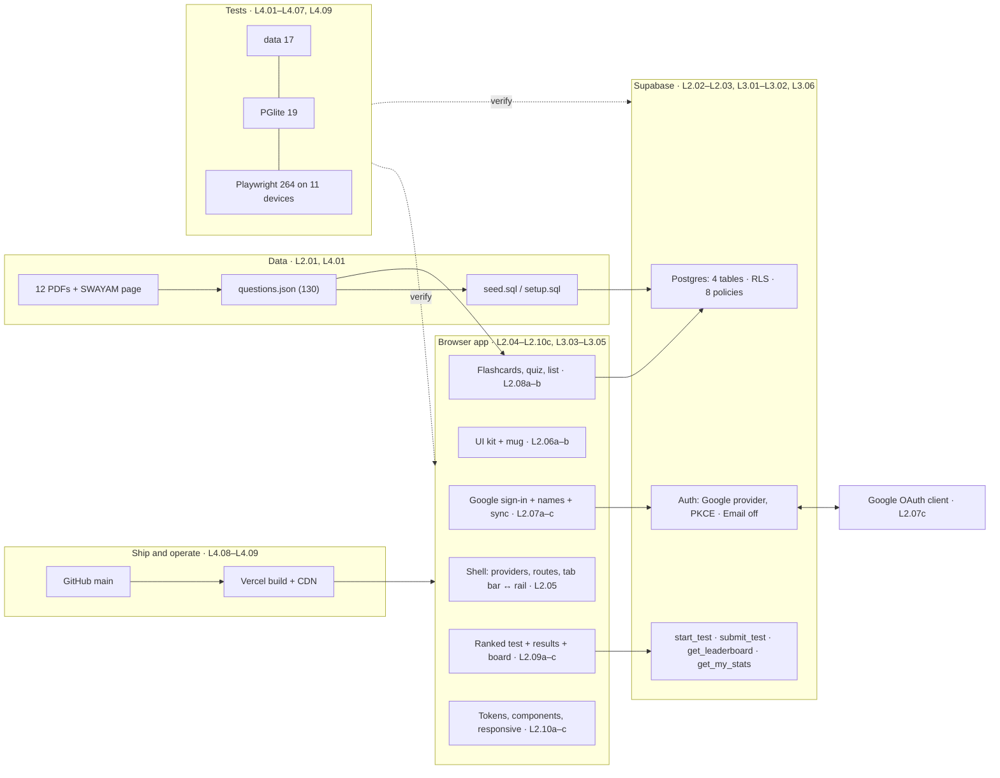

# Build "Psychology of Learning · Coffee aur Code" from scratch, and own every line

> A study series that turns two working sessions (building a flashcard, quiz and ranked-test app for the NPTEL *Psychology of Learning* exam on React, Supabase and Vercel, then fixing its sign-up and moving it to Google sign-in) into lessons you can rebuild from memory.

The app you'll learn is live at **https://psychology-of-learning-nptel.vercel.app**: 130 assignment questions as swipeable flashcards, a quiz, a searchable list, a timed 100-question ranked test graded on the server, and a leaderboard, on every screen from a folded Galaxy phone to a 1920 px monitor, with one-tap Google sign-in. These pages walk through every file of it, why each line is there, the 40-odd real bugs that happened while building and running it, and the tests that now keep them fixed.

> **New in session 2 (2026-10-16):** sign-up returned an HTTP 504, which led to Google-only sign-in. Three lessons cover it: **[L2.07c](l2-07c-google-sign-in.md)** (build it), **[L3.06](l3-06-oauth-pkce-504.md)** (OAuth, PKCE and the 504 under the hood) and **[L4.09](l4-09-auth-tests-incident-ops.md)** (testing it, and running the incident). The email-code sign-in in L2.07a is now history; its `AuthProvider` is still current.

**[▶ Start Level 1](l1-01-what-we-built.md)** · **[See the study plan](plan.md)** · **[The mastery checkpoint](mastery.md)**

| 38 lessons | 4 levels | 52 h 55 min new material | 78 h 15 min with spaced reviews | 62 study days at 90 min/day | 366 flashcards |
|---|---|---|---|---|---|

---

## The levels

| Level | You'll be able to… | Lessons | New material | Exit check |
|---|---|---|---|---|
| **[1 · Foundations](l1-01-what-we-built.md)** | Explain the whole app, draw its map, and run the first working slice: every prerequisite (web platform, TypeScript and React, SQL and auth, hosting) taught | 5 | 6 h 50 min | Draw the map and name every part ([L1.05](l1-05-setup-first-slice.md)) |
| **[2 · Build it](l2-01-data-pipeline.md)** | Write every file of the app from a blank editor: data pipeline, database, shell, UI kit, Google sign-in (and its dashboards), flashcards, ranked test, styling | 18 | 22 h 20 min | Write `submit_test` and the `SwipeCard` from memory ([L2.10c](l2-10c-responsive.md)) |
| **[3 · Under the hood](l3-01-security-model.md)** | Defend the design and predict the edges: the security model, ranking maths, gesture and spring physics, contrast maths, performance, OAuth and PKCE, gateway timeouts | 6 | 8 h 25 min | Explain a trade-off and an edge case with numbers ([L3.05](l3-05-performance.md) + [L3.06](l3-06-oauth-pkce-504.md) addendum) |
| **[4 · Test it and ship it](l4-01-testing-strategy-data.md)** | Write the 300-test suite (data, PGlite, Playwright on 11 devices, live security, accessibility), test a sign-in you can't automate, diagnose flakes, deploy from Git, operate and run an incident | 9 | 12 h 05 min | Write the test and release system ([L4.08](l4-08-deploy-operate.md) + [L4.09](l4-09-auth-tests-incident-ops.md) addendum) |
| **[Mastery](mastery.md)** | Rebuild it from memory | — | 3 h 15 min | Pass sittings A, B and C |

---

## How to study this

**The loop, for every lesson:**
1. **Warm-up** (2 min): answer the questions from earlier lessons *before* reading on. Wrong is fine; trying is the point.
2. **Read and predict**: wherever a trace or table says *predict*, stop and write your guess first.
3. **Run things**: every command in "Running and testing" works on the real repository.
4. **Check yourself, then practise** (easy → hard).
5. **From memory**: the cloze, then the blank-page drill with **no scrolling up**. Tick the self-check honestly.
6. **Flashcards**: answer aloud before opening each card.
7. **Reviews**: the plan brings each lesson back 1, 3, 7 and 14 study days later for 10 minutes (its flashcards and its blank-page drill).

**Reading conventions.** Mermaid diagrams render on GitHub, in VS Code (with a Markdown preview that supports Mermaid) and in Obsidian. Maths is LaTeX (`$…$`), rendered by GitHub. Answers, hints and long source listings are folded inside `▸` reveals: open them only when you've tried.

**Prerequisites: skip what you know, learn what you don't**

| Prerequisite | Self-check and teaching |
|---|---|
| HTML, CSS (cascade, custom properties, flex/grid, transforms), DOM events, storage, HTTP, SPA routing | [L1.02](l1-02-web-platform.md) |
| TypeScript types and generics; React components, hooks, effects, context | [L1.03](l1-03-typescript-react.md) |
| SQL tables, keys, constraints; row-level security; JWTs and sessions; env variables; Git and static hosting | [L1.04](l1-04-data-auth-hosting.md) |
| OAuth sign-in ("Sign in with Google"), redirects and the redirect chain | [L2.07c](l2-07c-google-sign-in.md) §3 (taught from zero there) |
| Node and npm, Vite, a terminal | [L1.05](l1-05-setup-first-slice.md) |

**Installs** (all free): Node 20+ (the project was built on Node 24), Git, Chrome or Edge, VS Code; later `npx playwright install` for the test browsers and Poppler or Xpdf for `pdftotext`. A Supabase account and a Vercel account are needed only to deploy your own copy; every test except the live ones runs without them.

---

## The whole system on one page

*Every box names the lessons that teach it. Start anywhere on the map, but study in the order below: each lesson builds on the ones before it.*

---

## Syllabus

Tick each lesson when you've done its blank-page drill (☐ → ☑ in your own copy, or track it in [plan.md](plan.md)).

### Level 1 · Foundations (6 h 50 min including setup and two readings)

| | Lesson | What it gives you | Tags | Min |
|---|---|---|---|---|
| ☐ | [L1.01 What we built, the map, and the build log](l1-01-what-we-built.md) | The finished app, its architecture, the build in the order it happened, and a preview of every bug | architecture · SPA · Supabase · build log | 45 |
| ☐ | [L1.02 Prerequisites I: the web platform](l1-02-web-platform.md) | HTML, the cascade, layout, events, storage, HTTP and client-side routing, as this app uses them | CSS · DOM events · HTTP · History API | 70 |
| ☐ | [L1.03 Prerequisites II: TypeScript and React](l1-03-typescript-react.md) | Enough TypeScript and React (hooks, effects, context, StrictMode) to read every line | TypeScript · hooks · effects · context | 75 |
| ☐ | [L1.04 Prerequisites III: SQL, auth, keys and hosting](l1-04-data-auth-hosting.md) | Tables and constraints, RLS, definer functions, JWT and email codes, env variables, Git and static hosting | SQL · RLS · JWT · OTP · env | 70 |
| ☐ | [L1.05 Setup and the first working slice](l1-05-setup-first-slice.md) | Install, clone and run the app, then build a from-scratch Vite + React + TS slice that shows the 130 questions as flip cards; **Level 1 checkpoint** | Node · Vite · tsconfig · checkpoint | 75 |

### Level 2 · Build it (22 h 20 min including three readings)

| | Lesson | What it gives you | Tags | Min |
|---|---|---|---|---|
| ☐ | [L2.01 From PDFs to 130 questions](l2-01-data-pipeline.md) | `pdftotext`, the answer parser, week 12 from images, ids, and the seed generator | pdftotext · data model · SQL escaping | 60 |
| ☐ | [L2.02 The database I: tables and RLS](l2-02-tables-and-rls.md) | The four tables, constraints, indexes and the eight policies | DDL · constraints · RLS · indexes | 70 |
| ☐ | [L2.03 The database II: server-side grading](l2-03-server-grading.md) | The four functions: start, submit (graded on the server), leaderboard, stats | PL/pgSQL · security definer · rank() | 75 |
| ☐ | [L2.04 Entry point, config and the small libraries](l2-04-entry-config-libs.md) | `index.html`, Vite and TS config, `main.tsx`, storage, theme, Supabase client, formatting, shuffle | Vite · SEO head · Fisher–Yates | 70 |
| ☐ | [L2.05 The app shell](l2-05-app-shell.md) | Providers, routes, page transitions, the tab bar, the splash and the error boundary | React Router · AnimatePresence · layoutId | 75 |
| ☐ | [L2.06a The UI kit](l2-06a-ui-kit.md) | Sheets, switches, segmented control, progress rings, count-up and confetti | drag · springs · SVG rings · rAF | 75 |
| ☐ | [L2.06b The mug, icons and Home](l2-06b-mug-icons-home.md) | The animated SVG mug, the icon set, and the Home page | SVG · keyframes · stats | 70 |
| ☐ | [L2.07a Auth state and email-code sign-in](l2-07a-auth-sign-in.md) | The auth provider (still current), the email-code flow (replaced in session 2), and the 8-digit sign-in bug | OTP · auth state · validation | 70 |
| ☐ | [L2.07c Google sign-in, line by line](l2-07c-google-sign-in.md) | Why email went away (a 504), the Google Cloud and Supabase settings, the six-hop redirect chain, and the Google-only `SignIn` | OAuth · redirects · PKCE · dashboards | 80 |
| ☐ | [L2.07b Names, account and progress sync](l2-07b-account-progress.md) | Leaderboard names, the account page, local-first sync, and the sign-out crash | upsert · merge · newest wins | 75 |
| ☐ | [L2.08a Flashcards I: the deck and the flip](l2-08a-flashcard-deck.md) | The swipe card, thresholds, the Safari-safe flip, undo and shortcuts | useMotionValue · drag · 3D | 75 |
| ☐ | [L2.08b Flashcards II: quiz and list](l2-08b-quiz-and-list.md) | The Study page, deck finished, quiz mode and the searchable list | state machines · search · highlight | 70 |
| ☐ | [L2.09a The ranked test I: intro and start](l2-09a-test-intro.md) | Attempt storage, two clocks, nested routes and starting a test | localStorage · routes · RPC | 60 |
| ☐ | [L2.09b The ranked test II: the runner](l2-09b-test-runner.md) | Auto-advance, flags, grid, resume, submit sheet and leaving | runner state · beforeunload | 75 |
| ☐ | [L2.09c The ranked test III: results and leaderboard](l2-09c-results-leaderboard.md) | The results moment, mistakes review, the podium and the pinned row | ring maths · ties · visibilitychange | 75 |
| ☐ | [L2.10a Styling I: tokens, themes and the shell](l2-10a-tokens-base-shell.md) | Design tokens for two themes, the reset, the top bar and the floating tab bar | custom properties · color-mix · clip | 70 |
| ☐ | [L2.10b Styling II: every component](l2-10b-component-styles.md) | Ten layout patterns and every component's CSS (full listings folded) | grid · stacking · touch-action | 75 |
| ☐ | [L2.10c Styling III: the responsive layer](l2-10c-responsive.md) | Breakpoints by situation, measured deck heights, the side rail; **Level 2 checkpoint** | media queries · dvh · @supports · checkpoint | 75 |

### Level 3 · Under the hood (8 h 25 min including four readings)

| | Lesson | What it gives you | Tags | Min |
|---|---|---|---|---|
| ☐ | [L3.01 The security model](l3-01-security-model.md) | A request from browser to row, ten attacks predicted, three Postgres foot-guns, and the one real weakness | RLS internals · grants · JWT · threat model | 70 |
| ☐ | [L3.02 Ranking maths and SQL internals](l3-02-ranking-sql.md) | `distinct on` and `rank()` frame by frame, sampling probabilities, query cost and locks | window functions · probability · EXPLAIN | 65 |
| ☐ | [L3.03 Gestures, springs, 3D and scrolling](l3-03-gestures-3d.md) | Motion's pan session, damping maths for every spring, perspective projection, scroll containers | pointer events · ζ · perspective | 75 |
| ☐ | [L3.04 Viewports, contrast and accessibility](l3-04-viewports-contrast.md) | The viewport units, the WCAG contrast formula on real colours, and the 11 contrast fixes | dvh · luminance · compositing · axe | 70 |
| ☐ | [L3.05 Performance and Lighthouse](l3-05-performance.md) | The critical path, the metrics, measured before/after and production; **Level 3 checkpoint** | LCP · CLS · caching · fonts · checkpoint | 70 |
| ☐ | [L3.06 OAuth, PKCE, and why sign-up timed out](l3-06-oauth-pkce-504.md) | 5xx codes by hop, SMTP ports and dead connections, the nested OAuth flows, PKCE derived with real numbers, the Public Suffix List; checkpoint addendum | 504 · SMTP · PKCE · SHA-256 · PSL | 75 |

### Level 4 · Test it and ship it (12 h 05 min including three readings)

| | Lesson | What it gives you | Tags | Min |
|---|---|---|---|---|
| ☐ | [L4.01 Testing strategy and data tests](l4-01-testing-strategy-data.md) | The test pyramid, every answer checked against the PDFs, and a mutation check | node:test · regex · mutation | 70 |
| ☐ | [L4.02 Database tests in PGlite](l4-02-database-tests.md) | Postgres in WebAssembly with simulated Supabase roles, and SQL mutation checks | PGlite · set role · RLS matrix | 75 |
| ☐ | [L4.03 Playwright foundations](l4-03-playwright-foundations.md) | Config, 12 projects, helpers, teardown and the HTTP checks | Playwright · webServer · secrets scan | 75 |
| ☐ | [L4.04 UI tests: navigation, layout, flashcards](l4-04-ui-tests-nav-cards.md) | Locators, waiting for states, realistic swipes | locators · expect.poll · CDP touch | 75 |
| ☐ | [L4.05 UI tests: quiz, list, runner, results](l4-05-ui-tests-quiz-runner.md) | Identifying random content, state injection, and a two-layer race | state injection · transitions | 70 |
| ☐ | [L4.06 Live security and the signed-in journey](l4-06-live-security-auth.md) | Attacking the live API and a real sign-in to leaderboard journey, with no emails sent (its sign-in step is updated in L4.09) | admin API · route mocking · cleanup | 75 |
| ☐ | [L4.07 Accessibility, Lighthouse, flaky tests](l4-07-a11y-lighthouse-flaky.md) | axe as a gate, Lighthouse done right, and a method for every flake | axe · Lighthouse · forensics | 65 |
| ☐ | [L4.08 Ship it: deploy from Git and operate](l4-08-deploy-operate.md) | `vercel.json`, secrets hygiene, SEO, Supabase settings, operating it; **Level 4 checkpoint** | Vercel · SEO · Supabase · checkpoint | 75 |
| ☐ | [L4.09 A sign-in you can't automate, and a live incident](l4-09-auth-tests-incident-ops.md) | The Google hand-off test, session injection, the five-probe incident kit, bundle fingerprints, safe debugging; checkpoint addendum | boundary tests · route · runbook | 75 |

### Mastery

| | | | | Min |
|---|---|---|---|---|
| ☐ | [Mastery checkpoint: rebuild from memory](mastery.md) | Three sittings, eleven drills, five explain-backs, 21 diagnoses, 366 cards | | 195 |

---

## Study plan at a glance

Default pace: **90 minutes a day, 5 days a week** ([plan.md](plan.md) has the day-by-day schedule and other paces).

| Level | Lessons | New material (incl. setup, reading, checkpoints) | Spaced reviews | Total | Exit criterion |
|---|---|---|---|---|---|
| 1 · Foundations | 5 | 6 h 50 min | 20 × 10 min = 3 h 20 min | 10 h 10 min | Map drawn from memory; first slice running |
| 2 · Build it | 18 | 22 h 20 min | 72 × 10 min = 12 h 00 min | 34 h 20 min | `submit_test` and `SwipeCard` from a blank file |
| 3 · Under the hood | 6 | 8 h 25 min | 24 × 10 min = 4 h 00 min | 12 h 25 min | A trade-off and an edge case explained with numbers |
| 4 · Test it and ship it | 9 | 12 h 05 min | 36 × 10 min = 6 h 00 min | 18 h 05 min | Test and release system, and the auth runbook, from memory |
| Mastery | — | 3 h 15 min | — | 3 h 15 min | Sittings A, B, C passed; retake after 7 days |
| **Total** | **38** | **52 h 55 min** | **152 reviews = 25 h 20 min** | **78 h 15 min** | **62 study days**, starting 2026-10-19 → 2027-01-12 |

---

## Outside reading, in order

Read each one at the point the plan schedules it; together they're the best short path through the official sources behind this series.

| When | Resource | Why | Time |
|---|---|---|---|
| After L1.03 | [react.dev: Synchronizing with Effects](https://react.dev/learn/synchronizing-with-effects) | The effect model behind the first bug of the build | 25 min |
| After L1.04 | [Supabase: Row Level Security](https://supabase.com/docs/guides/database/postgres/row-level-security) | How Supabase roles, `auth.uid()` and policies fit together | 20 min |
| After L2.03 | [PostgreSQL: Window functions tutorial](https://www.postgresql.org/docs/current/tutorial-window.html) | The idea behind `rank() over` | 15 min |
| After L2.05 | [Motion: AnimatePresence](https://motion.dev/docs/react-animate-presence) | Exit animations, `mode` and `custom` | 15 min |
| After L2.07c | [Supabase: Login with Google](https://supabase.com/docs/guides/auth/social-login/auth-google) | The official version of the dashboard steps, with screenshots | 15 min |
| After L3.01 | [PostgreSQL: CREATE FUNCTION](https://www.postgresql.org/docs/current/sql-createfunction.html) | "Writing SECURITY DEFINER Functions Safely" | 10 min |
| After L3.03 | [Josh W. Comeau: A friendly introduction to spring physics](https://www.joshwcomeau.com/animation/a-friendly-introduction-to-spring-physics/) | Interactive intuition for stiffness and damping | 25 min |
| After L3.05 | [web.dev: Largest Contentful Paint](https://web.dev/articles/lcp) | What counts as LCP and how to improve it | 20 min |
| After L3.06 | [RFC 7636: PKCE](https://datatracker.ietf.org/doc/html/rfc7636) | The attack (§1) and the algorithm (§4), from the source | 25 min |
| After L4.01 | [Martin Fowler: The practical test pyramid](https://martinfowler.com/articles/practical-test-pyramid.html) | The reasoning behind test layers | 30 min |
| After L4.04 | [Playwright: Locators](https://playwright.dev/docs/locators) | Choosing and chaining locators | 20 min |
| After L4.08 | [Vercel: Project configuration](https://vercel.com/docs/project-configuration) | Redirects, rewrites and headers | 20 min |

---

## Files in this folder

- `README.md` (this hub) · [`plan.md`](plan.md) (the schedule) · [`mastery.md`](mastery.md) (the final checkpoint) · `_outline.md` (the curriculum's source of truth: mastery spec, knowledge inventory, level plan, visual plan, design brief)
- `l<level>-<nn>-<slug>.md`: the 38 lessons, each with the same sections: warm-up, the problem, concepts, the real code, traces, running and testing, bug journal, design decisions, quizzes, practice, from-memory drills, flashcards, a one-screen summary ("the menu board"), glossary, and further reading.

*Generated 2026-10-16 from build session `bd01eb89` and the repository at commit `94c4a3b`; extended 2026-10-17 with session 2 (the 504 and Google sign-in) at commit `e34add1`. Every number in these pages was measured or recomputed while writing them; where something couldn't be verified, the lesson says so.*
