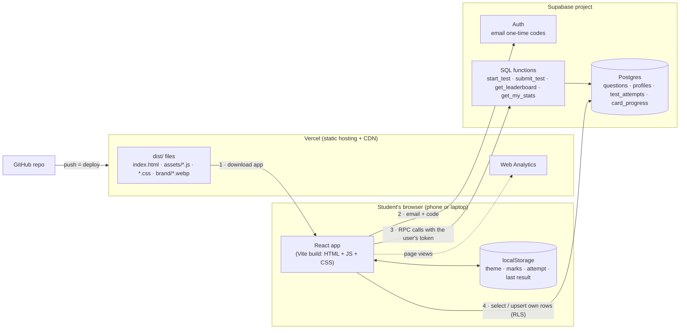
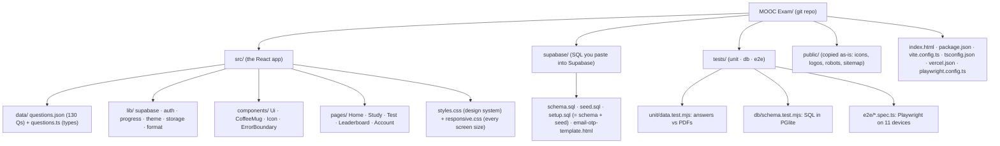

# L1.01 · What we built, the map, and the build log

> **Level 1 · Foundations** · Lesson 1 of 5

| Recipe card | |
|---|---|
| **Time** | 45 min |
| **You need** | Nothing yet. A browser to open the live site. |
| **You'll produce** | A hand-drawn map of the whole system and a one-paragraph explanation of how a test score gets onto the leaderboard |

**In two sentences:** We turned 13 weeks of NPTEL assignment PDFs into a phone-first web app where students study flashcards, take a timed 100-question test and appear on a live leaderboard. This lesson shows the finished thing, draws the map of its parts and lists every step we took, so the rest of the series has a skeleton to hang on.

### Objectives (you can do these without notes at the end)
1. Name the five screens of the app and what each one is for.
2. Draw the architecture: browser app, Vercel, Supabase Auth, Supabase Postgres, and which talks to which.
3. Explain, in order, what happens from "Start test" to your name appearing on the leaderboard.
4. Explain why the *server* grades the test and not the browser.
5. List the major build phases in order and say which lesson teaches each.

---

## 1 · The finished result first

Open **https://psychology-of-learning-nptel.vercel.app** on your phone, then on a laptop. Spend five minutes clicking everything. Here is what you are looking at.

| Screen | Route | What it does |
|---|---|---|
| **Home** | `/` | Greeting, your stats (cards mastered, best score, rank), shortcuts, and 13 week tiles with progress bars |
| **Study** | `/study` | Three modes: **Cards** (swipe right = "got it", left = "again", tap to flip), **Quiz** (instant right/wrong), **List** (search every question) |
| **Test** | `/test` | Intro → **runner** (`/test/run`, 100 random questions, timer, flags, grid) → **results** (`/test/result`) |
| **Ranks** | `/ranks` | Leaderboard: podium for the top 3, then everyone else. Best attempt per player, ranked by score, then by time |
| **Me** | `/me` | Sign in with an emailed code, choose a leaderboard name, theme, reset progress, sign out |

On a phone the five screens sit in a **bottom tab bar**. On a laptop (1024 px and wider) the same links move into a **side rail**. That is one of many responsive decisions you will learn in [L2.10c](l2-10c-responsive.md).

> **Try it now (2 min).** On the Study page, swipe a card right. Go to Home: "Cards mastered" went from 0 to 1. Reload the page. It is still 1. *Where* was that remembered? Hold your guess; [L2.07b](l2-07b-account-progress.md) answers it (browser storage first, then the cloud if you are signed in).

## 2 · The problem this solves

The course only gives you PDFs: twelve assignment files plus a SWAYAM web page for week 12. The exam asks *only* questions from these assignments. So the naive study method is to open twelve PDFs and reread them. That has three problems:

1. **Rereading is the weakest way to remember.** Recalling an answer before you see it builds memory far better. This is called *retrieval practice*, and flashcards and quizzes are built on it.
2. **Nothing tracks what you already know**, so you waste time on cards you have mastered.
3. **There is no exam rehearsal.** A timed, mixed, 100-question run is the closest thing to the real exam, and a leaderboard adds motivation.

The app fixes all three. Building it needed a front end (the screens), a back end (accounts, scores, leaderboard), a deployment, and a test suite to prove it all works on every phone.

## 3 · The map: every part and who talks to whom



*Takeaway: the browser only ever holds the **public** key. Everything that must be trusted (grading, timing, ranking) happens in SQL functions inside Supabase.*

Read the arrows in order:
1. The browser downloads the built app from **Vercel**, a static host. A *CDN* (content delivery network) keeps copies near the user, so files arrive fast.
2. To sign in, the app sends your email to **Supabase Auth**. Auth emails you an 8-digit code, and you type it back. Auth then gives the browser a **session**: a signed token that says "this is user 3f9c…".
3. To start or submit a test, the app calls **SQL functions** (an *RPC*, remote procedure call, means "run this function on the server") and sends that token along.
4. For simple reads and writes of *your own* rows (your profile, your flashcard marks), the app talks to the tables directly. **Row-level security** (RLS) rules inside Postgres decide which rows each user may touch.

GitHub sits on the left because deploying is a `git push`. Vercel watches the repo and rebuilds on every push ([L4.08](l4-08-deploy-operate.md)).

## 4 · One test attempt, end to end

This trace is the spine of the project. Every later lesson zooms into one arrow of it.

```mermaid
sequenceDiagram
  autonumber
  actor S as Student
  participant A as React app (browser)
  participant L as localStorage
  participant F as start_test / submit_test (Postgres functions)
  participant T as test_attempts table
  S->>A: taps "Start test"
  A->>F: rpc("start_test") + user token
  F->>F: auth.uid() → who is calling? has a profile?
  F->>T: delete my unsubmitted attempts; insert new row (100 random ids, started_at = now())
  F-->>A: { attempt_id, question_ids[100], started_at }
  A->>L: save attempt (answers all null, pos 0)
  loop 100 questions
    S->>A: taps an option
    A->>L: save answer, auto-advance after 320 ms
  end
  S->>A: "Submit at 12:39"
  A->>F: rpc("submit_test", attempt_id, answers[100] with -1 = skipped)
  F->>T: lock row (for update), check owner, not submitted, < 3 h, 100 answers
  F->>F: score = count(answers[i] = questions.answer); duration = now() - started_at
  F->>T: save submitted_at, answers, score, duration
  F-->>A: { score, total, duration_ms, correct[], rank, players }
  A->>L: save result, clear attempt
  A-->>S: results page: ring animates to the score
```

*Takeaway: the browser never decides the score or the time. It only sends choices. The server stamps the start time, owns the answer key and does the grading.*

Why grade on the server? Anything that runs in the browser can be changed by the person holding the phone. If the browser computed `score = 100` and sent it, anyone could open DevTools and send 100. In our design:
- The `questions` table (which holds the answer key) **cannot be read** by the browser at all. RLS is on, with no read policy.
- `test_attempts` **cannot be written** by the browser either. There are no insert or update policies, so the only way in is through `start_test` and `submit_test`, which run as the database owner (`security definer`).
- The **time** is `now()` at start minus `now()` at submit, both on the server's clock, so changing the phone's clock does nothing.

You will write all of this in [L2.02](l2-02-tables-and-rls.md) and [L2.03](l2-03-server-grading.md), and attack it in [L3.01](l3-01-security-model.md).

> **But wait:** the flashcards *show* the answers. Doesn't that leak the key? Yes, on purpose. Studying the answers is the whole point. What the design prevents is **forging a score**, not knowing answers. A student who memorises all 130 answers *deserves* 100/100. The threat is a fake "100 in 3 seconds" row, and that cannot be inserted.

## 5 · The code, by folder



Sizes, to set expectations. The final app is about **2,600 lines of TypeScript/TSX**, **2,400 lines of CSS**, **240 lines of SQL** and **1,100 lines of tests**. Level 2 walks through every line of it.

## 6 · The build log, in the order it happened

A session is chronological; this series is conceptual. Here is the chronological path, so you can replay it.

| # | What we did | Why at that moment | Taught in |
|---|---|---|---|
| 1 | Extracted 12 PDFs to text with `pdftotext -layout`; hand-checked the 120 questions and answers | The data is everything; nothing else matters if it is wrong | [L2.01](l2-01-data-pipeline.md) |
| 2 | Built a first **single-file HTML** flashcard page (vanilla JS: cards, quiz, list) | Useful immediately, before any infrastructure | [L2.01](l2-01-data-pipeline.md) §history |
| 3 | Added week 12 from a saved SWAYAM page: questions were **images**, answers came from "Accepted answer is X" | No PDF existed for week 12 | [L2.01](l2-01-data-pipeline.md) |
| 4 | Connected the folder to GitHub (`git init`, `git remote add`), with no commits by the assistant | Version control before the real build | [L1.04](l1-04-data-auth-hosting.md) |
| 5 | Looked for design inspiration; processed the Coffee aur Code logos (removed white backgrounds, kept the largest shape); redrew the mug in **SVG** so its steam could animate | A brand to design around | [L2.06b](l2-06b-mug-icons-home.md) |
| 6 | Decided: Vite + React + TypeScript; email one-time codes; tests of 100 random from 130 | The user chose from three options each | [L1.05](l1-05-setup-first-slice.md) |
| 7 | Read the Supabase keys; derived the project URL from the anon JWT's `ref`; git-ignored the keys; wrote `.env.local` | Never commit secrets | [L1.04](l1-04-data-auth-hosting.md), [L4.08](l4-08-deploy-operate.md) |
| 8 | Wrote `schema.sql` with server-side grading; verified it in **PGlite** before the user ran it | Correctness before UI | [L2.02](l2-02-tables-and-rls.md), [L2.03](l2-03-server-grading.md), [L4.02](l4-02-database-tests.md) |
| 9 | Built the app: shell, UI kit, flashcards, quiz, list, test runner, results, leaderboard, account | The product | L2.04 → L2.09c |
| 10 | First browser run: blank page (**`useEffect` returned a Promise**), then a flood of first-run bugs | Real browsers find real bugs | [L2.05](l2-05-app-shell.md) bug journal |
| 11 | First deploy with the Vercel CLI; chose the memorable, searchable domain `psychology-of-learning-nptel` | Ship early | [L4.08](l4-08-deploy-operate.md) |
| 12 | Responsive pass: side rail on laptops, 11 device sizes, old-Safari fallbacks; SEO files | "Every screen size, even iPhones and all Androids" | [L2.10c](l2-10c-responsive.md), [L4.08](l4-08-deploy-operate.md) |
| 13 | Switched deploys to **Git** (`vercel git connect`, deploy from `main` via the API, set framework = Vite) | Easy to maintain: push = deploy | [L4.08](l4-08-deploy-operate.md) |
| 14 | Thorough testing: data, DB, live security, Playwright on 11 devices, axe, Lighthouse. It found **9 real bugs**, including "nobody can sign in" (8-digit codes) | Untested code is unknown code | Level 4 |
| 15 | Added Vercel Web Analytics and a "what we store" privacy note | User request | [L4.08](l4-08-deploy-operate.md) |

## 7 · Every bug in this series (preview)

Bugs are the best teachers, so each gets a full incident ticket in the lesson where it lived. Here are the titles, so you can feel the shape of what is coming.

| App bugs | Lesson |
|---|---|
| Blank page: `destroy is not a function` (an effect returned `window.scrollTo`'s Promise) | L2.05 |
| Splash never disappears in a background tab | L2.05 |
| Logo cut-outs included pieces of neighbouring stickers | L2.06b |
| **Nobody could sign in**: 8-digit codes cut to 6 | L2.07a |
| The browser's own email check hid the app's message | L2.07a |
| Signing out crashed the whole app to a blank page | L2.07b |
| A swipe triggered "go back" in the browser | L2.08a |
| Touch swipes were swallowed by the scrollable options area | L2.08a |
| **iPhones showed the answer before the flip** (mirrored) | L2.08a |
| Backspace (undo) navigated away in Safari | L2.08a |
| Quiz shuffled twice when opened; the first question swapped under your finger | L2.08b |
| iPhones could scroll the page sideways during slide animations | L2.10a |
| Card buttons hidden under the tab bar on short phones | L2.10c |
| Hero heading ran under the mug on small laptops | L2.10c |
| 11 contrast failures (axe) | L3.04 |
| Vercel built from Git with no framework set | L4.08 |
| `vercel link` silently git-ignored `.env.example` | L4.08 |

| Test bugs (bugs in the tests themselves) | Lesson |
|---|---|
| `pdftotext -v` exits non-zero, so all PDF checks were skipped | L4.01 |
| Git Bash rewrote `/study` into `C:/Program Files/Git/study` | L4.03 |
| The secret scanner flagged the Supabase library's own source | L4.03 |
| HTTP tests silently hit production instead of the local build | L4.03 |
| A swipe fired in one millisecond failed in WebKit | L4.04 |
| The sideways-scroll check measured a proxy, once, at the wrong moment | L4.04 |
| The quiz test read the card that was sliding *out* | L4.05 |
| One worker's cleanup deleted another worker's user mid-test | L4.06 |
| An extra "Next" click skipped a question on slow WebKit | L4.06 |
| Vite's reload loop plus background-tab throttling looked like a frozen app | L4.07 |

## 8 · Vocabulary you will meet in every lesson

| Term | Plain meaning | Analogy |
|---|---|---|
| **Front end** | The code that runs in the user's browser | The café's counter and menu |
| **Back end** | Code and data on servers you control | The kitchen |
| **SPA** (single-page app) | One HTML page; JavaScript swaps the screens without reloading | Changing the menu board without rebuilding the café |
| **Build** | Turning source (TSX, modern CSS) into plain files a browser runs (`dist/`) | Prepping ingredients into dishes |
| **Static host / CDN** | Serves files as-is from servers close to users | Pre-made sandwiches in fridges in every neighbourhood |
| **Postgres** | The database Supabase gives you | The pantry with labelled shelves |
| **RLS** | Rules inside the database deciding which *rows* each user can see or change | A pantry where each shelf only opens for its owner's key |
| **RPC** | Calling a function that lives on the server | Ordering a dish; the kitchen cooks it, you don't |
| **Session / token** | Proof of who you are, sent with every request | A wristband at an event |
| **OTP** | One-time password: the code emailed to you | A cloakroom ticket that works once |
| **Publishable (anon) key** | Public identifier for your Supabase project; safe in the browser | The café's street address |
| **Secret / service-role key** | Bypasses all rules; must never reach a browser | The master key to every room |
| **E2E test** | Drives a real browser like a user would | A mystery shopper |

## 9 · Check yourself

**Q1.** A student opens DevTools and calls `supabase.from("test_attempts").insert({ score: 100, … })`. What happens?
- A) The row is inserted, because they are signed in
- B) The insert fails: there is no insert policy on `test_attempts`, so RLS blocks it
- C) It works, but only for their own `user_id`
- D) The database crashes

<details><summary>Answer</summary>

**B.** RLS is enabled and `test_attempts` has only a *select* policy (read your own rows). With RLS on, anything not explicitly allowed is denied. **A** confuses "authenticated" with "authorised": being signed in only means the database knows who you are, not that you may do anything. **C** would be true only if we had written an insert policy with `auth.uid() = user_id`, which we deliberately did not, so that grading stays server-side. **D**: denials are normal errors, not crashes.
</details>

**Q2.** Which value is computed on the **phone**?
- A) The test duration
- B) The score
- C) The timer shown at the top of the runner
- D) The rank

<details><summary>Answer</summary>

**C.** The on-screen timer is cosmetic: `Date.now() - client_started`. The *ranked* duration is `now() - started_at` on the server. **A** is the classic misconception: if the phone's time counted, changing the clock would cheat. Score (**B**) and rank (**D**) come back from `submit_test`.
</details>

**Q3.** You swipe a card right while **signed out**, then sign in on the same phone. What happens to that mark?
- A) It is lost
- B) It stays only on this phone forever
- C) It is merged into the cloud: newest timestamp wins per card
- D) The cloud overwrites it

<details><summary>Answer</summary>

**C.** On sign-in, `ProgressProvider` downloads your cloud marks, merges them with local ones by timestamp, and uploads anything local that is newer. **D** is a common naive sync design. It would silently destroy offline work. Details in [L2.07b](l2-07b-account-progress.md).
</details>

**Q4.** Why does deploying the app need *no* server code of our own?
- A) Vercel runs our React code on its servers
- B) The app is static files; dynamic work happens in Supabase (Auth + SQL functions)
- C) We use serverless functions
- D) It does need a server; we just didn't mention it

<details><summary>Answer</summary>

**B.** `vite build` outputs plain files. Supabase provides auth, the database and the functions. **A**: Vercel serves our files; it does not render React on the server in this project. **C**: we wrote no Vercel functions.
</details>

## 10 · Practice

**Easy (10 min).** Open the live site on a phone. Find all five screens, and on the Study page use all three modes. Write one sentence per screen describing its job.
*Done when:* you have five sentences without looking at this lesson.

**Medium (20 min).** Without scrolling up, redraw the architecture diagram on paper. Include the browser, localStorage, Vercel, Auth, Postgres tables, SQL functions, GitHub and the arrows labelled 1–4.
<details><summary>Hint</summary>Start with three boxes: browser, Vercel, Supabase. Then ask: who sends the app? Who checks identity? Who stores rows? Who decides the score?</details>
<details><summary>Self-check</summary>

- [ ] Browser holds only the publishable key
- [ ] Vercel → browser: files (once)
- [ ] Browser → Auth: email + code; gets a session
- [ ] Browser → functions: start/submit with the token
- [ ] Browser → tables: only own profile and own progress (RLS)
- [ ] GitHub → Vercel: push triggers a deploy
</details>

**Hard (40 min).** Write a one-page threat model in your own words: three ways a student might try to cheat the leaderboard, and which part of the design stops each one.
<details><summary>One good answer</summary>

1. *Insert a fake attempt* → no insert policy on `test_attempts`; only `start_test`/`submit_test` write it.
2. *Fake a fast time by changing the phone clock* → duration uses the server's `now()` at start and at submit.
3. *Read the answer key during the test* → the `questions` table has RLS with no read policy. (They could study the flashcards beforehand, and that's allowed: it's learning.)
4. *Submit someone else's attempt id* → `submit_test` matches `user_id = auth.uid()`, otherwise "Test attempt not found".
5. *Submit twice to try again* → `submitted_at is not null` → "already submitted".
</details>

## 11 · From memory

**Rung 1 · Cloze.** Fill the blanks (answers below).

> The browser downloads static files from ___①___. It signs in by sending an email to ___②___, which emails an ___③___-digit code. To start a test it calls the SQL function ___④___, which stamps `started_at = ___⑤___` on the server. Scores are computed in ___⑥___ by comparing each answer with `questions.___⑦___`. The browser cannot read the `questions` table because ___⑧___ is enabled with no read policy.

<details><summary>Answers</summary>① Vercel ② Supabase Auth ③ 8 (6–10 supported) ④ <code>start_test</code> ⑤ <code>now()</code> ⑥ <code>submit_test</code> ⑦ <code>answer</code> ⑧ row-level security (RLS)</details>

**Rung 2 · Blank page (15 min).** No scrolling up. On a blank page, write:
1. The five screens and their routes.
2. The architecture map.
3. The 10-step sequence of one test attempt.

<details><summary>Self-check list</summary>

- [ ] Routes: `/`, `/study`, `/test` (+ `/test/run`, `/test/result`), `/ranks`, `/me`
- [ ] Map has the four Supabase parts: Auth, tables, functions, and RLS between browser and tables
- [ ] Sequence: start_test checks profile → deletes unsubmitted → inserts 100 random ids → app saves the attempt locally → answers saved locally → submit_test locks the row and checks owner/submitted/expiry/count → grades → saves → returns score/rank → app shows results
- [ ] You said *why* grading is server-side
</details>

## 12 · Flashcards

<details><summary><b>Q:</b> Why does the server, not the browser, compute the score?</summary><b>A:</b> Anything in the browser can be changed by the user. The answer key and the grading live in Postgres, where the client cannot read the key or write attempts directly.</details>
<details><summary><b>Q:</b> Which two tables can a signed-in user write directly?</summary><b>A:</b> <code>profiles</code> (own row) and <code>card_progress</code> (own rows). <code>test_attempts</code> is written only by functions; <code>questions</code> by nobody from the browser.</details>
<details><summary><b>Q:</b> What makes the ranked time cheat-proof?</summary><b>A:</b> It is <code>now() − started_at</code>, both on the database server's clock.</details>
<details><summary><b>Q:</b> What does the publishable key let a stranger do?</summary><b>A:</b> Only what RLS and grants allow anonymous users: read the leaderboard function and attempt sign-in. Nothing private.</details>
<details><summary><b>Q:</b> How many questions are in the pool, and how many in a test?</summary><b>A:</b> 130 in the pool (weeks 0–12 × 10); each test draws 100 at random on the server.</details>
<details><summary><b>Q:</b> How does the app get deployed now?</summary><b>A:</b> <code>git push</code> to <code>main</code>; Vercel's Git integration builds with Vite and publishes.</details>
<details><summary><b>Q:</b> On a laptop, where does the tab bar go?</summary><b>A:</b> It becomes a fixed side rail (≥ 1024 px), restyled by <code>responsive.css</code>.</details>
<details><summary><b>Q:</b> What is the ranking rule?</summary><b>A:</b> Each player's best attempt; higher score first; ties broken by shorter duration.</details>

## 13 · The menu board (one-screen summary)

| | |
|---|---|
| **Live site** | `psychology-of-learning-nptel.vercel.app` (short: `psychologyoflearning.vercel.app`) |
| **Stack** | Vite + React 19 + TypeScript · Motion · React Router 7 · Supabase (Auth + Postgres) · Vercel |
| **Screens** | Home · Study (cards/quiz/list) · Test (intro/run/result) · Ranks · Me |
| **Trust boundary** | Browser = untrusted. Postgres functions + RLS = trusted. |
| **Tables** | `questions` (key, unreadable) · `profiles` · `test_attempts` (function-written) · `card_progress` |
| **Functions** | `start_test` · `submit_test` · `get_leaderboard` · `get_my_stats` |
| **Local storage keys** | `pol.theme` · `pol.marks` · `pol.attempt` · `pol.lastResult` · `pol.studyMode` · `pol.shuffle` · `pol.hideKnown` |
| **Deploy** | `git push` → Vercel builds `npm run build` → `dist/` |
| **Tests** | `npm test` (= unit + db + e2e) · `npm run test:prod` against the live site |

## 14 · Glossary

**Architecture**: the parts of a system and how they connect. **CDN**: servers worldwide that cache your files near users. **Front end / back end**: browser code / server-side code and data. **Leaderboard**: ranked list of each player's best attempt. **OTP**: one-time password sent by email. **Publishable key**: public project identifier, safe in client code. **RLS**: row-level security, per-row access rules in Postgres. **RPC**: remote procedure call, running a named server function. **Secret key**: unrestricted admin key, server-only. **Session**: proof of identity the browser sends with requests. **SPA**: single-page application. **Static hosting**: serving pre-built files without running code per request.

## 15 · Go further

| Resource | Type | Why this one | Which part | Time |
|---|---|---|---|---|
| [Supabase: Architecture](https://supabase.com/docs/guides/getting-started/architecture) | Docs | Shows what sits inside "Supabase" (Postgres, Auth, PostgREST) | Whole page | 10 min |
| [MDN: How the web works](https://developer.mozilla.org/en-US/docs/Learn_web_development/Getting_started/Web_standards/How_the_web_works) | Article | Plain-language model of browsers, servers and requests | Whole page | 10 min |
| [web.dev: Rendering on the web](https://web.dev/articles/rendering-on-the-web) | Article | Where an SPA sits among rendering strategies, and the trade-offs | "Terminology" and "Client-side rendering" | 15 min |

---
← (start) · [Hub](README.md) · [L1.02 The web platform →](l1-02-web-platform.md)
