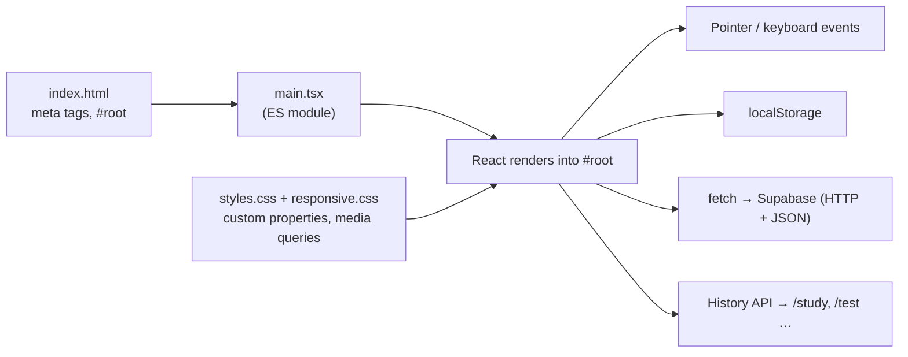
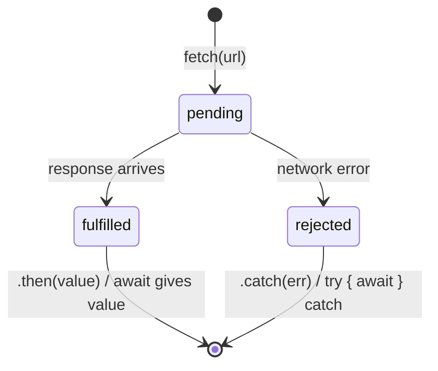
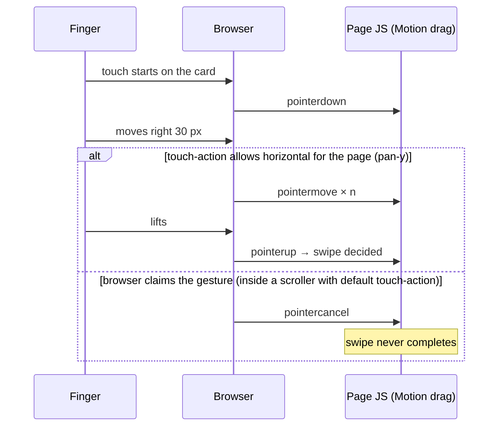
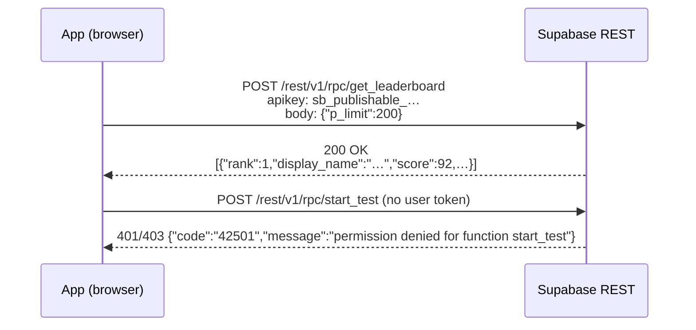
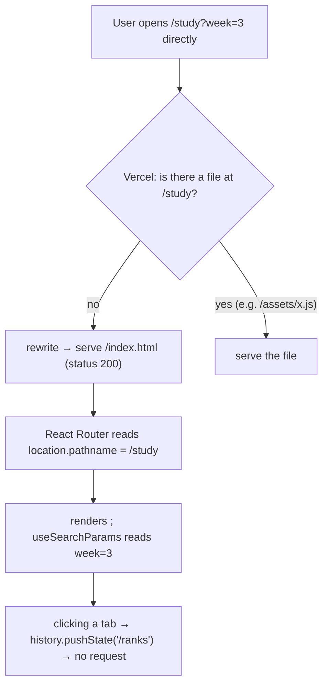

# L1.02 · Prerequisites I: the web platform an app stands on

> **Level 1 · Foundations** · Lesson 2 of 5

| Recipe card | |
|---|---|
| **Time** | 70 min (skip sections whose self-check you ace) |
| **You need** | A browser with DevTools (F12) |
| **You'll produce** | Small snippets typed into the DevTools console that prove each idea |

**In two sentences:** Every line of our app leans on a handful of browser features: HTML meta tags, CSS custom properties and media queries, promises and `fetch`, pointer events, `localStorage`, and the History API for routing. This lesson teaches exactly those, at the depth the later lessons need, and nothing else.

### Objectives
1. Explain what each `<meta>` tag in our `index.html` does, especially `viewport` with `viewport-fit=cover`.
2. Explain how CSS custom properties plus `prefers-color-scheme` produce light and dark themes from one stylesheet.
3. Write `async`/`await` code with `fetch`, and say what a Promise is and why returning one from the wrong place breaks things.
4. Describe the pointer event sequence of a swipe, and what `touch-action: pan-y` changes.
5. Explain how an SPA shows `/study` without the server having a `study.html` file.

---

## 1 · Warm-up: pull it from memory (from L1.01)

1. Which values does the browser keep in `localStorage`, by key prefix?
2. Who computes the ranked duration of a test, and how?

<details><summary>Answers</summary>1. Keys starting <code>pol.</code>: theme, marks, attempt, lastResult, studyMode, shuffle, hideKnown. 2. <code>submit_test</code> in Postgres: <code>now() − started_at</code>.</details>

## 2 · The problem this solves

Frameworks hide the platform until something breaks. Then you need the platform. Three of this project's worst bugs were pure web-platform behaviour:
- **Chrome made `window.scrollTo()` return a Promise.** That blanked the app ([L2.05](l2-05-app-shell.md)).
- **A sideways swipe triggered the browser's "go back"** ([L2.08a](l2-08a-flashcard-deck.md)).
- **A scrollable box ate touch gestures** ([L2.08a](l2-08a-flashcard-deck.md)).

You can only diagnose those if you know what the browser does underneath React.



*Takeaway: React sits on top of six browser features. This lesson covers each of the six boxes it points to.*

---

## 3 · HTML: the document and its meta tags

**Self-check (skip §3 if all correct):**
1. What breaks on phones if you remove `<meta name="viewport">`?
2. What does `type="module"` on a script change?
3. What is `<div id="root">` for in a React app?

<details><summary>Answers</summary>1. Phones pretend to be about 980 px wide and zoom out; text becomes tiny. 2. The script can use <code>import</code>/<code>export</code>, runs deferred (after parsing), and in strict mode. 3. It is the empty container React renders the whole app into.</details>

### 3.1 What an HTML page is

**Definition.** An HTML file is a tree of elements. The `<head>` describes the page (title, metadata, styles). The `<body>` holds what you see.

**Why here.** Our app is an SPA, so `index.html` is nearly empty. It holds metadata for phones, search engines and link previews, plus one `<div id="root">` and one script. React fills the rest.

The real file (trimmed to the parts this lesson explains; the full file is walked in [L2.04](l2-04-entry-config-libs.md)):

```html
<!doctype html>
<html lang="en">
  <head>
    <meta charset="UTF-8" />
    <meta name="viewport" content="width=device-width, initial-scale=1, viewport-fit=cover" />
    <title>Psychology of Learning NPTEL · Flashcards, Quiz &amp; Practice Test</title>
    <meta name="theme-color" content="#0e0c0b" />
    <link rel="manifest" href="/manifest.webmanifest" />
  </head>
  <body>
    <div id="root"></div>
    <script type="module" src="/src/main.tsx"></script>
  </body>
</html>
```

Line notes:
- **`<!doctype html>`**: tells the browser to use modern *standards mode*. Without it, browsers fall back to "quirks mode" with old, inconsistent layout rules.
- **`charset="UTF-8"`**: how bytes become characters. Without it, `·`, `–` and `☕` can turn into garbage like `·`.
- **`viewport` → `width=device-width`**: make the layout width equal the phone's width in CSS pixels (an iPhone 13 is 390). **`initial-scale=1`**: no zoom on load. **`viewport-fit=cover`**: let the page draw under the notch and the home indicator. That is why our CSS later adds `env(safe-area-inset-*)` padding: having asked to cover the whole screen, we must keep content out of the notch ourselves.
- **`theme-color`**: the colour mobile browsers paint the address bar. We change it from JavaScript when the theme changes ([L2.04](l2-04-entry-config-libs.md)).
- **`manifest`**: a JSON file that makes the site installable ("Add to Home Screen") with a name and icons.
- **`<div id="root">`**: React's mount point.
- **`type="module"`**: lets `main.tsx` use `import`. In development Vite serves that file translated to plain JS. In a build Vite rewrites this tag to point at the bundled `assets/index-xxxx.js`.

> **Try it (2 min).** Open the live site, then DevTools → Elements. Expand `<div id="root">`: everything inside was created by JavaScript. Now View Source (Ctrl+U). In the raw HTML, `#root` contains only a fallback block for search engines ([L4.08](l4-08-deploy-operate.md)).

---

## 4 · CSS you must know for this app

**Self-check:**
1. What does `var(--red)` read, and where can `--red` be redefined?
2. What does `@media (prefers-color-scheme: dark)` match?
3. What is the difference between `position: fixed` and `position: sticky`?
4. Why might `transform: rotateY(180deg)` show text mirrored?

<details><summary>Answers</summary>1. The value of the custom property <code>--red</code> inherited at that element; it can be redefined on any ancestor or in a media query. 2. When the OS or browser is set to dark mode. 3. Fixed is pinned to the viewport always; sticky scrolls normally until it reaches its offset (e.g. <code>top: 0</code>) inside its scroll container, then sticks. 4. Rotating 180° around the vertical axis shows the element's back side, which is its front drawn mirror-imaged, unless <code>backface-visibility: hidden</code> hides it.</details>

### 4.1 Custom properties (CSS variables) and theming

**Definition.** `--name: value` defines a variable on an element. Children inherit it, and `var(--name)` reads it.

**Why here.** The app has **one** stylesheet that serves both light and dark mode. Every colour is a *token* like `--bg`, `--ink` or `--red`, and we redefine the tokens for dark mode in one place.

**How it works.** Analogy: tokens are labelled paint pots on a shelf. Components never say "beige". They say "the background pot". Swap what's in the pots, and the whole café repaints.

**Minimal example** (paste into an HTML file and open it; toggle your OS dark mode):

```html
<style>
  :root { --bg: #f6f0e6; --ink: #17110e; }
  @media (prefers-color-scheme: dark) {
    :root { --bg: #0e0c0b; --ink: #f4eadb; }
  }
  body { background: var(--bg); color: var(--ink); }
</style>
<p>Same CSS, two themes.</p>
```

**How the project uses it** (from `src/styles.css`, explained fully in [L2.10a](l2-10a-tokens-base-shell.md)): the light tokens live on `:root`. Dark tokens are defined twice: once in `@media (prefers-color-scheme: dark) { :root:not([data-theme="light"]) {…} }` for "auto", and once on `:root[data-theme="dark"]` for "the user chose dark". JavaScript only flips the `data-theme` attribute.

**What breaks without it.** You would need a second stylesheet, or a class on every element. Both are easy to get wrong and drift apart.

### 4.2 Media queries and `@supports`

- `@media (min-width: 1024px) { … }` applies rules only on wide screens. Our breakpoints are ≤ 300, ≤ 360, ≥ 640, ≥ 1024 and ≥ 1440 px, plus height-based ones ([L2.10c](l2-10c-responsive.md)).
- `@media (hover: hover) and (pointer: fine)` means "this device has a mouse". We show keyboard-shortcut hints only there.
- `@media (prefers-reduced-motion: reduce)` means "the user asked the OS for less motion". We almost disable animations.
- `@supports not (height: 100dvh) { … }` applies rules only when the browser lacks a feature. We use it for old-Safari fallbacks.

### 4.3 Layout: flex, grid, fixed, sticky

- **Flexbox** lays children in a row or column. **Grid** lays them in rows *and* columns (the stats tiles use `grid-template-columns: repeat(3, 1fr)`).
- **`position: fixed`** pins to the viewport. That is our bottom tab bar.
- **`position: sticky; top: 0`** keeps the top bar at the top while you scroll. *Gotcha:* sticky sticks within its nearest **scroll container**. If an ancestor gets `overflow: hidden`, it becomes a scroll container and sticky stops working the way you expect. This is exactly why we used `overflow-x: clip` on `<html>` instead ([L3.03](l3-03-gestures-3d.md)).

### 4.4 Transforms and 3D

`transform: rotateY(180deg)` spins an element around its vertical axis. For a flip card you stack two faces. The back face starts at `rotateY(180deg)`, and both faces get `backface-visibility: hidden` so only the face pointing at you shows. Safari did **not** honour that in our setup and showed the back mirrored over the front. Read the incident in [L2.08a](l2-08a-flashcard-deck.md).

---

## 5 · JavaScript: modules, promises, async/await, fetch, JSON

**Self-check:**
1. What does an `async` function always return?
2. What does `await` do to the surrounding function?
3. What does `fetch()` resolve to for a 404?

<details><summary>Answers</summary>1. A Promise. 2. Pauses that function (not the whole page) until the promise settles, then continues with the value. 3. A <code>Response</code> with <code>ok === false</code> and <code>status === 404</code>; fetch only rejects on network failure.</details>

### 5.1 Promises in one picture

**Definition.** A Promise is an object standing for a value that will exist later: pending → fulfilled (value) or rejected (error).

**Analogy.** The buzzer a café hands you. You can keep doing things; it buzzes when your coffee is ready.



**Minimal example** (DevTools console on any page):

```js
async function demo() {
  const res = await fetch("https://psychology-of-learning-nptel.vercel.app/robots.txt");
  console.log(res.status, res.ok);      // 200 true
  const text = await res.text();
  console.log(text.split("\n")[0]);     // User-agent: *
}
demo();                                   // returns a Promise immediately
```

**How the project uses it.** Every Supabase call is a promise: `const { data, error } = await supabase.rpc("start_test")`. Supabase does not throw on errors; it *returns* `error`, so our code checks `if (error)`.

**What breaks if you misuse it.** React's `useEffect` expects its callback to return **nothing or a cleanup function**. In Chrome, `window.scrollTo(...)` returns a Promise. We wrote `useEffect(() => window.scrollTo({ top: 0 }), [...])`. The arrow returned that Promise, React later tried to call it as cleanup, and the result was `TypeError: destroy is not a function` and a blank app. The full incident is in [L2.05](l2-05-app-shell.md).

### 5.2 JSON

`JSON.stringify({ s: "known", t: 1792068664692 })` gives `'{"s":"known","t":1792068664692}'`, and `JSON.parse` reverses it. Storage only holds **strings**, so we JSON-encode everything we store. The questions file `questions.json` is JSON that Vite imports as a JS array.

---

## 6 · DOM events: click, pointer, touch, keyboard, beforeunload

**Self-check:**
1. In what order do `pointerdown`, `pointermove` and `pointerup` fire during a swipe?
2. What does `e.preventDefault()` on a `keydown` for Backspace prevent?
3. What does `touch-action: pan-y` on an element tell the browser?

<details><summary>Answers</summary>1. One <code>pointerdown</code>, many <code>pointermove</code>, one <code>pointerup</code> (or <code>pointercancel</code> if the browser takes over the gesture). 2. The browser's default action (in Safari, possibly navigating back). 3. "You may handle vertical panning (scrolling) yourself; leave horizontal movement to my JavaScript."</details>

### 6.1 Pointer events and who owns a gesture

**Definition.** Pointer events unify mouse, pen and touch: `pointerdown`, `pointermove`, `pointerup`, `pointercancel`.

**Why here.** The flashcard swipe is a stream of pointer events, interpreted by the Motion library's `drag` ([L2.08a](l2-08a-flashcard-deck.md)).

**How it works.** When a finger moves, the browser must decide quickly: is this a *scroll* (the browser's job) or a *drag* (the page's job)? `touch-action` answers that in advance. If the browser decides it is a scroll, it sends `pointercancel` and the page never hears the rest.



*Takeaway: a scrollable child with default `touch-action` can steal the swipe. Our fix was `touch-action: pan-y` on the card's scroll area ([L2.08a](l2-08a-flashcard-deck.md)).*

**Try it (2 min).** In the console on any page:

```js
addEventListener("pointerdown", e => console.log("down", e.pointerType));
addEventListener("pointerup",   e => console.log("up"));
addEventListener("pointercancel", e => console.log("CANCEL"));
```
Click: you see `down mouse`, then `up`.

### 6.2 Keyboard events and default actions

`keydown` gives `e.key` (`" "`, `"ArrowRight"`, `"Backspace"`, `"1"`). We listen on `window` for shortcuts and call `e.preventDefault()` for Space (otherwise the page scrolls) and Backspace (otherwise Safari may go back).

### 6.3 `beforeunload`

`window.addEventListener("beforeunload", e => e.preventDefault())` asks the browser to show "Leave site?". We register it only while a test is running, so a stray swipe-back or tab close doesn't silently lose your attempt.

---

## 7 · Storage: localStorage and sessionStorage

**Self-check:**
1. What type do `localStorage` values have?
2. When can `localStorage.setItem` throw?
3. How is `sessionStorage` different?

<details><summary>Answers</summary>1. Strings only. 2. In some private modes, when the quota is full, or when storage is blocked by settings. 3. It lasts only for that tab's session; closing the tab clears it.</details>

**How the project uses it.** `src/lib/storage.ts` wraps both calls in `try/catch` and JSON (walked in [L2.04](l2-04-entry-config-libs.md)). `sessionStorage` remembers "the splash was already shown in this tab" so the splash appears once per visit, not on every reload.

**What breaks without the try/catch.** In a locked-down browser the very first `setItem` throws, and the app crashes on load instead of working without persistence.

---

## 8 · HTTP and JSON APIs

**Self-check:**
1. What is the difference between status 200, 401, 403 and 404?
2. What does a `308` response with a `Location` header do?
3. What does the header `Cache-Control: public, max-age=31536000, immutable` mean?

<details><summary>Answers</summary>1. OK; not authenticated; authenticated but not allowed; not found. 2. Permanent redirect, keeping the method; the browser goes to <code>Location</code>. 3. Any cache may keep it for a year and never revalidate. Safe only when the file name changes whenever the content does (hashed asset names).</details>

**Definition.** HTTP is request → response. A request has a method (GET, POST), a URL, headers and an optional body. A response has a status, headers and a body.



*Takeaway: Supabase is HTTP + JSON underneath. `supabase-js` builds these requests for you.*

**Where you will see this.** The live security tests in [L4.06](l4-06-live-security-auth.md) send exactly these requests and expect error code `42501` for anonymous `start_test`. The HTTP tests in [L4.03](l4-03-playwright-foundations.md) check our redirect (`308`) and cache headers.

---

## 9 · URLs, the History API and SPA routing

**Self-check:**
1. In `/study?week=3`, what is the path and what is the query?
2. How does an SPA change the URL without reloading?
3. Why must the host rewrite `/study` to `/index.html`?

<details><summary>Answers</summary>1. Path <code>/study</code>; query <code>week=3</code>. 2. <code>history.pushState()</code> or <code>replaceState()</code> change the URL and add history entries without a request; the app listens and renders the matching screen. 3. If someone opens or refreshes <code>/study</code> directly, the server receives that request; there is no <code>study</code> file, so without a rewrite to <code>index.html</code> they get a 404.</details>



*Takeaway: the server always hands out the same HTML; the router in the browser picks the screen. That is why `vercel.json` has a catch-all rewrite ([L4.08](l4-08-deploy-operate.md)).*

**Try it (1 min).** On the live site, click Study → Ranks with the Network tab open. No new HTML request appears. Then press F5 on `/ranks`. Now one HTML request appears, and it returns 200 thanks to the rewrite.

---

## 10 · Check yourself

**Q1.** You remove `viewport-fit=cover` but keep the safe-area padding. On an iPhone, what changes?
- A) Content goes under the notch
- B) The page no longer extends under the notch, and `env(safe-area-inset-*)` becomes 0, so nothing breaks; you lose the edge-to-edge look
- C) The app crashes
- D) Text becomes tiny

<details><summary>Answer</summary><b>B.</b> Without <code>cover</code> the browser keeps the page inside the safe area itself, and the insets evaluate to 0. <b>A</b> is the opposite risk: having <code>cover</code> <i>without</i> the padding. <b>D</b> happens when you remove the whole viewport tag.</details>

**Q2.** Which `useEffect` is **wrong**?
- A) `useEffect(() => { window.scrollTo({ top: 0 }); }, [path]);`
- B) `useEffect(() => window.scrollTo({ top: 0 }), [path]);`
- C) `useEffect(() => { const t = setTimeout(f, 9); return () => clearTimeout(t); }, []);`
- D) `useEffect(() => { save(KEY, marks); }, [marks]);`

<details><summary>Answer</summary><b>B.</b> A concise arrow returns its expression, and here that is a Promise in current Chrome. React treats a returned value as a cleanup function and later calls it: <code>destroy is not a function</code>. The braces in <b>A</b> and <b>D</b> make the arrow return <code>undefined</code>. <b>C</b> correctly returns a cleanup function.</details>

**Q3.** A swipe on the card moves the page sideways and the browser navigates back. Which CSS property fixes the *navigation* part?
- A) `touch-action: none` on body
- B) `overscroll-behavior-x: none` on `html`
- C) `user-select: none`
- D) `overflow: hidden` on body

<details><summary>Answer</summary><b>B.</b> Overscroll navigation is the browser's "swipe past the edge to go back". <code>overscroll-behavior-x: none</code> disables it. <b>A</b> would kill all scrolling. <b>D</b> could break sticky headers and does not stop overscroll navigation.</details>

**Q4.** Opening `https://…/ranks` directly returns 404 on a new host. The most likely cause?
- A) React Router is misconfigured
- B) The host has no SPA rewrite to `index.html`
- C) The JS bundle failed to build
- D) Supabase is down

<details><summary>Answer</summary><b>B.</b> The 404 comes from the server before any JavaScript runs. <b>A</b> would show a blank page or the wrong screen, not a server 404.</details>

## 11 · Practice

**Easy (10 min).** Make a one-file HTML page with two tokens (`--bg`, `--ink`) and a dark-mode media query. Then add a button that sets `document.documentElement.dataset.theme = "dark"`, and a `:root[data-theme="dark"]` rule.
*Done when:* the button forces dark even when the OS is light.

**Medium (20 min).** In the console, log every pointer event with `pointerType`, `clientX` and `type`. Drag across the page and count the moves. Then add `document.body.style.touchAction = "none"` and drag on a phone (or in device emulation).
*Done when:* you can explain when `pointercancel` appears.

**Hard (40 min).** Build a 30-line SPA with two "pages" in plain JS: links call `history.pushState`, and a `popstate` listener re-renders. Serve it with `npx serve` and press F5 on `/page2`. Watch it 404. Explain which server rule fixes it.
<details><summary>Solution sketch</summary>

```html
<a href="/" data-link>Home</a> <a href="/page2" data-link>Page 2</a><main id="out"></main>
<script>
  const render = () => out.textContent = location.pathname === "/page2" ? "Page 2" : "Home";
  document.addEventListener("click", e => {
    const a = e.target.closest("a[data-link]"); if (!a) return;
    e.preventDefault(); history.pushState({}, "", a.getAttribute("href")); render();
  });
  addEventListener("popstate", render); render();
</script>
```
Fix: the static server needs a fallback: serve `index.html` for unknown paths (`npx serve -s` turns on single-page mode; Vercel uses a rewrite).
</details>

## 12 · From memory

**Rung 1 · Cloze.**

```css
:root { --bg: #f6f0e6; }
@media (___①___: dark) {
  :root:not([data-theme="___②___"]) { --bg: #0e0c0b; }
}
:root[data-theme="dark"] { --bg: #0e0c0b; }
body { background: ___③___(--bg); }
.card-scroll { touch-action: ___④___; }   /* let JS own horizontal drags */
html { overscroll-behavior-x: ___⑤___; }  /* no swipe-to-go-back */
```
<details><summary>Answers</summary>① <code>prefers-color-scheme</code> ② <code>light</code> (auto-dark must not override an explicit light choice) ③ <code>var</code> ④ <code>pan-y</code> ⑤ <code>none</code></details>

**Rung 2 · Blank page (10 min).** Write from memory: (a) the five meta/link tags in our `<head>` and what each does; (b) a correct `useEffect` that scrolls to top on route change; (c) the three steps by which `/study?week=3` renders after F5.

<details><summary>Self-check</summary>

- [ ] charset, viewport (with `viewport-fit=cover`), title, theme-color, manifest
- [ ] Braces around `window.scrollTo(...)`, so the effect returns nothing
- [ ] Server rewrite → index.html; router reads the pathname; `useSearchParams` reads `week`
</details>

## 13 · Flashcards

<details><summary><b>Q:</b> What does <code>viewport-fit=cover</code> oblige you to do in CSS?</summary><b>A:</b> Pad content with <code>env(safe-area-inset-*)</code> so it stays out of the notch and home-indicator areas.</details>
<details><summary><b>Q:</b> Why are dark tokens written twice in our CSS?</summary><b>A:</b> Once under <code>prefers-color-scheme: dark</code> for "auto" (unless the user forced light), once under <code>[data-theme="dark"]</code> for an explicit dark choice.</details>
<details><summary><b>Q:</b> What must a <code>useEffect</code> callback return?</summary><b>A:</b> Nothing, or a cleanup function. Never a Promise or any other value.</details>
<details><summary><b>Q:</b> What does <code>pointercancel</code> mean for a swipe?</summary><b>A:</b> The browser took over the gesture (usually to scroll); the page gets no further moves or pointerup.</details>
<details><summary><b>Q:</b> Why wrap <code>localStorage</code> in try/catch?</summary><b>A:</b> It can throw in private modes, when full, or when blocked. Crashing on load is worse than losing persistence.</details>
<details><summary><b>Q:</b> Why does an SPA host need a catch-all rewrite?</summary><b>A:</b> Direct visits or refreshes of client routes reach the server, which has no such file; the rewrite serves index.html so the router can render the route.</details>
<details><summary><b>Q:</b> When is <code>Cache-Control: immutable</code> safe?</summary><b>A:</b> When the filename changes with the content (hashed build assets), so a new version always has a new URL.</details>
<details><summary><b>Q:</b> Why can <code>overflow: hidden</code> on an ancestor break <code>position: sticky</code>?</summary><b>A:</b> It makes that ancestor a scroll container; sticky then sticks relative to it, not the viewport.</details>

## 14 · The menu board

| Topic | Remember |
|---|---|
| Viewport | `width=device-width, initial-scale=1, viewport-fit=cover` + safe-area padding |
| Theming | tokens on `:root`; dark via media query (auto) **and** `[data-theme="dark"]` (forced) |
| Media features | `min-width`, `hover:hover and pointer:fine`, `prefers-reduced-motion`, `@supports not (…)` |
| Promises | `async` returns a Promise; `fetch` rejects only on network failure; Supabase returns `{data, error}` |
| useEffect | return nothing or cleanup, **never** a value |
| Gestures | pointerdown → move… → up / **cancel**; `touch-action: pan-y` hands horizontal to JS |
| Storage | strings only; try/catch; `sessionStorage` per tab |
| HTTP | 200/308/401/403/404; `immutable` for hashed assets |
| SPA | pushState for in-app links; server rewrite for direct hits |

## 15 · Glossary

**Custom property**: CSS variable `--x` read with `var(--x)`. **Default action**: what the browser does for an event unless `preventDefault()` is called. **History API**: `pushState`/`replaceState`/`popstate` for URL changes without reloads. **JSON**: text format for data. **Media query**: CSS applied only when a condition matches. **Pointer events**: unified mouse/touch/pen events. **Promise**: object for a future value. **Rewrite**: server serves a different file than the URL names, keeping the URL. **Safe area**: screen region not covered by notches or rounded corners. **Scroll container**: element that scrolls its overflowing content. **Standards mode**: modern rendering mode triggered by `<!doctype html>`. **touch-action**: CSS telling the browser which touch gestures it may handle. **Viewport**: the visible area the layout is computed for.

## 16 · Go further

| Resource | Type | Why | Which part | Time |
|---|---|---|---|---|
| [MDN: Using CSS custom properties](https://developer.mozilla.org/en-US/docs/Web/CSS/Using_CSS_custom_properties) | Docs | The exact theming mechanism we use | "Basic usage", "Inheritance" | 15 min |
| [MDN: Pointer events](https://developer.mozilla.org/en-US/docs/Web/API/Pointer_events) | Docs | The events behind every swipe | Intro + "Event types" | 15 min |
| [MDN: touch-action](https://developer.mozilla.org/en-US/docs/Web/CSS/touch-action) | Docs | Why our swipe started working | Values table | 5 min |
| [MDN: Using promises](https://developer.mozilla.org/en-US/docs/Web/JavaScript/Guide/Using_promises) | Guide | Solid promise mental model | "Chaining", "Error handling" | 20 min |
| [MDN: History API](https://developer.mozilla.org/en-US/docs/Web/API/History_API) | Docs | How SPA routers work | "Working with the History API" | 10 min |

---
← [L1.01 What we built](l1-01-what-we-built.md) · [Hub](README.md) · [L1.03 TypeScript & React →](l1-03-typescript-react.md)
