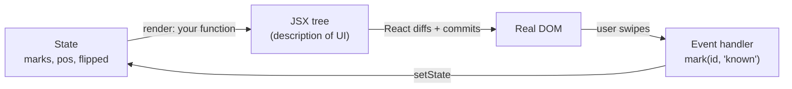
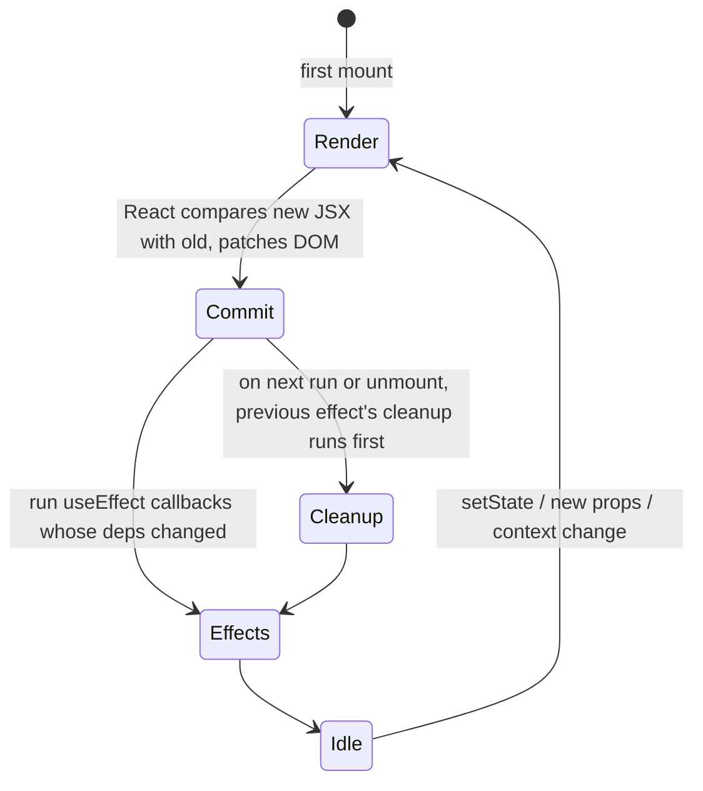
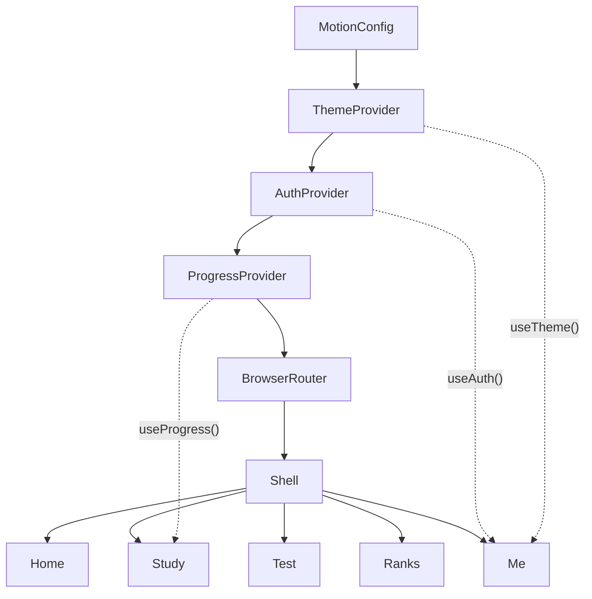

# L1.03 · Prerequisites II: TypeScript and React, enough to read every line

> **Level 1 · Foundations** · Lesson 3 of 5

| Recipe card | |
|---|---|
| **Time** | 75 min |
| **You need** | L1.02; Node installed is helpful for the examples (see L1.05) |
| **You'll produce** | A tiny counter + timer component that uses every hook our app uses |

**In two sentences:** Our app is written in TypeScript (JavaScript plus types) using React (a library that turns state into UI). This lesson teaches the exact features the code uses: unions, generics, `!`, `as`, JSX, props, `useState`, `useEffect`, `useRef`, `useMemo`, `useCallback`, context, keys and the rules of hooks. It shows them in our real code.

### Objectives
1. Read any type annotation in the codebase, including unions like `"cards" | "quiz" | "list"`, generics like `load<T>` and the `!` operator.
2. Explain React's render → commit → effect cycle and what a dependency array does.
3. Choose correctly between `useState`, `useRef`, `useMemo` and `useCallback` for a given need.
4. Build a context provider plus a custom hook (`useAuth`) and explain why it avoids prop drilling.
5. State the rules of hooks, and explain why `Me()` puts its `if (!profile) return null` *after* its hooks.

---

## 1 · Warm-up (from L1.02)

1. What must a `useEffect` callback return?
2. What does `touch-action: pan-y` hand to JavaScript?

<details><summary>Answers</summary>1. Nothing, or a cleanup function. 2. Horizontal movement (the browser keeps vertical scrolling).</details>

## 2 · The problem this solves

Plain JavaScript lets you write `question.answr` and only find the typo at runtime, on a student's phone. Plain DOM code (`document.createElement`, manual updates) gets tangled when one change, like marking a card known, must update the deck counter, the Home stats and the week tile. TypeScript catches the typo while you type. React lets you describe *what the screen should look like for a given state*, and it works out the DOM changes.



*Takeaway: you never edit the DOM. You change state, and React re-runs your component and patches the DOM.*

---

## 3 · TypeScript in 20 minutes (only what we use)

**Self-check:**
1. What does `type Mode = "cards" | "quiz" | "list"` allow?
2. What is `T` in `function load<T>(key: string, fallback: T): T`?
3. What does `profile!.display_name` promise the compiler?
4. What does `import type { Session } from "@supabase/supabase-js"` do at runtime?

<details><summary>Answers</summary>1. Only those three exact strings. 2. A type parameter: the caller's fallback type becomes the return type. 3. "This is not null or undefined here, trust me." It is unchecked at runtime. 4. Nothing: it is erased; only types are imported.</details>

### 3.1 Annotations and object types

```ts
export type Question = {
  id: number;          // week*100 + number, matches public.questions.id
  week: number;
  q: string;
  options: string[];   // array of strings
  answer: number;      // 0-based
  note?: string;       // ? = optional: string | undefined
};
```
That is the real type from `src/data/questions.ts`. Now `q.answr` is a compile error, and `q.note.length` is an error too ("possibly undefined"). TypeScript forces you to handle the missing note.

### 3.2 Union and literal types

```ts
type Mode = "cards" | "quiz" | "list";
type Mark = "known" | "again";
type ThemePref = "system" | "light" | "dark";
```
A union of string literals is an **enum without the ceremony**. `setMode("lsit")` fails to compile. Postgres enforces the same set server-side with `check (status in ('known','again'))`, so the two layers agree ([L2.02](l2-02-tables-and-rls.md)).

### 3.3 Generics: one function, many types

```ts
// src/lib/storage.ts (real)
export function load<T>(key: string, fallback: T): T {
  try {
    const v = localStorage.getItem(key);
    return v ? (JSON.parse(v) as T) : fallback;
  } catch {
    return fallback;
  }
}
// callers:
const pref = load<ThemePref>("pol.theme", "system");   // ThemePref
const marks = load<Marks>("pol.marks", {});              // Marks
```
**Why.** `JSON.parse` returns `any` (no type information), and `as T` labels it. That label is an *assertion*, not a check. If someone stored garbage, the type is a lie. We accept that for our own keys.

Generic components exist too: `Segmented<T extends string>` in [L2.06a](l2-06a-ui-kit.md) accepts any string union, so `value` and `onChange` stay in sync.

### 3.4 `!`, `as`, and why they are sharp knives

- `document.getElementById("root")!` is fine: we wrote `index.html`, and `#root` exists.
- `profile!.display_name` was **the sign-out crash**. During the exit animation, `profile` *was* null. The `!` silenced the compiler, and the app died at runtime ([L2.07b](l2-07b-account-progress.md)). The fix was a real check: `if (!session || !profile) return null;`.
- `data as Stats` labels untyped API data. Prefer real validation where it matters. Here the server is ours.

### 3.5 Modules, JSON imports and `import type`

```ts
import raw from "./questions.json";                     // Vite turns JSON into a JS value
import { createClient } from "@supabase/supabase-js";   // named import
import type { Session } from "@supabase/supabase-js";   // type-only, erased at build
```
Our `tsconfig.json` sets `verbatimModuleSyntax: true`. That *forces* `import type` for type-only imports, so the compiled JS never tries to import something that does not exist at runtime ([L2.04](l2-04-entry-config-libs.md)).

---

## 4 · React: the model

**Self-check:**
1. Is a component a function that *returns HTML*?
2. When does `useEffect(fn, [a])` run `fn`?
3. Why does React need `key` on list items?
4. What happens to `count` immediately after `setCount(count + 1)` inside the same handler?

<details><summary>Answers</summary>1. It returns a JSX description (objects), not HTML; React turns it into DOM. 2. After the first commit and after any commit where <code>a</code> changed (compared with <code>Object.is</code>). 3. To match items between renders, so state and animations stay with the right item. 4. Nothing: <code>count</code> is a constant for this render; the new value appears on the next render.</details>

### 4.1 JSX and components

**Definition.** A component is a function from props to a UI description. JSX is HTML-like syntax that compiles to function calls.

```tsx
function Stat({ value, label }: { value: string; label: string }) {
  return (
    <div className="stat">
      <div className="v">{value}</div>
      <div className="k">{label}</div>
    </div>
  );
}
// usage
<Stat value="12/130" label="Cards mastered" />
```
- `className`, not `class` (`class` is a JS keyword).
- `{expr}` embeds any JS expression.
- `style={{ width: 120 }}`: the outer braces mean "JS here"; the inner pair is an object.
- `{cond && <X/>}` renders X only if cond is truthy. `{a ? <X/> : <Y/>}` picks one.

### 4.2 State and the render cycle

**Definition.** `const [x, setX] = useState(initial)` gives you a value that survives re-renders and a setter that schedules a re-render.



*Takeaway: effects run **after** the DOM is updated, and each effect's cleanup runs before it runs again or when the component leaves.*

**Step-through frames: the flashcard counter.** The code (simplified from `Study.tsx`):

```tsx
const [pos, setPos] = useState(0);
const decide = () => setPos((p) => p + 1);   // functional update
```

| Frame | Event | `pos` in this render | What React does | Predict before reading → |
|---|---|---|---|---|
| 1 | mount | 0 | renders card #1 | Which card shows? |
| 2 | tap "Got it" → `decide()` | 0 (unchanged during the handler) | queues `p => p + 1` | Does `pos` change inside the handler? **No** |
| 3 | re-render | 1 | renders card #2, commits | |
| 4 | double-tap fast: `decide(); decide();` | 1 | queues two updates: `1→2`, `2→3` | Final `pos`? **3** |
| 5 | (if we had written `setPos(pos + 1)` twice) | 1 | both compute `1 + 1` | Final `pos`? **2**: one tap lost |

**Why our code uses functional updates.** Frame 5 is a real class of bug. `setPos((p) => p + 1)` always uses the latest value. You will see `setA((cur) => …)` throughout the test runner.

**Lazy initial state.** `useState(() => load("pol.shuffle", false))` runs `load` only on the first render, not on every render.

### 4.3 Effects: syncing with the outside world

**Definition.** `useEffect(fn, deps)` runs `fn` after commit, when `deps` changed. If `fn` returns a function, React calls it as **cleanup**.

**Real example** (`src/lib/theme.tsx`, listening to the OS dark-mode switch):

```tsx
useEffect(() => {
  const m = window.matchMedia("(prefers-color-scheme: dark)");
  const on = () => setSystemDark(m.matches);
  m.addEventListener("change", on);
  return () => m.removeEventListener("change", on);   // cleanup: no leaked listeners
}, []);                                                 // [] = only on mount/unmount
```

- **No deps array** means it runs after *every* render. We do this deliberately for keyboard listeners that need fresh closures (the Study cards), and remove the old listener each time.
- **StrictMode** (development only) mounts, unmounts and mounts every component once more, to flush out effects without proper cleanup. If your effect breaks when run twice, it was already broken.

### 4.4 Refs: memory that doesn't re-render

`const r = useRef(value)` gives `{ current }`. It persists across renders, and changing it does **not** re-render.
- DOM access: `codeRef.current?.focus()` focuses the code input.
- Remembering a value between renders: `lastPool.current` is how we fixed the **double shuffle** in the quiz ([L2.08b](l2-08b-quiz-and-list.md)).
- Collections that shouldn't trigger renders: `againIds.current` (a `Set` of ids marked "again").

### 4.5 `useMemo` and `useCallback`

- `useMemo(() => expensive(a), [a])` caches a *value*: `perWeek` progress on Home, the filtered `pool` of questions.
- `useCallback(fn, [deps])` caches a *function identity*. That matters when the function is itself a dependency of an effect. Example: `build` in the flashcards, used by `useEffect(() => { build(); }, [build])`.

### 4.6 Context: shared state without prop drilling

**Definition.** Context passes a value to *every* component below a provider, without threading props through each level.

```tsx
// pattern used by ThemeProvider, AuthProvider, ProgressProvider
const Ctx = createContext<AuthState>(defaultValue);
export function AuthProvider({ children }: { children: ReactNode }) {
  const [session, setSession] = useState<Session | null>(null);
  return <Ctx.Provider value={{ session /* … */ }}>{children}</Ctx.Provider>;
}
export const useAuth = () => useContext(Ctx);   // custom hook
// any component:
const { session } = useAuth();
```



*Takeaway: order matters. `ProgressProvider` sits inside `AuthProvider` because it calls `useAuth()` to know whose progress to sync.*

### 4.7 Lists and keys

```tsx
{deck.slice(pos + 1, pos + 3).map((q, i) => <motion.div key={q.id} … />)}
```
`key` must be stable and unique among siblings. We use question ids. In the swipe card we use `key={current.id + ":" + pos}`, so **undo** (same question, new position) creates a fresh card that animates in.

### 4.8 The rules of hooks, and the sign-out bug

1. Call hooks **only at the top level** of a component or custom hook. Never inside conditions, loops or after an early `return`.
2. Call them **in the same order on every render**. React identifies each hook by its call order.

```tsx
function Me() {
  const { session, profile } = useAuth();    // hook 1
  const [editOpen, setEditOpen] = useState(false);   // hook 2
  const [toast, setToast] = useToast();      // hook 3
  if (!session || !profile) return null;     // ✓ early return AFTER all hooks
  const name = profile.display_name;
  …
}
```
If the `return null` came *before* `useState`, one render would call 1 hook and the next would call 3. React would throw "Rendered more hooks than during the previous render."

### 4.9 Class components (one place only)

Error boundaries must be classes. Only classes have `componentDidCatch` and `static getDerivedStateFromError`. It is our single class in the app ([L2.05](l2-05-app-shell.md)).

---

## 5 · First working slice: one component using every hook

Create `Counter.tsx` (you will run it in L1.05's scaffold):

```tsx
import { useCallback, useEffect, useMemo, useRef, useState } from "react";

export function Counter() {
  const [n, setN] = useState(() => Number(localStorage.getItem("n") ?? 0)); // lazy init
  const clicks = useRef(0);                                  // no re-render on change
  const parity = useMemo(() => (n % 2 === 0 ? "even" : "odd"), [n]);
  const inc = useCallback(() => {
    clicks.current++;
    setN((x) => x + 1);                                      // functional update
  }, []);

  useEffect(() => {
    localStorage.setItem("n", String(n));                    // sync to the outside world
  }, [n]);

  useEffect(() => {
    const k = (e: KeyboardEvent) => e.key === "ArrowUp" && inc();
    window.addEventListener("keydown", k);
    return () => window.removeEventListener("keydown", k);   // cleanup
  }, [inc]);

  return (
    <button onClick={inc}>
      {n} ({parity}) · clicked {clicks.current}×
    </button>
  );
}
```
*Done when:* the number survives reload, ↑ increments it, and you can explain why `clicks.current` only shows the new value after the next render.

## 6 · Check yourself

**Q1.** `setPos(pos + 1)` is called twice in one handler, with `pos = 4`. What is `pos` next render?
- A) 6 · B) 5 · C) 4 · D) Error

<details><summary>Answer</summary><b>B.</b> Both calls compute <code>4 + 1</code>. Use <code>setPos(p => p + 1)</code> to get 6. <b>A</b> assumes state updates instantly inside the handler, which is the core misconception.</details>

**Q2.** You want to remember "the pool we last shuffled", to avoid reshuffling on mount, without causing a render. Use:
- A) `useState` · B) `useRef` · C) `useMemo` · D) `useContext`

<details><summary>Answer</summary><b>B.</b> A ref persists and doesn't re-render. <b>A</b> would re-render when set. <b>C</b> recomputes from inputs and is not a writable memory.</details>

**Q3.** Why does `ProgressProvider` sit *inside* `AuthProvider`?
- A) Alphabetical order · B) It calls `useAuth()` to get the user id · C) Performance · D) It doesn't matter

<details><summary>Answer</summary><b>B.</b> A component can only read contexts provided <i>above</i> it. Placed outside, <code>useAuth()</code> would return the default value (no session) forever.</details>

**Q4.** An effect adds a `keydown` listener and has no cleanup. In development the handler fires twice per key press. Why?
- A) React bug · B) StrictMode mounted the effect twice and the first listener was never removed · C) Keyboard repeat · D) Two windows

<details><summary>Answer</summary><b>B.</b> StrictMode's double-mount exposes the missing cleanup. In production the leak would build up across navigations instead.</details>

**Q5.** Which line can crash at runtime even though TypeScript compiles it?
- A) `const n: number = q.answer` · B) `profile!.display_name` · C) `type Mode = "cards" | "quiz"` · D) `import type { Session } …`

<details><summary>Answer</summary><b>B.</b> <code>!</code> disables the null check. If <code>profile</code> is null at runtime, you get <code>TypeError: Cannot read properties of null</code>. That was our sign-out crash.</details>

## 7 · Practice

**Easy (10 min).** Write a type `Attempt` with `attempt_id: string`, `question_ids: number[]`, `answers: (number | null)[]`, `flags: number[]`, `pos: number`. Explain why `answers` is `(number | null)[]` and not `number[] | null`.
<details><summary>Answer</summary>Each slot is either a chosen option or "not answered yet". <code>number[] | null</code> would mean the whole array is missing.</details>

**Medium (20 min).** Write a `ThemeProvider` from memory: a `pref` state loaded from storage, a `setPref` that saves, an effect that sets `document.documentElement.dataset.theme`, and a `useTheme` hook. Compare with [L2.04](l2-04-entry-config-libs.md) afterwards.

**Hard (40 min).** Write a `useCountdown(seconds)` hook returning the remaining seconds. It uses `setInterval` in an effect with cleanup, stops at 0 and survives StrictMode without double speed.
<details><summary>Solution</summary>

```tsx
function useCountdown(seconds: number) {
  const [left, setLeft] = useState(seconds);
  useEffect(() => {
    const t = setInterval(() => setLeft((s) => (s > 0 ? s - 1 : 0)), 1000);
    return () => clearInterval(t);   // StrictMode's remount clears the first interval
  }, []);
  return left;
}
```
</details>

## 8 · From memory

**Rung 1 · Cloze.**

```tsx
const Ctx = ___①___<ProgressState>(defaults);
export function ProgressProvider({ children }: { children: ReactNode }) {
  const { session } = ___②___();
  const [marks, setMarks] = useState<Marks>(() => load<Marks>(KEY, {}));
  useEffect(() => { save(KEY, marks); }, [___③___]);
  const mark = useCallback((id: number, s: Mark) => {
    setMarks((m) => ({ ...m, [id]: { s, t: Date.now() } }));   // ___④___ update
  }, []);
  return <Ctx.___⑤___ value={{ marks, mark }}>{children}</Ctx.Provider>;
}
```
<details><summary>Answers</summary>① <code>createContext</code> ② <code>useAuth</code> ③ <code>marks</code> ④ functional ⑤ <code>Provider</code></details>

**Rung 2 · Blank page (15 min).** Write the `Counter` component of §5 from memory, then list the rules of hooks.
<details><summary>Self-check</summary>

- [ ] Lazy `useState` initialiser
- [ ] Functional update in the increment
- [ ] Effect with `[n]` deps syncing storage
- [ ] Listener effect returns a cleanup
- [ ] Rules: top level only; same order every render; early returns after all hooks
</details>

## 9 · Flashcards

<details><summary><b>Q:</b> What does a string-literal union type give you?</summary><b>A:</b> A closed set of allowed values checked at compile time (e.g. <code>"known" | "again"</code>).</details>
<details><summary><b>Q:</b> What does <code>as T</code> after <code>JSON.parse</code> actually check?</summary><b>A:</b> Nothing at runtime; it is a label telling the compiler to trust you.</details>
<details><summary><b>Q:</b> Why prefer <code>setX(x => x + 1)</code>?</summary><b>A:</b> It uses the latest queued value, so rapid repeated updates are not lost.</details>
<details><summary><b>Q:</b> When does a <code>useEffect</code> cleanup run?</summary><b>A:</b> Before the effect runs again (deps changed) and when the component unmounts.</details>
<details><summary><b>Q:</b> useRef vs useState?</summary><b>A:</b> Both persist across renders; only state changes trigger a re-render.</details>
<details><summary><b>Q:</b> Why must providers that read other contexts be nested inside them?</summary><b>A:</b> <code>useContext</code> only sees providers above it in the tree.</details>
<details><summary><b>Q:</b> Why must early returns come after all hooks?</summary><b>A:</b> React matches hooks by call order; a conditional return before a hook changes the count between renders.</details>
<details><summary><b>Q:</b> Why does StrictMode double-run effects in development?</summary><b>A:</b> To expose effects that don't clean up properly.</details>
<details><summary><b>Q:</b> Why is the swipe card keyed by <code>id + ":" + pos</code>?</summary><b>A:</b> So undo, which shows the same question at a new position, mounts a fresh card that animates in.</details>

## 10 · The menu board

| | |
|---|---|
| Types | `type X = {…}`, `?` optional, `A \| B` unions, `<T>` generics |
| Sharp knives | `!` (non-null), `as` (assertion): both unchecked at runtime |
| Imports | `import type` for types (`verbatimModuleSyntax`); JSON imports via Vite |
| Render cycle | render (pure) → commit (DOM) → effects (after) → cleanup before next |
| Hooks | state (re-render) · ref (no re-render) · memo (value) · callback (function identity) · context |
| Updates | functional `setX(x => …)`; lazy init `useState(() => …)` |
| Effects | return nothing or cleanup; deps compared with `Object.is`; StrictMode double-mounts |
| Rules | top level, same order, early return after hooks |

## 11 · Glossary

**Assertion (`as`)**: tells the compiler a type without checking. **Commit**: React applying changes to the DOM. **Component**: function returning JSX. **Context**: value shared with a subtree via a provider. **Custom hook**: a function starting with `use` that calls other hooks. **Dependency array**: values an effect/memo/callback depends on. **Generic**: a type parameter (`T`). **JSX**: HTML-like syntax compiled to JS. **Key**: stable identity for list items. **Literal type**: a type whose only value is one specific string or number. **Non-null assertion (`!`)**: claims a value is not null/undefined. **Props**: a component's inputs. **Render**: calling your component to get JSX. **StrictMode**: dev-only checks that double-invoke effects. **Union type**: a value that may be one of several types.

## 12 · Go further

| Resource | Type | Why | Which part | Time |
|---|---|---|---|---|
| [react.dev: Learn](https://react.dev/learn) | Official tutorial | The modern, hooks-first mental model | "Describing the UI", "Adding Interactivity", "Managing State" | 90 min (over several days) |
| [react.dev: Synchronizing with Effects](https://react.dev/learn/synchronizing-with-effects) | Docs | Effects, cleanup, StrictMode double-run | Whole page | 25 min |
| [react.dev: Rules of Hooks](https://react.dev/reference/rules/rules-of-hooks) | Docs | Exactly why order matters | Whole page | 10 min |
| [TypeScript Handbook: Everyday Types](https://www.typescriptlang.org/docs/handbook/2/everyday-types.html) | Docs | Unions, literals, `!`, assertions | Whole page | 30 min |
| [TypeScript Handbook: Generics](https://www.typescriptlang.org/docs/handbook/2/generics.html) | Docs | `load<T>`, `Segmented<T>` | First half | 20 min |

---
← [L1.02 The web platform](l1-02-web-platform.md) · [Hub](README.md) · [L1.04 SQL, auth & hosting →](l1-04-data-auth-hosting.md)
