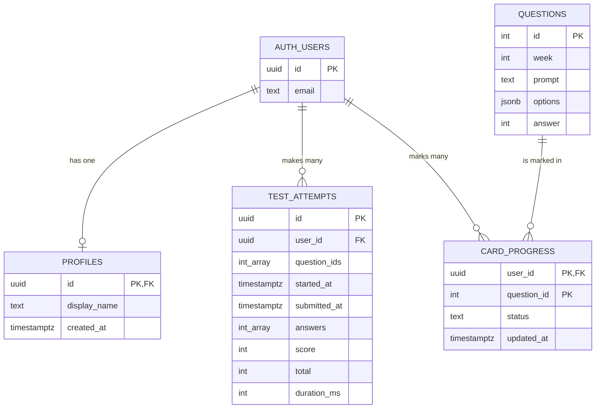
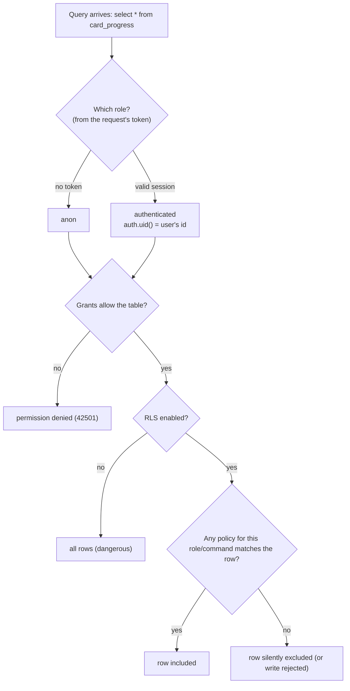
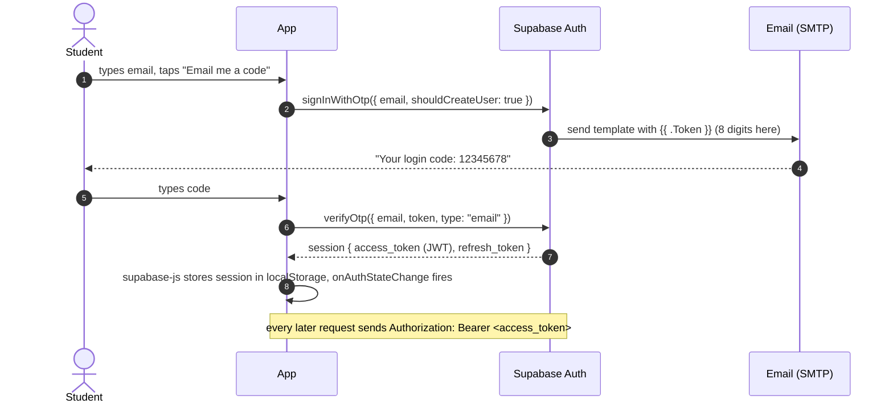

# L1.04 · Prerequisites III: SQL, auth, keys and hosting

> **Level 1 · Foundations** · Lesson 4 of 5

| Recipe card | |
|---|---|
| **Time** | 70 min |
| **You need** | The project folder with `npm install` done (for the PGlite playground), or skip the "Try it" boxes |
| **You'll produce** | A local SQL playground where you create a table, turn on row-level security and watch a policy block a user |

**In two sentences:** The back end is a Postgres database (with Supabase Auth in front of it) and the front end is static files on Vercel. To write the schema and deploy safely you need SQL tables and constraints, the idea of database roles and row-level security, how sessions and email codes work, which keys are public, and how Git and environment variables keep secrets out of the repo.

> **Session 2 update (2026-10-16).** The app no longer signs in with email codes; it uses **Google sign-in** through Supabase. §5.1 (JWTs) and §5.3 (keys) are unchanged and still essential. §5.2 (email codes) is now history: the same session and JWT come out of a Google sign-in instead, taught from zero in [L2.07c](l2-07c-google-sign-in.md) §3.

### Objectives
1. Write a `create table` with a primary key, a foreign key with `on delete cascade`, a `check` constraint and a case-insensitive unique index.
2. Explain what RLS does, the difference between `using` and `with check`, and why "RLS on with no policy" means "nobody".
3. Draw the email-code sign-in sequence and say what `auth.uid()` returns inside SQL.
4. Say which Supabase key may live in browser code and which must never leave your machine.
5. Explain how `.gitignore`, `.env.local` and the `VITE_` prefix keep secrets out of Git and the bundle.

---

## 1 · Warm-up (from L1.03)

1. Why does `ProgressProvider` sit inside `AuthProvider`?
2. What is wrong with `useEffect(() => window.scrollTo({top:0}), [p])`?

<details><summary>Answers</summary>1. It calls <code>useAuth()</code> to get the user id; context is only visible below its provider. 2. The concise arrow returns scrollTo's Promise; React calls the return value as cleanup → <code>destroy is not a function</code>.</details>

## 2 · The problem this solves

We need to store accounts, names, scores and progress so that **each student sees only their own private rows, everyone sees the leaderboard, and nobody can forge a score**, without writing a server. Supabase gives us Postgres plus Auth and an automatic HTTP API. The trick is that the *database itself* enforces who can do what.



*Takeaway: four tables of our own, plus Supabase's `auth.users`. Everything private hangs off a user id.*

(`card_progress.question_id` is *not* a declared foreign key in our schema; the diagram shows the logical link. [L2.02](l2-02-tables-and-rls.md) explains why.)

---

## 3 · SQL in 25 minutes

**Self-check:**
1. What does a primary key guarantee?
2. What does `references auth.users on delete cascade` do when a user is deleted?
3. How do you make display names unique ignoring case?
4. What does `insert … on conflict (id) do update set …` do?

<details><summary>Answers</summary>1. Unique and not null; one row per key. 2. Deletes the referencing rows automatically. 3. <code>create unique index … on profiles (lower(display_name))</code>. 4. An upsert: insert, or update the existing row when that id already exists.</details>

### 3.1 Tables, types and constraints

```sql
create table public.profiles (
  id           uuid primary key references auth.users on delete cascade,
  display_name text not null,
  created_at   timestamptz not null default now(),
  constraint display_name_len   check (char_length(display_name) between 3 and 20),
  constraint display_name_chars check (display_name ~ '^[A-Za-z0-9_. -]+$')
);
create unique index profiles_display_name_key on public.profiles (lower(display_name));
```

| Piece | Meaning | Why we chose it |
|---|---|---|
| `uuid` | 128-bit random id like `3f9c…` | Supabase user ids are uuids |
| `primary key references auth.users` | The profile id **is** the user id (one profile per user) | No separate id to keep in sync |
| `on delete cascade` | Delete the user → their profile goes too | Our test suite deletes throwaway users and relies on this ([L4.06](l4-06-live-security-auth.md)) |
| `timestamptz` | Timestamp with time zone | Durations computed on the server's clock |
| `default now()` | Filled automatically | The client cannot fake it |
| `check (…)` | Row rejected unless true | Blocks `` style names at the database, error code `23514` |
| `~ '…'` | Regex match | Letters, digits, space, `_ . -` only |
| `unique index on lower(…)` | "Espresso Ana" and "espresso ANA" collide | Error code `23505`, shown as "That name is taken" |

Other types we use: `int`, `text`, `jsonb` (binary JSON, for the options array), `int[]` (Postgres arrays, for 100 question ids and 100 answers).

### 3.2 Reading and writing

```sql
select id, display_name from profiles where id = '…' ;
insert into card_progress (user_id, question_id, status) values ('…', 101, 'known')
  on conflict (user_id, question_id) do update set status = excluded.status;  -- upsert
delete from test_attempts where user_id = '…' and submitted_at is null;
```
`excluded` means "the row you tried to insert". `supabase-js`'s `.upsert()` generates exactly this kind of statement.

### 3.3 Functions (PL/pgSQL) in one look

```sql
create or replace function public.hello(p_name text)
returns text
language plpgsql
as $$
declare msg text;            -- local variables
begin
  msg := 'hi ' || p_name;    -- || concatenates
  return msg;
end;
$$;
select hello('ana');         -- 'hi ana'
```
`$$ … $$` is "dollar quoting", a string that may contain quotes. You will write four real functions in [L2.03](l2-03-server-grading.md).

> **Try it: your local Postgres (5 min).** From the project folder (after `npm install`), save this as `scratch.mjs` and run `node scratch.mjs`:
> ```js
> import { PGlite } from "@electric-sql/pglite";
> const db = new PGlite();                       // a real Postgres, in memory, no account
> await db.exec(`create table t (id int primary key, name text check (char_length(name) >= 3));`);
> await db.exec(`insert into t values (1, 'Ana') on conflict (id) do update set name = excluded.name;`);
> console.log((await db.query("select * from t")).rows);       // [ { id: 1, name: 'Ana' } ]
> try { await db.exec(`insert into t values (2, 'ab')`); } catch (e) { console.log(e.message); }
> // new row for relation "t" violates check constraint "t_name_check"
> ```
> Delete `scratch.mjs` afterwards. [L4.02](l4-02-database-tests.md) turns this playground into the real database test suite.

---

## 4 · Roles, grants and row-level security

**Self-check:**
1. Which two Postgres roles does a Supabase API request run as?
2. With RLS enabled and no policies, what can `authenticated` select?
3. In a policy, what does `using (…)` check versus `with check (…)`?

<details><summary>Answers</summary>1. <code>anon</code> (no session) or <code>authenticated</code> (valid session). 2. Nothing; zero rows (and writes are rejected). 3. <code>using</code> filters which existing rows you can see/update/delete; <code>with check</code> validates the new row you are inserting or updating to.</details>

### 4.1 The concept

**Definition.** Row-level security adds an automatic `WHERE` clause, written by you as *policies*, to every query on a table, based on who is asking.

**Why here.** The browser talks to the database directly (through Supabase's REST API). Without RLS, anyone with the public key could read every row.

**Analogy.** A pantry where each shelf has a lock. Policies are the rules printed on the door ("you may open shelves with your name on them"). Turning RLS on locks every shelf; each policy hands out one kind of key.



*Takeaway: two gates. **Grants** decide whether a role may touch a table or function at all; **RLS policies** decide which rows. A denied read returns zero rows, not an error.*

**How the project uses it.**

```sql
alter table public.card_progress enable row level security;
create policy "progress: read own" on public.card_progress
  for select using (auth.uid() = user_id);
create policy "progress: insert own" on public.card_progress
  for insert with check (auth.uid() = user_id);
```
`auth.uid()` is a Supabase SQL function that reads the user id out of the request's token. For `anon` it returns `null`, and `null = user_id` is never true, so anonymous users see nothing.

**What breaks without it.** Every student's progress and every attempt (including the answers) would be readable with the public key. The live tests in [L4.06](l4-06-live-security-auth.md) prove anon gets `[]` from all four tables.

> **Try it: RLS in PGlite (5 min).**
> ```js
> import { PGlite } from "@electric-sql/pglite";
> const db = new PGlite();
> await db.exec(`
>   create role authenticated nologin;
>   create table notes (owner text, body text);
>   insert into notes values ('ana','mine'), ('ben','his');
>   alter table notes enable row level security;
>   create policy own on notes for select using (owner = current_setting('app.user', true));
>   grant select on notes to authenticated;
> `);
> await db.exec(`select set_config('app.user','ana',false); set role authenticated;`);
> console.log((await db.query("select * from notes")).rows);   // [ { owner: 'ana', body: 'mine' } ]
> ```
> `current_setting('app.user')` stands in for `auth.uid()`. The real test suite uses exactly this trick ([L4.02](l4-02-database-tests.md)).

### 4.2 `security definer`: a door the kitchen opens for you

Normally a function runs with the caller's rights. `security definer` makes it run with the **owner's** rights, the way a waiter goes into the kitchen on your behalf. That lets `submit_test` read the answer key that the caller cannot read, and write the attempt row that the caller cannot write. The function itself checks who is calling, via `auth.uid()`. Two safety rules follow. You will meet both in [L2.03](l2-03-server-grading.md) and [L3.01](l3-01-security-model.md):
1. Always `set search_path = public` on definer functions, so nobody can trick them into calling a look-alike function from another schema.
2. `revoke` execute from `public` and `anon` where appropriate, then `grant` to `authenticated` only.

---

## 5 · Auth: sessions, JWTs and email codes

**Self-check:**
1. What are the three dot-separated parts of a JWT?
2. Is a JWT encrypted?
3. What does the user type in our sign-in flow, and what does the browser receive back?

<details><summary>Answers</summary>1. Header, payload, signature (each base64url). 2. No, only signed: anyone can read the payload; only the signer can produce a valid signature. 3. Their email, then the 8-digit code from the email; the browser receives a session (access token + refresh token).</details>

### 5.1 JWT in one picture

A session's access token is a **JWT** (JSON Web Token): `xxxxx.yyyyy.zzzzz`.
- **Header**: `{"alg":"HS256","typ":"JWT"}`.
- **Payload**: claims such as `{"sub":"3f9c…","role":"authenticated","exp":1792…}`. `sub` (subject) is the user id, and `auth.uid()` reads it.
- **Signature**: proves Supabase issued it. Changing one character of the payload invalidates it.

Because the payload is only *encoded*, not secret, we used it during the build. The user's credentials file had keys but no project URL. Decoding the anon key's payload showed `{"iss":"supabase","ref":"kehcsupmruaskpgdvzaj","role":"anon"}`, and the URL is `https://<ref>.supabase.co`.

### 5.2 Email one-time codes



*Takeaway: no passwords. The code proves you own the inbox. Supabase's email template must contain `{{ .Token }}`, or the email holds only a link ([L4.08](l4-08-deploy-operate.md)).*

**The bug this lesson prepares you for.** Supabase's "Email OTP length" setting was **8** in this project, but the app assumed 6. It cut every code to 6 digits, and every verification failed with `otp_expired`. [L2.07a](l2-07a-auth-sign-in.md) tells the story.

### 5.3 Keys: which may be public

| Key | Looks like | Where it may live | What it can do |
|---|---|---|---|
| **Publishable / anon** | `sb_publishable_…` or a JWT with `role: anon` | Browser bundle, `.env.local`, Vercel env | Only what grants and RLS allow `anon`/`authenticated` |
| **Secret / service role** | `sb_secret_…` or a JWT with `role: service_role` | Your machine only (here: git-ignored `Supabase.txt`), CI secrets | **Bypasses RLS entirely.** Admin API: create and delete users, read everything |

The test suite uses the secret key **locally** to create and delete throwaway users. It is never imported by app code, and an HTTP test scans the deployed bundle to prove it never ships ([L4.03](l4-03-playwright-foundations.md)).

---

## 6 · Environment variables, Git and hosting

**Self-check:**
1. Why does Vite only expose variables starting with `VITE_` to the browser?
2. What does `.gitignore` do to a file that is *already committed*?
3. What does a static host do on each request?

<details><summary>Answers</summary>1. So server-only secrets in the same <code>.env</code> are not accidentally bundled into public JS. 2. Nothing: ignore rules only affect untracked files; you must <code>git rm --cached</code> it. 3. Look up a file and return it (plus rewrites/redirects/headers); no app code runs.</details>

### 6.1 `.env.local` and `import.meta.env`

```bash
# .env.local  (git-ignored)
VITE_SUPABASE_URL=https://kehcsupmruaskpgdvzaj.supabase.co
VITE_SUPABASE_ANON_KEY=sb_publishable_…
```
In code: `import.meta.env.VITE_SUPABASE_URL`. At **build** time Vite pastes the value into the JS. That has two consequences:
- The value is public, so only put public values in `VITE_` variables.
- Changing a Vercel env var needs a **rebuild** to take effect.

`.env.example` (committed) documents the names with fake values, so a newcomer knows what to set.

### 6.2 Git hygiene

Our `.gitignore` starts with the secrets:

```gitignore
# secrets — never commit
Supabase.txt
.env
.env.*
!.env.example
```
`.env.*` ignores `.env.local`, `.env.production` and so on, and `!.env.example` un-ignores the template. Order matters: the last matching rule wins. [L4.08](l4-08-deploy-operate.md) tells how `vercel link` appended a bare `.env*` line *after* these, silently ignoring `.env.example` again.

Check before committing: `git check-ignore -v Supabase.txt .env.local` prints the rule that ignores each file. If it prints nothing, the file would be committed.

### 6.3 Hosting on Vercel

Vercel runs `npm run build`, uploads `dist/` to its CDN, and applies `vercel.json`:
- a **rewrite** of every path to `/index.html` (SPA routing, [L1.02](l1-02-web-platform.md) §9),
- a **redirect** from the short domain to the main one,
- a **header** making `/assets/*` cacheable forever.

With the **Git integration**, every push to `main` triggers that build ([L4.08](l4-08-deploy-operate.md)).

---

## 7 · Check yourself

**Q1.** RLS is enabled on `questions` with **no policies**. A signed-in student runs `select * from questions`. Result?
- A) All 130 rows · B) Zero rows, no error · C) Error 42501 · D) Only questions they answered

<details><summary>Answer</summary><b>B.</b> Supabase grants table privileges to <code>authenticated</code>, so the grant gate passes; RLS then filters every row out. <b>C</b> would happen if the grant itself were missing. <b>A</b> is "RLS off". The live test asserts exactly <code>[]</code>.</details>

**Q2.** Which policy lets users insert progress **only for themselves**?
- A) `for insert using (auth.uid() = user_id)`
- B) `for insert with check (auth.uid() = user_id)`
- C) `for select using (true)`
- D) `for all using (true)`

<details><summary>Answer</summary><b>B.</b> Inserts are validated by <code>with check</code> (the new row); <code>using</code> does not apply to inserts. <b>D</b> lets anyone do anything.</details>

**Q3.** You accidentally put the **secret** key in `VITE_SUPABASE_ANON_KEY` and deploy. What is the impact?
- A) None, the bundle is minified · B) Anyone can extract it from the JS and bypass all RLS · C) Only logged-in users can misuse it · D) Supabase rejects it in browsers

<details><summary>Answer</summary><b>B.</b> Minification is not secrecy. Rotate the key immediately. (Recent supabase-js versions warn when a secret key is used in a browser, which is why the library source contains the text <code>sb_secret_</code>. That text caused a false alarm in our secret scanner, [L4.03](l4-03-playwright-foundations.md).)</details>

**Q4.** Why is `auth.uid()` safe to trust inside SQL?
- A) The browser sends it as a header · B) It is read from the signed JWT that Supabase verified · C) It is the IP address · D) It isn't safe

<details><summary>Answer</summary><b>B.</b> The id comes from the token's <code>sub</code> claim after signature verification. <b>A</b> describes an unsafe design, where the client asserts its own identity.</details>

## 8 · Practice

**Easy (10 min).** Write `create table card_progress` from memory: composite primary key `(user_id, question_id)`, a `status` check of `known`/`again`, and `updated_at` defaulting to now.
<details><summary>Answer</summary>

```sql
create table public.card_progress (
  user_id     uuid not null references auth.users on delete cascade,
  question_id int  not null,
  status      text not null check (status in ('known', 'again')),
  updated_at  timestamptz not null default now(),
  primary key (user_id, question_id)
);
```
</details>

**Medium (20 min).** In the PGlite playground, add an insert policy to `notes` with `with check (owner = current_setting('app.user', true))`, grant insert, then try inserting a row owned by `ben` while acting as `ana`.
*Done when:* you see `new row violates row-level security policy for table "notes"`.

**Hard (40 min).** Decode a JWT by hand in the browser console: `JSON.parse(atob(token.split(".")[1].replace(/-/g,"+").replace(/_/g,"/")))`. Use the anon key from `.env.local` if it is a JWT, or sign in on the site and read `localStorage` (look for a key containing `auth-token`). Find `sub`, `role` and `exp`, and convert `exp` to a date.
<details><summary>Hint</summary><code>new Date(exp * 1000)</code>. <code>exp</code> is in seconds since 1970.</details>

## 9 · From memory

**Rung 1 · Cloze.**

```sql
alter table public.profiles ___① row level security;
create policy "profiles: update own" on public.profiles
  for update ___②___ (auth.uid() = id) ___③___ (auth.uid() = id);
create unique index on public.profiles (___④___(display_name));
create function f() returns json language plpgsql security ___⑤___ set search_path = public as $$ … $$;
```
<details><summary>Answers</summary>① <code>enable</code> ② <code>using</code> ③ <code>with check</code> ④ <code>lower</code> ⑤ <code>definer</code></details>

**Rung 2 · Blank page (15 min).** Draw (a) the ER diagram of the four tables, (b) the RLS decision flowchart, (c) the OTP sequence.
<details><summary>Self-check</summary>

- [ ] profiles.id = auth.users.id; attempts and progress reference users with cascade
- [ ] Two gates: grants, then policies; denied reads return zero rows
- [ ] `using` vs `with check` placed correctly
- [ ] OTP: signInWithOtp → email with token → verifyOtp → session → Bearer token on requests
</details>

## 10 · Flashcards

<details><summary><b>Q:</b> RLS enabled, no policies: what can users read?</summary><b>A:</b> Nothing: zero rows (writes rejected).</details>
<details><summary><b>Q:</b> <code>using</code> vs <code>with check</code>?</summary><b>A:</b> <code>using</code> filters existing rows (select/update/delete); <code>with check</code> validates new or updated rows (insert/update).</details>
<details><summary><b>Q:</b> What does <code>auth.uid()</code> return for anonymous requests?</summary><b>A:</b> <code>null</code>, so <code>auth.uid() = user_id</code> is never true.</details>
<details><summary><b>Q:</b> Why <code>security definer</code> for <code>submit_test</code>?</summary><b>A:</b> It must read the answer key and write attempts that the caller cannot; it runs with the owner's rights and checks the caller itself.</details>
<details><summary><b>Q:</b> Why <code>set search_path = public</code> on definer functions?</summary><b>A:</b> So object names resolve only in <code>public</code>, preventing hijacking via look-alike objects in another schema.</details>
<details><summary><b>Q:</b> Is a JWT secret?</summary><b>A:</b> No, it is signed, not encrypted. The payload is readable by anyone.</details>
<details><summary><b>Q:</b> Which Supabase key bypasses RLS?</summary><b>A:</b> The secret / service-role key. Never ship it to a browser.</details>
<details><summary><b>Q:</b> Why the <code>VITE_</code> prefix?</summary><b>A:</b> Only prefixed variables are exposed to client code, so other secrets aren't bundled by accident.</details>
<details><summary><b>Q:</b> Error codes 23505 and 23514?</summary><b>A:</b> Unique violation; check-constraint violation.</details>

## 11 · The menu board

| | |
|---|---|
| Table rules | PK, FK `on delete cascade`, `check`, `unique index on lower(col)`, `default now()` |
| Upsert | `insert … on conflict (key) do update set col = excluded.col` |
| Roles | `anon` (no session) · `authenticated` (session) · owner (definer functions) · service role (bypasses RLS) |
| RLS | `enable row level security` + policies; `using` = which rows; `with check` = new rows |
| Identity in SQL | `auth.uid()` from the verified JWT `sub` |
| Definer safety | `set search_path = public`; revoke from public/anon; grant to authenticated |
| OTP | signInWithOtp → email `{{ .Token }}` → verifyOtp(type "email") → session |
| Keys | publishable = public; secret = never in bundle or git |
| Env | `.env.local` git-ignored; `VITE_` = public; rebuild after changing |

## 12 · Glossary

**Cascade**: automatic delete of rows that reference a deleted row. **Check constraint**: a rule each row must satisfy. **Foreign key**: a column that must match a key in another table. **Grant**: permission for a role to use a table or function. **JWT**: signed token carrying claims. **OTP**: one-time password. **PL/pgSQL**: Postgres's procedural language. **Policy**: an RLS rule. **Primary key**: unique row identifier. **Publishable key**: public API key. **RLS**: row-level security. **Role**: a Postgres identity with privileges. **Secret key**: admin key that bypasses RLS. **Security definer**: function that runs with its owner's privileges. **Upsert**: insert-or-update. **uuid**: 128-bit unique identifier.

## 13 · Go further

| Resource | Type | Why | Which part | Time |
|---|---|---|---|---|
| [Supabase: Row Level Security](https://supabase.com/docs/guides/database/postgres/row-level-security) | Docs | The exact model we use, with Supabase helpers | "Policies", "Helper functions", "Performance" | 25 min |
| [PostgreSQL: Row Security Policies](https://www.postgresql.org/docs/current/ddl-rowsecurity.html) | Manual | Precise semantics of `using`/`with check` | First half | 20 min |
| [Supabase: Passwordless email logins](https://supabase.com/docs/guides/auth/auth-email-passwordless) | Docs | OTP vs magic link, templates | "With OTP" | 10 min |
| [jwt.io introduction](https://jwt.io/introduction) | Article | JWT structure in one page | Whole page | 10 min |
| [Vite: Env variables and modes](https://vite.dev/guide/env-and-mode) | Docs | `VITE_` prefix, `.env.local` | "Env Variables", ".env Files" | 10 min |

---
← [L1.03 TypeScript & React](l1-03-typescript-react.md) · [Hub](README.md) · [L1.05 Setup & first slice →](l1-05-setup-first-slice.md)
