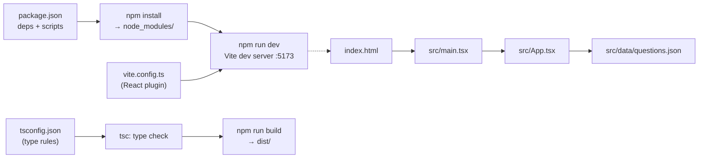

# L1.05 · Setup and the first working slice (+ Level 1 checkpoint)

> **Level 1 · Foundations** · Lesson 5 of 5

| Recipe card | |
|---|---|
| **Time** | 75 min (+ 30 min setup practice item in the plan) |
| **You need** | A computer with internet; L1.01–L1.04 |
| **You'll produce** | (1) the finished app running locally; (2) a from-scratch Vite + React + TypeScript project, `slice/`, that shows the 130 questions as flip cards |

**In two sentences:** First you install the tools and run the real app on your machine. Then you build the smallest end-to-end version of it by hand, with no project generator, so that every config file in Level 2 is already familiar.

> **Session 2 update (2026-10-16).** In the checkpoint map, "Supabase Auth (OTP)" is now "Supabase Auth (Google provider, PKCE)" ([L2.07c](l2-07c-google-sign-in.md)).

### Objectives
1. Install Node and Git, clone the repo, configure `.env.local`, and run `npm run dev`, `npm run build` and `npm run preview`, saying what each does.
2. Write `package.json`, `tsconfig.json`, `vite.config.ts`, `index.html` and `src/main.tsx` from memory for a React + TS app.
3. Render data from a JSON import as interactive cards (flip, next, previous).
4. Diagnose the five most common setup failures from their error text.

---

## 1 · Warm-up (from L1.04)

1. What does RLS return to a signed-in user for a table with no policies?
2. Which variables can browser code read from `.env.local`?

<details><summary>Answers</summary>1. Zero rows, no error. 2. Only those prefixed <code>VITE_</code>.</details>

## 2 · The problem this solves

Project generators (`npm create vite`) produce working code you did not write. When something breaks, you cannot tell which line matters. Building the skeleton by hand once makes it yours. And running the finished app first gives you a target to compare against.



*Takeaway: five small files define the whole toolchain. Everything else is your code.*

---

## 3 · Setup (the `setup` item in your plan)

### 3.1 Install the tools

| Tool | Version used in this build | Check with | Why |
|---|---|---|---|
| **Node.js** | 24.x (any current LTS ≥ 20 works) | `node -v` | Runs Vite, TypeScript, tests |
| **npm** | 11.x (ships with Node) | `npm -v` | Installs packages |
| **Git** | any recent | `git --version` | Version control; Vercel deploys from it |
| **Chrome** | any recent | | DevTools; Lighthouse; Playwright can also use it |
| **VS Code** (recommended) | | | Renders this Markdown, including Mermaid with the "Markdown Preview Mermaid Support" extension |

Install Node from https://nodejs.org (LTS) and Git from https://git-scm.com. On Windows, Git installs **Git Bash**, the terminal used during this build.

### 3.2 Clone, install, configure, run

```bash
git clone https://github.com/CoffeeAurCode/Psycology-of-learning.git
cd Psycology-of-learning
npm install
```
- `git clone` copies the repo with its history.
- `npm install` reads `package.json` plus `package-lock.json` (exact resolved versions of every sub-dependency) and fills `node_modules/`. Expect `added ~200 packages`.

Create `.env.local` by copying the template:

```bash
cp .env.example .env.local
# then edit .env.local:
# VITE_SUPABASE_URL=https://YOUR-PROJECT.supabase.co
# VITE_SUPABASE_ANON_KEY=sb_publishable_xxx
```
Without real values, the app still runs. Flashcards, quiz and list work offline, and the test and leaderboard screens show "needs Supabase" banners ([L2.04](l2-04-entry-config-libs.md) explains `isConfigured`).

```bash
npm run dev       # → VITE v7.x ready … Local: http://localhost:5173/
```
Open the URL. **`dev`** runs the Vite dev server. It serves source files translated on the fly, and *hot module replacement* (HMR) updates the page when you save.

```bash
npm run build     # → tsc -p . && vite build → dist/index.html, dist/assets/*.js|css
npm run preview   # → serves dist/ at http://localhost:4173
```
**`build`** first type-checks (`tsc -p .`; any type error stops the build), then bundles to `dist/`. **`preview`** serves `dist/` exactly as a static host would. Always try `preview` before deploying: some bugs only exist in the built version.

### 3.3 Common failures (learn them now)

| Symptom | Cause | Fix |
|---|---|---|
| `'vite' is not recognized` / `command not found: vite` | `npm install` not run, or run in another folder | Run `npm install` in the folder that has `package.json` |
| `Port 5173 is in use` (or Vite silently picks 5174) | Another dev server is running | Close it, or pass `--port 5180 --strictPort` (strict = fail instead of switching) |
| `error TS2307: Cannot find module './questions.json'` | Wrong path, or JSON imports not allowed | Check the path; Vite + `moduleResolution: "bundler"` handle JSON |
| Blank page; console: `destroy is not a function` | An effect returned a value ([L2.05](l2-05-app-shell.md)) | Wrap effect bodies in braces |
| `"/study"` becomes `C:/Program Files/Git/study` when passed to a script in Git Bash | MSYS path conversion rewrites arguments that look like paths | Prefix the command with `MSYS_NO_PATHCONV=1` ([L4.03](l4-03-playwright-foundations.md)) |

---

## 4 · First working slice: build it by hand

Make a sibling folder **outside** the repo, so nothing gets committed by accident:

```bash
mkdir slice && cd slice
mkdir -p src/data
cp ../Psycology-of-learning/src/data/questions.json src/data/
```

### 4.1 `package.json`

```json
{
  "name": "slice",
  "private": true,
  "type": "module",
  "scripts": {
    "dev": "vite",
    "build": "tsc -p . && vite build",
    "preview": "vite preview"
  },
  "dependencies": {
    "react": "19.2.9",
    "react-dom": "19.2.9"
  },
  "devDependencies": {
    "@types/react": "19.2.18",
    "@types/react-dom": "19.2.7",
    "@vitejs/plugin-react": "5.2.0",
    "typescript": "5.9.3",
    "vite": "7.3.7"
  }
}
```
Line notes:
- `"private": true`: npm refuses to publish it by accident.
- `"type": "module"`: `.js` files (and `vite.config.ts`) are ES modules, so `import` works everywhere.
- **Exact versions** (no `^`): we pinned what we tested, so a new release can't change behaviour silently. The real project pins most packages the same way. (A few test tools added later use `^`.)
- `dependencies` vs `devDependencies`: runtime libraries vs build and type tools. Vite bundles both into the output as needed. The split documents intent.

Then:
```bash
npm install
```

### 4.2 `tsconfig.json`

```json
{
  "compilerOptions": {
    "target": "ES2022",
    "lib": ["ES2022", "DOM", "DOM.Iterable"],
    "module": "ESNext",
    "moduleResolution": "bundler",
    "jsx": "react-jsx",
    "strict": true,
    "skipLibCheck": true,
    "isolatedModules": true,
    "verbatimModuleSyntax": true,
    "noEmit": true,
    "resolveJsonModule": true,
    "types": ["vite/client"]
  },
  "include": ["src"]
}
```
Line notes:
- `target`/`lib`: which JS features and browser APIs exist (DOM types like `HTMLElement`).
- `moduleResolution: "bundler"`: resolve imports the way Vite does.
- `jsx: "react-jsx"`: the modern JSX transform, with no `import React` needed in every file.
- `strict: true`: null checks and more. This is what made `profile!` necessary, and visible, in our code.
- `isolatedModules` + `verbatimModuleSyntax`: each file must be translatable on its own (that is how Vite compiles). Type-only imports must say `import type`.
- `noEmit`: `tsc` only *checks*; Vite produces the JS.
- `resolveJsonModule`: allows `import raw from "./questions.json"`. (The real project resolves JSON through Vite's `bundler` resolution too. It doesn't list this flag, but adding it is harmless and makes the slice explicit.)
- `types: ["vite/client"]`: types for `import.meta.env` and asset imports.

### 4.3 `vite.config.ts`

```ts
import { defineConfig } from "vite";
import react from "@vitejs/plugin-react";

export default defineConfig({
  plugins: [react()],
});
```
The React plugin compiles JSX and enables Fast Refresh, which keeps component state across edits.

### 4.4 `index.html` (at the project root, not in `src/`)

```html
<!doctype html>
<html lang="en">
  <head>
    <meta charset="UTF-8" />
    <meta name="viewport" content="width=device-width, initial-scale=1" />
    <title>Slice · Flashcards</title>
  </head>
  <body>
    <div id="root"></div>
    <script type="module" src="/src/main.tsx"></script>
  </body>
</html>
```
Vite treats `index.html` as the entry point and follows the module script into your code.

### 4.5 `src/main.tsx`

```tsx
import { StrictMode } from "react";
import { createRoot } from "react-dom/client";
import App from "./App";
import "./slice.css";

createRoot(document.getElementById("root")!).render(
  <StrictMode>
    <App />
  </StrictMode>
);
```
- `createRoot(...).render(...)` is React 18+'s entry API.
- `!`: we wrote `index.html`, so `#root` exists.
- `StrictMode`: dev-only double-invoking to surface effect bugs ([L1.03](l1-03-typescript-react.md) §4.3).
- `import "./slice.css"`: Vite injects CSS imported from JS.

### 4.6 `src/App.tsx`: the slice

```tsx
import { useEffect, useState } from "react";
import raw from "./data/questions.json";

type Question = { id: number; week: number; q: string; options: string[]; answer: number };
const QUESTIONS = raw as Question[];
const LETTERS = "ABCD";

export default function App() {
  const [pos, setPos] = useState(0);
  const [flipped, setFlipped] = useState(false);
  const q = QUESTIONS[pos];

  const go = (d: number) => {
    setFlipped(false);
    setPos((p) => (p + d + QUESTIONS.length) % QUESTIONS.length);   // wrap around both ends
  };

  useEffect(() => {
    const k = (e: KeyboardEvent) => {
      if (e.key === " ") { e.preventDefault(); setFlipped((f) => !f); }
      if (e.key === "ArrowRight") go(1);
      if (e.key === "ArrowLeft") go(-1);
    };
    window.addEventListener("keydown", k);
    return () => window.removeEventListener("keydown", k);
  });                                          // no deps: re-bind each render (go is recreated)

  return (
    <main className="wrap">
      <p className="meta">
        Week {q.week} · Q{q.id % 100} · {pos + 1} / {QUESTIONS.length}
      </p>
      <button className={`card ${flipped ? "flipped" : ""}`} onClick={() => setFlipped((f) => !f)}>
        {!flipped ? (
          <>
            <strong>{q.q}</strong>
            <ol type="A">{q.options.map((o) => <li key={o}>{o}</li>)}</ol>
            <small>Tap to reveal</small>
          </>
        ) : (
          <>
            <small>Correct answer</small>
            <strong className="ans">{LETTERS[q.answer]}. {q.options[q.answer]}</strong>
          </>
        )}
      </button>
      <nav>
        <button onClick={() => go(-1)}>← Prev</button>
        <button onClick={() => go(1)}>Next →</button>
      </nav>
    </main>
  );
}
```
Line notes:
- `raw as Question[]`: JSON imports are typed loosely; we label them. The real app does the same in `questions.ts`.
- `q.id % 100`: ids are `week*100 + n`, so `% 100` gives the number within the week ([L2.01](l2-01-data-pipeline.md)).
- `(p + d + len) % len`: modulo wraps around. `+ len` keeps it positive when going back from 0. Check: `(0 − 1 + 130) % 130 = 129` ✓.
- The `key={o}` on options: option texts are unique within a question (a data test enforces this, [L4.01](l4-01-testing-strategy-data.md)).
- We swap content on flip instead of using a 3D rotation. The real app's 3D flip, and why Safari needed a special approach, comes in [L2.08a](l2-08a-flashcard-deck.md).

### 4.7 `src/slice.css`

```css
:root { --bg: #f6f0e6; --ink: #17110e; --red: #d7262f; color-scheme: light dark; }
@media (prefers-color-scheme: dark) { :root { --bg: #0e0c0b; --ink: #f4eadb; } }
body { margin: 0; background: var(--bg); color: var(--ink); font: 16px/1.5 system-ui, sans-serif; }
.wrap { max-width: 560px; margin: 0 auto; padding: 16px; }
.meta { opacity: 0.7; }
.card { display: grid; gap: 10px; width: 100%; min-height: 320px; padding: 20px; text-align: left;
        border-radius: 20px; border: 1px solid currentColor; background: transparent; color: inherit;
        font: inherit; cursor: pointer; }
.card.flipped { background: #120f0e; color: #f4eadb; }
.ans { font-size: 1.5rem; color: var(--red); }
nav { display: flex; gap: 10px; margin-top: 12px; }
nav button { flex: 1; min-height: 48px; border-radius: 14px; font: inherit; }
```
`color-scheme: light dark` tells the browser to style form controls and scrollbars to match.

### 4.8 Run it

```bash
npm run dev
```
Expected: `Week 0 · Q1 · 1 / 130` and "What is Psychology?". Space flips; → / ← move. Then:

```bash
npm run build && npm run preview
```
Expected build output (sizes vary): `dist/index.html`, `dist/assets/index-<hash>.css`, `dist/assets/index-<hash>.js`, and `✓ built in …`.

> **Done when:** all 130 cards cycle, flipping shows the right answer for card 1 (D. A study of cognitive processes & behavior), and `npm run build` passes the type check.

---

## 5 · Bug journal: setup

**Clean run (by design).** Building the slice by hand avoided generator surprises, so nothing broke. The real project's first browser run *did* break (blank page). That story lives with the code that caused it in [L2.05](l2-05-app-shell.md). One setup-adjacent surprise from the session is worth knowing now:

**Incident · "The dev server keeps reloading and the app looks frozen."**
1. **Symptom.** During testing in Chrome, the page kept reloading; timers took 37 seconds to fire a 500 ms timeout; screenshots timed out.
2. **Diagnosis.** The console showed `[vite] server connection lost. Polling for restart...` about once a minute, followed by reloads. A JS check showed `document.visibilityState === "hidden"`. The test tab was in the background.
3. **Root cause.** Two unrelated things. (a) In this environment the dev server's live-reload WebSocket kept dropping, and Vite's client reloads the page when it reconnects. (b) Browsers throttle timers and pause `requestAnimationFrame` in hidden tabs, so animations never finished.
4. **Fix.** Test against `npm run build && npx vite preview` (no reload socket), and in automation use headless browsers, which are never "hidden".
5. **Lesson.** Before calling an app frozen, check `document.visibilityState` and whether you are on the dev server. Full forensics in [L4.07](l4-07-a11y-lighthouse-flaky.md).

## 6 · Why this design

| Decision | Alternatives | Why this one | Trade-off | Choose differently when |
|---|---|---|---|---|
| Vite + React + TS | Next.js; plain HTML/JS | Fast static build, zero-config deploy, types catch errors early | No server rendering (SEO relies on meta tags + fallback HTML) | You need per-page SSR or server routes → Next.js |
| Hand-written config | `npm create vite` | Every line understood | 10 minutes of typing | Never for learning; fine for a throwaway |
| Pinned exact versions | `^` ranges | Reproducible builds | Manual upgrades | A library you want patch fixes from automatically |
| Content swap (slice) vs 3D flip | CSS 3D from day one | Works on every browser immediately | Less delightful | Once you know the Safari pitfall (L2.08a) |

## 7 · Check yourself

**Q1.** `npm run build` fails with a TypeScript error but `npm run dev` works. Why?
- A) Vite is broken · B) `dev` does not type-check; `build` runs `tsc -p .` first · C) Missing `.env.local` · D) Port conflict

<details><summary>Answer</summary><b>B.</b> Vite's dev server only strips types for speed. Our build script runs <code>tsc</code> first, so type errors block deploys. That is a feature.</details>

**Q2.** Why put the slice folder **outside** the repo?
<details><summary>Answer</summary>So its <code>node_modules</code> and experiments can't be committed or deployed by accident, and the real project's config stays untouched.</details>

**Q3.** You go back from card 1 and get `undefined` errors. Which expression is missing the `+ len`?
<details><summary>Answer</summary><code>(p + d) % len</code>: in JavaScript <code>-1 % 130</code> is <code>-1</code> (remainder keeps the sign), so <code>QUESTIONS[-1]</code> is undefined. Adding <code>len</code> first fixes it.</details>

## 8 · Level 1 checkpoint

**Mixed quiz (answers hidden).**
1. Which part of the system stamps the test start time? *(L1.01)*
2. Which HTML tag setting obliges safe-area padding? *(L1.02)*
3. What does `setX(x => x + 1)` protect against? *(L1.03)*
4. RLS with no policies: what does a signed-in `select` return? *(L1.04)*
5. What does `npm run preview` serve? *(L1.05)*
6. Why can't a student insert a fake attempt? *(L1.01/L1.04)*

<details><summary>Answers</summary>1. <code>start_test</code> in Postgres (<code>now()</code>). 2. <code>viewport-fit=cover</code>. 3. Lost updates when several updates queue before a render. 4. Zero rows. 5. The built <code>dist/</code> folder, like a static host. 6. <code>test_attempts</code> has RLS with no insert policy; only definer functions write it.</details>

**Blank-page drill (20 min).** No scrolling. Draw the architecture map, then name every part and the lesson that will teach it in Level 2.
<details><summary>Self-check</summary>

- [ ] Browser: React app + localStorage
- [ ] Vercel: static files + analytics; GitHub push → deploy
- [ ] Supabase Auth (OTP), Postgres tables (4), functions (4)
- [ ] Arrows: files → browser; email/code ↔ Auth; RPC with token; own-row reads/writes under RLS
- [ ] Lessons: data L2.01, DB L2.02–03, shell L2.04–05, UI L2.06, auth L2.07, cards L2.08, test L2.09, CSS L2.10
</details>

## 9 · Flashcards

<details><summary><b>Q:</b> What does <code>npm run build</code> do before bundling, in this project?</summary><b>A:</b> Runs <code>tsc -p .</code> to type-check; any error fails the build.</details>
<details><summary><b>Q:</b> Why <code>"type": "module"</code> in package.json?</summary><b>A:</b> So JS/TS config files are ES modules and can use <code>import</code>.</details>
<details><summary><b>Q:</b> Why <code>verbatimModuleSyntax</code>?</summary><b>A:</b> Forces <code>import type</code> for type-only imports so per-file compilation (Vite) never imports a non-existent runtime value.</details>
<details><summary><b>Q:</b> Where does <code>index.html</code> live in a Vite app?</summary><b>A:</b> The project root; it is the entry point.</details>
<details><summary><b>Q:</b> Why test with <code>preview</code> before deploying?</summary><b>A:</b> It serves the production build; some bugs exist only after bundling or without the dev server.</details>
<details><summary><b>Q:</b> How do you wrap an index backwards safely?</summary><b>A:</b> <code>(p + d + len) % len</code>, because JS <code>%</code> keeps the sign.</details>

## 10 · The menu board

| Command | Meaning |
|---|---|
| `npm install` | Install from `package.json` + lockfile |
| `npm run dev` | Dev server with HMR (no type check) |
| `npm run build` | `tsc -p .` then `vite build` → `dist/` |
| `npm run preview` | Serve `dist/` like production |
| `cp .env.example .env.local` | Start your local config (git-ignored) |
| `--port N --strictPort` | Fixed port; fail if taken |
| `MSYS_NO_PATHCONV=1 cmd …` | Git Bash: don't rewrite `/paths` |

## 11 · Glossary

**Bundle**: combined, minified output files. **Dev server**: serves source with on-the-fly compilation. **Fast Refresh / HMR**: updating code in the page without a full reload. **Lockfile**: exact dependency tree (`package-lock.json`). **Pinned version**: exact version without a range. **Strict mode (TS)**: strong type checks including null safety. **Type check**: verifying types without producing JS.

## 12 · Go further

| Resource | Type | Why | Which part | Time |
|---|---|---|---|---|
| [Vite: Getting Started](https://vite.dev/guide/) | Docs | What the dev server and build do | "Overview", "index.html and Project Root" | 15 min |
| [TypeScript: TSConfig Reference](https://www.typescriptlang.org/tsconfig/) | Reference | Look up any compiler option above | `strict`, `moduleResolution`, `verbatimModuleSyntax` | 15 min |
| [npm: package.json](https://docs.npmjs.com/cli/v11/configuring-npm/package-json) | Docs | Scripts, dependencies, `private` | "scripts", "dependencies" | 10 min |

---
← [L1.04 SQL, auth & hosting](l1-04-data-auth-hosting.md) · [Hub](README.md) · [L2.01 The data pipeline →](l2-01-data-pipeline.md)
