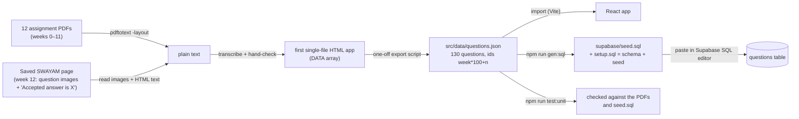

# L2.01 · From PDFs to 130 questions: the data pipeline

> **Level 2 · Build it** · Lesson 1 of 17

| Recipe card | |
|---|---|
| **Time** | 60 min |
| **You need** | L1.05 done; `pdftotext` (ships with Git for Windows; on macOS `brew install poppler`) |
| **You'll produce** | `src/data/questions.json` (130 questions), `src/data/questions.ts`, `scripts/gen-seed.mjs`, and the generated `supabase/seed.sql` + `setup.sql` |

**In two sentences:** All of the app's value sits in 130 question-and-answer pairs taken from 12 PDFs and one web page. This lesson shows how we extracted them, how the data is shaped (ids, 0-based answers, notes), and the script that turns the JSON into SQL so the database and the app can never disagree.

### Objectives
1. Run `pdftotext -layout` and pick the answer key out of its output, including wrapped and malformed "Ans." lines.
2. Explain the id scheme `week*100 + n` and why answers are 0-based indexes.
3. Write `questions.ts` (types + derived constants) and `gen-seed.mjs` from memory, including SQL string escaping.
4. Explain why `questions.json` is the single source of truth, and which test proves the SQL matches it.

---

## 1 · Warm-up (from Level 1)

1. In the slice, why did `q.id % 100` give the question number?
2. Why must the `questions` table be unreadable from the browser?
3. What does `on conflict (id) do update` do?

<details><summary>Answers</summary>1. Ids are <code>week*100 + n</code>. 2. It holds the answer key used for grading; forging would be trivial if the grader's key were exposed during a test (flashcards show answers for study, but the ranked flow relies on the server). 3. Upsert: update the existing row instead of failing on a duplicate id.</details>

## 2 · The problem this solves

The exam asks only assignment questions, and those exist only as PDFs (weeks 0–11) and a SWAYAM page (week 12). The app needs them as structured data in **two places**: the browser (flashcards, quiz, list, test UI) and Postgres (grading). Typing them twice would guarantee drift. So we keep **one** JSON file and *generate* the SQL from it.



*Takeaway: JSON is the source of truth. The SQL is a build artifact, and a test fails if the two ever disagree.*

---

## 3 · Concepts

### 3.1 `pdftotext -layout`: text that keeps its columns

**Definition.** `pdftotext` (from the Poppler tools) converts a PDF to plain text. With `-layout` it keeps the original spacing, so options stay on their own lines.

**Why here.** The assignment PDFs are text-based, not scans. That makes extraction exact. No OCR (image-to-text guessing) was needed for weeks 0–11.

**How we used it.**

```bash
for f in *.pdf; do pdftotext -layout "$f" "txt/${f%.pdf}.txt"; done
```
- `"$f"` is quoted because a filename contains spaces (`Assignement 3. Solution.pdf`).
- `${f%.pdf}` is Bash for "`$f` with `.pdf` removed from the end".
- Output: one `.txt` per week, about 4 KB each.

A real chunk of output (week 0):

```text
1) What is Psychology?
    A. Just a social media trend
    B. An art of living
    C. A subject about human body
    D. A study of cognitive processes & behavior

         Ans. D= A study of cognitive processes & behavior
```

**What can go wrong.** The keys are not perfectly regular, and those irregularities are why we hand-checked every question:

| Week | Quirk in the official PDF | What we did |
|---|---|---|
| 1 | Two questions both numbered `6)` (Watson, then Behaviorism) | Kept both. Our ids count position, not the printed number |
| 6, Q7 | Key says `Ans. a= all of the given`, but "all of the given" is option **d** | Trusted the **text**; stored `answer: 3` plus a `note` shown on the card |
| 7, Q6 | Key says `Ans. = humanistic` (no letter) | Matched the text to option c |
| 10, Q7 | The answer text wraps onto a second line | The parser joins the next line ([L4.01](l4-01-testing-strategy-data.md)) |

### 3.2 Week 12: questions in images, answers in HTML

There was no week-12 PDF. The user saved the SWAYAM assignment page with its assets. In that HTML:
- each question was an **image** (`a12q1.png` … `a12q10.png`), and the A/B/C/D labels next to them had no text;
- below each one was the platform's feedback: `Accepted answer is` followed by `C.`.

So we read the ten images (their text is short and clear), and took the answers from the HTML by stripping tags and matching the pattern. The accepted answers were **C D D B C D D A A B**. A unit test re-checks this against the saved page ([L4.01](l4-01-testing-strategy-data.md)).

> **Side note.** The page also showed the user's own submission. Q1 was marked wrong: they had picked *multidimensional*, but the accepted answer is **unidimensional**. That is why reading "Accepted answer", not "your answer", matters.

### 3.3 The id scheme: `week * 100 + n`

**Definition.** Question *n* (1–10) of week *w* gets id $\text{id} = 100w + n$. So week 3 Q4 → 304, week 12 Q1 → 1201, week 0 Q1 → 1.

**Why.**
- **Stable.** Adding question 11 to week 3 gives it 311 and changes no other id. A running counter (1…130) would shift every later id and silently break everyone's saved progress and attempts, which reference ids.
- **Readable.** You can debug `question_id = 507` in a database row without a lookup.
- **Reversible.** $w = \lfloor \text{id} / 100 \rfloor$, $n = \text{id} \bmod 100$, which is the app's `numberInWeek`.

### 3.4 Answers as 0-based indexes

`answer: 3` means `options[3]`, the fourth option (D). The UI shows letters with `"ABCD"[answer]`. The database stores the same integer, and `submit_test` compares integers. Using the *letter* would add conversions; using the *text* would break if we fixed a typo in an option.

---

## 4 · Reading the real code

### 4.1 The one-off export (history)

The first artifact of the session was a single-file HTML flashcard page. Its script held a `DATA` array of `{w, q, o, a, n?}` objects. When we moved to React, this command converted it once, run with `node -e` from the project root:

```js
const fs = require("fs");
const h = fs.readFileSync("Psychology_of_Learning_Flashcards.html", "utf8");
const js = h.split("<script>")[1].split("</script>")[0];
const data = eval(js.split("DATA.forEach")[0].replace("const DATA =", "(").trim().replace(/;$/, "") + ")");
const cnt = {};
const out = data.map((d) => {
  cnt[d.w] = (cnt[d.w] || 0) + 1;
  const o = { id: d.w * 100 + cnt[d.w], week: d.w, q: d.q, options: d.o, answer: d.a };
  if (d.n) o.note = d.n;
  return o;
});
fs.writeFileSync("src/data/questions.json", JSON.stringify(out, null, 1));
```

Line notes:
- **L3**: grab the text between `<script>` and `</script>`.
- **L4**: keep only the array literal. Replacing `const DATA =` with `(` and closing with `)` turns `[…]` into an expression that `eval` can return. **`eval` runs arbitrary code.** That was acceptable here only because we wrote that file ourselves. Never `eval` downloaded content.
- **L5–9**: `cnt[d.w]` counts questions seen so far in each week, so the 1st of week 3 becomes 301, the 2nd 302 and so on. This is why the duplicated printed "6)" in week 1 doesn't matter.
- **L10**: `JSON.stringify(out, null, 1)` pretty-prints with 1-space indentation, which keeps diffs readable.

It is no longer part of the build. `questions.json` is now edited directly.

### 4.2 `src/data/questions.ts`

```ts
import raw from "./questions.json";

export type Question = {
  id: number; // week*100 + number, matches public.questions.id
  week: number;
  q: string;
  options: string[];
  answer: number; // 0-based
  note?: string;
};

export const QUESTIONS: Question[] = raw as Question[];
export const BY_ID = new Map(QUESTIONS.map((q) => [q.id, q]));
export const WEEKS = [...new Set(QUESTIONS.map((q) => q.week))].sort((a, b) => a - b);
export const TEST_SIZE = 100;

export const WEEK_TOPICS: Record<number, string> = {
  0: "Intro to psychology",
  1: "What is learning",
  2: "Behaviourism & intelligence",
  3: "Memory",
  4: "Thinking & Bloom",
  5: "Motivation",
  6: "Emotional intelligence",
  7: "Learning & instruction",
  8: "Pedagogy",
  9: "E-learning",
  10: "Teaching & assessment",
  11: "Social cognition",
  12: "Sustainability",
};

export const LETTERS = "ABCD";
export const numberInWeek = (q: Question) => q.id % 100;
```

Line notes:
- **L1**: Vite imports JSON as a plain JS value. TypeScript infers a wide type, so…
- **L12**: …we assert `Question[]`. It is an assertion, not a check. The *unit tests* do the checking: every question has 2 or 4 options, a valid answer index, and so on.
- **L13 `BY_ID`**: a `Map` from id to question, giving O(1) lookups. The test runner receives `question_ids` from the server and must find each question quickly (`BY_ID.get(id)`). Without it, every render would scan 130 items.
- **L14 `WEEKS`**: `new Set(...)` removes duplicates and `[...set]` turns it back into an array. `.sort((a, b) => a - b)` sorts **numerically**. The default `sort()` compares strings, which would order `[0, 1, 10, 11, 12, 2, …]`. A real bug avoided.
- **L15 `TEST_SIZE`**: shown in the UI text. The server has its own `limit 100` (in SQL). They must match. A test checks `start_test` returns 100 ids.
- **L17–31 `WEEK_TOPICS`**: `Record<number, string>` is an object type with number keys and string values. Shown on week tiles and the Study header.
- **L33 `LETTERS`**: `"ABCD"[i]` turns an index into a letter, because strings are indexable.
- **L34 `numberInWeek`**: the reverse of the id scheme.

### 4.3 `scripts/gen-seed.mjs`

```js
// Regenerates supabase/seed.sql and supabase/setup.sql from src/data/questions.json.
// Run after editing questions: npm run gen:sql
import { readFileSync, writeFileSync } from "node:fs";

const questions = JSON.parse(readFileSync(new URL("../src/data/questions.json", import.meta.url), "utf8"));
const lit = (s) => "'" + String(s).replace(/'/g, "''") + "'";

const rows = questions.map(
  (q) => `  (${q.id}, ${q.week}, ${lit(q.q)}, ${lit(JSON.stringify(q.options))}::jsonb, ${q.answer})`
);

const sql = `-- Generated by scripts/gen-seed.mjs — ${questions.length} questions. Run after schema.sql.
insert into public.questions (id, week, prompt, options, answer) values
${rows.join(",\n")}
on conflict (id) do update
  set week = excluded.week, prompt = excluded.prompt, options = excluded.options, answer = excluded.answer;
`;

writeFileSync(new URL("../supabase/seed.sql", import.meta.url), sql);

// one-shot file: schema + questions, for pasting into the Supabase SQL editor
const schema = readFileSync(new URL("../supabase/schema.sql", import.meta.url), "utf8");
const banner = "\n\n-- =====================================================================\n-- Questions\n-- =====================================================================\n";
writeFileSync(new URL("../supabase/setup.sql", import.meta.url), schema + banner + sql);
console.log(`Wrote supabase/seed.sql and supabase/setup.sql (${questions.length} questions)`);
```

Line notes:
- **L3** `node:fs`: the `node:` prefix says "built-in module", so it can't be confused with an npm package called `fs`.
- **L5** `new URL("../src/…", import.meta.url)`: resolve the path relative to **this script's file**, not the current working directory. Running `node scripts/gen-seed.mjs` from anywhere works. A plain `"src/…"` would break if run from `scripts/`.
- **L6** `lit()` builds a SQL string literal. In SQL, a quote inside a string is written as **two quotes**: `Maslow's` → `'Maslow''s'`. `/'/g` is a regex with the global flag, so every quote is replaced, not only the first. Without this, the first apostrophe would end the string and the rest would be parsed as SQL. That is a syntax error at best, and SQL injection at worst.
- **L9** options are stored as JSON text, then cast with `::jsonb` (binary JSON), so Postgres validates it.
- **L12–17** one multi-row `insert … values (…), (…), …` statement. `on conflict (id) do update` makes the seed **idempotent**: re-running it updates rows instead of failing on duplicate keys. So you can fix a typo, regenerate and paste again.
- **L22–24** `setup.sql = schema.sql + banner + seed`, so the user pastes **one** file into the Supabase SQL editor.
- `package.json` has `"gen:sql": "node scripts/gen-seed.mjs"`, so `npm run gen:sql` runs it.

---

## 5 · Worked examples (step-through frames)

### 5.1 Pulling the answer key out of PDF text

The data test (taught in [L4.01](l4-01-testing-strategy-data.md)) re-reads every PDF with this logic: find lines matching `/Ans\.?\s*([a-dA-D])?\s*=\s*(.+)$/`, and if the next line continues the answer, join it.

Input (week 10 output, real lines):

```text
         Ans. c= Students' cognitive development and learning is limited by the general stages of
                  development.
```

| Frame | Step | State after | Predict first → |
|---|---|---|---|
| 1 | Regex on line 1 | letter = `c`, text = `Students' cognitive … stages of` | Does the regex need the letter? **No**, `([a-dA-D])?` is optional (week 7 Q6 has none) |
| 2 | Look at next line: `development.` | not empty, and doesn't start with `Solution`, `n)`, `QUESTION` or `***END` | Join it? **Yes** |
| 3 | Joined | `Students' cognitive … stages of development.` | |
| 4 | Normalise (lowercase, keep a–z0–9) | `studentscognitivedevelopmentandlearningislimitedbythegeneralstagesofdevelopment` | Why normalise? Spacing and quotes differ between PDF and JSON |
| 5 | Compare with ours, `options[2]` normalised | equal ✓ | |

### 5.2 Escaping a quote

`q.q = "Friendship is a ___ need in Maslow's hierarchy."`

| Frame | Expression | Value |
|---|---|---|
| 1 | `String(s)` | `Friendship is a ___ need in Maslow's hierarchy.` |
| 2 | `.replace(/'/g, "''")` | `Friendship is a ___ need in Maslow''s hierarchy.` |
| 3 | wrap in quotes | `'Friendship is a ___ need in Maslow''s hierarchy.'` |
| 4 | Postgres reads it as | `Friendship is a ___ need in Maslow's hierarchy.` ✓ |

### 5.3 One question, end to end

Week 5, the 9th question:

```json
{ "id": 509, "week": 5, "q": "Friendship is a ___ need in Maslow's hierarchy.",
  "options": ["Love and belonging", "Esteem", "Physiological", "Safety"], "answer": 0 }
```
becomes this row in `seed.sql`:

```sql
  (509, 5, 'Friendship is a ___ need in Maslow''s hierarchy.', '["Love and belonging","Esteem","Physiological","Safety"]'::jsonb, 0),
```
and on a card shows **"W5 · Q9"** (`509 % 100 = 9`) with the answer **A. Love and belonging** (`"ABCD"[0]`).

---

## 6 · Running and testing

```bash
npm run gen:sql
# Wrote supabase/seed.sql and supabase/setup.sql (130 questions)

npm run test:unit
# ✔ there are 130 questions, 10 per week, weeks 0–12
# ✔ ids are unique and follow week*100 + n
# ✔ every question has text, 2 or 4 distinct options and a valid answer
# ✔ supabase/seed.sql is in sync with questions.json
# ✔ week 0 answers match 00.Assignement_Psy.pdf   … (12 PDF checks)
# ✔ week 12 answers match the SWAYAM accepted answers
# ℹ tests 17  ℹ pass 17  ℹ fail 0
```

What each proves:
- **Shape tests** catch a missing option or a bad index the moment you edit the JSON.
- **"seed.sql is in sync"** catches editing the JSON and forgetting `npm run gen:sql`.
- **PDF checks** recompute every answer from the official keys. **The week-12 check** re-reads "Accepted answer is X" from the saved page.
- We also proved the tests **can fail**. We changed one answer on purpose; two tests failed; we restored it. This is a *mutation check*, taught in [L4.01](l4-01-testing-strategy-data.md).

## 7 · Bug journal

**Incident · Official key letter contradicts its own text (week 6, Q7)**
1. **Symptom.** `Ans. a= all of the given`, but option a is "optimism" and "all of the given" is option d.
2. **Diagnosis.** We compared the letter and the text for all 120 PDF answers. Only this one disagreed. Week 7 Q6 had no letter at all (`Ans. = humanistic`).
3. **Root cause.** A typo in the official answer key.
4. **Fix.** Trust the text: `"answer": 3` plus `"note": "The answer key prints \"a = all of the given\"; the answer text is \"all of the given\" (option d)."`. The card's back face shows the note so students aren't confused by the PDF.
5. **Lesson.** When a source contradicts itself, decide which part is authoritative (the text here), record the decision **in the data**, and make the test compare on the authoritative part. Our PDF test compares **texts**, never letters.

**Test-tooling incident** (the PDF tests were silently skipped because `pdftotext -v` exits non-zero) belongs to the test code and is told in [L4.01](l4-01-testing-strategy-data.md).

## 8 · Why this design

| Decision | Alternatives | Why this one | Trade-off | Choose differently when |
|---|---|---|---|---|
| JSON in the repo as the source of truth | Database as the source; a spreadsheet | Versioned in Git, reviewable diffs, usable offline by the app | Must regenerate SQL after edits (a test enforces it) | Non-developers edit questions daily → an admin UI on the DB |
| Generated `seed.sql` | Hand-written SQL | No drift, correct escaping | One more script | Never for 130 rows |
| `on conflict do update` | Plain insert | Re-runnable after fixes | Deleted questions are not removed automatically | You must delete rows → generate a `delete … where id not in (…)` too |
| ids `100w + n` | Sequential 1…130; uuids | Stable, readable, reversible | Max 99 questions per week | A week with ≥ 100 questions → `1000w + n` |
| 0-based answer index | Letter; answer text | Matches array indexing in JS and SQL | Off-by-one if someone thinks 1-based | Never here |

## 9 · Check yourself

**Q1.** You add an 11th question to week 3. What id does it get, and what happens to week 4's ids?
<details><summary>Answer</summary>311. Week 4's ids don't change (401–410). With sequential ids every later id would shift, breaking saved progress and past attempts.</details>

**Q2.** A question text contains `It's`. You forget the `.replace(/'/g, "''")`. What happens when the user pastes `setup.sql`?
- A) Works · B) Syntax error near `s` · C) The apostrophe disappears · D) Only that row is skipped

<details><summary>Answer</summary><b>B.</b> The first <code>'</code> inside the text closes the string literal, and Postgres then tries to parse <code>s …'</code> as SQL. The whole statement fails (one multi-row insert), so <b>D</b> is wrong too.</details>

**Q3.** `WEEKS` used `.sort()` without a comparator. What order would the week chips appear in?
<details><summary>Answer</summary><code>0, 1, 10, 11, 12, 2, 3, …</code>. The default sort compares as strings.</details>

**Q4.** You edit an answer in `questions.json` and deploy, but forget `npm run gen:sql`. What does a student see?
<details><summary>Answer</summary>The flashcards show the new answer (the app imports the JSON), but the server grades with the old one. A correct test answer is marked wrong. The unit test "seed.sql is in sync" catches this before you push.</details>

## 10 · Practice

**Easy (10 min).** Run `pdftotext -layout` on one PDF and find its 10 `Ans.` lines with `grep -n "Ans" file.txt`.
*Done when:* you can point at the wrapped answer in week 10.

**Medium (20 min).** Write a function `parseKeys(text)` that returns 10 normalised answer strings, joining wrapped lines.
<details><summary>Solution</summary>

```js
const norm = (s) => s.toLowerCase().replace(/[^a-z0-9]/g, "");
function parseKeys(text) {
  const lines = text.split(/\r?\n/), keys = [];
  for (let i = 0; i < lines.length; i++) {
    const m = lines[i].match(/Ans\.?\s*([a-dA-D])?\s*=\s*(.+)$/);
    if (!m) continue;
    let t = m[2].trim();
    const next = (lines[i + 1] || "").trim();
    if (next && !/^(Solution|\d+\)|QUESTION|\*+END)/.test(next)) t += " " + next;
    keys.push(norm(t));
  }
  return keys;
}
```
</details>

**Hard (40 min).** Extend `gen-seed.mjs` to also emit `delete from public.questions where id not in (…)` so that removed questions disappear. Discuss why that is dangerous: old attempts reference removed ids.
<details><summary>Discussion</summary><code>submit_test</code> joins answers to <code>questions</code>. Old submitted attempts are fine (their score is stored), but an <i>unsubmitted</i> attempt containing a deleted id would score that question as missing. Deleting is safe only between tests, or if you keep "retired" questions with a flag instead.</details>

## 11 · From memory

**Rung 1 · Cloze.**

```js
const lit = (s) => "'" + String(s).replace(/___①___/g, "___②___") + "'";
const rows = questions.map((q) => `  (${q.id}, ${q.week}, ${lit(q.q)}, ${lit(JSON.___③___(q.options))}::___④___, ${q.answer})`);
// … values ${rows.join(",\n")}
// on ___⑤___ (id) do update set week = ___⑥___.week, …
export const WEEKS = [...new Set(QUESTIONS.map((q) => q.week))].sort((a, b) => ___⑦___);
export const numberInWeek = (q: Question) => q.id ___⑧___ 100;
```
<details><summary>Answers</summary>① <code>'</code> ② <code>''</code> ③ <code>stringify</code> ④ <code>jsonb</code> ⑤ <code>conflict</code> ⑥ <code>excluded</code> ⑦ <code>a - b</code> ⑧ <code>%</code></details>

**Rung 2 · Blank page (15 min).** Write `questions.ts` and `gen-seed.mjs` from memory. Run `npm run gen:sql && npm run test:unit`.
<details><summary>Self-check</summary>

- [ ] `Question` type with optional `note`
- [ ] `BY_ID` Map, `WEEKS` numeric sort, `TEST_SIZE = 100`, `LETTERS`, `numberInWeek`
- [ ] Paths resolved with `new URL(…, import.meta.url)`
- [ ] Quote escaping with a global regex
- [ ] `::jsonb` cast and `on conflict … excluded`
- [ ] `setup.sql` = schema + banner + seed
- [ ] `test:unit` passes 17/17
</details>

## 12 · Flashcards

<details><summary><b>Q:</b> What is the id of week 12, question 1?</summary><b>A:</b> 1201 (100·12 + 1).</details>
<details><summary><b>Q:</b> Why not sequential ids?</summary><b>A:</b> Inserting a question would shift later ids and corrupt saved progress and attempts.</details>
<details><summary><b>Q:</b> How do you escape a quote inside a SQL string?</summary><b>A:</b> Double it: <code>''</code>.</details>
<details><summary><b>Q:</b> Why <code>new URL(path, import.meta.url)</code> in a Node script?</summary><b>A:</b> Resolves relative to the script file, independent of the working directory.</details>
<details><summary><b>Q:</b> Why does the seed use <code>on conflict do update</code>?</summary><b>A:</b> Idempotent: you can re-run it after fixing data.</details>
<details><summary><b>Q:</b> Which part of a contradictory key did we trust, and how is it recorded?</summary><b>A:</b> The answer text; recorded as <code>answer: 3</code> plus a <code>note</code> on the question.</details>
<details><summary><b>Q:</b> What catches "edited JSON, forgot gen:sql"?</summary><b>A:</b> The unit test "supabase/seed.sql is in sync with questions.json".</details>
<details><summary><b>Q:</b> Why <code>BY_ID</code>?</summary><b>A:</b> O(1) lookup of questions by the ids the server sends.</details>

## 13 · The menu board

| | |
|---|---|
| Extract | `pdftotext -layout file.pdf out.txt`; keys match `/Ans\.?\s*([a-dA-D])?\s*=\s*(.+)$/` (+ wrapped line) |
| Week 12 | question images + "Accepted answer is X." in saved HTML |
| Ids | `100·week + n`; `n = id % 100` |
| Answers | 0-based index into `options`; letter = `"ABCD"[i]` |
| Source of truth | `src/data/questions.json` |
| Generate SQL | `npm run gen:sql` → `seed.sql`, `setup.sql` |
| Escape | `'` → `''`; options as `'[…]'::jsonb` |
| Verify | `npm run test:unit` (17 tests, incl. 12 PDF checks) |

## 14 · Glossary

**Build artifact**: a file produced by a script (here `seed.sql`), never edited by hand. **Idempotent**: safe to run repeatedly with the same result. **jsonb**: Postgres's binary JSON type. **Mutation check**: deliberately breaking code or data to prove a test fails. **OCR**: optical character recognition (not needed here). **Poppler**: PDF tools including `pdftotext`. **Source of truth**: the single authoritative copy of data. **SQL injection**: user text being executed as SQL because of missing escaping.

## 15 · Go further

| Resource | Type | Why | Which part | Time |
|---|---|---|---|---|
| [PostgreSQL: INSERT … ON CONFLICT](https://www.postgresql.org/docs/current/sql-insert.html#SQL-ON-CONFLICT) | Manual | Exact upsert semantics and `excluded` | "ON CONFLICT Clause" | 10 min |
| [PostgreSQL: String constants](https://www.postgresql.org/docs/current/sql-syntax-lexical.html#SQL-SYNTAX-STRINGS) | Manual | Quote doubling and dollar quoting | 4.1.2.1–4.1.2.4 | 10 min |
| [Node.js: `import.meta`](https://nodejs.org/api/esm.html#importmeta) | Docs | Why `import.meta.url` resolves relative to the file | "import.meta" | 5 min |

---
← [L1.05 Setup & first slice](l1-05-setup-first-slice.md) · [Hub](README.md) · [L2.02 Tables & RLS →](l2-02-tables-and-rls.md)
