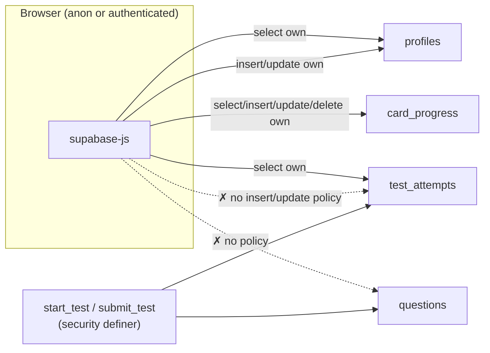

# L2.02 · The database I: tables, constraints and row-level security

> **Level 2 · Build it** · Lesson 2 of 18

| Recipe card | |
|---|---|
| **Time** | 70 min |
| **You need** | L1.04 (SQL + RLS concepts), L2.01 (question ids) |
| **You'll produce** | Lines 1–74 of `supabase/schema.sql`: four tables, two indexes, eight policies |

**In two sentences:** This is the half of the schema that defines what is stored and who may touch which rows. Every table has RLS turned on. Two tables are deliberately left with *no* write policies, and that single decision is what makes scores unforgeable.

### Objectives
1. Write the four `create table` statements from memory, with every constraint and why it exists.
2. Explain the partial index `… where submitted_at is not null` and the composite primary key of `card_progress`.
3. Write the eight policies and fill in a role × table × command permission matrix.
4. Explain why the script uses `create table if not exists` and `drop policy if exists` + `create policy`, and why that makes `setup.sql` safe to run twice.

---

## 1 · Warm-up

1. *(L1.04)* `using` vs `with check`: which applies to `insert`?
2. *(L2.01)* What does `on conflict (id) do update` give the seed?
3. *(L1.01)* Which table holds the answer key, and who can read it?

<details><summary>Answers</summary>1. <code>with check</code>. 2. Idempotence: re-runnable. 3. <code>questions</code>; nobody from the browser; only definer functions.</details>

## 2 · The problem this solves

The browser talks to Postgres directly through Supabase's REST API, using the public key. So **every** table is reachable by anyone on the internet, and the only thing standing between a stranger and your data is what this file declares.



*Takeaway: solid arrows are policies; dotted crosses are deliberate gaps. The gaps force writes to attempts, and reads of the key, through functions we control ([L2.03](l2-03-server-grading.md)).*

---

## 3 · Concepts new in this lesson

### 3.1 Idempotent DDL: why the script is safe to re-run

*DDL* (data definition language) means statements like `create`, `alter` and `drop`. The user pastes `setup.sql` into the Supabase SQL editor, maybe more than once: after fixing a question, after we change a function. So every statement must succeed whether or not its object already exists.

| Object | Re-runnable form | Why this form |
|---|---|---|
| Table | `create table if not exists …` | Keeps existing data; skips if present |
| Index | `create unique index if not exists …` | Same |
| RLS switch | `alter table … enable row level security` | Already idempotent |
| Policy | `drop policy if exists "name" on t;` then `create policy …` | Postgres has no `create or replace policy`. Drop-then-create updates the rule |
| Function | `create or replace function …` | Replaces the body in place |

*Caveat:* `create table if not exists` will **not** add a column you add later to an existing table. It skips the whole statement. For schema changes on a live database you would write `alter table … add column if not exists …`. The PGlite test "setup.sql is safe to run twice" runs the file twice and checks the data survived ([L4.02](l4-02-database-tests.md)).

### 3.2 Partial indexes

**Definition.** An index with a `where` clause contains only the rows that match.

**Why here.** The leaderboard only ever considers **submitted** attempts, and it sorts them by score descending, then duration ascending. An index on exactly that subset, in exactly that order, is smaller and matches the query. Unsubmitted attempts (one per active student, deleted on restart) never bloat it.

### 3.3 Composite primary keys

`primary key (user_id, question_id)` means "one row per (user, question) pair". That makes "mark card 101 known" an **upsert** on that pair: the second mark replaces the first instead of adding a duplicate.

---

## 4 · Reading the real code (lines 1–74)

### 4.1 `questions` (lines 8–17)

```sql
-- ---------- Questions (answer key lives here; tests are graded in SQL) ----------
create table if not exists public.questions (
  id      int primary key,           -- week*100 + question number, e.g. 304 = week 3 Q4
  week    int  not null,
  prompt  text not null,
  options jsonb not null,
  answer  int  not null              -- 0-based index into options
);
alter table public.questions enable row level security;
-- No policies on purpose: clients never read this table directly.
```

- **`public.`**: Supabase has several schemas (`auth`, `storage`, `public`…). The REST API exposes `public`. Writing the schema explicitly avoids surprises.
- **`id int primary key`** with no default: ids come from the JSON (`100w + n`), never generated here.
- **`prompt`**: the column is `prompt` while the JSON field is `q`. Names differ only because "q" is a poor column name. The seed maps one to the other.
- **`options jsonb`**: the array of option strings. `jsonb` validates that it is JSON.
- **RLS on + no policies** = no client can read or write. The grader functions read it as the owner. **What breaks if you add `for select using (true)`?** Anyone could download the answer key with one `curl`, including during a test.

### 4.2 `profiles` (lines 19–35)

```sql
create table if not exists public.profiles (
  id           uuid primary key references auth.users on delete cascade,
  display_name text not null,
  created_at   timestamptz not null default now(),
  constraint display_name_len   check (char_length(display_name) between 3 and 20),
  constraint display_name_chars check (display_name ~ '^[A-Za-z0-9_. -]+$')
);
create unique index if not exists profiles_display_name_key on public.profiles (lower(display_name));
alter table public.profiles enable row level security;

drop policy if exists "profiles: read own"   on public.profiles;
drop policy if exists "profiles: insert own" on public.profiles;
drop policy if exists "profiles: update own" on public.profiles;
create policy "profiles: read own"   on public.profiles for select using (auth.uid() = id);
create policy "profiles: insert own" on public.profiles for insert with check (auth.uid() = id);
create policy "profiles: update own" on public.profiles for update using (auth.uid() = id) with check (auth.uid() = id);
```

- **`id uuid primary key references auth.users on delete cascade`**: a profile *is* a user. Deleting a user (our e2e cleanup does this) removes the profile automatically.
- **Named constraints** (`constraint display_name_len …`): the name appears in error messages (`violates check constraint "display_name_len"`), so you know which rule failed.
- **`char_length(...) between 3 and 20`**: matches the app's `NAME_RE = /^[A-Za-z0-9_. -]{3,20}$/`. The **database is the real guard**, and the client regex only gives faster feedback. Someone calling the API directly hits the database rule.
- **`~ '^[A-Za-z0-9_. -]+$'`**: POSIX regex. Inside `[…]`, a `-` at the end is a literal hyphen, `.` is a literal dot, and the space is allowed. This blocks HTML (``), emoji and quotes. That is defence in depth (several layers each blocking the same attack), even though React already escapes output.
- **`unique index … (lower(display_name))`**: an *expression index*. Uniqueness is enforced on the lowercased value, so `Espresso Ana` and `espresso ANA` collide (`23505`), and the app shows "That name is taken".
- **Policies**:
  - `read own`: you can only `select` your own profile. **But the leaderboard shows other people's names?** Yes, through `get_leaderboard`, a definer function that returns *only* `display_name`, never emails or ids beyond what's needed ([L2.03](l2-03-server-grading.md)).
  - `insert own`: `with check (auth.uid() = id)`: you may create a profile only with *your* id.
  - `update own`: `using` (you can target only your row) **and** `with check` (after the update it must still be yours; you can't change `id` to someone else's).
  - **No delete policy**: users can't delete their profile from the client. Account deletion would go through the admin API.

### 4.3 `test_attempts` (lines 37–55)

```sql
create table if not exists public.test_attempts (
  id           uuid primary key default gen_random_uuid(),
  user_id      uuid not null references auth.users on delete cascade,
  question_ids int[] not null,
  started_at   timestamptz not null default now(),
  submitted_at timestamptz,
  answers      int[],
  score        int,
  total        int not null,
  duration_ms  int
);
create index if not exists test_attempts_user_idx on public.test_attempts (user_id);
create index if not exists test_attempts_rank_idx on public.test_attempts (score desc, duration_ms asc) where submitted_at is not null;
alter table public.test_attempts enable row level security;

drop policy if exists "attempts: read own" on public.test_attempts;
create policy "attempts: read own" on public.test_attempts for select using (auth.uid() = user_id);
-- No insert/update policies: only start_test()/submit_test() can write, so scores can't be forged.
```

- **`default gen_random_uuid()`**: Postgres generates the attempt id. A random uuid can't be guessed (unlike 1, 2, 3…). Even if it could, `submit_test` also checks ownership.
- **`question_ids int[]`**: the 100 drawn ids, in the order shown. Storing the order matters: `answers[i]` belongs to `question_ids[i]`.
- **Nullable `submitted_at`, `answers`, `score`, `duration_ms`**: an attempt is born "open" (null) and filled once on submit. "Open" = `submitted_at is null`. That predicate appears in the partial index, in `start_test` (delete open attempts) and in the leaderboard (ignore open ones).
- **`total int not null`**: the number of questions actually drawn (100 when ≥ 100 exist). The score is out of this.
- **`test_attempts_user_idx`**: speeds up "my attempts" and the delete in `start_test`.
- **`test_attempts_rank_idx`**: the partial index from §3.2.
- **Only a select policy.** The comment on line 55 is the security design in one sentence. The PGlite and live tests both try `insert` and `update` as a signed-in user and expect failure / zero rows ([L4.02](l4-02-database-tests.md), [L4.06](l4-06-live-security-auth.md)).

### 4.4 `card_progress` (lines 57–74)

```sql
create table if not exists public.card_progress (
  user_id     uuid not null references auth.users on delete cascade,
  question_id int  not null,
  status      text not null check (status in ('known', 'again')),
  updated_at  timestamptz not null default now(),
  primary key (user_id, question_id)
);
alter table public.card_progress enable row level security;

drop policy if exists "progress: read own"   on public.card_progress;
drop policy if exists "progress: insert own" on public.card_progress;
drop policy if exists "progress: update own" on public.card_progress;
drop policy if exists "progress: delete own" on public.card_progress;
create policy "progress: read own"   on public.card_progress for select using (auth.uid() = user_id);
create policy "progress: insert own" on public.card_progress for insert with check (auth.uid() = user_id);
create policy "progress: update own" on public.card_progress for update using (auth.uid() = user_id) with check (auth.uid() = user_id);
create policy "progress: delete own" on public.card_progress for delete using (auth.uid() = user_id);
```

- **`status … check (status in ('known','again'))`**: the SQL twin of the TypeScript union `Mark = "known" | "again"`.
- **`updated_at`**: the client sends its own timestamp on upsert (the time you swiped). Merge logic compares these to decide "newest wins" across devices ([L2.07b](l2-07b-account-progress.md)).
- **`question_id` has no foreign key** to `questions`. That was a choice, honestly a small one. Without it, progress can be saved even before the seed runs, and old progress survives if a question is renamed. A foreign key would be stricter, and since referential checks run as the table owner, it would work despite the `questions` table having no policies. Either is defensible; we kept it simple.
- **All four commands have policies**, all "own rows only". This is the one table the client fully manages. *Reset progress* in the app is `delete … where user_id = me`.

---

## 5 · Worked trace (step-through frames): RLS filtering real rows

State: `card_progress` contains

| user_id | question_id | status |
|---|---|---|
| A | 101 | known |
| A | 102 | again |
| B | 101 | known |

User **A** (signed in, so `auth.uid() = A`) runs `select question_id, status from card_progress`.

| Frame | What Postgres does | Rows so far | Predict first → |
|---|---|---|---|
| 1 | Role = `authenticated`; grant check on the table passes (Supabase grants table privileges by default) | — | Does the grant alone allow reading all rows? **No**, RLS is next |
| 2 | Adds the policy as a hidden filter: `where auth.uid() = user_id` | — | |
| 3 | Row (A, 101): `A = A` true | (101, known) | |
| 4 | Row (A, 102): true | (101, known), (102, again) | |
| 5 | Row (B, 101): `A = B` false → silently skipped | unchanged | Error or skip? **Skip**; no error is raised |
| 6 | Result to A | 2 rows | What does **B** see? Only (101, known), its own |

Now **B** runs `delete from card_progress where user_id = 'A'`:

| Frame | What happens | Result |
|---|---|---|
| 1 | Delete policy `using (auth.uid() = user_id)` filters the target rows | B can only target rows where `user_id = B` |
| 2 | `user_id = 'A'` and `user_id = B` match nothing | **0 rows deleted, no error** |

That is exactly what the live test asserts: `B.from("card_progress").delete().eq("user_id", a.id).select()` returns `[]` ([L4.06](l4-06-live-security-auth.md)).

### The permission matrix (memorise this)

| | `questions` | `profiles` | `test_attempts` | `card_progress` |
|---|---|---|---|---|
| **anon** select | 0 rows | 0 rows | 0 rows | 0 rows |
| **anon** write | ✗ | ✗ | ✗ | ✗ |
| **auth** select | 0 rows | own row | own rows | own rows |
| **auth** insert | ✗ | own id only | ✗ | own only |
| **auth** update | ✗ | own row | ✗ (0 rows) | own rows |
| **auth** delete | ✗ | ✗ | ✗ | own rows |
| **definer functions** | read key | read (leaderboard names) | insert/update/delete | — |

---

## 6 · Running and testing

You can't run this file "alone" in the app, but you can run it in a real Postgres in two places:

```bash
# 1) In Supabase: SQL Editor → New query → paste supabase/setup.sql → Run
#    → "Success. No rows returned"

# 2) Locally, in PGlite with Supabase-like roles (no account needed):
npm run test:db
# ✔ seed loaded 130 questions
# ✔ anon cannot read the answer key, profiles, attempts or progress
# ✔ signed-in users still cannot read the answer key
# ✔ display names: length, characters and case-insensitive uniqueness
# ✔ users cannot create or edit someone else's profile
# ✔ cannot forge scores by writing to test_attempts directly
# ✔ card progress: users manage only their own rows
# ✔ setup.sql is safe to run twice
# … (19 tests total)
```

And against the live project (after `setup.sql` ran):
```bash
npx playwright test tests/e2e/api-security.spec.ts --project=api
# ✓ anonymous visitor › cannot read the answer key or any private table
# ✓ signed-in users › profile rules: own row only, valid names, unique ignoring case
# ✓ signed-in users › scores cannot be forged or tampered with
# ✓ signed-in users › users cannot see each other's attempts or flashcard progress
```
How these tests simulate roles is taught in [L4.02](l4-02-database-tests.md) and [L4.06](l4-06-live-security-auth.md).

## 7 · Bug journal

**Clean run.** This half of the schema never broke during the build, because it was tested in PGlite *before* the user ran it in Supabase. The only database bug of the session lived in the functions (a leaderboard limit too low to look up ranks beyond 1,000 players). See [L2.03](l2-03-server-grading.md).

The classic Supabase failure, a table with RLS **off**, is turned into an incident in [L3.01](l3-01-security-model.md), together with how to detect it.

## 8 · Why this design

| Decision | Alternatives | Why this one | Trade-off | Choose differently when |
|---|---|---|---|---|
| RLS on every table | RLS only on "sensitive" tables | Every table is reachable via the API; "not sensitive yet" changes | Must write policies | Never; always on |
| No write policies on `test_attempts` | Insert policy `with check (auth.uid() = user_id)` | Clients can't forge score or time | All writes need functions | Low-stakes data the client may own fully |
| `profiles.id` = user id | Separate serial id + `user_id` column | One-to-one by construction | Can't have several profiles per user | Multi-profile accounts |
| Name rules in a DB `check` + client regex | Client only | API callers can't bypass | Two places to update | — |
| Case-insensitive unique index | `citext` column type | No extension needed | Must remember `lower()` in lookups | Many case-insensitive columns → `citext` |
| Partial rank index | Full index; none | Small, matches the leaderboard query | Only helps queries with the same predicate | — |
| `card_progress.question_id` without FK | FK to `questions` | Simpler; progress independent of seeding | Orphan rows possible | You need strict integrity → add the FK |

## 9 · Check yourself

**Q1.** A user runs `update profiles set id = '<someone else>' where id = '<me>'`. Which clause stops it?
- A) `using (auth.uid() = id)` · B) `with check (auth.uid() = id)` · C) the primary key · D) nothing

<details><summary>Answer</summary><b>B.</b> <code>using</code> allowed targeting their own row, but <code>with check</code> validates the <i>new</i> row, whose id no longer equals <code>auth.uid()</code>. (The PK would also complain if the other id exists. The policy rejects it either way.)</details>

**Q2.** You remove the partial index. What breaks?
<details><summary>Answer</summary>Nothing functionally. The leaderboard gets slower as attempts grow, because Postgres sorts the submitted rows itself. Indexes change speed, not results.</details>

**Q3.** Re-running `setup.sql` after adding a column `badge text` inside `create table if not exists profiles (…)`. Does the column appear?
<details><summary>Answer</summary>No. The table exists, so the whole statement is skipped. Use <code>alter table public.profiles add column if not exists badge text;</code>.</details>

**Q4.** Why does a signed-in user get **zero rows**, not an error, from `questions`?
<details><summary>Answer</summary>The table-level grant passes (Supabase grants privileges to <code>authenticated</code>), and RLS then filters every row out because no policy matches. An error (<code>42501</code>) would mean a missing grant.</details>

**Q5.** The leaderboard shows names, yet `profiles` is "read own". How?
<details><summary>Answer</summary><code>get_leaderboard</code> is <code>security definer</code>: it runs as the owner (RLS doesn't restrict the owner here) and returns only the columns we choose.</details>

## 10 · Practice

**Easy (10 min).** Fill the permission matrix from memory, then compare with §5.

**Medium (20 min).** Add a `bio text` column with a 0–140 character check, as a re-runnable statement.
<details><summary>Answer</summary>

```sql
alter table public.profiles add column if not exists bio text;
alter table public.profiles drop constraint if exists bio_len;
alter table public.profiles add constraint bio_len check (bio is null or char_length(bio) <= 140);
```
</details>

**Hard (40 min).** Design a `friends` table where a user can see only friendships they're part of, and only insert ones where they are `requester_id`. Write the table and policies.
<details><summary>Solution</summary>

```sql
create table if not exists public.friends (
  requester_id uuid not null references auth.users on delete cascade,
  addressee_id uuid not null references auth.users on delete cascade,
  created_at timestamptz not null default now(),
  primary key (requester_id, addressee_id),
  check (requester_id <> addressee_id)
);
alter table public.friends enable row level security;
create policy "friends: read mine" on public.friends for select
  using (auth.uid() in (requester_id, addressee_id));
create policy "friends: request" on public.friends for insert
  with check (auth.uid() = requester_id);
```
</details>

## 11 · From memory

**Rung 1 · Cloze.**

```sql
create table if not exists public.test_attempts (
  id           uuid primary key default ___①___(),
  user_id      uuid not null references auth.users on delete ___②___,
  question_ids ___③___ not null,
  started_at   timestamptz not null default ___④___(),
  submitted_at timestamptz,
  answers int[], score int, total int not null, duration_ms int
);
create index if not exists test_attempts_rank_idx on public.test_attempts (score ___⑤___, duration_ms ___⑥___) where ___⑦___;
alter table public.test_attempts enable row level security;
create policy "attempts: read own" on public.test_attempts for ___⑧___ using (auth.uid() = user_id);
```
<details><summary>Answers</summary>① <code>gen_random_uuid</code> ② <code>cascade</code> ③ <code>int[]</code> ④ <code>now</code> ⑤ <code>desc</code> ⑥ <code>asc</code> ⑦ <code>submitted_at is not null</code> ⑧ <code>select</code></details>

**Rung 2 · Blank page (20 min).** Write lines 1–74 of `schema.sql` from memory. Paste your version over the real one in a scratch copy and run `npm run gen:sql && npm run test:db`.
<details><summary>Self-check</summary>

- [ ] 4 tables with every constraint (len, chars regex, status check, composite PK)
- [ ] `lower(display_name)` unique index; partial rank index; user index
- [ ] RLS enabled on all 4
- [ ] 8 policies, each preceded by `drop policy if exists`
- [ ] No policy on `questions`; only select on `test_attempts`
- [ ] `test:db` green
</details>

## 12 · Flashcards

<details><summary><b>Q:</b> Why no policies on <code>questions</code>?</summary><b>A:</b> So no client can read or write the answer key; only definer functions use it.</details>
<details><summary><b>Q:</b> Why only a select policy on <code>test_attempts</code>?</summary><b>A:</b> Writes must go through <code>start_test</code>/<code>submit_test</code> so score and time are computed by the server.</details>
<details><summary><b>Q:</b> Why <code>drop policy if exists</code> before <code>create policy</code>?</summary><b>A:</b> Postgres has no <code>create or replace policy</code>; this makes the script re-runnable and updates the rule.</details>
<details><summary><b>Q:</b> What does the partial index cover?</summary><b>A:</b> Only submitted attempts, ordered by score desc, duration asc: the leaderboard's shape.</details>
<details><summary><b>Q:</b> How are names unique ignoring case?</summary><b>A:</b> A unique expression index on <code>lower(display_name)</code>.</details>
<details><summary><b>Q:</b> What happens to a user's rows when the user is deleted?</summary><b>A:</b> <code>on delete cascade</code> removes their profile, attempts and progress.</details>
<details><summary><b>Q:</b> RLS-denied delete: error or nothing?</summary><b>A:</b> Nothing: 0 rows affected, no error.</details>
<details><summary><b>Q:</b> Does <code>create table if not exists</code> add new columns?</summary><b>A:</b> No; use <code>alter table … add column if not exists</code>.</details>

## 13 · The menu board

| Table | Key | Policies | Notes |
|---|---|---|---|
| `questions` | `id int` | none | answer key; RLS on |
| `profiles` | `id uuid` = user | select/insert/update own | name 3–20, `[A-Za-z0-9_. -]`, unique `lower()` |
| `test_attempts` | `id uuid default gen_random_uuid()` | select own | open = `submitted_at is null`; partial rank index |
| `card_progress` | `(user_id, question_id)` | all four, own | status `known`/`again`; `updated_at` for merges |

## 14 · Glossary

**Composite key**: a primary key made of several columns. **DDL**: statements that define schema objects. **Defence in depth**: several independent layers each blocking the same attack. **Expression index**: an index on a computed value like `lower(col)`. **gen_random_uuid()**: built-in random uuid generator. **Open attempt**: a started, unsubmitted test (`submitted_at is null`). **Partial index**: an index covering only rows matching a `where`. **Permission matrix**: role × object × action table.

## 15 · Go further

| Resource | Type | Why | Which part | Time |
|---|---|---|---|---|
| [PostgreSQL: CREATE POLICY](https://www.postgresql.org/docs/current/sql-createpolicy.html) | Manual | Exact rules for using/with check per command | "Description", the per-command table | 15 min |
| [PostgreSQL: Partial Indexes](https://www.postgresql.org/docs/current/indexes-partial.html) | Manual | When and why partial indexes help | Whole page | 10 min |
| [Supabase: RLS performance recommendations](https://supabase.com/docs/guides/database/postgres/row-level-security#rls-performance-recommendations) | Docs | Indexing columns used in policies | That section | 10 min |

---
← [L2.01 The data pipeline](l2-01-data-pipeline.md) · [Hub](README.md) · [L2.03 Server-side grading →](l2-03-server-grading.md)
