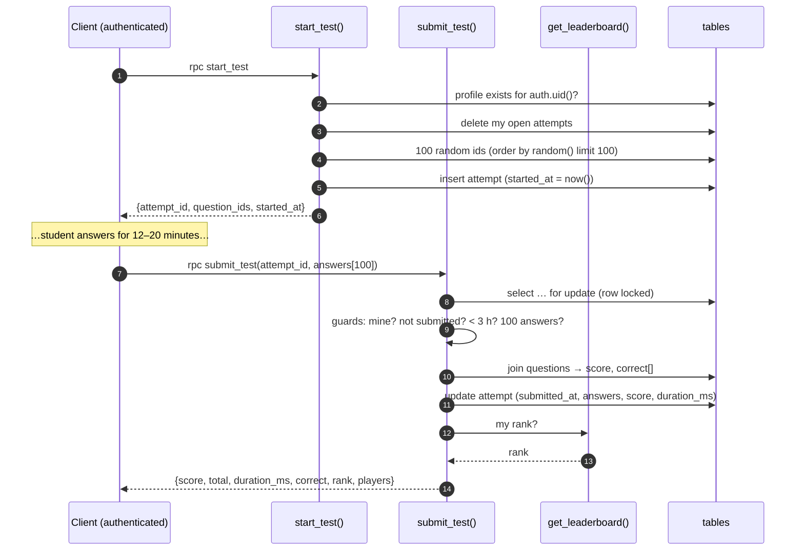

# L2.03 · The database II: server-side grading and the leaderboard

> **Level 2 · Build it** · Lesson 3 of 18

| Recipe card | |
|---|---|
| **Time** | 75 min |
| **You need** | L2.02 (tables + policies) |
| **You'll produce** | Lines 76–238 of `supabase/schema.sql`: `start_test`, `get_leaderboard`, `submit_test`, `get_my_stats`, and the grants |

**In two sentences:** These four functions are the only trusted code in the whole product. They draw the questions, stamp the time, grade against the hidden key and rank everyone. This lesson walks every line, then grades a five-question attempt by hand with real answers.

### Objectives
1. Write `start_test` and `submit_test` from memory, including every guard clause and its error message.
2. Explain `security definer` + `set search_path = public` + `revoke`/`grant`, and why each function gets the grants it does.
3. Grade an attempt by hand the way `generate_subscripts … join questions` does, and compute `duration_ms`.
4. Explain `distinct on` + `rank() over (…)` well enough to predict the leaderboard for a small set of attempts (full depth in L3.02).
5. Say why `submit_test` uses `for update` and `clock_timestamp()`.

---

## 1 · Warm-up

1. *(L2.02)* Which table has no policies at all, and why?
2. *(L2.02)* What does "open attempt" mean in SQL?
3. *(L1.04)* What does `auth.uid()` return for an anonymous caller?

<details><summary>Answers</summary>1. <code>questions</code>, so no client can read the key. 2. <code>submitted_at is null</code>. 3. <code>null</code>.</details>

## 2 · The problem this solves

L2.02 locked `test_attempts` against client writes and hid `questions` entirely. Now somebody has to write attempts and read the key, and only after checking who's asking and whether the request is legitimate. That somebody is a function that runs with the owner's rights but trusts nothing the caller says, except their answers.



*Takeaway: the client sends exactly two things it controls: "start" and its list of chosen options. Everything that matters for ranking is computed inside these functions.*

---

## 3 · Concepts new in this lesson

### 3.1 PL/pgSQL building blocks used here

| Construct | Meaning | Where |
|---|---|---|
| `declare x int; … begin … end;` | Local variables, then the body | `start_test`, `submit_test` |
| `uid uuid := auth.uid();` | Initialise at declaration | `start_test` |
| `raise exception 'msg' using errcode = '…'` | Abort with an error the client receives as `error.message` / `error.code` | all guards |
| `select … into var` | Store a query result in variables | everywhere |
| `if not found then` | `found` is set by the previous `select into`: false if no row | `submit_test` |
| `insert … returning id, started_at into aid, started` | Get generated values back | `start_test` |
| `json_build_object('k', v, …)` | Build a JSON object to return | return values |
| `language sql stable` | A single SQL query; `stable` = same output within a statement for the same input, with no writes | `get_leaderboard`, `get_my_stats` |
| `returns table (…)` | A set-returning function that behaves like a table in `from` | `get_leaderboard` |

### 3.2 Arrays: `array_agg`, `array_length`, `generate_subscripts`

- `array_agg(id)` turns rows into one array: `{304,1201,7,…}`.
- `array_length(arr, 1)` is the length along dimension 1. **Gotcha:** for an *empty* array it returns `NULL`, not 0. Hence `coalesce(array_length(p_answers, 1), 0)`.
- `generate_subscripts(arr, 1)` yields the indexes `1, 2, …, n`. Postgres arrays are **1-based**. Our JS arrays are 0-based, but we only ever send whole arrays, so positions line up automatically.

### 3.3 Time: `now()` vs `clock_timestamp()`

`now()` is the start time **of the current transaction**. It stays constant inside it. `clock_timestamp()` is the actual current time. In `submit_test` the duration uses `clock_timestamp()`, the true moment of grading. (`now()` would differ only by milliseconds here, but `clock_timestamp()` states the intent.) The 3-hour expiry check uses `now()`, which is fine at that granularity.

### 3.4 Row locks: `select … for update`

`for update` locks the selected row until the transaction ends. If two `submit_test` calls for the same attempt arrive at once (a double tap, or two tabs), the second **waits**, then sees `submitted_at is not null` and fails with "already submitted". Without the lock, both could read "not submitted" and both could write, a race that could overwrite a score.

### 3.5 Grants on functions

New functions are executable by `PUBLIC` (everyone) by default, and Supabase also grants `anon`/`authenticated` execute on new objects. So we **revoke** first, then **grant** precisely:

| Function | anon | authenticated | Why |
|---|---|---|---|
| `start_test` | ✗ | ✓ | Needs a user to own the attempt |
| `submit_test` | ✗ | ✓ | Same |
| `get_my_stats` | ✗ | ✓ | "My" makes no sense anonymously |
| `get_leaderboard` | ✓ | ✓ | Public board: visitors see it before signing up |

---

## 4 · Reading the real code

### 4.1 `start_test` (lines 80–116)

```sql
-- Start a ranked test: 100 random questions, start time stamped by the server.
create or replace function public.start_test()
returns json
language plpgsql
security definer
set search_path = public
as $$
declare
  uid     uuid := auth.uid();
  qids    int[];
  aid     uuid;
  started timestamptz;
begin
  if uid is null then
    raise exception 'Please sign in first' using errcode = '28000';
  end if;
  if not exists (select 1 from profiles where id = uid) then
    raise exception 'Choose a display name first' using errcode = 'P0001';
  end if;

  -- one open attempt at a time; starting again abandons the previous one
  delete from test_attempts where user_id = uid and submitted_at is null;

  select array_agg(id) into qids
  from (select id from questions order by random() limit 100) s;

  if qids is null then
    raise exception 'No questions in the database yet (run seed.sql)';
  end if;

  insert into test_attempts (user_id, question_ids, total)
  values (uid, qids, array_length(qids, 1))
  returning id, started_at into aid, started;

  return json_build_object('attempt_id', aid, 'question_ids', qids, 'started_at', started);
end;
$$;
```

Line notes:
- **`returns json`**: supabase-js receives it as a JS object in `data`.
- **`security definer`**: runs as the owner (the role that ran `setup.sql`), which bypasses RLS on these tables. This is why it can insert into `test_attempts`.
- **`set search_path = public`**: inside the function, unqualified names like `profiles` resolve **only** in `public`. Without it, a caller could create a look-alike object in a schema earlier on their path and hijack what the definer function calls ([L3.01](l3-01-security-model.md)).
- **`uid uuid := auth.uid()`**: read the caller's id once. Every later statement uses `uid`, never anything the caller passed.
- **Guard 1, `uid is null`**: anonymous callers. (Grants already block `anon`; this is defence in depth.) `errcode '28000'` is Postgres's "invalid authorization" class.
- **Guard 2, profile exists**: the leaderboard needs a display name. The app catches the message "Choose a display name first" and sends the user to pick one. Error code `P0001` is the default for `raise exception`; written here for clarity.
- **`delete … submitted_at is null`**: one open attempt per user. Tapping "Start over" abandons the old one. It also keeps the table small.
- **`order by random() limit 100`**: a uniform random sample. Every one of the 130 questions has an equal chance. It sorts all rows by a random number, fine for 130 rows ([L3.02](l3-02-ranking-sql.md) discusses scale).
- **`array_agg(id) into qids`**: collects the sample into `int[]`. With zero questions (seed not run), `array_agg` returns `NULL`, hence the next guard.
- **`total = array_length(qids, 1)`**: 100 normally. If someone runs this with fewer questions seeded, the score is out of what was actually drawn.
- **`returning … into aid, started`**: the generated uuid and the default `now()` come back without a second query.
- **The returned `started_at`** is informational. The client shows its own timer from `Date.now()` because phone and server clocks differ.

### 4.2 `get_leaderboard` (lines 118–155)

```sql
-- Leaderboard: each player's best attempt (highest score, then fastest).
create or replace function public.get_leaderboard(p_limit int default 100)
returns table (
  rank         bigint,
  user_id      uuid,
  display_name text,
  score        int,
  total        int,
  duration_ms  int,
  attempts     bigint,
  submitted_at timestamptz
)
language sql
stable
security definer
set search_path = public
as $$
  with best as (
    select distinct on (t.user_id)
           t.user_id, t.score, t.total, t.duration_ms, t.submitted_at
    from test_attempts t
    where t.submitted_at is not null
    order by t.user_id, t.score desc, t.duration_ms asc, t.submitted_at asc
  ),
  counts as (
    select t.user_id, count(*) as attempts
    from test_attempts t
    where t.submitted_at is not null
    group by t.user_id
  )
  select rank() over (order by b.score desc, b.duration_ms asc) as rank,
         b.user_id, p.display_name, b.score, b.total, b.duration_ms, c.attempts, b.submitted_at
  from best b
  join profiles p on p.id = b.user_id
  join counts  c on c.user_id = b.user_id
  order by rank, b.submitted_at
  limit least(greatest(coalesce(p_limit, 100), 1), 100000);
$$;
```

Line notes:
- **`returns table (…)`**: callers can `select … from get_leaderboard(10)`, and supabase-js `rpc("get_leaderboard", { p_limit: 200 })` gets an array of rows. `rank()` produces `bigint`, `count(*)` too, hence those column types.
- **`with best as (…)`**: a CTE (common table expression), a named sub-query used below.
- **`distinct on (t.user_id)` + `order by t.user_id, t.score desc, t.duration_ms asc, t.submitted_at asc`**: keep **one** row per user, the **first** in that order. So the best attempt is: highest score, then fastest, then earliest (a deterministic tie-break). `distinct on` requires the `order by` to start with the same column.
- **`counts`**: total submitted attempts per user, shown as "3 attempts".
- **`rank() over (order by b.score desc, b.duration_ms asc)`**: a window function. Equal score *and* time share a rank (1, 1, 3…). Frame-by-frame in [L3.02](l3-02-ranking-sql.md).
- **`join profiles`**: users without a profile never appear. In practice they can't start tests anyway (guard 2).
- **`order by rank, b.submitted_at`**: stable display order within ties.
- **`limit least(greatest(coalesce(p_limit, 100), 1), 100000)`**: clamp the caller's limit to between 1 and 100,000. `coalesce` handles `null`, `greatest(…,1)` stops `limit -5`, and `least(…,100000)` stops someone requesting a billion rows. The PGlite test "leaderboard limit is clamped" calls it with `-5` and `2`.
- **Note what is *not* returned**: emails, attempt ids, answers. The leaderboard is public (granted to `anon`), so it returns only what a public board shows.

### 4.3 `submit_test` (lines 157–210)

```sql
-- Submit answers; graded here against the server-side key.
-- p_answers[i] is the chosen option for question_ids[i], or -1 if skipped.
create or replace function public.submit_test(p_attempt uuid, p_answers int[])
returns json
language plpgsql
security definer
set search_path = public
as $$
declare
  a       test_attempts;
  s       int;
  correct int[];
  dur     int;
  my_rank bigint;
  players bigint;
begin
  select * into a from test_attempts
  where id = p_attempt and user_id = auth.uid()
  for update;

  if not found then
    raise exception 'Test attempt not found';
  end if;
  if a.submitted_at is not null then
    raise exception 'This test was already submitted';
  end if;
  if now() - a.started_at > interval '3 hours' then
    raise exception 'This test expired (3 hour limit). Start a new one.';
  end if;
  if coalesce(array_length(p_answers, 1), 0) <> array_length(a.question_ids, 1) then
    raise exception 'Answer count does not match';
  end if;

  select coalesce(sum(case when p_answers[i] = q.answer then 1 else 0 end), 0)::int,
         array_agg(q.answer order by i)
    into s, correct
  from generate_subscripts(a.question_ids, 1) as i
  join questions q on q.id = a.question_ids[i];

  dur := (extract(epoch from (clock_timestamp() - a.started_at)) * 1000)::int;

  update test_attempts
     set submitted_at = now(), answers = p_answers, score = s, duration_ms = dur
   where id = a.id;

  select l.rank into my_rank from get_leaderboard(100000) l where l.user_id = auth.uid();
  select count(distinct t.user_id) into players from test_attempts t where t.submitted_at is not null;

  return json_build_object(
    'score', s, 'total', a.total, 'duration_ms', dur,
    'correct', correct, 'rank', my_rank, 'players', players
  );
end;
$$;
```

Line notes:
- **`a test_attempts;`**: a *row-type* variable; `a.started_at`, `a.question_ids` and so on are its fields.
- **`where id = p_attempt and user_id = auth.uid()`**: ownership is part of the lookup. Someone else's attempt id isn't found, so we don't even reveal that it exists. The error is the same "not found" either way.
- **`for update`**: the row lock from §3.4.
- **Four guards**, each a specific message the app shows in the submit sheet:
  1. not found (wrong id, or not yours),
  2. already submitted (double tap or replay),
  3. expired (> 3 h), which stops "start, look up answers all day, submit",
  4. answer count ≠ question count, which stops sending 3 answers and having the rest scored somehow.
- **The grading query.** For each index `i`, join the question with id `question_ids[i]`, and add 1 when `p_answers[i] = q.answer`. Skipped answers are `-1` and never equal a real index. `coalesce(…, 0)` handles the impossible-but-safe "no rows" case. `::int` because `sum` returns `bigint`.
- **`array_agg(q.answer order by i)`**: the correct answers in test order, returned so the results page can show "your answer vs correct" without the client ever having had the key during the test.
- **`dur`**: `clock_timestamp() - started_at` is an `interval`. `extract(epoch from …)` gives seconds (with fractions), `* 1000` gives milliseconds, and `::int` rounds. An `int` holds about 24.8 days of milliseconds, far more than the 3-hour limit.
- **`update … where id = a.id`**: fill the four "open" columns once.
- **Rank lookup**: call our own leaderboard with a large limit and pick our row. Here the limit **was a bug**, caught before shipping (incident below).
- **`players`**: count of distinct users with a submitted attempt. Shown as "of 41 players".

### 4.4 `get_my_stats` (lines 212–228)

```sql
create or replace function public.get_my_stats()
returns json
language sql
stable
security definer
set search_path = public
as $$
  select json_build_object(
    'best_score',    (select l.score       from get_leaderboard(100000) l where l.user_id = auth.uid()),
    'best_total',    (select l.total       from get_leaderboard(100000) l where l.user_id = auth.uid()),
    'best_duration', (select l.duration_ms from get_leaderboard(100000) l where l.user_id = auth.uid()),
    'rank',          (select l.rank        from get_leaderboard(100000) l where l.user_id = auth.uid()),
    'attempts',      (select count(*) from test_attempts t where t.user_id = auth.uid() and t.submitted_at is not null),
    'players',       (select count(distinct t.user_id) from test_attempts t where t.submitted_at is not null)
  );
$$;
```

- Powers the three Home stat tiles. A user with no attempts gets `null`s, and the UI shows "–".
- **Honest critique:** it calls `get_leaderboard` **four times**. Correct, but it computes the whole board four times per Home visit. That's fine for hundreds of players, wasteful for tens of thousands. [L3.02](l3-02-ranking-sql.md) rewrites it as one lateral lookup.

### 4.5 The grants (lines 230–238)

```sql
revoke all on function public.start_test()                from public, anon;
revoke all on function public.submit_test(uuid, int[])    from public, anon;
revoke all on function public.get_my_stats()              from public, anon;
revoke all on function public.get_leaderboard(int)        from public;
grant execute on function public.start_test()             to authenticated;
grant execute on function public.submit_test(uuid, int[]) to authenticated;
grant execute on function public.get_my_stats()           to authenticated;
grant execute on function public.get_leaderboard(int)     to anon, authenticated;
```
- Functions are identified by **name and argument types** (`submit_test(uuid, int[])`), because Postgres allows overloads.
- `from public` removes the default execute-for-everyone. `from anon` removes Supabase's default grant.
- Result: an anonymous `rpc("start_test")` fails with `42501 permission denied for function start_test`. The live test asserts exactly that code.

---

## 5 · Worked trace: grading a 5-question attempt with real answers

(The real test has 100 questions; five keep the arithmetic visible. The answers are the real keys.)

| i | `question_ids[i]` | question (short) | `q.answer` (key) | `p_answers[i]` (student) | match? |
|---|---|---|---|---|---|
| 1 | 304 | "For many with ___ deficits…" | 2 (social cognition) | 2 | 1 |
| 2 | 1201 | "Sustainability in economic sustainability is ___" | 2 (unidimensional) | 0 | 0 |
| 3 | 7 | "Psychology is not an independent science…" | 1 (False) | 1 | 1 |
| 4 | 509 | "Friendship is a ___ need in Maslow's hierarchy" | 0 (Love and belonging) | −1 (skipped) | 0 |
| 5 | 810 | "According to the ___ principle…" | 1 (modality) | 1 | 1 |

| Frame | Step | Value | Predict first → |
|---|---|---|---|
| 1 | guards pass (mine, open, 12 min old, 5 answers for 5 questions) | — | Which guard fails if the client sends 4 answers? **count** |
| 2 | `generate_subscripts` | `i = 1,2,3,4,5` | 0-based or 1-based? **1-based** |
| 3 | join + `case when` | `1,0,1,0,1` | Does `-1` ever match? **No** |
| 4 | `sum` → `s` | **3** | |
| 5 | `array_agg(q.answer order by i)` → `correct` | `{2,2,1,0,1}` | |
| 6 | started `10:00:00.000`, now `10:21:34.000` | interval `00:21:34` → epoch `1294` s | |
| 7 | `dur = 1294 × 1000` | **1,294,000 ms** (UI shows `21:34`) | |
| 8 | update row; rank lookup; players | returned JSON | Can the client send `score: 5`? **No such parameter exists** |

---

## 6 · Running and testing

```bash
npm run test:db
# ✔ start_test requires a profile
# ✔ start_test returns 100 distinct real questions and records server time
# ✔ submit_test grades on the server (all right / partly right / all skipped)
# ✔ result includes the correct answers and a rank
# ✔ cannot submit twice, submit another user's attempt, or send the wrong number of answers
# ✔ attempts older than 3 hours cannot be submitted
# ✔ leaderboard: best attempt per player, score first, then time
# ✔ leaderboard limit is clamped
# ✔ get_my_stats reflects the caller's best attempt
```
The "partly right" case answers the first 63 correctly and skips the rest, then expects `score = 63`. The live version does the same with 73 ([L4.06](l4-06-live-security-auth.md)).

In the Supabase SQL editor you can try a function as the owner:
```sql
select * from get_leaderboard(5);
```
(`start_test` from the editor fails with "Please sign in first", because the editor has no `auth.uid()`. That's the guard working.)

## 7 · Bug journal

**Incident · Rank lookup capped at 1,000 players (caught before shipping)**
1. **Symptom.** None yet in production. Found while re-reading the first draft: `get_leaderboard` clamped `p_limit` to at most **1000**, while `submit_test` and `get_my_stats` call `get_leaderboard(100000)` and search for the caller's row.
2. **Diagnosis.** Traced it with a thought experiment: player #1,001 submits, the inner call returns only 1,000 rows, their row isn't among them, so `my_rank` is `NULL` and the results page shows "–" instead of "1001st".
3. **Root cause.** One limit was serving two purposes: protecting the public endpoint from huge responses, and an internal "give me everyone" lookup.
4. **Fix.**
   ```diff
   -  limit least(greatest(coalesce(p_limit, 100), 1), 1000);
   +  limit least(greatest(coalesce(p_limit, 100), 1), 100000);   -- internal rank lookups need the full board
   ```
5. **Lesson.** When a function both serves the public and is reused internally, check every caller's assumptions about its limits. The cleaner design (in L3.02) looks up one user's rank directly, with no limit involved.

## 8 · Why this design

| Decision | Alternatives | Why this one | Trade-off | Choose differently when |
|---|---|---|---|---|
| Grade in SQL (definer function) | Edge/serverless function; client grading | No extra infrastructure; the key never leaves Postgres; atomic | Logic in SQL (harder to unit-test without PGlite) | Complex scoring rules → server code |
| Server-stamped `started_at` | Client sends duration | Can't be faked | Network latency counts against the student (milliseconds) | — |
| Delete open attempts on start | Keep many open attempts | One active test; small table | Abandoned progress is lost on "Start over" (the UI warns) | You want "resume on another device" |
| 3-hour expiry | None; 2 h; exactly the exam length | Generous for the slowest students, blocks day-long lookups | Arbitrary | Strict exam simulation → 60 min |
| `-1` for skipped | `null` in `int[]` | Simple equality; never matches | Magic number | — |
| Leaderboard via `distinct on` + `rank()` | Store "best" in profiles | Always correct from raw attempts, no sync | Recomputed per call | Huge scale → materialised view |

## 9 · Check yourself

**Q1.** Two tabs submit the same attempt within 50 ms. What happens?
- A) Two scores · B) The second waits on the row lock, then fails "already submitted" · C) Deadlock · D) Both fail

<details><summary>Answer</summary><b>B.</b> <code>for update</code> serialises them. Without the lock, both could see <code>submitted_at is null</code> and both could write.</details>

**Q2.** A student sends `p_answers` with only 3 elements. What's the error?
<details><summary>Answer</summary>"Answer count does not match". (With an empty array, <code>array_length</code> is NULL, coalesced to 0 → mismatch.)</details>

**Q3.** Why does `get_leaderboard` need `security definer` if it only reads?
- A) Speed · B) It reads every user's attempts and profile names, which RLS restricts to "own" · C) It doesn't · D) For grants

<details><summary>Answer</summary><b>B.</b> As the caller, RLS would show each user only their own attempt and profile, a leaderboard of one. Definer rights plus a deliberately narrow output make a safe public view.</details>

**Q4.** Predict the board. Attempts: Ana 90 in 15:00; Ana 95 in 30:00; Ben 95 in 20:00; Cy 95 in 20:00.
<details><summary>Answer</summary>Best per player: Ana 95/30:00, Ben 95/20:00, Cy 95/20:00. Ranks: Ben 1, Cy 1 (same score and time), Ana 3. Ana's faster 90 doesn't count, because score comes first.</details>

**Q5.** Why does the app *not* receive the answer key at `start_test`?
<details><summary>Answer</summary>The test would then be gradeable, and cheatable, in the client. <code>correct[]</code> is returned only after submission. (Flashcards include answers for studying; the ranked runner never needs them.)</details>

## 10 · Practice

**Easy (10 min).** Write the four `raise exception` guards of `submit_test`, in order, from memory.

**Medium (20 min).** Add an optional parameter `p_size int default 100` to `start_test`, clamped to 10–130. Update the grant signature.
<details><summary>Answer</summary>Use <code>limit least(greatest(coalesce(p_size,100),10),130)</code> in the sample query. Grant on <code>public.start_test(int)</code> (and drop the old zero-argument version, or both overloads exist).</details>

**Hard (40 min).** Rewrite `get_my_stats` to compute the leaderboard **once** (hint: one CTE, then pick the caller's row). Verify with `npm run test:db`.
<details><summary>Solution</summary>

```sql
create or replace function public.get_my_stats()
returns json language sql stable security definer set search_path = public as $$
  with lb as (select * from get_leaderboard(100000)),
       me as (select * from lb where user_id = auth.uid())
  select json_build_object(
    'best_score', (select score from me), 'best_total', (select total from me),
    'best_duration', (select duration_ms from me), 'rank', (select rank from me),
    'attempts', (select count(*) from test_attempts t where t.user_id = auth.uid() and t.submitted_at is not null),
    'players', (select count(*) from lb));
$$;
```
(<code>players</code> = rows on the board = distinct users with a submitted attempt <i>and a profile</i>. That is a subtle difference from the original's <code>count(distinct user_id)</code>; decide which you want.)
</details>

## 11 · From memory

**Rung 1 · Cloze.**

```sql
create or replace function public.submit_test(p_attempt uuid, p_answers int[])
returns json language plpgsql security ___①___ set ___②___ = public as $$
declare a test_attempts; s int; correct int[]; dur int; my_rank bigint; players bigint;
begin
  select * into a from test_attempts where id = p_attempt and user_id = ___③___() for ___④___;
  if not ___⑤___ then raise exception 'Test attempt not found'; end if;
  if a.submitted_at is not null then raise exception 'This test was already submitted'; end if;
  if now() - a.started_at > interval '___⑥___' then raise exception 'This test expired (3 hour limit). Start a new one.'; end if;
  if ___⑦___(array_length(p_answers, 1), 0) <> array_length(a.question_ids, 1) then raise exception 'Answer count does not match'; end if;
  select coalesce(sum(case when p_answers[i] = q.answer then 1 else 0 end), 0)::int, array_agg(q.answer order by i)
    into s, correct
  from ___⑧___(a.question_ids, 1) as i join questions q on q.id = a.question_ids[i];
  dur := (extract(___⑨___ from (clock_timestamp() - a.started_at)) * 1000)::int;
  …
```
<details><summary>Answers</summary>① <code>definer</code> ② <code>search_path</code> ③ <code>auth.uid</code> ④ <code>update</code> ⑤ <code>found</code> ⑥ <code>3 hours</code> ⑦ <code>coalesce</code> ⑧ <code>generate_subscripts</code> ⑨ <code>epoch</code></details>

**Rung 2 · Blank page (20 min).** Write `start_test`, `submit_test` and the grant block from memory. Then run `npm run gen:sql && npm run test:db` against your version.
<details><summary>Self-check</summary>

- [ ] definer + search_path on both
- [ ] start: null uid guard, profile guard, delete open, random 100, null guard, insert returning, json
- [ ] submit: lookup with owner + `for update`, 4 guards, grading join, `clock_timestamp` duration, update, rank, players
- [ ] revoke from public (and anon), grant to authenticated; leaderboard also to anon
- [ ] `test:db` green
</details>

## 12 · Flashcards

<details><summary><b>Q:</b> Which two values does the client control in a ranked test?</summary><b>A:</b> The decision to start, and the array of chosen options.</details>
<details><summary><b>Q:</b> Why <code>set search_path = public</code>?</summary><b>A:</b> So a definer function can't be tricked into resolving names to attacker-created objects in another schema.</details>
<details><summary><b>Q:</b> Why <code>for update</code> in submit?</summary><b>A:</b> Locks the attempt row so concurrent submissions serialise; the second sees it already submitted.</details>
<details><summary><b>Q:</b> What does <code>array_length</code> return for an empty array?</summary><b>A:</b> NULL. Hence <code>coalesce(…, 0)</code>.</details>
<details><summary><b>Q:</b> How is a skipped answer encoded?</summary><b>A:</b> <code>-1</code>, which never equals a valid 0-based index.</details>
<details><summary><b>Q:</b> What does <code>distinct on (user_id)</code> keep?</summary><b>A:</b> The first row per user in the <code>order by</code>, here the best attempt (score desc, duration asc, earliest).</details>
<details><summary><b>Q:</b> Which functions can <code>anon</code> execute?</summary><b>A:</b> Only <code>get_leaderboard</code>.</details>
<details><summary><b>Q:</b> Why is the rank lookup limit 100,000?</summary><b>A:</b> A cap of 1,000 would make ranks beyond 1,000 come back NULL.</details>
<details><summary><b>Q:</b> Why <code>clock_timestamp()</code> for the duration?</summary><b>A:</b> It is the real current time; <code>now()</code> is frozen at transaction start.</details>

## 13 · The menu board

| Function | Grants | Returns | Key lines |
|---|---|---|---|
| `start_test()` | authenticated | `{attempt_id, question_ids, started_at}` | profile guard · delete open · `order by random() limit 100` |
| `submit_test(uuid, int[])` | authenticated | `{score,total,duration_ms,correct,rank,players}` | `for update` · 4 guards · `generate_subscripts` join · `clock_timestamp()` |
| `get_leaderboard(int)` | anon, authenticated | table of rows | `distinct on` best · `rank() over` · clamp 1..100000 |
| `get_my_stats()` | authenticated | json | 4× leaderboard (optimise in L3.02) |

## 14 · Glossary

**CTE**: a named sub-query introduced by `with`. **`distinct on`**: Postgres extension keeping the first row per group. **Overload**: functions with the same name and different argument types. **Row lock**: `for update` exclusive lock until the transaction ends. **Row type**: a variable shaped like a table row. **`stable`**: a function marker meaning no writes and consistent results within a statement. **Window function**: a calculation over related rows (`rank() over (…)`) without collapsing them.

## 15 · Go further

| Resource | Type | Why | Which part | Time |
|---|---|---|---|---|
| [PostgreSQL: PL/pgSQL Basic Statements](https://www.postgresql.org/docs/current/plpgsql-statements.html) | Manual | `select into`, `found`, `returning into` | 43.5.3 and the FOUND section | 20 min |
| [PostgreSQL: Window Functions tutorial](https://www.postgresql.org/docs/current/tutorial-window.html) | Manual | The idea behind `rank() over` | Whole page | 15 min |
| [Supabase: Database functions](https://supabase.com/docs/guides/database/functions) | Docs | Security definer and calling via RPC | "Security definer vs invoker" | 10 min |
| [PostgreSQL: Explicit Locking](https://www.postgresql.org/docs/current/explicit-locking.html) | Manual | What `for update` locks | 13.3.2 Row-Level Locks | 10 min |

---
← [L2.02 Tables & RLS](l2-02-tables-and-rls.md) · [Hub](README.md) · [L2.04 Entry, config & libs →](l2-04-entry-config-libs.md)
