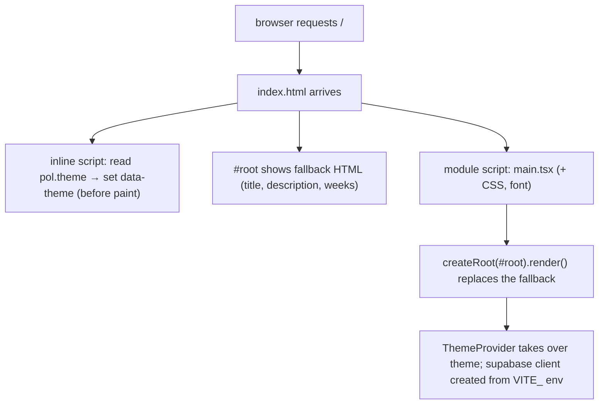
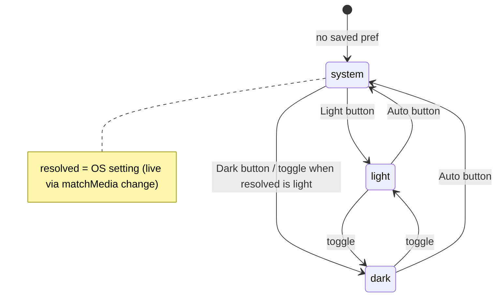

# L2.04 · Entry point, config and the small libraries

> **Level 2 · Build it** · Lesson 4 of 18

| Recipe card | |
|---|---|
| **Time** | 70 min |
| **You need** | L1.05 (you wrote simpler versions of these files) |
| **You'll produce** | `index.html`, `vite.config.ts`, `tsconfig.json`, `src/main.tsx`, `src/lib/storage.ts`, `src/lib/theme.tsx`, `src/lib/supabase.ts`, `src/lib/format.ts`, `public/manifest.webmanifest`, `.env.example` |

**In two sentences:** These files are the plumbing every screen depends on: how the page boots, how the theme is chosen before the first paint, how storage never crashes, how Supabase is configured, and four small helpers. They are short, so the line notes go deep.

> **Session 2 update (2026-10-16).** Two lines of `supabase.ts` changed: the client now uses `detectSessionInUrl: true` and `flowType: "pkce"` (to finish Google sign-in), and `friendlyError` lost its "wrong or expired code" rule and gained a 5xx rule. The current file, line by line, is in [L2.07c](l2-07c-google-sign-in.md) §5.1. Everything else in this lesson is current.

### Objectives
1. Explain every block of the real `index.html`: SEO meta, Open Graph, JSON-LD, the theme-before-paint script and the no-JS fallback inside `#root`.
2. Explain `manualChunks` and why splitting vendor code helps repeat visits.
3. Write `storage.ts`, `theme.tsx` and `supabase.ts` from memory.
4. Prove the Fisher–Yates shuffle is uniform, and trace `fmtDuration` and `ordinal` on real values.

---

## 1 · Warm-up

1. *(L1.02)* What does `viewport-fit=cover` oblige the CSS to do?
2. *(L1.03)* Why is `useState(() => load(...))` written with a function?
3. *(L1.04)* Why does `VITE_SUPABASE_ANON_KEY` have the `VITE_` prefix?

<details><summary>Answers</summary>1. Pad with <code>env(safe-area-inset-*)</code>. 2. Lazy initial state: <code>load</code> runs only once, on the first render. 3. Only <code>VITE_</code>-prefixed variables are exposed to client code, and this key is meant to be public.</details>

## 2 · The problem this solves

Three boot-time problems would hurt every visit if left unsolved:
1. **Theme flash.** React loads after the HTML, so a dark-mode user would see a light page for a split second.
2. **Blank page for crawlers and slow networks.** An SPA's HTML is empty until JS runs.
3. **Crashes from the environment.** Storage blocked, Supabase not configured, unknown errors shown raw.



*Takeaway: the HTML does three jobs before React exists: correct colours, readable content, and loading the app.*

---

## 3 · Concepts

### 3.1 Theme before paint

The browser parses `<head>` top to bottom, and a plain (non-module) `<script>` there runs **immediately, before the body is painted**. So a short inline script can read the saved preference and set `data-theme` on `<html>` before any pixel shows. The CSS rules from [L1.02](l1-02-web-platform.md) §4.1 then apply on the very first paint. React's `ThemeProvider` takes over later and keeps it in sync.

### 3.2 Vendor chunks and caching

Vite bundles everything into JS files with **content hashes** in their names (`react-efav6phX.js`). Same content, same name, so the browser can cache it forever ([L4.08](l4-08-deploy-operate.md) sets `immutable`). If everything were in one file, changing one line of *our* code would change the hash of the whole 660 KB bundle, and every visitor would download React again. Splitting libraries into their own chunks means a deploy usually changes only our ~90 KB chunk:

| Chunk | Size (gzip) | Changes when |
|---|---|---|
| `index-*.js` (our code) | ~28 KB | every deploy |
| `react-*.js` (React, React DOM, Router) | ~72 KB | React upgrade |
| `supabase-*.js` | ~58 KB | Supabase upgrade |
| `motion-*.js` | ~42 KB | Motion upgrade |

### 3.3 Fisher–Yates shuffle (used by flashcards and quiz)

**Definition.** Walk from the last index down. At each position $i$, pick a random index $j \in \{0, \dots, i\}$ and swap.

**Why it is uniform.** Position $n-1$ receives each of the $n$ elements with probability $\tfrac{1}{n}$. Given that, position $n-2$ receives each of the remaining $n-1$ with probability $\tfrac{1}{n-1}$, and so on. A particular final order therefore has probability

$$
P(\text{order}) = \frac{1}{n}\cdot\frac{1}{n-1}\cdots\frac{1}{1} = \frac{1}{n!},
$$

which is the same for all $n!$ orders. So every order is equally likely.

**The naive version is biased.** `arr.sort(() => Math.random() - 0.5)` does not give $1/n!$. Sort algorithms compare elements a varying number of times, and an inconsistent comparator skews the result. With $n = 3$, swapping with a random index in `0..n-1` at every step makes $3^3 = 27$ equally likely paths onto $3! = 6$ orders. 27 is not divisible by 6, so some orders must appear more often than others.

---

## 4 · Reading the real code

### 4.1 `index.html` (91 lines)

```html
<!doctype html>
<html lang="en">
  <head>
    <meta charset="UTF-8" />
    <meta name="viewport" content="width=device-width, initial-scale=1, viewport-fit=cover" />
    <title>Psychology of Learning NPTEL · Flashcards, Quiz &amp; Practice Test</title>
    <meta
      name="description"
      content="Free flashcards, quizzes and a timed 100-question practice test for the NPTEL Psychology of Learning course (IIT Kharagpur). All 130 assignment questions with answers, weeks 0–12, plus a live leaderboard."
    />
    <meta name="keywords" content="Psychology of Learning, NPTEL, NPTEL Psychology of Learning, assignment answers, IIT Kharagpur, SWAYAM, flashcards, practice test, quiz, exam preparation" />
    <link rel="canonical" href="https://psychology-of-learning-nptel.vercel.app/" />
    <meta name="robots" content="index, follow" />
    <meta name="theme-color" content="#0e0c0b" />
    <meta name="color-scheme" content="dark light" />
    <meta name="format-detection" content="telephone=no" />
    <link rel="icon" type="image/png" href="/favicon.png" />
    <link rel="apple-touch-icon" href="/icons/apple-touch-icon.png" />
    <link rel="manifest" href="/manifest.webmanifest" />
    <meta name="mobile-web-app-capable" content="yes" />
    <meta name="apple-mobile-web-app-capable" content="yes" />
    <meta name="apple-mobile-web-app-title" content="PsyLearn" />
    <meta name="apple-mobile-web-app-status-bar-style" content="black-translucent" />
```
Line notes (head, part 1):
- **`<title>`** holds the search query words people type ("Psychology of Learning NPTEL"), the most important SEO element. `&amp;` is the HTML escape for `&`.
- **`description`** is the snippet search engines show under the title: about 150–220 characters, with the real value proposition. The HTTP test asserts it is at least 80 characters ([L4.03](l4-03-playwright-foundations.md)).
- **`keywords`**: ignored by Google, harmless, and used by some smaller engines.
- **`canonical`**: "the official URL of this page is …". It matters because the same app is reachable at the short domain (which redirects) and at preview URLs.
- **`robots: index, follow`**: may be indexed and its links followed (also the default; stated explicitly).
- **`color-scheme: dark light`**: tells the browser that both schemes are supported, so built-in UI (scrollbars, form controls) matches.
- **`format-detection: telephone=no`**: stops iOS turning digit strings (a score of `1294000`!) into phone links.
- **Icons**: `favicon.png` for tabs; `apple-touch-icon` (180×180) for the iOS home screen.
- **`apple-mobile-web-app-*`**: when added to the iOS home screen, run full-screen (`capable`), named "PsyLearn", with a translucent status bar.

```html
    <meta property="og:type" content="website" />
    <meta property="og:site_name" content="Coffee aur Code" />
    <meta property="og:url" content="https://psychology-of-learning-nptel.vercel.app/" />
    <meta property="og:title" content="Psychology of Learning NPTEL · Flashcards, Quiz & Practice Test" />
    <meta property="og:description" content="All 130 NPTEL assignment questions with answers. Swipe flashcards, take a timed 100-question test, climb the leaderboard." />
    <meta property="og:image" content="https://psychology-of-learning-nptel.vercel.app/og-image.png" />
    <meta property="og:image:width" content="1200" />
    <meta property="og:image:height" content="630" />
    <meta name="twitter:card" content="summary_large_image" />
    <meta name="twitter:title" content="Psychology of Learning NPTEL · Flashcards, Quiz & Practice Test" />
    <meta name="twitter:description" content="All 130 NPTEL assignment questions with answers, a timed practice test and a live leaderboard." />
    <meta name="twitter:image" content="https://psychology-of-learning-nptel.vercel.app/og-image.png" />
```
- **Open Graph (`og:*`)**: what WhatsApp, Telegram, LinkedIn and Discord show when someone pastes the link. **`og:image` must be an absolute URL.** Scrapers don't resolve relative paths. 1200×630 is the standard large-card size, and the dimensions let scrapers lay it out before downloading.
- **`twitter:*`**: X/Twitter's equivalents. `summary_large_image` shows the big image card.

```html
    <script type="application/ld+json">
      {
        "@context": "https://schema.org",
        "@type": "LearningResource",
        "name": "Psychology of Learning NPTEL · Flashcards, Quiz & Practice Test",
        "url": "https://psychology-of-learning-nptel.vercel.app/",
        "description": "Flashcards, quizzes and a timed practice test covering all 130 assignment questions of the NPTEL Psychology of Learning course (IIT Kharagpur), weeks 0 to 12.",
        "learningResourceType": ["Flashcards", "Quiz", "Practice test"],
        "educationalLevel": "Undergraduate",
        "inLanguage": "en",
        "isAccessibleForFree": true,
        "about": { "@type": "Course", "name": "Psychology of Learning", "provider": { "@type": "Organization", "name": "NPTEL · IIT Kharagpur" } },
        "publisher": { "@type": "Organization", "name": "Coffee aur Code" }
      }
    </script>
```
- **JSON-LD structured data**: machine-readable facts for search engines, using the schema.org vocabulary. `type="application/ld+json"` means the browser doesn't execute it. `LearningResource` with `about: Course` tells Google what this page *is*.

```html
    <script>
      // apply saved theme before paint (no flash)
      try {
        var t = JSON.parse(localStorage.getItem("pol.theme") || "null");
        if (t === "light" || t === "dark") document.documentElement.dataset.theme = t;
      } catch (e) {}
    </script>
  </head>
```
- **Plain (classic) script**: runs synchronously, before the body paints (§3.1).
- **`JSON.parse(... || "null")`**: storage holds `"\"dark\""` (a JSON string), because `save()` JSON-encodes. A missing key gives `null`.
- **Only `light`/`dark` set the attribute.** `system` (auto) leaves it absent, so the media query decides.
- **`try/catch`**: storage can throw (L1.02 §7). A theme should never break page load.
- **`var`**, not `const`: old-school on purpose, because it runs before any build step and must work on very old browsers.

```html
  <body>
    <div id="root">
      <!-- Readable before JavaScript loads (search engines, slow networks). React replaces this. -->
      <main style="max-width: 640px; margin: 0 auto; padding: 32px 20px; font-family: system-ui, sans-serif">
        <h1>Psychology of Learning (NPTEL) · Flashcards, Quiz &amp; Practice Test</h1>
        <p>…Study all 130 assignment questions with answers…</p>
        <h2>Weeks covered</h2>
        <ul> <li>Week 0 · Introduction to psychology</li> … <li>Week 12 · Learning for sustainability</li> </ul>
        <noscript><p>Please enable JavaScript to use the flashcards and practice test.</p></noscript>
      </main>
    </div>
    <script type="module" src="/src/main.tsx"></script>
  </body>
</html>
```
- **Fallback content inside `#root`**: crawlers and users on slow 3G see a real heading, description and the 13 week topics before JS arrives. `createRoot().render()` **replaces** the children of `#root`, so it disappears when React mounts.
- **The inline `style` has no colour.** An earlier version set `color: #f4eadb` (cream), which was invisible on the light theme's cream background. Fixed by inheriting the body colour, which comes from the CSS.
- **`<noscript>`**: shown only if JS is disabled.

### 4.2 `vite.config.ts`

```ts
import { defineConfig } from "vite";
import react from "@vitejs/plugin-react";

export default defineConfig({
  plugins: [react()],
  build: {
    rollupOptions: {
      output: {
        // separate, long-cached vendor chunks
        manualChunks(id) {
          if (id.includes("node_modules/@supabase")) return "supabase";
          if (id.includes("node_modules/motion") || id.includes("node_modules/framer-motion")) return "motion";
          if (id.includes("node_modules/react") || id.includes("node_modules/scheduler")) return "react";
        },
      },
    },
  },
});
```
- **`defineConfig`**: only gives type hints in the editor; it returns the object unchanged.
- **`rollupOptions.output.manualChunks(id)`**: Vite builds with *Rollup*. For each module path (`id`), return a chunk name, or nothing to let Rollup decide.
- **Order matters.** `node_modules/react` also matches `react-dom` and `react-router` (string prefix), so all three land in `react`, which we want. `scheduler` is React's internal dependency.
- **`framer-motion`**: Motion v12 re-exports from `framer-motion` internally. Both go to `motion`.
- Before this config, the build warned *"Some chunks are larger than 500 kB"* (one 666 KB file). After: 88 + 128 + 223 + 226 KB raw.

### 4.3 `tsconfig.json`

```json
{
  "compilerOptions": {
    "target": "ES2022",
    "lib": ["ES2022", "DOM", "DOM.Iterable"],
    "module": "ESNext",
    "moduleResolution": "bundler",
    "jsx": "react-jsx",
    "strict": true,
    "noUnusedLocals": true,
    "noUnusedParameters": true,
    "noFallthroughCasesInSwitch": true,
    "skipLibCheck": true,
    "isolatedModules": true,
    "verbatimModuleSyntax": true,
    "noEmit": true,
    "types": ["vite/client"]
  },
  "include": ["src"]
}
```
Same as the slice ([L1.05](l1-05-setup-first-slice.md) §4.2), plus:
- **`noUnusedLocals` / `noUnusedParameters`**: an unused import or variable fails the build. That keeps dead code out. It's why handlers write `(_, info) =>` (a leading `_` marks a parameter as intentionally unused).
- **`noFallthroughCasesInSwitch`**: catches a missing `break`.
- **`skipLibCheck`**: don't type-check `.d.ts` files inside `node_modules`. Faster, and avoids errors in other people's types.
- **`include: ["src"]`**: tests and configs (`tests/`, `playwright.config.ts`) are *not* checked by `npm run build`. Playwright compiles its own files, so test-only types can't block a deploy.

### 4.4 `src/main.tsx`

```tsx
import { StrictMode } from "react";
import { createRoot } from "react-dom/client";
import App from "./App";
import "@fontsource-variable/archivo/wdth.css";
import "./styles.css";
import "./responsive.css";

createRoot(document.getElementById("root")!).render(
  <StrictMode>
    <App />
  </StrictMode>
);
```
- **Font import first.** `@fontsource-variable/archivo/wdth.css` declares the self-hosted variable font (weight *and* width axes: the brand look uses `font-stretch: 125%`). Vite copies the `.woff2` files into `dist/assets/` with hashes. Replacing Google Fonts with this moved mobile Lighthouse performance from 81 to 91 ([L3.05](l3-05-performance.md)).
- **CSS order matters.** `responsive.css` comes after `styles.css`, so its media-query rules win ties in the cascade ([L2.10c](l2-10c-responsive.md)).

### 4.5 `src/lib/storage.ts`

```ts
// localStorage that never throws (private mode, blocked storage, etc.)
export function load<T>(key: string, fallback: T): T {
  try {
    const v = localStorage.getItem(key);
    return v ? (JSON.parse(v) as T) : fallback;
  } catch {
    return fallback;
  }
}

export function save(key: string, value: unknown) {
  try {
    if (value === undefined || value === null) localStorage.removeItem(key);
    else localStorage.setItem(key, JSON.stringify(value));
  } catch {
    /* ignore */
  }
}
```
- **`catch` with no variable** (`catch {`): modern syntax for when we don't need the error.
- **The `JSON.parse` failure** (corrupted value) is caught too, and returns the fallback.
- **`save(key, null)` removes the key.** The test runner clears `pol.attempt` with `save(ATTEMPT_KEY, null)` after submitting.
- **`value: unknown`**: accepts anything. `unknown` is the safe "any": you must narrow it before use, and here we only stringify it.

### 4.6 `src/lib/theme.tsx`

```tsx
import { createContext, useContext, useEffect, useState, type ReactNode } from "react";
import { load, save } from "./storage";

export type ThemePref = "system" | "light" | "dark";

const Ctx = createContext<{ pref: ThemePref; setPref: (p: ThemePref) => void; resolved: "light" | "dark" }>({
  pref: "system",
  setPref: () => {},
  resolved: "dark",
});

const media = () => window.matchMedia("(prefers-color-scheme: dark)");

export function ThemeProvider({ children }: { children: ReactNode }) {
  const [pref, setPrefState] = useState<ThemePref>(() => load<ThemePref>("pol.theme", "system"));
  const [systemDark, setSystemDark] = useState(() => media().matches);

  useEffect(() => {
    const m = media();
    const on = () => setSystemDark(m.matches);
    m.addEventListener("change", on);
    return () => m.removeEventListener("change", on);
  }, []);

  const resolved = pref === "system" ? (systemDark ? "dark" : "light") : pref;

  useEffect(() => {
    const root = document.documentElement;
    if (pref === "system") delete root.dataset.theme;
    else root.dataset.theme = pref;
    document.querySelector('meta[name="theme-color"]')?.setAttribute("content", resolved === "dark" ? "#0e0c0b" : "#f6f0e6");
  }, [pref, resolved]);

  const setPref = (p: ThemePref) => {
    setPrefState(p);
    save("pol.theme", p);
  };

  return <Ctx.Provider value={{ pref, setPref, resolved }}>{children}</Ctx.Provider>;
}

export const useTheme = () => useContext(Ctx);
```



Line notes:
- **Two states**: `pref` (what the user chose) and `systemDark` (what the OS says). `resolved` is **derived**, computed each render rather than stored, so it can never be out of sync.
- **`matchMedia(...).addEventListener("change")`**: if the OS switches to dark at sunset while the app is open in "auto", the app follows.
- **Effect 2** writes to the DOM: `delete root.dataset.theme` removes `data-theme` entirely for "auto", so only the media query applies. It also repaints the browser's address bar via `theme-color`.
- **The toggle in the top bar** calls `setPref(resolved === "dark" ? "light" : "dark")`. It flips what you *see*, which may mean leaving "auto". The Account page offers all three.
- **The default context value** (`resolved: "dark"`) is only used if a component is rendered outside the provider. It never happens in the app; tests could do it.

### 4.7 `src/lib/supabase.ts`

```ts
import { createClient } from "@supabase/supabase-js";

const url = import.meta.env.VITE_SUPABASE_URL as string | undefined;
const key = import.meta.env.VITE_SUPABASE_ANON_KEY as string | undefined;

export const isConfigured = Boolean(url && key);

export const supabase = createClient(url ?? "http://localhost", key ?? "missing", {
  auth: { persistSession: true, autoRefreshToken: true, detectSessionInUrl: false },
});

/** Turn Supabase / Postgres errors into something a student can act on. */
export function friendlyError(e: unknown): string {
  const msg = (e as { message?: string })?.message ?? String(e);
  const code = (e as { code?: string })?.code;
  if (code === "PGRST202" || /function .* does not exist|Could not find the function/i.test(msg))
    return "The database isn't set up yet. Run supabase/setup.sql in the Supabase SQL editor.";
  if (code === "23505") return "That name is taken. Try another.";
  if (/rate limit|too many/i.test(msg)) return "Too many attempts. Please wait a minute and try again.";
  if (/Token has expired or is invalid|otp/i.test(msg)) return "That code is wrong or has expired. Request a new one.";
  if (/Failed to fetch|NetworkError/i.test(msg)) return "You seem to be offline. Check your connection.";
  return msg;
}
```
- **`isConfigured`**: lets the app run without Supabase (flashcards still work). Pages check it and show a banner instead of failing.
- **Placeholder URL/key when missing**: `createClient` throws on an empty URL, so we give harmless placeholders and never call it unless `isConfigured`.
- **`persistSession: true`**: store the session in `localStorage`, so you stay signed in across reloads. **`autoRefreshToken`**: renew the short-lived access token in the background. **`detectSessionInUrl: false`**: we use codes, not magic links, so there's nothing to read from the URL. That saves work and avoids surprises.
- **`friendlyError`, ordered from specific to general:**
  - `PGRST202` is PostgREST's "function not found", which happens when `setup.sql` hasn't run. The message tells the developer exactly what to do. This was seen live before the user ran the SQL.
  - `23505` is a unique violation, i.e. a duplicate display name.
  - Rate limits: Supabase Auth limits OTP sends per hour.
  - OTP failures: `Token has expired or is invalid` (the 8-digit bug's message, [L2.07a](l2-07a-auth-sign-in.md)).
  - Network: `fetch` rejects with `Failed to fetch` (Chrome) or `NetworkError` (Firefox).
  - Otherwise the raw message. The definer functions' own messages ("Test attempt not found") are already human.

### 4.8 `src/lib/format.ts`

```ts
export function fmtDuration(ms: number | null | undefined): string {
  if (ms == null) return "–";
  const total = Math.max(0, Math.round(ms / 1000));
  const h = Math.floor(total / 3600);
  const m = Math.floor((total % 3600) / 60);
  const s = total % 60;
  const pad = (n: number) => String(n).padStart(2, "0");
  return h ? `${h}:${pad(m)}:${pad(s)}` : `${m}:${pad(s)}`;
}

export function shuffle<T>(arr: T[]): T[] {
  const a = arr.slice();
  for (let i = a.length - 1; i > 0; i--) {
    const j = Math.floor(Math.random() * (i + 1));
    [a[i], a[j]] = [a[j], a[i]];
  }
  return a;
}

export function greeting(): string {
  const h = new Date().getHours();
  if (h < 5) return "Burning the midnight coffee";
  if (h < 12) return "Good morning";
  if (h < 17) return "Good afternoon";
  return "Good evening";
}

export const haptic = (ms = 12) => {
  try {
    navigator.vibrate?.(ms);
  } catch {
    /* unsupported */
  }
};

export function ordinal(n: number): string {
  const s = ["th", "st", "nd", "rd"];
  const v = n % 100;
  return n + (s[(v - 20) % 10] || s[v] || s[0]);
}
```
- **`ms == null`** (double equals) is true for both `null` and `undefined`. That is the one place `==` is idiomatic.
- **`Math.max(0, …)`** guards against negative durations if clocks disagree.
- **`shuffle` copies first** (`arr.slice()`), so the caller's array is never mutated. Mutating the shared `QUESTIONS` array would reorder the List view everywhere.
- **`[a[i], a[j]] = [a[j], a[i]]`**: swap by destructuring.
- **`navigator.vibrate?.(ms)`**: optional call. It runs only if the function exists. Android Chrome vibrates; iOS Safari has no `vibrate`, so nothing happens. The `try` covers browsers that throw when it is called without a user gesture.
- **`ordinal`**: the classic compact trick, traced below.

---

## 5 · Worked traces

**`fmtDuration(1294000)`** (the 21:34 test from L2.03):

| Frame | Expression | Value |
|---|---|---|
| 1 | `Math.round(1294000/1000)` | 1294 |
| 2 | `h = floor(1294/3600)` | 0 |
| 3 | `m = floor((1294 % 3600)/60) = floor(1294/60)` | 21 |
| 4 | `s = 1294 % 60` | 34 |
| 5 | `h` is 0 → `${m}:${pad(s)}` | **"21:34"** |

`fmtDuration(3725000)` → total 3725 → h 1, m 2, s 5 → **"1:02:05"**.

**`ordinal(n)`**: the rule: 11th/12th/13th are special, and otherwise the last digit picks st/nd/rd.

| n | v = n%100 | (v−20)%10 | `s[(v-20)%10]` | `s[v]` | result |
|---|---|---|---|---|---|
| 1 | 1 | −9 | undefined | "st" | 1st |
| 2 | 2 | −8 | undefined | "nd" | 2nd |
| 11 | 11 | −9 | undefined | undefined | 11th (`s[0]`) |
| 21 | 21 | 1 | "st" | — | 21st |
| 112 | 12 | −8 | undefined | undefined | 112th |
| 23 | 23 | 3 | "rd" | — | 23rd |

*Why it works:* for v < 20, `(v−20)%10` is negative (JS remainders keep the sign), so the first lookup is `undefined` and `s[v]` handles 1, 2 and 3 directly; 4–19 fall through to "th". For v ≥ 20, `(v−20)%10` is the last digit.

**`shuffle([A,B,C])`** with random draws giving j = 0 then j = 1:

| Frame | i | j | array after swap |
|---|---|---|---|
| start | | | A B C |
| 1 | 2 | 0 | C B A |
| 2 | 1 | 1 | C B A (swap with itself) |
| done | | | **C B A** |

---

## 6 · Running and testing

- `npm run build`. Expect four JS chunks (`index`, `motion`, `supabase`, `react`) and **no** "larger than 500 kB" warning.
- Theme: set dark on the Me page, reload, and look for any light flash (there should be none). The e2e test "theme toggle switches light/dark and is remembered" checks `data-theme` survives reload on all 11 devices ([L4.05](l4-05-ui-tests-quiz-runner.md)).
- SEO: `tests/e2e/http.spec.ts` › "index.html has title, description, canonical, Open Graph and structured data".
- Without `.env.local`: `npm run dev`. Flashcards work, and Test/Ranks show the "needs Supabase" banner.

## 7 · Bug journal

**Incident · The no-JS fallback was invisible in light mode**
1. **Symptom.** In a light-theme screenshot of the raw HTML, the fallback heading and text in `#root` couldn't be seen.
2. **Diagnosis.** The inline style on the fallback `<main>` set `color: #f4eadb` (cream), and the light theme's body background is `#f6f0e6`, almost the same colour.
3. **Root cause.** A hard-coded colour in a theme-aware page.
4. **Fix.**
   ```diff
   - <main style="… font-family: system-ui, sans-serif; color: #f4eadb">
   + <main style="… font-family: system-ui, sans-serif">   <!-- inherit the themed body colour -->
   ```
5. **Lesson.** In a themed app, never hard-code text colours outside the token system. Inherit, or use a token.

## 8 · Why this design

| Decision | Alternatives | Why this one | Trade-off | Choose differently when |
|---|---|---|---|---|
| Inline theme script in `<head>` | Let React set it | No flash of the wrong theme | One tiny duplicated piece of logic | — |
| Fallback HTML in `#root` | Empty `#root`; server rendering | SEO + slow networks, at zero cost | Content duplicated from the app | You need full SSR |
| Vendor `manualChunks` | One bundle; Vite's automatic splitting | Long-term caching of libraries | Slightly more requests on the first visit | HTTP/1 with many tiny chunks |
| `friendlyError` mapping | Show raw errors | Actionable messages | Must match error formats that can change | — |
| Self-hosted variable font | Google Fonts | Not render-blocking, no third party | ~90 KB font file per subset | — |

## 9 · Check yourself

**Q1.** Why can't the theme-before-paint script be a module (`type="module"`)?
<details><summary>Answer</summary>Module scripts are deferred until the HTML is parsed, so they run after the first paint and you would see the flash.</details>

**Q2.** You delete `manualChunks`. What changes for users?
<details><summary>Answer</summary>Nothing functionally. Each deploy changes the single big bundle's hash, so returning visitors re-download about 200 KB gzip instead of about 28 KB.</details>

**Q3.** `shuffle` without `arr.slice()`: which visible bug appears?
<details><summary>Answer</summary>The shared <code>QUESTIONS</code> array is reordered in place, so the List view (and anything else using it) becomes shuffled too.</details>

**Q4.** `ordinal(13)` returns? And `ordinal(101)`?
<details><summary>Answer</summary>"13th" (<code>s[-7]</code> and <code>s[13]</code> are undefined → "th"); "101st" (v = 1 → <code>s[1]</code>).</details>

**Q5.** A user without `.env.local` opens Ranks. What do they see, and which line decides it?
<details><summary>Answer</summary>A banner "Leaderboard needs Supabase to be configured.", because <code>isConfigured</code> is false (the Leaderboard checks it before calling the RPC).</details>

## 10 · Practice

**Easy (10 min).** Add a `system`-aware favicon: a different `<link rel="icon" media="(prefers-color-scheme: dark)">`. Explain the `media` attribute.

**Medium (20 min).** Write a test (in your head or with `node:test`) that shuffles `[0,1,2]` 60,000 times and counts the 6 orders. Each should land near 10,000. Then try the biased `sort(() => Math.random() - 0.5)`.
<details><summary>What you'll see</summary>Fisher–Yates: all six ≈ 10,000. The sort-based shuffle: noticeably uneven counts (the exact skew depends on the engine's sort algorithm).</details>

**Hard (40 min).** Make `friendlyError` handle `42501` ("permission denied for function") with "Please sign in first", and write the cases you'd test.

## 11 · From memory

**Rung 1 · Cloze.**

```ts
export function load<T>(key: string, fallback: T): T {
  try { const v = localStorage.___①___(key); return v ? (JSON.parse(v) as T) : fallback; }
  catch { return ___②___; }
}
const resolved = pref === "system" ? (systemDark ? "dark" : "light") : ___③___;
useEffect(() => {
  const root = document.documentElement;
  if (pref === "system") ___④___ root.dataset.theme; else root.dataset.theme = pref;
}, [pref, resolved]);
export const supabase = createClient(url ?? "http://localhost", key ?? "missing", {
  auth: { persistSession: true, autoRefreshToken: true, detectSessionInUrl: ___⑤___ },
});
for (let i = a.length - 1; i > 0; i--) { const j = Math.floor(Math.random() * (___⑥___)); [a[i], a[j]] = [a[j], a[i]]; }
```
<details><summary>Answers</summary>① <code>getItem</code> ② <code>fallback</code> ③ <code>pref</code> ④ <code>delete</code> ⑤ <code>false</code> ⑥ <code>i + 1</code></details>

**Rung 2 · Blank page (15 min).** Write `storage.ts`, `theme.tsx` and the `shuffle`/`fmtDuration` helpers from memory.
<details><summary>Self-check</summary>

- [ ] Both storage functions swallow errors; `save(null)` removes
- [ ] Theme: two states, derived `resolved`, matchMedia listener with cleanup, `delete dataset.theme` for system, theme-color meta update
- [ ] Shuffle copies, loops down to 1, `j ∈ [0, i]`
- [ ] fmtDuration: hours only when > 0, zero-padded mm/ss
</details>

## 12 · Flashcards

<details><summary><b>Q:</b> How does the app avoid a theme flash?</summary><b>A:</b> A classic inline script in <code>&lt;head&gt;</code> sets <code>data-theme</code> from storage before the body paints.</details>
<details><summary><b>Q:</b> Why put fallback HTML inside <code>#root</code>?</summary><b>A:</b> Crawlers and slow connections see real content; React replaces it on mount.</details>
<details><summary><b>Q:</b> Why must <code>og:image</code> be absolute?</summary><b>A:</b> Link-preview scrapers don't resolve relative URLs.</details>
<details><summary><b>Q:</b> What does <code>manualChunks</code> buy?</summary><b>A:</b> Library code in separately hashed files, cached across deploys.</details>
<details><summary><b>Q:</b> Why is <code>resolved</code> computed, not stored?</summary><b>A:</b> Derived state can't go out of sync with <code>pref</code> and the OS setting.</details>
<details><summary><b>Q:</b> What does <code>detectSessionInUrl: false</code> skip?</summary><b>A:</b> Parsing magic-link tokens from the URL; we use OTP codes.</details>
<details><summary><b>Q:</b> Probability of any order under Fisher–Yates?</summary><b>A:</b> 1/n!.</details>
<details><summary><b>Q:</b> Which tsconfig flags make unused code fail the build?</summary><b>A:</b> <code>noUnusedLocals</code> and <code>noUnusedParameters</code>.</details>
<details><summary><b>Q:</b> What does PostgREST error <code>PGRST202</code> mean here?</summary><b>A:</b> The function doesn't exist, so <code>setup.sql</code> hasn't been run.</details>

## 13 · The menu board

| File | Remember |
|---|---|
| `index.html` | title/description/canonical/OG/JSON-LD · theme script before paint · fallback in `#root` |
| `vite.config.ts` | `manualChunks` → react / supabase / motion |
| `tsconfig.json` | strict + noUnused* + verbatimModuleSyntax; `include: ["src"]` |
| `main.tsx` | font → styles → responsive (order matters) |
| `storage.ts` | try/catch everywhere; `save(k, null)` removes |
| `theme.tsx` | pref + systemDark → derived `resolved`; `data-theme` absent = auto |
| `supabase.ts` | `isConfigured`; persist + refresh; `friendlyError` ordered specific → general |
| `format.ts` | `fmtDuration`, Fisher–Yates `shuffle`, `greeting`, `haptic`, `ordinal` |

## 14 · Glossary

**Canonical URL**: the official address of a page for search engines. **Chunk**: one output JS file. **Classic script**: non-module script that runs synchronously. **Content hash**: hash of a file's bytes in its name. **Derived state**: a value computed from other state each render. **JSON-LD**: JSON structured data using schema.org terms. **Open Graph**: meta tags for link previews. **Rollup**: the bundler underneath `vite build`. **Variable font**: one font file with adjustable axes (weight, width).

## 15 · Go further

| Resource | Type | Why | Which part | Time |
|---|---|---|---|---|
| [Google Search Central: SEO starter guide](https://developers.google.com/search/docs/fundamentals/seo-starter-guide) | Guide | What title/description/canonical actually do | "Influence how your site looks in Google Search" | 20 min |
| [The Open Graph protocol](https://ogp.me/) | Spec | The `og:` tags | "Basic Metadata" | 5 min |
| [Vite: Build options](https://vite.dev/config/build-options) | Docs | `rollupOptions`, chunk warnings | `build.rollupOptions` | 10 min |
| [Wikipedia: Fisher–Yates shuffle](https://en.wikipedia.org/wiki/Fisher%E2%80%93Yates_shuffle) | Article | Proof and the biased variants | "Potential sources of bias" | 15 min |

---
← [L2.03 Server-side grading](l2-03-server-grading.md) · [Hub](README.md) · [L2.05 The app shell →](l2-05-app-shell.md)
