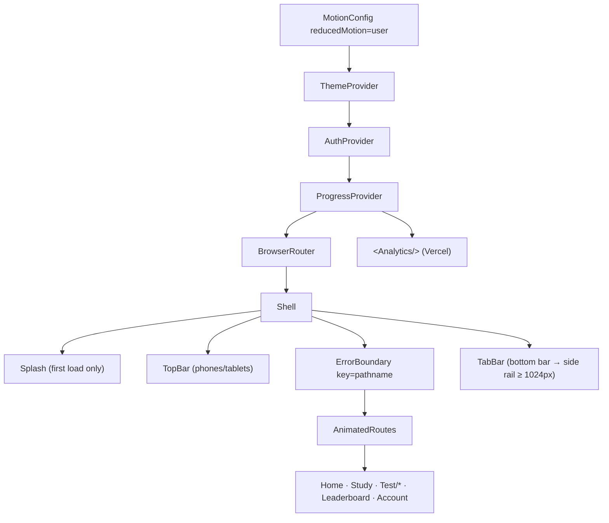
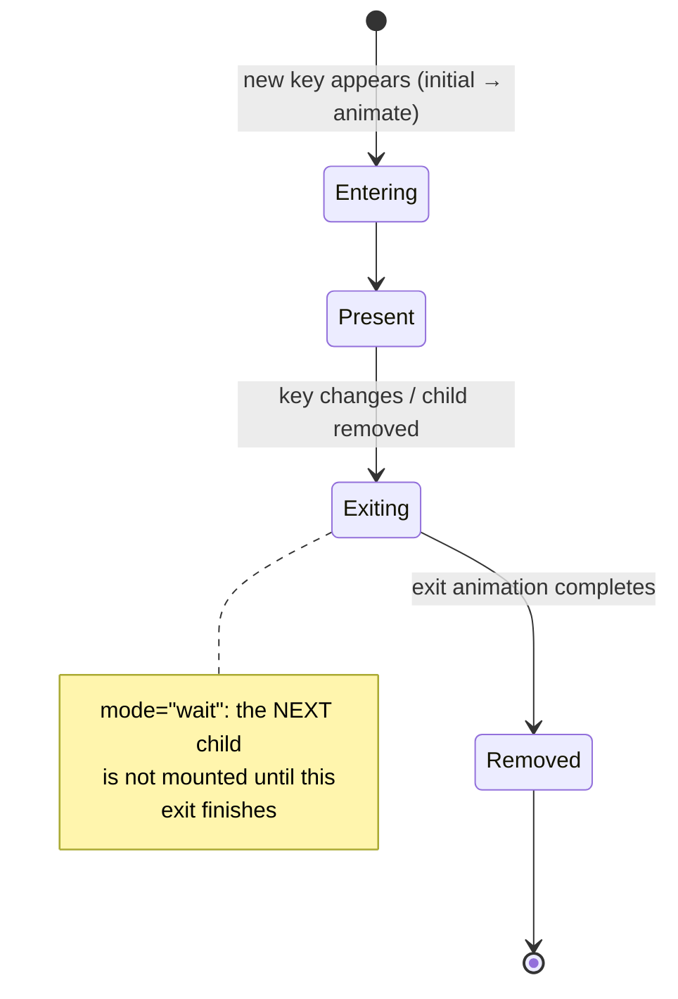
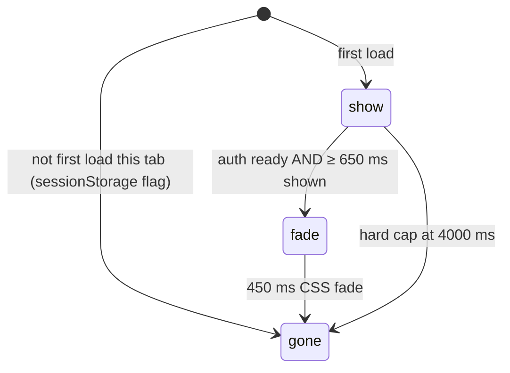

# L2.05 · The app shell: providers, routes, navigation, splash, error boundary

> **Level 2 · Build it** · Lesson 5 of 18

| Recipe card | |
|---|---|
| **Time** | 75 min |
| **You need** | L1.03 (hooks, context), L2.04 (theme, storage) |
| **You'll produce** | `src/App.tsx` (217 lines) and `src/components/ErrorBoundary.tsx` (31 lines) |

**In two sentences:** `App.tsx` assembles everything: the provider stack, the router, the animated page transitions, the top bar, the tab bar that becomes a side rail, and the first-load splash. It is also where the session's first and most dramatic bug lived: a blank page caused by one missing pair of braces.

### Objectives
1. Draw the provider tree and explain why each provider sits where it does.
2. Write `AnimatedRoutes`: keyed `motion.main` inside `AnimatePresence mode="wait"`, scroll-to-top and per-page titles.
3. Explain how the shared `layoutId="tab-pill"` makes the active tab background glide.
4. Write the splash as a 3-phase state machine with a hard 4-second cap, and explain why it no longer depends on an exit animation.
5. Explain what an error boundary catches, why it is keyed by `pathname`, and what it cannot catch.

---

## 1 · Warm-up

1. *(L1.03)* What must an effect callback return?
2. *(L2.04)* What does `theme.tsx` do for the "system" preference?
3. *(L1.02)* How does an SPA show `/ranks` without a server file?

<details><summary>Answers</summary>1. Nothing or a cleanup function. 2. Removes <code>data-theme</code> so the media query decides; follows OS changes live. 3. The host rewrites to <code>index.html</code>; the router renders by pathname.</details>

## 2 · The problem this solves

Every page needs the same frame: providers above it, a top bar, a tab bar, transitions between pages, a safety net for crashes, and a pleasant first load. Putting that once in a "shell" keeps the pages focused on their own job.



*Takeaway: providers are ordered by dependency (Progress needs Auth); visual parts sit inside the router, because they read the location.*

---

## 3 · Concepts new in this lesson

### 3.1 React Router 7 pieces used here

| Piece | Job |
|---|---|
| `BrowserRouter` | Uses the History API; provides location to everything inside |
| `Routes` / `Route path element` | Picks the first matching route. `path="/test/*"` lets `Test` define its own sub-routes (`run`, `result`) |
| `NavLink to` | A link that navigates with `pushState` (no reload) |
| `useLocation()` | The current `{ pathname, search }`; re-renders on navigation |

### 3.2 Motion: `AnimatePresence`, keys and `layoutId`

**Definition.** Motion (formerly Framer Motion) animates React components declaratively: `initial` (start), `animate` (target) and `exit` (on removal).

**The problem it solves.** React removes a component from the DOM immediately when it stops rendering, so there is no chance to animate it out. `<AnimatePresence>` keeps a removed child mounted until its `exit` animation finishes.



*Takeaway: changing the `key` tells AnimatePresence "this is a different child". `mode="wait"` plays exit-then-enter instead of both at once.*

**`layoutId`.** Two elements with the same `layoutId` (even in different components, or the same one moving) are treated as **one** element. When it re-renders somewhere else, Motion animates it from the old position to the new one. Only the active tab renders `<motion.span layoutId="tab-pill">`, so switching tabs makes the pill glide.

**`MotionConfig reducedMotion="user"`.** If the OS asks for reduced motion, Motion skips transform animations app-wide. The CSS does the same for CSS animations ([L2.10b](l2-10b-component-styles.md)).

### 3.3 Error boundaries

**Definition.** A class component with `static getDerivedStateFromError` that catches errors thrown **while rendering** its children, and renders a fallback instead of letting React unmount the whole app.

It does **not** catch errors in event handlers, in async code (promises, `setTimeout`), or in itself. React 19 removes the whole tree on an uncaught render error. That is the blank page we saw.

---

## 4 · Reading the real code

### 4.1 Imports and the tab model (lines 1–24)

```tsx
import { useEffect, useState } from "react";
import { BrowserRouter, NavLink, Route, Routes, useLocation } from "react-router-dom";
import { Analytics } from "@vercel/analytics/react";
import { AnimatePresence, MotionConfig, motion } from "motion/react";
import { AuthProvider, useAuth } from "./lib/auth";
import { ProgressProvider } from "./lib/progress";
import { ThemeProvider, useTheme } from "./lib/theme";
import { Icon, type IconName } from "./components/Icon";
import { Splash } from "./components/Ui";
import { ErrorBoundary } from "./components/ErrorBoundary";
import Home from "./pages/Home";
import Study from "./pages/Study";
import Test from "./pages/Test";
import Leaderboard from "./pages/Leaderboard";
import Account from "./pages/Account";

// `long` is the label on the laptop side rail
const TABS: { to: string; label: string; long: string; icon: IconName }[] = [
  { to: "/", label: "Home", long: "Home", icon: "home" },
  { to: "/study", label: "Study", long: "Flashcards", icon: "cards" },
  { to: "/test", label: "Test", long: "Practice test", icon: "timer" },
  { to: "/ranks", label: "Ranks", long: "Leaderboard", icon: "trophy" },
  { to: "/me", label: "Me", long: "My account", icon: "user" },
];
```
- **`motion/react`**: Motion v12's React entry point.
- **`type IconName`**: inline type-only import (allowed with `verbatimModuleSyntax`). `IconName` is the union of icon keys, so `icon: "trophy"` is checked.
- **The tabs are data.** One array drives both the phone bar (`label`, short) and the laptop rail (`long`). The first edit for the rail built "My account" from a CSS-hidden "My " span plus the word "account". Caught on review: phones would have shown just "account". Rendering **both** full labels and letting CSS show the right one is simpler and correct ([L2.10c](l2-10c-responsive.md)).

### 4.2 `ThemeToggle` (lines 26–50)

```tsx
function ThemeToggle({ withLabel = false }: { withLabel?: boolean }) {
  const { resolved, setPref } = useTheme();
  return (
    <motion.button
      className={withLabel ? "rail-theme" : "icon-btn"}
      whileTap={{ scale: 0.92 }}
      onClick={() => setPref(resolved === "dark" ? "light" : "dark")}
      aria-label={`Switch to ${resolved === "dark" ? "light" : "dark"} mode`}
    >
      <AnimatePresence mode="wait" initial={false}>
        <motion.span
          key={resolved}
          style={{ display: "grid" }}
          initial={{ y: -14, opacity: 0, rotate: -60 }}
          animate={{ y: 0, opacity: 1, rotate: 0 }}
          exit={{ y: 14, opacity: 0, rotate: 60 }}
          transition={{ duration: 0.22 }}
        >
          <Icon name={resolved === "dark" ? "sun" : "moon"} size={20} />
        </motion.span>
      </AnimatePresence>
      {withLabel && <span>{resolved === "dark" ? "Light mode" : "Dark mode"}</span>}
    </motion.button>
  );
}
```
- **Used twice**: as an icon button in the top bar, and with a label in the laptop rail footer.
- **`whileTap`**: animates while pressed, which gives tactile feedback.
- **`aria-label`** describes the *action* ("Switch to light mode"). Screen readers announce it. The icon alone has no text.
- **`key={resolved}`** inside `AnimatePresence mode="wait"`: the sun spins out downwards, then the moon drops in. **`initial={false}`** skips the entrance on first render, so the icon doesn't animate on page load.

### 4.3 `TopBar` (lines 52–75)

```tsx
function TopBar() {
  const [scrolled, setScrolled] = useState(false);
  useEffect(() => {
    const on = () => setScrolled(window.scrollY > 4);
    on();
    window.addEventListener("scroll", on, { passive: true });
    return () => window.removeEventListener("scroll", on);
  }, []);
  return (
    <header className={`topbar ${scrolled ? "scrolled" : ""}`}>
      <NavLink to="/" className="brand">
        <motion.img src="/brand/badge-round.webp" width={34} height={34} alt="" whileTap={{ rotate: -20, scale: 0.9 }} />
        <div>
          <div className="brand-title">Psychology of Learning</div>
          <div className="brand-sub">
            Coffee <b>aur</b> Code
          </div>
        </div>
      </NavLink>
      <div className="spacer" />
      <ThemeToggle />
    </header>
  );
}
```
- **`scrolled`** adds a border once you scroll, a subtle depth cue under the sticky, translucent bar.
- **`on()` immediately**: if the page loads already scrolled (back navigation), the border is correct at once.
- **`{ passive: true }`**: promises the browser we won't call `preventDefault()` on scroll, so it can scroll smoothly without waiting for our handler.
- **`alt=""`** on the badge: decorative, because the link's text already says "Psychology of Learning". An earlier version had `aria-label="Home"` on the link. Lighthouse flagged *label-content-name-mismatch*: the accessible name ("Home") didn't contain the visible text. Removing it let the visible text be the name ([L3.05](l3-05-performance.md)).
- **`width={34} height={34}`**: reserves space before the image loads, which prevents layout shift (CLS).
- **On laptops** the whole top bar is hidden by CSS. The rail carries the brand.

### 4.4 `TabBar` (lines 77–113)

```tsx
function TabBar() {
  const { pathname } = useLocation();
  const { session } = useAuth();
  // the running test has its own bottom bar
  if (pathname.startsWith("/test/run")) return null;
  return (
    <nav className="tabbar" aria-label="Main">
      <NavLink to="/" className="rail-brand">
        
        <div>
          <div className="brand-title">Psychology of Learning</div>
          <div className="brand-sub">
            Coffee <b>aur</b> Code
          </div>
        </div>
      </NavLink>
      {TABS.map((t) => {
        const active = t.to === "/" ? pathname === "/" : pathname.startsWith(t.to);
        return (
          <NavLink key={t.to} to={t.to} className={`tab ${active ? "active" : ""}`} aria-current={active ? "page" : undefined}>
            {active && <motion.span layoutId="tab-pill" className="tab-pill" transition={{ type: "spring", stiffness: 520, damping: 40 }} />}
            <motion.span animate={{ y: active ? -1 : 0, scale: active ? 1.08 : 1 }} style={{ display: "grid" }}>
              <Icon name={t.icon} size={22} stroke={active ? 2.3 : 2} />
            </motion.span>
            <span className="tab-label short">{t.label}</span>
            <span className="tab-label long">{t.long}</span>
            {t.to === "/me" && !session && !active && <span className="tab-dot" />}
          </NavLink>
        );
      })}
      <div className="rail-foot">
        <ThemeToggle withLabel />
        <p>NPTEL · IIT Kharagpur · July 2026</p>
      </div>
    </nav>
  );
}
```
- **Hidden during the test runner.** The runner has its own bottom bar (Prev · Flag · Next · Grid), and a tab bar would invite accidental exits. The early `return null` sits **after** the hooks (rules of hooks).
- **Rail-only pieces** (`.rail-brand`, `.rail-foot`, `.tab-label.long`) are always rendered and hidden by CSS below 1024 px. One component, two layouts.
- **`active`**: `/` must match exactly (otherwise every path "starts with /"); other tabs match by prefix, so `/test/result` keeps "Test" active.
- **`aria-current="page"`**: tells assistive technology which link is the current page. The e2e navigation test asserts it.
- **The pill**: only the active tab renders the `layoutId` element, so Motion moves the one shared pill from the old tab to the new. The spring (`stiffness: 520, damping: 40`) is quick and barely overshoots ([L3.03](l3-03-gestures-3d.md) has the spring maths).
- **The red dot on "Me"**: nudges signed-out users to sign in, and hides when you're on that tab.

### 4.5 `AnimatedRoutes` (lines 115–153)

```tsx
function AnimatedRoutes() {
  const location = useLocation();
  useEffect(() => {
    window.scrollTo({ top: 0 });
  }, [location.pathname]);
  const key = location.pathname.split("/")[1] || "home";
  useEffect(() => {
    const t: Record<string, string> = {
      home: "Psychology of Learning NPTEL · Flashcards, Quiz & Practice Test",
      study: "Study flashcards · Psychology of Learning NPTEL",
      test: "Practice test · Psychology of Learning NPTEL",
      ranks: "Leaderboard · Psychology of Learning NPTEL",
      me: "Account · Psychology of Learning NPTEL",
    };
    document.title = t[key] ?? t.home;
  }, [key]);
  const width = key === "home" ? "page-wide" : key === "me" ? "page-xs" : "page-narrow";
  return (
    <AnimatePresence mode="wait" initial={false}>
      <motion.main
        key={key}
        className={width}
        initial={{ opacity: 0, y: 14 }}
        animate={{ opacity: 1, y: 0 }}
        exit={{ opacity: 0, y: -8 }}
        transition={{ duration: 0.26, ease: [0.22, 1, 0.36, 1] }}
      >
        <Routes location={location}>
          <Route path="/" element={<Home />} />
          <Route path="/study" element={<Study />} />
          <Route path="/test/*" element={<Test />} />
          <Route path="/ranks" element={<Leaderboard />} />
          <Route path="/me" element={<Account />} />
          <Route path="*" element={<Home />} />
        </Routes>
      </motion.main>
    </AnimatePresence>
  );
}
```
- **Scroll to top on path change.** Note the braces: `useEffect(() => { window.scrollTo({ top: 0 }); }, …)`. The braces are the fix for the session's first bug (§7).
- **`key` = first path segment.** `/test/run` and `/test/result` share the key `test`, so moving inside the test flow doesn't replay the page transition (Test animates its own inner steps). `/study?week=3` → `study`: changing weeks doesn't remount the page.
- **Per-page `document.title`**: tabs and history show which page you're on, and crawlers that run JS see page-specific titles.
- **`width` class**: Home uses the wide layout on laptops, Me the narrow one, and the rest a medium column ([L2.10c](l2-10c-responsive.md)).
- **`<Routes location={location}>`**: we pass the location explicitly. During the exit animation the old `motion.main` must keep rendering the **old** route. Each `motion.main` captures the location it was rendered with.
- **`ease: [0.22, 1, 0.36, 1]`**: a cubic-bezier "ease-out-quint": fast start, gentle stop.
- **`path="*"` → Home**: unknown URLs show Home instead of a 404. The e2e test "deep links, week filter and unknown routes" checks `/this/does/not/exist`.

### 4.6 The splash (lines 155–186)

```tsx
// Splash only on the first load of a browser session, and never longer than needed.
const firstLoad = (() => {
  try {
    if (sessionStorage.getItem("pol.splashed")) return false;
    sessionStorage.setItem("pol.splashed", "1");
  } catch {
    /* ignore */
  }
  return true;
})();

function Shell() {
  const { ready } = useAuth();
  const { pathname } = useLocation();
  const running = pathname.startsWith("/test/run");
  const [phase, setPhase] = useState<"show" | "fade" | "gone">(firstLoad ? "show" : "gone");
  const [minDone, setMinDone] = useState(!firstLoad);
  useEffect(() => {
    if (!firstLoad) return;
    const t = setTimeout(() => setMinDone(true), 650);
    const cap = setTimeout(() => setPhase("gone"), 4000); // never block the app
    return () => {
      clearTimeout(t);
      clearTimeout(cap);
    };
  }, []);
  useEffect(() => {
    if (phase !== "show" || !(ready && minDone)) return;
    setPhase("fade");
    const t = setTimeout(() => setPhase("gone"), 450);
    return () => clearTimeout(t);
  }, [ready, minDone, phase]);
```



- **`firstLoad`** is computed **once per module load** (an IIFE, an immediately-invoked function). `sessionStorage` lives per tab, so reloads in the same tab skip the splash and a new tab shows it once.
- **`minDone`** (650 ms minimum): a splash that flashes for 50 ms looks like a glitch.
- **`ready`** comes from `AuthProvider`: the stored session has been read, so the first real screen won't flicker between signed-out and signed-in.
- **The cap**: whatever happens, the splash is gone after 4 s.
- **`fade`** is a **CSS** transition (`.splash.fading { opacity: 0 }`), and `gone` unmounts after a plain timer. That design is the fix for incident 2.

### 4.7 Shell render and `App` (lines 187–217)

```tsx
  return (
    <>
      {phase !== "gone" && <Splash fading={phase === "fade"} />}
      <div className={`shell ${running ? "no-rail" : ""}`}>
        <TopBar />
        <ErrorBoundary key={pathname}>
          <AnimatedRoutes />
        </ErrorBoundary>
      </div>
      <TabBar />
    </>
  );
}

export default function App() {
  return (
    <MotionConfig reducedMotion="user">
      <ThemeProvider>
        <AuthProvider>
          <ProgressProvider>
            <BrowserRouter>
              <Shell />
            </BrowserRouter>
            {/* Vercel Web Analytics: cookieless page views (enabled in the Vercel dashboard) */}
            <Analytics />
          </ProgressProvider>
        </AuthProvider>
      </ThemeProvider>
    </MotionConfig>
  );
}
```
- **The app renders behind the splash.** It's already mounted when the splash fades, so there's no second wait.
- **`no-rail`**: during the runner the laptop layout drops the rail margin and the page centres.
- **`ErrorBoundary key={pathname}`**: when an error is caught, the fallback shows; navigating to another path changes the key, which remounts the boundary with a clean state. Without the key, one crash would keep showing the fallback on every page until reload. The TopBar and TabBar are **outside** the boundary, so navigation keeps working after a crash.
- **`<Analytics />`** is outside the router. Vercel's script tracks history changes itself ([L4.08](l4-08-deploy-operate.md)).

### 4.8 `ErrorBoundary.tsx`

```tsx
import { Component, type ErrorInfo, type ReactNode } from "react";
import { CoffeeMug } from "./CoffeeMug";

/** Last line of defence: show a friendly screen instead of a blank page. */
export class ErrorBoundary extends Component<{ children: ReactNode }, { error: Error | null }> {
  state = { error: null as Error | null };

  static getDerivedStateFromError(error: Error) {
    return { error };
  }

  componentDidCatch(error: Error, info: ErrorInfo) {
    console.error("[app] crashed:", error, info.componentStack);
  }

  render() {
    if (!this.state.error) return this.props.children;
    return (
      <div className="empty" role="alert" style={{ minHeight: "70dvh", alignContent: "center" }}>
        <CoffeeMug size={96} steam={false} />
        <h2 className="display" style={{ margin: 0, color: "var(--ink)" }}>
          Oops, something spilled.
        </h2>
        <p style={{ margin: 0 }}>Your progress is saved. Reload to continue.</p>
        <button className="btn primary" onClick={() => location.reload()}>
          Reload
        </button>
      </div>
    );
  }
}
```
- **`Component<Props, State>`**: the generic class base.
- **`getDerivedStateFromError`** runs during rendering. It returns new state, which switches to the fallback.
- **`componentDidCatch`** runs after commit, for side effects like logging. A real product might send this to an error tracker.
- **`role="alert"`**: screen readers announce the message.
- **"Your progress is saved"** is true: marks, attempts and results all live in `localStorage` or Supabase.
- Added *after* the sign-out crash ([L2.07b](l2-07b-account-progress.md)) as a safety net. The root-cause fix lives in the Account page.

---

## 5 · Worked trace (step-through frames): navigating Home → Ranks

| Frame | Event | What renders | Predict first → |
|---|---|---|---|
| 1 | User taps "Ranks" (`NavLink`) | Router calls `pushState("/ranks")`, `location` changes | Does the browser request HTML? **No** |
| 2 | `AnimatedRoutes` re-renders: key `home → ranks` | AnimatePresence sees a new child key | Both pages visible at once? **No, mode="wait"** |
| 3 | Old `motion.main` (key home) plays `exit` (opacity 0, y −8, 0.26 s) | still showing Home via its captured location | |
| 4 | Exit completes → old removed → new `motion.main` (key ranks) mounts | `initial` opacity 0, y 14 | |
| 5 | New page animates in; `document.title` = "Leaderboard · …"; `scrollTo(top)` | Leaderboard fetches the board | |
| 6 | TabBar: the `layoutId` pill moves from Home to Ranks | spring animation | Two pills during the move? **No, one element moving** |

---

## 6 · Running and testing

- `tests/e2e/ui.spec.ts`:
  - "navigation reaches every section and marks the active tab": clicks each tab on all 11 devices, checks the URL, heading and `aria-current`, and checks that the **rail** is visible on laptops and the **top bar** on phones.
  - "deep links, week filter and unknown routes".
  - "test runner…" asserts `.tabbar` has count 0 during `/test/run`.
- Splash: all Playwright helpers call `ready(page)`, which waits for `.splash` to be gone (≤ 8 s) ([L4.03](l4-03-playwright-foundations.md)).
- Manual: reduce motion in the OS settings and confirm transitions become instant.

## 7 · Bug journal

**Incident 1 · Blank page: `destroy is not a function`**
1. **Symptom.** The first browser run showed a dark, empty page. Console:
   ```text
   %s must not return anything besides a function, which is used for clean-up.%s useEffect
   It looks like you wrote useEffect(async () => ...) or returned a Promise. …
   TypeError: destroy is not a function
       at commitHookEffectListUnmount (react-dom_client.js:9449)
   An error occurred in the <AnimatedRoutes> component.
   ```
2. **Diagnosis.** React said an effect returned something other than a cleanup. None of our effects were `async`. We searched for concise-arrow effects with a regex: `useEffect\(\(\) => [^{]`. Seven matches; most called `save()` (returns `undefined`) or `build()`. The suspicious one was `useEffect(() => window.scrollTo({ top: 0 }), [location.pathname])` in `AnimatedRoutes`, which was also the component named in the warning. Checking in the page: `String(window.scrollTo({top:0}))` returned **`"[object Promise]"`**. In this Chrome version, `scrollTo` returns a Promise.
3. **Root cause.** A concise arrow returns its expression. React stored the Promise as the effect's "cleanup", and on the next path change tried to call it: `destroy is not a function`. The error happened during commit, so React 19 unmounted the whole tree, and the page went blank.
4. **Fix.**
   ```diff
   - useEffect(() => window.scrollTo({ top: 0 }), [location.pathname]);
   + useEffect(() => {
   +   window.scrollTo({ top: 0 });          // braces: the effect returns undefined
   + }, [location.pathname]);
   ```
   We applied the same change to **all seven** expression-bodied effects, so no future API change in `save()` or `build()` can repeat it.
5. **Lesson.** Never use a concise arrow for `useEffect`; always use braces. Even a function that "returns nothing" today may return a Promise tomorrow. The lint rule `react-hooks/exhaustive-deps` won't catch this, but a simple grep for `useEffect(() => [^{]` will.

**Incident 2 · The splash never disappears (headless and background tabs)**
1. **Symptom.** In headless screenshots, four of five pages were still covered by the splash after 20 seconds of simulated time. In a background Chrome tab, the same.
2. **Diagnosis.** Was auth stuck? `--dump-dom` showed the Test page content ("Sign in with email to start") **under** the splash, so `ready` was true. The splash element had `style="opacity: 1"`, so its *exit animation* had never run. The first version used `<AnimatePresence>{!(ready && minDone) && <Splash/>}</AnimatePresence>` with a Motion `exit={{ opacity: 0 }}`. AnimatePresence only removes a child after its exit animation **finishes**, and in background tabs (where `requestAnimationFrame` pauses) and some headless modes, that never happened.
3. **Root cause.** Unmounting depended on an animation-completion event that the environment doesn't guarantee.
4. **Fix.** A 3-phase state machine driven by timers. `fade` sets a CSS class with `transition: opacity .4s`; `gone` unmounts after 450 ms via `setTimeout`, and a 4 s cap forces `gone` regardless. Shown once per tab (`sessionStorage`).
   ```diff
   - <AnimatePresence>{!(ready && minDone) && <Splash key="splash" />}</AnimatePresence>
   + {phase !== "gone" && <Splash fading={phase === "fade"} />}
   ```
5. **Lesson.** Anything that **blocks** the UI must have a timeout that doesn't depend on animations, network or other events. Decorative animation can be best-effort; access to the app cannot.

## 8 · Why this design

| Decision | Alternatives | Why this one | Trade-off | Choose differently when |
|---|---|---|---|---|
| `AnimatePresence mode="wait"` page transitions | Instant swaps; parallel cross-fade | Calm, app-like feel; old and new pages never overlap | Navigation takes ~0.5 s total | Power users who navigate rapidly → shorter or no exit |
| Key = first path segment | Full pathname | Sub-steps of `/test` and query changes don't remount the page | Test animates its own steps | — |
| One `TabBar` that becomes a rail via CSS | Separate mobile/desktop components | One source of truth for links | Some always-rendered hidden elements | Very different desktop navigation |
| Splash once per tab, capped | Every load; never | Brand moment without nagging | A little logic | — |
| Error boundary keyed by pathname | Unkeyed; none | Recovers on navigation | Doesn't catch event/async errors | Add an error tracker for those |

## 9 · Check yourself

**Q1.** You change `const key = location.pathname.split("/")[1] || "home"` to `const key = location.pathname`. What changes?
<details><summary>Answer</summary>Moving from <code>/test/run</code> to <code>/test/result</code> now replays the full page exit/enter. (Query strings aren't in <code>pathname</code>, so week changes still don't remount.)</details>

**Q2.** Why does the TabBar's `if (…) return null` not violate the rules of hooks?
<details><summary>Answer</summary>Both hooks (<code>useLocation</code>, <code>useAuth</code>) are called before the early return on every render.</details>

**Q3.** An event handler throws. Does the ErrorBoundary show "Oops, something spilled"?
- A) Yes · B) No: boundaries catch render-time errors only · C) Only in dev · D) Only if keyed

<details><summary>Answer</summary><b>B.</b> Event-handler errors don't break rendering; they appear in the console. Our sign-out crash was a <i>render</i> error, which a boundary does catch.</details>

**Q4.** Why pass `location` to `<Routes location={location}>`?
<details><summary>Answer</summary>So the exiting <code>motion.main</code> keeps rendering the route it was created with during its exit animation, instead of jumping to the new route.</details>

**Q5.** The splash's minimum time is 650 ms. What would happen with 0?
<details><summary>Answer</summary>On fast devices with a stored session, the splash would flash for a few milliseconds, which looks like a glitch.</details>

## 10 · Practice

**Easy (10 min).** Add a sixth tab "About" (`/about`, icon `info`) and its route. What else must change? (Hint: the CSS grid `repeat(5, 1fr)`.)

**Medium (20 min).** Make page transitions horizontal: entering from the right when going to a tab further right, and from the left otherwise. (Hint: compare indexes in `TABS`, store direction in state, pass `custom` to `AnimatePresence`.)

**Hard (40 min).** Write an `ErrorBoundary` test: a component that throws on render behind a button. Click it and expect the "Oops" text, then navigate and expect the page to be back.
<details><summary>Sketch</summary>Render <code>&lt;Boom/&gt;</code> that throws when a state flag is set. In Playwright, click the button and <code>expect(getByText("Oops, something spilled.")).toBeVisible()</code>, then click a tab and expect the new page heading. The <code>key={pathname}</code> is what makes the second assertion pass.</details>

## 11 · From memory

**Rung 1 · Cloze.**

```tsx
function AnimatedRoutes() {
  const location = useLocation();
  useEffect(() => ___①___, [location.pathname]);
  const key = location.pathname.split("/")[1] || "home";
  return (
    <AnimatePresence mode="___②___" initial={false}>
      <motion.main key={___③___} initial={{ opacity: 0, y: 14 }} animate={{ opacity: 1, y: 0 }} exit={{ opacity: 0, y: -8 }}>
        <Routes location={___④___}> … </Routes>
      </motion.main>
    </AnimatePresence>
  );
}
// TabBar active pill
{active && <motion.span ___⑤___="tab-pill" className="tab-pill" />}
// Shell
<ErrorBoundary key={___⑥___}><AnimatedRoutes /></ErrorBoundary>
```
<details><summary>Answers</summary>① <code>{ window.scrollTo({ top: 0 }); }</code> (braces!) ② <code>wait</code> ③ <code>key</code> ④ <code>location</code> ⑤ <code>layoutId</code> ⑥ <code>pathname</code></details>

**Rung 2 · Blank page (20 min).** Write `App.tsx` from memory: providers, TabBar with the pill, AnimatedRoutes, and the Shell with the splash state machine.
<details><summary>Self-check</summary>

- [ ] Provider order: MotionConfig › Theme › Auth › Progress › Router (+ Analytics)
- [ ] TabBar hidden on `/test/run`; exact match for `/`; `aria-current`
- [ ] Routes keyed by first segment; `location` passed to `Routes`; catch-all → Home
- [ ] Effects with braces
- [ ] Splash: firstLoad via sessionStorage, 650 ms minimum, 4 s cap, CSS fade + timer unmount
- [ ] ErrorBoundary keyed by pathname, inside the shell (bars outside)
</details>

## 12 · Flashcards

<details><summary><b>Q:</b> What does <code>AnimatePresence</code> add that React lacks?</summary><b>A:</b> It keeps removed children mounted until their exit animation finishes.</details>
<details><summary><b>Q:</b> What does <code>mode="wait"</code> do?</summary><b>A:</b> Mounts the next keyed child only after the previous one finished exiting.</details>
<details><summary><b>Q:</b> How does the tab pill glide between tabs?</summary><b>A:</b> A shared <code>layoutId</code>; Motion animates the single element to its new position.</details>
<details><summary><b>Q:</b> Why did the page go blank on first run?</summary><b>A:</b> <code>useEffect(() => window.scrollTo(...))</code> returned a Promise; React called it as cleanup → <code>destroy is not a function</code>.</details>
<details><summary><b>Q:</b> Why must blocking UI never wait on an animation event?</summary><b>A:</b> Hidden tabs and headless browsers may never fire it; the UI would stay blocked.</details>
<details><summary><b>Q:</b> What does an error boundary not catch?</summary><b>A:</b> Errors in event handlers, async code, and the boundary itself.</details>
<details><summary><b>Q:</b> Why key the boundary by pathname?</summary><b>A:</b> Navigating remounts it, clearing the error state.</details>
<details><summary><b>Q:</b> Why is the TopBar's scroll listener passive?</summary><b>A:</b> It promises not to <code>preventDefault</code>, letting the browser scroll without waiting.</details>

## 13 · The menu board

| Part | Remember |
|---|---|
| Providers | Motion › Theme › Auth › Progress › Router; Analytics beside |
| Routes | `/`, `/study`, `/test/*`, `/ranks`, `/me`, `*`→Home |
| Transitions | `AnimatePresence mode="wait" initial={false}`; key = first segment; pass `location` |
| Tab bar | data-driven `TABS`; hidden on `/test/run`; `layoutId` pill; red dot when signed out |
| Splash | show → fade (CSS) → gone (timer); ≥ 650 ms; ≤ 4 s; once per tab |
| Boundary | class; `getDerivedStateFromError`; key = pathname |
| Effects | always braces |

## 14 · Glossary

**AnimatePresence**: Motion component that animates children out before removal. **Cubic-bezier**: four numbers defining an easing curve. **Error boundary**: component that catches render errors in its subtree. **IIFE**: function defined and called immediately. **layoutId**: Motion id linking elements for shared-layout animation. **NavLink**: router link that navigates without reloading. **Passive listener**: an event listener that promises not to call `preventDefault`. **Shell**: the persistent frame around pages.

## 15 · Go further

| Resource | Type | Why | Which part | Time |
|---|---|---|---|---|
| [Motion: AnimatePresence](https://motion.dev/docs/react-animate-presence) | Docs | Exit animations, modes, `custom` | "mode", "custom" | 15 min |
| [Motion: Layout animations](https://motion.dev/docs/react-layout-animations) | Docs | How `layoutId` works | "Shared layout animations" | 10 min |
| [react.dev: Error boundaries](https://react.dev/reference/react/Component#catching-rendering-errors-with-an-error-boundary) | Docs | What boundaries catch | That section | 10 min |
| [React Router: Routing](https://reactrouter.com/start/declarative/routing) | Docs | `Routes`, nested `/*` paths | "Nested routes" | 15 min |

---
← [L2.04 Entry, config & libs](l2-04-entry-config-libs.md) · [Hub](README.md) · [L2.06a The UI kit →](l2-06a-ui-kit.md)
