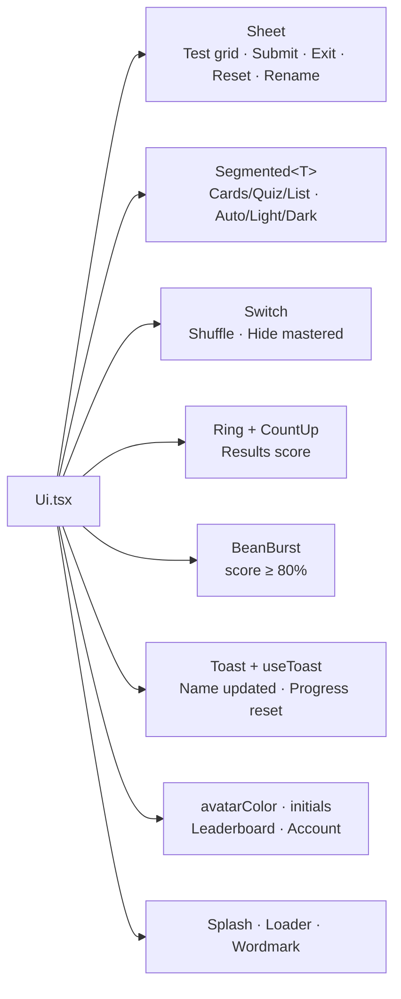
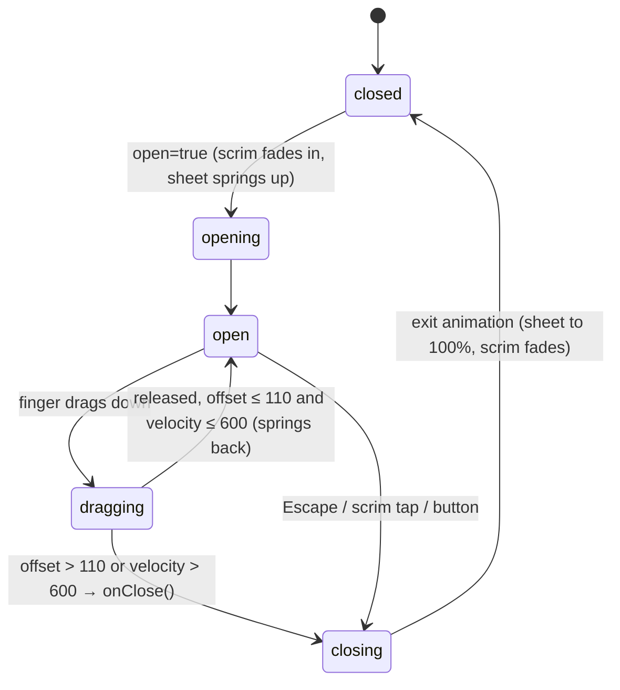

# L2.06a · The UI kit: sheets, switches, segmented control, rings, confetti

> **Level 2 · Build it** · Lesson 6 of 17

| Recipe card | |
|---|---|
| **Time** | 75 min |
| **You need** | L2.05 (AnimatePresence, `layoutId`) |
| **You'll produce** | `src/components/Ui.tsx` (242 lines): `Wordmark`, `Splash`, `Loader`, `Sheet`, `Switch`, `Segmented<T>`, `CountUp`, `Ring`, `BeanBurst`, `Toast`, `useToast`, `avatarColor`, `initials` |

**In two sentences:** Every page reuses these small components. The bottom sheet is used for confirmations and grids, the segmented control for modes and themes, and the ring and count-up for the score. They are where the app's polish lives, and each hides a small piece of maths or accessibility you should be able to rebuild.

### Objectives
1. Build a bottom sheet that opens with a spring, closes on Escape, scrim tap or a downward drag, and locks page scrolling while open.
2. Build accessible toggles: `role="switch"` + `aria-checked`, and `role="tablist"`/`tab` + `aria-selected`.
3. Derive the ring's `strokeDasharray`/`strokeDashoffset` from radius and progress, and the count-up's ease-out-cubic curve.
4. Explain how `avatarColor` turns a name into a stable colour, and trace `initials`.

---

## 1 · Warm-up

1. *(L2.05)* What does `layoutId` do when the element renders in a new place?
2. *(L2.05)* Why did the splash stop using an exit animation to unmount?
3. *(L1.02)* What does `role` change for a screen reader?

<details><summary>Answers</summary>1. Motion animates it from its old position or size to the new one. 2. In hidden tabs and headless runs the exit never completed; a timer-driven CSS fade with a cap is guaranteed. 3. It announces the element as that kind of control (switch, tab, dialog…).</details>

## 2 · The problem this solves

Phones need native-feeling controls: sheets that slide up from the bottom (near the thumb), toggles, segmented pickers, and rewarding feedback when you finish a test. Building them once, accessibly, keeps every page consistent.



---

## 3 · Concepts new in this lesson

### 3.1 Drawing a progress ring with stroke dashes

An SVG circle's outline can be drawn as dashes. Set the dash length to the full circumference $C$, so one dash covers the whole circle. Then shift it with an offset: offset $C$ hides it entirely, and offset $0$ shows it all.

With canvas size $S$ and stroke width $w$, the circle must fit inside the canvas, so its radius is

$$
r = \frac{S - w}{2}, \qquad C = 2\pi r .
$$

For a progress value $v \in [0,1]$ (score / total), the visible part should be $vC$, so the hidden part (the offset) is

$$
\text{offset}(v) = C\,(1 - v).
$$

**Real numbers** (the results ring): $S = 190$, $w = 14$ gives $r = 88$, $C = 2\pi \cdot 88 \approx 552.92$. A score of 87/100 gives offset $= 552.92 \times 0.13 \approx 71.88$. Motion animates the offset from $552.92$ (empty) down to $71.88$.

SVG starts a circle's stroke at 3 o'clock, so the whole SVG is rotated `-90deg` to start at 12 o'clock.

### 3.2 Easing: ease-out cubic

Animating a number linearly feels mechanical. Ease-out starts fast and settles. With progress $p \in [0,1]$ (elapsed time ÷ duration),

$$
e(p) = 1 - (1 - p)^3,\qquad n(t) = \operatorname{round}\big(\text{to}\cdot e(p)\big).
$$

| $p$ | $e(p)$ | shown for `to = 87` |
|---|---|---|
| 0 | 0 | 0 |
| 0.25 | 0.578 | 50 |
| 0.5 | 0.875 | 76 |
| 0.75 | 0.984 | 86 |
| 1 | 1 | 87 |

Half the time covers 87.5% of the distance; the last quarter only creeps from 86 to 87. That is the "settling" feel.

### 3.3 `requestAnimationFrame`

`requestAnimationFrame(cb)` calls `cb(timestamp)` just before the next screen repaint (about 60 times a second), and **never in hidden tabs**. It is the right clock for visual animation. The timestamp is a high-resolution time in milliseconds, the same clock as `performance.now()`.

---

## 4 · Reading the real code

### 4.1 `Wordmark`, `Splash`, `Loader` (lines 1–31)

```tsx
import { useEffect, useState, type ReactNode } from "react";
import { AnimatePresence, motion } from "motion/react";
import { CoffeeMug } from "./CoffeeMug";

export function Wordmark({ className = "" }: { className?: string }) {
  return (
    <div className={`wordmark ${className}`} aria-label="Coffee aur Code">
      <span className="w1">COFFEE</span>
      <span className="w2">AUR</span>
      <span className="w3">CODE</span>
    </div>
  );
}

export function Splash({ fading = false }: { fading?: boolean }) {
  return (
    <div className={`splash ${fading ? "fading" : ""}`} aria-hidden={fading}>
      <CoffeeMug size={120} filling edge="#f4eadb" />
      <Wordmark />
    </div>
  );
}

export function Loader({ label = "Brewing…" }: { label?: string }) {
  return (
    <div className="empty">
      <CoffeeMug size={84} filling />
      <span>{label}</span>
    </div>
  );
}
```
- **`Wordmark`** recreates the logo's stacked "COFFEE — AUR — CODE" in live text (CSS draws the red rules beside "AUR"). Text is crisp at any size and themeable, unlike the logo PNG, which was black text on white and unusable in dark mode.
- **`aria-label`** reads it as one phrase instead of three shouted words.
- **`Splash`**: the splash background is always espresso black, so the mug's outline is forced cream (`edge="#f4eadb"`) even in light mode. `aria-hidden={fading}` hides it from screen readers once it starts fading.
- **`Loader`**: the mug with `filling` (coffee level pouring up and down) plus a label. Used by Leaderboard while fetching.

### 4.2 `Sheet` (lines 33–72)

```tsx
/** Bottom sheet (drag down or tap the scrim to close). */
export function Sheet({ open, onClose, children }: { open: boolean; onClose: () => void; children: ReactNode }) {
  useEffect(() => {
    if (!open) return;
    const k = (e: KeyboardEvent) => e.key === "Escape" && onClose();
    window.addEventListener("keydown", k);
    const prev = document.body.style.overflow;
    document.body.style.overflow = "hidden";
    return () => {
      window.removeEventListener("keydown", k);
      document.body.style.overflow = prev;
    };
  }, [open, onClose]);

  return (
    <AnimatePresence>
      {open && (
        <>
          <motion.div className="scrim" onClick={onClose} initial={{ opacity: 0 }} animate={{ opacity: 1 }} exit={{ opacity: 0 }} />
          <motion.div
            className="sheet"
            role="dialog"
            aria-modal="true"
            initial={{ y: "100%", x: "-50%" }}
            animate={{ y: 0, x: "-50%" }}
            exit={{ y: "100%", x: "-50%" }}
            transition={{ type: "spring", damping: 32, stiffness: 360 }}
            drag="y"
            dragConstraints={{ top: 0, bottom: 0 }}
            dragElastic={{ top: 0, bottom: 0.6 }}
            onDragEnd={(_, info) => (info.offset.y > 110 || info.velocity.y > 600) && onClose()}
          >
            <div className="grab" />
            {children}
          </motion.div>
        </>
      )}
    </AnimatePresence>
  );
}
```
Line notes:
- **The effect only runs while open** (`if (!open) return;` returns undefined, which is fine).
- **Escape to close**: keyboard users must be able to dismiss a dialog.
- **Scroll lock**: `body { overflow: hidden }` stops the page behind from scrolling under your thumb. We save `prev` and restore it in the cleanup, so nested or other code's value survives.
- **`[open, onClose]` deps**: if the parent passes a new `onClose` each render, the effect re-subscribes. That is correct, if slightly wasteful.
- **The scrim** (the dimmed backdrop) closes on tap.
- **`role="dialog"` + `aria-modal="true"`**: assistive technology treats the rest of the page as inert while it's open.
- **`x: "-50%"` in every state**: the sheet is centred with `left: 50%` in CSS plus a `-50%` translate. Motion owns `transform`, so the translate must be part of Motion's values. A CSS `transform` would be overwritten.
- **`y: "100%"` → `0`**: slides up from just below the screen. Percentages are of the sheet's own height.
- **Spring `damping: 32, stiffness: 360`**: snappy, with almost no bounce.
- **Drag to close**:
  - `drag="y"` allows vertical dragging only.
  - `dragConstraints={{ top: 0, bottom: 0 }}` makes it spring back to 0 when released.
  - `dragElastic={{ top: 0, bottom: 0.6 }}`: it can't be pulled up at all (0), and downward drags follow at 60%, which feels like rubber.
  - `onDragEnd`: close if pulled more than **110 px** *or* flicked faster than **600 px/s**. `(cond) && onClose()` is a compact "if".
- **`.grab`**: the little handle bar, a visual hint that the sheet can be dragged.



### 4.3 `Switch` (lines 74–81)

```tsx
export function Switch({ on, onChange, label }: { on: boolean; onChange: (v: boolean) => void; label: string }) {
  return (
    <button className="toggle" role="switch" aria-checked={on} onClick={() => onChange(!on)}>
      <span className={`switch ${on ? "on" : ""}`} />
      {label}
    </button>
  );
}
```
- **A real `<button>`**: focusable and keyboard-operable (Space/Enter) for free. A `<div onClick>` would be neither.
- **`role="switch"` + `aria-checked`**: announced as "Shuffle, switch, on". Playwright finds it with `getByRole("switch", { name: "Hide mastered" })` ([L4.04](l4-04-ui-tests-nav-cards.md)).
- **The visual track/knob is pure CSS** (`.switch::after` slides 16 px when `.on`).
- **Controlled component**: it shows `on` from props and asks the parent to change it, so it has no internal state.

### 4.4 `Segmented<T>` (lines 83–105)

```tsx
/** Segmented control with a sliding pill. */
export function Segmented<T extends string>({
  value,
  onChange,
  options,
  id,
}: {
  value: T;
  onChange: (v: T) => void;
  options: { value: T; label: ReactNode }[];
  id: string;
}) {
  return (
    <div className="seg" role="tablist">
      {options.map((o) => (
        <button key={o.value} role="tab" aria-selected={value === o.value} className={value === o.value ? "on" : ""} onClick={() => onChange(o.value)}>
          {value === o.value && <motion.span layoutId={`seg-${id}`} className="seg-pill" transition={{ type: "spring", stiffness: 500, damping: 38 }} />}
          {o.label}
        </button>
      ))}
    </div>
  );
}
```
- **`T extends string`**: works with any string union. In Study, `Segmented<Mode>` with `value: Mode` means `onChange` receives a `Mode`. Passing `{ value: "lsit" }` is a compile error.
- **`label: ReactNode`**: labels can include icons (`<><Icon name="cards"/> Cards</>`).
- **`layoutId={`seg-${id}`}`**: the same sliding-pill trick as the tab bar. The **`id` prop makes each instance's pill unique.** Two segmented controls on one page (the Study mode switch and the Account theme picker) would otherwise share `layoutId="seg"`, and the pill would fly between them.
- **`role="tablist"` / `role="tab"` / `aria-selected`**: announced as tabs. Tests use `.seg button` with text.

### 4.5 `CountUp` (lines 107–122)

```tsx
/** Count up to a number (for scores). */
export function CountUp({ to, duration = 1.1 }: { to: number; duration?: number }) {
  const [n, setN] = useState(0);
  useEffect(() => {
    let raf = 0;
    const start = performance.now();
    const tick = (t: number) => {
      const p = Math.min(1, (t - start) / (duration * 1000));
      setN(Math.round(to * (1 - Math.pow(1 - p, 3))));
      if (p < 1) raf = requestAnimationFrame(tick);
    };
    raf = requestAnimationFrame(tick);
    return () => cancelAnimationFrame(raf);
  }, [to, duration]);
  return <>{n}</>;
}
```
- **`p` clamps to 1** so the last frame lands exactly on `to`.
- **The `raf` id is kept** so cleanup can cancel the loop if the component unmounts mid-animation. Otherwise `setN` would run on an unmounted component.
- **Restarts when `to` changes**, a fresh count from 0.
- **Returns a fragment** `<>{n}</>`: only text, no wrapper element, so the parent's `<b>` styles it.

### 4.6 `Ring` (lines 124–158)

```tsx
/** Circular progress ring that draws itself in. */
export function Ring({
  value,
  size = 190,
  stroke = 14,
  color = "#ef3a42",
  track = "rgba(244,234,219,.12)",
}: {
  value: number; // 0..1
  size?: number;
  stroke?: number;
  color?: string;
  track?: string;
}) {
  const r = (size - stroke) / 2;
  const c = 2 * Math.PI * r;
  return (
    <svg width={size} height={size} viewBox={`0 0 ${size} ${size}`} style={{ transform: "rotate(-90deg)" }}>
      <circle cx={size / 2} cy={size / 2} r={r} fill="none" stroke={track} strokeWidth={stroke} />
      <motion.circle
        cx={size / 2}
        cy={size / 2}
        r={r}
        fill="none"
        stroke={color}
        strokeWidth={stroke}
        strokeLinecap="round"
        strokeDasharray={c}
        initial={{ strokeDashoffset: c }}
        animate={{ strokeDashoffset: c * (1 - Math.max(0, Math.min(1, value))) }}
        transition={{ duration: 1.2, ease: [0.22, 1, 0.36, 1], delay: 0.15 }}
      />
    </svg>
  );
}
```
- **Two circles**: a faint full **track**, then the coloured **progress** on top.
- **`viewBox="0 0 size size"`**: the coordinate system matches pixels.
- **Clamp `value`** into [0, 1]: a bad score can't draw past full or negative.
- **`strokeLinecap="round"`**: rounded ends.
- **`delay: 0.15`**: waits for the results card's entrance spring, so the eye sees the draw.
- **The default colours are for the dark results card.** The track is a 12% cream that shows on espresso. The results card is always dark, even in light mode.

### 4.7 `BeanBurst` (lines 160–198)

```tsx
/** Coffee beans + sparks bursting out (celebration). */
export function BeanBurst({ count = 26 }: { count?: number }) {
  const [parts] = useState(() =>
    Array.from({ length: count }, (_, i) => {
      const a = (i / count) * Math.PI * 2 + Math.random() * 0.4;
      const d = 110 + Math.random() * 120;
      return {
        x: Math.cos(a) * d,
        y: Math.sin(a) * d - 40,
        r: Math.random() * 540 - 270,
        kind: i % 3, // 0 bean, 1 red spark, 2 cream spark
        s: 0.7 + Math.random() * 0.6,
        delay: Math.random() * 0.15,
      };
    })
  );
  return (
    <div aria-hidden style={{ position: "absolute", left: "50%", top: "42%", pointerEvents: "none", zIndex: 2 }}>
      {parts.map((p, i) => (
        <motion.div
          key={i}
          style={{ position: "absolute" }}
          initial={{ x: 0, y: 0, opacity: 1, rotate: 0, scale: 0.3 }}
          animate={{ x: p.x, y: [0, p.y, p.y + 120], opacity: [1, 1, 0], rotate: p.r, scale: p.s }}
          transition={{ duration: 1.6, delay: 0.5 + p.delay, ease: "easeOut" }}
        >
          {p.kind === 0 ? (
            <svg width="16" height="20" viewBox="0 0 16 20">
              <ellipse cx="8" cy="10" rx="7" ry="9.5" fill="#7a4220" />
              <path d="M8 1.5 C 4 7, 12 13, 8 18.5" stroke="#3a1e0c" strokeWidth="1.6" fill="none" />
            </svg>
          ) : (
            <span style={{ display: "block", width: 9, height: 9, borderRadius: 3, background: p.kind === 1 ? "#ef3a42" : "#f4eadb" }} />
          )}
        </motion.div>
      ))}
    </div>
  );
}
```
- **Particles computed once** (`useState(() => …)`, never updated), so re-renders don't re-randomise mid-flight.
- **Geometry**: particle $i$ of $n$ gets angle $a_i = \frac{2\pi i}{n} + \varepsilon$ with jitter $\varepsilon \in [0, 0.4)$ radians, and distance $d \in [110, 230)$ px. Its target is $(d\cos a_i,\ d\sin a_i - 40)$: evenly spread around a circle, nudged up by 40 px.
- **Keyframe arrays**: `y: [0, p.y, p.y + 120]` goes out, then falls 120 px like gravity. `opacity: [1, 1, 0]` fades only at the end.
- **The bean** is an ellipse plus an S-curve crease, drawn in SVG.
- **`aria-hidden` + `pointerEvents: "none"`**: decoration only, never blocks taps or confuses screen readers.

### 4.8 `Toast` + `useToast` (lines 200–226)

```tsx
export function Toast({ msg }: { msg: string | null }) {
  return (
    <AnimatePresence>
      {msg && (
        <motion.div
          className="toast"
          role="status"
          initial={{ opacity: 0, y: 20, x: "-50%", scale: 0.95 }}
          animate={{ opacity: 1, y: 0, x: "-50%", scale: 1 }}
          exit={{ opacity: 0, y: 10, x: "-50%" }}
        >
          {msg}
        </motion.div>
      )}
    </AnimatePresence>
  );
}

export function useToast() {
  const [msg, setMsg] = useState<string | null>(null);
  useEffect(() => {
    if (!msg) return;
    const t = setTimeout(() => setMsg(null), 2200);
    return () => clearTimeout(t);
  }, [msg]);
  return [msg, setMsg] as const;
}
```
- **`role="status"`**: screen readers announce it politely, without interrupting.
- **`useToast` auto-clears after 2.2 s.** Setting a new message restarts the timer, because the cleanup clears the old one.
- **`as const`**: returns a typed tuple `[string | null, setter]`, not `(string | Setter)[]`, so `const [toast, setToast] = useToast()` gets correct types. A test checks "Name updated" appears ([L4.06](l4-06-live-security-auth.md)).

### 4.9 `avatarColor` + `initials` (lines 228–242)

```tsx
/** Deterministic warm colour for a player's avatar. */
export function avatarColor(name: string) {
  const palette = ["#f4eadb", "#ef3a42", "#e8b36b", "#c9d6a3", "#9fc7d8", "#e6a2b4", "#d9c2f0", "#f2c879"];
  let h = 0;
  for (const ch of name) h = (h * 31 + ch.charCodeAt(0)) >>> 0;
  return palette[h % palette.length];
}

export const initials = (name: string) =>
  name
    .split(/[\s._-]+/)
    .filter(Boolean)
    .slice(0, 2)
    .map((s) => s[0]!.toUpperCase())
    .join("") || "?";
```
- **A string hash**: $h \leftarrow (31h + \text{code}(ch)) \bmod 2^{32}$. `>>> 0` (unsigned right shift by zero) truncates to an unsigned 32-bit integer, so it never overflows into floats.
- **Deterministic**: the same name always gets the same colour on every device, with no storage.
- **`initials`**: split on spaces, dots, underscores and hyphens (the same characters names may contain), drop empty pieces, take the first two words' first letters. `|| "?"` covers a name like `__`.

---

## 5 · Worked traces

**`avatarColor("Ana")`**

| Frame | ch | code | h = (h·31 + code) >>> 0 |
|---|---|---|---|
| 1 | A | 65 | 0·31 + 65 = **65** |
| 2 | n | 110 | 65·31 + 110 = **2125** |
| 3 | a | 97 | 2125·31 + 97 = **65972** |
| end | | | 65972 mod 8 = **4** → `#9fc7d8` (soft blue) |

**`initials`**: `"Espresso Ana"` → EA · `"Latte_Ben"` → LB · `"Mocha.C"` → MC · `"x"` → X · `"__"` → ?

**Sheet drag (frames):**

| Frame | Finger | `offset.y` | Sheet position | Predict → |
|---|---|---|---|---|
| 1 | down on sheet | 0 | 0 | |
| 2 | moves down 100 px | 100 | 60 px (elastic 0.6) | Why only 60? **dragElastic bottom 0.6** |
| 3 | lifts slowly (velocity 200 px/s) | 100 | springs back to 0 | Closes? **No: 100 ≤ 110 and 200 ≤ 600** |
| 4 | quick flick down 40 px at 900 px/s | 40 | → `onClose()` | Closes? **Yes, velocity > 600** |

---

## 6 · Running and testing

- `tests/e2e/ui.spec.ts` › "test runner…" opens the question grid **sheet**, counts 100 buttons and the `.ans`/`.flag` classes, then uses the **submit sheet** and presses Escape to close it.
- "flashcards: flip, got it… hide mastered" toggles the `Switch` via `getByRole("switch", { name: "Hide mastered" })`.
- "result page renders score, stats and mistakes" waits for `.ring-num b` to show `88` (the `CountUp` end value).
- `tests/e2e/a11y.spec.ts` scans the open grid sheet in both themes for accessibility problems.

## 7 · Bug journal

**Clean run.** The kit never broke during the build. Its pieces were written with the known pitfalls in mind, and the e2e tests exercise the sheet, switch, segmented control and ring on all 11 devices.

**Foot-gun to know (did not happen here): a shared `layoutId`.** If `Segmented` used one fixed `layoutId` (say `"seg-pill"`) for every instance, Motion would treat all the pills as one element. With two segmented controls on screen at once, the pill would fly from one control to the other on every change. That is why `Segmented` takes an `id` prop and uses `seg-${id}`. **Lesson:** a `layoutId` is a global name, so make it unique per logical element.

## 8 · Why this design

| Decision | Alternatives | Why this one | Trade-off | Choose differently when |
|---|---|---|---|---|
| Custom bottom sheet | Native `<dialog>`; a UI library | Thumb-friendly, drag-to-close, matches the brand | Must handle focus/escape ourselves | Need full focus trapping → `<dialog>` or a library |
| Controlled `Switch`/`Segmented` | Internal state | Parent owns persistence (e.g. `pol.shuffle`) | More props | — |
| SVG dash ring | Canvas; conic-gradient | Crisp, animatable, accessible size | Rotation trick needed | — |
| rAF count-up | Motion's `animate` on a value | Tiny, no extra API | Pauses in hidden tabs (fine for decoration) | — |
| Hash-based avatar colour | Random + stored; gravatar | Deterministic, no storage, no network | Collisions (8 colours) | Need unique colours → assign on signup |

## 9 · Check yourself

**Q1.** In `Sheet`, why must `x: "-50%"` be in `initial`, `animate` and `exit`?
<details><summary>Answer</summary>Motion writes the whole <code>transform</code>. If <code>x</code> isn't part of its values, the CSS <code>translateX(-50%)</code> centring is overwritten and the sheet jumps right by half its width.</details>

**Q2.** The ring for 50/100 with size 190, stroke 14: what is the offset?
<details><summary>Answer</summary>C ≈ 552.92; offset = 552.92 × 0.5 ≈ 276.46.</details>

**Q3.** Why does `BeanBurst` compute particles in `useState(() => …)` instead of in the render body?
<details><summary>Answer</summary>Render can run many times; recomputing would re-randomise targets mid-animation and make particles jump. The lazy state runs once.</details>

**Q4.** What breaks if `CountUp` doesn't cancel its animation frame on unmount?
<details><summary>Answer</summary>The loop keeps calling <code>setN</code> on an unmounted component: wasted work, and a warning in older React.</details>

**Q5.** Two players named "Ana" and "Ben": can they get the same avatar colour?
<details><summary>Answer</summary>Yes. With 8 colours, collisions are common (about a 1-in-8 chance for any pair). It's decoration, not identity.</details>

## 10 · Practice

**Easy (10 min).** Change the toast duration to 3 s and make it dismissible on tap.

**Medium (20 min).** Give `Sheet` an optional `title` prop rendered as `<h3 id>`, and add `aria-labelledby` to the dialog.
<details><summary>Answer</summary>Generate an id with <code>useId()</code>, render <code>&lt;h3 id={id}&gt;{title}&lt;/h3&gt;</code>, and set <code>aria-labelledby={title ? id : undefined}</code> on the dialog <code>motion.div</code>.</details>

**Hard (40 min).** Make the ring accessible: add `role="img"` and an `aria-label` like "Score 87 out of 100", and respect reduced motion by skipping the draw animation. (Hint: `MotionConfig reducedMotion="user"` already handles transforms. Check whether it covers `strokeDashoffset`, and if not, use `useReducedMotion()`.)

## 11 · From memory

**Rung 1 · Cloze.**

```tsx
const r = (size - ___①___) / 2;
const c = 2 * Math.PI * ___②___;
<motion.circle strokeDasharray={c} initial={{ strokeDashoffset: ___③___ }}
  animate={{ strokeDashoffset: c * (1 - ___④___) }} />
setN(Math.round(to * (1 - Math.pow(1 - p, ___⑤___))));
onDragEnd={(_, info) => (info.offset.y > ___⑥___ || info.velocity.y > ___⑦___) && onClose()}
<button role="___⑧___" aria-checked={on}>…</button>
for (const ch of name) h = (h * 31 + ch.charCodeAt(0)) ___⑨___ 0;
```
<details><summary>Answers</summary>① <code>stroke</code> ② <code>r</code> ③ <code>c</code> ④ <code>value</code> (clamped) ⑤ <code>3</code> ⑥ <code>110</code> ⑦ <code>600</code> ⑧ <code>switch</code> ⑨ <code>&gt;&gt;&gt;</code></details>

**Rung 2 · Blank page (20 min).** Write `Sheet`, `Segmented<T>` and `Ring` from memory.
<details><summary>Self-check</summary>

- [ ] Sheet: Escape listener + body scroll lock with restore, scrim, dialog role, spring, drag y with elastic bottom only, close thresholds
- [ ] Segmented: generic `T extends string`, tablist/tab/aria-selected, per-instance `layoutId`
- [ ] Ring: r and C formulas, track + progress circles, rotate −90°, clamp, offset animation
</details>

## 12 · Flashcards

<details><summary><b>Q:</b> Formula for the ring's dash offset?</summary><b>A:</b> offset = C·(1 − v), with C = 2πr and r = (size − stroke)/2.</details>
<details><summary><b>Q:</b> Why rotate the ring SVG −90°?</summary><b>A:</b> SVG strokes start at 3 o'clock; rotating starts the progress at 12.</details>
<details><summary><b>Q:</b> Ease-out cubic formula?</summary><b>A:</b> e(p) = 1 − (1 − p)³.</details>
<details><summary><b>Q:</b> When does the sheet close on drag end?</summary><b>A:</b> Offset > 110 px or downward velocity > 600 px/s.</details>
<details><summary><b>Q:</b> Why per-instance <code>layoutId</code> in Segmented?</summary><b>A:</b> Equal layoutIds are treated as one element; two controls would share and fling one pill.</details>
<details><summary><b>Q:</b> What role and attribute make a toggle accessible?</summary><b>A:</b> <code>role="switch"</code> with <code>aria-checked</code> on a real button.</details>
<details><summary><b>Q:</b> What does <code>&gt;&gt;&gt; 0</code> do in the hash?</summary><b>A:</b> Truncates to an unsigned 32-bit integer.</details>
<details><summary><b>Q:</b> Why does <code>useToast</code> return <code>as const</code>?</summary><b>A:</b> To type the result as a tuple, so destructuring gets precise types.</details>

## 13 · The menu board

| Component | Key facts |
|---|---|
| `Sheet` | Escape + scrim + drag(110 px / 600 px/s); scroll lock; `x:"-50%"` in all states; dialog role |
| `Switch` | button + `role=switch` + `aria-checked`; controlled |
| `Segmented<T>` | tablist/tab; `layoutId=seg-${id}` |
| `CountUp` | rAF; ease-out cubic; cancel on unmount |
| `Ring` | r=(S−w)/2; C=2πr; offset=C(1−v); rotate −90° |
| `BeanBurst` | once-computed particles; polar spread; keyframe arrays; aria-hidden |
| `Toast` | role=status; auto-clear 2.2 s |
| Avatars | hash ×31 >>>0 mod 8; initials from 2 words |

## 14 · Glossary

**Bottom sheet**: a panel that slides up from the bottom edge. **Controlled component**: shows props and reports changes; owns no state. **Dash offset**: how far an SVG stroke's dash pattern is shifted. **Easing**: a curve mapping time progress to value progress. **Elastic drag**: dragging past a limit with resistance. **Keyframes (Motion)**: an array of values animated through in order. **requestAnimationFrame**: browser callback before each repaint. **Scrim**: the dimmed overlay behind a modal.

## 15 · Go further

| Resource | Type | Why | Which part | Time |
|---|---|---|---|---|
| [Motion: Drag](https://motion.dev/docs/react-drag) | Docs | `drag`, constraints, elastic, `onDragEnd` info | "Constraints", "Elastic" | 15 min |
| [WAI-ARIA APG: Switch](https://www.w3.org/WAI/ARIA/apg/patterns/switch/) | Pattern | Correct switch semantics | "WAI-ARIA Roles, States, and Properties" | 10 min |
| [WAI-ARIA APG: Dialog (Modal)](https://www.w3.org/WAI/ARIA/apg/patterns/dialog-modal/) | Pattern | What a full modal should do (focus trap) | "Keyboard Interaction" | 15 min |
| [MDN: stroke-dashoffset](https://developer.mozilla.org/en-US/docs/Web/SVG/Reference/Attribute/stroke-dashoffset) | Docs | The ring technique | Example | 5 min |

---
← [L2.05 The app shell](l2-05-app-shell.md) · [Hub](README.md) · [L2.06b The mug, icons & Home →](l2-06b-mug-icons-home.md)
