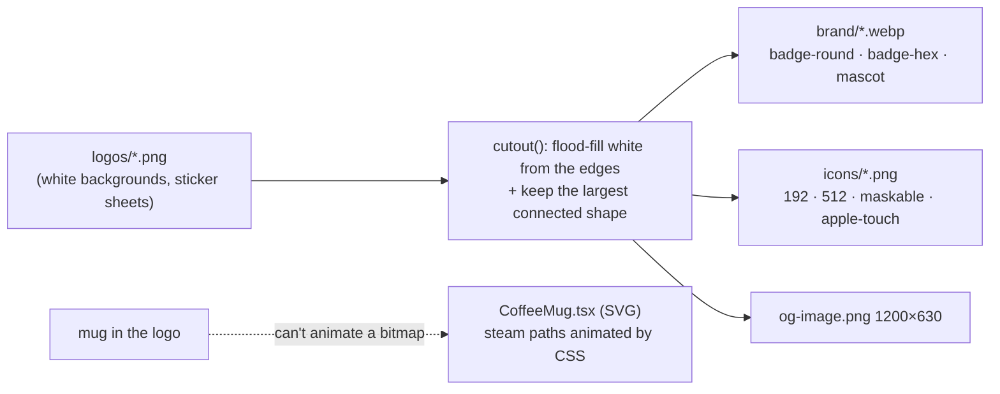

# L2.06b · The animated mug, the icon set and the Home page

> **Level 2 · Build it** · Lesson 7 of 18

| Recipe card | |
|---|---|
| **Time** | 70 min |
| **You need** | L2.06a; Python 3 + Pillow for the asset part (`pip install pillow`) |
| **You'll produce** | The brand assets in `public/` (cut-out logos, app icons), `src/components/CoffeeMug.tsx`, `src/components/Icon.tsx`, the CSS steam animation, and `src/pages/Home.tsx` |

**In two sentences:** The Coffee aur Code logos arrived as PNGs on white backgrounds, unusable on a dark theme, and the steam in them couldn't move. We cut the logos out with a flood-fill script, redrew the mug as SVG so CSS could animate the steam, built a 30-icon set as path data, and assembled the Home page with staggered entrance animations.

### Objectives
1. Explain the background-removal algorithm (flood fill from the edges plus keeping the largest connected shape), and the incident that made the second step necessary.
2. Read and write SVG path commands (`M L H V C S A Z`) well enough to draw the mug and the icons.
3. Animate the steam with `stroke-dasharray`/`dashoffset` keyframes and explain `transform-box: fill-box`.
4. Write `Home.tsx`: stats from `get_my_stats`, per-week progress with `useMemo`, and Motion `variants` with `staggerChildren`.

---

## 1 · Warm-up

1. *(L2.06a)* Formula for the ring's dash offset?
2. *(L2.04)* Why do `` tags carry `width`/`height`?
3. *(L2.05)* What does `MotionConfig reducedMotion="user"` change?

<details><summary>Answers</summary>1. C·(1 − v). 2. To reserve space before loading (no layout shift, CLS). 3. Motion skips transform animations when the OS asks for reduced motion.</details>

## 2 · The problem this solves

A brand makes the app recognisable, but raw logo files fight the UI. The black-and-white artwork vanished on dark backgrounds, the white boxes looked pasted-on in dark mode, and a static mug can't express "brewing". We needed transparent cut-outs, proper app icons, and a mug we could animate.



*Takeaway: bitmaps for brand imagery; vectors for anything that moves or must stay crisp at every size.*

---

## 3 · Concepts

### 3.1 Removing a white background: flood fill, then the largest component

**Plain idea.** Every white pixel you can reach from the image's edge, without crossing a non-white pixel, is background. White pixels *inside* the artwork (the mascot's sunglasses glint, enclosed by black outline) are not reachable from the edge, so they stay.

**Steps** (Python + Pillow; the real script, slightly condensed):

```python
from PIL import Image, ImageFilter
from collections import deque

def cutout(path, thr=40):
    im = Image.open(path).convert("RGBA"); w, h = im.size; px = im.load()
    dist = lambda p: 255 * 3 - (p[0] + p[1] + p[2])      # 0 for pure white
    bg = [[False] * h for _ in range(w)]
    q = deque([(x, 0) for x in range(w)] + [(x, h - 1) for x in range(w)] +
              [(0, y) for y in range(h)] + [(w - 1, y) for y in range(h)])
    while q:                                              # 1) flood fill from all edges
        x, y = q.popleft()
        if not (0 <= x < w and 0 <= y < h) or bg[x][y] or dist(px[x, y]) > thr: continue
        bg[x][y] = True
        q.extend(((x + 1, y), (x - 1, y), (x, y + 1), (x, y - 1)))
    mask = Image.new("L", (w, h), 255); m = mask.load()
    for x in range(w):
        for y in range(h):
            if bg[x][y]: m[x, y] = 0
    edge = mask.filter(ImageFilter.MinFilter(3)); e = edge.load()   # 2) soften the rim
    for x in range(w):
        for y in range(h):
            if m[x, y] == 255 and e[x, y] == 0:
                m[x, y] = max(0, min(255, int(dist(px[x, y]) * 255 / 300)))
    # 3) keep only the largest 8-connected blob (drops pieces of neighbouring stickers)
    seen = [[False] * h for _ in range(w)]; best = []
    for sx in range(w):
        for sy in range(h):
            if seen[sx][sy] or m[sx, sy] == 0: continue
            comp, q = [], deque([(sx, sy)]); seen[sx][sy] = True
            while q:
                x, y = q.popleft(); comp.append((x, y))
                for dx in (-1, 0, 1):
                    for dy in (-1, 0, 1):
                        nx, ny = x + dx, y + dy
                        if 0 <= nx < w and 0 <= ny < h and not seen[nx][ny] and m[nx, ny] > 0:
                            seen[nx][ny] = True; q.append((nx, ny))
            if len(comp) > len(best): best = comp
    keep = Image.new("L", (w, h), 0); k = keep.load()
    for x, y in best: k[x, y] = m[x, y]
    im.putalpha(keep)
    return im.crop(keep.getbbox())                        # trim empty borders
```
Notes:
- **`dist`** is "how far from white": 0 for `(255,255,255)`. `thr=40` treats near-white (JPEG-ish noise) as background. The mascot had a grey sticker halo and needed `thr=110`.
- **BFS with a `deque`** (breadth-first search: visit neighbours level by level): 4-neighbour fill for the background. A recursive version would overflow the stack on a 1536×1024 image (1.5 million pixels).
- **Rim softening**: pixels right next to the background get partial alpha proportional to their darkness. That anti-aliases the edge, so there's no white fringe on dark themes.
- **Largest component**: 8-neighbour connectivity. See the incident in §7.
- **`getbbox()`**: the bounding box of non-zero alpha, used to crop the margins.

### 3.2 SVG paths in five minutes

An SVG `<path d="…">` is a pen: commands move or draw, with numbers as coordinates in the `viewBox`.

| Command | Meaning | Example from the code |
|---|---|---|
| `M x y` | move (pen up) | `M36 104` starts the mug body |
| `L x y` | straight line | `L 156 104` the rim edge |
| `H x` / `V y` | horizontal / vertical line | icon `home`: `V20` |
| `C x1 y1, x2 y2, x y` | cubic Bézier curve: two control points, then the end | `C 64 74, 92 64, 78 44` a steam S-bend |
| `S x2 y2, x y` | smooth cubic (first control point mirrored from the previous curve) | `S 72 20, 84 8` continues the S |
| `A rx ry rot large sweep x y` | elliptical arc | icon `timer` circle |
| `Z` | close the shape | end of the body |
| lower-case (`l`, `a`, `h`) | **relative** to the current point | icons use `a1 1 0 0 1-1 1` for rounded corners |

**`viewBox="0 0 200 230"`** defines the drawing's own coordinate space; `width`/`height` scale it. That is why `<CoffeeMug size={84}>` and `size={150}` are the same drawing at different sizes.

### 3.3 Animating a line being "drawn"

The ring trick from L2.06a, reused: set `stroke-dasharray: 160` (a dash longer than the steam path) and animate `stroke-dashoffset` from `160` (hidden) to `0` (fully drawn) to `-150` (sliding away). Combined with a rise (`translateY`) and fade, each wisp seems to curl up and vanish.

`transform-box: fill-box` + `transform-origin: 50% 100%`: by default, SVG transforms use the whole SVG's origin (its top-left corner). `fill-box` makes `50% 100%` mean "the bottom-centre *of this path*", so each wisp scales and rises from its own base.

---

## 4 · Reading the real code

### 4.1 `CoffeeMug.tsx` (94 lines)

```tsx
import { useId, type CSSProperties } from "react";

/**
 * The Coffee aur Code mug, redrawn as SVG so the steam can animate.
 * `filling` makes the coffee level pour up and down (used as the loader).
 */
export function CoffeeMug({
  size = 140,
  steam = true,
  filling = false,
  bob = false,
  edge,
  className = "",
}: {
  size?: number;
  steam?: boolean;
  filling?: boolean;
  bob?: boolean;
  /** outline colour; defaults to the theme (dark on light, cream on dark) */
  edge?: string;
  className?: string;
}) {
  const id = useId().replace(/:/g, "");
  return (
    <svg
      className={`${bob ? "mug-bob" : ""} ${className}`}
      width={size}
      height={size * 1.15}
      viewBox="0 0 200 230"
      role="img"
      aria-label="Steaming coffee mug"
      style={edge ? ({ "--mug-edge": edge } as CSSProperties) : undefined}
    >
```
- **Four switches**: `steam` (wisps on/off), `filling` (loader mode), `bob` (gentle float on Home) and `edge` (outline colour).
- **`useId()`** gives a unique id per mug instance. Gradients and clip paths are referenced by id (`url(#coffee-…)`), and two mugs on one page with the same ids would make the second reference the first's definitions. `.replace(/:/g, "")` strips the colons React puts in ids (`:r1:`), which are awkward inside `url(#…)`.
- **`height = size * 1.15`** matches the 200×230 viewBox ratio.
- **`role="img"` + `aria-label`**: announced as one image, not 15 shapes.
- **`--mug-edge`** is a CSS custom property set inline. The `edge` prop overrides the theme default (cream on dark backgrounds like the hero, splash and results card). The *type assertion* is needed because `CSSProperties` doesn't know custom properties.

```tsx
      <defs>
        <linearGradient id={`coffee-${id}`} x1="0" y1="0" x2="0" y2="1">
          <stop offset="0" stopColor="#b5652b" />
          <stop offset="1" stopColor="#6e3514" />
        </linearGradient>
        <linearGradient id={`shine-${id}`} x1="0" y1="0" x2="1" y2="0">
          <stop offset="0" stopColor="#fff" stopOpacity="0.28" />
          <stop offset="1" stopColor="#fff" stopOpacity="0" />
        </linearGradient>
        <clipPath id={`cup-${id}`}>
          <ellipse cx="96" cy="104" rx="52" ry="10" />
        </clipPath>
      </defs>

      {/* shadow */}
      <ellipse cx="100" cy="214" rx="74" ry="9" fill="#000" opacity="0.22" />
```
- **`<defs>`**: definitions that aren't drawn until referenced.
- **The coffee gradient** runs top to bottom (`y1=0 → y2=1`), crema-light to deep brown.
- **The shine gradient** runs left to right, white fading to transparent: a glossy highlight.
- **`clipPath` ellipse**: the coffee surface's oval. Anything drawn inside the clip group is cut to this shape, which lets the "filling" rectangle look like liquid in a round cup.
- **The shadow**: a flat, faint ellipse under the mug that grounds it.

```tsx
      {/* steam */}
      {steam && (
        <g className="steam" fill="none" strokeLinecap="round">
          <path className="s1" d="M78 92 C 64 74, 92 64, 78 44 S 72 20, 84 8" stroke="var(--mug-edge)" strokeWidth="13" />
          <path className="s1" d="M78 92 C 64 74, 92 64, 78 44 S 72 20, 84 8" stroke="#e3262e" strokeWidth="8" />
          <path className="s2" d="M100 96 C 88 76, 116 66, 100 46 S 94 22, 108 4" stroke="var(--mug-edge)" strokeWidth="13" />
          <path className="s2" d="M100 96 C 88 76, 116 66, 100 46 S 94 22, 108 4" stroke="#f4eadb" strokeWidth="8" />
          <path className="s3" d="M120 92 C 110 76, 134 68, 120 50 S 116 30, 126 18" stroke="var(--mug-edge)" strokeWidth="12" />
          <path className="s3" d="M120 92 C 110 76, 134 68, 120 50 S 116 30, 126 18" stroke="#e3262e" strokeWidth="7" />
        </g>
      )}
```
- **Three wisps** (red · cream · red), like the logo. Each is an S-curve: one `C` plus one smooth `S`.
- **Each wisp is drawn twice**: a thick stroke in the edge colour underneath, then a thinner coloured stroke on top. That makes the sticker-style outline, and it keeps the cream wisp visible on the light theme, where the outline is dark.
- **Steam is drawn before the body** in source order, so the mug covers the wisps' bottoms. They appear to rise out of the coffee.

```tsx
      {/* handle */}
      <path d="M152 124 C 192 120, 194 184, 146 182" fill="none" stroke="var(--mug-edge)" strokeWidth="26" strokeLinecap="round" />
      <path d="M152 124 C 192 120, 194 184, 146 182" fill="none" stroke="#15110f" strokeWidth="18" strokeLinecap="round" />
      <path d="M154 130 C 180 130, 182 174, 150 174" fill="none" stroke="#f4eadb" strokeWidth="3" strokeLinecap="round" opacity="0.6" />

      {/* body */}
      <path
        d="M36 104 L 156 104 L 150 186 C 149 200, 138 208, 124 208 L 68 208 C 54 208, 43 200, 42 186 Z"
        fill="#15110f"
        stroke="var(--mug-edge)"
        strokeWidth="5"
        strokeLinejoin="round"
      />
      <path d="M50 116 L 56 186 C 57 194, 62 198, 68 199" fill="none" stroke={`url(#shine-${id})`} strokeWidth="10" strokeLinecap="round" />
```
- **The handle is a single curve stroked three times**: thick outline (26), black fill (18), and a thin cream highlight inside. A stroke-only shape is simpler than a filled C-shape.
- **The body** tapers slightly (top 36–156, bottom 42–150) with rounded bottom corners (`C …`). `strokeLinejoin="round"` softens the top corners.
- **The shine** is a curved stroke down the left side using the shine gradient.

```tsx
      {/* rim + coffee */}
      <ellipse cx="96" cy="104" rx="60" ry="14" fill="#15110f" stroke="var(--mug-edge)" strokeWidth="5" />
      <ellipse cx="96" cy="104" rx="60" ry="14" fill="none" stroke="#f4eadb" strokeWidth="2" opacity="0.35" />
      <g clipPath={`url(#cup-${id})`}>
        <rect className={filling ? "coffee-fill" : ""} x="40" y="92" width="112" height="24" fill={`url(#coffee-${id})`} />
        <ellipse cx="84" cy="101" rx="16" ry="3" fill="#e0a36a" opacity="0.35" />
      </g>

      {/* </> */}
      <g fill="none" stroke="#f4eadb" strokeWidth="8" strokeLinecap="round" strokeLinejoin="round">
        <path d="M80 140 L 64 154 L 80 168" />
        <path d="M112 140 L 128 154 L 112 168" />
        <path d="M102 134 L 90 174" />
      </g>
    </svg>
  );
}
```
- **The rim**: an ellipse with outline, plus a faint cream inner line for depth.
- **The coffee**: a rectangle filled with the gradient, *clipped* to the surface oval. With `filling`, the CSS class scales it vertically from 15% to 100% and back, so the cup appears to fill, used by the splash and the loader. A small light ellipse is the crema reflection.
- **`</>`**: three strokes (`<`, `>`, `/`) in cream with round caps. That's the "Code" in Coffee aur Code.

### 4.2 The steam CSS (from `styles.css`)

```css
.steam path {
  transform-box: fill-box;
  transform-origin: 50% 100%;
  animation: steam 3.2s ease-in-out infinite;
  stroke-dasharray: 160;
  stroke-dashoffset: 160;
}
.steam .s2 { animation-delay: 0.55s; }
.steam .s3 { animation-delay: 1.1s; }
@keyframes steam {
  0%   { stroke-dashoffset: 160; opacity: 0; transform: translateY(10px) scaleX(0.9); }
  20%  { opacity: 1; }
  55%  { stroke-dashoffset: 0;   opacity: 1; transform: translateY(-2px) scaleX(1.06); }
  100% { stroke-dashoffset: -150; opacity: 0; transform: translateY(-16px) scaleX(0.94); }
}
.mug-bob { animation: bob 4s ease-in-out infinite; }
@keyframes bob { 50% { transform: translateY(-4px) rotate(-1deg); } }
.coffee-fill {
  animation: fill 1.8s var(--ease-out) infinite alternate;
  transform-box: fill-box;
  transform-origin: 50% 100%;
}
@keyframes fill { from { transform: scaleY(0.15); } to { transform: scaleY(1); } }
```
(The real file has one declaration per line; it's condensed here for reading.)

- **Staggered delays** (0, 0.55 and 1.1 s over a 3.2 s cycle): the wisps never move in sync, which reads as natural steam.
- **`bob`**: a keyframe with only `50%` means it eases from the element's normal state to that pose and back. A floating mug on Home.
- **`fill … alternate`**: plays forwards, then backwards, forever: pour, drain, pour.
- **Reduced motion** (end of `styles.css`): all animations shrink to 0.001 ms, and steam is shown fully drawn (`dashoffset: 0; opacity: 1`) instead of invisible.

### 4.3 `Icon.tsx` (58 lines)

```tsx
// Small stroke icon set (24×24, 2px), hand-drawn to stay dependency-free.
const P: Record<string, string[]> = {
  home: ["M3 10.5 12 3l9 7.5V20a1 1 0 0 1-1 1h-5v-6H9v6H4a1 1 0 0 1-1-1z"],
  cards: ["M4 8a2 2 0 0 1 2-2h10a2 2 0 0 1 2 2v11a2 2 0 0 1-2 2H6a2 2 0 0 1-2-2z", "M8 3h11a2 2 0 0 1 2 2v12"],
  timer: ["M12 21a8 8 0 1 0 0-16 8 8 0 0 0 0 16z", "M12 9v4l2.5 2", "M9 2h6"],
  trophy: ["M8 21h8", "M12 17v4", "M7 4h10v5a5 5 0 0 1-10 0z", "M17 5h3v2a3 3 0 0 1-3 3", "M7 5H4v2a3 3 0 0 0 3 3"],
  user: ["M12 12a4 4 0 1 0 0-8 4 4 0 0 0 0 8z", "M4 21a8 8 0 0 1 16 0"],
  // … 30 icons in total: shuffle, check, x, flip, left, right, grid, flag, sun, moon, monitor,
  //   search, logout, mail, list, bolt, clock, target, arrow, sparkle, undo, trash, edit, lock,
  //   info, coffee, medal
};

export type IconName = keyof typeof P;

export function Icon({ name, size = 22, stroke = 2, className }: { name: IconName; size?: number; stroke?: number; className?: string }) {
  return (
    <svg
      className={className}
      width={size}
      height={size}
      viewBox="0 0 24 24"
      fill="none"
      stroke="currentColor"
      strokeWidth={stroke}
      strokeLinecap="round"
      strokeLinejoin="round"
      aria-hidden="true"
    >
      {P[name].map((d, i) => (
        <path key={i} d={d} />
      ))}
    </svg>
  );
}
```
- **Each icon is an array of path strings** on a 24×24 grid, styled like the popular "Lucide" set but hand-written: no dependency, no icon font, about 3 KB.
- **Reading `home`:** `M3 10.5` start left of the roof; `12 3` (an implicit `L`) the roof peak; `l9 7.5` the right side of the roof, *relative*; `V20` down the right wall; `a1 1 0 0 1-1 1` a rounded corner; `h-5v-6H9v6H4` floor and door; `a1 1 0 0 1-1-1z` the last corner, then close.
- **`stroke="currentColor"`**: icons take the text colour of their parent, so a red button gets red icons with no props.
- **`aria-hidden`**: icons are decorative; buttons carry text or `aria-label`.
- **⚠ `IconName = keyof typeof P`**: because `P` is annotated `Record<string, string[]>`, this resolves to `string`, so a typo like `name="trophey"` compiles and crashes at runtime (`P[name]` is undefined). A stricter version drops the annotation and writes `as const satisfies Record<string, readonly string[]>`. Practice exercise below.
- **Active tab icons** pass `stroke={2.3}` to look bolder.

### 4.4 `Home.tsx` (151 lines)

```tsx
import { useEffect, useMemo, useState } from "react";
import { Link, useNavigate } from "react-router-dom";
import { motion } from "motion/react";
import { CoffeeMug } from "../components/CoffeeMug";
import { Icon } from "../components/Icon";
import { useAuth } from "../lib/auth";
import { useProgress } from "../lib/progress";
import { supabase } from "../lib/supabase";
import { fmtDuration, greeting } from "../lib/format";
import { QUESTIONS, TEST_SIZE, WEEKS, WEEK_TOPICS } from "../data/questions";

type Stats = { best_score: number | null; best_total: number | null; best_duration: number | null; rank: number | null; attempts: number; players: number };

const container = { hidden: {}, show: { transition: { staggerChildren: 0.06 } } };
const item = { hidden: { opacity: 0, y: 16 }, show: { opacity: 1, y: 0, transition: { duration: 0.4, ease: [0.22, 1, 0.36, 1] as const } } };

export default function Home() {
  const { session, profile } = useAuth();
  const { marks, knownCount } = useProgress();
  const nav = useNavigate();
  const [stats, setStats] = useState<Stats | null>(null);

  useEffect(() => {
    if (!session) return setStats(null);
    supabase.rpc("get_my_stats").then(({ data }) => data && setStats(data as Stats));
  }, [session]);

  const perWeek = useMemo(
    () =>
      WEEKS.map((w) => {
        const qs = QUESTIONS.filter((q) => q.week === w);
        const known = qs.filter((q) => marks[q.id]?.s === "known").length;
        return { w, total: qs.length, known };
      }),
    [marks]
  );

  const pct = Math.round((knownCount / QUESTIONS.length) * 100);
  const name = profile?.display_name?.split(" ")[0];
```
- **`Stats`** mirrors `get_my_stats()`'s JSON from [L2.03](l2-03-server-grading.md). Nulls mean no attempts yet.
- **Motion variants.** `container` and `item` are *named animation states*. The parent `<motion.div variants={container} initial="hidden" animate="show">` passes the state names down, and every child with `variants={item}` animates hidden → show. **`staggerChildren: 0.06`** starts each child 60 ms after the previous one: the hero, then stats, then "Jump in", and so on cascade in. `as const` keeps the bezier array typed as a 4-tuple.
- **The stats effect.**
  - Signed out → clear the stats.
  - Signed in → call the RPC and store the data.
  - `return setStats(null)` returns `undefined` (a state setter returns nothing), so this concise return is safe. Compare the `scrollTo` bug in L2.05. *Braces would be clearer; this line is a reminder to stay alert.*
  - **No error handling.** If the DB isn't set up, the tiles stay "–". Acceptable on Home, where Ranks shows the setup banner.
- **`perWeek`**: progress per week, recomputed only when `marks` changes. `marks[q.id]?.s` uses optional chaining, because an unmarked card has no entry.
- **`name`**: first word of the display name, for a friendlier greeting ("Good evening, Espresso").

```tsx
  return (
    <motion.div variants={container} initial="hidden" animate="show">
      <div className="home-top">
      <motion.section variants={item} className="hero" style={{ marginTop: 6 }}>
        <p className="hi">
          {greeting()}
          {name ? `, ${name}` : ""} ☕
        </p>
        <h1 className="display">
          Brew your <em>exam prep</em>.
        </h1>
        <p>All {QUESTIONS.length} assignment questions. Swipe, test, climb the ranks.</p>
        <motion.div whileTap={{ scale: 0.96 }} style={{ display: "inline-block" }}>
          <Link to="/study" className="btn primary">
            {knownCount ? "Continue studying" : "Start studying"} <Icon name="arrow" size={18} className="arrow" />
          </Link>
        </motion.div>
        <div className="mug-slot">
          <CoffeeMug size={150} bob edge="#f4eadb" />
        </div>
      </motion.section>
```
- **`.home-top`** wraps the hero and stats. On laptops CSS turns it into a two-column grid (hero left, stats stacked right) ([L2.10c](l2-10c-responsive.md)).
- **`<em>`** in the heading is styled red ("exam prep" in steam red) instead of italic.
- **The CTA text adapts**: "Start" for a newcomer, "Continue" once a card is marked.
- **`whileTap` on a wrapper**, because `Link` isn't a Motion component. `inline-block` lets the scale apply to just the button.
- **The mug** floats (`bob`) with a cream edge on the always-dark hero. Its position is set entirely in CSS (`.mug-slot`).

```tsx
      <motion.div variants={item} className="stats">
        <div className="stat">
          <div className="v tnum">
            {knownCount}
            <small>/{QUESTIONS.length}</small>
          </div>
          <div className="k">Cards mastered</div>
          <div className="bar good" style={{ marginTop: 8, height: 5 }}>
            <span style={{ width: `${pct}%` }} />
          </div>
        </div>
        <div className="stat">
          <div className="v tnum">
            {stats?.best_score ?? "–"}
            {stats?.best_score != null && <small>/{stats.best_total}</small>}
          </div>
          <div className="k">Best score</div>
          <div className="k tnum" style={{ marginTop: 2 }}>
            {stats?.best_duration != null ? `in ${fmtDuration(stats.best_duration)}` : " "}
          </div>
        </div>
        <div className="stat">
          <div className="v tnum">{stats?.rank ? `#${stats.rank}` : "–"}</div>
          <div className="k">Rank</div>
          <div className="k" style={{ marginTop: 2 }}>
            {stats?.players ? `of ${stats.players}` : " "}
          </div>
        </div>
      </motion.div>
      </div>
```
- **`tnum`** = tabular numbers (`font-variant-numeric: tabular-nums`): every digit has equal width, so changing numbers don't jiggle.
- **`??` vs `||`**: `stats?.best_score ?? "–"` shows `0` for a score of zero, whereas `||` would wrongly show "–". `!= null` (loose) covers both null and undefined.
- **`" "`** (a non-breaking space): keeps every tile's second line the same height, so the tiles don't jump when data arrives. The test "home shows hero, stats and all 13 weeks" expects the first tile to read `0/130` on a fresh profile ([L4.04](l4-04-ui-tests-nav-cards.md)).

```tsx
      <motion.div variants={item} className="section-title">
        <h2>Jump in</h2>
      </motion.div>
      <motion.div variants={item} className="quick">
        <motion.div whileTap={{ scale: 0.97 }}>
          <Link to="/test" className="red">
            <div className="q-ico"><Icon name="timer" /></div>
            <b>Practice test</b>
            <span>{TEST_SIZE} random questions, timed &amp; ranked</span>
          </Link>
        </motion.div>
        <motion.div whileTap={{ scale: 0.97 }}>
          <Link to="/ranks">
            <div className="q-ico"><Icon name="trophy" /></div>
            <b>Leaderboard</b>
            <span>Score first, then fastest time</span>
          </Link>
        </motion.div>
      </motion.div>

      <motion.div variants={item} className="section-title">
        <h2>Weeks</h2>
        <span className="caps">{WEEKS.length} weeks · tap to study</span>
      </motion.div>
      <motion.div variants={item} className="weeks">
        {perWeek.map(({ w, total, known }) => (
          <motion.button
            key={w}
            className={`week-tile ${known === total ? "done" : ""}`}
            whileTap={{ scale: 0.96 }}
            onClick={() => nav(`/study?week=${w}`)}
          >
            <div className="wk">
              <b>Week {w}</b>
              <span className="tnum">{known}/{total}</span>
            </div>
            <div className="topic">{WEEK_TOPICS[w]}</div>
            <div className="bar good" style={{ height: 5 }}>
              <span style={{ width: `${(known / total) * 100}%` }} />
            </div>
          </motion.button>
        ))}
      </motion.div>

      <p className="footer-note">
        Questions from the NPTEL “Psychology of Learning” assignments (IIT Kharagpur, July 2026).
        <br />
        Made with ☕ by Coffee aur Code
      </p>
    </motion.div>
  );
}
```
- **The quick cards**: the red card is the main action (the test), styled with `--red-fill` for contrast ([L3.04](l3-04-viewports-contrast.md)).
- **Week tiles are buttons** that navigate with `useNavigate()` to `/study?week=N` (a deep link the Study page reads).
- **`done`** class when every card in that week is mastered: a green border.
- **Attribution** in the footer: the content belongs to the course.

---

## 5 · Worked trace (step-through frames): one steam cycle of wisp `s2`

`s2` has `animation-delay: 0.55s` and a 3.2 s cycle. Times are seconds since page load.

| Frame | t | Keyframe % | dashoffset | opacity | transform | What you see |
|---|---|---|---|---|---|---|
| 1 | 0.55 | 0% | 160 | 0 | translateY(10) scaleX(.9) | nothing yet |
| 2 | 1.19 | 20% | ~101 | 1 | rising | the bottom third of the wisp appears |
| 3 | 2.31 | 55% | 0 | 1 | translateY(−2) scaleX(1.06) | the full wisp, slightly wider |
| 4 | 3.75 | 100% | −150 | 0 | translateY(−16) scaleX(.94) | slid up and dissolved |
| 5 | 3.75+ | 0% | 160 | 0 | | restarts (infinite) |

(The dashoffset at 20% is interpolated with the `ease-in-out` timing between 0% and 55%, so the number is approximate. The shape of the motion is the point.)

---

## 6 · Running and testing

- Visual check: open Home in both themes. The mug's outline is cream on the dark hero in **both**, and the cream wisp is visible.
- Reduced motion: enable it in the OS. Steam appears static and complete, and the mug stops bobbing.
- `tests/e2e/ui.spec.ts` › "home shows hero, stats and all 13 weeks", and the accessibility scan of `/` in both themes ([L4.07](l4-07-a11y-lighthouse-flaky.md)).
- `tests/e2e/http.spec.ts` › "search & sharing files are served correctly" fetches every brand image and icon and checks the content type (`image/png` or `image/webp`).

## 7 · Bug journal

**Incident · Cut-out logos carried pieces of neighbouring stickers**
1. **Symptom.** On a contact sheet of the cut-outs against dark and light backgrounds, the mug had a black arc floating above it, the hexagon badge a red arc on its right, and the sticker and round badge had fragments at their sides.
2. **Diagnosis.** The source PNGs were crops from a **sticker sheet**: the edges of neighbouring stickers poked into each crop. Flood fill correctly removed the white between them, but the fragments weren't white, so they stayed as separate islands of opaque pixels.
3. **Root cause.** "Not background" is not the same as "the subject". The algorithm had no notion of *which* foreground was the logo.
4. **Fix.** After masking, label the connected foreground regions (BFS, 8-connectivity) and keep only the largest. The mascot also had a grey halo, so its threshold went 40 → 110.
   ```diff
   -    im.putalpha(mask)
   -    return im.crop(mask.getbbox())
   +    # keep only the largest connected foreground blob (drops neighbouring sticker fragments)
   +    … BFS labelling, best = largest component …
   +    im.putalpha(keep)
   +    return im.crop(keep.getbbox())
   ```
5. **Lesson.** Look at image-processing output **on both target backgrounds** before shipping. A contact sheet made the problem obvious in one glance.

**Design incident · The mug PNG couldn't be used for animation.** The mug image had its steam baked in, and the inside of its handle was solid white (not reachable by the edge flood fill). Trying to paint the steam out of the coffee pixel by pixel left smudges. **Decision:** redraw the mug as SVG (≈ 40 lines of paths), which also made it theme-aware and crisp at every size. *Lesson:* when a bitmap fights you, a vector redraw is often faster than repair.

## 8 · Why this design

| Decision | Alternatives | Why this one | Trade-off | Choose differently when |
|---|---|---|---|---|
| SVG mug + CSS animation | Lottie; GIF; animated PNG | Tiny, crisp, themeable, respects reduced motion | Hand-drawn paths | Complex character animation → Lottie |
| Hand-written icons | lucide-react; an icon font | No dependency, ~3 KB | `IconName` typing must be tightened | Hundreds of icons → a library |
| Cut-outs exported as WebP | Keep PNG | ~90% smaller (80 KB → 5 KB for the badge) | Very old browsers lack WebP (none we target) | — |
| Motion variants + stagger | Per-element delays | Declarative cascade | Every child needs `variants` | — |

## 9 · Check yourself

**Q1.** Two `<CoffeeMug>`s on one page without `useId`. What could go wrong?
<details><summary>Answer</summary>Duplicate gradient and clip-path ids. The second mug's <code>url(#coffee)</code> may resolve to the first's definition, and if that mug unmounts, the reference can break.</details>

**Q2.** Remove `transform-box: fill-box` from `.steam path`. What changes?
<details><summary>Answer</summary>Transforms use the whole SVG's origin (its top-left corner), so <code>scaleX</code> and the rise distort every wisp around the wrong point. The wisps drift sideways instead of curling up from their bases.</details>

**Q3.** Why draw each wisp twice?
<details><summary>Answer</summary>The first, thicker stroke in the edge colour forms an outline under the coloured stroke. That makes the sticker look, and keeps the cream wisp visible on light backgrounds.</details>

**Q4.** `stats?.best_score || "–"` instead of `??`. Which student sees the wrong thing?
<details><summary>Answer</summary>One whose best score is 0: <code>0 || "–"</code> is "–". <code>??</code> only falls back on null or undefined.</details>

**Q5.** Why was the white inside the mug handle not removed by flood fill?
<details><summary>Answer</summary>It's enclosed by the dark handle outline, so it's not reachable from the image's edge without crossing non-white pixels.</details>

## 10 · Practice

**Easy (10 min).** Add a fourth wisp to the mug with its own delay. Keep the cycle staggered.

**Medium (20 min).** Make `IconName` a real union: change `const P: Record<string, string[]> = {…}` to `const P = {…} as const satisfies Record<string, readonly string[]>;`. Confirm `<Icon name="trophey" />` now fails to compile.
<details><summary>Why it works</summary>Without the wide annotation, <code>keyof typeof P</code> is the literal key union. <code>satisfies</code> still checks every value is a string array, without widening the type.</details>

**Hard (40 min).** Re-implement `cutout` in JavaScript with `canvas.getImageData`, in a 40-line HTML page: drop a PNG, download the transparent version.

## 11 · From memory

**Rung 1 · Cloze.**

```css
.steam path {
  transform-box: ___①___;
  transform-origin: 50% ___②___;
  animation: steam 3.2s ease-in-out infinite;
  stroke-dasharray: 160;
  stroke-dashoffset: ___③___;
}
@keyframes steam {
  0%   { stroke-dashoffset: 160; opacity: 0; }
  55%  { stroke-dashoffset: ___④___; opacity: 1; }
  100% { stroke-dashoffset: ___⑤___; opacity: 0; }
}
```
```tsx
const id = ___⑥___().replace(/:/g, "");
const container = { hidden: {}, show: { transition: { ___⑦___: 0.06 } } };
```
<details><summary>Answers</summary>① <code>fill-box</code> ② <code>100%</code> ③ <code>160</code> ④ <code>0</code> ⑤ <code>-150</code> ⑥ <code>useId</code> ⑦ <code>staggerChildren</code></details>

**Rung 2 · Blank page (15 min).** Sketch the mug as SVG from memory: body, rim, coffee with clip, handle, `</>`, three wisps. It need not match exactly; it must have the same *structure*. Then write the steam keyframes.
<details><summary>Self-check</summary>

- [ ] `viewBox` + size scaling; `role="img"`
- [ ] Gradients and clipPath in `<defs>` with per-instance ids
- [ ] Wisps drawn before the body; each wisp with an outline stroke underneath
- [ ] Coffee rect clipped to the surface ellipse
- [ ] Keyframes: dash 160 → 0 → −150 with fade in/out and rise
</details>

## 12 · Flashcards

<details><summary><b>Q:</b> Two steps of the logo cut-out?</summary><b>A:</b> Flood-fill near-white from the edges to transparent; then keep only the largest connected foreground blob.</details>
<details><summary><b>Q:</b> Why redraw the mug as SVG?</summary><b>A:</b> The bitmap had baked-in steam and a white handle hole; SVG is animatable, themeable and crisp.</details>
<details><summary><b>Q:</b> What does <code>S</code> do in a path?</summary><b>A:</b> A smooth cubic curve whose first control point mirrors the previous curve's last.</details>
<details><summary><b>Q:</b> Why <code>useId</code> in CoffeeMug?</summary><b>A:</b> Unique gradient and clip ids per instance.</details>
<details><summary><b>Q:</b> What makes icons take the text colour?</summary><b>A:</b> <code>stroke="currentColor"</code>.</details>
<details><summary><b>Q:</b> What does <code>staggerChildren</code> do?</summary><b>A:</b> Delays each child's variant animation by a fixed step after the previous one.</details>
<details><summary><b>Q:</b> Why <code> </code> in empty stat lines?</summary><b>A:</b> Keeps tile heights equal before data arrives (no layout jump).</details>
<details><summary><b>Q:</b> What happens to steam under reduced motion?</summary><b>A:</b> Animations collapse to ~0 ms and steam is shown fully drawn and opaque.</details>

## 13 · The menu board

| Piece | Remember |
|---|---|
| Cut-out | BFS flood fill (thr 40; mascot 110) → soften rim → largest 8-connected blob → crop |
| Assets | `brand/*.webp` (small), `icons/*` (192/512/maskable/apple-touch), `og-image.png` |
| Mug | viewBox 200×230; `useId` for defs; wisps → handle → body → rim/coffee (clipped) → `</>` |
| Steam | dash 160 → 0 → −150; fade; rise; `fill-box`, origin bottom; delays 0/.55/1.1 s |
| Icons | path arrays on 24×24; `currentColor`; aria-hidden; tighten `IconName` |
| Home | variants + stagger; `get_my_stats`; `useMemo` per week; `??` not `||`; tabular numbers |

## 14 · Glossary

**BFS**: breadth-first search, exploring neighbours level by level. **Bézier curve**: a curve defined by control points. **clipPath**: an SVG shape that limits where content is visible. **Connected component**: a maximal group of touching pixels. **currentColor**: CSS keyword for the element's text colour. **Flood fill**: filling a region by spreading to neighbours. **transform-box**: CSS property choosing the reference box for SVG transforms. **Variants (Motion)**: named animation states propagated to children. **viewBox**: an SVG's internal coordinate system.

## 15 · Go further

| Resource | Type | Why | Which part | Time |
|---|---|---|---|---|
| [MDN: SVG paths tutorial](https://developer.mozilla.org/en-US/docs/Web/SVG/Tutorials/SVG_from_scratch/Paths) | Tutorial | Every path command with pictures | Whole page | 25 min |
| [MDN: transform-box](https://developer.mozilla.org/en-US/docs/Web/CSS/transform-box) | Docs | Why SVG transforms need `fill-box` | Values | 5 min |
| [Motion: Variants](https://motion.dev/docs/react-animation#variants) | Docs | `variants`, propagation, `staggerChildren` | "Variants" | 10 min |
| [Pillow: Image module](https://pillow.readthedocs.io/en/stable/reference/Image.html) | Docs | `putalpha`, `getbbox`, `filter` | Those methods | 10 min |

---
← [L2.06a The UI kit](l2-06a-ui-kit.md) · [Hub](README.md) · [L2.07a Auth & sign-in →](l2-07a-auth-sign-in.md)
