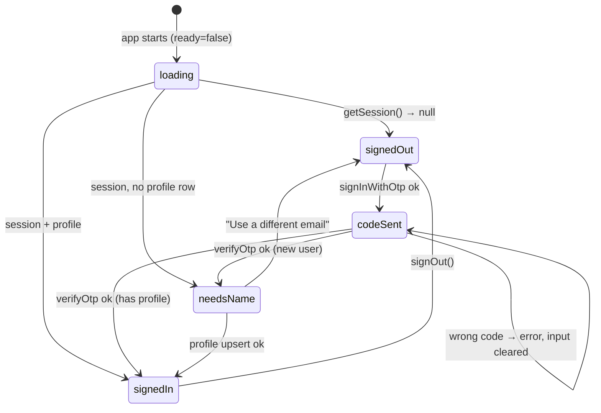

# L2.07a · Auth state and email-code sign-in

> **Level 2 · Build it** · Lesson 8 of 17

| Recipe card | |
|---|---|
| **Time** | 70 min |
| **You need** | L1.04 §5 (sessions, OTP), L2.04 (`supabase.ts`, `friendlyError`) |
| **You'll produce** | `src/lib/auth.tsx` (69 lines) and lines 1–203 of `src/pages/Account.tsx` (constants, the `Account` router component, `SignIn`) |

**In two sentences:** `AuthProvider` turns Supabase's session into React state that every page can read, and the sign-in screen turns an email plus a one-time code into that session. This lesson also tells the story of the session's most serious bug: for a while **nobody could sign in**, because the app cut 8-digit codes down to 6.

### Objectives
1. Write `AuthProvider`: initial session, `onAuthStateChange` subscription, profile fetch, `ready` flag, `signOut`.
2. Explain why the auth callback defers work with `setTimeout(…, 0)`.
3. Write the two-step sign-in (email → code) with validation, cooldown, auto-submit and error mapping.
4. Explain `inputMode="numeric"` + `autoComplete="one-time-code"` and why the form uses `noValidate`.
5. Diagnose "every correct code is rejected" from its network response.

---

## 1 · Warm-up

1. *(L1.04)* Which Supabase calls send and check the code?
2. *(L2.04)* What does `persistSession: true` do?
3. *(L1.03)* Why must early returns come after all hooks?

<details><summary>Answers</summary>1. <code>signInWithOtp</code>, then <code>verifyOtp({ type: "email" })</code>. 2. Stores the session in localStorage so you stay signed in across reloads. 3. React identifies hooks by call order.</details>

## 2 · The problem this solves

Five places need to know "who is signed in?": the Me tab's dot, Home's stats, the test intro, progress sync and the account page. Each could ask Supabase separately, but they'd disagree for a moment after sign-in or sign-out. One provider holds the truth, and everyone re-renders together when it changes.



*Takeaway: the account page renders one of three screens (SignIn · ChooseName · Me), chosen purely from `session` and `profile`.*

---

## 3 · Concepts

### 3.1 How supabase-js tracks auth

- `supabase.auth.getSession()` reads the stored session (from `localStorage`; no network unless the token needs refreshing).
- `supabase.auth.onAuthStateChange(cb)` calls `cb(event, session)` on `SIGNED_IN`, `SIGNED_OUT`, `TOKEN_REFRESHED` and so on. It returns `{ data: { subscription } }`, which you unsubscribe from on cleanup.
- Inside that callback, the library holds an internal lock. Supabase's documentation warns against `await`-ing other Supabase calls *inside* it, because that can deadlock. So we schedule the profile fetch with `setTimeout(…, 0)`, which runs after the callback returns.

### 3.2 `maybeSingle()`

`.select(...).eq("id", uid).maybeSingle()` returns `data` = the row **or `null`** when there are zero rows. `.single()` would return an *error* for zero rows. A brand-new user has no profile yet, and that is not an error. It's the "choose a name" state.

### 3.3 One-time-code inputs on phones

| Attribute | Effect |
|---|---|
| `inputMode="numeric"` | Phones show the digit keypad |
| `autoComplete="one-time-code"` | iOS and Android offer "From Messages/Mail: 12345678" above the keyboard, one tap to fill |
| `maxLength={10}` | Blocks absurd pastes; our accepted range is 6–10 digits |
| `onChange` strips non-digits | Pasting "1234 5678" or "Code: 12345678" still works |

### 3.4 Native validation vs app validation

`<input type="email">` inside a `<form>` makes the **browser** validate on submit, and block submission with its own popup, which looks different in every browser. We want one styled message, so the form sets `noValidate` and our `send()` validates itself. `type="email"` stays for the right keyboard (with `@`) and autofill.

---

## 4 · Reading the real code

### 4.1 `src/lib/auth.tsx`

```tsx
import { createContext, useCallback, useContext, useEffect, useState, type ReactNode } from "react";
import type { Session } from "@supabase/supabase-js";
import { isConfigured, supabase } from "./supabase";

export type Profile = { id: string; display_name: string };

type AuthState = {
  ready: boolean;
  session: Session | null;
  profile: Profile | null;
  refreshProfile: () => Promise<void>;
  signOut: () => Promise<void>;
};

const Ctx = createContext<AuthState>({
  ready: false,
  session: null,
  profile: null,
  refreshProfile: async () => {},
  signOut: async () => {},
});
```
- **`import type { Session }`**: type only, so it's erased at build ([L1.03](l1-03-typescript-react.md) §3.5).
- **`AuthState`** is the contract every consumer relies on. `ready` means "we've looked at storage at least once". Without it, the first render would think "signed out" and flash the sign-in screen at a signed-in user.

```tsx
export function AuthProvider({ children }: { children: ReactNode }) {
  const [ready, setReady] = useState(!isConfigured);
  const [session, setSession] = useState<Session | null>(null);
  const [profile, setProfile] = useState<Profile | null>(null);

  const fetchProfile = useCallback(async (uid: string | undefined) => {
    if (!uid) return setProfile(null);
    const { data } = await supabase.from("profiles").select("id, display_name").eq("id", uid).maybeSingle();
    setProfile((data as Profile) ?? null);
  }, []);
```
- **`ready` starts true when Supabase isn't configured**: there's nothing to wait for, so the splash and pages don't hang.
- **`fetchProfile` reads the caller's own profile**, allowed by the "read own" policy ([L2.02](l2-02-tables-and-rls.md)). `useCallback(…, [])` gives it a stable identity, so the effect below runs once.
- **`return setProfile(null)`** returns `undefined`: a safe concise return.

```tsx
  useEffect(() => {
    if (!isConfigured) return;
    let alive = true;
    supabase.auth.getSession().then(async ({ data }) => {
      if (!alive) return;
      setSession(data.session);
      await fetchProfile(data.session?.user.id);
      if (alive) setReady(true);
    });
    const { data: sub } = supabase.auth.onAuthStateChange((_event, s) => {
      setSession(s);
      // don't await inside the callback (supabase-js deadlock guidance)
      setTimeout(() => fetchProfile(s?.user.id), 0);
    });
    return () => {
      alive = false;
      sub.subscription.unsubscribe();
    };
  }, [fetchProfile]);
```
- **`alive` flag**: if the provider unmounts (StrictMode's double mount, in development) before the promise resolves, we don't set state on a dead component. This is the standard guard for async work in effects.
- **Order on start-up**: read the session → fetch the profile → **then** `ready = true`. The first screen already knows both, so Account shows the right one of its three screens with no flicker.
- **The subscription** keeps state in sync after sign-in, sign-out and token refresh. `_event` is unused (the underscore prefix satisfies `noUnusedParameters`).
- **`setTimeout(…, 0)`**: §3.1. Run the profile fetch after the callback returns.
- **Cleanup** unsubscribes, so there are no duplicate listeners in StrictMode.

```tsx
  const value: AuthState = {
    ready,
    session,
    profile,
    refreshProfile: () => fetchProfile(session?.user.id),
    signOut: async () => {
      await supabase.auth.signOut();
      setSession(null);
      setProfile(null);
    },
  };

  return <Ctx.Provider value={value}>{children}</Ctx.Provider>;
}

export const useAuth = () => useContext(Ctx);
```
- **`refreshProfile`**: after choosing or renaming a display name, the form calls this to reload the profile into state.
- **`signOut` clears both `session` and `profile` itself**, at the same moment. Originally it cleared only `profile` and waited for `onAuthStateChange` to clear the session. For a moment that produced "session present, profile null", the state that crashed the account page during its exit animation. The full story is in [L2.07b](l2-07b-account-progress.md).
- **The `value` object is recreated every render.** Simple; with this few consumers the extra renders don't matter. A bigger app would `useMemo` it.

### 4.2 `Account.tsx`: constants and the screen router (lines 1–70)

```tsx
import { useEffect, useRef, useState } from "react";
import { useNavigate, useSearchParams } from "react-router-dom";
import { AnimatePresence, motion } from "motion/react";
import { Icon } from "../components/Icon";
import { Segmented, Sheet, Toast, avatarColor, initials, useToast } from "../components/Ui";
import { useAuth } from "../lib/auth";
import { useProgress } from "../lib/progress";
import { useTheme, type ThemePref } from "../lib/theme";
import { friendlyError, isConfigured, supabase } from "../lib/supabase";
import { QUESTIONS } from "../data/questions";

// Supabase "Email OTP length" (Auth → Providers → Email). This project uses 8.
// Codes of 6–10 digits are accepted; we auto-submit once OTP_LENGTH digits are typed or pasted.
const OTP_LENGTH = Number(import.meta.env.VITE_OTP_LENGTH ?? 8);
const OTP_MIN = 6;
const OTP_MAX = 10;
const NAME_RE = /^[A-Za-z0-9_. -]{3,20}$/;
```
- **`OTP_LENGTH`** defaults to **8** (this project's Supabase setting) and is configurable with `VITE_OTP_LENGTH` without a code change. `Number(...)` because env values are strings.
- **`OTP_MIN`/`OTP_MAX`** give the range Supabase allows (6–10). The Verify button works for any length in range, even if the auto-submit length is wrong.
- **`NAME_RE`** mirrors the database rules (3–20 characters, `[A-Za-z0-9_. -]`) for instant feedback ([L2.02](l2-02-tables-and-rls.md)).

```tsx
export default function Account() {
  const { session, profile, ready } = useAuth();
  const [params] = useSearchParams();
  const nav = useNavigate();
  const next = params.get("next");

  // once fully set up, send them back where they came from
  useEffect(() => {
    if (session && profile && next) nav(next, { replace: true });
  }, [session, profile, next, nav]);

  if (!isConfigured)
    return (
      <div>
        <Head title="Account" sub="Sign-in is not configured" />
        <div className="banner">
          <Icon name="info" size={18} /> Add VITE_SUPABASE_URL and VITE_SUPABASE_ANON_KEY to enable sign-in.
        </div>
        <Preferences />
      </div>
    );

  if (!ready) return null;

  return (
    <AnimatePresence mode="wait">
      {!session ? (
        <motion.div key="signin" initial={{ opacity: 0 }} animate={{ opacity: 1 }} exit={{ opacity: 0 }}>
          <SignIn />
        </motion.div>
      ) : !profile ? (
        <motion.div key="name" initial={{ opacity: 0 }} animate={{ opacity: 1 }} exit={{ opacity: 0 }}>
          <ChooseName />
        </motion.div>
      ) : (
        <motion.div key="me" initial={{ opacity: 0 }} animate={{ opacity: 1 }} exit={{ opacity: 0 }}>
          <Me />
        </motion.div>
      )}
    </AnimatePresence>
  );
}

function Head({ title, sub }: { title: string; sub?: string }) {
  return (
    <div className="page-head">
      <span className="caps">Account</span>
      <h1 className="display">{title}</h1>
      {sub && <p>{sub}</p>}
    </div>
  );
}
```
- **`?next=/test`**: the Test intro links to `/me?next=/test`. Once both session and profile exist, the effect navigates back. **`replace: true`** swaps the history entry, so "Back" doesn't return to a finished sign-in screen. Note the braces: `nav(...)` can return a Promise in React Router 7, and the L2.05 lesson applies.
- **Three keyed screens** inside `AnimatePresence mode="wait"`: a cross-fade between SignIn → ChooseName → Me.
- **This is where the sign-out crash happened.** During the exit fade the old `<Me/>` re-rendered with fresh context (`profile = null`) and dereferenced it. Fixed in `Me` and in `signOut` ([L2.07b](l2-07b-account-progress.md)).
- **`if (!ready) return null`** is after the hooks, as the rules require.

### 4.3 `SignIn` (lines 72–203)

```tsx
function SignIn() {
  const [step, setStep] = useState<"email" | "code">("email");
  const [email, setEmail] = useState("");
  const [code, setCode] = useState("");
  const [busy, setBusy] = useState(false);
  const [err, setErr] = useState<string | null>(null);
  const [cooldown, setCooldown] = useState(0);
  const codeRef = useRef<HTMLInputElement>(null);

  useEffect(() => {
    if (cooldown <= 0) return;
    const t = setTimeout(() => setCooldown((c) => c - 1), 1000);
    return () => clearTimeout(t);
  }, [cooldown]);
```
- **Local state only.** The sign-in steps don't matter to the rest of the app until a session exists.
- **The cooldown countdown**: each tick sets the next. A chain of one-second timeouts is simpler than `setInterval` plus a stop condition. The 60 s resend lock protects Supabase's email rate limit (and the user's inbox).

```tsx
  const send = async (e?: React.FormEvent) => {
    e?.preventDefault();
    const em = email.trim().toLowerCase();
    if (!/^\S+@\S+\.\S+$/.test(em)) return setErr("Enter a valid email address.");
    setBusy(true);
    setErr(null);
    const { error } = await supabase.auth.signInWithOtp({ email: em, options: { shouldCreateUser: true } });
    setBusy(false);
    if (error) return setErr(friendlyError(error));
    setEmail(em);
    setStep("code");
    setCooldown(60);
    setTimeout(() => codeRef.current?.focus(), 350);
  };
```
- **`e?.preventDefault()`**: called from form submit (has an event) and from "Resend" (no event). Without `preventDefault`, a submit reloads the page.
- **Normalise** to lowercase and trimmed, so `Ana@Mail.com ` and `ana@mail.com` are the same account.
- **The email regex** is deliberately loose: something@something.something. Real validation is "did the code arrive".
- **`shouldCreateUser: true`**: sign-in and sign-up are the same flow ("New here? This creates your account.").
- **Focus the code box after the slide animation (350 ms)**, so the keypad opens without a tap.

```tsx
  const verify = async (token: string) => {
    setBusy(true);
    setErr(null);
    const { error } = await supabase.auth.verifyOtp({ email, token, type: "email" });
    setBusy(false);
    if (error) {
      setErr(friendlyError(error));
      setCode("");
    }
  };

  const onCode = (v: string) => {
    const digits = v.replace(/\D/g, "").slice(0, OTP_MAX);
    setCode(digits);
    if (digits.length === OTP_LENGTH && !busy) verify(digits);
  };
```
- **On success there's nothing to do here.** Supabase stores the session and fires `SIGNED_IN`, `AuthProvider` updates, and `Account` swaps to ChooseName or Me. The UI follows state.
- **On failure**: a friendly message ("That code is wrong or has expired. Request a new one."), and the box is cleared for a fresh attempt.
- **`type: "email"`**: the OTP type for email codes. Older docs mention `"magiclink"`; `"email"` is current.
- **`onCode`**: strip non-digits (`\D`), cap at 10, and **auto-submit exactly at `OTP_LENGTH`**. That is the line where the bug lived (§7).

```tsx
  return (
    <div>
      <div className="auth-hero">
        <motion.img src="/brand/badge-hex.webp" width={128} height={180} alt="Coffee aur Code" initial={{ y: 20, opacity: 0, rotate: -6 }} animate={{ y: 0, opacity: 1, rotate: 0 }} transition={{ type: "spring", stiffness: 200, damping: 16 }} />
      </div>
      <AnimatePresence mode="wait">
        {step === "email" ? (
          <motion.form key="email" onSubmit={send} noValidate initial={{ x: 30, opacity: 0 }} animate={{ x: 0, opacity: 1 }} exit={{ x: -30, opacity: 0 }} className="stack">
            <div style={{ textAlign: "center" }}>
              <h1 className="display" style={{ fontSize: "1.8rem", margin: "8px 0 6px" }}>Pull up a chair</h1>
              <p className="muted" style={{ margin: 0 }}>Sign in to save progress, take ranked tests and get on the leaderboard.</p>
            </div>
            <div className="field">
              <label htmlFor="email">Email</label>
              <input id="email" className="input" type="email" inputMode="email" autoComplete="email" placeholder="you@example.com" value={email} onChange={(e) => setEmail(e.target.value)} autoFocus />
            </div>
            {err && <div className="err">{err}</div>}
            <button className="btn primary block" disabled={busy}>
              {busy ? "Sending…" : "Email me a code"} <Icon name="arrow" size={18} />
            </button>
            <p className="muted" style={{ fontSize: ".8rem", textAlign: "center", margin: 0 }}>No password needed. New here? This creates your account.</p>
            <PrivacyNote />
          </motion.form>
```
- **The badge springs in** (`damping: 16`, a little bounce): a friendly first impression.
- **The two steps slide** left and right (`x: 30 → 0 → −30`). This slide once made iPhones scroll sideways for a moment, fixed globally with `overflow-x: clip` ([L2.10a](l2-10a-tokens-base-shell.md)).
- **`noValidate`**: §3.4 and incident 2.
- **`<label htmlFor="email">`** is linked to `id="email"`. Tapping the label focuses the input, and tests can use `getByLabel("Email")`.
- **`autoFocus`**: the keyboard opens immediately.
- **The button has no `type`**, so inside a form it defaults to `submit`, and Enter on the keyboard submits too.
- **`<PrivacyNote/>`**: "We store only your email, leaderboard name, test scores and flashcard progress…" (defined at the bottom of the file).

```tsx
        ) : (
          <motion.div key="code" initial={{ x: 30, opacity: 0 }} animate={{ x: 0, opacity: 1 }} exit={{ x: -30, opacity: 0 }} className="stack">
            <div style={{ textAlign: "center" }}>
              <h1 className="display" style={{ fontSize: "1.8rem", margin: "8px 0 6px" }}>Check your inbox</h1>
              <p className="muted" style={{ margin: 0 }}>
                We sent a {OTP_LENGTH}-digit code to <b style={{ color: "var(--ink)" }}>{email}</b>
              </p>
            </div>
            <div className="field">
              <label htmlFor="code" className="sr-only">Code</label>
              <input
                ref={codeRef}
                id="code"
                className="input otp"
                inputMode="numeric"
                autoComplete="one-time-code"
                placeholder={"•".repeat(OTP_LENGTH)}
                value={code}
                onChange={(e) => onCode(e.target.value)}
                maxLength={OTP_MAX}
              />
            </div>
            {err && <div className="err">{err}</div>}
            <button className="btn primary block" disabled={busy || code.length < OTP_MIN} onClick={() => verify(code)}>
              {busy ? "Checking…" : "Verify & sign in"}
            </button>
            <div className="row between">
              <button className="btn sm ghost" onClick={() => { setStep("email"); setCode(""); setErr(null); }}>
                <Icon name="left" size={16} /> Change email
              </button>
              <button className="btn sm ghost" disabled={cooldown > 0 || busy} onClick={() => send()}>
                {cooldown > 0 ? `Resend in ${cooldown}s` : "Resend code"}
              </button>
            </div>
            <p className="muted" style={{ fontSize: ".8rem", textAlign: "center", margin: 0 }}>Can't find it? Check spam or promotions.</p>
          </motion.div>
        )}
      </AnimatePresence>
      <Preferences />
    </div>
  );
}
```
(Some JSX lines are joined here for reading; the real file has the same elements one attribute group per line.)
- **This step is not a form**, so no Enter-to-submit: auto-submit or the button does it.
- **`sr-only` label**: visually hidden but announced by screen readers. The input still needs a name for accessibility, and axe flags unlabeled inputs ([L4.07](l4-07-a11y-lighthouse-flaky.md)).
- **The placeholder** shows the expected number of dots (8 here).
- **`.otp`** styling: large, letter-spaced, centred digits. Its letter-spacing was reduced from `0.5em` to `0.32em` (and `0.22em` at ≤ 360 px) so **8** digits fit on a 320 px phone.
- **"Change email"** returns to step 1 without losing the typed email.
- **`<Preferences/>`**: theme is available even signed out.

---

## 5 · Worked trace (step-through frames): signing in a new user

| Frame | User action / event | State after | Predict first → |
|---|---|---|---|
| 1 | Types `Ana@Mail.com `, taps "Email me a code" | `send()`: `em = "ana@mail.com"`, busy | Does the browser block it as invalid? **No: `noValidate`; our regex passes** |
| 2 | `signInWithOtp` resolves `{ error: null }` | step = code, cooldown = 60, focus scheduled | |
| 3 | Pastes `Your code: 4815 1623` | `onCode`: digits `48151623` (8) → auto `verify` | Why didn't it wait for a button? **length === OTP_LENGTH** |
| 4 | `verifyOtp` ok | Supabase stores the session; fires `SIGNED_IN` | |
| 5 | `onAuthStateChange` → `setSession(s)`; `setTimeout(fetchProfile)` | session set, profile null | Which screen? **ChooseName** |
| 6 | `maybeSingle()` → `data: null` | profile stays null | Error? **No: maybeSingle** |
| 7 | (L2.07b) the name is saved → `refreshProfile()` | profile `{ display_name: "Espresso Ana" }` | Which screen? **Me, or `?next` target** |

---

## 6 · Running and testing

- `tests/e2e/auth.spec.ts` drives this exact flow through the real UI on Android/Chrome, iPhone/WebKit and desktop Firefox.
  - It **intercepts** the "send code" request (`page.route("**/auth/v1/otp*")`), so no email is sent.
  - It types a wrong 8-digit code (expects "wrong or has expired"), then gets the **real** code from Supabase's admin API (`generateLink`) and types it. That exercises the real `verifyOtp` endpoint ([L4.06](l4-06-live-security-auth.md)).
- `tests/e2e/ui.spec.ts` › "signed-out visitors are sent to sign in before a ranked test" covers the `?next=/test` link and the invalid-email message.

## 7 · Bug journal

**Incident 1 · Nobody could sign in: 8-digit codes cut to 6**
1. **Symptom.** In the signed-in journey test, after typing the real code, the screen said **"That code is wrong or has expired. Request a new one."**, and the code box was empty again. The failure screenshot showed the error under an empty box with **six** placeholder dots.
2. **Diagnosis.** Was the test's code wrong? We logged the verify response in a debug test:
   ```text
   VERIFY 403 {"code":"otp_expired","message":"Token has expired or is invalid"}
   CODE 8 value before fill:
   ```
   The admin API's code had **8 digits**. The app's `onCode` did `v.replace(/\D/g, "").slice(0, OTP_LENGTH)` with `OTP_LENGTH = 6`, so the input kept only the first 6 digits and auto-submitted them. Supabase compared 6 digits against an 8-digit code and correctly refused.
3. **Root cause.** The app assumed Supabase's default OTP length is 6. This project's Auth setting ("Email OTP length") was **8**. The assumption was never checked against the real config, and no test had used a real code until the e2e suite. Every real user with the real email would have been rejected.
4. **Fix.**
   ```diff
   - const OTP_LENGTH = 6;
   + // Supabase "Email OTP length" (Auth → Providers → Email). This project uses 8.
   + const OTP_LENGTH = Number(import.meta.env.VITE_OTP_LENGTH ?? 8);
   + const OTP_MIN = 6;
   + const OTP_MAX = 10;
   …
   - const digits = v.replace(/\D/g, "").slice(0, OTP_LENGTH);
   + const digits = v.replace(/\D/g, "").slice(0, OTP_MAX);       // never truncate a real code
   …
   - disabled={busy || code.length !== OTP_LENGTH}
   + disabled={busy || code.length < OTP_MIN}                      // any valid length can be verified
   - maxLength={OTP_LENGTH}
   + maxLength={OTP_MAX}
   - We sent a 6-digit code …          (Test intro: "a 6-digit code" → "a sign-in code")
   ```
   Plus CSS letter-spacing so 8 digits fit, and a `VITE_OTP_LENGTH` line in `.env.example`.
5. **Lesson.** Any value that mirrors a **remote configuration** (code length, rate limits, token expiry) must be read from config or tolerate the whole legal range, and must be exercised by a test against the real service. Our auth journey test now does that on three browsers.

**Incident 2 · The browser's own email check hid the app's message**
1. **Symptom.** The UI test typed `not-an-email` and clicked "Email me a code", expecting the app's red "Enter a valid email address." It timed out: `getByText('Enter a valid email address.')` not found.
2. **Diagnosis.** The failure screenshot showed no red text, and nothing had been sent. The browser had stopped the submit itself: `type="email"` inside a `<form>` triggers HTML5 constraint validation, which shows a native tooltip (not in the DOM, so invisible to screenshots and tests).
3. **Root cause.** Two validators. The browser's ran first and won, and it looks and words differently in Chrome, Firefox and Safari.
4. **Fix.**
   ```diff
   - <motion.form key="email" onSubmit={send} …>
   + <motion.form key="email" onSubmit={send} noValidate …>   {/* our validation, one style everywhere */}
   ```
5. **Lesson.** Pick one validation layer for the UI. Keep `type="email"` for the keyboard and autofill, and add `noValidate` when you show your own messages.

## 8 · Why this design

| Decision | Alternatives | Why this one | Trade-off | Choose differently when |
|---|---|---|---|---|
| Email OTP code | Magic link; password; Google sign-in | No passwords; works on phones without app-switching problems | Depends on email delivery (SMTP limits) | You need instant sign-in → OAuth |
| Auto-submit at the configured length | Always a button | One less tap | Must know the length (now configurable) | — |
| `ready` gate | Render immediately | No signed-out flicker for signed-in users | First paint waits for storage + one query | — |
| Defer the fetch in the auth callback | `await` inside | Avoids the documented lock deadlock | One tick of delay | — |
| `shouldCreateUser: true` | Separate sign-up | One flow for everyone | Typos create stray accounts | Invite-only apps |

## 9 · Check yourself

**Q1.** A user's Supabase project switches OTP length to 10. Without code changes, can they sign in?
<details><summary>Answer</summary>Yes. Auto-submit (at 8) won't fire, but the input accepts up to 10 digits and the button enables at ≥ 6, so tapping Verify works. Set <code>VITE_OTP_LENGTH=10</code> to restore auto-submit.</details>

**Q2.** Why does `AuthProvider` set `ready` only after `fetchProfile`?
<details><summary>Answer</summary>So the first rendered screen already knows whether the user needs a name. Otherwise Account would flash ChooseName for an existing user.</details>

**Q3.** What would `.single()` do for a new user's profile query?
<details><summary>Answer</summary>Return an error (zero rows), not <code>null</code>. <code>maybeSingle()</code> treats zero rows as a normal null result.</details>

**Q4.** Why `setTimeout(() => fetchProfile(...), 0)` in the auth callback?
<details><summary>Answer</summary>supabase-js holds a lock during the callback; awaiting another Supabase call inside can deadlock. Deferring runs it after the callback returns.</details>

**Q5.** The verify response is `403 otp_expired` for a code you just received. List two causes.
<details><summary>Answer</summary>(1) The code was truncated or altered before sending (our bug). (2) A newer code was requested, which invalidates older ones, or more than an hour passed (expiry setting).</details>

## 10 · Practice

**Easy (10 min).** Change the resend cooldown to 45 s and show it as a progress bar.

**Medium (20 min).** Add "Paste code" support for codes with letters (some providers use alphanumeric). What has to change in `onCode` and `inputMode`?
<details><summary>Answer</summary>Filter with <code>/[^A-Za-z0-9]/g</code> and uppercase; use <code>inputMode="text"</code> with <code>autoCapitalize="characters"</code>. Supabase email OTPs are numeric, so this is hypothetical.</details>

**Hard (40 min).** Write a Playwright test that mocks `/auth/v1/verify` to return 403 three times and then succeed, and checks the UI clears the box each time. (Hint: `page.route` with a counter.)

## 11 · From memory

**Rung 1 · Cloze.**

```tsx
const { data } = await supabase.from("profiles").select("id, display_name").eq("id", uid).___①___();
const { data: sub } = supabase.auth.___②___((_event, s) => {
  setSession(s);
  setTimeout(() => fetchProfile(s?.user.id), ___③___);
});
const { error } = await supabase.auth.signInWithOtp({ email: em, options: { ___④___: true } });
const { error } = await supabase.auth.verifyOtp({ email, token, type: "___⑤___" });
const digits = v.replace(/___⑥___/g, "").slice(0, ___⑦___);
<input inputMode="numeric" autoComplete="___⑧___" />
<motion.form onSubmit={send} ___⑨___ >
```
<details><summary>Answers</summary>① <code>maybeSingle</code> ② <code>onAuthStateChange</code> ③ <code>0</code> ④ <code>shouldCreateUser</code> ⑤ <code>email</code> ⑥ <code>\D</code> ⑦ <code>OTP_MAX</code> ⑧ <code>one-time-code</code> ⑨ <code>noValidate</code></details>

**Rung 2 · Blank page (20 min).** Write `auth.tsx` and the `SignIn` component from memory.
<details><summary>Self-check</summary>

- [ ] `ready` initialised from `!isConfigured`; set after session + profile
- [ ] `alive` guard; subscription unsubscribed in cleanup
- [ ] Deferred profile fetch in the callback
- [ ] `signOut` clears session and profile
- [ ] SignIn: normalise email, loose regex, `shouldCreateUser`, cooldown 60, focus after the slide
- [ ] Code: strip non-digits, cap at 10, auto-submit at OTP_LENGTH, button enabled at ≥ 6, clear on error
- [ ] `noValidate`, `inputMode`, `autoComplete="one-time-code"`
</details>

## 12 · Flashcards

<details><summary><b>Q:</b> What does <code>ready</code> prevent?</summary><b>A:</b> A flash of the signed-out UI before the stored session and profile are loaded.</details>
<details><summary><b>Q:</b> Why <code>maybeSingle()</code> for the profile?</summary><b>A:</b> New users have no row; zero rows must be <code>null</code>, not an error.</details>
<details><summary><b>Q:</b> Why defer work in <code>onAuthStateChange</code>?</summary><b>A:</b> Awaiting Supabase calls inside the callback can deadlock on its internal lock.</details>
<details><summary><b>Q:</b> What was the "nobody can sign in" root cause?</summary><b>A:</b> The app truncated codes to 6 digits; the project sends 8.</details>
<details><summary><b>Q:</b> Which OTP lengths does the app accept now?</summary><b>A:</b> 6–10; auto-submits at <code>VITE_OTP_LENGTH</code> (default 8).</details>
<details><summary><b>Q:</b> What does <code>autoComplete="one-time-code"</code> give users?</summary><b>A:</b> One-tap fill of the code from Mail/Messages above the keyboard.</details>
<details><summary><b>Q:</b> Why <code>noValidate</code> on the email form?</summary><b>A:</b> So the app's own message shows consistently instead of each browser's native popup.</details>
<details><summary><b>Q:</b> What does <code>?next=/test</code> do?</summary><b>A:</b> After session + profile exist, Account navigates there with <code>replace: true</code>.</details>

## 13 · The menu board

| | |
|---|---|
| Provider state | `ready`, `session`, `profile`, `refreshProfile`, `signOut` |
| Start-up | `getSession` → `fetchProfile` → `ready=true`; subscribe to changes; `alive` guard |
| Callback rule | no `await` of Supabase calls inside; `setTimeout(…, 0)` |
| Send | normalise email; `signInWithOtp({ shouldCreateUser: true })`; cooldown 60 s |
| Verify | `verifyOtp({ type: "email" })`; clear on error; UI follows the session |
| Code input | digits only, ≤ 10, auto at 8, button at ≥ 6, `one-time-code` |
| Screens | SignIn (no session) · ChooseName (no profile) · Me |

## 14 · Glossary

**Auth state change**: an event emitted by supabase-js on sign-in, sign-out or refresh. **Constraint validation**: the browser's built-in form checks. **Deadlock**: two pieces of code waiting on each other forever. **maybeSingle**: query helper returning one row or null. **OTP length**: the number of digits in emailed codes (a Supabase Auth setting). **sr-only**: visually hidden, still read by screen readers.

## 15 · Go further

| Resource | Type | Why | Which part | Time |
|---|---|---|---|---|
| [Supabase: signInWithOtp](https://supabase.com/docs/reference/javascript/auth-signinwithotp) | Reference | Options incl. `shouldCreateUser` | Whole entry | 5 min |
| [Supabase: verifyOtp](https://supabase.com/docs/reference/javascript/auth-verifyotp) | Reference | `type` values | Whole entry | 5 min |
| [Supabase: onAuthStateChange](https://supabase.com/docs/reference/javascript/auth-onauthstatechange) | Reference | Events and the callback-lock warning | Notes section | 10 min |
| [web.dev: SMS OTP form best practices](https://web.dev/articles/sms-otp-form) | Article | `inputmode`, `autocomplete="one-time-code"` | Whole page | 10 min |

---
← [L2.06b The mug, icons & Home](l2-06b-mug-icons-home.md) · [Hub](README.md) · [L2.07b Account & progress sync →](l2-07b-account-progress.md)
