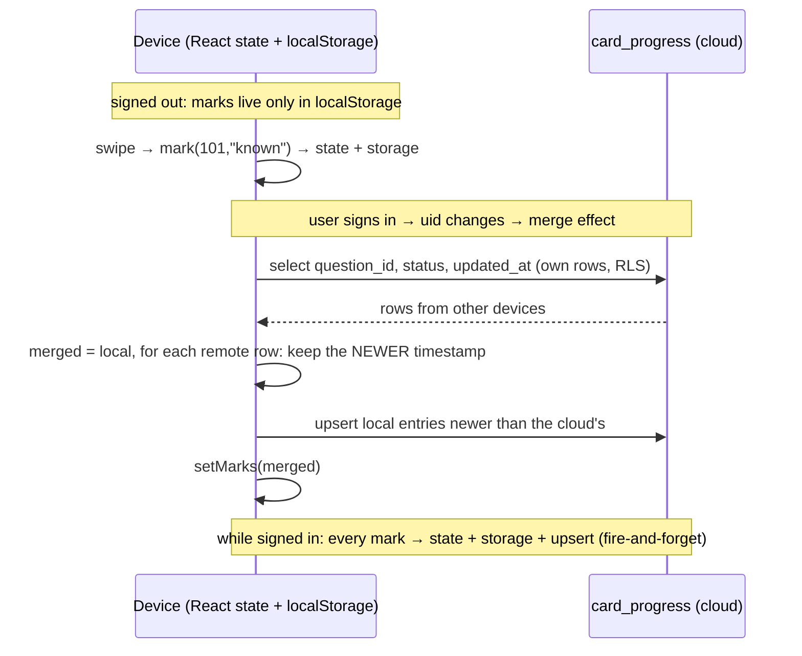

# L2.07b · Leaderboard names, the account page and progress sync

> **Level 2 · Build it** · Lesson 10 of 18

| Recipe card | |
|---|---|
| **Time** | 75 min |
| **You need** | L2.07a (auth state), L2.02 (`profiles`, `card_progress` policies), L2.06a (`Sheet`, `Toast`) |
| **You'll produce** | Lines 205–394 of `src/pages/Account.tsx` (`NameForm`, `ChooseName`, `Me`, `PrivacyNote`, `Preferences`) and `src/lib/progress.tsx` (77 lines) |

**In two sentences:** After sign-in, a student picks a public name, manages their account, and their flashcard marks follow them between devices. This lesson builds those screens and the "newest wins" merge between browser storage and the cloud, and tells the story of the crash that blanked the app on sign-out.

### Objectives
1. Write `NameForm`: client validation mirroring the database, `upsert`, the friendly duplicate message, refresh, then callback.
2. Write `Me`, with all hooks before the guard, and explain the sign-out crash.
3. Write `ProgressProvider`: local-first marks, the sign-in merge (newest timestamp wins per card), pushing local-only changes, optimistic `mark`, `reset`.
4. Trace the merge on real timestamps, and name its one known limitation (resets don't propagate to other devices' local copies).

---

## 1 · Warm-up

1. *(L2.07a)* Which three screens can `Account` render, and what decides between them?
2. *(L2.02)* Which policies let a user write `card_progress`?
3. *(L1.03)* What does `setX(prev => …)` protect against?

<details><summary>Answers</summary>1. SignIn (no session), ChooseName (session, no profile), Me (both). 2. Insert/update/delete "own" (<code>auth.uid() = user_id</code>). 3. Losing updates queued before a render.</details>

## 2 · The problem this solves

Students study on their phone on the bus and on a laptop at home. Progress must work **offline and signed out** (instantly, in the browser), yet **follow them** once signed in, without one device wiping the other's work. And the leaderboard needs a public name that is safe to show.



*Takeaway: the browser is always the first copy (fast, offline). The cloud is a sync target merged by timestamp.*

---

## 3 · Concepts

### 3.1 Optimistic updates

**Definition.** Update the UI immediately as if the server call succeeded, and send the call in the background.

**Why here.** A swipe must feel instant. Waiting 200 ms for Supabase before moving to the next card would feel broken. If the upsert fails (offline), the mark is still in `localStorage`, and the next sign-in merge pushes it up.

### 3.2 "Last write wins" by timestamp

Each mark carries `t`, the moment you swiped (milliseconds since 1970). When two copies disagree about the same card, the larger `t` wins:

$$
\text{merged}[id] = \begin{cases} \text{remote} & \text{if } t_\text{remote} > t_\text{local} \text{ or local missing} \\ \text{local} & \text{otherwise} \end{cases}
$$

It is simple and good enough for flashcards: the most recent judgment of a card is the one you want. It is wrong for data where both edits matter (two people editing one document). That needs merging, not picking.

### 3.3 Supabase query builders are lazy

`supabase.from("t").upsert(row)` builds a request object. **It is sent only when awaited or `.then()`-ed.** The builder is a "thenable" (an object with a `then` method, which `await` understands). That is why `mark()` ends with `.then(() => {})`. Remove it, and nothing is ever saved to the cloud, silently.

---

## 4 · Reading the real code

### 4.1 `NameForm` (lines 205–240)

```tsx
function NameForm({ initial = "", onDone, cta }: { initial?: string; onDone: () => void; cta: string }) {
  const { session, refreshProfile } = useAuth();
  const [name, setName] = useState(initial);
  const [busy, setBusy] = useState(false);
  const [err, setErr] = useState<string | null>(null);

  const submit = async (e: React.FormEvent) => {
    e.preventDefault();
    const n = name.trim().replace(/\s+/g, " ");
    if (!NAME_RE.test(n)) return setErr("3–20 characters: letters, numbers, spaces, . _ -");
    setBusy(true);
    setErr(null);
    const { error } = await supabase.from("profiles").upsert({ id: session!.user.id, display_name: n });
    setBusy(false);
    if (error) return setErr(friendlyError(error));
    await refreshProfile();
    onDone();
  };

  return (
    <form onSubmit={submit} className="stack">
      <div className="field">
        <label htmlFor="dn">Leaderboard name</label>
        <input id="dn" className="input" value={name} onChange={(e) => setName(e.target.value)} maxLength={20} placeholder="e.g. Espresso Ananya" autoFocus autoComplete="nickname" />
        <span className="muted" style={{ fontSize: ".8rem" }}>
          Shown publicly on the leaderboard. Your email is never shown.
        </span>
      </div>
      {err && <div className="err">{err}</div>}
      <button className="btn primary block" disabled={busy}>
        {busy ? "Saving…" : cta}
      </button>
    </form>
  );
}
```
- **Reused twice**: choosing a first name (`cta="Let's go"`), and renaming in a sheet (`cta="Save name"`). The `initial` and `onDone` props make it fit both.
- **Normalise**: trim, and collapse runs of whitespace to one space (`/\s+/g`), so `"Ana   B"` → `"Ana B"`.
- **`NAME_RE`** gives instant feedback. The database `check` constraints are the real guard ([L2.02](l2-02-tables-and-rls.md)).
- **`upsert` with `id = session.user.id`**: an insert the first time, an update afterwards. It needs the insert **and** update **and** select policies, which `profiles` has (all "own").
- **`session!`**: NameForm only renders when a session exists (ChooseName or Me). Not a crash risk here.
- **`friendlyError`** turns `23505` (the unique `lower(display_name)` index) into "That name is taken. Try another." The auth journey test tries a taken name with *different casing* and expects that message ([L4.06](l4-06-live-security-auth.md)).
- **`await refreshProfile()` before `onDone()`**: the profile in context updates, `Account` re-renders into Me, and for renames the card shows the new name before the sheet closes.
- **`maxLength={20}`** matches the limit. `autoComplete="nickname"` gives a sensible autofill hint.

### 4.2 `ChooseName` (lines 242–263)

```tsx
function ChooseName() {
  const { signOut } = useAuth();
  return (
    <div>
      <div className="auth-hero">
        <motion.img src="/brand/mascot.webp" width={120} height={131} alt="" style={{ width: 120 }} initial={{ scale: 0, rotate: -20 }} animate={{ scale: 1, rotate: 0 }} transition={{ type: "spring", stiffness: 240, damping: 14 }} />
      </div>
      <div style={{ textAlign: "center", marginBottom: 16 }}>
        <h1 className="display" style={{ fontSize: "1.8rem", margin: "8px 0 6px" }}>
          You're in! ☕
        </h1>
        <p className="muted" style={{ margin: 0 }}>
          Pick the name other students will see on the leaderboard.
        </p>
      </div>
      <NameForm onDone={() => {}} cta="Let's go" />
      <button className="btn ghost block" style={{ marginTop: 8 }} onClick={signOut}>
        Use a different email
      </button>
    </div>
  );
}
```
- **The mascot pops in** with a bouncy spring (`damping: 14`): celebration of a successful sign-in.
- **`onDone={() => {}}`**: nothing to do, because `refreshProfile` sets the profile and `Account` moves on (or follows `?next=`).
- **"Use a different email"** signs out: an escape hatch if someone typed the wrong address.

### 4.3 `Me` (lines 265–365)

```tsx
function Me() {
  const { session, profile, signOut } = useAuth();
  const { knownCount, reset } = useProgress();
  const [editOpen, setEditOpen] = useState(false);
  const [resetOpen, setResetOpen] = useState(false);
  const [toast, setToast] = useToast();
  // can briefly render during the sign-out transition, after the profile is cleared
  if (!session || !profile) return null;
  const name = profile.display_name;
```
- **All five hooks first, then the guard.** This guard is the fix for the sign-out crash (§7). It must be **after** the hooks: returning before `useState` would change the hook count between renders.

```tsx
  return (
    <div>
      <Head title="Your account" />
      <div className="card pad row" style={{ gap: 14 }}>
        <motion.div
          className="av"
          style={{ width: 60, height: 60, borderRadius: "50%", display: "grid", placeItems: "center", fontWeight: 900, fontSize: "1.4rem", color: "#120f0e", background: avatarColor(name), flex: "none" }}
          initial={{ scale: 0.6 }}
          animate={{ scale: 1 }}
        >
          {initials(name)}
        </motion.div>
        <div style={{ minWidth: 0, flex: 1 }}>
          <div style={{ fontWeight: 800, fontSize: "1.15rem", fontStretch: "112%" }}>{name}</div>
          <div className="muted" style={{ fontSize: ".85rem", overflow: "hidden", textOverflow: "ellipsis" }}>
            {session.user.email}
          </div>
          <div className="muted" style={{ fontSize: ".8rem", marginTop: 2 }}>
            {knownCount}/{QUESTIONS.length} cards mastered · synced
          </div>
        </div>
        <button className="icon-btn" onClick={() => setEditOpen(true)} aria-label="Edit name">
          <Icon name="edit" size={19} />
        </button>
      </div>

      <Preferences />
```
- **The avatar**: the deterministic colour + initials from [L2.06a](l2-06a-ui-kit.md). `color: #120f0e` (espresso) is dark text on light avatar colours. `flex: none` stops it squashing.
- **`minWidth: 0` + `textOverflow: ellipsis`**: a long email gets an ellipsis instead of pushing the card wider than a 320 px screen. In flexbox, children default to `min-width: auto`, which refuses to shrink below the content. `0` allows it.
- **The email** is shown only here, to the owner. Never on the leaderboard.
- **The edit button** has an `aria-label` (icon only). The test uses `getByRole("button", { name: "Edit name" })`.

```tsx
      <div className="section-title">
        <h2>Data</h2>
      </div>
      <div className="card">
        <button className="list-row" onClick={() => setResetOpen(true)}>
          <Icon name="trash" />
          <span className="grow">
            Reset flashcard progress
            <small>Clears “Got it / Again” marks on all devices</small>
          </span>
        </button>
        <div className="list-row">
          <Icon name="lock" />
          <span className="grow">
            What we store
            <small>
              Your email, leaderboard name, test scores &amp; times, and which flashcards you marked. No password, no phone, no location.
            </small>
          </span>
        </div>
        <button className="list-row" onClick={signOut}>
          <Icon name="logout" />
          <span className="grow">Sign out</span>
        </button>
      </div>
```
- **Destructive action behind a sheet**: reset opens a confirmation; it never happens on one tap.
- **"What we store"** was added at the user's request after they asked what the database tracks. It's honest and complete for our tables. Supabase Auth's own logs (IP, browser) are platform-level.
- **Sign out** calls the provider's `signOut`, which clears session **and** profile together.

```tsx
      <Sheet open={editOpen} onClose={() => setEditOpen(false)}>
        <h3>Change your name</h3>
        <NameForm
          initial={name}
          cta="Save name"
          onDone={() => {
            setEditOpen(false);
            setToast("Name updated");
          }}
        />
      </Sheet>
      <Sheet open={resetOpen} onClose={() => setResetOpen(false)}>
        <h3>Reset all flashcard progress?</h3>
        <p className="muted" style={{ marginTop: 0 }}>
          Your {knownCount} mastered cards go back to unseen. Test scores and leaderboard stay.
        </p>
        <div className="stack">
          <button
            className="btn red block"
            onClick={async () => {
              await reset();
              setResetOpen(false);
              setToast("Progress reset");
            }}
          >
            Reset progress
          </button>
          <button className="btn block" onClick={() => setResetOpen(false)}>
            Cancel
          </button>
        </div>
      </Sheet>
      <Toast msg={toast} />
    </div>
  );
}
```
- **Rename sheet**: the same `NameForm`, prefilled. On success it closes and shows a toast.
- **The reset sheet states the consequence with a number** ("Your 12 mastered cards…") and what is *not* affected (scores). It's red, and the safe option sits right there.
- **`await reset()`** before closing, so the toast only claims success after the cloud delete returns.

### 4.4 `PrivacyNote` and `Preferences` (lines 367–394)

```tsx
function PrivacyNote() {
  return (
    <p className="muted" style={{ fontSize: ".75rem", textAlign: "center", margin: 0 }}>
      We store only your email, leaderboard name, test scores and flashcard progress. Your email is never shown to others.
    </p>
  );
}

function Preferences() {
  const { pref, setPref } = useTheme();
  return (
    <>
      <div className="section-title">
        <h2>Appearance</h2>
      </div>
      <Segmented<ThemePref>
        id="theme"
        value={pref}
        onChange={setPref}
        options={[
          { value: "system", label: <><Icon name="monitor" size={17} /> Auto</> },
          { value: "light", label: <><Icon name="sun" size={17} /> Light</> },
          { value: "dark", label: <><Icon name="moon" size={17} /> Dark</> },
        ]}
      />
    </>
  );
}
```
- **`PrivacyNote`** appears on the sign-in screen, *before* the user gives an email. That is informed consent in one sentence.
- **`Preferences`** is a three-way theme picker (`Segmented<ThemePref>`, `id="theme"`, so its pill is unique). The top-bar toggle only flips light/dark; this one can return to **Auto**.

### 4.5 `src/lib/progress.tsx`

```tsx
import { createContext, useCallback, useContext, useEffect, useMemo, useState, type ReactNode } from "react";
import { useAuth } from "./auth";
import { load, save } from "./storage";
import { supabase } from "./supabase";

export type Mark = "known" | "again";
type Entry = { s: Mark; t: number };
type Marks = Record<number, Entry>;

type ProgressState = {
  marks: Marks;
  mark: (id: number, s: Mark) => void;
  reset: () => Promise<void>;
  knownCount: number;
};

const Ctx = createContext<ProgressState>({ marks: {}, mark: () => {}, reset: async () => {}, knownCount: 0 });
const KEY = "pol.marks";
```
- **The shape `{ [questionId]: { s, t } }`** with short keys keeps `localStorage` small: 130 entries ≈ 4 KB. `s` is status, `t` the time.
- **`Mark`** is shared with the Study page (`import { type Mark }`).

```tsx
export function ProgressProvider({ children }: { children: ReactNode }) {
  const { session } = useAuth();
  const uid = session?.user.id;
  const [marks, setMarks] = useState<Marks>(() => load<Marks>(KEY, {}));

  useEffect(() => {
    save(KEY, marks);
  }, [marks]);
```
- **Local-first**: initial state comes from storage, and every change is written back. This works with no account at all.
- **`uid`** is a string or undefined. It's the dependency that triggers the merge.

```tsx
  // On sign-in: merge cloud and local progress (newest wins), then push local-only changes up.
  useEffect(() => {
    if (!uid) return;
    let alive = true;
    (async () => {
      const { data, error } = await supabase.from("card_progress").select("question_id, status, updated_at");
      if (error || !alive) return;
      const local = load<Marks>(KEY, {});
      const merged: Marks = { ...local };
      for (const r of data as { question_id: number; status: Mark; updated_at: string }[]) {
        const t = Date.parse(r.updated_at);
        if (!merged[r.question_id] || merged[r.question_id].t < t) merged[r.question_id] = { s: r.status, t };
      }
      const remoteT = new Map((data as { question_id: number; updated_at: string }[]).map((r) => [r.question_id, Date.parse(r.updated_at)]));
      const push = Object.entries(local)
        .filter(([id, e]) => (remoteT.get(+id) ?? 0) < e.t)
        .map(([id, e]) => ({ user_id: uid, question_id: +id, status: e.s, updated_at: new Date(e.t).toISOString() }));
      if (push.length) await supabase.from("card_progress").upsert(push);
      if (alive) setMarks(merged);
    })();
    return () => {
      alive = false;
    };
  }, [uid]);
```
- **Runs when `uid` changes**: sign-in, or switching account.
- **An async IIFE** inside the effect, because effect callbacks can't be `async` (they'd return a Promise: L2.05's lesson). The `alive` guard handles unmounts and account switches mid-request.
- **`select` without a filter**: RLS limits the rows to *mine*. No `.eq("user_id", uid)` needed, though adding it would be harmless.
- **`load(KEY)` again**, rather than using the `marks` state: inside the async function, the state captured when the effect started may be stale. Storage is always current, because every mark writes it immediately.
- **The merge loop**: start from local, and overwrite with a remote row only when the local copy is missing or older.
- **`remoteT` Map**: question id → remote timestamp, for O(1) lookups.
- **`push`**: local entries the cloud doesn't have, or has older. `Object.entries` gives string keys, hence `+id` to convert back to a number. `new Date(t).toISOString()` is the format Postgres `timestamptz` accepts.
- **One batched `upsert(push)`** (an array) sends one request, not one per card. Conflicts resolve on the primary key `(user_id, question_id)`.

```tsx
  const mark = useCallback(
    (id: number, s: Mark) => {
      const t = Date.now();
      setMarks((m) => ({ ...m, [id]: { s, t } }));
      if (uid)
        supabase
          .from("card_progress")
          .upsert({ user_id: uid, question_id: id, status: s, updated_at: new Date(t).toISOString() })
          .then(() => {});
    },
    [uid]
  );

  const reset = useCallback(async () => {
    setMarks({});
    if (uid) await supabase.from("card_progress").delete().eq("user_id", uid);
  }, [uid]);

  const knownCount = useMemo(() => Object.values(marks).filter((e) => e.s === "known").length, [marks]);

  return <Ctx.Provider value={{ marks, mark, reset, knownCount }}>{children}</Ctx.Provider>;
}

export const useProgress = () => useContext(Ctx);
```
- **`mark` is optimistic**: functional state update first (instant UI plus storage via the effect), then a fire-and-forget upsert. **The same `t`** goes to both copies, so they compare equal later.
- **`.then(() => {})`** sends the lazy request (§3.3). Errors are ignored: offline marks stay local and are pushed at the next sign-in merge.
- **`reset`** clears local state (which empties storage via the effect) and deletes my cloud rows (the delete policy allows own rows). **Always filter a delete.** Supabase's docs say `delete()` should be combined with filters. RLS would limit the damage here to my own rows anyway, but `.eq("user_id", uid)` states the intent and protects you if the code ever runs with broader rights (for example with the service key in a script).
- **`knownCount`** is memoised and used by Home, Account and the "Hide mastered" logic.
- **The auth journey test** marks a card "Got it" while signed in, then polls the cloud with the admin client until `question_id 1` shows `known` ([L4.06](l4-06-live-security-auth.md)).

---

## 5 · Worked trace (step-through frames): the merge with real timestamps

Device B (laptop) signs in. Times are simplified integers (real values are epoch milliseconds).

**Local** (`pol.marks` on B): `{ 101: { s: "known", t: 1000 }, 102: { s: "again", t: 3000 } }`
**Cloud** (from phone A): `[{ question_id: 101, status: "again", updated_at: t=2000 }, { question_id: 103, status: "known", updated_at: t=500 }]`

| Frame | Step | State | Predict first → |
|---|---|---|---|
| 1 | `merged = { ...local }` | 101 known@1000, 102 again@3000 | |
| 2 | remote 101 @2000: local @1000 is older → overwrite | 101 **again@2000** | Who wins 101? **The phone's later "again"** |
| 3 | remote 103 @500: not in local → add | 103 known@500 | |
| 4 | `remoteT` = {101→2000, 103→500} | | |
| 5 | push filter: 101 (2000 < 1000? no) · 102 (0 < 3000 yes) | push = [102 again@3000] | Why push 102? **The cloud lacks it** |
| 6 | `upsert([102])`; `setMarks(merged)` | 101 again · 102 again · 103 known | `knownCount`? **1** |

### The known limitation (honest)

A reset on device A deletes the cloud rows. Device B still holds its *local* marks. The next time B signs in (uid changes), the merge sees an empty cloud and **pushes B's marks back up**. Resets aren't propagated, because deletions leave no trace to compare against. The fix would be **tombstones**: store `status: "cleared"` with a timestamp instead of deleting, so "newest wins" also covers resets. Not built, since resets are rare.

---

## 6 · Running and testing

- `tests/e2e/auth.spec.ts` (Android, iPhone, Firefox):
  - names: rejects `"ab"` with "3–20 characters", saves a valid name, rejects a case-variant of a taken name with "That name is taken", renames successfully ("Name updated" toast);
  - progress: one swipe → cloud row `known`;
  - sign-out: the sign-in screen returns, and the test asserts **no uncaught page errors** happened during the whole journey.
- `tests/e2e/ui.spec.ts` › "flashcards: … progress saved" checks `pol.marks` survives a reload and appears on Home.
- `tests/db/schema.test.mjs` › "card progress: users manage only their own rows".

## 7 · Bug journal

**Incident · Signing out crashed the whole app to a blank page**
1. **Symptom.** The signed-in journey test got through sign-in, a 100-question test, the leaderboard, a rename and progress sync, then failed at the last step:
   ```text
   Error: expect(locator).toBeVisible() failed
   Locator: getByText('Pull up a chair')
   Received: <element(s) not found>
   ```
   The failure screenshot was an **empty cream page**. No top bar, no tab bar, nothing.
2. **Diagnosis.** A totally blank page in React 19 means an uncaught render error unmounted the root. What renders at sign-out? `Account` swaps its keyed child from `<Me/>` to `<SignIn/>` inside `AnimatePresence mode="wait"`. AnimatePresence **keeps the exiting `<Me/>` mounted** for its fade. While mounted, it re-renders with the latest context. `signOut` had set `profile = null` immediately, while `session` cleared a moment later via `onAuthStateChange`. So `<Me/>` rendered with a session and `profile === null`, and the line `const name = profile!.display_name;` threw `TypeError: Cannot read properties of null`. The `!` had told TypeScript "never null", and that was wrong for exactly this frame.
3. **Root cause.** A component assumed its parent's condition (`profile` exists) still held, but exit animations render components **after** the condition that chose them has become false. On top of that, two pieces of state that should change together (`session`, `profile`) changed at different times.
4. **Fix** (three layers).
   ```diff
    function Me() {
      const { session, profile, signOut } = useAuth();
      …all hooks…
   -  const name = profile!.display_name;
   +  // can briefly render during the sign-out transition, after the profile is cleared
   +  if (!session || !profile) return null;      // guard AFTER the hooks
   +  const name = profile.display_name;
   ```
   ```diff
      signOut: async () => {
        await supabase.auth.signOut();
   +    setSession(null);                           // clear both together
        setProfile(null);
      },
   ```
   Plus the app-wide `ErrorBoundary` ([L2.05](l2-05-app-shell.md)), so any future render error shows "Oops, something spilled" instead of a blank page. The test now also collects `pageerror` events and asserts there were none.
5. **Lesson.** Components rendered inside `AnimatePresence` must survive the state that made them **stop** being chosen. Never use `!` on data that can change during an animation. And update related state atomically.

## 8 · Why this design

| Decision | Alternatives | Why this one | Trade-off | Choose differently when |
|---|---|---|---|---|
| Local-first marks + sign-in merge | Cloud-only; local-only | Instant, offline, works signed out, syncs across devices | Merge logic; resets don't propagate | Real-time multi-device → subscribe to changes |
| Newest timestamp wins | Count-based merge; ask the user | Simple and matches "my latest judgment" | Clock skew between devices can pick wrongly | Collaborative data → proper merges or CRDTs |
| Fire-and-forget upsert | Await each mark | Swipes stay instant | Silent failure (healed at next merge) | Critical data → retry queue |
| Batched push on merge | One upsert per card | One request | — | — |
| `NameForm` reused for create + rename | Two forms | One validation path | A few props | — |

## 9 · Check yourself

**Q1.** You delete `.then(() => {})` from `mark`. What happens?
- A) Nothing changes · B) Marks no longer reach the cloud, silently · C) TypeScript error · D) The UI stops updating

<details><summary>Answer</summary><b>B.</b> Supabase query builders execute only when awaited or then-ed. Local state still updates, so <b>D</b> is wrong.</details>

**Q2.** Why does the merge re-read storage instead of using `marks`?
<details><summary>Answer</summary>The async function's captured <code>marks</code> may be stale by the time the network returns. Storage is updated on every mark, so it is current.</details>

**Q3.** Phone (clock correct) marks 101 "known" at 10:00. Laptop (clock 10 minutes fast) marked 101 "again" at real time 09:55, recorded as 10:05. After merging, which wins?
<details><summary>Answer</summary>"again", because 10:05 > 10:00, even though it was really earlier. That is the clock-skew weakness of wall-clock last-write-wins. Using server timestamps (<code>default now()</code> on insert) would fix ordering for cloud writes.</details>

**Q4.** Why is the `Me` guard placed after `useToast()`?
<details><summary>Answer</summary>Rules of hooks: returning before some hooks would change the number of hooks called between renders and make React throw.</details>

**Q5.** A user resets on the phone, then signs in on the laptop that still has local marks. What does the laptop end up with?
<details><summary>Answer</summary>Its old marks, pushed back to the cloud: the reset didn't propagate. That's the known limitation; tombstones would fix it.</details>

## 10 · Practice

**Easy (10 min).** Show "synced ✓" vs "local only" on the Me card depending on whether the last upsert succeeded. (Hint: keep a `lastSyncOk` state in the provider.)

**Medium (20 min).** Implement tombstones: `reset` upserts `status: "cleared"` for every known id instead of deleting, and the merge treats `cleared` as "remove locally". What changes in the database `check`?
<details><summary>Answer</summary>The check becomes <code>status in ('known','again','cleared')</code>. The TS <code>Mark</code> type gains <code>"cleared"</code>, or the provider maps it. <code>knownCount</code> already counts only <code>known</code>.</details>

**Hard (40 min).** Make sync real-time: subscribe to `card_progress` changes with Supabase Realtime and apply remote rows with the same newest-wins rule. Discuss the echo problem (your own upserts coming back).

## 11 · From memory

**Rung 1 · Cloze.**

```tsx
// merge
for (const r of data) {
  const t = Date.___①___(r.updated_at);
  if (!merged[r.question_id] || merged[r.question_id].t ___②___ t) merged[r.question_id] = { s: r.status, t };
}
const push = Object.entries(local)
  .filter(([id, e]) => (remoteT.get(+id) ___③___ 0) < e.t)
  .map(([id, e]) => ({ user_id: uid, question_id: +id, status: e.s, updated_at: new Date(e.t).___④___() }));
if (push.length) await supabase.from("card_progress").___⑤___(push);
// mark
setMarks((m) => ({ ...m, [id]: { s, t } }));
if (uid) supabase.from("card_progress").upsert({ … }).___⑥___(() => {});
// Me
const [toast, setToast] = useToast();
if (!session || !___⑦___) return null;
```
<details><summary>Answers</summary>① <code>parse</code> ② <code>&lt;</code> ③ <code>??</code> ④ <code>toISOString</code> ⑤ <code>upsert</code> ⑥ <code>then</code> ⑦ <code>profile</code></details>

**Rung 2 · Blank page (20 min).** Write `ProgressProvider` and `NameForm` from memory, then run `npm run test:e2e -- tests/e2e/auth.spec.ts --project=pixel-7` (needs the secret key locally).
<details><summary>Self-check</summary>

- [ ] Local-first state + save effect
- [ ] Merge effect keyed on `uid`, async IIFE, alive guard, re-read storage, newest wins, batched push
- [ ] Optimistic `mark` with one shared `t`, `.then()` to fire
- [ ] `reset` deletes with `.eq("user_id", uid)`
- [ ] NameForm: normalise, regex, upsert, friendlyError, refreshProfile, onDone
- [ ] Me: guard after all hooks
</details>

## 12 · Flashcards

<details><summary><b>Q:</b> What does "local-first" mean for marks?</summary><b>A:</b> State and localStorage are the primary copy; the cloud is merged in on sign-in and updated in the background.</details>
<details><summary><b>Q:</b> Merge rule per card?</summary><b>A:</b> Keep whichever copy has the newer timestamp; add missing ones.</details>
<details><summary><b>Q:</b> Which local entries are pushed after the merge?</summary><b>A:</b> Those the cloud lacks or has with an older timestamp.</details>
<details><summary><b>Q:</b> Why <code>.then(() => {})</code> after the upsert?</summary><b>A:</b> Supabase builders are lazy; nothing is sent until awaited or then-ed.</details>
<details><summary><b>Q:</b> Why did sign-out blank the app?</summary><b>A:</b> The exiting <code>&lt;Me/&gt;</code> re-rendered with <code>profile = null</code> and dereferenced it via <code>profile!</code>; the render error unmounted the root.</details>
<details><summary><b>Q:</b> Three layers of the sign-out fix?</summary><b>A:</b> A guard in Me after hooks; signOut clears session and profile together; an app-wide ErrorBoundary.</details>
<details><summary><b>Q:</b> Known limitation of the sync?</summary><b>A:</b> Resets don't propagate to other devices' local copies (no tombstones).</details>
<details><summary><b>Q:</b> Why <code>minWidth: 0</code> on the email column?</summary><b>A:</b> Flex items default to min-width auto; 0 lets them shrink so the ellipsis works.</details>

## 13 · The menu board

| | |
|---|---|
| Name rules | client `NAME_RE` + DB `check` + unique `lower()`; `23505` → "That name is taken" |
| Name save | `upsert({ id: uid, display_name })` → `refreshProfile()` → `onDone()` |
| Me | hooks first, then `if (!session || !profile) return null` |
| Marks | `{ [id]: { s, t } }` in `pol.marks`; optimistic; `.then()` to send |
| Merge | on uid change; newest wins; push newer-local in one batch |
| Reset | `setMarks({})` + `delete().eq("user_id", uid)`; doesn't propagate (no tombstones) |

## 14 · Glossary

**Batched request**: many rows in one call. **Clock skew**: different devices' clocks disagreeing. **Fire-and-forget**: starting an async call without awaiting its result. **Last-write-wins**: conflict rule keeping the newest version. **Optimistic update**: updating the UI before the server confirms. **Thenable**: an object with a `then` method that `await` can wait on. **Tombstone**: a record marking something as deleted, so deletions can sync.

## 15 · Go further

| Resource | Type | Why | Which part | Time |
|---|---|---|---|---|
| [Supabase JS: upsert](https://supabase.com/docs/reference/javascript/upsert) | Reference | Arrays, conflict targets | Examples | 5 min |
| [Ink & Switch: Local-first software](https://www.inkandswitch.com/essay/local-first/) | Essay | The idea behind local-first apps and their sync trade-offs | "Motivation", "Existing data storage and sharing models" | 30 min |
| [Martin Kleppmann: Designing Data-Intensive Applications, ch. 5](https://dataintensive.net/) | Book | Last-write-wins, clocks, conflict resolution | "Detecting Concurrent Writes" | 30 min |

---
← [L2.07c Google sign-in](l2-07c-google-sign-in.md) · [Hub](README.md) · [L2.08a The flashcard deck →](l2-08a-flashcard-deck.md)
