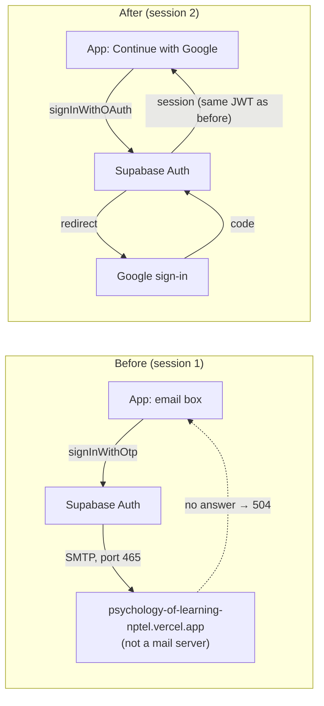
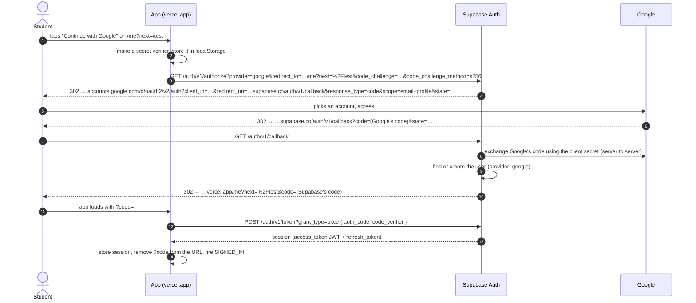

# L2.07c · Google sign-in, line by line (and why email codes went away)

> **Level 2 · Build it** · Lesson 9 of 18 · *Session 2: the day sign-up returned a 504*

| Recipe card | |
|---|---|
| **Time** | 75 min |
| **You need** | L2.07a (`AuthProvider`, the three account screens, `?next`), L2.04 (`supabase.ts`, `friendlyError`), L1.04 §5 (sessions and JWTs) |
| **You'll produce** | The Google Cloud and Supabase settings for Google sign-in; `src/lib/supabase.ts` (client options + one new error rule); `SignIn` and `GoogleLogo` in `src/pages/Account.tsx` (lines 67–122 and 286–295); the sign-in link on the Test page |

**In two sentences:** A friend tried to sign up and got an **HTTP 504**. The email codes from [L2.07a](l2-07a-auth-sign-in.md) depended on an email server that was set up wrong, so the app switched to **"Continue with Google"**, where Google proves who you are and Supabase turns that proof into the same kind of session the rest of the app already used. This lesson builds that switch from the dashboards down to the last line, and removes everything that only existed for email codes.

> **What changed in the series.** Before this session, the app signed people in with emailed 8-digit codes ([L2.07a](l2-07a-auth-sign-in.md)). Since this session it is **Google-only**, and the Email provider is switched off in Supabase. L2.07a still teaches `AuthProvider` (unchanged) and stays worth reading for its bugs, but its `SignIn` code is history. This lesson is the current `SignIn`.

### Objectives
1. Configure Google sign-in end to end from memory: the Google Cloud OAuth client (branding, authorised domains, audience, redirect URI) and the Supabase settings (Google provider, Site URL, redirect allow-list, Email off), in the right order with the right values.
2. Write `SignIn`: `signInWithOAuth` with a `redirectTo` that keeps `?next`, a busy state, and clean handling of `?error=…` returns.
3. Explain what `detectSessionInUrl: true` and `flowType: "pkce"` do, and the symptom you'd see without each.
4. Trace one sign-in through the six hops of the redirect chain, naming each URL and who handles it.
5. Diagnose "Invalid domain: must be a top private domain" and "Access blocked: Authorisation error · Error 400: invalid_request".

---

## 1 · Warm-up: pull it from memory

1. *(L2.07a)* The account page shows one of three screens. Which three, and what decides which one?
2. *(L2.07a)* What does `/me?next=/test` do once the user is fully set up?
3. *(L2.04)* With `persistSession: true`, where does supabase-js keep the session, and why does that matter after a reload?
4. *(L2.07a)* In session 1, why could nobody sign in for a while?

<details><summary>Answers</summary>

1. `SignIn` (no session), `ChooseName` (session but no profile row), `Me` (both). Chosen purely from `session` and `profile` in `AuthProvider`.
2. An effect in `Account` calls `nav(next, { replace: true })` when `session && profile && next`, so the student lands back on the test page.
3. In `localStorage`, under the key `sb-<project-ref>-auth-token`. After a reload, `getSession()` reads it back, so the user stays signed in. You'll use this exact key in [L4.09](l4-09-auth-tests-incident-ops.md).
4. The project sent 8-digit codes and the app truncated input to 6, so every verify returned `otp_expired`.
</details>

---

## 2 · The problem this solves

The session started with three words from the user: **"what http 504"**. A friend had tried to sign up and got a *504 Gateway Timeout*. [L3.06](l3-06-oauth-pkce-504.md) tells the full diagnosis. The short version:

- Sign-up with an email code means Supabase must **send an email** before it answers.
- The project's custom SMTP settings (SMTP = the protocol mail servers use to hand over email) pointed at **the app's own website**, `psychology-of-learning-nptel.vercel.app`, on port 465. A website host doesn't run a mail server, so every connection attempt hung until a gateway in front of Supabase gave up: **504**.
- While investigating, a probe request came back `429 over_email_send_rate_limit`: the hourly email quota was used up as well. The project had **0 users**.

Two fixes were on the table: set up a real email service (Brevo, Gmail SMTP), or stop sending email at all. Email delivery is an ongoing job: quotas, spam folders, sender verification, one more dashboard to keep right. Google sign-in has none of that. The user chose Google, then asked for **Google only** after the email fallback kept failing (Incident 1 in §8).


*Takeaway: everything after sign-in (names, progress sync, ranked tests, RLS) is untouched, because Google sign-in ends with exactly the same Supabase session that email codes did.*

---

## 3 · Concepts

### 3.1 OAuth sign-in, with Supabase as the broker

1. **Definition.** OAuth sign-in ("Sign in with Google") lets a trusted provider confirm who someone is, so your app never handles a password.
2. **Why here.** It removes the email server from the sign-in path, which was the thing that broke.
3. **How it works.** Think of a club. Google is the government office that issues ID cards. Supabase is the bouncer: it checks your ID card once, then puts **its own wristband** on you (a Supabase session with a JWT). Inside the club (our app and its database), staff only look at wristbands. They never see the ID card.
   - The app talks only to Supabase. It never receives a Google token or a password.
   - Supabase talks to Google with a **client ID** (public) and a **client secret** (private, stored only in the Supabase dashboard).
   - The result is a normal Supabase session, so `auth.uid()`, RLS and every policy from [L2.02](l2-02-tables-and-rls.md) work unchanged.
4. **Minimal example** (outside the project, any supabase-js v2 client):
   ```ts
   await supabase.auth.signInWithOAuth({ provider: "google" }); // browser leaves for Google
   ```
5. **In this project:** `Account.tsx` line 88, with a `redirectTo` (§5.2).
6. **Without it:** you're back to sending email, or storing passwords.
7. **Try it (2 min):** open the live site in a private window, tap **Me → Continue with Google**, and watch the address bar change domains: our site → `kehcsupmruaskpgdvzaj.supabase.co` → `accounts.google.com` → Supabase again → our site.

### 3.2 The redirect chain: six hops

Every sign-in is a relay race of browser redirects. Learn the hops; they're how you debug every OAuth problem.


*Takeaway: there are **two different codes**. Google's code goes only to Supabase. Supabase's own code comes back to the app, and only the browser tab that holds the verifier can exchange it.*

The hop-3 response is real. This is what `curl` showed during the session (`Location` header of the 302, one parameter per line):

```text
https://accounts.google.com/o/oauth2/v2/auth?client_id=182547289278-qo0utv8esu3gg4ag1epvfvas7ufa4ks6.apps.googleusercontent.com
redirect_to=https%3A%2F%2Fpsychology-of-learning-nptel.vercel.app%2Fme
redirect_uri=https%3A%2F%2Fkehcsupmruaskpgdvzaj.supabase.co%2Fauth%2Fv1%2Fcallback
response_type=code
scope=email+profile
state=c77e7cb5-9457-4abd-bf41-99e49b5f21fa
```
- **`client_id`** is public by design; it names our OAuth client in Google Cloud.
- **`redirect_uri`** must match, character for character, one of the "Authorised redirect URIs" in Google Cloud. Ours is Supabase's callback, not our website.
- **`scope=email profile`** asks for the email address and the basic profile (name, photo). Nothing else.
- **`state`** is a one-time random value Supabase checks when Google comes back, so a forged callback is rejected ([L3.06](l3-06-oauth-pkce-504.md) §3.3).

### 3.3 PKCE in one paragraph

**PKCE** (Proof Key for Code Exchange, said "pixie") protects hop 7→8. Before leaving, the app invents a long random secret, the **code verifier**, keeps it in `localStorage`, and sends only its **hash** (the *code challenge*) to Supabase. When the app later trades Supabase's code for a session, it must present the verifier itself; Supabase hashes it and compares. Anyone who steals the code from the URL (a browser extension, a log, a shoulder) still can't use it without the verifier. The maths, real numbers and attack are in [L3.06](l3-06-oauth-pkce-504.md) §3.4.

### 3.4 `detectSessionInUrl`: finishing the sign-in on page load

- **What:** a supabase-js option. When `true`, the client looks at the URL as it starts up. If it sees `?code=…` (PKCE) it exchanges the code for a session, then deletes `code` from the address bar with `history.replaceState`.
- **Why it was `false`:** in session 1, codes were typed into a box, never delivered in the URL, so there was nothing to detect.
- **What breaks with `false`:** Google sign-in "does nothing". The student returns to `/me?next=%2Ftest&code=…`, the code sits there unused, and they still see "Continue with Google".
- **Where it runs:** inside `createClient`, before React renders anything. That's why no app code handles `?code` at all; `AuthProvider`'s `getSession()` waits for that start-up work and then returns the new session.

### 3.5 Redirect allow-lists: Site URL and Redirect URLs

Supabase refuses to send people (and their codes) to arbitrary websites. In **Authentication → URL Configuration**:
- **Site URL** is the default destination, used when no `redirect_to` is given or when the given one isn't allowed.
- **Redirect URLs** is the allow-list. `https://psychology-of-learning-nptel.vercel.app/**` allows any path and query on our site; `http://localhost:5173/**` allows the dev server.

If `redirect_to` doesn't match, sign-in still works but the student lands on the Site URL (the home page) instead of where they were going. That's the only visible symptom, which makes it easy to miss.

### 3.6 When the student says no

If the student cancels on Google's screen, the chain ends with the error in the query string instead of a code, for example `/me?next=%2Ftest&error=access_denied&error_description=…`. The app must (a) say something human, and (b) clean the URL so a reload doesn't show the error again. That's lines 73–81 of `Account.tsx`.

---

## 4 · Setting it up: the dashboards (no file can do this)

Do these in this order. Each row says what breaks if you skip it.

**Google Cloud Console** (console.cloud.google.com), in a project of its own:

| # | Where | Set | What breaks without it |
|---|---|---|---|
| 1 | Google Auth Platform → **Branding** | App name, user support email, developer email. Leave the logo empty (a logo triggers Google's verification review) | You can't create a client |
| 2 | Branding → **Authorised domains** | `kehcsupmruaskpgdvzaj.supabase.co` and `psychology-of-learning-nptel.vercel.app` (not `supabase.co`, not `vercel.app`: Incident 3) | Any URL on the consent screen or in the client that uses an unlisted domain is refused |
| 3 | **Audience** | User type **External**; publishing status **In production** | In *Testing*, only listed test users can sign in; everyone else is blocked |
| 4 | **Clients** → Create client → **Web application** | Authorised redirect URI: `https://kehcsupmruaskpgdvzaj.supabase.co/auth/v1/callback` | `Error 400: redirect_uri_mismatch` on Google's page |
| 5 | (same dialog) | Copy the **Client ID** and **Client secret** | — |

No "Authorised JavaScript origins" are needed: our JavaScript never calls Google directly. The browser only ever *navigates* to Google.

**Supabase dashboard** (project `kehcsupmruaskpgdvzaj`):

| # | Where | Set | What breaks without it |
|---|---|---|---|
| 6 | Authentication → Sign In / Providers → **Google** | Enable; paste Client ID and Client secret | The button navigates to Supabase, which answers with a JSON error ("Unsupported provider: provider is not enabled") instead of redirecting to Google |
| 7 | Authentication → **URL Configuration** | Site URL `https://psychology-of-learning-nptel.vercel.app`; Redirect URLs `https://psychology-of-learning-nptel.vercel.app/**` and `http://localhost:5173/**` | Students land on the home page instead of `/me?next=…` |
| 8 | Authentication → Sign In / Providers → **Email** | **Off** | Anyone can still call `/auth/v1/otp` directly and hit the broken email path |
| 9 | Authentication → Emails → SMTP (optional tidy-up) | Custom SMTP off | Nothing (with Email off it's unused), but it keeps a wrong setting around |

**The client secret is a secret.** It lives only in the Supabase dashboard. It never goes in the repo, in `.env.local`, or in any `VITE_` variable (those are baked into the public JavaScript bundle, [L2.04](l2-04-entry-config-libs.md)).

**Check the setup from a terminal** (the publishable key is public, [L1.04](l1-04-data-auth-hosting.md) §5.3):

```bash
U=https://kehcsupmruaskpgdvzaj.supabase.co
K=$(grep VITE_SUPABASE_ANON_KEY .env.local | cut -d= -f2)    # value only, never echo it
curl -s -H "apikey: $K" "$U/auth/v1/settings" | grep -o '"google":[a-z]*\|"email":[a-z]*'
```
```text
"google":true
"email":false
```
```bash
# Where does the authorize endpoint send a browser? (-w prints the Location header of the 302)
curl -s -o /dev/null -w "HTTP %{http_code} -> %{redirect_url}\n" -H "apikey: $K" \
  "$U/auth/v1/authorize?provider=google&redirect_to=https://psychology-of-learning-nptel.vercel.app/me"
```
```text
HTTP 302 -> https://accounts.google.com/o/oauth2/v2/auth?client_id=182547289278-…&redirect_to=…&redirect_uri=…&response_type=code&scope=email+profile&state=…
```
- `-s` silent, `-o /dev/null` throw the body away, `-w` print chosen fields after the request (`%{http_code}`, `%{redirect_url}`).
- Following that URL with `curl -L` and a browser user agent ended on Google's normal "Sign in – Google Accounts" page, not an error page. That one check proves the client ID exists and the redirect URI is registered.

---

## 5 · Reading the real code

### 5.1 `src/lib/supabase.ts` (the whole file, 25 lines)

```ts
import { createClient } from "@supabase/supabase-js";

const url = import.meta.env.VITE_SUPABASE_URL as string | undefined;
const key = import.meta.env.VITE_SUPABASE_ANON_KEY as string | undefined;

export const isConfigured = Boolean(url && key);

export const supabase = createClient(url ?? "http://localhost", key ?? "missing", {
  // detectSessionInUrl: finish Google sign-in when Supabase redirects back with ?code=…
  auth: { persistSession: true, autoRefreshToken: true, detectSessionInUrl: true, flowType: "pkce" },
});

/** Turn Supabase / Postgres errors into something a student can act on. */
export function friendlyError(e: unknown): string {
  const msg = (e as { message?: string })?.message ?? String(e);
  const code = (e as { code?: string })?.code;
  const status = (e as { status?: number })?.status;
  if (code === "PGRST202" || /function .* does not exist|Could not find the function/i.test(msg))
    return "The database isn't set up yet. Run supabase/setup.sql in the Supabase SQL editor.";
  if (code === "23505") return "That name is taken. Try another.";
  if (/rate limit|too many/i.test(msg)) return "Too many attempts. Please wait a minute and try again.";
  if (/Failed to fetch|NetworkError/i.test(msg)) return "You seem to be offline. Check your connection.";
  if (status && status >= 500) return "Sign-in is having trouble right now. Please try again in a minute.";
  return msg;
}
```
Line notes (only what changed this session; the rest is in [L2.04](l2-04-entry-config-libs.md)):
- **`detectSessionInUrl: true`** (was `false`): finish the sign-in when the page loads with `?code=` (§3.4). *Breaks if `false`:* returning from Google leaves you signed out.
- **`flowType: "pkce"`**: use the code-plus-verifier flow (§3.3). The alternative, `"implicit"`, puts the access token itself in the URL fragment (`#access_token=…`), where browser history and extensions can read it. *Breaks if removed:* nothing visible. auth-js's default is `flowType: 'implicit'` (in its `DEFAULT_OPTIONS`), so sign-in would still work, but less safely.
- **`const status = …?.status`**: supabase-js auth errors carry the HTTP status. For any status in its list of server and gateway errors (500–504 and Cloudflare's 520–530), auth-js throws an `AuthRetryableFetchError` with that `status`. Its `message` is whatever the gateway sent: a bare `Gateway Timeout`, `HTTP 504` (HTTP/2 has no reason phrase), or a JSON dump. None of those help a student.
- **`if (status && status >= 500)`**: any server-side failure (500, 502, 503, 504) gets one human sentence. It sits **after** the offline check on purpose: "Failed to fetch" has no status and means *your* connection; a 5xx means *ours*. *Breaks if removed:* students saw raw or empty error text.
- **Deleted line:** `if (/Token has expired or is invalid|otp/i.test(msg)) return "That code is wrong or has expired…"`. No codes are typed any more, and the loose `/otp/` pattern could have relabelled unrelated errors.

### 5.2 `Account.tsx`: `SignIn` (lines 67–122)

```tsx
/* ---------------- Google sign-in ---------------- */
const OAUTH_ERROR_PARAMS = ["error", "error_code", "error_description"];

function SignIn() {
  const [params, setParams] = useSearchParams();
  const [busy, setBusy] = useState(false);
  // Supabase sends people back with ?error=… if they cancel on Google's screen
  const [err, setErr] = useState<string | null>(() => (params.has("error") ? "Google sign-in didn't finish. Please try again." : null));
```
- **`OAUTH_ERROR_PARAMS`**: the three names an OAuth error return can carry. Kept at module level because it never changes; a new array per render would be harmless but noisy.
- **`useSearchParams()`** returns the current query (`URLSearchParams`) and a setter that updates the URL through React Router ([L2.05](l2-05-app-shell.md)), so the router and the address bar stay in sync.
- **`useState(() => …)`**: a *lazy initialiser* runs once, on the first render. The error message is decided from the URL the component was born with. Later URL changes (our own cleanup below) don't reset it, which is exactly what we want: clean the URL, keep the message.
- **Why a fixed message and not `error_description`?** The URL is attacker-controllable: anyone can send a link like `/me?error=x&error_description=Your account is suspended, call …`. React would escape it (no script injection), but the app would still be displaying a stranger's sentence. A fixed message can't be abused.

```tsx
  useEffect(() => {
    if (!OAUTH_ERROR_PARAMS.some((k) => params.has(k))) return;
    const p = new URLSearchParams(params);
    OAUTH_ERROR_PARAMS.forEach((k) => p.delete(k));
    setParams(p, { replace: true });
  }, [params, setParams]);
```
- **Early return** when there's nothing to clean, so the effect is a no-op on normal visits. Without it, `setParams` would run on every params change and could loop.
- **`new URLSearchParams(params)`** copies the params. Mutating the object React Router gave you would change state behind its back.
- **Only the error keys are deleted**, so `next=/test` survives: after a cancelled attempt, the next successful one still returns the student to the test page.
- **`replace: true`** swaps the history entry instead of pushing a new one. *If you push:* the Back button returns to the error URL and the message appears again.
- **Order of events on an error return:** first render → lazy initialiser sets `err` → effect removes the keys → re-render with clean params; `err` stays because state isn't re-initialised.

```tsx
  const google = async () => {
    setBusy(true);
    setErr(null);
    const next = params.get("next");
    const redirectTo = `${window.location.origin}/me${next ? `?next=${encodeURIComponent(next)}` : ""}`;
    const { error } = await supabase.auth.signInWithOAuth({ provider: "google", options: { redirectTo } });
    // on success the browser is already leaving for Google, so stay "busy"
    if (error) {
      setBusy(false);
      setErr(friendlyError(error));
    }
  };
```
- **`setBusy(true)` first**: the button disables at once, so a double tap can't start two flows (each start generates and stores a new verifier).
- **`window.location.origin`**: `https://psychology-of-learning-nptel.vercel.app` in production, `http://localhost:5173` in dev, `http://127.0.0.1:4174` under the Playwright build server. One line works everywhere, which is why both origins are in the Supabase allow-list.
- **`/me` as the landing path**: the account page is where `ChooseName` lives. A brand-new Google user has a session but no profile, so they must see the name step before going anywhere.
- **`encodeURIComponent(next)`**: `next` itself is a path (`/test`) going inside another URL's query. Encoded, `/test` becomes `%2Ftest`. Unencoded, characters like `&` in a future `next` value would split into separate parameters. The test in [L4.09](l4-09-auth-tests-incident-ops.md) asserts the exact string `/me?next=%2Ftest`.
- **`signInWithOAuth`** builds the authorize URL locally (generating and storing the PKCE verifier) and then calls `window.location.assign(url)`. It makes **no network request** itself. The promise resolves **before** the page unloads, with `error: null`.
- **No `setBusy(false)` on success:** the page is about to be replaced. Re-enabling the button would invite a second tap during the navigation, and the text "Opening Google…" tells the student something is happening on slow phones.
- **On error**: rare, because nothing has touched the network yet (for example, storage throws in a locked-down browser). Undo busy and show a friendly message. Server-side problems, like a disabled provider, show up *after* the navigation, as an error page from Supabase.

```tsx
  return (
    <div>
      <div className="auth-hero">
        <motion.img src="/brand/badge-hex.webp" width={128} height={180} alt="Coffee aur Code" initial={{ y: 20, opacity: 0, rotate: -6 }} animate={{ y: 0, opacity: 1, rotate: 0 }} transition={{ type: "spring", stiffness: 200, damping: 16 }} />
      </div>
      <motion.div initial={{ y: 12, opacity: 0 }} animate={{ y: 0, opacity: 1 }} className="stack">
        <div style={{ textAlign: "center" }}>
          <h1 className="display" style={{ fontSize: "1.8rem", margin: "8px 0 6px" }}>
            Pull up a chair
          </h1>
          <p className="muted" style={{ margin: 0 }}>
            Sign in to save progress, take ranked tests and get on the leaderboard.
          </p>
        </div>
        <button className="btn primary block" disabled={busy} onClick={google}>
          <GoogleLogo /> {busy ? "Opening Google…" : "Continue with Google"}
        </button>
        {err && <div className="err">{err}</div>}
        <p className="muted" style={{ fontSize: ".8rem", textAlign: "center", margin: 0 }}>
          New here? This creates your account with your Google email.
        </p>
        <PrivacyNote />
      </motion.div>
      <Preferences />
    </div>
  );
}
```
- **The badge animation** is unchanged from L2.07a (a spring from below with a slight rotation).
- **One `motion.div` instead of `AnimatePresence` with two steps:** there is only one step now, so the email→code slide (and its `key`s) went away.
- **"Pull up a chair"** is kept on purpose: the tests (`ROUTES` in `ui.spec.ts`, the sign-out check in `auth.spec.ts`) use it to recognise the signed-out account page.
- **`btn primary block`**: the only action on the screen gets the primary style. The Google "G" keeps its own colours on top.
- **Accessible name:** the SVG is `aria-hidden`, so a screen reader (and Playwright's `getByRole("button", { name: /Continue with Google/ })`) reads only the text.
- **"New here? This creates your account…"**: there is no separate sign-up. The first Google sign-in creates the Supabase user.
- **`<Preferences/>`** keeps the theme switch available while signed out.

### 5.3 `GoogleLogo` and the wording changes

```tsx
function GoogleLogo() {
  return (
    <svg width="20" height="20" viewBox="0 0 48 48" aria-hidden="true">
      <path fill="#FFC107" d="M43.6 20.1H42V20H24v8h11.3C33.7 32.7 29.2 36 24 36c-6.6 0-12-5.4-12-12s5.4-12 12-12c3.1 0 5.8 1.2 8 3l5.7-5.7C34 6.1 29.3 4 24 4 13 4 4 13 4 24s9 20 20 20 20-9 20-20c0-1.3-.1-2.6-.4-3.9z" />
      <path fill="#FF3D00" d="m6.3 14.7 6.6 4.8C14.7 15.1 19 12 24 12c3.1 0 5.8 1.2 8 3l5.7-5.7C34 6.1 29.3 4 24 4 16.3 4 9.7 8.3 6.3 14.7z" />
      <path fill="#4CAF50" d="M24 44c5.2 0 9.9-2 13.4-5.2l-6.2-5.2C29.2 35.1 26.7 36 24 36c-5.2 0-9.6-3.3-11.3-7.9l-6.5 5C9.5 39.6 16.2 44 24 44z" />
      <path fill="#1976D2" d="M43.6 20.1H42V20H24v8h11.3c-.8 2.2-2.2 4.2-4.1 5.6l6.2 5.2C37 39.2 44 34 44 24c0-1.3-.1-2.6-.4-3.9z" />
    </svg>
  );
}
```
- **Inline SVG, not an image file:** no extra request, sharp at any size, and no third-party script. (Google's own sign-in button library would load a script from Google on every visit.)
- **`viewBox="0 0 48 48"` with `width/height="20"`**: drawn on a 48-unit grid, displayed at 20 px ([L2.06b](l2-06b-mug-icons-home.md) explains viewBox scaling).
- **Four paths, four brand colours**: yellow arc, red top arc, green bottom arc, blue bar. The paths overlap; the later ones paint over the yellow base.
- **`aria-hidden="true"`**: decoration only; the button's text carries the meaning.

**Wording elsewhere** (each changed for accuracy, not taste):

| File | Before | After | Why |
|---|---|---|---|
| `Account.tsx` `ChooseName` | Use a different email | Use a different account | There's no email to change; it signs out so you can pick another Google account |
| `Account.tsx` `Me` → "What we store" | Your email, leaderboard name, … | Your Google email, the name and photo Google shares, your leaderboard name, … | Supabase saves Google's name and avatar URL in the user's metadata. Saying so is honest |
| `Test.tsx` intro | ✉ Sign in with email to start · "We'll email you a sign-in code." | Sign in to start → · "One tap with Google. No password." | The link goes to `/me?next=/test`, whatever the method |

`Test.tsx` lines 148–154 now read:
```tsx
<Link to="/me?next=/test" className="btn primary block">
  Sign in to start <Icon name="arrow" size={19} />
</Link>
<p className="muted" style={{ textAlign: "center", fontSize: ".85rem", margin: 0 }}>
  One tap with Google. No password.
</p>
```
- The label no longer names a method, so a future provider change won't make the button lie again. The arrow icon moved after the text: it now means "go", not "mail".

### 5.4 What was deleted, and why deleting matters

The change touched 11 files: **+99 lines, −189 lines**. Everything that existed only for email codes went:

| Removed | Was in | Why it had to go |
|---|---|---|
| `OTP_LENGTH`, `OTP_MIN`, `OTP_MAX`, `useRef` import | `Account.tsx` | No code input |
| The email step, the code step, `send`, `verify`, `onCode`, the resend cooldown | `Account.tsx` | Replaced by one button |
| `.otp` styles (and the ≤ 360 px override) | `styles.css`, `responsive.css` | Dead CSS still ships to every visitor |
| `VITE_OTP_LENGTH` | `.env.example` | A setting that does nothing confuses the next developer |
| `supabase/email-otp-template.html` | repo | Pasting it into Supabase would now be pointless |
| The "wrong or expired code" error rule | `supabase.ts` | See §5.1 |

The test helpers `otpFor` and `signedInClient` **stayed**: the tests still use admin-minted codes to create signed-in throwaway users, and that keeps working with the Email provider off ([L4.09](l4-09-auth-tests-incident-ops.md) §8).

---

## 6 · Worked trace (step-through frames): a new student, from the test page to their name

Real values from the production site. Cover the right column, predict, then reveal row by row.

| Frame | Event | State after | Predict first → |
|---|---|---|---|
| 1 | On `/test`, signed out, taps **Sign in to start** | URL `/me?next=/test`; `Account` renders `SignIn` (no session) | Which component decides the screen? **`Account`, from `session`/`profile`** |
| 2 | Taps **Continue with Google** | `busy = true`; button text "Opening Google…"; `redirectTo = "https://psychology-of-learning-nptel.vercel.app/me?next=%2Ftest"` | How is `/test` written inside `redirectTo`? **`%2Ftest`** |
| 3 | `signInWithOAuth` runs | A 112-character verifier saved in `localStorage` under `sb-kehcsupmruaskpgdvzaj-auth-token-code-verifier`; its 43-character challenge goes in the URL; `location.assign(…/auth/v1/authorize?provider=google&redirect_to=…&code_challenge=…&code_challenge_method=s256)` | Does the verifier leave the browser now? **No, only its hash** |
| 4 | Supabase answers 302 → Google | The address bar shows `accounts.google.com`; `redirect_uri` is Supabase's callback | Whose URL must be in Google's redirect URI list? **Supabase's callback** |
| 5 | Student picks an account | Google 302 → `…supabase.co/auth/v1/callback?code=…&state=…` | Who uses Google's code? **Supabase, with the client secret** |
| 6 | Supabase finishes with Google | New row in `auth.users` (provider `google`); 302 → `…vercel.app/me?next=%2Ftest&code=…` | Is the student signed in yet? **Not in the app: the code isn't exchanged yet** |
| 7 | The app's JavaScript loads; `createClient` sees `?code` | `POST /auth/v1/token?grant_type=pkce` with the code and the stored verifier → session saved under `sb-kehcsupmruaskpgdvzaj-auth-token`; `code` removed from the URL | What if `detectSessionInUrl` were `false`? **Nothing happens; still signed out** |
| 8 | `AuthProvider`: `getSession()` returns the session; `fetchProfile` → `null` | `session` set, `profile = null`, `ready = true` | Which screen? **`ChooseName`** ("You're in! ☕") |
| 9 | Student saves "Espresso Ana" ([L2.07b](l2-07b-account-progress.md)) | `profile = { display_name: "Espresso Ana" }` | Where do they go? **`/test`, via the `next` effect with `replace: true`** |

An existing user skips frame 9: `fetchProfile` finds their row, and the `next` effect fires as soon as frame 8 finishes.

---

## 7 · Running and testing

```bash
npm run build                      # tsc -p . && vite build; type errors fail here
npx playwright test tests/e2e/ui.spec.ts -g "sign|Google" --project=pixel-7
```

Two UI tests cover this lesson's code (both walked line by line in [L4.09](l4-09-auth-tests-incident-ops.md)):
- **"signed-out visitors are sent to sign in before a ranked test"**: the Test page link goes to `/me?next=/test`, the Google button is visible, and there is **no** email field (`getByLabel("Email")` has count 0).
- **"Continue with Google hands off to Supabase and returns to where they were going"**: intercepts the request to `/auth/v1/authorize`, then checks `provider=google`, `redirect_to` ending `/me?next=%2Ftest`, and a `code_challenge`. Then it loads `/me?next=/test&error=access_denied&error_description=cancelled` and checks the friendly message and the cleaned URL.

What the session measured:

| Run | Result |
|---|---|
| Full suite with Google added (email still as fallback) | **247 passed**, 17 skipped, 13.6 min |
| Sign-in-related tests after email removal (`-g "sign\|Google\|Pull up\|a11y\|axe\|routes\|/me\|account"`) | **90 passed**, 7.3 min |
| Full suite after email removal | **246 passed, 1 flaky**, 17 skipped, 14.1 min |
| `api-security.spec.ts` after turning the Email provider **off** | **13 passed** |

**Manual check (do it once per deploy that touches auth):** private window → live site → Me → Continue with Google → pick an account → you should land on "You're in! ☕" (first time) or your account page. Then check the user exists: Supabase → Authentication → Users, provider "google".

**Common failures:**

| You see | Look at |
|---|---|
| `Error 400: redirect_uri_mismatch` on Google | Google client's redirect URI vs `https://<ref>.supabase.co/auth/v1/callback` |
| Back on the site but still signed out | `detectSessionInUrl`; a different browser finished the flow than started it ([L3.06](l3-06-oauth-pkce-504.md) §3.7) |
| Signed in but landed on the home page | Supabase Redirect URLs allow-list |
| "Access blocked" for some accounts only | Audience still *Testing*; supervised or school accounts; see Incident 2 |

---

## 8 · Bug journal

### Incident 1 · The email fallback said "Sign-in is having trouble right now"

1. **Symptom.** After Google sign-in shipped with email kept behind a "Use email instead" link, the user tried email with their own address and sent a screenshot:
   ```text
   Email   (the user's own Gmail address)
   Sign-in is having trouble right now. Please try again in a minute.
   [ Email me a code → ]
   ‹ Back to Google sign-in
   ```
2. **Diagnosis.** That sentence is the new `status >= 500` rule in `friendlyError`, so the server had failed (it was the 504 again). Nothing about email had been fixed: the SMTP host still pointed at the website. The fallback was a path we knew was broken, now with a better-worded error.
3. **Root cause.** A fallback that is never exercised is not a fallback. It added a second way to fail, and the friendlier error made the failure look temporary ("try again in a minute") when it was permanent.
4. **Fix.** The user's call: **"remove the option to use email, only keep google sign in"**, then **"make sure from every where … only google sign in"**.
   ```diff
   - const [step, setStep] = useState<"start" | "email" | "code">("start");
   - … the email form, the code form, send(), verify(), onCode() …
   - <button className="btn sm ghost block">✉ Use email instead</button>
   + <button className="btn primary block" disabled={busy} onClick={google}>   {/* the only way in */}
   ```
   Plus the server side: Supabase → Providers → **Email off**. Afterwards a direct API call is refused before any email is attempted:
   ```text
   {"code":422,"error_code":"email_provider_disabled","msg":"Email logins are disabled"}
   ```
5. **Lesson.** Every path you ship must be one you've seen work end to end. Turning off a method means turning it off **where it's enforced** (the auth server), not only hiding its button. A test now asserts there is no email field.

### Incident 2 · "Access blocked: Authorisation error" for one friend

1. **Symptom.** A phone photo of a laptop showed Google's error page in Edge:
   ```text
   Access blocked: Authorisation error
   Something went wrong during this authorisation request. Please try again.
   If you are a developer of psychology-of-learning, see error details.
   Error 400: invalid_request
   ```
   The address bar read `accounts.google.com/signin/oauth/error?authError=Cg9pbnZhbGlkX3JlcXVlc3QkAM&flowName=GeneralOAuthFlow&client_id=182547289278…`.
2. **Diagnosis.**
   - Is our setup broken for everyone? The `curl -L` check (§4) reached Google's normal account chooser, so the client ID and redirect URI were accepted. And the user table showed other people signing in with Google within minutes of this error. So: not broken for everyone.
   - What does `authError` say? It's base64. Decoded, the bytes are `0a 0f "invalid_request" 24 00`: a protobuf field (tag `0a`, length 15) holding the same text as the page. No extra detail.
   - What was different about this attempt? Two things were in flux: the authorised domains were incomplete (Incident 3 was being fixed at that moment), and Google warns that OAuth settings "may take 5 minutes to a few hours" to apply. Account restrictions (a Family Link supervised account, or a school or work account under an admin policy) can also block one account while others work.
   - The page's **"error details"** link shows Google's exact reason. That was the next thing to ask for.
3. **Root cause.** **Not confirmed.** The friend tried again later and it worked. By then the authorised domains were fixed and some time had passed, so the most likely causes are the incomplete domain list or settings that hadn't applied yet.
4. **Fix.** No code change. Authorised domains completed (Incident 3); the friend was told to retry in Chrome (not inside WhatsApp or Instagram) and, if blocked again, to tap "error details" and share a screenshot.
5. **Lesson.** For "works for some, not others", compare against the people it works for before changing code. Your two best instruments are a `curl` of your own redirect chain and the auth users table. And when a provider offers "error details", get them before guessing.

### Incident 3 · "Invalid domain: must be a top private domain"

1. **Symptom.** Following advice to add `supabase.co` to Google's **Authorised domains**, the console refused it, and `vercel.app` too:
   ```text
   Authorized domain 1 *   supabase.co
   ⓘ Invalid domain: must be a top private domain
   ```
2. **Diagnosis.** The advice (from the assistant in this session) was wrong. Google wants a domain *one organisation* controls. `supabase.co` and `vercel.app` are shared by thousands of unrelated projects.
3. **Root cause.** Both are on the **Public Suffix List** (in its "private domains" section, where hosting companies list domains they hand out to customers). For Google, browsers and cookie rules they behave like `.com`: nobody "owns" them, so they can't be authorised. The *top private domain* is the public suffix plus one more label: `kehcsupmruaskpgdvzaj.supabase.co` and `psychology-of-learning-nptel.vercel.app`. The mechanics are in [L3.06](l3-06-oauth-pkce-504.md) §3.6.
4. **Fix.**
   ```diff
   - Authorized domain 1: supabase.co                                  (rejected)
   - Authorized domain 1: vercel.app                                   (rejected)
   + Authorized domain 1: kehcsupmruaskpgdvzaj.supabase.co             (our Supabase project)
   + Authorized domain 2: psychology-of-learning-nptel.vercel.app      (our site)
   ```
5. **Lesson.** On shared hosting you own a subdomain, not the domain. Check suspicious "parent" domains against publicsuffix.org before adding them anywhere that asks for a domain you control.

### Incident 4 · A scripted edit that silently did nothing (CRLF)

1. **Symptom.** A small Node script spliced the new `SignIn` into `Account.tsx` and also removed the OTP constants with a regex. The splice worked, but a grep right after showed the constants were still there:
   ```text
   12:// Supabase "Email OTP length" (Auth → Providers → Email). This project uses 8.
   14:const OTP_LENGTH = Number(import.meta.env.VITE_OTP_LENGTH ?? 8);
   ```
2. **Diagnosis.** The pattern ended in `const OTP_MAX = 10;\n`. `file src/pages/Account.tsx` reported `with CRLF line terminators`: every line ends `\r\n`, so `10;\n` never matched. `String.replace` with a non-matching regex returns the string unchanged, with no error.
3. **Root cause.** Windows line endings (`\r\n`) versus a pattern written for Unix endings (`\n`), plus an API that fails silently.
4. **Fix.** The block was removed with an exact-match edit instead. In a regex, write `\r?\n` for "end of line" on files of either style.
5. **Lesson.** After any scripted edit, **assert** the change: grep for what should be gone, and run the build. Know your files' line endings (`file name`, or VS Code's status bar "CRLF/LF").

---

## 9 · Why this design

| Decision | Alternatives | Why this one | Trade-off | Choose differently when |
|---|---|---|---|---|
| Google-only sign-in | Email codes with working SMTP (Brevo, Gmail); both methods | No email to deliver; one tap; most students have Google accounts | Students without (or unwilling to use) Google can't sign in | A real audience lacks Google accounts → fix SMTP and offer both |
| Supabase brokers Google (`signInWithOAuth`) | Google Identity Services (One Tap) + `signInWithIdToken`; your own OAuth server code | No Google script on the page; same session type as before; Supabase keeps the client secret | Several full-page redirects | You want One Tap's in-page prompt |
| PKCE flow | Implicit flow (token in `#fragment`) | A stolen code is useless without the verifier; no token in the URL | The tab that started must finish | — (PKCE is the current recommendation, RFC 9700) |
| Full-page redirect | Popup (`skipBrowserRedirect: true` + `window.open`) | Works on phones and in every browser; no popup blockers | The SPA reloads; in-memory state is lost (ours lives in storage, so nothing is lost) | A long unsaved form on the page |
| Keep the `ChooseName` step | Use Google's display name automatically | Real names stay off a public leaderboard | One extra screen | A private, invite-only class |
| Fixed error text | Show `error_description` | URL text is attacker-controlled | Less detail on screen | A developer-only debug page |
| Turn Email off in Supabase | Only hide the UI | Enforced where it counts; ends the 504 path | Tests can't use the Email OTP flow in the UI (they never needed to) | — |

---

## 10 · Check yourself

**Q1.** A student returns from Google to `/me?next=%2Ftest&code=8d3…` and still sees "Continue with Google". Most likely cause?
- a) The Google client secret is wrong
- b) `detectSessionInUrl` is `false`
- c) `?next` wasn't encoded
- d) The student cancelled

<details><summary>Answer</summary><b>b.</b> The code arrived but nothing exchanged it. (a) would fail at Supabase's callback, before any redirect to our site with a code. (c) affects where you land, not whether you're signed in. (d) returns <code>?error=…</code>, not <code>?code=</code>.</details>

**Q2.** Which URL goes in Google Cloud's "Authorised redirect URIs"?
- a) `https://psychology-of-learning-nptel.vercel.app/me`
- b) `https://kehcsupmruaskpgdvzaj.supabase.co/auth/v1/callback`
- c) `https://accounts.google.com/o/oauth2/v2/auth`
- d) Both a and b

<details><summary>Answer</summary><b>b.</b> Google only ever redirects to Supabase. Our site is Supabase's redirect target, configured in Supabase's allow-list, not Google's. Adding (a) to Google does no harm but no good either; (c) is Google itself.</details>

**Q3.** Why does `google()` not call `setBusy(false)` after a successful `signInWithOAuth`?

<details><summary>Answer</summary>Success means the browser is already navigating to Supabase. Re-enabling the button would allow a second tap mid-navigation (a second flow, a new verifier). The "Opening Google…" label also reassures students on slow connections.</details>

**Q4.** You remove `encodeURIComponent` and `next` is `/test`. What does `redirect_to` look like, and does it still work?

<details><summary>Answer</summary><code>…/me?next=/test</code>. It still works for this value (a slash is legal in a query), but the UI test that expects <code>/me?next=%2Ftest</code> fails, and any future <code>next</code> containing <code>&</code> or <code>#</code> would break the URL. Encoding is the correct general rule.</details>

**Q5.** Signed in fine, but every student lands on the home page instead of the test. What's wrong?

<details><summary>Answer</summary>The <code>redirect_to</code> URL isn't in Supabase's Redirect URLs allow-list, so Supabase used the Site URL. Add <code>https://psychology-of-learning-nptel.vercel.app/**</code>.</details>

**Q6.** Why show "Google sign-in didn't finish" instead of the `error_description` from the URL?

<details><summary>Answer</summary>Anyone can craft a link with any <code>error_description</code>. React would escape it (no script runs), but the page would still display a stranger's words, which is a phishing aid. A fixed message can't be abused.</details>

---

## 11 · Practice

**Easy (10 min).** After signing out, Google signs the same account straight back in. Make Google always show the account chooser.
<details><summary>Hint</summary><code>signInWithOAuth</code> accepts <code>options.queryParams</code>, which are forwarded to Google.</details>
<details><summary>Solution</summary>

```ts
await supabase.auth.signInWithOAuth({
  provider: "google",
  options: { redirectTo, queryParams: { prompt: "select_account" } }, // Google's chooser every time
});
```
Done when: sign out, tap Continue with Google, and the account chooser appears even with one Google account in the browser.
</details>

**Medium (20 min).** Bring back email sign-in behind a build-time flag `VITE_EMAIL_SIGNIN=1`, off by default, for a future where SMTP is fixed.
<details><summary>Hint</summary>Read the flag once at module level, like <code>isConfigured</code>. Render a second, ghost-styled button only when it's on. The server side must change too.</details>
<details><summary>Solution outline</summary>

- `const EMAIL_SIGNIN = import.meta.env.VITE_EMAIL_SIGNIN === "1";` in `Account.tsx`.
- Restore the email/code steps from git history (`git show 94c4a3b:src/pages/Account.tsx`) inside `{EMAIL_SIGNIN && …}`.
- Turn the Supabase Email provider back on **and** fix custom SMTP first ([L3.06](l3-06-oauth-pkce-504.md) has the checklist).
- Update the UI test: with the flag off, `getByLabel("Email")` has count 0.

Done when: the build without the flag is byte-for-byte the same feature set as today, and with the flag an email code arrives in a real inbox.
</details>

**Hard (40 min).** Add GitHub as a second provider without duplicating `google()`.
<details><summary>Hint</summary>Turn <code>google()</code> into <code>signIn(provider: "google" | "github")</code>. GitHub needs its own OAuth app (callback: the same Supabase URL) and its own toggle in Supabase.</details>
<details><summary>Solution outline</summary>

- GitHub → Settings → Developer settings → OAuth Apps → New: Authorization callback URL `https://kehcsupmruaskpgdvzaj.supabase.co/auth/v1/callback`.
- Supabase → Providers → GitHub: client ID and secret.
- Code: `const signIn = async (provider: Provider) => { … signInWithOAuth({ provider, options: { redirectTo } }) … }` with `import type { Provider } from "@supabase/supabase-js"`; two buttons; one `busy` state shared by both.
- Error text: "Sign-in didn't finish" (no longer Google-specific).
- Test: duplicate the hand-off test with `provider=github`.

Done when: both buttons reach their provider's page, and both land on `ChooseName` for a new user.
</details>

---

## 12 · From memory

**Rung 1 · Cloze.** Fill each blank before opening the answers.

```tsx
// supabase.ts
auth: { persistSession: true, autoRefreshToken: true, ___①___: true, flowType: "___②___" },
if (status && status >= ___③___) return "Sign-in is having trouble right now. Please try again in a minute.";

// Account.tsx
const OAUTH_ERROR_PARAMS = ["error", "error_code", "___④___"];
const [err, setErr] = useState<string | null>(() => (params.___⑤___("error") ? "Google sign-in didn't finish. Please try again." : null));
setParams(p, { ___⑥___: true });
const redirectTo = `${window.location.___⑦___}/me${next ? `?next=${___⑧___(next)}` : ""}`;
const { error } = await supabase.auth.___⑨___({ provider: "google", options: { redirectTo } });
```
<details><summary>Answers</summary>① <code>detectSessionInUrl</code> ② <code>pkce</code> ③ <code>500</code> ④ <code>error_description</code> ⑤ <code>has</code> ⑥ <code>replace</code> ⑦ <code>origin</code> ⑧ <code>encodeURIComponent</code> ⑨ <code>signInWithOAuth</code></details>

**Rung 2 · Blank page (20 min).** No scrolling up. On paper: list the nine dashboard settings (§4) in order with their values. Then in an editor: write `SignIn` and the two changed lines of `supabase.ts`.
<details><summary>Self-check</summary>

- [ ] Google: Branding (no logo), authorised domains = the two **full** hostnames, Audience External + In production, Web client with redirect URI = Supabase `/auth/v1/callback`
- [ ] Supabase: Google on with ID + secret; Site URL; Redirect URLs with `/**` for prod and localhost; Email off
- [ ] Client secret only in Supabase; never in the repo or a `VITE_` variable
- [ ] `detectSessionInUrl: true`, `flowType: "pkce"`; 5xx rule after the offline rule
- [ ] Error message from a lazy initialiser; effect deletes only the error keys, `replace: true`, keeps `next`
- [ ] `busy` set first; `redirectTo` from `origin` + `/me` + encoded `next`; no `setBusy(false)` on success
- [ ] Button: `btn primary block`, `aria-hidden` logo, text "Continue with Google"/"Opening Google…"
</details>

---

## 13 · Flashcards

<details><summary><b>Q:</b> What finally caused the 504 on sign-up?</summary><b>A:</b> Custom SMTP pointed at the website (<code>psychology-of-learning-nptel.vercel.app:465</code>), which has no mail server, so sending the code email hung until the gateway timed out.</details>
<details><summary><b>Q:</b> In "Sign in with Google" through Supabase, who receives Google's authorisation code?</summary><b>A:</b> Supabase (at <code>/auth/v1/callback</code>). The app only ever receives Supabase's own code.</details>
<details><summary><b>Q:</b> What does <code>detectSessionInUrl: true</code> do?</summary><b>A:</b> On start-up, supabase-js exchanges a <code>?code=</code> in the URL for a session and removes it from the address bar.</details>
<details><summary><b>Q:</b> What does the PKCE verifier prove?</summary><b>A:</b> That whoever exchanges the code is the same browser that started the sign-in; only that tab has the verifier.</details>
<details><summary><b>Q:</b> Which URL is the Google client's authorised redirect URI?</summary><b>A:</b> <code>https://kehcsupmruaskpgdvzaj.supabase.co/auth/v1/callback</code>.</details>
<details><summary><b>Q:</b> What happens when <code>redirect_to</code> isn't in Supabase's allow-list?</summary><b>A:</b> Sign-in works, but the user lands on the Site URL instead.</details>
<details><summary><b>Q:</b> Why can't you authorise <code>vercel.app</code> in Google Cloud?</summary><b>A:</b> It's a public suffix; only a top private domain (suffix + one label) like <code>psychology-of-learning-nptel.vercel.app</code> can be authorised.</details>
<details><summary><b>Q:</b> Why is <code>?next</code> passed through <code>encodeURIComponent</code>?</summary><b>A:</b> It's a URL inside another URL's query; encoding keeps characters like <code>/</code>, <code>&amp;</code>, <code>#</code> from breaking the outer URL.</details>
<details><summary><b>Q:</b> Why does the error cleanup use <code>replace: true</code>?</summary><b>A:</b> So Back doesn't return to the error URL and show the message again.</details>
<details><summary><b>Q:</b> Why a fixed error message, not <code>error_description</code>?</summary><b>A:</b> URL text is attacker-controlled; displaying it would let anyone put words on your page.</details>
<details><summary><b>Q:</b> Where does the Google client secret live?</summary><b>A:</b> Only in the Supabase dashboard (Providers → Google). Never in the repo or a <code>VITE_</code> variable.</details>
<details><summary><b>Q:</b> How do you turn email sign-in off where it's enforced?</summary><b>A:</b> Supabase → Sign In / Providers → Email off; the API then answers <code>422 email_provider_disabled</code>.</details>
<details><summary><b>Q:</b> What's the first diagnostic for "Access blocked" on one account?</summary><b>A:</b> Check whether others can sign in (users table, your own curl of the chain), then get Google's "error details" for that account.</details>

---

## 14 · The menu board

| | |
|---|---|
| Google Cloud | Branding (no logo) · authorised domains `<ref>.supabase.co`, `<site>.vercel.app` · External + In production · Web client, redirect URI `https://<ref>.supabase.co/auth/v1/callback` |
| Supabase | Providers → Google (ID + secret) · Site URL · Redirect URLs `…/**` + localhost · Email **off** |
| Client options | `detectSessionInUrl: true`, `flowType: "pkce"` |
| Start | `signInWithOAuth({ provider: "google", options: { redirectTo: origin + "/me?next=" + enc(next) } })`; busy first; never un-busy on success |
| Finish | automatic on load: `?code` → `/token?grant_type=pkce` + verifier → session → `code` removed |
| Errors | `?error…` → fixed message (lazy init) → delete the 3 keys, keep `next`, `replace: true`; 5xx → "having trouble" |
| Six hops | app → Supabase authorize → Google → Supabase callback → app `?code` → token exchange |
| Debug | `curl …/auth/v1/settings`; `curl -w "%{redirect_url}" …/authorize?provider=google`; users table; Google "error details" |

## 15 · Glossary

**Authorisation code**: a short-lived, one-use value returned in a redirect, traded for tokens. **Authorised domain**: a domain Google lets your OAuth client and consent screen use. **Client ID / client secret**: the public name and the private password of an OAuth client. **Code challenge**: the hash of the code verifier, sent at the start. **Code verifier**: the random secret kept in the browser and revealed only at the exchange. **Consent screen**: Google's page that tells users which app wants which data. **Identity provider (IdP)**: the service that proves who someone is (Google here). **OAuth 2.0**: the standard for delegated authorisation that "Sign in with…" builds on. **PKCE**: Proof Key for Code Exchange, binding a code to the browser that started the flow. **Public suffix**: a domain under which unrelated parties register names (`com`, `vercel.app`). **Redirect URI**: where a provider may send the browser back to. **Scope**: what the app asks the provider for (`email profile`). **SMTP**: the protocol for handing email to a mail server. **State parameter**: a one-time value that ties a callback to the request that started it. **Top private domain**: a public suffix plus one label; the smallest domain one owner controls.

## 16 · Go further

| Resource | Type | Why | Which part | Time |
|---|---|---|---|---|
| [Supabase: Login with Google](https://supabase.com/docs/guides/auth/social-login/auth-google) | Guide | The official version of §4, with screenshots | "Using the Google Auth Platform" setup steps | 15 min |
| [Supabase: signInWithOAuth](https://supabase.com/docs/reference/javascript/auth-signinwithoauth) | Reference | Every option (`redirectTo`, `scopes`, `queryParams`, `skipBrowserRedirect`) | Whole entry | 5 min |
| [Supabase: Redirect URLs](https://supabase.com/docs/guides/auth/redirect-urls) | Guide | Site URL vs allow-list, and the wildcard rules | Whole page | 10 min |
| [Google: Using OAuth 2.0 for web server applications](https://developers.google.com/identity/protocols/oauth2/web-server) | Reference | What Supabase does on your behalf at hops 4–6 | "Step 1" to "Step 5" and the error codes | 25 min |

---
← [L2.07a Auth state and email-code sign-in](l2-07a-auth-sign-in.md) · [Hub](README.md) · [L2.07b Account & progress sync →](l2-07b-account-progress.md)
