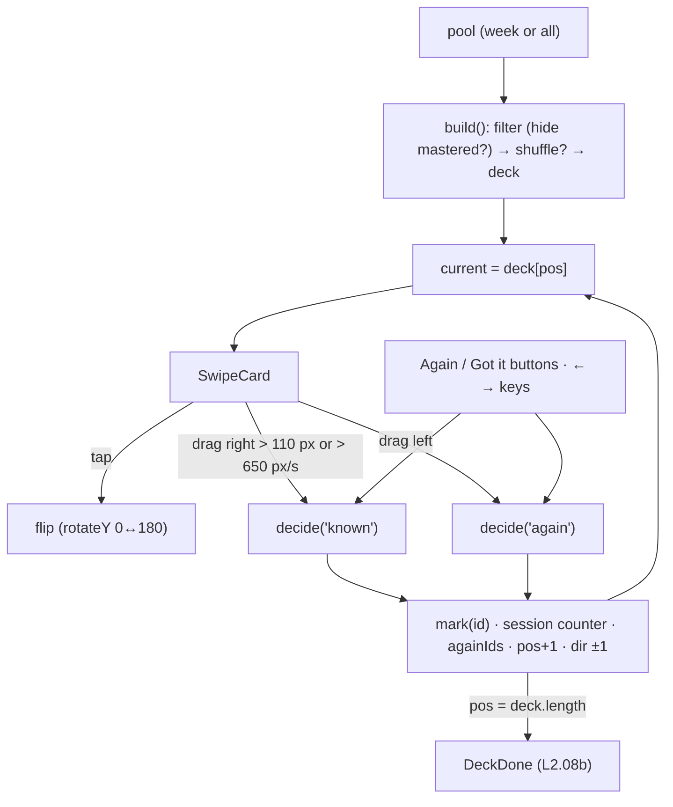

# L2.08a · Flashcards I: the deck, the swipe card and the flip

> **Level 2 · Build it** · Lesson 10 of 17

| Recipe card | |
|---|---|
| **Time** | 75 min |
| **You need** | L2.06a (Motion basics), L2.07b (`useProgress().mark`), L1.02 §6 (pointer events, `touch-action`) |
| **You'll produce** | Lines 84–369 of `src/pages/Study.tsx`: `Cards` (deck state, decide/undo, keyboard, ghost stack, controls) and `SwipeCard` (drag, stamps, exit direction, the Safari-safe flip) |

**In two sentences:** The flashcard deck is the heart of the app: swipe right if you knew it, left to see it again, tap to flip. It is also where the browser fought back hardest, with four real bugs across Chrome, Safari and touch screens, each told here as an incident ticket.

### Objectives
1. Build the deck from a progress *snapshot*, and explain why marking a card mustn't rebuild it.
2. Write `SwipeCard` with motion values: drag → rotation and stamp opacity via `useTransform`, and a swipe decision by offset **or** velocity.
3. Make the card fly out in the swipe's direction using `AnimatePresence custom` + exit variants.
4. Build a 3D flip that is correct in Safari, by driving face visibility from the angle instead of relying on `backface-visibility`.
5. Diagnose from symptoms: "swipe goes back a page", "swipe works with a mouse but not with a finger", "iPhone shows the answer mirrored", "Backspace leaves the page in Safari".

---

## 1 · Warm-up

1. *(L2.07b)* Is `mark()` optimistic? What does it write first?
2. *(L1.02)* What does `pointercancel` mean for a gesture?
3. *(L2.05)* What does `AnimatePresence` add, and what does `custom` pass?

<details><summary>Answers</summary>1. Yes: React state (and so localStorage) first, then a background upsert. 2. The browser took over the gesture (e.g. to scroll); the page gets no more moves. 3. Exit animations before unmount; <code>custom</code> passes a value to the exiting child's variant functions (it can't receive new props any more).</details>

## 2 · The problem this solves

Reading a question and its answer is passive. Deciding "did I know it?" is *retrieval practice*, and sorting cards into known/again focuses future time on weak cards. On a phone, the fastest way to decide is a flick of the thumb.



---

## 3 · Concepts new in this lesson

### 3.1 Motion values and `useTransform`

**Definition.** A *motion value* (`useMotionValue(0)`) is a number that animates **outside React's render cycle**. Updating it moves the element without re-rendering the component, which is essential for 60 fps dragging.

`useTransform(x, [a, b], [c, d])` derives a new motion value by linear interpolation, clamped to the range:

$$
f(x) = c + \frac{\operatorname{clamp}(x, a, b) - a}{b - a}\,(d - c)
$$

Our card uses three of these.

| Derived value | Input range | Output range | At x = +75 px | At x = +110 px |
|---|---|---|---|---|
| `rotate` | −220 … 220 | −14° … 14° | 4.8° | **7°** |
| `goodOpacity` ("GOT IT" stamp) | 30 … 120 | 0 … 1 | **0.5** | 0.89 |
| `badOpacity` ("AGAIN" stamp) | −120 … −30 | 1 … 0 | 0 | 0 |

Check one row: $\text{rotate}(110) = -14 + \frac{110 + 220}{440} \cdot 28 = -14 + 0.75 \cdot 28 = 7°$.

`useTransform(v, fn)` (a function form) maps through any function. We use it for the flip's face visibility.

### 3.2 Deciding a swipe: offset OR velocity

When the finger lifts, Motion's `PanInfo` tells you `offset` (total distance dragged) and `velocity` (px/s at release). Two ways to mean "swipe":
- **A long drag**: `|offset.x| > 110` px, deliberate and slow.
- **A flick**: `|velocity.x| > 650` px/s, short but fast.

Using only distance makes flicks feel ignored; using only speed makes careful drags fail. Otherwise the card springs back (`dragSnapToOrigin`).

### 3.3 Directional exits with `custom`

When `current` changes, the old `SwipeCard` leaves. It's an exiting child, so it can't get new props. `<AnimatePresence custom={dir}>` hands `dir` (+1 right, −1 left, 0 undo) to the exiting child's variant **function**: `exit: (d) => d === 0 ? fade : { x: d*520, rotate: d*24 }`. Swipe right, it flies right; undo, it fades.

### 3.4 A 3D flip that works in every browser

The classic recipe:
- a wrapper with `transform-style: preserve-3d`;
- two faces;
- the back face at `rotateY(180deg)`;
- both faces with `backface-visibility: hidden`;
- rotate the wrapper 0 → 180°.

**Safari (WebKit) didn't hide the back face in our layout.** On iPhones the answer showed through, mirrored, before you flipped (incident 3). The robust approach is to compute visibility yourself from the angle:

| `rotateY` | front opacity | back opacity | pointer events |
|---|---|---|---|
| 0° … 89.9° | 1 | 0 | front |
| 90° … 180° | 0 | 1 | back |

At exactly 90° the card is edge-on (invisible anyway), so swapping there is seamless. The angle is a spring (`useSpring`); its slight overshoot past 180° stays above 90°, so faces never flicker ([L3.03](l3-03-gestures-3d.md) has the spring maths).

---

## 4 · Reading the real code

### 4.1 `Cards`: state and the deck (lines 84–121)

```tsx
/* =====================================================================
   Flashcards — swipe right = got it, left = again, tap = flip
   ===================================================================== */
function Cards({ pool }: { pool: Question[] }) {
  const { marks, mark } = useProgress();
  const [shuffled, setShuffled] = useState(() => load("pol.shuffle", false));
  const [hideKnown, setHideKnown] = useState(() => load("pol.hideKnown", false));
  const [deck, setDeck] = useState<Question[]>([]);
  const [pos, setPos] = useState(0);
  const [flipped, setFlipped] = useState(false);
  const [dir, setDir] = useState(0);
  const [session, setSession] = useState({ known: 0, again: 0 });

  // build the deck from a snapshot of progress, so marking cards doesn't reshuffle mid-session
  const build = useCallback(
    (onlyIds?: Set<number>) => {
      let d = pool.filter((q) => (onlyIds ? onlyIds.has(q.id) : !hideKnown || marks[q.id]?.s !== "known"));
      if (shuffled) d = shuffleArr(d);
      setDeck(d);
      setPos(0);
      setFlipped(false);
      setSession({ known: 0, again: 0 });
    },
    // eslint-disable-next-line react-hooks/exhaustive-deps
    [pool, hideKnown, shuffled]
  );
  useEffect(() => {
    build();
  }, [build]);
  useEffect(() => {
    save("pol.shuffle", shuffled);
  }, [shuffled]);
  useEffect(() => {
    save("pol.hideKnown", hideKnown);
  }, [hideKnown]);

  const current = deck[pos];
  const againIds = useRef(new Set<number>());
```
- **`deck` is state, not derived.** If the deck were computed from `marks` on every render, then with "Hide mastered" on, swiping a card right would remove it from the deck *while you're on it*, and every later index would shift. `build` takes a **snapshot** and runs only when the pool, the hide toggle or the shuffle toggle changes.
- **`marks` is deliberately missing from the dependencies.** Hence the eslint-disable comment. The comment above `build` says why. This is the only intentional "missing dep" in the codebase.
- **`onlyIds`**: "Review the 4 'again' cards" rebuilds from just those ids (L2.08b).
- **`session`**: counters for *this* pass (✓ 3 · ↻ 1), separate from lifetime marks.
- **`dir`**: the last decision's direction, for the exit animation.
- **`againIds` is a ref**: updated on every decision without re-rendering. Read when the deck finishes.
- **Persisted toggles** (`pol.shuffle`, `pol.hideKnown`), with braces on every effect (L2.05).
- **Honest critique: the first frame.** `deck` starts as `[]` and `build()` fills it in an effect, and effects run *after* the browser paints. So the very first frame renders the "Everything here is mastered." empty state before the deck appears. It's usually too brief to notice, and no test caught it, but it is real. The fix is to initialise the deck lazily as well: compute the first deck in `useState(() => …)` with the same filter and shuffle, and keep the effect for later changes. Try it in Practice below.

### 4.2 Deciding, undoing, keyboard (lines 123–162)

```tsx
  const decide = useCallback(
    (m: Mark) => {
      if (!current) return;
      haptic(m === "known" ? 10 : 18);
      setDir(m === "known" ? 1 : -1);
      mark(current.id, m);
      if (m === "again") againIds.current.add(current.id);
      else againIds.current.delete(current.id);
      setSession((s) => ({ ...s, [m === "known" ? "known" : "again"]: s[m === "known" ? "known" : "again"] + 1 }));
      setFlipped(false);
      setPos((p) => p + 1);
    },
    [current, mark]
  );

  const undo = () => {
    if (pos === 0) return;
    setDir(0);
    setFlipped(false);
    setPos((p) => p - 1);
  };

  useEffect(() => {
    const k = (e: KeyboardEvent) => {
      if ((e.target as HTMLElement).tagName === "INPUT") return;
      if (e.key === " " || e.key === "Enter") {
        e.preventDefault();
        setFlipped((f) => !f);
      } else if (e.key === "ArrowRight") decide("known");
      else if (e.key === "ArrowLeft") decide("again");
      else if (e.key === "Backspace") {
        e.preventDefault(); // Safari would otherwise navigate back
        undo();
      }
    };
    window.addEventListener("keydown", k);
    return () => window.removeEventListener("keydown", k);
  });

  const done = deck.length > 0 && pos >= deck.length;
```
- **`haptic`**: a short buzz for "known" (10 ms), longer for "again" (18 ms). Android only (L2.04).
- **Set `dir` before advancing `pos`**, so the exiting card reads the new direction via `custom`.
- **`mark(...)`** persists the lifetime mark (local + cloud).
- **`againIds`**: add on "again", and **remove on "known"**. If you undo and change your mind, the review list stays right.
- **Computed property key** `[m === "known" ? "known" : "again"]` increments the right counter. A functional update, so rapid taps don't lose counts.
- **Undo moves back only.** It doesn't erase the mark. If you decide again, the new mark overwrites (newer timestamp). `dir = 0` → the card fades instead of flying.
- **The keyboard effect has no deps array**: it re-binds every render, so the handler always sees the current `decide`/`undo` closures, and cleanup removes the previous one. The INPUT check ignores keys while typing (in List search).
- **`preventDefault()` on Space** (would scroll the page) and **on Backspace** (Safari navigated back: incident 4).
- **`done`**: past the last card. `deck.length > 0` distinguishes "finished" from "empty deck".

### 4.3 Rendering the deck (lines 164–249)

```tsx
  return (
    <div>
      <div className="deck">
        {deck.length === 0 ? (
          <div className="fc-face" style={{ alignItems: "center", justifyContent: "center", textAlign: "center", gap: 10 }}>
            <CoffeeMug size={96} />
            <b>Everything here is mastered.</b>
            <span className="muted">Turn off “Hide mastered” to review them again.</span>
          </div>
        ) : done ? (
          <DeckDone
            known={session.known}
            again={session.again}
            onRestart={() => build()}
            onReviewAgain={againIds.current.size ? () => build(new Set(againIds.current)) : undefined}
          />
        ) : (
          <>
            {deck.slice(pos + 1, pos + 3).map((q, i) => (
              <motion.div
                key={q.id}
                className="fc-ghost"
                initial={false}
                animate={{ scale: 1 - (i + 1) * 0.045, y: (i + 1) * 14, opacity: 1 - (i + 1) * 0.25 }}
                transition={{ type: "spring", stiffness: 300, damping: 30 }}
                style={{ zIndex: 1 - i }}
              />
            ))}
            <AnimatePresence custom={dir} initial={false}>
              {current && (
                <SwipeCard
                  key={current.id + ":" + pos}
                  q={current}
                  index={pos}
                  total={deck.length}
                  flipped={flipped}
                  status={marks[current.id]?.s}
                  onFlip={() => setFlipped((f) => !f)}
                  onDecide={decide}
                />
              )}
            </AnimatePresence>
          </>
        )}
      </div>
```
- **Three states**: empty (everything mastered and hidden), done, or playing.
- **The ghost stack**: the next two cards drawn as blank cards behind. The `i`-th ghost ($i = 0, 1$) gets $\text{scale} = 1 - 0.045(i+1)$, $y = 14(i+1)$ px, $\text{opacity} = 1 - 0.25(i+1)$:

  | ghost | scale | y | opacity |
  |---|---|---|---|
  | next (i=0) | 0.955 | 14 px | 0.75 |
  | after (i=1) | 0.91 | 28 px | 0.5 |

  Keyed by question id, so when you swipe, the "next" ghost *springs forward* into the place of the card that became current. That creates the depth illusion.
- **`initial={false}`** on ghosts and on `AnimatePresence`: no entrance animation on first render.
- **`key={current.id + ":" + pos}`** (L1.03 §4.7): undo, which shows the same card at a new position, mounts a fresh card.
- **`status`** shows "✓ mastered" or "↻ reviewing" on cards you've marked before.

```tsx
      {!done && deck.length > 0 && (
        <>
          <div className="deck-foot">
            <span className="tnum">
              {pos + 1} / {deck.length}
            </span>
            <span className="tnum">
              <span style={{ color: "var(--good)" }}>✓ {session.known}</span> · <span style={{ color: "var(--bad)" }}>↻ {session.again}</span>
            </span>
          </div>
          <div className="bar" style={{ marginBottom: 14, height: 5 }}>
            <span style={{ width: `${(pos / deck.length) * 100}%` }} />
          </div>
          <div className="deck-controls">
            <motion.button className="round" whileTap={{ scale: 0.9 }} onClick={undo} disabled={pos === 0} aria-label="Previous card">
              <Icon name="undo" />
            </motion.button>
            <motion.button className="btn again" whileTap={{ scale: 0.95 }} onClick={() => decide("again")}>
              <Icon name="x" size={20} /> Again
            </motion.button>
            <motion.button className="btn got" whileTap={{ scale: 0.95 }} onClick={() => decide("known")}>
              <Icon name="check" size={20} /> Got it
            </motion.button>
            <motion.button className="round" whileTap={{ scale: 0.9, rotate: 90 }} onClick={() => setFlipped((f) => !f)} aria-label="Flip card">
              <Icon name="flip" />
            </motion.button>
          </div>
        </>
      )}

      <p className="kbd-hint">
        <kbd>Space</kbd> flip · <kbd>→</kbd> got it · <kbd>←</kbd> again · <kbd>Backspace</kbd> undo
      </p>
      <div className="row between" style={{ marginTop: 18, flexWrap: "wrap", gap: 12 }}>
        <Switch on={shuffled} onChange={setShuffled} label="Shuffle" />
        <Switch on={hideKnown} onChange={setHideKnown} label="Hide mastered" />
      </div>
    </div>
  );
}
```
- **The footer** reads like `3 / 10   ✓ 1 · ↻ 1`. Tests assert exactly these strings ([L4.04](l4-04-ui-tests-nav-cards.md)).
- **Buttons duplicate gestures.** Not everyone can swipe (motor impairments, mouse users), and buttons are discoverable. Icon-only buttons have `aria-label`s.
- **`disabled={pos === 0}`** on undo, since there's nothing before card 1.
- **`.kbd-hint`** is hidden by CSS except on devices with a mouse (L2.10c).
- **The two switches** sit *below* the controls. On short phones they may need a scroll, by design, because the card buttons must stay above the tab bar ([L2.10c](l2-10c-responsive.md)).

### 4.4 `SwipeCard` (lines 251–369)

```tsx
function SwipeCard({ q, index, total, flipped, status, onFlip, onDecide }: {
  q: Question; index: number; total: number; flipped: boolean; status?: Mark; onFlip: () => void; onDecide: (m: Mark) => void;
}) {
  const x = useMotionValue(0);
  const rotate = useTransform(x, [-220, 220], [-14, 14]);
  const goodOpacity = useTransform(x, [30, 120], [0, 1]);
  // Flip: show exactly one face based on the angle. Safari doesn't reliably honour
  // backface-visibility here, so we never rely on it alone.
  const rotateY = useSpring(flipped ? 180 : 0, { stiffness: 260, damping: 26 });
  useEffect(() => {
    rotateY.set(flipped ? 180 : 0);
  }, [flipped, rotateY]);
  const frontOpacity = useTransform(rotateY, (v) => (v < 90 ? 1 : 0));
  const backOpacity = useTransform(rotateY, (v) => (v < 90 ? 0 : 1));
  const frontEvents = useTransform(rotateY, (v) => (v < 90 ? "auto" : "none"));
  const backEvents = useTransform(rotateY, (v) => (v < 90 ? "none" : "auto"));
  const badOpacity = useTransform(x, [-120, -30], [1, 0]);

  const onDragEnd = (_: unknown, info: PanInfo) => {
    if (info.offset.x > 110 || info.velocity.x > 650) onDecide("known");
    else if (info.offset.x < -110 || info.velocity.x < -650) onDecide("again");
  };
```
(The props destructuring is condensed onto two lines here; the file lists one per line.)
- **`x`** is the drag position, written by Motion's drag directly. Nothing re-renders while you drag.
- **`rotate`, `goodOpacity`, `badOpacity`**: the §3.1 table. The card tilts and the matching stamp fades in as you drag.
- **`rotateY`** is a **spring motion value**. Set its target, and it animates there with spring physics. The `useEffect` sets it when `flipped` changes. The initial value matches the current `flipped`, so a new card doesn't animate a flip on mount.
- **Face visibility from the angle** (§3.4): four derived values. Opacity hides the wrong face; `pointerEvents` makes sure taps and scrolls go to the visible face.
- **`onDragEnd`**: the offset-or-velocity rule (§3.2). Neither threshold met → no decision → `dragSnapToOrigin` springs back.

```tsx
  return (
    <motion.div
      className="fc"
      style={{ x, rotate, zIndex: 5 }}
      drag="x"
      dragSnapToOrigin
      dragElastic={0.9}
      onDragEnd={onDragEnd}
      onTap={onFlip}
      initial={{ scale: 0.94, y: 14, opacity: 0 }}
      animate={{ scale: 1, y: 0, opacity: 1 }}
      exit="exit"
      variants={{
        exit: (d: number) =>
          d === 0
            ? { opacity: 0, scale: 0.94, transition: { duration: 0.15 } }
            : { x: d * 520, rotate: d * 24, opacity: 0, transition: { duration: 0.36, ease: [0.4, 0, 0.2, 1] } },
      }}
      transition={{ type: "spring", stiffness: 380, damping: 32 }}
      role="button"
      aria-label={flipped ? "Answer side. Tap to flip back." : "Question side. Tap to reveal the answer."}
    >
```
- **`style={{ x, rotate }}`**: binding motion values to style. Motion writes `transform` directly on each frame.
- **`drag="x"`**: horizontal only, so vertical scrolling inside the card still works (with `touch-action: pan-y` in CSS).
- **`dragElastic={0.9}`**: the card follows the finger closely (90%).
- **`onTap`** fires only for a tap, not at the end of a drag. Motion cancels the tap when the pointer moved past a small threshold. So tapping flips, and dragging doesn't.
- **Enter**: from slightly small and low, to full size. This matches where the "next" ghost was, so the new card appears to rise from the stack.
- **`exit="exit"` + `variants.exit` as a function** of `custom` (§3.3): 520 px is wider than any phone card, so it fully leaves the screen.
- **`role="button"` + a dynamic `aria-label`**: screen readers learn that it's tappable and which side is showing.

```tsx
      <motion.div className="fc-stamp good" style={{ opacity: goodOpacity }}>
        GOT IT
      </motion.div>
      <motion.div className="fc-stamp bad" style={{ opacity: badOpacity }}>
        AGAIN
      </motion.div>
      <motion.div className="fc-inner" style={{ rotateY }}>
        {/* front */}
        <motion.div className="fc-face fc-front" style={{ opacity: frontOpacity, pointerEvents: frontEvents }} aria-hidden={flipped}>
          <div className="fc-meta">
            <span className="tag">
              W{q.week} · Q{numberInWeek(q)}
            </span>
            <span>{status === "known" ? "✓ mastered" : status === "again" ? "↻ reviewing" : `${index + 1} of ${total}`}</span>
          </div>
          <div className="fc-scroll" tabIndex={flipped ? -1 : 0} aria-label="Question and options">
            <p className="fc-q">{q.q}</p>
            <ul className="fc-opts">
              {q.options.map((o, i) => (
                <li key={i}>
                  <span className="L">{LETTERS[i]}</span>
                  {o}
                </li>
              ))}
            </ul>
          </div>
          <div className="fc-hint">
            <Icon name="flip" size={14} /> Tap to reveal · swipe → got it, ← again
          </div>
        </motion.div>
```
- **Stamps** ("GOT IT" tilted on the left, "AGAIN" on the right), like a rubber stamp. Their opacity follows the drag.
- **`fc-inner`** carries `rotateY` (the spring). Its CSS sets `transform-style: preserve-3d`.
- **`aria-hidden`** on the hidden face, so screen readers read only the visible side.
- **`.fc-scroll`** is the scrollable middle (long questions on small screens):
  - **`tabIndex` only on the visible face**: axe requires scrollable regions to be keyboard-focusable (so keyboard users can scroll them), but a focusable element inside an `aria-hidden` face is itself a violation. Hence the toggle.
  - **`aria-label`** names the region for screen readers.
  - Its CSS has **`touch-action: pan-y`**, the fix for incident 2.

```tsx
        {/* back */}
        <motion.div className="fc-face fc-back" style={{ opacity: backOpacity, pointerEvents: backEvents }} aria-hidden={!flipped}>
          <div className="fc-meta">
            <span className="tag">
              W{q.week} · Q{numberInWeek(q)}
            </span>
            <span>Answer</span>
          </div>
          <div className="fc-scroll" tabIndex={flipped ? 0 : -1} aria-label="Answer">
            <p className="fc-small-q">{q.q}</p>
            <div className="fc-answer-label">Correct answer</div>
            <div className="fc-answer">
              <span style={{ color: "#ef3a42" }}>{LETTERS[q.answer]}.</span> {q.options[q.answer]}
            </div>
            <ul className="fc-opts">
              {q.options.map((o, i) => (
                <li key={i} className={i === q.answer ? "correct" : ""}>
                  <span className="L">{LETTERS[i]}</span>
                  {o}
                </li>
              ))}
            </ul>
            {q.note && <div className="fc-note">Note: {q.note}</div>}
          </div>
          <div className="fc-hint">Swipe → if you knew it · ← to see it again</div>
        </motion.div>
      </motion.div>
    </motion.div>
  );
}
```
- **The back repeats the question small**, then the answer large ("D. A study of cognitive processes & behavior"), then all options with the correct one highlighted green. You see the answer *in context* of the distractors, which helps with MCQ exams.
- **`q.note`**: the week-6 key-typo note from [L2.01](l2-01-data-pipeline.md).
- **The CSS gives the back face `transform: rotateY(180deg)`**, so after the wrapper rotates 180°, the back reads the right way round.

---

## 5 · Worked traces

### 5.1 Step-through frames: a right swipe

| Frame | Finger | `x` | rotate | GOT IT opacity | Predict → |
|---|---|---|---|---|---|
| 1 | down | 0 | 0° | 0 | |
| 2 | +30 px | 30 | 1.9° | 0 | Stamp yet? **No: the range starts at 30** |
| 3 | +75 px | 75 | 4.8° | 0.5 | |
| 4 | +130 px, lifts at 300 px/s | 130 | 8.3° | 1 | Decision? **Known: offset 130 > 110** |
| 5 | `onDecide("known")` | | | | `dir` becomes? **+1** |
| 6 | the old card exits: `x → 520`, `rotate → 24°`, fades (0.36 s); the next ghost springs forward; the new card enters | | | | |

### 5.2 Step-through frames: a tap (flip)

| Frame | Event | `rotateY` (spring) | front | back |
|---|---|---|---|---|
| 1 | tap → `onFlip` → `flipped = true` → `rotateY.set(180)` | 0 | 1 | 0 |
| 2 | ~120 ms | ~70° | 1 | 0 |
| 3 | crosses 90° | 90° | **0** | **1** |
| 4 | overshoot | ~183° | 0 | 1 |
| 5 | settles | 180° | 0 | 1 |

---

## 6 · Running and testing

`tests/e2e/ui.spec.ts` on 11 device/browser projects:
- "flashcards: flip, got it, again, undo, hide mastered, progress saved" checks the flip **via the computed transform** (`DOMMatrix(t).m11 < 0` means rotated past 90°), the footer counters, undo, reload persistence and the hide toggle.
- "flashcards: swipe right = got it, swipe left = again" drags with the mouse in 12 steps over about 200 ms.
- "flashcards: real touch swipe on phones (Chromium)" sends **raw touch events** through the Chrome DevTools Protocol, in the middle of the scrollable area, and asserts the URL didn't change (no back-navigation).
- "flashcards: keyboard shortcuts on laptops" covers Space, →, ← and Backspace.

Teaching walkthrough in [L4.04](l4-04-ui-tests-nav-cards.md).

## 7 · Bug journal

**Incident 1 · A swipe made the browser go back a page**
1. **Symptom.** An automated touch-swipe test on the Study page logged navigations: `NAV …/study`, `NAV about:blank`. After the first swipe the page was `about:blank`, the browser's previous page in that test.
2. **Diagnosis.** No app code navigates to `about:blank`. Chrome on touch devices has *overscroll history navigation*: a horizontal swipe that the page doesn't consume goes back or forward. The first swipe was treated as "swipe back".
3. **Root cause.** The browser's default gesture competed with the app's.
4. **Fix** (in `styles.css`):
   ```diff
    html {
   +  overscroll-behavior-x: none;     /* no swipe-to-go-back while swiping cards */
      -webkit-text-size-adjust: 100%;
    }
    body {
   -  overscroll-behavior-y: none;
   +  overscroll-behavior: none;
   ```
5. **Lesson.** Any horizontal-swipe UI must disable horizontal overscroll navigation. The touch test asserts `toHaveURL(/\/study/)` after swiping.

**Incident 2 · Swipes worked with a mouse but not with a finger**
1. **Symptom.** With the mouse: `3 / 130 ✓ 1 · ↻ 1` (both swipes registered). With CDP touch: `1 / 130 ✓ 0 · ↻ 0` (nothing), yet tapping to flip worked with touch.
2. **Diagnosis.** We moved the touch point: starting at `bx.y + 30` (the card's header) → **both swipes registered**. Starting in the middle (over the options list) → nothing. The middle is `.fc-scroll`, a scroll container (`overflow-y: auto`). The browser saw a touch begin inside a scroller and claimed the gesture for scrolling, sending `pointercancel` to Motion.
3. **Root cause.** Default `touch-action` on the scroll area let the browser own all pans that began there, including horizontal ones.
4. **Fix**:
   ```diff
    .fc-scroll {
      flex: 1;
      overflow-y: auto;
   +  touch-action: pan-y;            /* browser may scroll vertically; horizontal belongs to the swipe */
   +  overscroll-behavior: contain;   /* scrolling the card doesn't scroll the page behind */
   ```
5. **Lesson.** Test gestures with **real touch input** at the spots users actually touch. Mouse-driven tests can't show touch-action conflicts. Every nested scroller inside a draggable needs an explicit `touch-action`.

**Incident 3 · iPhones showed the answer before the flip, mirrored**
1. **Symptom.** All the functional tests were green. But phone-size screenshots in WebKit (Safari's engine), iPhone SE and iPhone 13, showed the card's **back** face, text mirrored ("ɘɈomɘɿ .C"), on first render. Chrome and Firefox were correct.
2. **Diagnosis.** The mirroring is the giveaway: we were seeing the back face *through* the front, rotated 180°. `backface-visibility: hidden` wasn't taking effect in WebKit for this nesting (draggable parent with transforms, `preserve-3d` wrapper, faces with `overflow: hidden`, masked scroll content). The tests had passed because they checked the *wrapper's* rotation, not what was painted.
3. **Root cause.** The design depended on a 3D rendering detail that browsers implement inconsistently in complex stacking situations.
4. **Fix**: drive visibility from the angle (§3.4).
   ```diff
   - <motion.div className="fc-inner" animate={{ rotateY: flipped ? 180 : 0 }} transition={{ type: "spring", stiffness: 260, damping: 26 }}>
   -   <div className="fc-face">…front…</div>
   -   <div className="fc-face fc-back">…back…</div>
   + const rotateY = useSpring(flipped ? 180 : 0, { stiffness: 260, damping: 26 });
   + const frontOpacity = useTransform(rotateY, (v) => (v < 90 ? 1 : 0));   // and back/pointer-events
   + <motion.div className="fc-inner" style={{ rotateY }}>
   +   <motion.div className="fc-face fc-front" style={{ opacity: frontOpacity, pointerEvents: frontEvents }} aria-hidden={flipped}>…
   +   <motion.div className="fc-face fc-back"  style={{ opacity: backOpacity,  pointerEvents: backEvents }}  aria-hidden={!flipped}>…
   ```
   Verified with before/after-flip screenshots on iPhone SE (WebKit), Pixel 7 (Chromium), desktop Safari and Firefox.
5. **Lesson.** **Look at screenshots** from every engine; green assertions on internal state aren't proof of what users see. For 3D tricks, don't rely on `backface-visibility` alone.

**Incident 4 · Backspace (undo) left the page in Safari**
1. **Symptom.** Keyboard test on desktop Safari: after pressing Backspace, `expect(deckFoot).toContainText("2 / 10")` failed with *element(s) not found*. The deck was gone.
2. **Diagnosis.** Space and the arrows had worked; the footer vanished right after Backspace. WebKit treated Backspace (outside a text field) as "go back in history".
3. **Root cause.** A key with a browser default action, not prevented.
4. **Fix**:
   ```diff
   - else if (e.key === "Backspace") undo();
   + else if (e.key === "Backspace") {
   +   e.preventDefault(); // Safari would otherwise navigate back
   +   undo();
   + }
   ```
5. **Lesson.** When you take over a key, prevent its default, and test keyboard shortcuts in every engine.

## 8 · Why this design

| Decision | Alternatives | Why this one | Trade-off | Choose differently when |
|---|---|---|---|---|
| Deck snapshot (`build`) | Derive the deck from `marks` | Marking can't reshuffle mid-session | An eslint-disable on deps | — |
| Offset OR velocity | Offset only | Flicks and slow drags both work | Two thresholds to tune | — |
| Directional exit via `custom` | One exit animation | Feedback matches the gesture | — | — |
| Angle-driven face visibility | `backface-visibility` only | Correct in WebKit | Four derived motion values | — |
| Buttons + keys + gestures | Gestures only | Accessible and discoverable | More UI | — |
| Undo doesn't erase the mark | Revert the mark | Simple; the next decision overwrites anyway | Briefly shows the old status | — |

## 9 · Check yourself

**Q1.** The finger drags 80 px right and lifts at 900 px/s. Decision?
<details><summary>Answer</summary>Known: velocity 900 > 650, even though 80 < 110.</details>

**Q2.** "Hide mastered" is on and the deck is derived from `marks` (no snapshot). You swipe card 3 right. What goes wrong?
<details><summary>Answer</summary>Card 3 disappears from the deck immediately, every later card shifts down one index, and <code>pos + 1</code> skips a card.</details>

**Q3.** What does `x = −75` give for `badOpacity`?
<details><summary>Answer</summary>Range [−120, −30] → [1, 0]: (−75 + 120)/90 = 0.5 of the way, so the opacity is 1 − 0.5 = <b>0.5</b>.</details>

**Q4.** Why is `tabIndex` toggled on the two `.fc-scroll` elements?
<details><summary>Answer</summary>Scrollable regions must be keyboard-focusable (axe rule <i>scrollable-region-focusable</i>), but focusable content inside an <code>aria-hidden</code> face is also a violation. So only the visible face's scroller is focusable.</details>

**Q5.** A mouse-drag test passes but users say swiping doesn't work on phones. First hypothesis?
<details><summary>Answer</summary>A touch-action conflict: the gesture starts inside a scroll container, and the browser claims it (<code>pointercancel</code>). Test with real touch at the middle of the card and add <code>touch-action: pan-y</code>.</details>

## 10 · Practice

**Easy (10 min).** Remove the empty-state flash on first render: give `deck` a lazy initial value computed with the same filter and shuffle as `build`. (Make sure `build`'s effect doesn't then reshuffle on mount. Compare the lesson of the quiz's double shuffle in [L2.08b](l2-08b-quiz-and-list.md).)

**Easy+ (10 min).** Add vertical swipe-up = "flip". (Hint: `drag` stays `"x"`, so use an `onPan` handler or a button, and explain why making the card draggable on both axes would break scrolling.)

**Medium (20 min).** Tilt-to-preview: make the "GOT IT" stamp scale from 0.8 to 1 as it fades in, using another `useTransform` on `x`.

**Hard (40 min).** Spaced repetition: replace known/again with Leitner boxes (1–5) stored in `marks`, and build the deck from cards whose box is due today. Keep the snapshot principle.
<details><summary>Sketch</summary><code>Entry = { box: 1..5, due: epochDay }</code>. "Known" moves the card up a box and sets <code>due = today + [1,2,4,8,16][box-1]</code>; "again" sends it to box 1, due today. <code>build</code> filters <code>due ≤ today</code>. The cloud table needs <code>box</code> and <code>due</code> columns.</details>

## 11 · From memory

**Rung 1 · Cloze.**

```tsx
const x = useMotionValue(0);
const rotate = useTransform(x, [-220, 220], [___①___, 14]);
const goodOpacity = useTransform(x, [___②___, 120], [0, 1]);
const rotateY = use___③___(flipped ? 180 : 0, { stiffness: 260, damping: 26 });
const frontOpacity = useTransform(rotateY, (v) => (v < ___④___ ? 1 : 0));
const onDragEnd = (_: unknown, info: PanInfo) => {
  if (info.offset.x > ___⑤___ || info.velocity.x > ___⑥___) onDecide("known");
  else if (info.offset.x < -110 || info.velocity.x < -650) onDecide("again");
};
<AnimatePresence ___⑦___={dir} initial={false}>
  <SwipeCard key={current.id + ":" + ___⑧___} … />
exit: (d: number) => d === 0 ? { opacity: 0 } : { x: d * ___⑨___, rotate: d * 24, opacity: 0 }
```
<details><summary>Answers</summary>① <code>-14</code> ② <code>30</code> ③ <code>Spring</code> ④ <code>90</code> ⑤ <code>110</code> ⑥ <code>650</code> ⑦ <code>custom</code> ⑧ <code>pos</code> ⑨ <code>520</code></details>

**Rung 2 · Blank page (20 min).** Write `SwipeCard` and the deck-building/decide logic of `Cards` from memory.
<details><summary>Self-check</summary>

- [ ] Snapshot `build` (pool, hideKnown, shuffled); `marks` intentionally not a dep
- [ ] decide: dir first, mark, againIds add/delete, functional counters, unflip, pos+1
- [ ] Keyboard: no deps array; preventDefault on Space and Backspace
- [ ] Ghost stack with springy scale/y/opacity keyed by id
- [ ] SwipeCard: x → rotate/stamps; offset-or-velocity; dragSnapToOrigin; onTap flip
- [ ] Exit variant function of `custom`
- [ ] Flip via spring + angle-driven opacity and pointer events; aria-hidden and tabIndex toggled
</details>

## 12 · Flashcards

<details><summary><b>Q:</b> Why is the deck a snapshot?</summary><b>A:</b> So marking a card (with "hide mastered" on) can't remove it or shift indexes mid-session.</details>
<details><summary><b>Q:</b> Swipe decision rule?</summary><b>A:</b> |offset.x| > 110 px or |velocity.x| > 650 px/s, in that direction; otherwise spring back.</details>
<details><summary><b>Q:</b> How does the exiting card know which way to fly?</summary><b>A:</b> <code>AnimatePresence custom={dir}</code> feeds the exit variant function.</details>
<details><summary><b>Q:</b> Why angle-driven face opacity?</summary><b>A:</b> WebKit showed the back face mirrored through the front; <code>backface-visibility</code> wasn't reliable in this layout.</details>
<details><summary><b>Q:</b> Fix for "swipe goes back a page"?</summary><b>A:</b> <code>html { overscroll-behavior-x: none }</code>.</details>
<details><summary><b>Q:</b> Fix for "touch swipe ignored over the options"?</summary><b>A:</b> <code>touch-action: pan-y</code> (+ <code>overscroll-behavior: contain</code>) on <code>.fc-scroll</code>.</details>
<details><summary><b>Q:</b> Why does tapping flip but dragging not?</summary><b>A:</b> Motion's <code>onTap</code> is cancelled once the pointer moves past a small threshold.</details>
<details><summary><b>Q:</b> What does undo do to the mark?</summary><b>A:</b> Nothing; it moves back one card. The next decision overwrites the mark.</details>
<details><summary><b>Q:</b> Why preventDefault on Backspace?</summary><b>A:</b> Safari otherwise navigates back.</details>

## 13 · The menu board

| | |
|---|---|
| Deck | `build()` on pool/hide/shuffle changes; snapshot of marks; `againIds` ref |
| Decide | haptic · dir · mark · againIds · counters · unflip · pos+1 |
| Drag | `drag="x"`, elastic 0.9, snap back; >110 px or >650 px/s |
| Tilt and stamps | rotate ±14° over ±220 px; stamps 30→120 px |
| Exit | `custom={dir}`; ±520 px, ±24°; undo fades |
| Flip | `useSpring` rotateY; v<90 front, else back (opacity + pointer events) |
| CSS fixes | `overscroll-behavior-x: none` (html); `touch-action: pan-y` (.fc-scroll) |
| Keys | Space/Enter flip · → known · ← again · Backspace undo (preventDefault) |

## 14 · Glossary

**dragSnapToOrigin**: return to the start position on release. **Exit variant**: a named animation for removal, possibly a function of `custom`. **Ghost stack**: placeholder cards behind the current one. **Motion value**: an animatable value updated outside React renders. **Overscroll navigation**: the browser's swipe-past-the-edge back/forward gesture. **PanInfo**: Motion's drag summary (offset, velocity, point). **preserve-3d**: CSS that keeps children in 3D space. **useSpring**: a motion value that animates to targets with spring physics. **useTransform**: a motion value derived from another by mapping.

## 15 · Go further

| Resource | Type | Why | Which part | Time |
|---|---|---|---|---|
| [Motion: Motion values](https://motion.dev/docs/react-motion-value) | Docs | `useMotionValue`, why no re-renders | Whole page | 10 min |
| [Motion: useTransform](https://motion.dev/docs/react-use-transform) | Docs | Range mapping and function form | Whole page | 10 min |
| [Motion: useSpring](https://motion.dev/docs/react-use-spring) | Docs | Spring motion values | Whole page | 5 min |
| [MDN: overscroll-behavior](https://developer.mozilla.org/en-US/docs/Web/CSS/overscroll-behavior) | Docs | Stopping swipe navigation and scroll chaining | Values + examples | 10 min |
| [MDN: backface-visibility](https://developer.mozilla.org/en-US/docs/Web/CSS/backface-visibility) | Docs | The 3D card recipe | Example | 5 min |

---
← [L2.07b Account & progress sync](l2-07b-account-progress.md) · [Hub](README.md) · [L2.08b Quiz & list →](l2-08b-quiz-and-list.md)
