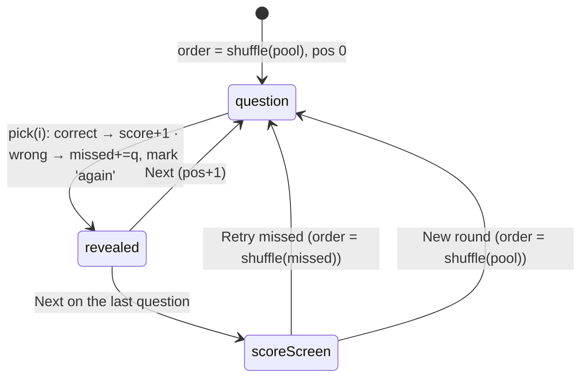

# L2.08b · Flashcards II: the Study page, deck finished, quiz mode and the searchable list

> **Level 2 · Build it** · Lesson 11 of 17

| Recipe card | |
|---|---|
| **Time** | 70 min |
| **You need** | L2.08a (Cards, motion basics) |
| **You'll produce** | The rest of `src/pages/Study.tsx`: the `Study` page (lines 1–63), `WeekChips` (65–82), `DeckDone` (371–399), `Quiz` (401–536) and `ListView` (538–607) |

**In two sentences:** The Study page wraps the deck in a week filter (kept in the URL) and a three-way mode switch. Quiz mode gives instant right/wrong feedback, and List mode is a searchable reference with highlights. The quiz also hid a subtle bug that swapped the first question under your finger.

### Objectives
1. Keep UI state in the URL (`?week=3`) with `useSearchParams`, and explain why the week belongs there while the mode belongs in `localStorage`.
2. Write the quiz state machine: pick → reveal → next → score screen → retry missed.
3. Explain the double-shuffle bug and the `useRef` fix, including why the parent's `key` makes the fix defensive.
4. Write the case-insensitive search with highlighting and sticky week headers using `display: contents`.

---

## 1 · Warm-up

1. *(L2.08a)* Why is the deck a snapshot?
2. *(L1.03)* `useRef` vs `useState`: which one re-renders?
3. *(L1.02)* How does an SPA keep `/study?week=3` working after F5?

<details><summary>Answers</summary>1. So marks can't remove cards or shift indexes mid-session. 2. Only <code>useState</code>. 3. The host rewrites to index.html; the router renders <code>/study</code>; <code>useSearchParams</code> reads <code>week</code>.</details>

## 2 · The problem this solves

Studying needs three gears:
- **Cards**: self-graded recall.
- **Quiz**: recognition with instant feedback, as on the exam.
- **List**: lookup ("what was the answer about Maslow?").

All three filtered by week. And the chosen week should be shareable and bookmarkable: tapping "Week 3" on Home must open week 3.



*Takeaway: a wrong quiz answer also marks the card "again", so quiz mistakes feed back into flashcard review.*

---

## 3 · Concepts

### 3.1 URL state vs stored preferences

| State | Where | Why |
|---|---|---|
| Week (`?week=3`) | URL query | Shareable and bookmarkable; Home's week tiles link to it; the back button works |
| Mode (cards/quiz/list) | `localStorage` (`pol.studyMode`) | A personal preference: open Study tomorrow, get the same mode |
| Shuffle, hide mastered | `localStorage` | Preferences |
| Position in the deck | component state | Ephemeral |

`setParams(p, { replace: true })` updates the query **without** adding a history entry. Flipping through weeks shouldn't make "back" step through every week.

### 3.2 `display: contents`

An element with `display: contents` disappears from layout: its children behave as if they were children of *its* parent. We need one wrapper per question (to hold `key`, plus an optional week header and the card), but in the flex/grid "stack" each header and card should be a direct child. That is also what lets the week headers be **sticky** relative to the list.

### 3.3 Highlighting matches safely

Never inject user-typed text as HTML (`innerHTML`). That is an XSS hole (cross-site scripting: untrusted text executed as code). Split the string into *before / match / after* and render the match inside `<mark>` as React text. React escapes it.

---

## 4 · Reading the real code

### 4.1 The `Study` page (lines 1–63)

```tsx
import { useCallback, useEffect, useMemo, useRef, useState } from "react";
import { useSearchParams } from "react-router-dom";
import { AnimatePresence, motion, useMotionValue, useSpring, useTransform, type PanInfo } from "motion/react";
import { Icon } from "../components/Icon";
import { CoffeeMug } from "../components/CoffeeMug";
import { Segmented, Switch } from "../components/Ui";
import { LETTERS, QUESTIONS, WEEKS, WEEK_TOPICS, numberInWeek, type Question } from "../data/questions";
import { useProgress, type Mark } from "../lib/progress";
import { haptic, shuffle as shuffleArr } from "../lib/format";
import { load, save } from "../lib/storage";

type Mode = "cards" | "quiz" | "list";

export default function Study() {
  const [params, setParams] = useSearchParams();
  const weekParam = params.get("week");
  const week: number | "all" = weekParam != null && WEEKS.includes(+weekParam) ? +weekParam : "all";
  const [mode, setMode] = useState<Mode>(() => load<Mode>("pol.studyMode", "cards"));
  useEffect(() => {
    save("pol.studyMode", mode);
  }, [mode]);

  const setWeek = (w: number | "all") => {
    const p = new URLSearchParams(params);
    if (w === "all") p.delete("week");
    else p.set("week", String(w));
    setParams(p, { replace: true });
  };

  const pool = useMemo(() => (week === "all" ? QUESTIONS : QUESTIONS.filter((q) => q.week === week)), [week]);
```
- **`shuffle as shuffleArr`**: renames the import, because `Cards` has a state variable called `shuffled`, and `shuffle` would read ambiguously.
- **Validating the URL**: `?week=99` or `?week=abc` → `WEEKS.includes(+weekParam)` is false → `"all"`. Never trust URL input to be valid.
- **`+weekParam`**: unary plus converts the string to a number.
- **`new URLSearchParams(params)`** copies the current params, so other query keys survive.
- **`pool`** is memoised by `week`, so its identity stays stable across renders. That matters because `Cards` (`build`) and `Quiz` depend on `pool` identity.

```tsx
  return (
    <div>
      <div className="page-head compact">
        <h1 className="display">{week === "all" ? "All weeks" : `Week ${week}`}</h1>
        <p>{week === "all" ? `${pool.length} questions` : `${WEEK_TOPICS[week]} · ${pool.length} questions`}</p>
      </div>

      <WeekChips week={week} setWeek={setWeek} />

      <div style={{ margin: "12px 0 4px" }}>
        <Segmented<Mode>
          id="study-mode"
          value={mode}
          onChange={setMode}
          options={[
            { value: "cards", label: <><Icon name="cards" size={17} /> Cards</> },
            { value: "quiz", label: <><Icon name="bolt" size={17} /> Quiz</> },
            { value: "list", label: <><Icon name="list" size={17} /> List</> },
          ]}
        />
      </div>

      <AnimatePresence mode="wait">
        <motion.div key={mode + String(week)} initial={{ opacity: 0, y: 10 }} animate={{ opacity: 1, y: 0 }} exit={{ opacity: 0, y: -6 }} transition={{ duration: 0.2 }}>
          {mode === "cards" && <Cards pool={pool} />}
          {mode === "quiz" && <Quiz pool={pool} />}
          {mode === "list" && <ListView pool={pool} />}
        </motion.div>
      </AnimatePresence>
    </div>
  );
}
```
- **`compact` header**: one line (title + count) to save height for the card. On very short phones it's hidden entirely ([L2.10c](l2-10c-responsive.md)).
- **`key={mode + String(week)}`**: changing mode **or** week remounts the child with a short cross-fade. That gives each week a fresh deck/quiz, which is simpler than resetting internal state by hand. Remember this key for §4.4.

### 4.2 `WeekChips` (lines 65–82)

```tsx
function WeekChips({ week, setWeek }: { week: number | "all"; setWeek: (w: number | "all") => void }) {
  const ref = useRef<HTMLDivElement>(null);
  useEffect(() => {
    ref.current?.querySelector(".chip.on")?.scrollIntoView({ inline: "center", block: "nearest", behavior: "smooth" });
  }, [week]);
  return (
    <div className="chips" ref={ref}>
      <button className={`chip ${week === "all" ? "on" : ""}`} onClick={() => setWeek("all")}>
        All <span className="count">{QUESTIONS.length}</span>
      </button>
      {WEEKS.map((w) => (
        <button key={w} className={`chip ${week === w ? "on" : ""}`} onClick={() => setWeek(w)}>
          Week {w}
        </button>
      ))}
    </div>
  );
}
```
- **A horizontally scrolling row on phones** (14 chips don't fit); it wraps on laptops (CSS).
- **`scrollIntoView({ inline: "center", block: "nearest" })`**: when you arrive with `?week=12`, the active chip scrolls into the middle of the row. `inline` is the horizontal axis. `block: "nearest"` avoids scrolling the *page* vertically.
- **Optional chaining twice**: no ref yet, or no active chip → do nothing.

### 4.3 `DeckDone` (lines 371–399)

```tsx
function DeckDone({ known, again, onRestart, onReviewAgain }: { known: number; again: number; onRestart: () => void; onReviewAgain?: () => void }) {
  return (
    <motion.div
      className="fc-face"
      style={{ alignItems: "center", justifyContent: "center", textAlign: "center", gap: 12 }}
      initial={{ scale: 0.9, opacity: 0 }}
      animate={{ scale: 1, opacity: 1 }}
      transition={{ type: "spring", stiffness: 260, damping: 22 }}
    >
      <motion.img src="/brand/mascot.webp" width={120} height={131} alt="" style={{ width: 120 }} initial={{ rotate: -10, y: 20 }} animate={{ rotate: [-10, 6, 0], y: 0 }} transition={{ duration: 0.8 }} />
      <h2 className="display" style={{ margin: 0, fontSize: "1.6rem" }}>
        Deck done!
      </h2>
      <p className="muted" style={{ margin: 0 }}>
        <b style={{ color: "var(--good)" }}>{known}</b> got it · <b style={{ color: "var(--bad)" }}>{again}</b> to review
      </p>
      <div className="stack" style={{ width: "100%", maxWidth: 300, marginTop: 6 }}>
        {onReviewAgain && (
          <button className="btn red block" onClick={onReviewAgain}>
            Review the {again} “again” cards
          </button>
        )}
        <button className={`btn block ${onReviewAgain ? "" : "primary"}`} onClick={onRestart}>
          Restart deck
        </button>
      </div>
    </motion.div>
  );
}
```
- **Reuses `.fc-face`** styling, so the finish screen sits exactly where the card was.
- **The mascot wiggles**: keyframes `rotate: [-10, 6, 0]`.
- **The primary action depends on context**: with "again" cards, *Review* is the red primary and *Restart* secondary; with none, *Restart* becomes primary.
- **`onReviewAgain` is optional.** `Cards` passes `undefined` when `againIds` is empty, which hides the button. Its label uses `again` (this pass's count). The e2e test ends a 10-card deck with 4 "again" and clicks "Review the 4" ([L4.04](l4-04-ui-tests-nav-cards.md)).

### 4.4 `Quiz` (lines 401–536)

```tsx
function Quiz({ pool }: { pool: Question[] }) {
  const { mark } = useProgress();
  const [order, setOrder] = useState(() => shuffleArr(pool));
  const [pos, setPos] = useState(0);
  const [picked, setPicked] = useState<number | null>(null);
  const [score, setScore] = useState(0);
  const [missed, setMissed] = useState<Question[]>([]);

  const restart = (qs = pool) => {
    setOrder(shuffleArr(qs));
    setPos(0);
    setPicked(null);
    setScore(0);
    setMissed([]);
  };
  // reshuffle only when the week changes (not on mount, which would swap the first question)
  const lastPool = useRef(pool);
  useEffect(() => {
    if (lastPool.current === pool) return;
    lastPool.current = pool;
    restart();
    // eslint-disable-next-line react-hooks/exhaustive-deps
  }, [pool]);
```
- **`order`** is shuffled once, lazily, at mount.
- **`picked`** is `null` until you answer, then the chosen index. It drives the reveal styling and disables the options.
- **`restart(qs = pool)`**: a default parameter. "New round" uses the whole pool, "Retry missed" passes `missed`.
- **The `lastPool` guard** is the double-shuffle fix (§7). Run `restart` only when `pool` is a *different array* than last time.
- **Why it's defensive:** the parent remounts `Quiz` whenever the week changes (`key={mode + week}`), so a mounted `Quiz` never actually sees a new `pool`. The guard keeps `Quiz` correct if it is ever reused without that key. The *bug* was the effect running **on mount**.

```tsx
  const q = order[pos];
  const pick = (i: number) => {
    if (picked !== null || !q) return;
    setPicked(i);
    if (i === q.answer) {
      setScore((s) => s + 1);
      haptic(10);
    } else {
      setMissed((m) => [...m, q]);
      mark(q.id, "again");
      haptic(30);
    }
  };
  const next = () => {
    setPicked(null);
    setPos((p) => p + 1);
  };
```
- **One answer per question**: the guard ignores taps after the first.
- **Wrong answers are remembered twice**: in `missed` (for "Retry the N you missed") and as a lifetime `again` mark (so the flashcards resurface them). Correct answers don't mark "known": recognising an option isn't the same as recalling it.
- **Haptics**: a longer buzz (30 ms) for wrong.

```tsx
  useEffect(() => {
    const k = (e: KeyboardEvent) => {
      const i = "1234".indexOf(e.key) >= 0 ? "1234".indexOf(e.key) : "abcd".indexOf(e.key.toLowerCase());
      if (i >= 0 && q && i < q.options.length) pick(i);
      else if ((e.key === "Enter" || e.key === "ArrowRight") && picked !== null) next();
    };
    window.addEventListener("keydown", k);
    return () => window.removeEventListener("keydown", k);
  });
```
- **Keys 1–4 or A–D** pick an option. `i < q.options.length` stops pressing 3 on a True/False question.
- **Enter / → advances**, but only after answering.
- **Edge:** `"abcd".indexOf("")` is `0`, but `e.key` is never empty. Keys like `Shift` give −1, so nothing happens.

```tsx
  if (!q) {
    const pct = Math.round((score / order.length) * 100);
    return (
      <div className="q-card" style={{ marginTop: 14, textAlign: "center" }}>
        <CoffeeMug size={90} />
        <h2 className="display" style={{ margin: "8px 0 4px" }}>
          {score}/{order.length}
        </h2>
        <p className="muted" style={{ marginTop: 0 }}>
          {pct >= 90 ? "Espresso-strong. 🔥" : pct >= 70 ? "Nicely brewed!" : "Needs another cup. Keep going!"}
        </p>
        <div className="stack">
          {missed.length > 0 && (
            <button className="btn red block" onClick={() => restart(missed)}>
              Retry the {missed.length} you missed
            </button>
          )}
          <button className="btn block" onClick={() => restart()}>
            New round
          </button>
        </div>
      </div>
    );
  }
```
- **`!q`** (past the end) shows the score screen. The heading is `score/length`, for example `5/10`, and the test finds it with `getByRole("heading", { name: "5/10" })`.
- **Coffee-themed encouragement** in three bands (≥ 90%, ≥ 70%, below).

```tsx
  return (
    <div style={{ marginTop: 14 }}>
      <div className="deck-foot">
        <span className="tnum">
          {pos + 1} / {order.length}
        </span>
        <span className="tnum">Score {score}</span>
      </div>
      <div className="bar" style={{ marginBottom: 12, height: 5 }}>
        <span style={{ width: `${(pos / order.length) * 100}%` }} />
      </div>
      <AnimatePresence mode="wait">
        <motion.div key={q.id} className="q-card" initial={{ x: 40, opacity: 0 }} animate={{ x: 0, opacity: 1 }} exit={{ x: -40, opacity: 0 }} transition={{ duration: 0.22 }}>
          <span className="tag">
            W{q.week} · Q{numberInWeek(q)}
          </span>
          <p className="q-text">{q.q}</p>
          <div className="opts">
            {q.options.map((o, i) => {
              const state = picked === null ? "" : i === q.answer ? "correct" : i === picked ? "wrong" : "dim";
              return (
                <motion.button
                  key={i}
                  className={`opt ${state}`}
                  onClick={() => pick(i)}
                  whileTap={picked === null ? { scale: 0.97 } : undefined}
                  animate={state === "wrong" ? { x: [0, -8, 8, -5, 5, 0] } : state === "correct" ? { scale: [1, 1.03, 1] } : {}}
                  transition={{ duration: 0.4 }}
                  disabled={picked !== null}
                >
                  <span className="L">{LETTERS[i]}</span>
                  {o}
                  {state === "correct" && <Icon name="check" className="mark" />}
                  {state === "wrong" && <Icon name="x" className="mark" />}
                </motion.button>
              );
            })}
          </div>
          {q.note && picked !== null && <p className="muted" style={{ fontSize: ".82rem", fontStyle: "italic" }}>Note: {q.note}</p>}
        </motion.div>
      </AnimatePresence>
      <p className="kbd-hint">
        <kbd>1</kbd>–<kbd>4</kbd> answer · <kbd>Enter</kbd> next
      </p>
      <AnimatePresence>
        {picked !== null && (
          <motion.div initial={{ opacity: 0, y: 12 }} animate={{ opacity: 1, y: 0 }} exit={{ opacity: 0 }} style={{ marginTop: 12 }}>
            <button className="btn primary block" onClick={next}>
              {pos + 1 < order.length ? "Next question" : "See score"} <Icon name="arrow" size={18} />
            </button>
          </motion.div>
        )}
      </AnimatePresence>
    </div>
  );
}
```
- **The reveal states** per option after answering: the right one is `correct` (green ✓, a little pulse); the one you picked, if wrong, is `wrong` (red ✗, a **shake** via keyframes `x: [0, -8, 8, -5, 5, 0]`); the rest are `dim`. Feedback through shape and motion as well as colour, which helps colour-blind users.
- **`disabled` after answering**: no double answers, and screen readers announce them as unavailable.
- **The card slides** (`x: 40 → 0 → −40`) between questions, with `mode="wait"`. **Tests must wait for the new card** before reading the question, because the old one is still sliding out ([L4.05](l4-05-ui-tests-quiz-runner.md)).
- **The Next button appears only after answering**, and says "See score" on the last question.

### 4.5 `ListView` (lines 538–607)

```tsx
function ListView({ pool }: { pool: Question[] }) {
  const [term, setTerm] = useState("");
  const t = term.trim().toLowerCase();
  const items = useMemo(
    () => (t ? pool.filter((q) => (q.q + " " + q.options.join(" ")).toLowerCase().includes(t)) : pool),
    [pool, t]
  );
  const hl = (s: string) => {
    if (!t) return s;
    const i = s.toLowerCase().indexOf(t);
    if (i < 0) return s;
    return (
      <>
        {s.slice(0, i)}
        <mark>{s.slice(i, i + t.length)}</mark>
        {s.slice(i + t.length)}
      </>
    );
  };
  let last = -1;
```
- **Searches the question *and* all options**, so "maslow" finds the question that mentions "Maslow's hierarchy".
- **Case-insensitive** via lowercasing both sides; `trim()` ignores stray spaces.
- **`hl`** highlights the **first** occurrence in each string (§3.3). Slicing the *original* string at indexes found in the lowercased copy keeps the original casing. This works because lowercasing doesn't change string length for these characters (it can for some Unicode letters, a known edge case).
- **`let last = -1`**: a variable mutated during render to detect when the week changes. That is safe because it's local to this render and recomputed every time.

```tsx
  return (
    <div style={{ marginTop: 14 }}>
      <div className="search">
        <Icon name="search" size={20} />
        <input className="input" placeholder="Search questions & answers" value={term} onChange={(e) => setTerm(e.target.value)} type="search" />
      </div>
      <p className="muted" style={{ fontSize: ".85rem", margin: "10px 2px" }}>
        {items.length} question{items.length === 1 ? "" : "s"}
      </p>
      <div className="stack" style={{ gap: 8 }}>
        {items.map((q) => {
          const head = q.week !== last;
          last = q.week;
          return (
            <div key={q.id} style={{ display: "contents" }}>
              {head && (
                <div className="week-head">
                  <b>Week {q.week}</b>
                  <span className="muted" style={{ fontSize: ".82rem" }}>
                    {WEEK_TOPICS[q.week]}
                  </span>
                </div>
              )}
              <div className="qa">
                <p>
                  <span className="muted">{numberInWeek(q)}.</span> {hl(q.q)}
                </p>
                <div className="a">
                  <Icon name="check" size={18} />
                  <span>
                    {LETTERS[q.answer]}. {hl(q.options[q.answer])}
                  </span>
                </div>
              </div>
            </div>
          );
        })}
        {!items.length && (
          <div className="empty">
            <Icon name="search" size={28} />
            Nothing matches “{term}”.
          </div>
        )}
      </div>
    </div>
  );
}
```
- **`type="search"`**: a search keyboard on phones (with a "Search" key) and a built-in clear ✕ in some browsers.
- **A live count**, with correct singular/plural ("1 question").
- **Week headers** are inserted where the week changes. `.week-head` is `position: sticky`, so the current week stays visible as you scroll.
- **`display: contents` wrapper**: §3.2.
- **The keyboard shortcuts of Cards and Quiz don't fire while typing here.** List mode doesn't mount those components, and `Cards` also ignores keys from `INPUT` elements.

---

## 5 · Worked traces

### 5.1 Highlight `hl("Friendship is a ___ need in Maslow's hierarchy.")` with term `"maslow"`

| Frame | Step | Value |
|---|---|---|
| 1 | `t` | `"maslow"` |
| 2 | `s.toLowerCase().indexOf(t)` | `28` |
| 3 | before = `s.slice(0, 28)` | `"Friendship is a ___ need in "` |
| 4 | match = `s.slice(28, 34)` | `"Maslow"` (original casing kept) |
| 5 | after = `s.slice(34)` | `"'s hierarchy."` |
| 6 | render | `Friendship is a ___ need in <mark>Maslow</mark>'s hierarchy.` |

### 5.2 Quiz frames (week 5, a correct then a wrong answer)

| Frame | Event | picked | score | missed | Predict → |
|---|---|---|---|---|---|
| 1 | mount; `order = shuffle(10 questions)` | null | 0 | [] | Any effect reshuffle? **No: the lastPool guard** |
| 2 | taps the correct option | its index | 1 | [] | Card marked known? **No** |
| 3 | Next | null | 1 | [] | |
| 4 | taps a wrong option | i | 1 | [q] | Side effect? **mark(q.id, "again")** |
| 5 | … after question 10 → Next | null | 5 | 5 items | Screen? **"5/10" + "Retry the 5 you missed"** |
| 6 | Retry | `order = shuffle(missed)` (5) | 0 | [] | |

---

## 6 · Running and testing

`tests/e2e/ui.spec.ts`:
- "deep links, week filter and unknown routes": `/study?week=3` → "Week 3" + `1 / 10`; tap the "Week 12" chip → URL `week=12`, first card "Sustainability in economic sustainability…"; tap "All" → `1 / 130`.
- "flashcards: finishing a deck offers review of the 'again' cards": the `DeckDone` path.
- "quiz mode scores right and wrong answers and finishes the round": answers alternately right and wrong by looking up each question's real answer from the data, checks `Score N`, the `.correct`/`.wrong` classes, the `5/10` heading and "Retry the 5 you missed".
- "list mode searches and highlights": 130 items → "maslow" → 1 item, `<mark>` text "Maslow", answer "Love and belonging"; a nonsense term → "Nothing matches".

## 7 · Bug journal

**Incident · Quiz mode shuffled twice on open; the first question swapped under your finger**
1. **Symptom.** The quiz test picked the correct answer for the first question and then saw a **wrong** mark. The screenshot showed the question "It is called extrinsic motivation if causal factor is ___", with B (social pressure) green and D (needs) red. The test had clicked D because it believed the question was a different one.
2. **Diagnosis.** We logged the question text the test read, then the text 600 ms later. They differed for the *first* question only. The original code was:
   ```tsx
   const [order, setOrder] = useState(() => shuffleArr(pool));   // shuffle #1 at mount
   useEffect(() => restart(), [pool]);                            // shuffle #2 right after mount!
   ```
   Effects run after the first render, so `restart()`, meant for "the week changed", also ran on mount and reshuffled. The first question visibly changed a moment after appearing.
3. **Root cause.** An effect intended for *changes* also fires on *mount*. `[pool]` as a dependency means "run after mount and whenever `pool` changes".
4. **Fix.**
   ```diff
   - useEffect(() => restart(), [pool]);
   + // reshuffle only when the week changes (not on mount, which would swap the first question)
   + const lastPool = useRef(pool);
   + useEffect(() => {
   +   if (lastPool.current === pool) return;    // same pool as at mount → skip
   +   lastPool.current = pool;
   +   restart();
   + }, [pool]);
   ```
   (The expression-bodied effect was also an L2.05-style hazard; the braces remove it.)
5. **Lesson.** "Run when X changes" in React needs a guard against the mount run: store the previous value in a ref. And a human tapping fast would have hit this too. The test just tapped fast enough to prove it.

*(A second, test-side issue on the same screen, where the test read the card that was sliding **out**, is told in [L4.05](l4-05-ui-tests-quiz-runner.md).)*

## 8 · Why this design

| Decision | Alternatives | Why this one | Trade-off | Choose differently when |
|---|---|---|---|---|
| Week in the URL | State or storage | Deep links from Home, shareable, back button | Must validate the param | — |
| Remount on mode/week (`key`) | Reset state manually | Fresh state is guaranteed | Loses in-progress quiz when switching | You want switching to preserve progress |
| Wrong quiz answer → mark "again" | Separate quiz stats | Unifies review | Quiz affects flashcards | — |
| Highlight the first occurrence only | All occurrences | Simple, safe | Later matches unhighlighted | Long texts → highlight all |
| `display: contents` wrapper | Flatten into an array of elements | Keeps one key per question | Older browsers had accessibility quirks with `contents` | — |

## 9 · Check yourself

**Q1.** `/study?week=abc`: what renders?
<details><summary>Answer</summary>"All weeks" (130). <code>WEEKS.includes(NaN)</code> is false.</details>

**Q2.** Why `setParams(p, { replace: true })`?
<details><summary>Answer</summary>So switching weeks doesn't add history entries; "back" leaves the Study page instead of stepping through weeks.</details>

**Q3.** Given the parent's `key={mode + week}`, can a mounted `Quiz` receive a different `pool`?
<details><summary>Answer</summary>No: a week change remounts it. The lastPool guard is defensive; the bug it fixed was the mount-time run.</details>

**Q4.** Does a correct quiz answer mark the card "known"? Why or why not?
<details><summary>Answer</summary>No. Recognising the right option isn't free recall; only the flashcard "Got it" marks known.</details>

**Q5.** Search term `"MASLOW "` (with a space). Results?
<details><summary>Answer</summary>Same as "maslow": trimmed and lowercased.</details>

## 10 · Practice

**Easy (10 min).** Highlight **all** occurrences in `hl` (loop over `indexOf` from the last end).
<details><summary>Solution</summary>

```tsx
const hl = (s: string) => {
  if (!t) return s;
  const out: React.ReactNode[] = []; const low = s.toLowerCase(); let i = 0, j;
  while ((j = low.indexOf(t, i)) >= 0) { out.push(s.slice(i, j), <mark key={j}>{s.slice(j, j + t.length)}</mark>); i = j + t.length; }
  out.push(s.slice(i)); return <>{out}</>;
};
```
</details>

**Medium (20 min).** Keep the quiz's progress when switching to Cards and back. (Hint: lift `order/pos/score/missed` into `Study`, or remove `mode` from the key and hide inactive modes with CSS.)

**Hard (40 min).** Add a "mistakes" filter chip to List mode that shows only cards marked `again`, with their count, reading `useProgress().marks`.

## 11 · From memory

**Rung 1 · Cloze.**

```tsx
const week = weekParam != null && WEEKS.___①___(+weekParam) ? +weekParam : "all";
setParams(p, { ___②___: true });
<motion.div key={mode + String(___③___)} …>
const lastPool = ___④___(pool);
useEffect(() => { if (lastPool.current ___⑤___ pool) return; lastPool.current = pool; restart(); }, [pool]);
const state = picked === null ? "" : i === q.answer ? "___⑥___" : i === picked ? "wrong" : "dim";
animate={state === "wrong" ? { x: [0, -8, 8, -5, 5, 0] } : …}
<div key={q.id} style={{ display: "___⑦___" }}>
```
<details><summary>Answers</summary>① <code>includes</code> ② <code>replace</code> ③ <code>week</code> ④ <code>useRef</code> ⑤ <code>===</code> ⑥ <code>correct</code> ⑦ <code>contents</code></details>

**Rung 2 · Blank page (15 min).** Write `Quiz` and `ListView` from memory.
<details><summary>Self-check</summary>

- [ ] Lazy shuffled order; restart with a default param; mount-safe reshuffle guard
- [ ] pick: one answer; correct → score; wrong → missed + mark again
- [ ] Keys 1–4/A–D, Enter/→ after answering
- [ ] Score screen with retry-missed and new round
- [ ] Reveal states correct/wrong/dim with shake/pulse; disabled after answering
- [ ] List: filter on question + options; first-occurrence highlight; week headers via `last`; `display: contents`
</details>

## 12 · Flashcards

<details><summary><b>Q:</b> Why is the week in the URL but the mode in storage?</summary><b>A:</b> The week is shareable navigation state (deep links); the mode is a personal preference.</details>
<details><summary><b>Q:</b> What caused the quiz's first question to swap?</summary><b>A:</b> An effect meant for pool changes also ran on mount and reshuffled.</details>
<details><summary><b>Q:</b> How do you run an effect only on changes, not on mount?</summary><b>A:</b> Keep the previous value in a ref and skip when it's unchanged.</details>
<details><summary><b>Q:</b> What does a wrong quiz answer do besides scoring?</summary><b>A:</b> Adds the card to <code>missed</code> and marks it "again" for flashcard review.</details>
<details><summary><b>Q:</b> Why highlight with slicing instead of innerHTML?</summary><b>A:</b> React escapes text, so user input can't inject HTML (no XSS).</details>
<details><summary><b>Q:</b> What does <code>display: contents</code> do?</summary><b>A:</b> Removes the wrapper's box so its children lay out as children of the parent.</details>
<details><summary><b>Q:</b> Why does the Study child remount on week change?</summary><b>A:</b> <code>key={mode + week}</code> gives each week a fresh deck/quiz.</details>

## 13 · The menu board

| | |
|---|---|
| Study | validate `?week`; `replace: true`; memo `pool`; remount child on mode/week |
| Chips | horizontal scroll; `scrollIntoView({ inline: "center", block: "nearest" })` |
| DeckDone | review-again (if any) or restart; mascot wiggle |
| Quiz | lazy shuffle; mount-safe guard; wrong → mark again; reveal shake/pulse; 1–4/A–D, Enter |
| List | search q + options; first-match `<mark>`; sticky week headers; `display: contents` |

## 14 · Glossary

**Deep link**: a URL that opens a specific state. **Default parameter**: a function argument value used when none is passed. **display: contents**: CSS removing an element's own box. **Query string**: the `?key=value` part of a URL. **Recognition vs recall**: picking a shown answer vs producing it from memory. **XSS**: cross-site scripting, executing injected content.

## 15 · Go further

| Resource | Type | Why | Which part | Time |
|---|---|---|---|---|
| [React Router: useSearchParams](https://reactrouter.com/api/hooks/useSearchParams) | Reference | Reading and writing the query | Whole entry | 5 min |
| [MDN: Element.scrollIntoView](https://developer.mozilla.org/en-US/docs/Web/API/Element/scrollIntoView) | Docs | `inline`/`block` options | Parameters | 5 min |
| [MDN: display: contents](https://developer.mozilla.org/en-US/docs/Web/CSS/display#contents) | Docs | Box generation | "contents" | 5 min |
| [Roediger & Karpicke (2006), "Test-Enhanced Learning"](https://journals.sagepub.com/doi/10.1111/j.1467-9280.2006.01693.x) | Paper | Why quizzing beats rereading | Abstract + Figure 1 | 15 min |

---
← [L2.08a The flashcard deck](l2-08a-flashcard-deck.md) · [Hub](README.md) · [L2.09a The test intro →](l2-09a-test-intro.md)
