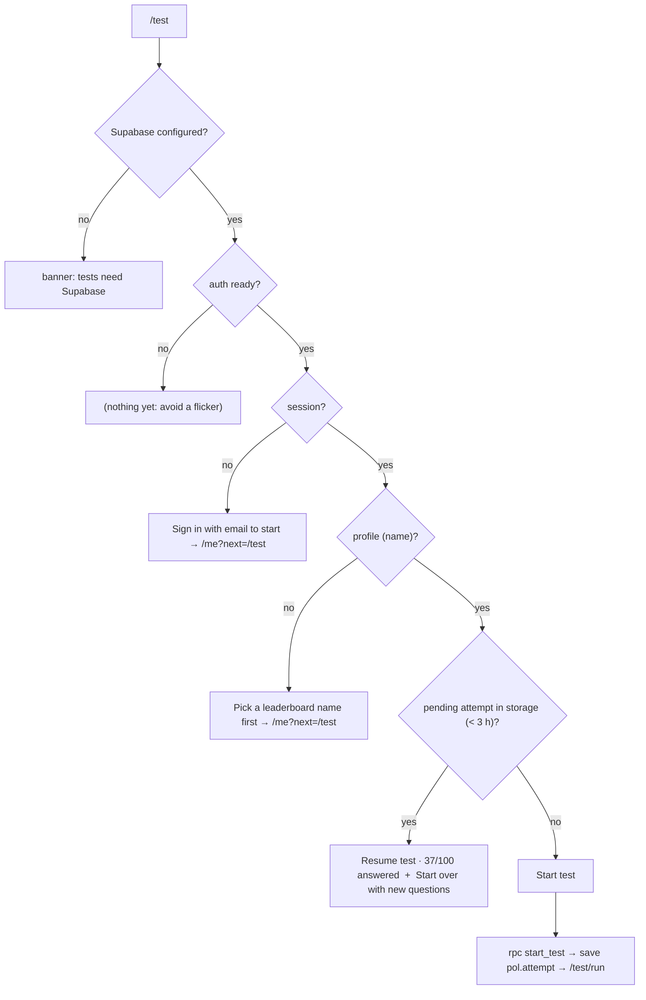

# L2.09a · The ranked test I: intro, attempt storage and starting a test

> **Level 2 · Build it** · Lesson 13 of 18

| Recipe card | |
|---|---|
| **Time** | 60 min |
| **You need** | L2.03 (`start_test`), L2.07a (`useAuth`), L2.04 (`storage`) |
| **You'll produce** | Lines 1–190 of `src/pages/Test.tsx`: the `Attempt`/`Result` types, storage keys, `loadAttempt`, the nested routes, and the `Intro` screen with `start()` |

**In two sentences:** Before the runner exists, we need a durable record of the attempt in the browser (so a reload doesn't lose 50 answers) and an intro screen that walks every kind of user to the right next step. This lesson builds both and wires the "Start test" button to `start_test`.

> **Session 2 update (2026-10-16).** The intro's sign-in link now reads "Sign in to start" with "One tap with Google. No password." underneath ([L2.07c](l2-07c-google-sign-in.md) §5.3).

### Objectives
1. Explain why the attempt stores **two** start times, and which one ranks you.
2. Write `loadAttempt()` with client-side expiry that mirrors the server's 3-hour rule.
3. Write the nested routes `index`, `run`, `result` and `*` under `/test/*`.
4. Render the intro's six states in the right order: not configured, not ready, signed out, no name, pending attempt, ready.
5. Write `start()`: RPC → build the local attempt → save → navigate.

---

## 1 · Warm-up

1. *(L2.03)* What does `start_test` return, and what does it do to older open attempts?
2. *(L2.07a)* What does `?next=/test` do on the account page?
3. *(L2.04)* What does `save(key, null)` do?

<details><summary>Answers</summary>1. <code>{attempt_id, question_ids[100], started_at}</code>; it deletes the user's unsubmitted attempts. 2. After session + profile exist, it navigates back to <code>/test</code> (replace). 3. Removes the key.</details>

## 2 · The problem this solves

A 100-question test takes 12–25 minutes on a phone. In that time a call comes in, the browser gets killed in the background, or the user swipes away by accident. Losing everything would be cruel. So the attempt lives in `localStorage` from the first second. And users arrive in many states (signed out, no name yet, test half done), each needing a different button.



*Takeaway: every user sees exactly one primary action, chosen by the first unmet requirement.*

---

## 3 · Concepts

### 3.1 Two clocks, two jobs

| Field | Set by | Used for | Trusted for ranking? |
|---|---|---|---|
| `started_at` | Postgres `now()` in `start_test` | The real duration in `submit_test` | **Yes** |
| `client_started` | `Date.now()` in the browser at start | The on-screen timer (`now − client_started`) | No |

Why not show `now − started_at` in the UI? Because the phone's clock and the server's clock differ. A phone 40 seconds fast would show the timer starting at 0:40. The UI timer measures from the phone's own start moment, so it always starts at 0:00, while the server measures the official time.

### 3.2 Client-side expiry mirrors the server

The server refuses submits older than 3 hours. If the browser kept a 5-hour-old attempt, the user would answer 100 questions and then get "This test expired" on submit. So `loadAttempt()` discards attempts older than 3 hours (by the client clock) **before** offering "Resume". Mirroring a server rule on the client is a UX courtesy; the server's check is the real one.

### 3.3 Nested routes

`App.tsx` routes `/test/*` to `<Test/>`. Inside, `<Routes>` resolves paths **relative to `/test`**:
- `index` (exactly `/test`) → Intro
- `run` → Run
- `result` → ResultView
- `*` (anything else under `/test/`) → Intro

Because `AnimatedRoutes` keys by the first segment (`test`), moving between these doesn't replay the page transition ([L2.05](l2-05-app-shell.md)).

---

## 4 · Reading the real code

### 4.1 Imports, types and storage (lines 1–45)

```tsx
import { useCallback, useEffect, useMemo, useState } from "react";
import { Link, Route, Routes, useNavigate } from "react-router-dom";
import { AnimatePresence, motion } from "motion/react";
import { Icon } from "../components/Icon";
import { CoffeeMug } from "../components/CoffeeMug";
import { BeanBurst, CountUp, Ring, Sheet } from "../components/Ui";
import { BY_ID, LETTERS, QUESTIONS, TEST_SIZE, numberInWeek } from "../data/questions";
import { useAuth } from "../lib/auth";
import { friendlyError, isConfigured, supabase } from "../lib/supabase";
import { fmtDuration, haptic, ordinal } from "../lib/format";
import { load, save } from "../lib/storage";

type Attempt = {
  attempt_id: string;
  question_ids: number[];
  started_at: string; // server time
  client_started: number; // Date.now() at start, for the on-screen timer
  answers: (number | null)[];
  flags: number[];
  pos: number;
};

type Result = {
  score: number;
  total: number;
  duration_ms: number;
  correct: number[];
  rank: number | null;
  players: number;
  question_ids: number[];
  answers: (number | null)[];
};

const ATTEMPT_KEY = "pol.attempt";
const RESULT_KEY = "pol.lastResult";
const EXPIRY_MS = 3 * 60 * 60 * 1000;
```
- **`Attempt`** is everything needed to resume exactly where you were: the server's id and question order, both clocks (§3.1), your answers (`null` = unanswered; `(number | null)[]`, see L1.03 practice), flagged positions, and the current position.
- **`answers` index = position in the test**, not question id. `answers[36]` belongs to `question_ids[36]`. This matches what `submit_test` expects.
- **`flags: number[]`** holds positions, not ids, for the same reason.
- **`Result`** is the server's response from `submit_test` (score, duration, correct answers, rank, players), **plus** the attempt's own `question_ids` and `answers`, so the results page can show "your answer vs correct" with no more network calls.
- **`EXPIRY_MS`** = 3 h written as arithmetic, so it reads as hours × minutes × seconds × ms.

```tsx
const loadAttempt = () => {
  const a = load<Attempt | null>(ATTEMPT_KEY, null);
  if (a && Date.now() - a.client_started > EXPIRY_MS) {
    save(ATTEMPT_KEY, null);
    return null;
  }
  return a;
};
```
- **Read, check age, and clean up a stale attempt on the spot** (§3.2).
- **Uses `client_started`** because it compares with the client clock (`Date.now()`), and the same clock is used on both sides of the subtraction.

### 4.2 Nested routes (lines 47–56)

```tsx
export default function Test() {
  return (
    <Routes>
      <Route index element={<Intro />} />
      <Route path="run" element={<Run />} />
      <Route path="result" element={<ResultView />} />
      <Route path="*" element={<Intro />} />
    </Routes>
  );
}
```
- **Relative paths**: `path="run"` means `/test/run`, because the parent matched `/test/*` (§3.3).
- **`index`** matches the parent path exactly.
- **The catch-all** sends typos like `/test/runn` to the intro rather than a blank page.

### 4.3 `Intro`: state and `start()` (lines 58–86)

```tsx
function Intro() {
  const { session, profile, ready } = useAuth();
  const nav = useNavigate();
  const [busy, setBusy] = useState(false);
  const [err, setErr] = useState<string | null>(null);
  const pending = loadAttempt();
  const last = load<Result | null>(RESULT_KEY, null);

  const start = async () => {
    setBusy(true);
    setErr(null);
    const { data, error } = await supabase.rpc("start_test");
    setBusy(false);
    if (error) return setErr(friendlyError(error));
    const d = data as { attempt_id: string; question_ids: number[]; started_at: string };
    const a: Attempt = {
      ...d,
      client_started: Date.now(),
      answers: d.question_ids.map(() => null),
      flags: [],
      pos: 0,
    };
    save(ATTEMPT_KEY, a);
    haptic(20);
    nav("/test/run");
  };
```
- **`pending` and `last` are read during render.** Cheap (a storage read) and always current. They don't need to be state, because nothing on this screen changes them except `start()`, which navigates away.
- **`supabase.rpc("start_test")`** sends `POST /rest/v1/rpc/start_test` with the user's token ([L1.02](l1-02-web-platform.md) §8).
- **Errors through `friendlyError`.** Possible messages: "Choose a display name first" (shouldn't happen, since the UI gates on profile), "The database isn't set up yet…" (`setup.sql` not run, seen live before the user ran it), network errors.
- **Building the local attempt**:
  - `...d` spreads the server fields (`attempt_id`, `question_ids`, `started_at`);
  - `client_started: Date.now()` (§3.1);
  - `answers: d.question_ids.map(() => null)`: 100 `null`s, one per question.
- **Save before navigating**, so `Run` finds it in storage on mount.
- **`haptic(20)`**: a satisfying "go" buzz.
- **Starting again while an attempt is pending** ("Start over") calls the same `start()`. The server deletes the old open attempt, and the new one overwrites the local key.

### 4.4 `Intro`: rendering (lines 88–190)

```tsx
  return (
    <div>
      <div className="page-head">
        <span className="caps">Practice test</span>
        <h1 className="display">
          {TEST_SIZE} questions.
          <br />
          <span className="red">One clock.</span>
        </h1>
        <p>Drawn at random from all {QUESTIONS.length} assignment questions.</p>
      </div>

      <div className="card pad">
        <ul className="rules">
          <li>
            <span className="ri"><Icon name="shuffle" size={20} /></span>
            <div>
              <b>{TEST_SIZE} random questions</b>
              <span>A new mix every attempt, all from the assignments.</span>
            </div>
          </li>
          <li>
            <span className="ri"><Icon name="clock" size={20} /></span>
            <div>
              <b>Timed by the server</b>
              <span>The clock starts when you tap Start and stops on Submit.</span>
            </div>
          </li>
          <li>
            <span className="ri"><Icon name="trophy" size={20} /></span>
            <div>
              <b>Ranked: score first, then time</b>
              <span>Your best attempt counts. Retake as often as you like.</span>
            </div>
          </li>
          <li>
            <span className="ri"><Icon name="flag" size={20} /></span>
            <div>
              <b>Skip, flag &amp; come back</b>
              <span>Jump to any question from the grid before submitting.</span>
            </div>
          </li>
        </ul>
      </div>
```
- **"100 questions. One clock."**: a headline that sets expectations. `TEST_SIZE` keeps the copy and the SQL `limit 100` in agreement.
- **The four rules state the trust model in plain language**: the server times you, the best attempt counts, and you can skip and come back. Students know the rules before they start, and the rules match the SQL exactly ([L2.03](l2-03-server-grading.md)).

```tsx
      <div className="stack" style={{ marginTop: 16 }}>
        {!isConfigured ? (
          <div className="banner">
            <Icon name="info" size={18} /> Tests need Supabase. Add VITE_SUPABASE_URL and VITE_SUPABASE_ANON_KEY.
          </div>
        ) : !ready ? null : !session ? (
          <>
            <Link to="/me?next=/test" className="btn primary block">
              <Icon name="mail" size={19} /> Sign in with email to start
            </Link>
            <p className="muted" style={{ textAlign: "center", fontSize: ".85rem", margin: 0 }}>
              No password. We'll email you a sign-in code.
            </p>
          </>
        ) : !profile ? (
          <Link to="/me?next=/test" className="btn primary block">
            Pick a leaderboard name first <Icon name="arrow" size={18} />
          </Link>
        ) : pending ? (
          <>
            <motion.button className="btn red block" whileTap={{ scale: 0.97 }} onClick={() => nav("/test/run")}>
              Resume test · {pending.answers.filter((a) => a !== null).length}/{pending.question_ids.length} answered
            </motion.button>
            <button className="btn block" onClick={start} disabled={busy}>
              {busy ? "Brewing a fresh test…" : "Start over with new questions"}
            </button>
          </>
        ) : (
          <motion.button className="btn red block" whileTap={{ scale: 0.97 }} onClick={start} disabled={busy} style={{ minHeight: 58, fontSize: "1.05rem" }}>
            {busy ? (
              <>
                <CoffeeMug size={26} steam={false} filling /> Brewing your test…
              </>
            ) : (
              <>
                <Icon name="bolt" size={20} /> Start test
              </>
            )}
          </motion.button>
        )}
        {err && <div className="banner">{err}</div>}
        {last && session && (
          <Link to="/test/result" className="btn ghost block">
            Last result: {last.score}/{last.total} in {fmtDuration(last.duration_ms)} <Icon name="right" size={18} />
          </Link>
        )}
      </div>
    </div>
  );
}
```
- **A chained ternary = an ordered decision list** (the flowchart in §2). Order matters: checking `pending` before `session` would offer "Resume" to a signed-out user, whose submit would then fail.
- **`!ready ? null`** renders nothing while auth initialises. No flicker of "Sign in" for a signed-in user.
- **"We'll email you a sign-in code"** used to say "a 6-digit code", which was wrong for this project's 8-digit codes. It was reworded during the OTP fix ([L2.07a](l2-07a-auth-sign-in.md)).
- **Resume shows progress** (`37/100 answered`) by counting non-null answers.
- **The loading state is a tiny filling mug** ("Brewing your test…"), on-brand feedback during the RPC.
- **"Last result"** links to `/test/result`, which reads `pol.lastResult` from storage.

---

## 5 · Worked trace (step-through frames): pressing Start

| Frame | Step | State | Predict → |
|---|---|---|---|
| 1 | tap "Start test" | busy = true, the button shows "Brewing your test…" | |
| 2 | `rpc("start_test")` → server deletes your open attempts, picks 100 ids, inserts the row | — | Who decides the 100 questions? **The server** |
| 3 | response `{ attempt_id: "8e1…", question_ids: [1203, 507, …], started_at: "2026-10-16T10:00:00.120Z" }` | busy = false | |
| 4 | build `a`: `client_started = 1792148400350` (phone clock), 100 × `null`, flags [], pos 0 | | Which time ranks you? **started_at** |
| 5 | `save("pol.attempt", a)` | storage holds the attempt | Survives a reload? **Yes** |
| 6 | `nav("/test/run")` | Run mounts and reads storage | |

---

## 6 · Running and testing

- `tests/e2e/ui.spec.ts` › "signed-out visitors are sent to sign in before a ranked test": `/test` shows "Sign in with email to start" and links to `/me?next=/test`.
- `tests/e2e/auth.spec.ts`: after choosing a name, lands back on `/test` (the `next` param), clicks **Start test**, and expects `/test/run` with "Question 1 of 100". This is the real `start_test` against Supabase.
- `tests/db/schema.test.mjs` › "start_test requires a profile" and "start_test returns 100 distinct real questions and records server time".

## 7 · Bug journal

**Clean run.** This part never failed in testing. One piece of copy was wrong ("a 6-digit code"), and it was corrected as part of the 8-digit OTP incident ([L2.07a](l2-07a-auth-sign-in.md)). The ordering of the intro's states was designed up front from the requirements in §2. Notably, "Resume" is only offered to users who can actually submit.

## 8 · Why this design

| Decision | Alternatives | Why this one | Trade-off | Choose differently when |
|---|---|---|---|---|
| Attempt in `localStorage` | Server-side autosave of each answer | Survives reloads and offline moments; zero network per answer | Not resumable on another device | Cross-device resume → save answers to the server |
| Two clocks | Server time only | The UI timer starts at 0:00 regardless of clock skew | Two fields | — |
| Client-side 3 h expiry | None | Avoids a wasted attempt that would fail on submit | Duplicates the server rule | — |
| Gate on name before starting | Ask for a name at submit | No ranked result without a board identity | One more step for newcomers | — |

## 9 · Check yourself

**Q1.** A user's phone clock is 2 minutes fast. What does the on-screen timer show right after starting? What duration does the leaderboard record for a 15-minute test?
<details><summary>Answer</summary>The timer shows 0:00 (it measures from the phone's own start). The leaderboard records about 15:00 (server <code>now()</code> minus server <code>started_at</code>). Clock skew affects neither.</details>

**Q2.** Why are `answers` and `flags` indexed by position rather than question id?
<details><summary>Answer</summary><code>submit_test</code> takes an array aligned with <code>question_ids</code>; positions also match the "Question N of 100" UI and the grid.</details>

**Q3.** You reorder the ternary to check `pending` before `session`. Who is harmed?
<details><summary>Answer</summary>Someone who signed out mid-test: they'd see "Resume", answer more, and then fail at submit (no session, so the RPC is denied).</details>

**Q4.** A 4-hour-old attempt is in storage. What does the intro show?
<details><summary>Answer</summary>"Start test". <code>loadAttempt</code> deleted the stale attempt and returned null.</details>

## 10 · Practice

**Easy (10 min).** Show how long ago the pending attempt started ("started 12 min ago") on the Resume button.

**Medium (20 min).** Add a confirmation sheet before "Start over with new questions" (it discards progress), reusing `Sheet`.

**Hard (40 min).** Design cross-device resume: which table changes (an `answers` column updated per answer?), which RPC (`save_answer(attempt, index, choice)`), and how you'd stop a client from writing answers after submit.
<details><summary>Sketch</summary>A definer function <code>save_answer</code> that locks the row, checks owner + open + not expired, and sets <code>answers[i]</code>. <code>submit_test</code> would grade the stored answers instead of a passed array. The resume screen fetches the open attempt with its stored answers.</details>

## 11 · From memory

**Rung 1 · Cloze.**

```tsx
type Attempt = { attempt_id: string; question_ids: number[]; started_at: string; ___①___: number;
                 answers: (number | ___②___)[]; flags: number[]; pos: number };
const EXPIRY_MS = 3 * 60 * 60 * ___③___;
const loadAttempt = () => {
  const a = load<Attempt | null>(ATTEMPT_KEY, null);
  if (a && Date.now() - a.client_started > EXPIRY_MS) { save(ATTEMPT_KEY, ___④___); return null; }
  return a;
};
<Route ___⑤___ element={<Intro />} />
<Route path="___⑥___" element={<Run />} />
const { data, error } = await supabase.___⑦___("start_test");
const a: Attempt = { ...d, client_started: Date.now(), answers: d.question_ids.map(() => ___⑧___), flags: [], pos: 0 };
```
<details><summary>Answers</summary>① <code>client_started</code> ② <code>null</code> ③ <code>1000</code> ④ <code>null</code> ⑤ <code>index</code> ⑥ <code>run</code> ⑦ <code>rpc</code> ⑧ <code>null</code></details>

**Rung 2 · Blank page (15 min).** Write the types, `loadAttempt`, the routes and `Intro` with `start()` from memory.
<details><summary>Self-check</summary>

- [ ] Attempt has both clocks; answers nullable; flags as positions
- [ ] Result includes question_ids + answers for review
- [ ] Expiry check uses the client clock on both sides
- [ ] Routes: index, run, result, catch-all
- [ ] Intro order: configured → ready → session → profile → pending → start
- [ ] start: rpc → friendlyError → build → save → navigate
</details>

## 12 · Flashcards

<details><summary><b>Q:</b> Which start time ranks you?</summary><b>A:</b> <code>started_at</code> from Postgres <code>now()</code>; <code>client_started</code> only drives the on-screen timer.</details>
<details><summary><b>Q:</b> Why store the attempt in localStorage immediately?</summary><b>A:</b> So reloads, background kills or accidental exits don't lose answers.</details>
<details><summary><b>Q:</b> Why mirror the 3 h expiry on the client?</summary><b>A:</b> To avoid offering "Resume" for an attempt the server would reject on submit.</details>
<details><summary><b>Q:</b> What does <code>path="run"</code> mean under <code>/test/*</code>?</summary><b>A:</b> <code>/test/run</code>; nested route paths are relative.</details>
<details><summary><b>Q:</b> Order of the intro's checks?</summary><b>A:</b> Configured → auth ready → session → profile → pending attempt → start.</details>
<details><summary><b>Q:</b> What does Result carry besides the server's fields?</summary><b>A:</b> The attempt's question_ids and answers, for the review list.</details>

## 13 · The menu board

| | |
|---|---|
| Keys | `pol.attempt`, `pol.lastResult` |
| Attempt | id · question_ids · started_at (server) · client_started (UI) · answers (null = unanswered) · flags · pos |
| Expiry | 3 h, checked in `loadAttempt` (client) and `submit_test` (server) |
| Routes | `/test` Intro · `/test/run` · `/test/result` · `*` → Intro |
| Intro order | configured → ready → session → profile → pending → start |
| start() | `rpc("start_test")` → build → save → `nav("/test/run")` |

## 14 · Glossary

**Clock skew**: different devices' clocks disagreeing. **Index route**: a child route matching the parent path exactly. **Nested routes**: routes defined relative to a parent route. **Pending attempt**: a started, unsubmitted test saved locally. **Spread (`...`)**: copying an object's properties into a new object.

## 15 · Go further

| Resource | Type | Why | Which part | Time |
|---|---|---|---|---|
| [React Router: Nested routes](https://reactrouter.com/start/declarative/routing#nested-routes) | Docs | Relative paths, index routes | That section | 10 min |
| [Supabase JS: rpc](https://supabase.com/docs/reference/javascript/rpc) | Reference | Calling Postgres functions | Examples | 5 min |
| [MDN: Date.now](https://developer.mozilla.org/en-US/docs/Web/JavaScript/Reference/Global_Objects/Date/now) | Docs | The client clock and its limits | Whole page | 5 min |

---
← [L2.08b Quiz & list](l2-08b-quiz-and-list.md) · [Hub](README.md) · [L2.09b The test runner →](l2-09b-test-runner.md)
