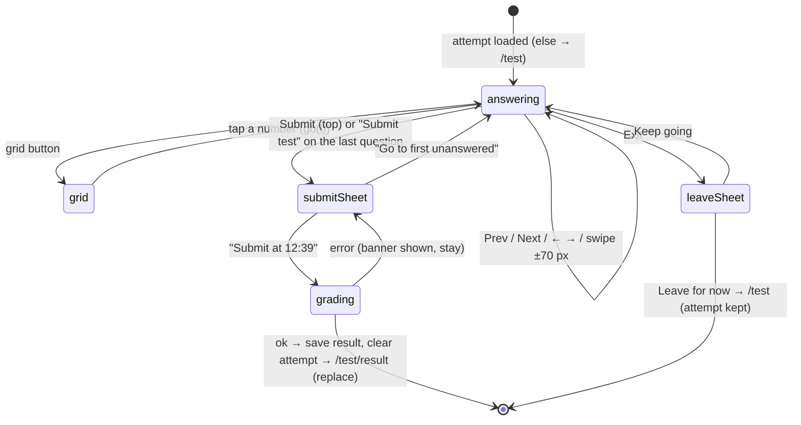

# L2.09b · The ranked test II: the runner

> **Level 2 · Build it** · Lesson 13 of 17

| Recipe card | |
|---|---|
| **Time** | 75 min |
| **You need** | L2.09a (Attempt type, storage), L2.06a (`Sheet`), L2.08b (quiz option styling) |
| **You'll produce** | Lines 192–477 of `src/pages/Test.tsx`: the `Run` component |

**In two sentences:** The runner is a focused, full-screen exam room. One question at a time, a ticking clock, a progress bar, auto-advance after you answer, flags, a jump grid, swipe between questions, and a confirmation before submitting. Every change is persisted, so a reload drops you back exactly where you were.

### Objectives
1. Keep the attempt in state **and** storage with one effect, and redirect when there's no attempt.
2. Write `choose` with toggle-off and a 320 ms auto-advance that can't fire on the wrong question.
3. Write `go` with clamping and direction, used by buttons, keys, swipes and the grid.
4. Build the three sheets (grid, submit, leave) and explain what each protects against.
5. Write `submit`: map `null → -1`, call `submit_test`, store the result, clear the attempt, and navigate with `replace`.

---

## 1 · Warm-up

1. *(L2.09a)* Which field drives the on-screen timer, and which the ranked time?
2. *(L2.03)* What does `submit_test` reject, and in which order?
3. *(L2.06a)* How do you close a `Sheet`?

<details><summary>Answers</summary>1. <code>client_started</code> (UI); server <code>started_at</code> (ranked). 2. Not found/not yours → already submitted → expired (> 3 h) → wrong answer count. 3. Escape, scrim tap, a drag down past 110 px / 600 px/s, or a button calling <code>onClose</code>.</details>

## 2 · The problem this solves

Phone exams fail on small things: a mis-tap that can't be undone, losing your place, an accidental swipe away, not knowing how many you skipped. The runner removes each of those risks.



*Takeaway: every path out of the runner is explicit, and only "Submit" ends the attempt.*

---

## 3 · Concepts

### 3.1 State as the single writer, storage as a mirror

All changes go through `setA(...)`, and one effect writes `a` to storage whenever it changes. Nothing writes storage directly during the run, so state and storage can't disagree.

### 3.2 Delayed actions must check they still apply

Auto-advance runs 320 ms after you choose. In those 320 ms you might tap Prev, or open the grid and jump. So the timeout doesn't blindly do `pos + 1`. It advances only if you're **still on the question you answered** (`cur.pos === p`). That is the general rule for timers in UI: capture the context, and verify it on fire.

### 3.3 `beforeunload`

Registering a `beforeunload` listener that calls `preventDefault()` asks the browser to show its "Leave site? Changes may not be saved" dialog when the tab is closed or reloaded. Browsers show their own wording; you can't customise it. Tests must accept it (`page.on("dialog", d => d.accept())`), or navigation hangs ([L4.05](l4-05-ui-tests-quiz-runner.md)).

---

## 4 · Reading the real code

### 4.1 State and the four effects (lines 195–226)

```tsx
function Run() {
  const nav = useNavigate();
  const [a, setA] = useState<Attempt | null>(() => loadAttempt());
  const [now, setNow] = useState(Date.now());
  const [gridOpen, setGridOpen] = useState(false);
  const [submitOpen, setSubmitOpen] = useState(false);
  const [quitOpen, setQuitOpen] = useState(false);
  const [busy, setBusy] = useState(false);
  const [err, setErr] = useState<string | null>(null);
  const [dir, setDir] = useState(1);

  useEffect(() => {
    if (!a) nav("/test", { replace: true });
  }, [a, nav]);

  useEffect(() => {
    const t = setInterval(() => setNow(Date.now()), 1000);
    return () => clearInterval(t);
  }, []);

  useEffect(() => {
    if (a) save(ATTEMPT_KEY, a);
  }, [a]);

  // warn before closing the tab mid-test
  useEffect(() => {
    const h = (e: BeforeUnloadEvent) => {
      e.preventDefault();
    };
    window.addEventListener("beforeunload", h);
    return () => window.removeEventListener("beforeunload", h);
  }, []);
```
- **Lazy initial attempt** from storage (`loadAttempt`, which also discards expired attempts).
- **No attempt → back to the intro** with `replace`, so "Back" won't return to an empty runner. This covers opening `/test/run` directly, or after submitting.
- **The clock tick**: `now` updates every second, re-rendering the timer. One re-render per second of a small tree is cheap.
- **The mirror effect** (§3.1). Every answer, flag or move is saved immediately.
- **`beforeunload`** for the whole lifetime of the runner (§3.3). Removed on unmount, so the rest of the app never nags.

### 4.2 Moving between questions (lines 228–238)

```tsx
  const go = useCallback(
    (to: number) => {
      setA((cur) => {
        if (!cur) return cur;
        const pos = Math.max(0, Math.min(cur.question_ids.length - 1, to));
        setDir(pos >= cur.pos ? 1 : -1);
        return { ...cur, pos };
      });
    },
    []
  );
```
- **Clamp** to `[0, 99]`: Prev on the first question and Next on the last are safe no-ops.
- **`dir`** = +1 forward, −1 back, which drives the slide direction (§4.6).
- **A functional update** reads the latest `pos`, even when called from a stale closure (the keyboard handler, the timer).
- **Code smell (honest):** `setDir` inside the `setA` updater is a side effect inside what should be a pure function. React may call updaters twice in StrictMode (development). It's harmless here (setting the same value twice), but cleaner code would compute `dir` outside the updater.

### 4.3 Answering and flagging (lines 240–261)

```tsx
  const choose = (i: number) => {
    if (!a) return;
    haptic(8);
    const answers = a.answers.slice();
    answers[a.pos] = answers[a.pos] === i ? null : i;
    setA({ ...a, answers });
    // quick auto-advance to keep momentum (you can always go back)
    if (answers[a.pos] !== null && a.pos < a.question_ids.length - 1) {
      const p = a.pos;
      setTimeout(() => {
        setDir(1);
        setA((cur) => (cur && cur.pos === p ? { ...cur, pos: p + 1 } : cur));
      }, 320);
    }
  };

  const toggleFlag = () => {
    if (!a) return;
    haptic(8);
    const flags = a.flags.includes(a.pos) ? a.flags.filter((f) => f !== a.pos) : [...a.flags, a.pos];
    setA({ ...a, flags });
  };
```
- **Copy before changing** (`slice()`): React state must be replaced, not mutated, or React can't see the change.
- **Tap the selected option again to clear it**, a way to un-answer a mis-tap.
- **Auto-advance only when an answer was set** (not when cleared), and not on the last question (where the "Submit test" button takes over).
- **`p`** captures the position *at the time of answering*. The timeout advances only if you're still there (§3.2).
- **320 ms**: long enough to see the ✓ appear (it scales in), short enough to keep momentum.
- **Flags** are a set of positions stored as an array. Toggling filters out or appends.
- **The refactor that preceded this version:** the first draft put `setDir(1)` *inside* the updater as a comma expression, `(cur && cur.pos === p ? (setDir(1), { ...cur, pos: p + 1 }) : cur)`. That's legal but obscure, so it was rewritten to the two clear statements above before any test ran.

### 4.4 Keyboard (lines 263–277)

```tsx
  useEffect(() => {
    const k = (e: KeyboardEvent) => {
      if (!a || gridOpen || submitOpen) return;
      const i = "1234".indexOf(e.key) >= 0 ? "1234".indexOf(e.key) : "abcd".indexOf(e.key.toLowerCase());
      const q = BY_ID.get(a.question_ids[a.pos]);
      if (i >= 0 && q && i < q.options.length) choose(i);
      else if (e.key === "ArrowRight") go(a.pos + 1);
      else if (e.key === "ArrowLeft") go(a.pos - 1);
      else if (e.key.toLowerCase() === "f") toggleFlag();
    };
    window.addEventListener("keydown", k);
    return () => window.removeEventListener("keydown", k);
  });

  const answered = useMemo(() => a?.answers.filter((x) => x !== null).length ?? 0, [a]);
```
- **Ignored while the grid or submit sheet is open**, so typing "3" in the submit sheet doesn't answer behind it. (The leave sheet isn't in the check. A small gap: pressing 1–4 behind it still answers.)
- **1–4 / A–D answer, ← → move, F flags.** On a True/False question, keys 3–4 do nothing.
- **`answered`** counts non-null answers. It's used by the progress bar, the grid legend and the submit sheet.

### 4.5 Submit (lines 279–298)

```tsx
  if (!a) return null;
  const q = BY_ID.get(a.question_ids[a.pos])!;
  const total = a.question_ids.length;
  const isLast = a.pos === total - 1;

  const submit = async () => {
    setBusy(true);
    setErr(null);
    const { data, error } = await supabase.rpc("submit_test", {
      p_attempt: a.attempt_id,
      p_answers: a.answers.map((x) => (x === null ? -1 : x)),
    });
    setBusy(false);
    if (error) return setErr(friendlyError(error));
    const r = data as Omit<Result, "question_ids" | "answers">;
    save(RESULT_KEY, { ...r, question_ids: a.question_ids, answers: a.answers });
    save(ATTEMPT_KEY, null);
    haptic(40);
    nav("/test/result", { replace: true, state: { fresh: true } });
  };
```
- **`if (!a) return null`** after all hooks; the redirect effect handles navigation.
- **`BY_ID.get(...)!`**: ids come from our own server's draw of our own questions, so a lookup miss would mean data drift. The `!` is reasonable here, and the data tests guard drift ([L2.01](l2-01-data-pipeline.md)).
- **Parameter names match the SQL** (`p_attempt`, `p_answers`). supabase-js sends them as named JSON arguments.
- **`null → -1`**: the SQL encoding for "skipped", which never matches a real answer ([L2.03](l2-03-server-grading.md)).
- **On error**: stay in the runner and show the message in the sheet. "This test expired…", "already submitted" and network errors are all recoverable or explainable. The UI test proves an anonymous submit shows `.sheet .banner` and stays on `/test/run` ([L4.05](l4-05-ui-tests-quiz-runner.md)).
- **On success**:
  - save the server result plus our question order and answers (for review);
  - **delete the attempt** (so "Resume" disappears);
  - navigate with `replace`, so "Back" from results doesn't reopen the finished runner (which would redirect anyway).
- **`state: { fresh: true }`** is never read by `ResultView`: dead data left from an idea (play the confetti only on fresh results). Harmless; worth knowing it's unused.

### 4.6 Top bar and question card (lines 300–372)

```tsx
  return (
    <div>
      <div className="test-top">
        <div className="row between">
          <button className="btn sm ghost" onClick={() => setQuitOpen(true)} style={{ paddingLeft: 4 }}>
            <Icon name="x" size={18} /> Exit
          </button>
          <span className="timer" aria-label="Elapsed time">
            <span className="dot" />
            {fmtDuration(now - a.client_started)}
          </span>
          <button className="btn sm" onClick={() => setSubmitOpen(true)}>
            Submit
          </button>
        </div>
        <div className="row" style={{ gap: 12 }}>
          <div className="bar" style={{ flex: 1, height: 6 }}>
            <span style={{ width: `${(answered / total) * 100}%` }} />
          </div>
          <span className="tnum muted" style={{ fontSize: ".82rem", fontWeight: 700 }}>
            {answered}/{total}
          </span>
        </div>
      </div>
```
- **`.test-top` is sticky** under the top bar (at the very top on laptops, where the top bar is hidden), so the clock and progress are always visible.
- **Exit opens a sheet** rather than leaving at once.
- **The timer pill** has a blinking red dot (a CSS `steps(2)` animation) and an `aria-label`, so screen readers announce "Elapsed time 12:35".
- **Submit is always reachable**, not only on the last question. You may finish early.
- **The progress bar counts answers**, not position: 37 answered, wherever you are.

```tsx
      <AnimatePresence mode="wait" custom={dir}>
        <motion.div
          key={a.pos}
          className="q-card"
          custom={dir}
          initial={{ x: dir * 48, opacity: 0 }}
          animate={{ x: 0, opacity: 1 }}
          exit={{ x: dir * -48, opacity: 0 }}
          transition={{ duration: 0.2, ease: [0.22, 1, 0.36, 1] }}
          drag="x"
          dragConstraints={{ left: 0, right: 0 }}
          dragElastic={0.25}
          onDragEnd={(_, info) => {
            if (info.offset.x < -70) go(a.pos + 1);
            else if (info.offset.x > 70) go(a.pos - 1);
          }}
          style={{ touchAction: "pan-y" }}
        >
          <div className="row between">
            <span className="tag">
              Question {a.pos + 1} of {total}
            </span>
            {a.flags.includes(a.pos) && (
              <span className="tag" style={{ color: "var(--red)", background: "var(--red-soft)" }}>
                <Icon name="flag" size={13} /> Flagged
              </span>
            )}
          </div>
          <p className="q-text">{q.q}</p>
          <div className="opts">
            {q.options.map((o, i) => (
              <motion.button key={i} className={`opt ${a.answers[a.pos] === i ? "sel" : ""}`} whileTap={{ scale: 0.97 }} onClick={() => choose(i)}>
                <span className="L">{LETTERS[i]}</span>
                {o}
                {a.answers[a.pos] === i && (
                  <motion.span className="mark" initial={{ scale: 0 }} animate={{ scale: 1 }}>
                    <Icon name="check" size={20} />
                  </motion.span>
                )}
              </motion.button>
            ))}
          </div>
        </motion.div>
      </AnimatePresence>

      <p className="kbd-hint">
        <kbd>1</kbd>–<kbd>4</kbd> answer · <kbd>←</kbd> <kbd>→</kbd> move · <kbd>F</kbd> flag
      </p>
```
- **Keyed by position**: each question is a new card, which slides in from the direction of travel (`dir`). Going back slides from the left.
- **Swipe between questions**: `drag="x"` with `dragConstraints={{ left: 0, right: 0 }}` and `dragElastic: 0.25` means the card barely moves (rubber band) but `offset` still measures the gesture. Past ±70 px → next/previous. `touchAction: pan-y` keeps vertical scrolling for long questions (the lesson of [L2.08a](l2-08a-flashcard-deck.md)).
- **The "Flagged" tag** is visible on the card itself.
- **The selected option** gets `.sel` and a ✓ that scales in. **No right/wrong colours.** This is an exam, and the key isn't on the client (only `submit_test` knows it).
- **"Question N of 100"** is the text tests wait for after every move.

### 4.7 Bottom navigation and the sheets (lines 374–477)

```tsx
      <div className="test-nav">
        <motion.button className="round" whileTap={{ scale: 0.9 }} onClick={() => go(a.pos - 1)} disabled={a.pos === 0} aria-label="Previous question">
          <Icon name="left" />
        </motion.button>
        <motion.button className={`round ${a.flags.includes(a.pos) ? "flag-on" : ""}`} whileTap={{ scale: 0.9 }} onClick={toggleFlag} aria-label="Flag question">
          <Icon name="flag" />
        </motion.button>
        {isLast ? (
          <motion.button className="btn red" whileTap={{ scale: 0.96 }} onClick={() => setSubmitOpen(true)}>
            Submit test
          </motion.button>
        ) : (
          <motion.button className="btn primary" whileTap={{ scale: 0.96 }} onClick={() => go(a.pos + 1)}>
            Next <Icon name="right" size={18} />
          </motion.button>
        )}
        <motion.button className="round" whileTap={{ scale: 0.9 }} onClick={() => setGridOpen(true)} aria-label="All questions">
          <Icon name="grid" />
        </motion.button>
      </div>
```
- **A fixed bottom bar replaces the app tab bar** (the TabBar hides on `/test/run`). Thumb-reachable: Prev · Flag · Next/Submit · Grid.
- **The main button changes on the last question** to a red "Submit test".
- **Every icon button has an `aria-label`**, which tests use (`getByRole("button", { name: "Flag question" })`).

```tsx
      <Sheet open={gridOpen} onClose={() => setGridOpen(false)}>
        <h3>Jump to a question</h3>
        <div className="legend">
          <span><i style={{ background: "var(--primary)" }} />Answered ({answered})</span>
          <span><i style={{ background: "var(--surface-2)", border: "1px solid var(--border-strong)" }} />Unanswered ({total - answered})</span>
          <span><i style={{ background: "var(--red)", borderRadius: "50%" }} />Flagged ({a.flags.length})</span>
        </div>
        <div className="qgrid">
          {a.question_ids.map((_, i) => (
            <button
              key={i}
              className={`${a.answers[i] !== null ? "ans" : ""} ${i === a.pos ? "cur" : ""} ${a.flags.includes(i) ? "flag" : ""}`}
              onClick={() => {
                go(i);
                setGridOpen(false);
              }}
            >
              {i + 1}
            </button>
          ))}
        </div>
      </Sheet>
```
- **The grid**: 100 numbered buttons. Filled = answered, a red ring = current, a red dot = flagged (`::after` in CSS). The legend with counts teaches the encoding.
- **Tap a number** → `go(i)` and close.

```tsx
      <Sheet open={submitOpen} onClose={() => !busy && setSubmitOpen(false)}>
        <h3>Submit your test?</h3>
        <p className="muted" style={{ marginTop: 0 }}>
          You answered <b style={{ color: "var(--ink)" }}>{answered}</b> of {total}
          {total - answered > 0 && (
            <>
              . <b style={{ color: "var(--red)" }}>{total - answered} unanswered</b> will count as wrong
            </>
          )}
          .{a.flags.length > 0 && ` ${a.flags.length} flagged.`}
        </p>
        {err && (
          <div className="banner" style={{ marginBottom: 12 }}>
            {err}
          </div>
        )}
        <div className="stack">
          <button className="btn red block" onClick={submit} disabled={busy}>
            {busy ? "Grading…" : `Submit at ${fmtDuration(now - a.client_started)}`}
          </button>
          {total - answered > 0 && (
            <button
              className="btn block"
              onClick={() => {
                setSubmitOpen(false);
                go(a.answers.findIndex((x) => x === null));
              }}
            >
              Go to first unanswered
            </button>
          )}
        </div>
      </Sheet>

      <Sheet open={quitOpen} onClose={() => setQuitOpen(false)}>
        <h3>Leave the test?</h3>
        <p className="muted" style={{ marginTop: 0 }}>
          Your answers are saved on this device and you can resume, but the clock keeps running.
        </p>
        <div className="stack">
          <button className="btn primary block" onClick={() => setQuitOpen(false)}>
            Keep going
          </button>
          <button className="btn block" onClick={() => nav("/test")}>
            Leave for now
          </button>
        </div>
      </Sheet>
    </div>
  );
}
```
- **The submit sheet states consequences in numbers**: "You answered 94 of 100. 6 unanswered will count as wrong. 1 flagged."
- **It can't be dismissed while grading** (`!busy && …`), so the result isn't lost mid-request.
- **"Submit at 12:39"**: the button shows the time you'll be ranked with (client approximation).
- **"Go to first unanswered"** uses `findIndex(x => x === null)`.
- **The leave sheet is honest**: answers are saved, and **the clock keeps running** (the server's `started_at` doesn't pause). Users decide with full information. "Keep going" is the primary (default) action.

---

## 5 · Worked trace (step-through frames): answer, auto-advance, flag, jump, reload

Start: `pos = 0`, all answers null.

| Frame | Action | State after | Storage? | Predict → |
|---|---|---|---|---|
| 1 | tap option B (index 1) on Q1 | answers[0] = 1 | saved | Moves immediately? **No, after 320 ms** |
| 2 | +320 ms; still `pos === 0` | pos = 1, dir = +1; Q2 slides in from the right | saved | |
| 3 | tap Prev quickly, then tap B on Q1 again | answers[0] = **null** (toggle off) | saved | Auto-advance? **No: the answer was cleared** |
| 4 | tap Flag | flags = [0] | saved | Where does it show? **Tag on the card + red dot in the grid** |
| 5 | open the grid, tap "50" | pos = 49, dir = +1 | saved | |
| 6 | reload the page (accept "Leave site?") | Run mounts: `loadAttempt()` → pos 49, flags [0] | | Which question shows? **Question 50 of 100** |
| 7 | Submit (top) | the sheet: "You answered 0 of 100. 100 unanswered…" | | |

**The auto-advance race, as a sequence:**

```mermaid
sequenceDiagram
  participant U as User
  participant R as Run
  U->>R: choose(i) on question p
  R->>R: answers[p] = i; schedule timeout(320 ms, captures p)
  alt user stays on p
    R->>R: timeout fires: cur.pos === p → pos = p+1
  else user taps Next within 320 ms
    U->>R: go(p+1)
    R->>R: timeout fires: cur.pos = p+1 ≠ p → do nothing ✓
  else user taps Next AFTER the auto-advance
    R->>R: timeout already moved to p+1
    U->>R: go(p+2) → question p+1 skipped ✗ (UX trade-off)
  end
```

*Takeaway: the guard prevents double-advancing within the window. A deliberate Next tap after the advance still moves on, which is correct behaviour, but it can surprise a user expecting no auto-advance. That exact case tripped the WebKit test ([L4.06](l4-06-live-security-auth.md)).*

---

## 6 · Running and testing

- `tests/e2e/ui.spec.ts` › "test runner: answer, auto-advance, flag, grid, resume, submit sheet, exit": injects a local attempt (no server needed to render) and checks auto-advance to "Question 2 of 100", `1/100` progress, Prev shows `.sel`, Flag shows "Flagged", the grid has 100 buttons with 1 `.ans` and 1 `.flag`, a jump to 50, a reload resumes at 50, the submit sheet says "You answered 1 of 100" and "99 unanswered", "Go to first unanswered" goes to Q2, an anonymous submit shows a banner and stays, and Exit → "Leave for now" → `/test`. On all 11 projects.
- `tests/e2e/auth.spec.ts` takes a **real** 100-question test (90 right, 4 wrong, 6 skipped) including a reload at question 51, submits, and expects the score `90`.

## 7 · Bug journal

**Clean run (app code).** The runner's logic passed every test once written. Two things are worth recording:
- **A pre-emptive refactor**: the comma-expression `setDir` inside an updater (§4.3), rewritten for clarity before the first run.
- **A test-side incident**: the auth journey on WebKit skipped a question because the *test* clicked Next after an auto-advance. The app behaved as designed. That story is in [L4.06](l4-06-live-security-auth.md).

## 8 · Why this design

| Decision | Alternatives | Why this one | Trade-off | Choose differently when |
|---|---|---|---|---|
| Auto-advance after 320 ms | Manual Next only | Fast flow on phones (a real exam has 100 questions) | A deliberate Next right after can skip | Users dislike it → add a setting |
| Tap again to un-answer | A separate "clear" button | No extra UI | Not discoverable | — |
| No right/wrong feedback during the test | Instant feedback | Exam realism; the key isn't on the client | Students learn only at the end | Practice mode (that is Quiz) |
| Swipe ±70 px between questions | Buttons only | Natural on phones | Mis-swipes possible (elastic 0.25 reduces them) | — |
| `beforeunload` warning | None | Prevents accidental loss | Nags on intentional reloads | — |
| Unanswered counts as wrong | Partial credit | Matches typical MCQ exams and the SQL | Harsh | Negative marking → a different scoring rule |

## 9 · Check yourself

**Q1.** You answer Q10, then open the grid within 320 ms and jump to Q40. Where do you end up?
<details><summary>Answer</summary>Q40. When the timeout fires, <code>cur.pos</code> is 39 (not 9), so the guard skips the advance.</details>

**Q2.** Why does `submit` send `-1` for unanswered instead of omitting them?
<details><summary>Answer</summary><code>submit_test</code> requires exactly as many answers as questions ("Answer count does not match"), and aligns them by position.</details>

**Q3.** Why can't the submit sheet be closed while `busy`?
<details><summary>Answer</summary>Closing mid-request would hide the outcome; the success path navigates away, and an error should be shown in the sheet.</details>

**Q4.** The user reloads at question 51. What restores the position and answers?
<details><summary>Answer</summary>The mirror effect saved <code>a</code> on every change; on mount, <code>useState(() => loadAttempt())</code> reads it back.</details>

**Q5.** What's dead in this component?
<details><summary>Answer</summary><code>state: { fresh: true }</code> passed on navigation; <code>ResultView</code> never reads it.</details>

## 10 · Practice

**Easy (10 min).** Add the leave sheet to the keyboard handler's ignore list, so keys don't answer behind it.

**Medium (20 min).** Add a setting "Auto-advance" (on by default, stored in `pol.autoAdvance`) and respect it in `choose`.

**Hard (40 min).** Show a five-minute warning toast when the elapsed time passes a soft limit you choose, for example 25:00 for 100 questions (15 seconds per question), without re-rendering more than once a second.
<details><summary>Hint</summary>Compare <code>now - a.client_started</code> against the limit in the render that already happens every second; keep a ref so the toast fires once.</details>

## 11 · From memory

**Rung 1 · Cloze.**

```tsx
useEffect(() => { if (a) ___①___(ATTEMPT_KEY, a); }, [a]);
useEffect(() => { const h = (e: BeforeUnloadEvent) => { e.___②___(); }; window.addEventListener("___③___", h); return () => window.removeEventListener("beforeunload", h); }, []);
const pos = Math.max(0, Math.min(cur.question_ids.length - 1, ___④___));
answers[a.pos] = answers[a.pos] === i ? ___⑤___ : i;
setTimeout(() => { setDir(1); setA((cur) => (cur && cur.pos === ___⑥___ ? { ...cur, pos: p + 1 } : cur)); }, ___⑦___);
p_answers: a.answers.map((x) => (x === null ? ___⑧___ : x)),
nav("/test/result", { ___⑨___: true });
```
<details><summary>Answers</summary>① <code>save</code> ② <code>preventDefault</code> ③ <code>beforeunload</code> ④ <code>to</code> ⑤ <code>null</code> ⑥ <code>p</code> ⑦ <code>320</code> ⑧ <code>-1</code> ⑨ <code>replace</code></details>

**Rung 2 · Blank page (20 min).** Write `Run` without the markup details: state, the four effects, `go`, `choose`, `toggleFlag`, the keyboard handler, `submit`, then sketch the JSX regions.
<details><summary>Self-check</summary>

- [ ] Redirect if no attempt; 1 s tick; mirror save; beforeunload
- [ ] go: clamp + dir; functional update
- [ ] choose: copy, toggle off, guarded 320 ms advance (not on the last question)
- [ ] Keys ignored while sheets are open
- [ ] submit: −1 for null, rpc, error in the sheet, save result + order + answers, clear attempt, replace navigation
- [ ] JSX: sticky top (exit, timer, submit, progress), keyed sliding card with swipe, bottom nav, 3 sheets
</details>

## 12 · Flashcards

<details><summary><b>Q:</b> How is the attempt kept safe across reloads?</summary><b>A:</b> All changes go through <code>setA</code>; one effect mirrors <code>a</code> to localStorage; mount reads it back.</details>
<details><summary><b>Q:</b> Why does auto-advance check <code>cur.pos === p</code>?</summary><b>A:</b> To avoid advancing if the user already moved during the 320 ms.</details>
<details><summary><b>Q:</b> How do you un-answer a question?</summary><b>A:</b> Tap the selected option again.</details>
<details><summary><b>Q:</b> What does the leave sheet warn about?</summary><b>A:</b> Answers are saved but the (server) clock keeps running.</details>
<details><summary><b>Q:</b> What happens on submit success?</summary><b>A:</b> Save the result (+ order + answers), delete the attempt, and navigate to results with replace.</details>
<details><summary><b>Q:</b> Why no right/wrong colours during the test?</summary><b>A:</b> Exam realism, and the client doesn't have the key.</details>
<details><summary><b>Q:</b> Swipe threshold between questions?</summary><b>A:</b> ±70 px offset (the card barely moves: elastic 0.25).</details>

## 13 · The menu board

| | |
|---|---|
| Effects | redirect if none · 1 s tick · mirror save · beforeunload |
| Moves | `go(to)` clamped, sets dir; buttons, ← →, swipe ±70, grid |
| Answer | toggle; guarded auto-advance 320 ms (not on the last question) |
| Flags | positions; tag on card; dot in grid |
| Sheets | grid (jump) · submit (counts, errors, first unanswered) · leave (clock keeps running) |
| Submit | `rpc("submit_test", { p_attempt, p_answers })` with −1; save result; clear attempt; replace |

## 14 · Glossary

**Auto-advance**: moving to the next question automatically after answering. **beforeunload**: the event before a page unloads, used to confirm leaving. **Clamp**: limit a number to a range. **Mirror (state → storage)**: writing state to storage whenever it changes. **Stale closure**: a function using values captured from an older render.

## 15 · Go further

| Resource | Type | Why | Which part | Time |
|---|---|---|---|---|
| [MDN: beforeunload](https://developer.mozilla.org/en-US/docs/Web/API/Window/beforeunload_event) | Docs | What browsers allow, and usage guidance | "Usage notes" | 10 min |
| [react.dev: Updating arrays in state](https://react.dev/learn/updating-arrays-in-state) | Docs | Why copy before changing | Whole page | 15 min |
| [react.dev: Queueing state updates](https://react.dev/learn/queueing-a-series-of-state-updates) | Docs | Functional updates and stale closures | Whole page | 10 min |

---
← [L2.09a The test intro](l2-09a-test-intro.md) · [Hub](README.md) · [L2.09c Results & leaderboard →](l2-09c-results-leaderboard.md)
