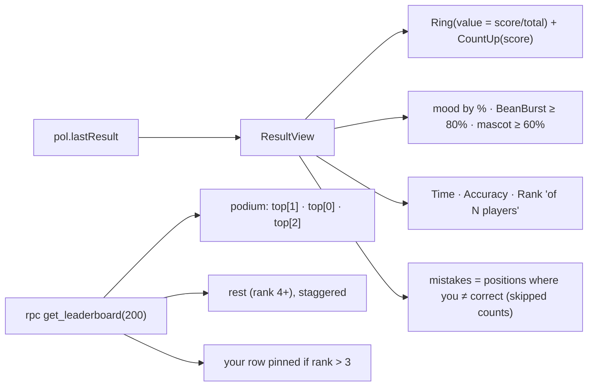

# L2.09c · The ranked test III: results and the leaderboard

> **Level 2 · Build it** · Lesson 14 of 17

| Recipe card | |
|---|---|
| **Time** | 75 min |
| **You need** | L2.09b (`submit` saves `pol.lastResult`), L2.06a (`Ring`, `CountUp`, `BeanBurst`, avatars), L2.03 (`get_leaderboard`) |
| **You'll produce** | Lines 479–593 of `src/pages/Test.tsx` (`ResultView`) and `src/pages/Leaderboard.tsx` (196 lines) |

**In two sentences:** The results screen turns a number into a moment: an animated ring, a count-up, a mood line, confetti for high scores, then an honest list of your mistakes with the right answers. The leaderboard shows everyone's best attempt as a podium plus a list, keeps your own row in view, and refreshes when you come back to the tab.

### Objectives
1. Compute the mistakes list from `question_ids`, `answers` and `correct`, including skipped questions.
2. Map score percentage to mood text, burst and mascot thresholds, and the ring's progress value.
3. Arrange the podium as 2 · 1 · 3 with heights and medal colours, handling **ties** correctly.
4. Pin the current user's row when they're outside the podium, and refresh on `visibilitychange`.

---

## 1 · Warm-up

1. *(L2.09b)* What does `pol.lastResult` contain besides the server fields?
2. *(L2.06a)* Ring offset formula?
3. *(L2.03)* How does `rank()` treat equal score *and* time?

<details><summary>Answers</summary>1. The attempt's <code>question_ids</code> and <code>answers</code>. 2. C·(1 − v). 3. They share the rank; the next rank skips (1, 1, 3).</details>

## 2 · The problem this solves

A score alone teaches nothing, and a list of names motivates little. Results must show *what to study next*, and the leaderboard must feel alive and fair: ties shown honestly, and your own position always visible.



---

## 3 · Concepts

### 3.1 Thresholds as a ladder

`pct = score / total` is a fraction from 0 to 1. Several independent ladders read it:

| pct | mood | BeanBurst | mascot |
|---|---|---|---|
| ≥ 0.95 | "Legendary brew! ☕🔥" | ✓ | ✓ |
| ≥ 0.85 | "Excellent! Nearly perfect." | ✓ | ✓ |
| ≥ 0.80 | "Solid. A few more cards to go." | ✓ | ✓ |
| ≥ 0.70 | "Solid. A few more cards to go." | ✗ | ✓ |
| ≥ 0.60 | "Getting there. Keep swiping!" | ✗ | ✓ |
| ≥ 0.50 | "Getting there. Keep swiping!" | ✗ | ✗ |
| < 0.50 | "Time for another cup and a review." | ✗ | ✗ |

A nested ternary tests the conditions from high to low, so the first match wins.

### 3.2 The podium order

People expect the winner in the middle, raised. With `top = rows.slice(0, 3)`, render columns `[top[1], top[0], top[2]]` (second · first · third). Each column's **block height** and **medal colour** come from the row's *rank*, not its column. So with a tie for first, both tied players get gold and the tallest block, which is honest.

### 3.3 Refresh on return: `visibilitychange`

`document.visibilityState` is `"visible"` or `"hidden"`. Listening to `visibilitychange` and refetching when the tab becomes visible keeps the board fresh after you switch apps (say, to take a test on another device), with no polling.

---

## 4 · Reading the real code

### 4.1 `ResultView`: data (lines 479–501)

```tsx
function ResultView() {
  const r = load<Result | null>(RESULT_KEY, null);
  const [showAll, setShowAll] = useState(false);
  if (!r)
    return (
      <div className="empty">
        <CoffeeMug size={90} />
        No result yet.
        <Link to="/test" className="btn primary">
          Take a test
        </Link>
      </div>
    );

  const pct = r.score / r.total;
  const mood =
    pct >= 0.95 ? "Legendary brew! ☕🔥" : pct >= 0.85 ? "Excellent! Nearly perfect." : pct >= 0.7 ? "Solid. A few more cards to go." : pct >= 0.5 ? "Getting there. Keep swiping!" : "Time for another cup and a review.";
  const wrong = r.question_ids
    .map((id, i) => ({ q: BY_ID.get(id)!, you: r.answers[i], right: r.correct?.[i] ?? BY_ID.get(id)!.answer }))
    .filter((x) => x.you !== x.right);
```
- **Reads storage each render**, so the latest result is always shown, even when you reach this page via "Last result" on the intro.
- **The empty state** handles someone opening `/test/result` without having taken a test.
- **The `mood` ladder** (§3.1).
- **`wrong`**: zip the three arrays by position.
  - `you` is your choice (`null` = skipped).
  - `right` is the server's `correct[i]`. **Fallback:** if `correct` is missing (an older result format), use the local key `BY_ID.get(id).answer`. `r.correct?.[i]` uses optional chaining on an array index.
  - **Filter `you !== right`**: `null !== 2` is true, so skipped questions count as mistakes too, consistent with the score.

### 4.2 `ResultView`: the result card (lines 503–547)

```tsx
  return (
    <div>
      <motion.div className="result" initial={{ scale: 0.92, opacity: 0 }} animate={{ scale: 1, opacity: 1 }} transition={{ type: "spring", stiffness: 220, damping: 22 }}>
        {pct >= 0.8 && <BeanBurst />}
        <motion.img
          className="mascot"
          src="/brand/mascot.webp"
          width={74}
          height={81}
          alt=""
          initial={{ scale: 0, rotate: -30, y: 30 }}
          animate={{ scale: 1, rotate: 0, y: 0 }}
          transition={{ type: "spring", stiffness: 260, damping: 14, delay: 0.9 }}
          style={{ display: pct >= 0.6 ? "block" : "none" }}
        />
        <span className="caps" style={{ color: "#a8998a" }}>
          Your score
        </span>
        <div className="ring-wrap" style={{ marginTop: 10 }}>
          <Ring value={pct} />
          <div className="ring-num">
            <b className="tnum">
              <CountUp to={r.score} />
            </b>
            <span>out of {r.total}</span>
          </div>
        </div>
        <motion.p initial={{ opacity: 0 }} animate={{ opacity: 1 }} transition={{ delay: 1.2 }} style={{ margin: "14px 0 0", fontWeight: 700 }}>
          {mood}
        </motion.p>
        <div className="result-stats">
          <div>
            <b className="tnum">{fmtDuration(r.duration_ms)}</b>
            <span>Time</span>
          </div>
          <div>
            <b className="tnum">{Math.round(pct * 100)}%</b>
            <span>Accuracy</span>
          </div>
          <div>
            <b className="tnum">{r.rank ? ordinal(r.rank) : "–"}</b>
            <span>{r.players ? `of ${r.players} players` : "Rank"}</span>
          </div>
        </div>
      </motion.div>
```
- **A choreographed timeline**:
  - 0 s: the card springs in.
  - 0.15 s: the ring starts drawing (its internal delay), lasting 1.2 s.
  - The count-up runs 1.1 s in parallel.
  - 0.5–0.65 s: beans burst (BeanBurst's own delays).
  - 0.9 s: the mascot pops.
  - 1.2 s: the mood line fades in.
  
  Each beat lands as the previous one settles.
- **The mascot stays mounted but is `display: none`** under 60%, so the layout doesn't change. (Not rendering it would work too.)
- **The always-dark card**: `.result` has an espresso background in both themes (an emotional "spotlight"). So text colours like `#a8998a` are hard-coded light-on-dark, and they were checked by axe in both themes ([L3.04](l3-04-viewports-contrast.md)).
- **Stats**: time via `fmtDuration` (e.g. `21:34`), accuracy as a rounded %, rank via `ordinal` ("2nd") plus "of 41 players". Unranked (no rank) shows "–".
- **The UI test** waits for the ring number to equal the stored score: `.ring-num b` with text `88`. That is the CountUp's final value, so the test also proves the count-up completes ([L4.05](l4-05-ui-tests-quiz-runner.md)).

### 4.3 `ResultView`: actions and review (lines 549–593)

```tsx
      <div className="stack" style={{ marginTop: 14 }}>
        <Link to="/ranks" className="btn primary block">
          <Icon name="trophy" size={19} /> See the leaderboard
        </Link>
        <Link to="/test" className="btn block">
          <Icon name="flip" size={19} /> Take another test
        </Link>
      </div>

      <div className="section-title">
        <h2>Review mistakes</h2>
        <span className="caps">{wrong.length} to review</span>
      </div>
      {wrong.length === 0 ? (
        <div className="card pad" style={{ textAlign: "center" }}>
          Perfect paper. Nothing to review! 🎉
        </div>
      ) : (
        <div className="stack" style={{ gap: 8 }}>
          {(showAll ? wrong : wrong.slice(0, 8)).map(({ q, you, right }) => (
            <div key={q.id} className="review-item">
              <span className="tag" style={{ marginBottom: 8 }}>
                W{q.week} · Q{numberInWeek(q)}
              </span>
              <p style={{ marginTop: 8 }}>{q.q}</p>
              <div className="ra you">
                <Icon name="x" size={17} />
                {you === null || you === undefined || you < 0 ? <i>Skipped</i> : `${LETTERS[you]}. ${q.options[you]}`}
              </div>
              <div className="ra ok">
                <Icon name="check" size={17} />
                {LETTERS[right]}. {q.options[right]}
              </div>
            </div>
          ))}
          {!showAll && wrong.length > 8 && (
            <button className="btn block" onClick={() => setShowAll(true)}>
              Show all {wrong.length}
            </button>
          )}
        </div>
      )}
    </div>
  );
}
```
- **Primary next step**: the leaderboard. Secondary: try again.
- **Review**: each mistake shows week/question, the question, *your* answer (red ✗, or "Skipped") and the correct answer (green ✓).
- **`you < 0` handled too**, defensive in case `-1` (the server encoding) ever reaches the client.
- **Progressive disclosure**: the first 8 mistakes, then "Show all N", so a 40-mistake list doesn't overwhelm.

### 4.4 `Leaderboard.tsx`: data (lines 1–50)

```tsx
import { useCallback, useEffect, useState } from "react";
import { Link } from "react-router-dom";
import { motion } from "motion/react";
import { Icon } from "../components/Icon";
import { Loader, avatarColor, initials } from "../components/Ui";
import { CoffeeMug } from "../components/CoffeeMug";
import { useAuth } from "../lib/auth";
import { friendlyError, isConfigured, supabase } from "../lib/supabase";
import { fmtDuration } from "../lib/format";

type Row = {
  rank: number;
  user_id: string;
  display_name: string;
  score: number;
  total: number;
  duration_ms: number;
  attempts: number;
  submitted_at: string;
};

const MEDAL = ["var(--gold)", "var(--silver)", "var(--bronze)"];

export default function Leaderboard() {
  const { session } = useAuth();
  const me = session?.user.id;
  const [rows, setRows] = useState<Row[] | null>(null);
  const [err, setErr] = useState<string | null>(null);
  const [spin, setSpin] = useState(0);

  const fetchRows = useCallback(async () => {
    if (!isConfigured) return setErr("Leaderboard needs Supabase to be configured.");
    const { data, error } = await supabase.rpc("get_leaderboard", { p_limit: 200 });
    if (error) setErr(friendlyError(error));
    else {
      setErr(null);
      setRows(data as Row[]);
    }
  }, []);

  useEffect(() => {
    fetchRows();
    const onFocus = () => document.visibilityState === "visible" && fetchRows();
    document.addEventListener("visibilitychange", onFocus);
    return () => document.removeEventListener("visibilitychange", onFocus);
  }, [fetchRows]);

  const top = rows?.slice(0, 3) ?? [];
  const rest = rows?.slice(3) ?? [];
  const mine = rows?.find((r) => r.user_id === me);
```
- **`Row`** mirrors `get_leaderboard`'s `returns table` ([L2.03](l2-03-server-grading.md)). `rank` and `attempts` are `bigint` in SQL but arrive as JSON numbers, fine at these sizes.
- **Medal colours are tokens** (`--gold`, `--silver`, `--bronze`), consistent in both themes.
- **`rows === null`** means "loading" (show the loader); `[]` means "no scores yet". Two different empty states, deliberately.
- **`p_limit: 200`**: the top 200 is plenty for a class. The server clamps anything larger.
- **Anonymous visitors see the board too** (`get_leaderboard` is granted to `anon`), which motivates sign-up.
- **Refresh on tab visibility** (§3.3). The `&&` in the listener is a compact "if"; the return value is ignored by event listeners.
- **`mine`**: the current user's row, if any.

### 4.5 `Leaderboard.tsx`: rendering (lines 52–169)

```tsx
  return (
    <div>
      <div className="page-head row between" style={{ alignItems: "flex-end" }}>
        <div>
          <span className="caps">Leaderboard</span>
          <h1 className="display">Top brewers</h1>
          <p>Best attempt per player · score, then time</p>
        </div>
        <motion.button
          className="icon-btn"
          aria-label="Refresh"
          animate={{ rotate: spin * 360 }}
          transition={{ duration: 0.6 }}
          onClick={() => {
            setSpin((s) => s + 1);
            fetchRows();
          }}
        >
          <Icon name="flip" size={19} />
        </motion.button>
      </div>

      {err && <div className="banner">{err}</div>}
      {!rows && !err && <Loader label="Fetching the rankings…" />}

      {rows && rows.length === 0 && (
        <div className="card pad empty">
          <CoffeeMug size={96} />
          <b style={{ color: "var(--ink)" }}>No scores yet</b>
          The top spot is up for grabs.
          <Link to="/test" className="btn red">
            Take the first test
          </Link>
        </div>
      )}
```
- **The subtitle states the ranking rule** ("score, then time"), so the ordering never looks arbitrary.
- **The refresh button spins a full turn per press**: `rotate = spin × 360`, animated. A counter instead of a boolean, so every press spins again.
- **The error banner**, e.g. "The database isn't set up yet. Run supabase/setup.sql…", was seen live before the SQL was run. The UI test "leaderboard loads from the live database" asserts no banner and either "No scores yet" or a podium ([L4.04](l4-04-ui-tests-nav-cards.md)).

```tsx
      {top.length > 0 && (
        <div className="podium">
          {[top[1], top[0], top[2]].map((r, col) => {
            if (!r) return <div key={col} />;
            const place = r.rank;
            const h = place === 1 ? 118 : place === 2 ? 88 : 68;
            const color = MEDAL[Math.min(place, 3) - 1];
            return (
              <motion.div
                key={r.user_id}
                className={`pod ${place === 1 ? "first" : ""}`}
                initial={{ opacity: 0, y: 30 }}
                animate={{ opacity: 1, y: 0 }}
                transition={{ delay: [0.15, 0, 0.3][col], type: "spring", stiffness: 200, damping: 20 }}
              >
                <div className="avatar" style={{ background: avatarColor(r.display_name), outline: `3px solid ${color}` }}>
                  {place === 1 && (
                    <motion.img className="crown" src="/brand/badge-round.webp" width={34} height={34} alt=""
                      initial={{ y: -10, rotate: -20, opacity: 0 }} animate={{ y: 0, rotate: 0, opacity: 1 }} transition={{ delay: 0.6, type: "spring" }} />
                  )}
                  {initials(r.display_name)}
                </div>
                <div className="name">
                  {r.display_name}
                  {r.user_id === me && <span className="red"> (you)</span>}
                </div>
                <div className="sc tnum">
                  {r.score}/{r.total} · {fmtDuration(r.duration_ms)}
                </div>
                <motion.div
                  className="block"
                  style={{ background: color }}
                  initial={{ height: 0 }}
                  animate={{ height: h }}
                  transition={{ delay: 0.2 + [0.15, 0, 0.3][col], duration: 0.6, ease: [0.22, 1, 0.36, 1] }}
                >
                  {place}
                </motion.div>
              </motion.div>
            );
          })}
        </div>
      )}
```
(The crown `<motion.img>` props are joined onto fewer lines here; the file lists one per line.)
- **Column order 2 · 1 · 3** (§3.2). With fewer than 3 players, `if (!r) return <div/>` keeps the grid shape (empty column).
- **Height and colour from `rank`**, not from column (ties: §3.2). Heights: first 118 px, second 88 px, third 68 px.
- **Staggered entrance by column**: middle first (delay 0), then left (0.15 s), then right (0.3 s). The blocks *grow* from height 0, so the winner's podium rises first.
- **The crown** (the round Coffee aur Code badge) drops onto the winner's avatar at 0.6 s.
- **Avatar ring** in medal colour (`outline: 3px solid`).
- **"(you)"** marks your own podium spot.

```tsx
      <div className="stack" style={{ gap: 8 }}>
        {rest.map((r, i) => (
          <motion.div
            key={r.user_id}
            initial={{ opacity: 0, y: 12 }}
            animate={{ opacity: 1, y: 0 }}
            transition={{ delay: Math.min(i, 12) * 0.035 + 0.3 }}
          >
            <LbRow r={r} me={r.user_id === me} />
          </motion.div>
        ))}
      </div>

      {mine && mine.rank > 3 && (
        <div className="me-pin">
          <LbRow r={mine} me />
        </div>
      )}

      {rows && session && !mine && rows.length > 0 && (
        <div className="card pad" style={{ marginTop: 14, textAlign: "center" }}>
          You're not on the board yet.{" "}
          <Link to="/test" className="red" style={{ fontWeight: 700 }}>
            Take a test →
          </Link>
        </div>
      )}
    </div>
  );
}
```
- **The list stagger is capped**: `Math.min(i, 12) * 35 ms + 300 ms`. Rows after the 12th all appear at about 0.72 s, so a 200-row board doesn't take 7 seconds to animate in.
- **The pinned "you" row**: if you're ranked below the podium, a copy of your row sticks to the bottom of the screen above the tab bar (`.me-pin` is `position: sticky`). You always see your position while scrolling.
- **Signed in but not ranked** → a nudge to take a test.

### 4.6 `LbRow` (lines 171–196)

```tsx
function LbRow({ r, me }: { r: Row; me: boolean }) {
  return (
    <div className={`lb-row ${me ? "me" : ""}`}>
      <span className="rk">{r.rank}</span>
      <span className="av" style={{ background: avatarColor(r.display_name) }}>
        {initials(r.display_name)}
      </span>
      <span className="nm">
        <b>
          {r.display_name}
          {me && <span className="red"> · you</span>}
        </b>
        <span>
          {r.attempts} attempt{r.attempts === 1 ? "" : "s"}
        </span>
      </span>
      <span className="pts">
        <b>
          {r.score}
          <span>/{r.total}</span>
        </b>
        <span className="tnum">{fmtDuration(r.duration_ms)}</span>
      </span>
    </div>
  );
}
```
- **A four-column grid** (CSS): rank · avatar · name and attempts · score and time. On a 320 px phone the columns shrink (`minmax(0, 1fr)` for the name, with an ellipsis), see [L2.10c](l2-10c-responsive.md).
- **The `.me` class** gives your row a red border and soft red background.
- **"· you"** text as well as colour, so it doesn't rely on colour alone.

---

## 5 · Worked traces

### 5.1 Mistakes from a 5-question result

`question_ids = [304, 1201, 7, 509, 810]`, `answers = [2, 0, 1, null, 1]`, `correct = [2, 2, 1, 0, 1]` (the L2.03 example).

| i | id | you | right | `you !== right`? | shown as |
|---|---|---|---|---|---|
| 0 | 304 | 2 | 2 | no | — |
| 1 | 1201 | 0 | 2 | **yes** | ✗ A. multidimensional · ✓ C. unidimensional |
| 2 | 7 | 1 | 1 | no | — |
| 3 | 509 | null | 0 | **yes** | ✗ *Skipped* · ✓ A. Love and belonging |
| 4 | 810 | 1 | 1 | no | — |

`wrong.length = 2` → "2 to review". The score was 3/5 = 60%: mood "Getting there. Keep swiping!", mascot shown, no burst.

### 5.2 Podium with a tie

Rows (already ranked by SQL): Ben 95 · 20:00 (rank 1), Cy 95 · 20:00 (rank 1), Ana 95 · 30:00 (rank 3), Di 88 (rank 4).

| Column | Row | rank | height | colour | first class? |
|---|---|---|---|---|---|
| left (`top[1]`) | Cy | 1 | **118** | gold | ✓ |
| middle (`top[0]`) | Ben | 1 | 118 | gold | ✓ |
| right (`top[2]`) | Ana | 3 | 68 | bronze | |
| list | Di | 4 | — | — | — |

*Both co-winners get gold and the tall block, and nobody gets silver. That matches `rank()` semantics (1, 1, 3).*

---

## 6 · Running and testing

- `tests/e2e/ui.spec.ts` › "result page renders score, stats and mistakes" injects a result (88/100, 754000 ms, rank 3 of 20) and expects ring `88`, `12:34`, `3rd`, "of 20 players", "12 to review", 8 items, then "Show all 12" → 12 items, and no sideways overflow.
- `tests/e2e/ui.spec.ts` › "leaderboard loads from the live database".
- `tests/e2e/auth.spec.ts`: after a real submission (score 90), it expects `90` on the ring, "10 to review", an ordinal rank, then on Ranks a row or podium containing the test user's name with 90.
- `tests/e2e/a11y.spec.ts` scans the results page in both themes.

## 7 · Bug journal

**Design incident · The mascot covered the score ring.** The first results screenshot showed the mascot (92 px, top right) overlapping the ring's upper-right arc. That's not a crash, but it hurt the key moment. **Fix:** `.result .mascot { width: 74px; right: 8px; top: 8px; }` on phones (larger again from 640 px, where there's room). **Lesson:** review screenshots of emotional "moment" screens at the smallest supported width.

**Clean run otherwise.** The leaderboard logic passed every live test. The tie-handling design (colour and height from rank, not column) was deliberate, following the SQL's `rank()` semantics.

## 8 · Why this design

| Decision | Alternatives | Why this one | Trade-off | Choose differently when |
|---|---|---|---|---|
| Results from localStorage | Re-fetch the attempt from the DB | Instant, works offline, includes question order | Only the latest result is kept locally | You want a history page → query `test_attempts` (own rows) |
| Server `correct[]` with a local fallback | Local key only | Grading truth from the server | Fallback could mask drift (data tests prevent drift) | — |
| Podium 2·1·3, styled by rank | Plain list | Celebrates the top, honest ties | Extra layout | Hundreds of ties → plain list |
| Pinned "you" row | Scroll to me | Always visible | Duplicate row | — |
| Refresh on visibility | Polling; Realtime | No wasted requests | Not live while watching | Live events → Supabase Realtime |

## 9 · Check yourself

**Q1.** You skipped 6 questions and got 4 wrong. How many "to review"?
<details><summary>Answer</summary>10. Skipped answers are <code>null</code>, and <code>null !== right</code>.</details>

**Q2.** Score 79/100: burst? mascot? mood?
<details><summary>Answer</summary>No burst (< 0.8); mascot yes (≥ 0.6); mood "Solid. A few more cards to go." (≥ 0.7).</details>

**Q3.** Only two players on the board. What does the podium show?
<details><summary>Answer</summary>Left column = rank 2, middle = rank 1, right = an empty <code>&lt;div/&gt;</code> placeholder.</details>

**Q4.** Why colour the podium by `rank` instead of by column?
<details><summary>Answer</summary>So ties show truthfully: two players with rank 1 both get gold and the tallest block.</details>

**Q5.** You're rank 57. Where do you see your row?
<details><summary>Answer</summary>In the list at position 57, and pinned (sticky) at the bottom while you scroll.</details>

## 10 · Practice

**Easy (10 min).** Show the review's "Skipped" items first, then wrong answers.

**Medium (20 min).** Add a "My attempts" section to Results: query `test_attempts` (select own: `score`, `duration_ms`, `submitted_at`), ordered newest first, and draw a tiny sparkline of scores.

**Hard (40 min).** Make the leaderboard live with Supabase Realtime: subscribe to inserts and updates on `test_attempts` and re-fetch `get_leaderboard` (debounced to at most once every 2 s). Discuss why you can't stream rows directly (RLS hides other users' attempts).
<details><summary>Key insight</summary>Realtime respects RLS: you'd only receive your own rows. So use the event as a trigger and re-run the definer function, or broadcast a public "board changed" message.</details>

## 11 · From memory

**Rung 1 · Cloze.**

```tsx
const wrong = r.question_ids
  .map((id, i) => ({ q: BY_ID.get(id)!, you: r.answers[i], right: r.correct?.[i] ___①___ BY_ID.get(id)!.answer }))
  .filter((x) => x.you ___②___ x.right);
{pct >= ___③___ && <BeanBurst />}
<Ring value={___④___} />
{[top[___⑤___], top[0], top[2]].map((r, col) => …)}
const h = place === 1 ? 118 : place === 2 ? ___⑥___ : 68;
const color = MEDAL[Math.min(place, 3) ___⑦___ 1];
const onFocus = () => document.visibilityState === "___⑧___" && fetchRows();
```
<details><summary>Answers</summary>① <code>??</code> ② <code>!==</code> ③ <code>0.8</code> ④ <code>pct</code> ⑤ <code>1</code> ⑥ <code>88</code> ⑦ <code>-</code> ⑧ <code>visible</code></details>

**Rung 2 · Blank page (20 min).** Write `ResultView` (data + the card + review) and the Leaderboard's fetch, podium and pinned row from memory.
<details><summary>Self-check</summary>

- [ ] Empty state; pct; mood ladder; wrong = zip + filter (skipped counts)
- [ ] Ring + CountUp; burst ≥ 0.8; mascot ≥ 0.6; stats with ordinal and "of N players"
- [ ] Review: 8 then "Show all"; Skipped handling
- [ ] Fetch with the configured check, error banner, loading vs empty
- [ ] visibilitychange refresh with cleanup
- [ ] Podium 2·1·3, height and colour from rank, staggered growth, crown
- [ ] Capped list stagger; pinned "you" row when rank > 3
</details>

## 12 · Flashcards

<details><summary><b>Q:</b> How is the mistakes list built?</summary><b>A:</b> Zip question_ids, your answers and correct answers by position; keep where yours ≠ correct (skipped included).</details>
<details><summary><b>Q:</b> Thresholds for burst and mascot?</summary><b>A:</b> Burst ≥ 80%; mascot ≥ 60%.</details>
<details><summary><b>Q:</b> Podium column order?</summary><b>A:</b> top[1] · top[0] · top[2] (second, first, third).</details>
<details><summary><b>Q:</b> Why style the podium by rank?</summary><b>A:</b> Honest ties: equal ranks get equal medals and heights.</details>
<details><summary><b>Q:</b> How does the board stay fresh?</summary><b>A:</b> Refetch on <code>visibilitychange</code> to visible, plus a refresh button.</details>
<details><summary><b>Q:</b> Why cap the list's stagger delay?</summary><b>A:</b> So long boards don't take seconds to finish animating in.</details>
<details><summary><b>Q:</b> Loading vs empty states?</summary><b>A:</b> <code>rows === null</code> → loader; <code>[]</code> → "No scores yet".</details>

## 13 · The menu board

| | |
|---|---|
| Result data | `pol.lastResult`; pct = score/total; wrong = zip + filter |
| Moment | card spring → ring 1.2 s + count-up → beans (≥ 80%) → mascot (≥ 60%) at 0.9 s → mood at 1.2 s |
| Review | 8 then "Show all"; Skipped vs ✗ yours vs ✓ right |
| Board fetch | `rpc("get_leaderboard", { p_limit: 200 })`; anon allowed |
| Podium | 2·1·3; heights 118/88/68; gold/silver/bronze by rank; crown on rank 1 |
| You | "(you)" on podium; `.me` row; sticky pin if rank > 3 |
| Fresh | `visibilitychange` + spinning refresh |

## 14 · Glossary

**Moment design**: choreographing animation and copy at an emotional peak. **Pinned row**: a sticky copy of the user's row. **Podium**: top-3 display with raised blocks. **Progressive disclosure**: showing a few items first, with more on request. **visibilitychange**: the event fired when a tab becomes hidden or visible. **Zip**: combining arrays element-by-element by index.

## 15 · Go further

| Resource | Type | Why | Which part | Time |
|---|---|---|---|---|
| [MDN: Page Visibility API](https://developer.mozilla.org/en-US/docs/Web/API/Page_Visibility_API) | Docs | `visibilityState` and its uses | "Use cases" | 10 min |
| [Supabase: Realtime Postgres changes](https://supabase.com/docs/guides/realtime/postgres-changes) | Docs | Live boards, and how RLS applies | "Row level security" note | 15 min |
| [Nielsen Norman: Progressive disclosure](https://www.nngroup.com/articles/progressive-disclosure/) | Article | Why "show 8, then all" | Whole page | 10 min |

---
← [L2.09b The test runner](l2-09b-test-runner.md) · [Hub](README.md) · [L2.10a Styling I: tokens & shell →](l2-10a-tokens-base-shell.md)
