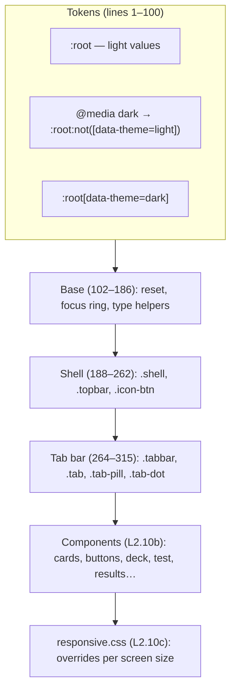

# L2.10a · Styling I: tokens, themes, base and the shell

> **Level 2 · Build it** · Lesson 15 of 17

| Recipe card | |
|---|---|
| **Time** | 70 min |
| **You need** | L1.02 (cascade, custom properties, media queries), L2.04 (`theme.tsx`, `index.html` meta tags), L2.05 (the `Topbar` and `TabBar` markup) |
| **You'll produce** | Lines 1–315 of `src/styles.css`: the design tokens for both themes, the base reset, the type helpers, the sticky top bar and the floating tab bar |

**In two sentences:** Every colour, shadow, radius and size in the app is a named variable (a *token*) defined once at the top of `styles.css`, and dark mode is nothing more than a second set of values for the same names. Below the tokens sit a small reset that makes buttons, inputs and images behave the same in every browser, and the two pieces of chrome that frame every page: a frosted sticky top bar and a floating tab bar that respects the iPhone's notch and home indicator.

### Objectives
1. Write the token block from memory and explain the three-selector pattern that gives you "System / Light / Dark" with no JavaScript in the cascade.
2. Explain what `color-scheme`, `color-mix()`, `backdrop-filter`, `env(safe-area-inset-*)` and `100dvh` each do, and what breaks without each.
3. Explain why `overflow-x` is set twice (`hidden`, then `clip`) on both `html` and `body`, and diagnose the iPhone sideways-scroll bug from its symptom.
4. Compute the shell's bottom padding and the tab bar's width on a given phone.

---

## 1 · Warm-up: pull it from memory

1. *(L2.04)* What does `ThemeProvider` write to `<html>` when the preference is `"system"`? When it is `"dark"`?
2. *(L1.02)* Two rules set `color` on the same element: `:root p { color: red }` and `p { color: blue }`. Which wins, and why?
3. *(L2.05)* Which element does `layoutId="tab-pill"` belong to, and what does Motion do with it when you change tabs?

<details><summary>Answers</summary>

1. For `"system"` it **deletes** `data-theme` (`delete root.dataset.theme`). For `"dark"` it sets `data-theme="dark"`. It also updates `<meta name="theme-color">` to `#0e0c0b` (dark) or `#f6f0e6` (light).
2. Red. `:root p` has higher specificity (one pseudo-class + one type selector = 0-1-1) than `p` (0-0-1). Order only matters when specificity ties.
3. The red/black `motion.span.tab-pill` rendered inside the **active** tab only. When the active tab changes, the old pill unmounts and a new one mounts in another tab; because they share a `layoutId`, Motion animates one pill sliding from the old position to the new one.
</details>

## 2 · The problem this solves

A naive stylesheet writes colours where they are used: `background: #fffdf9` on cards, `#17110e` on text, and so on, hundreds of times. Then you add dark mode and must find and duplicate every one of those rules under a dark selector. You will miss some, and the app ends up with white boxes in dark mode.

**The idea:** name every design decision once (`--surface`, `--ink`, `--red`) and write every component against the *names*. A theme is then a list of values for those names. Switching theme changes about 25 values in one place, and the whole app follows.


*Read top to bottom: each layer only uses names defined above it, and `responsive.css` loads last so it can override any of them.*

---

## 3 · Concepts

### 3.1 Custom properties are variables the cascade resolves

1. **Definition.** A custom property is a CSS property whose name starts with `--`. You read it with `var(--name)`.
2. **Why here.** Two themes, one set of component rules.
3. **How it works.** Custom properties *inherit* like `color` does. Define them on `:root` (the `<html>` element) and every element in the page sees them. `var()` is resolved per element at computed-value time, so if a higher-specificity rule redefines `--ink` on `:root`, every `color: var(--ink)` in the app changes at once. Analogy: the tokens are a price list pinned at the café door. The menu items say "one espresso", not "₹120"; reprint the price list and every menu item updates.
4. **Minimal example.**
   ```html
   <style>
     :root { --ink: black; }
     :root.dark { --ink: white; background: black; }
     p { color: var(--ink); }
   </style>
   <p>Hello</p>
   <button onclick="document.documentElement.classList.toggle('dark')">toggle</button>
   ```
5. **In the project.** Every component uses tokens: `.card { background: var(--surface); border: 1px solid var(--border); }`.
6. **Without it.** Every component needs a second dark rule; one forgotten rule gives a cream card on a black page.
7. **Try it.** In DevTools on the live site, select `<html>` and change `--red` to `blue`. Buttons, the focus ring, text selection and the tab dot all turn blue.

### 3.2 Three selectors give three theme states

The app offers **System**, **Light** and **Dark**. "System" must follow the OS setting live, with no JavaScript in the styling path. The pattern is three rules:

| Rule | Matches when | Effect |
|---|---|---|
| `:root { … }` | Always | Light values (the default) |
| `@media (prefers-color-scheme: dark) { :root:not([data-theme="light"]) { … } }` | OS is dark **and** the user did not force Light | Dark values |
| `:root[data-theme="dark"] { … }` | The user forced Dark (any OS) | Dark values |

**Why `:not([data-theme="light"])`?** Without it, a user on a dark OS who picks "Light" would still get dark values from the media query. The `:not()` makes the media rule step aside when Light is forced.

**Why is the dark block written twice?** CSS has no way to say "media query OR attribute" in one selector. So the 23 dark declarations appear twice, once inside the media query and once under `[data-theme="dark"]`. They are byte-for-byte identical (checked with `diff`). Duplication is the price of a no-JS theme path; a build step or a mixin could remove it, but this project has no CSS preprocessor.

**Specificity check.** `:root` is 0-1-0. `:root:not([data-theme="light"])` is 0-2-0 (`:not()` counts as its argument, an attribute selector). `:root[data-theme="dark"]` is 0-2-0. Both dark rules beat the light rule, so dark values win whenever a dark rule matches.

### 3.3 `color-scheme` tells the browser which built-in palette to use

`color-scheme: light` or `dark` changes the browser's own UI colours: scrollbars, the date-picker, form-control defaults and the default page background before your CSS paints. It is set inside each token block, so it flips with the theme. `index.html` also has `<meta name="color-scheme" content="dark light">`, which applies before any CSS loads and prevents a white flash on dark phones.

### 3.4 `color-mix()` makes translucent versions of tokens

`color-mix(in srgb, var(--bg) 82%, transparent)` gives "the background colour at 82% opacity". You cannot write `rgba(var(--bg), 0.82)` because `--bg` is a hex string, not three numbers. `color-mix` works on any colour value, so the top bar and tab bar stay correct in both themes. Supported in Safari 16.2+ and Chrome 111+; older browsers get the fallback in `responsive.css` ([L2.10c](l2-10c-responsive.md)).

### 3.5 `backdrop-filter` frosts what is behind an element

`backdrop-filter: saturate(1.4) blur(14px)` blurs and boosts the colour of whatever is *behind* the element (content scrolling under the top bar), not the element itself. It only shows if the element's own background is translucent, which is why it is paired with `color-mix(… 82%, transparent)`. Safari needs the `-webkit-` prefix, so both lines are written.

### 3.6 Safe areas: `viewport-fit=cover` + `env()`

An iPhone screen has a notch or Dynamic Island at the top and a home indicator bar at the bottom. By default Safari letterboxes the page away from them. `index.html` opts out with `viewport-fit=cover`, so the page fills the whole screen, and in return the CSS must keep content clear of the hardware itself:

- `env(safe-area-inset-top)`: the notch height (about 47 px on an iPhone 13 in portrait).
- `env(safe-area-inset-bottom)`: the home-indicator height (34 px on Face-ID iPhones).
- On phones without these, and on desktops, they are `0px`.

### 3.7 `100dvh`: the viewport height that tracks the browser bar

On mobile, `100vh` is the height *with the address bar hidden*, so a `100vh` element is taller than the screen while the bar is showing. `100dvh` (dynamic viewport height) follows the visible area as the bar slides. `min-height: 100dvh` makes short pages fill the screen exactly. Browsers older than Safari 15.4 ignore `dvh`; [L2.10c](l2-10c-responsive.md) adds `vh` fallbacks and [L3.04](l3-04-viewports-contrast.md) explains the three viewport units.

### 3.8 `overflow-x: clip` versus `hidden`

Both stop content from showing outside the box. The difference:

| | `hidden` | `clip` |
|---|---|---|
| Content outside is painted? | No | No |
| Box becomes a *scroll container*? | **Yes** (scrollable by code, by focus, and on iOS sometimes by finger) | **No** |
| `position: sticky` inside still sticks to the viewport? | **No**, it sticks to this box instead | Yes |
| Browser support | Everywhere | Safari 16+, Chrome 90+, Firefox 81+ |

The app needs **no sideways scrolling ever** and a **sticky top bar**. `clip` gives both. Writing `overflow-x: hidden;` then `overflow-x: clip;` is a fallback: a browser that doesn't know `clip` drops the second line as invalid and keeps `hidden`. The deep dive on why WebKit needed it on `html` as well as `body` is in the bug journal below and in [L3.03](l3-03-gestures-3d.md).

### 3.9 A variable font with a width axis

`main.tsx` imports `@fontsource-variable/archivo/wdth.css`: one font file containing every **weight** (100–900) and every **width** (62%–125%). `font-stretch: 125%` on `.display` selects the widest cut for headings, and `112%` for the brand title. One file, many styles, one download.

---

## 4 · Reading the real code

### 4.1 Light tokens (lines 1–43)

```css
/* =====================================================================
   Coffee aur Code · design tokens
   Espresso black, steam red, cream — straight from the logo.
   ===================================================================== */
:root {
  color-scheme: light;
  --bg: #f6f0e6;
  --bg-glow: rgba(215, 38, 47, 0.07);
  --surface: #fffdf9;
  --surface-2: #f1e8da;
  --surface-3: #e8dccb;
  --ink: #17110e;
  --muted: #6f6359;
  --tab-ink: #574c43;
  --faint: #75685c;
  --border: #e6dac8;
  --border-strong: #cfc0aa;
  --red: #d7262f;
  --red-soft: #fbe3e1;
  --red-ink: #b51e27;
  --red-fill: #c01f29;
  --cream: #f4eadb;
  --coffee: #8a4b22;
  --good: #186b3b;
  --good-soft: #dcf0e2;
  --bad: #b81f28;
  --bad-soft: #fbe3e1;
  --gold: #c99a2e;
  --silver: #8f969c;
  --bronze: #b06a3b;
  --primary: #17110e;
  --on-primary: #f8f1e6;
  --mug: #15110f;
  --mug-line: #f4eadb;
  --mug-edge: #15110f;
  --shadow-1: 0 1px 2px rgba(50, 30, 10, 0.06), 0 6px 18px rgba(50, 30, 10, 0.07);
  --shadow-2: 0 18px 40px -12px rgba(50, 30, 10, 0.28);
  --radius: 20px;
  --radius-sm: 14px;
  --tab-h: 68px;
  --font: "Archivo Variable", "Archivo", system-ui, -apple-system, "Segoe UI", Roboto, sans-serif;
  --ease-out: cubic-bezier(0.22, 1, 0.36, 1);
}
```

The tokens fall into families. Learn them as families, not as 37 separate lines.

| Family | Tokens | Role | What breaks if you change it |
|---|---|---|---|
| **Page** | `--bg`, `--bg-glow` | Cream page and a faint red glow at the top | `--bg` is also used by the top bar's frosted mix, so a change shows there too |
| **Surfaces** | `--surface`, `-2`, `-3` | Three steps of "raised": card, inset (segmented control track), pressed | Too close to `--bg` and cards vanish into the page |
| **Text** | `--ink`, `--muted`, `--tab-ink`, `--faint` | Body text, secondary text, tab labels, hints | Each was tuned to pass WCAG AA (4.5:1) on its background; lighter values failed axe ([L3.04](l3-04-viewports-contrast.md)) |
| **Lines** | `--border`, `--border-strong` | Hairlines; stronger for inputs and option rows | Too faint and inputs lose their edges |
| **Brand red** | `--red`, `--red-soft`, `--red-ink`, `--red-fill` | Accent, tinted background, red *text*, red *button fill* | See the note below |
| **Brand neutrals** | `--cream`, `--coffee` | Logo cream and coffee brown (mug liquid, illustrations) | — |
| **Feedback** | `--good`, `--good-soft`, `--bad`, `--bad-soft` | Correct/wrong answers, "Got it"/"Again" | Contrast on white text buttons |
| **Medals** | `--gold`, `--silver`, `--bronze` | Podium blocks and avatar rings ([L2.09c](l2-09c-results-leaderboard.md)) | — |
| **Primary** | `--primary`, `--on-primary` | The main button: espresso with cream text in light mode, **inverted** in dark | Invert only one of the pair and the button text disappears |
| **Mug** | `--mug`, `--mug-line`, `--mug-edge` | The SVG mug's body, line art and outline ([L2.06b](l2-06b-mug-icons-home.md)) | `--mug-edge` flips to cream in dark mode so the black mug stays visible on a black page |
| **Depth** | `--shadow-1`, `--shadow-2` | Resting cards; floating things (tab bar, sheets) | Shadows are brown-tinted (`rgba(50,30,10,…)`), not grey, so they look warm on cream |
| **Shape and size** | `--radius`, `--radius-sm`, `--tab-h` | Corner radii; tab bar height, used in several layout calculations | `--tab-h` feeds the shell's bottom padding, the pinned leaderboard row and the toast position, so it must stay a token |
| **Type and motion** | `--font`, `--ease-out` | Font stack; the app's standard "fast start, soft landing" curve | — |

**Why four reds?** One red cannot do every job. Measured against the light page `#f6f0e6`:
- `--red` `#d7262f` is the brand red but only reaches **4.40:1**, just under the 4.5:1 needed for small text. It is used for large or decorative things: icons, the focus ring, dots.
- `--red-ink` `#b51e27` is darker and is used whenever red is *text*.
- `--red-fill` `#c01f29` is the background for red buttons with white text.
- `--red-soft` `#fbe3e1` is a tint for backgrounds (the "you" leaderboard row).

The ratio formula and every measured pair are in [L3.04](l3-04-viewports-contrast.md).

**The font stack** reads left to right: the self-hosted variable font (`"Archivo Variable"`), a locally installed Archivo if one exists, then the OS UI fonts. `system-ui` and `-apple-system` (the older Safari name) give San Francisco on Apple devices, `"Segoe UI"` on Windows and Roboto on Android. If the web font fails, text still looks native rather than falling back to Times.

**`--ease-out: cubic-bezier(0.22, 1, 0.36, 1)`** is the "ease-out quint"-like curve: it starts fast and settles gently. Motion's transitions in the TSX use the same four numbers (`ease: [0.22, 1, 0.36, 1]`, seen in the podium blocks), so CSS and JS animations feel like one system.

### 4.2 Dark tokens, the system-driven copy (lines 45–73)

```css
@media (prefers-color-scheme: dark) {
  :root:not([data-theme="light"]) {
    color-scheme: dark;
    --bg: #0e0c0b;
    --bg-glow: rgba(239, 58, 66, 0.09);
    --surface: #171413;
    --surface-2: #211d1b;
    --surface-3: #2c2725;
    --ink: #f4eadb;
    --muted: #ab9d8e;
    --tab-ink: #b8ab9c;
    --faint: #9b8e80;
    --border: #2b2624;
    --border-strong: #3f3734;
    --red: #ef3a42;
    --red-soft: #3b1619;
    --red-ink: #ff7075;
    --red-fill: #c4222b;
    --good: #4cc477;
    --good-soft: #142e1e;
    --bad: #ff5a60;
    --bad-soft: #3b1619;
    --primary: #f4eadb;
    --on-primary: #120f0e;
    --mug-edge: #f4eadb;
    --shadow-1: 0 1px 2px rgba(0, 0, 0, 0.4), 0 8px 24px rgba(0, 0, 0, 0.35);
    --shadow-2: 0 24px 48px -12px rgba(0, 0, 0, 0.7);
  }
}
```
- **Only 23 tokens are redefined.** Shape, size, font, motion, medals, `--cream`, `--coffee`, `--mug` and `--mug-line` don't change with theme, so they are not repeated. A token you forget here keeps its light value: that is the failure mode to watch for when you add a new colour token.
- **Dark is not "invert".** The page is `#0e0c0b` (espresso, not pure black), surfaces step *up* in lightness (`#171413` → `#211d1b` → `#2c2725`) because in the dark, raised things are lighter. Text is cream `#f4eadb`, not white, to avoid glare.
- **Reds get brighter in dark mode** (`#ef3a42`, text `#ff7075`): the same red that pops on cream looks muddy on black. `--red-fill` stays dark (`#c4222b`) because it sits under white text.
- **Shadows become pure black and stronger** (0.4/0.35/0.7 alpha): brown shadows are invisible on a near-black page.
- **`--primary` inverts**: the main button becomes cream with espresso text.

### 4.3 Dark tokens, the forced copy (lines 74–100)

```css
:root[data-theme="dark"] {
  color-scheme: dark;
  /* …the same 23 declarations as lines 47–71, character for character… */
}
```
The body of this rule is identical to the block above (verify it yourself: `diff <(sed -n 47,71p src/styles.css | sed 's/^  //') <(sed -n 75,99p src/styles.css)` prints nothing). It exists because a `@media` rule cannot be combined with an attribute selector using "or" (§3.2). **If you change a dark colour, change it in both places.** A test can't catch a mismatch between them yet; the axe scans in [L4.07](l4-07-a11y-lighthouse-flaky.md) force dark through `data-theme`, so only the forced copy is scanned.

### 4.4 The reset (lines 102–155)

```css
/* ---------- base ---------- */
*,
*::before,
*::after {
  box-sizing: border-box;
}
html {
  overscroll-behavior-x: none;
  overflow-x: hidden;
  overflow-x: clip;
  -webkit-text-size-adjust: 100%;
  -webkit-tap-highlight-color: transparent;
}
body {
  margin: 0;
  background: var(--bg);
  background-image: radial-gradient(120% 60% at 50% -10%, var(--bg-glow), transparent 60%);
  background-attachment: fixed;
  color: var(--ink);
  font: 400 16px/1.5 var(--font);
  min-height: 100dvh;
  overscroll-behavior: none;
  /* slide animations must never make the page scroll sideways (clip keeps position: sticky working) */
  overflow-x: hidden;
  overflow-x: clip;
  transition: background-color 0.3s, color 0.3s;
}
```
- **`box-sizing: border-box` everywhere.** `width` then includes padding and border. Without it, `width: 100%; padding: 16px` is 32 px wider than its parent: the classic cause of sideways scrolling. Pseudo-elements are included because they are boxes too.
- **`html`:**
  - `overscroll-behavior-x: none` stops a horizontal overscroll from triggering the browser's back/forward gesture (that was the "a swipe triggered go back" bug in [L2.08a](l2-08a-flashcard-deck.md); the card also sets `touch-action`, this is the page-level backstop).
  - `overflow-x: hidden` then `clip`: the fallback pair from §3.8, on the root, because of the WebKit bug below.
  - `-webkit-text-size-adjust: 100%` stops iOS from enlarging text when you rotate to landscape.
  - `-webkit-tap-highlight-color: transparent` removes the grey flash iOS and Android draw over tapped links and buttons; the app gives its own pressed states (`:active`, `whileTap`).
- **`body`:**
  - `margin: 0`: browsers default to 8 px.
  - The background is a solid token plus a **radial gradient** centred 10% *above* the top edge (`at 50% -10%`), 120% wide and 60% tall, fading from the red glow to transparent by 60% of its radius. On screen that is a faint warm light at the top of the page.
  - `background-attachment: fixed` keeps the glow at the top of the *screen* while content scrolls. (iOS ignores `fixed` on backgrounds and treats it as `scroll`; the glow then scrolls away, which is harmless.)
  - `font: 400 16px/1.5 var(--font)`: weight 400, size 16 px, line height 1.5, family from the token. 16 px matters on iOS: inputs with smaller text make Safari zoom in when focused.
  - `overscroll-behavior: none` stops the rubber-band bounce and pull-to-refresh, which feel wrong in an app-like UI and could reload the page mid-test.
  - `overflow-x` again, on `body`, for the slide animations (bug journal).
  - `transition` on background and text colour makes the theme switch a 0.3 s cross-fade instead of a flash.

```css
button,
input {
  font: inherit;
  color: inherit;
}
button {
  cursor: pointer;
  border: 0;
  background: none;
  padding: 0;
}
img {
  display: block;
  max-width: 100%;
}
a {
  color: inherit;
}
:focus-visible {
  outline: 2.5px solid var(--red);
  outline-offset: 2px;
  border-radius: 8px;
}
::selection {
  background: var(--red);
  color: #fff;
}
```
- **Form controls don't inherit fonts by default.** Without `font: inherit` buttons render in the OS's 13 px system font. `color: inherit` stops them being black in dark mode.
- **`button` reset**: no border, background or padding, so every button starts as plain text and the component classes (`.btn`, `.icon-btn`, `.chip`) add exactly the look they want.
- **`img { display: block }`** removes the few pixels of gap under inline images (they sit on the text baseline and leave room for descenders). `max-width: 100%` stops large images overflowing narrow screens.
- **`:focus-visible`** shows a red ring only when focus came from the keyboard (or another non-pointer method), not on mouse clicks. This is the keyboard user's cursor; removing it fails WCAG 2.4.7. The `border-radius` rounds the ring's corners in browsers that follow it.
- **`::selection`** colours selected text with the brand.

### 4.5 Type helpers (lines 157–186)

```css
.display {
  font-stretch: 125%;
  font-weight: 800;
  letter-spacing: -0.01em;
  line-height: 1.05;
}
.caps {
  text-transform: uppercase;
  letter-spacing: 0.14em;
  font-size: 0.72rem;
  font-weight: 700;
  color: var(--muted);
}
.muted {
  color: var(--muted);
}
.tnum {
  font-variant-numeric: tabular-nums;
}
.red {
  color: var(--red);
}
.sr-only {
  position: absolute;
  width: 1px;
  height: 1px;
  overflow: hidden;
  clip: rect(0 0 0 0);
  white-space: nowrap;
}
```
- **`.display`**: wide (125%), heavy (800), slightly tightened letters and lines. It is the "menu board" headline style used on every `h1`. Tight `line-height: 1.05` works only for short headings; on body text it would make lines collide.
- **`.caps`**: small uppercase labels ("YOUR SCORE", "LEADERBOARD"). Uppercase needs extra letter-spacing (0.14em) to stay readable.
- **`.tnum`**: tabular numerals, where every digit has the same width. Timers (`12:34` → `12:35`) and scores don't jiggle as digits change. Used on the test clock, stats and leaderboard.
- **`.red`** uses `--red`, which is fine for the short bold words it decorates ("· you", "Take a test →"). For long red text the code uses `--red-ink`.
- **`.sr-only`** ("screen-reader only"): visually hidden, still read aloud. A 1×1 px box with everything clipped. `display: none` would hide it from screen readers too. `white-space: nowrap` stops the text wrapping into a tall invisible column that can affect layout.

### 4.6 The shell and the top bar (lines 188–262)

```css
/* ---------- app shell ---------- */
.shell {
  max-width: 560px;
  margin: 0 auto;
  min-height: 100dvh;
  padding-top: 0;
  padding-bottom: calc(var(--tab-h) + 28px + env(safe-area-inset-bottom));
  position: relative;
}
```
- **`max-width: 560px; margin: 0 auto`**: a phone-width column centred on any screen. `responsive.css` widens it on tablets and turns it into a two-column layout with a side rail on laptops ([L2.10c](l2-10c-responsive.md)). The side gutters (`padding-left/right: max(16px, env(safe-area-inset-left/right))`) live in `responsive.css` too, so landscape iPhones keep content clear of the notch.
- **`padding-bottom`** reserves room for the floating tab bar so the last thing on a page is never hidden behind it: the bar's height + 12 px gap below it + 16 px breathing room above it (= 28) + the home indicator.

```css
.topbar {
  position: sticky;
  top: 0;
  z-index: 20;
  display: flex;
  align-items: center;
  gap: 10px;
  padding: calc(10px + env(safe-area-inset-top)) 0 10px;
  margin: 0 -16px;
  padding-left: 16px;
  padding-right: 16px;
  background: color-mix(in srgb, var(--bg) 82%, transparent);
  backdrop-filter: saturate(1.4) blur(14px);
  -webkit-backdrop-filter: saturate(1.4) blur(14px);
  border-bottom: 1px solid transparent;
  transition: border-color 0.2s;
}
.topbar.scrolled {
  border-bottom-color: var(--border);
}
```
- **`position: sticky; top: 0`**: the bar scrolls with the page until it reaches the top, then stays. It only works if no ancestor between it and the viewport is a scroll container, which is exactly why the page uses `overflow-x: clip` and not `hidden` (§3.8).
- **`z-index: 20`**: above page content, below the tab bar (30) and sheets.
- **Top padding includes the notch** so the logo sits below the Dynamic Island while the frosted background extends behind it.
- **`margin: 0 -16px` plus `padding-left/right: 16px`**: the shell has 16 px gutters, but the frosted background should run edge to edge. Negative margins pull the bar out over the gutters; the padding puts the content back in line with the page. This is the "full-bleed inside a padded container" pattern.
- **Frosted glass**: 82% background plus blur (§3.4, §3.5).
- **The border appears only after scrolling.** `App.tsx` sets `scrolled` when `window.scrollY > 4`. At the top the bar blends into the page; once content slides under it, a hairline separates them. The `transparent` default keeps the bar's height identical in both states, so nothing jumps by 1 px.

```css
.topbar .brand {
  display: flex;
  align-items: center;
  gap: 10px;
  text-decoration: none;
  min-width: 0;
}
.topbar .brand img {
  width: 34px;
  height: 34px;
}
.topbar .brand-title {
  font-weight: 800;
  font-stretch: 112%;
  font-size: 1.02rem;
  line-height: 1.1;
  white-space: nowrap;
}
.topbar .brand-sub {
  font-size: 0.62rem;
  letter-spacing: 0.2em;
  font-weight: 700;
  color: var(--muted);
  text-transform: uppercase;
}
.topbar .brand-sub b {
  color: var(--red);
}
.topbar .spacer {
  flex: 1;
}
```
- **`min-width: 0`** on the brand link: flex items default to `min-width: auto`, meaning "never shrink below my content". On a 280 px Galaxy Fold the title plus the theme button is wider than the screen; `min-width: 0` lets the brand shrink. (`responsive.css` also shrinks the title there.)
- **`white-space: nowrap`** keeps "Psychology of Learning" on one line.
- **The red "aur"** inside "COFFEE AUR CODE" echoes the logo.
- **`.spacer { flex: 1 }`** eats the free space, pushing the theme toggle to the right edge. It is the flexbox way to write "left group … right group".

```css
.icon-btn {
  width: 42px;
  height: 42px;
  display: grid;
  place-items: center;
  border-radius: 14px;
  background: var(--surface);
  border: 1px solid var(--border);
  color: var(--ink);
  transition: background 0.2s, border-color 0.2s;
}
.icon-btn:active {
  background: var(--surface-2);
}
```
- **42 × 42 px**: comfortably above the 24 px WCAG 2.2 minimum target size and near Apple's 44 pt guideline.
- **`display: grid; place-items: center`**: the shortest way to centre one child both ways.
- **`:active`** darkens on press, replacing the tap highlight removed in the reset.

### 4.7 The floating tab bar (lines 264–315)

```css
/* ---------- tab bar ---------- */
.tabbar {
  position: fixed;
  z-index: 30;
  left: 50%;
  transform: translateX(-50%);
  bottom: calc(12px + env(safe-area-inset-bottom));
  width: min(528px, calc(100% - 24px));
  height: var(--tab-h);
  display: grid;
  grid-template-columns: repeat(5, 1fr);
  padding: 6px;
  border-radius: 24px;
  background: color-mix(in srgb, var(--surface) 95%, transparent);
  backdrop-filter: saturate(1.5) blur(18px);
  -webkit-backdrop-filter: saturate(1.5) blur(18px);
  border: 1px solid var(--border);
  box-shadow: var(--shadow-2);
}
```
- **`position: fixed`** pins it to the screen, not the page.
- **Centring a fixed element**: `left: 50%` puts its left edge at the middle; `translateX(-50%)` moves it back by half its own width. (Note: this `transform` is why `responsive.css` must reset it when the bar becomes a side rail.)
- **`bottom: 12px + home indicator`**: it floats 12 px above the indicator on iPhones and 12 px above the edge elsewhere.
- **`width: min(528px, 100% − 24px)`**: 12 px margins on phones, capped at the 560 px shell minus 32 px on wide screens.
- **Five equal columns** (`repeat(5, 1fr)`), one per tab: Home, Study, Test, Ranks, Me. The rail brand and rail foot are also children of `<nav>` but are `display: none` on phones, so they don't take a column.
- **95% surface plus blur**: almost solid, so labels stay readable over busy content.
- **`--shadow-2`**: the "floating" depth.

```css
.tab {
  position: relative;
  display: flex;
  flex-direction: column;
  align-items: center;
  justify-content: center;
  gap: 2px;
  border-radius: 18px;
  text-decoration: none;
  color: var(--tab-ink);
  font-size: 0.68rem;
  font-weight: 600;
  transition: color 0.2s;
}
.tab.active {
  color: var(--on-primary);
}
.tab .tab-pill {
  position: absolute;
  inset: 0;
  border-radius: 18px;
  background: var(--primary);
  z-index: -1;
}
.tab .tab-dot {
  position: absolute;
  top: 7px;
  right: calc(50% - 16px);
  width: 6px;
  height: 6px;
  border-radius: 50%;
  background: var(--red);
}
```
- **Icon over label**, centred, in a column.
- **`--tab-ink`**, not `--muted`: tab labels are tiny (0.68 rem ≈ 10.9 px), so they got their own, darker token to pass contrast on the translucent bar. `#574c43` on `#fffdf9` is 8.20:1.
- **The active tab** turns its text `--on-primary` because the pill behind it is `--primary`.
- **The pill**: `position: absolute; inset: 0` fills the tab (`inset: 0` is shorthand for `top/right/bottom/left: 0`). `z-index: -1` puts it *behind* the icon and label. That works only because `.tab` is `position: relative` and the bar's `backdrop-filter` creates a stacking context: the pill stays above the bar's background but below the tab's content. Motion's `layoutId` animates this element between tabs.
- **The red dot** on "Me" (when signed out): 6 px circle, placed `16px` right of the tab's centre line (`right: calc(50% − 16px)`) so it sits at the icon's top-right corner regardless of tab width.

---

## 5 · Worked traces

### 5.1 Which tokens apply? Four users, four outcomes

Predict each row before opening the answer.

| # | OS setting | `pol.theme` | `data-theme` on `<html>` | Light rule | Media rule matches? | Forced-dark rule matches? |
|---|---|---|---|---|---|---|
| 1 | Light | `system` | *(absent)* | ✓ | no (OS light) | no |
| 2 | Dark | `system` | *(absent)* | ✓ | **predict** | no |
| 3 | Dark | `light` | `light` | ✓ | **predict** | no |
| 4 | Light | `dark` | `dark` | ✓ | no (OS light) | **predict** |

<details><summary>Reveal</summary>

| # | Result | Why |
|---|---|---|
| 1 | Light | Only `:root` matches |
| 2 | **Dark** | Media matches; `:not([data-theme="light"])` is true because the attribute is absent; 0-2-0 beats 0-1-0 |
| 3 | **Light** | Media query is true, but `:not([data-theme="light"])` is false, so that rule doesn't apply |
| 4 | **Dark** | `:root[data-theme="dark"]` matches regardless of OS |

Row 2 also changes live: if the user switches their phone to light at sunset, the media query stops matching and the page re-themes with no JavaScript. `ThemeProvider` still listens to the media change, but only to update `resolved` (for the theme toggle's icon and `<meta name="theme-color">`).
</details>

### 5.2 Layout numbers on an iPhone 13 (390 × 844, notch 47 px, home indicator 34 px)

| Quantity | Formula | Value |
|---|---|---|
| Tab bar width | `min(528, 390 − 24)` | **366 px** |
| Tab bar inner width | 366 − 2×6 padding − 2×1 border | 352 px |
| One tab | 352 / 5 | **70.4 px** |
| Tab bar bottom offset | 12 + 34 | **46 px** above the screen edge |
| Shell bottom padding | 68 + 28 + 34 | **130 px** |
| Top bar top padding | 10 + 47 | **57 px** |
| Space between tab bar top and screen bottom | 46 + 68 | 114 px (the last 130 px of content clears it by 16 px) |

On a Galaxy S9 at 320 px wide (no insets): bar width 296 px, each tab 54.4 px, shell padding 96 px.

---

## 6 · Running and testing

```bash
npm run dev            # http://localhost:5173 ; edit styles.css and watch it hot-reload
npx playwright test tests/e2e/ui.spec.ts -g "nothing hides" --project=iphone-13
```
- **"no page scrolls sideways and nothing hides under the tab bar"** visits every route and checks that the page cannot scroll sideways, both immediately and 600 ms later (during and after entry animations). It also checks the flashcard buttons sit fully above the tab bar ([L4.04](l4-04-ui-tests-nav-cards.md)).
- **"theme toggle switches light/dark and is remembered"** in `ui.spec.ts` clicks the toggle, waits for the body background to change, checks `data-theme` is `light` or `dark`, reloads and checks it stuck, then picks "Dark" on the account page ([L4.05](l4-05-ui-tests-quiz-runner.md)).
- **`a11y.spec.ts`** runs axe in both themes, which is what caught the low-contrast token values ([L4.07](l4-07-a11y-lighthouse-flaky.md)).

**Try it in DevTools:** Rendering panel → "Emulate CSS media feature prefers-color-scheme" → dark. With the app on "System" the page re-themes instantly. Now set the app to "Light" and emulate dark again: nothing changes (row 3 of §5.1).

## 7 · Bug journal

### Incident · iPhones could scroll the page sideways during slide animations

1. **Symptom.** The layout test passed on every Chromium and Firefox device but failed on the three WebKit iPhones:
   ```text
   ✘ [iphone-se]  › ui.spec.ts › no page scrolls sideways and nothing hides under the tab bar
       Expected: <= 1
       Received:    4
   ✘ [iphone-13]  › … Received: 14
   ✘ [iphone-14-pro-max] › … Received: 14
   ```
2. **Diagnosis.**
   - *Which page?* A throwaway debug test visited each route and listed elements whose right edge passed the viewport:
     ```text
     OVER /study {"over":0,"vw":390,"offenders":["button.chip right=412", …]}
     OVER /me    {"over":13,"vw":390,"offenders":["form.stack right=403", "h1.display right=403", …]}
     ```
     The Study chips are inside their own horizontally scrolling row, so they don't count (`over` is 0). The real offender is `/me`: the sign-in form was 13 px past the edge.
   - *Why 13 px?* The form enters with `initial={{ x: 30 }}` (it slides in from the right, [L2.07a](l2-07a-auth-sign-in.md)). Mid-animation its right edge is past the viewport, and WebKit counts the transformed box toward the page's scroll width. Chromium does too, but the test caught WebKit mid-slide because its animation ran slightly later.
   - *Hypothesis 1: clip the body.* Added `overflow-x: hidden; overflow-x: clip` to `body`. The test still failed (12–18 px).
   - *Was the test right?* `scrollWidth − innerWidth` is a proxy: it says content reaches past the edge, not that anyone can scroll there. The test was rewritten to measure the property itself, by *trying* to scroll: `scrollTo(400, y)`, read `scrollX`, scroll back, at 0 ms and again at 600 ms. It still reported 8–14 px on iPhones, so the page really was scrollable. (The test change is its own story in [L4.04](l4-04-ui-tests-nav-cards.md).)
   - *Hypothesis 2: the root.* Putting the same pair on `html` makes the root's own value control the viewport. The test then passed on all 11 devices.
   - *Re-checked for this series* in a minimal page (a 100 px box translated 330 px right in a 390 px viewport), Chromium and WebKit behave identically: with no rule, or with `hidden` or `clip` on `body` only, the viewport scrolls by 40 px; with the rule on `html` and `body`, it scrolls by 0. The Chromium projects had passed in the session only because their slide animation had finished by the time they measured.
3. **Root cause.** A transformed child (`translateX(30px)`) extends the page's scrollable overflow even though it is only temporarily off-screen. `overflow-x` on `body` alone does not stop the **viewport** from scrolling; the rule has to be on the root element (`html`).
4. **Fix.**
   ```diff
    html {
      overscroll-behavior-x: none;
   +  overflow-x: hidden;   /* fallback for browsers without clip */
   +  overflow-x: clip;     /* the root controls the viewport: no sideways panning, and no scroll container */
      -webkit-text-size-adjust: 100%;
   ```
   ```diff
    body {
      …
      overscroll-behavior: none;
   +  /* slide animations must never make the page scroll sideways (clip keeps position: sticky working) */
   +  overflow-x: hidden;
   +  overflow-x: clip;
      transition: background-color 0.3s, color 0.3s;
    }
   ```
5. **Lesson.** Any `x` slide animation can make a phone page wobble sideways for a moment. Clip horizontal overflow at the **root**, use `clip` rather than `hidden` so `position: sticky` keeps working, and test "can the page actually scroll sideways?" by trying to scroll, during and after animations, on real WebKit.

**Clean run for the tokens themselves:** the token architecture never broke. The contrast failures that changed some token values are told in [L3.04](l3-04-viewports-contrast.md), where the maths lives.

## 8 · Why this design

| Decision | Alternatives | Why this one | Trade-off | Choose differently when |
|---|---|---|---|---|
| Custom-property tokens | Sass variables; Tailwind; CSS-in-JS | Change at runtime (theme switch) with no rebuild; no build tooling | No compile-time check for typos (`var(--suface)` silently fails) | A large team → Tailwind or a typed token pipeline |
| Three-selector theming | JS toggles a class for all three states; only `prefers-color-scheme` | "System" follows the OS live with no JS; user override still possible | Dark block duplicated | A preprocessor is available → generate both copies from one source |
| Separate `--red-ink` / `--red-fill` | One red everywhere | Each passes contrast for its job | More tokens to remember | Brand red already passes 4.5:1 on your background |
| Floating, fixed tab bar | Static footer; hamburger menu | Thumb-reachable on phones; always one tap to any section | Covers content, so pages need bottom padding | Desktop-first app → top nav (the app switches to a side rail on laptops) |
| `overflow-x: clip` on root and body | `hidden`; fixing every animation's overflow | One rule protects every current and future slide | Needs the `hidden` fallback for pre-2022 browsers | You need horizontal scroll on the page itself (you almost never do) |
| `dvh` with `vh` fallbacks | `vh` only; JS measuring `innerHeight` | Correct on modern mobile browsers, no JS | Older Safari gets the slightly-too-tall `vh` | — |

## 9 · Check yourself

**Q1.** A user's phone is in dark mode and the app is on "Light". You add a new token `--chip-bg` only to the light `:root` block and to `:root[data-theme="dark"]`. What does this user see?
- a) The dark `--chip-bg` · b) The light `--chip-bg` · c) Nothing; the variable is undefined
<details><summary>Answer</summary><b>b.</b> Forced Light means neither dark rule applies (§5.1 row 3), so the light value is used, which is correct for this user. The bug you introduced affects a <i>different</i> user: dark OS + "System" gets the light <code>--chip-bg</code>, because you forgot the media-query copy. (c) is wrong: the light block always defines it.</details>

**Q2.** Someone "simplifies" `body { overflow-x: hidden; overflow-x: clip }` to just `overflow-x: hidden`. What can break?
<details><summary>Answer</summary>Because <code>html</code> now has its own non-visible <code>overflow-x</code>, the body's value is no longer propagated to the viewport; it applies to <code>body</code> itself. <code>hidden</code> makes <code>body</code> a <b>scroll container</b>, so the sticky top bar would stick inside <code>body</code> instead of the viewport, and code or focus could scroll <code>body</code> sideways. <code>clip</code> hides the overflow without creating a scroll container. Keep <code>clip</code>, with <code>hidden</code> only as the fallback line before it.</details>

**Q3.** Why is `.tab .tab-pill` given `z-index: -1` instead of placing it after the label in the DOM with a higher z-index on the label?
<details><summary>Answer</summary>The pill is rendered first in the JSX and must sit <i>behind</i> the icon and text. With <code>z-index: -1</code> inside the tab bar's stacking context, it paints above the bar's background but below the tab's normal-flow content, with no z-index needed on the icon or label. Changing the order of the elements wouldn't help on its own: absolutely positioned elements paint above normal content unless you give them a negative z-index.</details>

**Q4.** On an iPhone with a 34 px home indicator, you set `--tab-h: 54px` for landscape. What is the shell's bottom padding now?
<details><summary>Answer</summary>54 + 28 + 34 = <b>116 px</b> (in landscape the bottom inset is usually 21 px, giving 103 px). Because the padding is calculated from the token, changing the token is enough; no other rule needs editing. That is the reason <code>--tab-h</code> is a token.</details>

**Q5.** The top bar loses its blur on an old Android browser but stays readable. Why?
<details><summary>Answer</summary>Its background is 82% opaque <code>--bg</code>, so even without <code>backdrop-filter</code> the content underneath shows only faintly. (On browsers without <code>color-mix</code>, <code>responsive.css</code> supplies a solid fallback background.) Progressive enhancement: the blur is a bonus, readability doesn't depend on it.</details>

## 10 · Practice

**Easy (10 min).** Add a "sepia" theme: a third `:root[data-theme="sepia"]` block that redefines only `--bg`, `--surface`, `--surface-2` and `--ink`. Set it from DevTools (`document.documentElement.dataset.theme = "sepia"`).
**Done when** cards and the page change but buttons, reds and borders keep their light values.
<details><summary>Hint</summary>Tokens you don't redefine fall back to <code>:root</code>. Check that your <code>--ink</code> still has ≥ 4.5:1 on your <code>--surface</code>.</details>

**Medium (20 min).** Remove the duplicated dark block: keep only `:root[data-theme="dark"]`, and have `ThemeProvider` set `data-theme` to the *resolved* theme even in System mode.
**Done when** all three preferences work and the OS switch still re-themes live.
<details><summary>Solution sketch</summary>In the effect, always write <code>root.dataset.theme = resolved</code>. <code>resolved</code> already updates from the <code>matchMedia</code> listener. Trade-off: before React runs, the page is light; on a dark phone that is a white flash at load. <code>index.html</code>'s <code>&lt;head&gt;</code> already has an inline "apply saved theme before paint" script that sets <code>data-theme</code> for a forced Light or Dark choice (L2.04); extend it to also read <code>matchMedia("(prefers-color-scheme: dark)")</code> when the preference is "system".</details>

**Hard (40 min).** Make the tab bar hide on scroll down and reappear on scroll up, without causing sideways overflow or layout shift.
**Done when** the shell's bottom padding still prevents content hiding when the bar is visible, and `noHorizontalOverflow` still passes.
<details><summary>Key insight</summary>Animate <code>transform: translate(-50%, calc(100% + 24px))</code>, not <code>bottom</code> or <code>display</code>: transforms don't trigger layout. Keep the <code>-50%</code> X part or the bar jumps sideways. Throttle the scroll listener with <code>requestAnimationFrame</code>, and show the bar whenever <code>scrollY &lt; 40</code>.</details>

## 11 · From memory

**Rung 1 · Cloze.**

```css
@media (prefers-color-scheme: ___①___) {
  :root:___②___([data-theme="light"]) { color-scheme: dark; --bg: #0e0c0b; }
}
:root[data-theme="___③___"] { color-scheme: dark; --bg: #0e0c0b; }

html { overflow-x: hidden; overflow-x: ___④___; }
body { min-height: 100___⑤___; font: 400 16px/1.5 var(--font); }

.shell { padding-bottom: calc(var(--tab-h) + 28px + env(___⑥___)); }
.topbar { position: ___⑦___; top: 0;
  background: color-mix(in srgb, var(--bg) 82%, ___⑧___);
  backdrop-filter: saturate(1.4) blur(14px); }
.tabbar { position: fixed; left: 50%; transform: translateX(___⑨___);
  width: min(528px, calc(100% - 24px)); grid-template-columns: repeat(___⑩___, 1fr); }
.tab .tab-pill { position: absolute; inset: 0; z-index: ___⑪___; }
```
<details><summary>Answers</summary>① <code>dark</code> ② <code>not</code> ③ <code>dark</code> ④ <code>clip</code> ⑤ <code>dvh</code> ⑥ <code>safe-area-inset-bottom</code> ⑦ <code>sticky</code> ⑧ <code>transparent</code> ⑨ <code>-50%</code> ⑩ <code>5</code> ⑪ <code>-1</code></details>

**Rung 2 · Blank page (20 min). No scrolling up.** In an empty `theme-lab.css`, write: a token block with at least `--bg`, `--surface`, `--ink`, `--muted`, `--border`, `--red`, `--primary`, `--on-primary`, `--tab-h`; the two dark copies; the reset; `.shell`; `.topbar` with the scrolled border; `.tabbar` and `.tab` with the pill.
<details><summary>Self-check</summary>

- [ ] Light values on `:root`, including `color-scheme: light`
- [ ] Dark values under `@media (prefers-color-scheme: dark) { :root:not([data-theme="light"]) }` **and** `:root[data-theme="dark"]`, each with `color-scheme: dark`
- [ ] `--primary` / `--on-primary` both inverted in dark
- [ ] `box-sizing: border-box` on `*, *::before, *::after`
- [ ] `overflow-x: hidden` then `clip`, on `html` and `body`; `overscroll-behavior`
- [ ] `button, input { font: inherit; color: inherit }`; button reset; `:focus-visible` ring
- [ ] Shell bottom padding = tab height + 28 px + bottom inset
- [ ] Top bar: sticky, notch-aware top padding, negative margin + padding for full bleed, translucent `color-mix` + both `backdrop-filter` lines, transparent border that colours when `.scrolled`
- [ ] Tab bar: fixed, centred with `left: 50%` + `translateX(-50%)`, bottom inset, `min()` width, 5-column grid
- [ ] Pill: absolute, `inset: 0`, `z-index: -1`, `--primary` background; active tab text `--on-primary`
</details>

## 12 · Flashcards

<details><summary><b>Q:</b> What three selectors implement System / Light / Dark?</summary><b>A:</b> <code>:root</code> (light); <code>@media (prefers-color-scheme: dark) { :root:not([data-theme="light"]) }</code>; <code>:root[data-theme="dark"]</code>.</details>
<details><summary><b>Q:</b> Why does the dark block appear twice?</summary><b>A:</b> CSS can't OR a media query with an attribute selector, so the same declarations go under both.</details>
<details><summary><b>Q:</b> What does <code>color-scheme</code> change?</summary><b>A:</b> The browser's built-in colours: scrollbars, form controls, default background.</details>
<details><summary><b>Q:</b> Why <code>color-mix(in srgb, var(--bg) 82%, transparent)</code> and not <code>rgba(var(--bg), .82)</code>?</summary><b>A:</b> <code>--bg</code> is a hex string; <code>rgba()</code> needs separate channels. <code>color-mix</code> accepts any colour.</details>
<details><summary><b>Q:</b> <code>overflow-x: clip</code> vs <code>hidden</code>?</summary><b>A:</b> Both hide overflow; only <code>hidden</code> makes a scroll container, which breaks <code>position: sticky</code> inside and can still be scrolled by code or touch.</details>
<details><summary><b>Q:</b> Why write <code>overflow-x</code> twice in one rule?</summary><b>A:</b> Fallback: browsers that don't know <code>clip</code> drop that line and keep <code>hidden</code>.</details>
<details><summary><b>Q:</b> What does <code>viewport-fit=cover</code> require from the CSS?</summary><b>A:</b> Padding with <code>env(safe-area-inset-*)</code> so content clears the notch and home indicator.</details>
<details><summary><b>Q:</b> <code>100vh</code> vs <code>100dvh</code> on a phone?</summary><b>A:</b> <code>vh</code> assumes the address bar is hidden (too tall while it shows); <code>dvh</code> follows the visible height.</details>
<details><summary><b>Q:</b> Shell bottom padding formula?</summary><b>A:</b> <code>--tab-h</code> + 28 px + <code>env(safe-area-inset-bottom)</code>.</details>
<details><summary><b>Q:</b> Why four red tokens?</summary><b>A:</b> Brand red is 4.40:1 on cream (fails small text). Separate tokens for text (<code>--red-ink</code>), button fill (<code>--red-fill</code>) and tint (<code>--red-soft</code>).</details>
<details><summary><b>Q:</b> Why does the brand link need <code>min-width: 0</code>?</summary><b>A:</b> Flex items won't shrink below their content by default; on 280 px screens the header would overflow.</details>
<details><summary><b>Q:</b> What does <code>.tnum</code> fix?</summary><b>A:</b> Digits of different widths make timers and scores jiggle; tabular numerals are equal width.</details>

## 13 · The menu board

| | |
|---|---|
| Theme cascade | `:root` light → media + `:not([data-theme=light])` dark → `[data-theme=dark]` dark (0-1-0 vs 0-2-0) |
| Theme JS | System = remove `data-theme`; Light/Dark = set it; update `<meta theme-color>` |
| Token families | page · surfaces 1–3 · text (ink, muted, tab-ink, faint) · borders · 4 reds · feedback · medals · primary pair · mug · shadows · radius · `--tab-h` · font · ease |
| Reset | border-box; `font/color: inherit` on controls; button reset; block images; `:focus-visible` ring |
| No sideways scroll | `overflow-x: hidden; overflow-x: clip` on **html and body**; `overscroll-behavior` |
| Safe areas | `viewport-fit=cover` + `env(safe-area-inset-top/bottom/left/right)` |
| Frosted glass | `color-mix(… 82–95%, transparent)` + `backdrop-filter` + `-webkit-` copy |
| Shell | max 560 px, centred, `min-height: 100dvh`, bottom padding = tab + 28 + inset |
| Tab bar | fixed, `left 50% / translateX(-50%)`, bottom 12 + inset, `min(528px, 100% − 24px)`, 5 cols, pill `inset 0; z-index −1` |

## 14 · Glossary

**Backdrop filter**: a filter applied to what is behind an element. **Box-sizing**: whether `width` includes padding and border. **Cascade**: the rules for choosing which declaration wins. **`color-mix()`**: mixes two colours in a colour space; with `transparent` it makes a translucent colour. **`color-scheme`**: tells the browser which built-in palette to use. **Custom property / token**: a `--name` variable holding a design decision. **`dvh`**: dynamic viewport height, follows the visible area. **Fallback declaration**: an earlier line a browser keeps when it doesn't understand a later one. **Full bleed**: a background that reaches the screen edges inside a padded container. **Safe area**: the part of the screen not covered by the notch or home indicator. **Scroll container**: a box whose overflow can be scrolled. **Specificity**: a selector's weight (ids-classes-types). **Stacking context**: a group of elements whose z-indexes are compared only with each other. **Sticky positioning**: normal flow until a threshold, then fixed within its scroll container. **Tabular numerals**: digits with equal widths. **Variable font**: one font file with continuous axes such as weight and width.

## 15 · Go further

| Resource | Type | Why | Which part | Time |
|---|---|---|---|---|
| [MDN: Using CSS custom properties](https://developer.mozilla.org/en-US/docs/Web/CSS/Using_CSS_custom_properties) | Docs | Inheritance and `var()` fallbacks, exactly as used here | "Inheritance of custom properties", "Custom property fallback values" | 15 min |
| [web.dev: prefers-color-scheme](https://web.dev/articles/prefers-color-scheme) | Article | Dark-mode best practice, `color-scheme`, and avoiding flashes | Whole article | 20 min |
| [MDN: overflow](https://developer.mozilla.org/en-US/docs/Web/CSS/overflow) | Docs | The precise difference between `hidden` and `clip` | The `clip` value and the "Description" section | 10 min |
| [WebKit blog: Designing websites for iPhone X](https://webkit.org/blog/7929/designing-websites-for-iphone-x/) | Article | Where `viewport-fit=cover` and safe-area insets came from | Whole post (written for `constant()`, now `env()`) | 10 min |
| [MDN: color-mix()](https://developer.mozilla.org/en-US/docs/Web/CSS/color_value/color-mix) | Docs | Syntax and colour spaces | "Syntax", "Examples" | 10 min |

---
← [L2.09c Results & leaderboard](l2-09c-results-leaderboard.md) · [Hub](README.md) · [L2.10b Styling II: every component →](l2-10b-component-styles.md)
