# L2.10b · Styling II: every component

> **Level 2 · Build it** · Lesson 16 of 17

| Recipe card | |
|---|---|
| **Time** | 75 min |
| **You need** | L2.10a (tokens, reset, shell), the TSX of each component (L2.06a–L2.09c), L1.02 (flex, grid, transforms) |
| **You'll produce** | Lines 317–1749 of `src/styles.css`: surfaces, buttons, chips, the segmented control, progress bars, Home, the flashcard deck, MCQ options, the test runner chrome, results, leaderboard, forms, the sheet, the list view, splash, toast, the CSS animations and reduced motion |

**In two sentences:** About 1,400 lines of CSS look intimidating, but they are built from a dozen patterns repeated with different tokens: a rounded surface with a border, a centred icon box, an absolutely positioned layer filling its parent, a sticky frosted header, and a grid whose columns adapt to the space. Learn the patterns once, then each component is "which pattern, which tokens, which one special trick".

### Objectives
1. Name the ten layout patterns this stylesheet repeats and write each from memory.
2. Explain the special trick in each of the deck, the options, the OTP input, the podium, the sticky headers and the reduced-motion block, and what breaks without it.
3. Compute the deck height, the question-grid column count and the week-tile column count for a given screen.
4. Map every state class in the TSX (`.on`, `.sel`, `.correct`, `.wrong`, `.dim`, `.ans`, `.cur`, `.flag`, `.me`, `.done`, `.fading`) to the CSS that draws it.

> **How to read this lesson.** Each section gives the patterns and line notes first, with the important rules quoted inline. The *complete* source of each section follows in a "Full source" reveal, so 100% of the file is here, but you only need to read the full listing once. The notes cover every declaration that is not self-explanatory.

---

## 1 · Warm-up: pull it from memory

1. *(L2.10a)* Which declaration makes an element's background translucent in both themes, and which one blurs what's behind it?
2. *(L2.08a)* The flashcard has three nested elements for the flip. Which one rotates, and which one carries `preserve-3d`?
3. *(L2.06a)* The `Seg` component renders a `motion.span` with `layoutId`. What is it for?

<details><summary>Answers</summary>

1. `background: color-mix(in srgb, var(--bg) 82%, transparent)` gives translucency; `backdrop-filter: blur(…)` (plus the `-webkit-` copy) blurs what is behind.
2. `.fc` is the draggable outer layer (moves sideways), `.fc-inner` rotates on Y and has `transform-style: preserve-3d`, the two `.fc-face` elements are the front and back.
3. The sliding white "pill" behind the selected segment (`.seg-pill`); `layoutId` lets Motion slide one pill between buttons.
</details>

## 2 · The problem this solves

The TSX decides *what* is on screen and *which state* it is in. It doesn't decide how anything looks. Every `className` in L2.05–L2.09c is a promise this file keeps. Without a system, a stylesheet this size drifts: five slightly different card radii, three different greys for secondary text, buttons that change height between pages.

**The idea:** a short list of patterns built only from tokens. Then a new component is assembled from known parts, and a change to `--radius` or `--muted` updates every component at once.

```mermaid
flowchart LR
  subgraph patterns["The ten patterns"]
    P1["Surface: bg + border + radius + shadow"]
    P2["Centred box: display grid + place-items center"]
    P3["Fill layer: absolute + inset 0"]
    P4["Row: flex + align center + gap"]
    P5["Stack: grid + gap"]
    P6["Sticky frosted header"]
    P7["Adaptive grid: repeat(auto-fill, minmax())"]
    P8["Truncate: min-width 0 + nowrap + ellipsis"]
    P9["State class swaps tokens"]
    P10["Fixed + centred: left 50% + translateX(-50%)"]
  end
  patterns --> C["Every component in this lesson"]
```


*Every component below is two or three of these patterns plus at most one special trick.*

---

## 3 · Concepts: the ten patterns

| # | Pattern | The code | Used by |
|---|---|---|---|
| 1 | **Surface** | `background: var(--surface); border: 1px solid var(--border); border-radius: …; box-shadow: var(--shadow-1)` | `.card`, `.stat`, `.quick a`, `.week-tile`, `.q-card`, `.review-item`, `.lb-row`, `.qa`, `.fc-face` |
| 2 | **Centred box** | `display: grid; place-items: center` (one child) | `.icon-btn`, `.round`, `.q-ico`, `.opt .L`, `.fc-opts .L`, avatars, podium blocks |
| 3 | **Fill layer** | `position: absolute; inset: 0` inside a `position: relative` parent | `.fc`, `.fc-inner`, `.fc-face`, `.fc-ghost`, `.seg-pill`, `.tab-pill`, `.ring-num`, `.scrim`, `::after` dot textures |
| 4 | **Row** | `display: flex; align-items: center; gap` | `.row`, `.chip`, `.opt`, `.toggle`, `.timer`, `.banner` |
| 5 | **Stack** | `display: grid; gap` | `.stack`, `.opts`, `.fc-opts`, `.rules`, `.field` |
| 6 | **Sticky frosted header** | `position: sticky; top: …; background: color-mix(…, transparent); backdrop-filter: blur()` | `.topbar`, `.test-top`, `.week-head` |
| 7 | **Adaptive grid** | `grid-template-columns: repeat(auto-fill, minmax(Npx, 1fr))` | `.weeks`, `.qgrid` |
| 8 | **Truncate** | `min-width: 0` on the flex/grid child, then `white-space: nowrap; overflow: hidden; text-overflow: ellipsis` | `.pod .name`, `.lb-row .nm b`, `.list-row .grow` |
| 9 | **State class swaps tokens** | `.x.on { background: var(--primary); color: var(--on-primary) }` | `.chip.on`, `.seg button.on`, `.opt.sel/.correct/.wrong`, `.qgrid .ans/.cur`, `.lb-row.me`, `.switch.on` |
| 10 | **Fixed and centred** | `position: fixed; left: 50%; transform: translateX(-50%)` | `.tabbar`, `.test-nav`; Motion supplies `x: "-50%"` for `.sheet` and `.toast` |

### 3.1 Why pattern 10 is split between CSS and Motion

`.tabbar` and `.test-nav` centre themselves with `transform: translateX(-50%)` in CSS. `.sheet` and `.toast` only set `left: 50%` in CSS, and the `-50%` comes from Motion (`initial={{ x: "-50%", y: "100%" }}` in `Ui.tsx`). **Why?** Motion owns the `transform` property of any element it animates: it writes one `transform` string combining `x`, `y` and `scale`. A CSS `transform: translateX(-50%)` on the sheet would be overwritten the moment Motion animated `y`. So the centring offset must be one of the values Motion animates.

### 3.2 `clamp(min, preferred, max)` for fluid sizes

`clamp(1.1rem, 4.6vw, 1.26rem)` means "4.6% of the viewport width, but never below 1.1 rem (17.6 px) or above 1.26 rem (20.16 px)". Headlines and question text grow with the screen with no media queries. Worked numbers for `.q-text`:

| Viewport width | 4.6vw | Used size | Why |
|---|---|---|---|
| 320 px | 14.7 px | **17.6 px** | below the minimum, so clamped up |
| 390 px | 17.9 px | **17.9 px** | inside the range |
| 430 px | 19.8 px | **19.8 px** | still inside the range |
| 560 px | 25.8 px | **20.16 px** | above the maximum, so capped |

The cap starts at 20.16 / 0.046 ≈ 438 px.

### 3.3 `text-wrap: pretty` and `balance`

`pretty` avoids a single orphan word on the last line of a paragraph (question text). `balance` makes all lines of a short heading roughly equal (the big answer on the card's back). Browsers that don't support them ignore them, so they're free enhancements.

### 3.4 `mask-image` for a soft fade

`mask-image: linear-gradient(to bottom, #000 calc(100% - 18px), transparent)` makes the element fully visible except its last 18 px, which fade out. The flashcard's scroll area uses it to hint "there's more below" without a scrollbar. Black in a mask means "show", transparent means "hide".

### 3.5 `prefers-reduced-motion`

Some people get dizzy or nauseous from motion and turn on "Reduce motion" in their OS. `@media (prefers-reduced-motion: reduce)` lets the CSS respect that. The app shortens every CSS animation and transition to 0.001 ms (not `none`, so `animationend`/`transitionend` events still fire and nothing waits forever).

---

## 4 · Reading the real code

### 4.1 Surfaces and layout helpers (lines 317–375)

- `.card` is pattern 1 with `--radius` (20 px). `.pad` adds 18 px padding separately, so a card can hold edge-to-edge rows (the account page's `.list-row`s) without padding.
- `.stack` (vertical grid with 14 px gaps) and `.row` (horizontal flex) are the two layout primitives used in almost every page. `.between` adds `justify-content: space-between`.
- `.section-title` aligns its `h2` and its small caps counter on the **baseline** (`align-items: baseline`), so different font sizes still sit on one line of text.
- `.page-head h1` uses `clamp(1.7rem, 7vw, 2.2rem)` (§3.2).
- `.page-head.compact` is the one-line variant used above the deck: heading and subtitle side by side, wrapping if needed. `responsive.css` hides it on very short phones.

<details><summary>Full source: lines 317–375</summary>

```css
/* ---------- surfaces ---------- */
.card {
  background: var(--surface);
  border: 1px solid var(--border);
  border-radius: var(--radius);
  box-shadow: var(--shadow-1);
}
.pad {
  padding: 18px;
}
.stack {
  display: grid;
  gap: 14px;
}
.row {
  display: flex;
  align-items: center;
  gap: 10px;
}
.between {
  justify-content: space-between;
}
.section-title {
  display: flex;
  align-items: baseline;
  justify-content: space-between;
  margin: 26px 2px 10px;
}
.section-title h2 {
  font-size: 1.06rem;
  margin: 0;
  font-weight: 800;
  font-stretch: 112%;
}
.page-head {
  margin: 14px 2px 18px;
}
.page-head h1 {
  font-size: clamp(1.7rem, 7vw, 2.2rem);
  margin: 4px 0 6px;
}
.page-head p {
  margin: 0;
  color: var(--muted);
}
.page-head.compact {
  margin: 8px 2px 12px;
  display: flex;
  align-items: baseline;
  gap: 10px;
  flex-wrap: wrap;
}
.page-head.compact h1 {
  font-size: 1.6rem;
  margin: 0;
}
.page-head.compact p {
  font-size: 0.85rem;
}
```
</details>

### 4.2 Buttons (lines 377–427)

```css
.btn {
  display: inline-flex;
  align-items: center;
  justify-content: center;
  gap: 8px;
  min-height: 52px;
  padding: 0 20px;
  border-radius: 16px;
  …
  user-select: none;
}
```
- **`min-height`, not `height`**: a button with a long label on a narrow screen can wrap to two lines and grow, instead of overflowing.
- **52 px**: a comfortable thumb target. `.btn.sm` is 40 px for secondary actions.
- **`user-select: none`**: a long press on a button shouldn't start selecting its text on phones.
- **Variants** are state classes (pattern 9): `.primary` (espresso/cream, inverted in dark), `.red` (`--red-fill` with white text), `.ghost` (no background or border), `.block` (full width).
- **`:disabled`** at 45% opacity with a `not-allowed` cursor. Combined with the `disabled` attribute in the TSX, so it is also skipped by keyboard and screen readers.
- **`.btn:hover .arrow`** nudges a "→" icon 3 px right on hover. A tiny promise of movement. Touch devices don't hover, and that's fine.

<details><summary>Full source: lines 377–427</summary>

```css
/* ---------- buttons ---------- */
.btn {
  display: inline-flex;
  align-items: center;
  justify-content: center;
  gap: 8px;
  min-height: 52px;
  padding: 0 20px;
  border-radius: 16px;
  font-weight: 700;
  font-size: 1rem;
  background: var(--surface);
  border: 1px solid var(--border-strong);
  color: var(--ink);
  text-decoration: none;
  user-select: none;
  transition: background 0.2s, border-color 0.2s, opacity 0.2s;
}
.btn:disabled {
  opacity: 0.45;
  cursor: not-allowed;
}
.btn.primary {
  background: var(--primary);
  border-color: var(--primary);
  color: var(--on-primary);
}
.btn.red {
  background: var(--red-fill);
  border-color: var(--red-fill);
  color: #fff;
}
.btn.ghost {
  background: transparent;
  border-color: transparent;
}
.btn.block {
  width: 100%;
}
.btn.sm {
  min-height: 40px;
  padding: 0 14px;
  border-radius: 12px;
  font-size: 0.9rem;
}
.btn .arrow {
  transition: transform 0.25s var(--ease-out);
}
.btn:hover .arrow {
  transform: translateX(3px);
}
```
</details>

### 4.3 Chips and the segmented control (lines 429–503)

```css
.chips {
  display: flex;
  gap: 8px;
  overflow-x: auto;
  scrollbar-width: none;
  padding: 2px 16px 6px;
  margin: 0 -16px;
  scroll-snap-type: x proximity;
}
.chip {
  flex: none;
  scroll-snap-align: start;
  …
}
```
- **A horizontally scrolling row** of 14 week chips (All, W0–W12). It is the *only* place in the app that scrolls sideways, and it does so inside its own box: the page itself never does (L2.10a).
- **`margin: 0 -16px` + `padding: 0 16px`**: the full-bleed trick again. Chips scroll all the way to the screen edge, but the first chip starts aligned with the page content.
- **Hidden scrollbar**: `scrollbar-width: none` (Firefox, modern Chrome) and `::-webkit-scrollbar { display: none }` (Safari). Touch users swipe; the cut-off chip at the edge signals that there's more.
- **`scroll-snap-type: x proximity`** with `scroll-snap-align: start` on each chip: after a swipe, the row settles with a chip's start edge aligned, *if* it stopped near one. `proximity` is gentle; `mandatory` would always snap, which fights small adjustments.
- **`flex: none`**: chips keep their natural width instead of squashing to fit.
- **`.chip.on`** uses the primary pair. `transition: all 0.2s` is used here only; elsewhere transitions name their properties, which is cheaper and avoids animating things you didn't intend.

```css
.seg {
  position: relative;
  display: grid;
  grid-auto-flow: column;
  grid-auto-columns: 1fr;
  …
}
.seg button { position: relative; z-index: 1; … }
.seg .seg-pill { position: absolute; inset: 0; … z-index: -1; }
```
- **`grid-auto-flow: column; grid-auto-columns: 1fr`**: however many buttons there are (2, 3 or 4), each gets an equal column, without writing `repeat(3, 1fr)` per use.
- **The pill trick from the tab bar**, inverted: the button has `z-index: 1` (creating a stacking context), so the pill's `z-index: -1` keeps it behind the label but above the track. The pill is rendered inside the selected button, and Motion's `layoutId` slides it.

<details><summary>Full source: lines 429–503</summary>

```css
/* ---------- chips / segmented ---------- */
.chips {
  display: flex;
  gap: 8px;
  overflow-x: auto;
  scrollbar-width: none;
  padding: 2px 16px 6px;
  margin: 0 -16px;
  scroll-snap-type: x proximity;
}
.chips::-webkit-scrollbar {
  display: none;
}
.chip {
  flex: none;
  scroll-snap-align: start;
  display: inline-flex;
  align-items: center;
  gap: 6px;
  height: 38px;
  padding: 0 14px;
  border-radius: 999px;
  background: var(--surface);
  border: 1px solid var(--border);
  font-weight: 600;
  font-size: 0.88rem;
  color: var(--muted);
  white-space: nowrap;
  transition: all 0.2s;
}
.chip.on {
  background: var(--primary);
  border-color: var(--primary);
  color: var(--on-primary);
}
.chip .count {
  font-size: 0.72rem;
  font-weight: 800;
}

.seg {
  position: relative;
  display: grid;
  grid-auto-flow: column;
  grid-auto-columns: 1fr;
  padding: 4px;
  border-radius: 16px;
  background: var(--surface-2);
  border: 1px solid var(--border);
}
.seg button {
  position: relative;
  height: 40px;
  border-radius: 12px;
  font-weight: 700;
  font-size: 0.9rem;
  color: var(--muted);
  display: flex;
  align-items: center;
  justify-content: center;
  gap: 6px;
  z-index: 1;
  transition: color 0.2s;
}
.seg button.on {
  color: var(--ink);
}
.seg .seg-pill {
  position: absolute;
  inset: 0;
  border-radius: 12px;
  background: var(--surface);
  box-shadow: var(--shadow-1);
  z-index: -1;
}
```
</details>

### 4.4 Progress bars (lines 505–521)

- `.bar` is the track (`--surface-3`, 8 px, fully rounded, `overflow: hidden` so the fill's corners are clipped).
- `.bar > span` is the fill. The TSX sets `style={{ width: "62%" }}`. `transition: width 0.5s var(--ease-out)` animates any change. `border-radius: inherit` gives the fill the same pill shape.
- `.bar.good` turns the fill green (used for "mastered" progress).

<details><summary>Full source: lines 505–521</summary>

```css
/* ---------- progress ---------- */
.bar {
  height: 8px;
  border-radius: 99px;
  background: var(--surface-3);
  overflow: hidden;
}
.bar > span {
  display: block;
  height: 100%;
  border-radius: inherit;
  background: var(--red);
  transition: width 0.5s var(--ease-out);
}
.bar.good > span {
  background: var(--good);
}
```
</details>

### 4.5 Home (lines 523–706)

```css
.hero {
  position: relative;
  overflow: hidden;
  …
  background: #120f0e;
  color: #f4eadb;
  isolation: isolate;
}
.hero::before { … inset: -40% -20% auto auto; width: 320px; height: 320px; border-radius: 50%;
  background: radial-gradient(circle, rgba(239, 58, 66, 0.35), transparent 65%); z-index: -1; }
.hero::after { … inset: 0; z-index: -1; opacity: 0.08;
  background-image: radial-gradient(#f4eadb 1px, transparent 1px); background-size: 14px 14px;
  mask-image: linear-gradient(to bottom left, #000, transparent 70%); }
```
- **The hero is always dark** (hard-coded espresso and cream, not tokens), in both themes. It's the café's signboard. That means every colour inside it is hard-coded light-on-dark (`#c9b9a6` text, `#ef3a42` emphasis), and those were checked by axe in both themes.
- **`isolation: isolate`** creates a new stacking context on the hero. Without it, the pseudo-elements' `z-index: -1` would put them *behind the hero's own background* (behind the page, invisible). With it, `-1` means "behind the hero's content but above its background".
- **`::before`** is a red glow: a 320 px circle positioned with `inset: -40% -20% auto auto` (top −40%, right −20%, bottom and left auto), so it pokes out past the top-right corner and is clipped by `overflow: hidden`.
- **`::after`** is a dot-grid texture: a 1 px cream dot repeated every 14 px, at 8% opacity, masked to fade from the top-right corner to nothing by 70% of the diagonal. It reads as "texture" rather than "pattern".
- **`.hero h1 { max-width: 12ch }`** and **`.hero p { max-width: 24ch }`** stop text running under the mug, which sits absolutely in the bottom-right corner (`.mug-slot`). `ch` is the width of a "0" in the current font, so the limit scales with the font size. Under 420 px wide, the mug shrinks to 82% from its bottom-right corner (`transform-origin: bottom right`) and the paragraph narrows to 21ch. (On small laptops this wasn't enough; that bug is in [L2.10c](l2-10c-responsive.md).)
- **`.hero .btn.primary`** overrides the primary button to cream-on-espresso, because `--primary` is espresso in light mode and would vanish on the dark hero.

```css
.stats { display: grid; grid-template-columns: repeat(3, 1fr); gap: 10px; }
.stat  { … min-width: 0; }
.quick { display: grid; grid-template-columns: 1fr 1fr; gap: 10px; }
.weeks { display: grid; grid-template-columns: repeat(auto-fill, minmax(150px, 1fr)); gap: 10px; }
.week-tile.done { border-color: color-mix(in srgb, var(--good) 45%, var(--border)); }
```
- **Three stat tiles** in equal columns; `min-width: 0` lets long numbers shrink rather than push the grid wider than the screen (grid items have the same `min-width: auto` default as flex items).
- **`.quick`**: two big action tiles ("Flashcards", "Practice test"), the red one with white text. Its icon box (`.q-ico`) is a translucent white square on red (`rgba(255,255,255,0.18)`), and its secondary text is 92% white, which keeps contrast on `--red-fill`.
- **`.weeks`** (pattern 7): as many 150 px-minimum columns as fit, stretched to fill the row. **`.week-tile .topic { min-height: 2.6em }`** reserves two lines (line height 1.3 × 2) so tiles with one-line topics are the same height as two-line ones.
- **`.week-tile.done`**: a green-tinted border for finished weeks: green mixed 45% into the normal border colour, so it's subtle in both themes.

<details><summary>Full source: lines 523–706</summary>

```css
/* ---------- home ---------- */
.hero {
  position: relative;
  overflow: hidden;
  padding: 22px 20px 20px;
  border-radius: 28px;
  background: #120f0e;
  color: #f4eadb;
  border: 1px solid #2a2422;
  box-shadow: var(--shadow-2);
  isolation: isolate;
}
.hero::before {
  content: "";
  position: absolute;
  inset: -40% -20% auto auto;
  width: 320px;
  height: 320px;
  border-radius: 50%;
  background: radial-gradient(circle, rgba(239, 58, 66, 0.35), transparent 65%);
  z-index: -1;
}
.hero::after {
  content: "";
  position: absolute;
  inset: 0;
  z-index: -1;
  opacity: 0.08;
  background-image: radial-gradient(#f4eadb 1px, transparent 1px);
  background-size: 14px 14px;
  mask-image: linear-gradient(to bottom left, #000, transparent 70%);
}
.hero .hi {
  font-size: 0.82rem;
  color: #c9b9a6;
  margin: 0;
}
.hero h1 {
  margin: 6px 0 4px;
  font-size: clamp(1.6rem, 7.4vw, 2.1rem);
  max-width: 12ch;
}
.hero h1 em {
  font-style: normal;
  color: #ef3a42;
}
.hero p {
  margin: 0 0 16px;
  color: #c9b9a6;
  font-size: 0.92rem;
  max-width: 24ch;
}
.hero .mug-slot {
  position: absolute;
  right: 2px;
  bottom: -8px;
  width: 150px;
}
@media (max-width: 420px) {
  .hero .mug-slot {
    transform: scale(0.82);
    transform-origin: bottom right;
  }
  .hero p {
    max-width: 21ch;
  }
}
.hero .btn.primary {
  background: #f4eadb;
  border-color: #f4eadb;
  color: #120f0e;
}
.stats {
  display: grid;
  grid-template-columns: repeat(3, 1fr);
  gap: 10px;
  margin-top: 14px;
}
.stat {
  padding: 14px 12px;
  border-radius: 18px;
  background: var(--surface);
  border: 1px solid var(--border);
  box-shadow: var(--shadow-1);
  min-width: 0;
}
.stat .v {
  font-weight: 800;
  font-stretch: 115%;
  font-size: 1.35rem;
  line-height: 1.1;
}
.stat .v small {
  font-size: 0.75rem;
  color: var(--muted);
  font-weight: 600;
}
.stat .k {
  font-size: 0.74rem;
  color: var(--muted);
  margin-top: 4px;
}
.quick {
  display: grid;
  grid-template-columns: 1fr 1fr;
  gap: 10px;
}
.quick a {
  position: relative;
  display: block;
  padding: 16px;
  min-height: 132px;
  border-radius: 22px;
  text-decoration: none;
  overflow: hidden;
  border: 1px solid var(--border);
  background: var(--surface);
  box-shadow: var(--shadow-1);
}
.quick a.red {
  background: var(--red-fill);
  border-color: var(--red-fill);
  color: #fff;
}
.quick a .q-ico {
  width: 40px;
  height: 40px;
  border-radius: 12px;
  display: grid;
  place-items: center;
  background: var(--surface-2);
  margin-bottom: 18px;
}
.quick a.red .q-ico {
  background: rgba(255, 255, 255, 0.18);
}
.quick a b {
  display: block;
  font-size: 1.02rem;
  font-stretch: 110%;
}
.quick a span {
  font-size: 0.8rem;
  color: var(--muted);
}
.quick a.red span {
  color: rgba(255, 255, 255, 0.92);
}
.weeks {
  display: grid;
  grid-template-columns: repeat(auto-fill, minmax(150px, 1fr));
  gap: 10px;
}
.week-tile {
  text-align: left;
  padding: 14px;
  border-radius: 18px;
  background: var(--surface);
  border: 1px solid var(--border);
  display: grid;
  gap: 8px;
}
.week-tile .wk {
  display: flex;
  justify-content: space-between;
  align-items: baseline;
}
.week-tile .wk b {
  font-stretch: 115%;
  font-size: 1rem;
}
.week-tile .wk span {
  font-size: 0.74rem;
  color: var(--muted);
}
.week-tile .topic {
  font-size: 0.8rem;
  color: var(--muted);
  line-height: 1.3;
  min-height: 2.6em;
}
.week-tile.done {
  border-color: color-mix(in srgb, var(--good) 45%, var(--border));
}
```
</details>

### 4.6 The flashcard deck (lines 708–985)

This is the densest section: it is the CSS half of [L2.08a](l2-08a-flashcard-deck.md).

```css
.deck {
  position: relative;
  height: clamp(340px, calc(100dvh - 440px - env(safe-area-inset-bottom)), 540px);
  margin: 14px 0 8px;
  perspective: 1600px;
}
```
- **The height formula**: "whatever is left of the screen after the fixed things above and below the card (440 px of chrome) and the home indicator, but at least 340 px and at most 540 px". Every card in the deck is absolutely positioned (pattern 3), so the deck *must* have an explicit height; absolutely positioned children don't give their parent any height. §5.1 computes it for real phones.
- **`perspective: 1600px`** is the distance from the viewer to the screen for 3D children. Smaller values (say 400 px) give a dramatic fish-eye flip; 1600 px is a calm, realistic one. It must be on an *ancestor* of the rotating element.

```css
.fc { position: absolute; inset: 0; touch-action: pan-y; cursor: grab; will-change: transform; }
.fc-inner { position: absolute; inset: 0; transform-style: preserve-3d; }
.fc-face { position: absolute; inset: 0; backface-visibility: hidden; -webkit-backface-visibility: hidden; … overflow: hidden; }
.fc-back { transform: rotateY(180deg); background: #120f0e; color: #f4eadb; border-color: #2a2422; }
```
- **`touch-action: pan-y`** on the draggable card: the browser may handle vertical finger movement itself (scrolling the page), but horizontal movement goes to JavaScript, which turns it into the swipe. Without it, a sideways swipe could be taken as a browser gesture (back navigation) or a page pan. This was part of the fix for "a swipe triggered go back" ([L2.08a](l2-08a-flashcard-deck.md)).
- **`will-change: transform`** asks the browser to put the card on its own compositor layer ahead of time, so the first drag frame doesn't stutter.
- **`transform-style: preserve-3d`** on `.fc-inner` makes its children (the faces) live in the same 3D space, so rotating the inner element rotates both faces as a real two-sided card.
- **`backface-visibility: hidden`** hides a face when it is turned away. **Safari didn't honour it in this nesting**, so the TSX also drives each face's opacity from the angle (the iPhone mirrored-answer bug, [L2.08a](l2-08a-flashcard-deck.md)). The CSS keeps the property (and the `-webkit-` copy) because it is correct where it works and costs nothing.
- **`.fc-back` starts rotated 180°**, so when `.fc-inner` rotates 180° the back faces the viewer.
- **The back is always dark** (the "answer side", like the hero and results card), so its inner colours are hard-coded too: the options become `#1d1917` with muted `#a8998a` text, and the correct option gets a green tint `rgba(76,196,119,0.14)` with `#7be09f` text and a solid green letter badge.

```css
.fc-scroll {
  flex: 1;
  overflow-y: auto;
  touch-action: pan-y;
  overscroll-behavior: contain;
  min-height: 0;
  scrollbar-width: none;
  mask-image: linear-gradient(to bottom, #000 calc(100% - 18px), transparent);
}
```
- **The scroll area inside a face** (long questions with four options don't fit a short phone's card).
- **`flex: 1; min-height: 0`**: take the remaining height of the column-flex face, and be allowed to be *smaller* than its content (otherwise it grows and pushes the hint off the card instead of scrolling).
- **`overscroll-behavior: contain`**: when you reach the end of the options, the scroll doesn't chain to the page.
- **`touch-action: pan-y`** here too: this was the "touch swipes were swallowed by the scrollable options area" fix. A scroll container claims all touch gestures by default; declaring `pan-y` tells the browser it only needs vertical ones.
- **The bottom fade** (§3.4).

```css
.fc-stamp { position: absolute; top: 22px; … border: 3px solid; pointer-events: none; z-index: 3; }
.fc-stamp.good { left: 18px; color: var(--good); border-color: var(--good); transform: rotate(-12deg); }
.fc-stamp.bad  { right: 18px; color: var(--bad);  border-color: var(--bad);  transform: rotate(12deg); }
.fc-ghost { position: absolute; inset: 0; border-radius: 26px; background: var(--surface); border: 1px solid var(--border); }
```
- **Stamps** ("GOT IT" tilted left, "AGAIN" tilted right) sit on top of the card. Their opacity comes from the drag distance in the TSX (`goodOpacity`, `badOpacity`). **`pointer-events: none`** so they never block a tap on the card. `border: 3px solid` with no colour uses `currentColor`, and each variant sets `color`, so text and border match.
- **`.fc-ghost`** is a blank card shape. The TSX renders the next **two** cards as ghosts behind the current one, scaled to 95.5% and 91%, pushed down 14 px and 28 px, at 75% and 50% opacity, so the deck reads as a pile.

```css
.deck-controls { display: grid; grid-template-columns: 56px minmax(0, 1fr) minmax(0, 1fr) 56px; gap: 10px; }
.btn.again { background: var(--bad-soft); border-color: transparent; color: var(--bad); }
.btn.got   { background: var(--good-soft); border-color: transparent; color: var(--good); }
```
- **Undo · Again · Got it · Flip** in a four-column grid: two square 56 px buttons at the ends, two equal flexible ones in the middle. **`minmax(0, 1fr)`** instead of `1fr`: plain `1fr` means `minmax(auto, 1fr)`, and `auto` refuses to shrink below the label's width. On a 280 px Galaxy Fold, "Again" and "Got it" would push the grid wider than the screen.

```css
.switch { position: relative; width: 40px; height: 24px; border-radius: 99px; background: var(--surface-3); }
.switch::after { content: ""; position: absolute; top: 3px; left: 3px; width: 18px; height: 18px; border-radius: 50%; background: #fff; … transition: transform 0.25s var(--ease-out); }
.switch.on { background: var(--red); }
.switch.on::after { transform: translateX(16px); }
```
- **A toggle switch with one element**: the track is the element, the knob is `::after`. Travel = 40 − 18 − 3 − 3 = **16 px**, exactly the `translateX`. The `.switch` span is purely visual; the `<button className="toggle">` that wraps it has `role="switch"` and `aria-checked`, so screen readers announce on/off correctly ([L2.06a](l2-06a-ui-kit.md)).

<details><summary>Full source: lines 708–985</summary>

```css
/* ---------- flashcards ---------- */
.deck {
  position: relative;
  height: clamp(340px, calc(100dvh - 440px - env(safe-area-inset-bottom)), 540px);
  margin: 14px 0 8px;
  perspective: 1600px;
}
.fc {
  position: absolute;
  inset: 0;
  touch-action: pan-y;
  cursor: grab;
  will-change: transform;
}
.fc:active {
  cursor: grabbing;
}
.fc-inner {
  position: absolute;
  inset: 0;
  transform-style: preserve-3d;
}
.fc-face {
  position: absolute;
  inset: 0;
  backface-visibility: hidden;
  -webkit-backface-visibility: hidden;
  border-radius: 26px;
  padding: 22px 20px 18px;
  display: flex;
  flex-direction: column;
  background: var(--surface);
  border: 1px solid var(--border);
  box-shadow: var(--shadow-2);
  overflow: hidden;
}
.fc-back {
  transform: rotateY(180deg);
  background: #120f0e;
  color: #f4eadb;
  border-color: #2a2422;
}
.fc-meta {
  display: flex;
  justify-content: space-between;
  align-items: center;
  font-size: 0.78rem;
  color: var(--muted);
  margin-bottom: 14px;
}
.fc-back .fc-meta {
  color: #a8998a;
}
.tag {
  display: inline-flex;
  align-items: center;
  gap: 6px;
  padding: 4px 10px;
  border-radius: 999px;
  background: var(--surface-2);
  font-weight: 700;
  font-size: 0.72rem;
  letter-spacing: 0.04em;
}
.fc-back .tag {
  background: #2a2422;
  color: #f4eadb;
}
.fc-q {
  font-size: clamp(1.12rem, 4.8vw, 1.32rem);
  font-weight: 700;
  line-height: 1.35;
  margin: 0;
  text-wrap: pretty;
}
.fc-scroll {
  flex: 1;
  overflow-y: auto;
  touch-action: pan-y;
  overscroll-behavior: contain;
  min-height: 0;
  scrollbar-width: none;
  mask-image: linear-gradient(to bottom, #000 calc(100% - 18px), transparent);
}
.fc-scroll::-webkit-scrollbar {
  display: none;
}
.fc-opts {
  list-style: none;
  margin: 16px 0 0;
  padding: 0;
  display: grid;
  gap: 8px;
}
.fc-opts li {
  display: flex;
  gap: 10px;
  align-items: flex-start;
  padding: 10px 12px;
  border-radius: 12px;
  background: var(--surface-2);
  font-size: 0.93rem;
  line-height: 1.35;
}
.fc-opts li .L {
  flex: none;
  width: 22px;
  height: 22px;
  border-radius: 7px;
  display: grid;
  place-items: center;
  font-size: 0.72rem;
  font-weight: 800;
  background: var(--surface);
  color: var(--muted);
}
.fc-back .fc-opts li {
  background: #1d1917;
  color: #a8998a;
}
.fc-back .fc-opts li .L {
  background: #2a2422;
  color: #a8998a;
}
.fc-back .fc-opts li.correct {
  background: rgba(76, 196, 119, 0.14);
  color: #7be09f;
  font-weight: 700;
}
.fc-back .fc-opts li.correct .L {
  background: #4cc477;
  color: #0c1a11;
}
.fc-answer-label {
  font-size: 0.72rem;
  letter-spacing: 0.16em;
  text-transform: uppercase;
  font-weight: 700;
  color: #ef3a42;
}
.fc-answer {
  font-size: clamp(1.25rem, 5.6vw, 1.65rem);
  font-weight: 800;
  font-stretch: 115%;
  line-height: 1.1;
  margin: 6px 0 4px;
  text-wrap: balance;
}
.fc-small-q {
  font-size: 0.86rem;
  color: #a8998a;
  margin: 0 0 14px;
}
.fc-hint {
  display: flex;
  justify-content: center;
  gap: 6px;
  align-items: center;
  font-size: 0.76rem;
  color: var(--faint);
  padding-top: 10px;
}
.fc-back .fc-hint {
  color: #a8998a;
}
.fc-note {
  margin-top: 10px;
  font-size: 0.78rem;
  color: #c9b9a6;
  font-style: italic;
}
.fc-stamp {
  position: absolute;
  top: 22px;
  padding: 6px 12px;
  border-radius: 10px;
  border: 3px solid;
  font-weight: 900;
  font-stretch: 120%;
  font-size: 1.1rem;
  letter-spacing: 0.06em;
  pointer-events: none;
  z-index: 3;
  background: var(--surface);
}
.fc-stamp.good {
  left: 18px;
  color: var(--good);
  border-color: var(--good);
  transform: rotate(-12deg);
}
.fc-stamp.bad {
  right: 18px;
  color: var(--bad);
  border-color: var(--bad);
  transform: rotate(12deg);
}
.fc-ghost {
  position: absolute;
  inset: 0;
  border-radius: 26px;
  background: var(--surface);
  border: 1px solid var(--border);
}
.deck-controls {
  display: grid;
  grid-template-columns: 56px minmax(0, 1fr) minmax(0, 1fr) 56px;
  gap: 10px;
  align-items: center;
}
.round {
  width: 56px;
  height: 56px;
  border-radius: 18px;
  display: grid;
  place-items: center;
  background: var(--surface);
  border: 1px solid var(--border);
  color: var(--ink);
}
.deck-controls .btn {
  padding: 0 10px;
  white-space: nowrap;
  min-height: 56px;
}
.btn.again {
  background: var(--bad-soft);
  border-color: transparent;
  color: var(--bad);
}
.btn.got {
  background: var(--good-soft);
  border-color: transparent;
  color: var(--good);
}
.deck-foot {
  display: flex;
  justify-content: space-between;
  align-items: center;
  font-size: 0.82rem;
  color: var(--muted);
  margin: 4px 2px 10px;
}
.toggle {
  display: inline-flex;
  align-items: center;
  gap: 8px;
  font-size: 0.85rem;
  color: var(--muted);
  font-weight: 600;
}
.switch {
  position: relative;
  width: 40px;
  height: 24px;
  border-radius: 99px;
  background: var(--surface-3);
  transition: background 0.2s;
  flex: none;
}
.switch::after {
  content: "";
  position: absolute;
  top: 3px;
  left: 3px;
  width: 18px;
  height: 18px;
  border-radius: 50%;
  background: #fff;
  box-shadow: 0 1px 3px rgba(0, 0, 0, 0.3);
  transition: transform 0.25s var(--ease-out);
}
.switch.on {
  background: var(--red);
}
.switch.on::after {
  transform: translateX(16px);
}
```
</details>

### 4.7 MCQ options, shared by quiz and test (lines 987–1067)

```css
.opt {
  display: flex; align-items: center; gap: 12px; width: 100%;
  min-height: 56px; padding: 12px 14px; border-radius: 16px; text-align: left;
  background: var(--surface-2);
  border: 2px solid transparent;
  …
}
.opt .L { flex: none; width: 30px; height: 30px; … transition: inherit; }
.opt.sel     { border-color: var(--ink); background: var(--surface); }
.opt.correct { border-color: var(--good); background: var(--good-soft); color: var(--good); }
.opt.wrong   { border-color: var(--bad);  background: var(--bad-soft);  color: var(--bad); }
.opt.dim     { opacity: 0.55; }
.opt .mark   { margin-left: auto; flex: none; }
```
- **A transparent 2 px border by default**: selected/correct/wrong only change its colour, so the option never changes size when its state changes (no 2 px jump).
- **`text-align: left`**: buttons centre text by default; long option text must read like a paragraph.
- **`.L`** is the A/B/C/D letter badge (pattern 2). `transition: inherit` copies the parent's transition list so the badge recolours in sync.
- **Four states** (pattern 9). In quiz mode after answering: your wrong pick is `.wrong`, the right one is `.correct`, the others are `.dim`. In the ranked test there is no feedback, only `.sel`. §5.2 lists them.
- **`.mark`** (✓ or ✗ icon) is pushed to the right edge with `margin-left: auto`, the flexbox way to say "everything left over goes before me".

<details><summary>Full source: lines 987–1067</summary>

```css
/* ---------- MCQ options (quiz + test) ---------- */
.q-card {
  padding: 20px 18px;
  border-radius: 24px;
  background: var(--surface);
  border: 1px solid var(--border);
  box-shadow: var(--shadow-1);
}
.q-text {
  font-size: clamp(1.1rem, 4.6vw, 1.26rem);
  font-weight: 700;
  line-height: 1.38;
  margin: 10px 0 18px;
  text-wrap: pretty;
}
.opts {
  display: grid;
  gap: 10px;
}
.opt {
  display: flex;
  align-items: center;
  gap: 12px;
  width: 100%;
  min-height: 56px;
  padding: 12px 14px;
  border-radius: 16px;
  text-align: left;
  background: var(--surface-2);
  border: 2px solid transparent;
  font-weight: 600;
  font-size: 0.97rem;
  line-height: 1.35;
  transition: background 0.18s, border-color 0.18s, color 0.18s;
}
.opt .L {
  flex: none;
  width: 30px;
  height: 30px;
  border-radius: 10px;
  display: grid;
  place-items: center;
  font-weight: 800;
  font-size: 0.82rem;
  background: var(--surface);
  color: var(--muted);
  transition: inherit;
}
.opt.sel {
  border-color: var(--ink);
  background: var(--surface);
}
.opt.sel .L {
  background: var(--primary);
  color: var(--on-primary);
}
.opt.correct {
  border-color: var(--good);
  background: var(--good-soft);
  color: var(--good);
}
.opt.correct .L {
  background: var(--good);
  color: #fff;
}
.opt.wrong {
  border-color: var(--bad);
  background: var(--bad-soft);
  color: var(--bad);
}
.opt.wrong .L {
  background: var(--bad);
  color: #fff;
}
.opt.dim {
  opacity: 0.55;
}
.opt .mark {
  margin-left: auto;
  flex: none;
}
```
</details>

### 4.8 The test runner chrome (lines 1069–1205)

```css
.test-top {
  position: sticky;
  top: calc(64px + env(safe-area-inset-top));
  z-index: 15;
  …
  background: color-mix(in srgb, var(--bg) 90%, transparent);
  backdrop-filter: blur(10px);
}
```
- **Pattern 6**: the timer and progress bar stick *just below* the top bar (64 px ≈ the top bar's height, plus the notch), at `z-index: 15`, under the top bar's 20.
- **`.timer`** is an inverted pill with tabular numerals and a blinking red dot: `animation: blink 1s steps(2) infinite` with `@keyframes blink { 50% { opacity: 0.2 } }`. **`steps(2)`** makes it jump between full and dim instead of fading, like a recording light.

```css
.test-nav {
  position: fixed; z-index: 25; left: 50%; transform: translateX(-50%);
  bottom: calc(12px + env(safe-area-inset-bottom));
  width: min(528px, calc(100% - 24px));
  display: grid; grid-template-columns: 56px 56px 1fr 56px; …
}
```
- **The runner's own bottom bar**, in exactly the tab bar's position and width (`TabBar` returns `null` on `/test/run`, [L2.05](l2-05-app-shell.md)). Columns: Previous · Flag · Next (wide) · Grid. `.flag-on` tints the flag button red when the current question is flagged.

```css
.qgrid { display: grid; grid-template-columns: repeat(auto-fill, minmax(44px, 1fr)); gap: 8px; }
.qgrid button.ans { background: var(--primary); color: var(--on-primary); }
.qgrid button.cur { border-color: var(--red); }
.qgrid button.flag::after { content: ""; position: absolute; top: 4px; right: 4px; width: 7px; height: 7px; border-radius: 50%; background: var(--red); }
```
- **The question grid** in the sheet: 100 numbered buttons in as many ≥ 44 px columns as fit (§5.3).
- **Three independent states that combine**: answered (filled), current (red border), flagged (red dot). A question can be all three at once; that's why they're three classes and not one.
- **`.legend i`** draws the little colour squares in the key above the grid; `vertical-align: -1px` nudges them onto the text's visual centre.
- **`.rules`** is the intro screen's list of test rules with an icon box per row (pattern 2 inside pattern 4).

<details><summary>Full source: lines 1069–1205</summary>

```css
/* ---------- test ---------- */
.test-top {
  position: sticky;
  top: calc(64px + env(safe-area-inset-top));
  z-index: 15;
  display: grid;
  gap: 10px;
  padding: 8px 0 12px;
  background: color-mix(in srgb, var(--bg) 90%, transparent);
  backdrop-filter: blur(10px);
  -webkit-backdrop-filter: blur(10px);
}
.timer {
  display: inline-flex;
  align-items: center;
  gap: 8px;
  padding: 8px 12px;
  border-radius: 12px;
  background: var(--primary);
  color: var(--on-primary);
  font-weight: 800;
  font-variant-numeric: tabular-nums;
  font-size: 1rem;
}
.timer .dot {
  width: 8px;
  height: 8px;
  border-radius: 50%;
  background: var(--red);
  animation: blink 1s steps(2) infinite;
}
@keyframes blink {
  50% {
    opacity: 0.2;
  }
}
.test-nav {
  position: fixed;
  z-index: 25;
  left: 50%;
  transform: translateX(-50%);
  bottom: calc(12px + env(safe-area-inset-bottom));
  width: min(528px, calc(100% - 24px));
  display: grid;
  grid-template-columns: 56px 56px 1fr 56px;
  gap: 8px;
  padding: 8px;
  border-radius: 24px;
  background: color-mix(in srgb, var(--surface) 88%, transparent);
  backdrop-filter: blur(18px);
  -webkit-backdrop-filter: blur(18px);
  border: 1px solid var(--border);
  box-shadow: var(--shadow-2);
}
.flag-on {
  color: var(--red);
  background: var(--red-soft);
  border-color: transparent;
}
.qgrid {
  display: grid;
  grid-template-columns: repeat(auto-fill, minmax(44px, 1fr));
  gap: 8px;
}
.qgrid button {
  position: relative;
  height: 44px;
  border-radius: 12px;
  font-weight: 700;
  font-size: 0.85rem;
  background: var(--surface-2);
  color: var(--muted);
  border: 2px solid transparent;
}
.qgrid button.ans {
  background: var(--primary);
  color: var(--on-primary);
}
.qgrid button.cur {
  border-color: var(--red);
}
.qgrid button.flag::after {
  content: "";
  position: absolute;
  top: 4px;
  right: 4px;
  width: 7px;
  height: 7px;
  border-radius: 50%;
  background: var(--red);
}
.legend {
  display: flex;
  gap: 14px;
  flex-wrap: wrap;
  font-size: 0.78rem;
  color: var(--muted);
  margin: 0 0 12px;
}
.legend i {
  display: inline-block;
  width: 10px;
  height: 10px;
  border-radius: 3px;
  margin-right: 6px;
  vertical-align: -1px;
}
.rules {
  display: grid;
  gap: 12px;
  margin: 0;
  padding: 0;
  list-style: none;
}
.rules li {
  display: flex;
  gap: 12px;
  align-items: flex-start;
  font-size: 0.94rem;
}
.rules li .ri {
  flex: none;
  width: 36px;
  height: 36px;
  border-radius: 12px;
  display: grid;
  place-items: center;
  background: var(--surface-2);
  color: var(--red);
}
.rules li b {
  display: block;
}
.rules li span {
  color: var(--muted);
  font-size: 0.86rem;
}
```
</details>

### 4.9 Results (lines 1207–1290)

- **`.result`** is the always-dark spotlight card ([L2.09c](l2-09c-results-leaderboard.md)) with `overflow: hidden` so the bean burst and mascot stay inside the rounded corners.
- **`.ring-wrap`** is a fixed 190 × 190 px square for the SVG ring; **`.ring-num`** is a fill layer on top using **`place-content: center`** (centres the whole grid of two lines, the number and "out of 100", as a group; `place-items` would centre each line in its own track).
- **`.ring-num b`**: 3.2 rem, weight 900, 120% width: the biggest number in the app.
- **`.mascot`** is 74 px in the top-right corner (the "mascot covered the ring" fix from L2.09c; `responsive.css` enlarges it from 640 px).
- **`.result-stats`**: three equal tiles on slightly lighter espresso `#1f1a18`.
- **`.review-item .ra.you`** (your answer) in `--bad`, **`.ra.ok`** (correct) in bold `--good`. `align-items: flex-start` keeps the icon at the first line of a long answer instead of centred on a two-line block.

<details><summary>Full source: lines 1207–1290</summary>

```css
/* ---------- results ---------- */
.result {
  text-align: center;
  padding: 26px 18px 22px;
  border-radius: 28px;
  background: #120f0e;
  color: #f4eadb;
  position: relative;
  overflow: hidden;
  box-shadow: var(--shadow-2);
}
.result .ring-wrap {
  position: relative;
  width: 190px;
  height: 190px;
  margin: 0 auto;
}
.result .ring-num {
  position: absolute;
  inset: 0;
  display: grid;
  place-content: center;
}
.result .ring-num b {
  font-size: 3.2rem;
  font-weight: 900;
  font-stretch: 120%;
  line-height: 1;
}
.result .ring-num span {
  font-size: 0.85rem;
  color: #a8998a;
}
.result .mascot {
  position: absolute;
  width: 74px;
  right: 8px;
  top: 8px;
}
.result-stats {
  display: grid;
  grid-template-columns: repeat(3, 1fr);
  gap: 8px;
  margin-top: 18px;
}
.result-stats div {
  padding: 12px 6px;
  border-radius: 16px;
  background: #1f1a18;
}
.result-stats b {
  display: block;
  font-size: 1.2rem;
  font-stretch: 115%;
}
.result-stats span {
  font-size: 0.72rem;
  color: #a8998a;
}
.review-item {
  padding: 14px 16px;
  border-radius: 18px;
  background: var(--surface);
  border: 1px solid var(--border);
}
.review-item p {
  margin: 0 0 8px;
  font-weight: 600;
  line-height: 1.4;
}
.review-item .ra {
  font-size: 0.88rem;
  display: flex;
  gap: 8px;
  align-items: flex-start;
  margin-top: 4px;
}
.review-item .ra.you {
  color: var(--bad);
}
.review-item .ra.ok {
  color: var(--good);
  font-weight: 700;
}
```
</details>

### 4.10 Leaderboard (lines 1292–1412)

```css
.podium { display: grid; grid-template-columns: 1fr 1.12fr 1fr; align-items: end; gap: 8px; }
.pod { text-align: center; min-width: 0; }
.pod .name { font-weight: 800; white-space: nowrap; overflow: hidden; text-overflow: ellipsis; }
.pod .block { margin-top: 8px; border-radius: 18px 18px 6px 6px; … color: #120f0e; }
```
- **The middle column is 12% wider** (`1.12fr`) for the winner, and **`align-items: end`** bottom-aligns the three columns, so blocks of different heights (118/88/68 px) stand on one floor like a real podium.
- **`.pod { min-width: 0 }` + `.name` truncation** (pattern 8): long names get "…" instead of widening the column.
- **Blocks** have rounded tops and nearly square bottoms (`18px 18px 6px 6px`). Their text is dark because the medal colours are mid-tones.
- **`.pod.first .avatar`** is 72 px instead of 58 px. **`.crown`** is meant to sit 22 px above the winner's avatar, centred with pattern 10 (`left: 50%; transform: translateX(-50%)`).

> **A real bug, found while writing this lesson.** The crown is a `motion.img` that animates `y` and `rotate`. Motion owns the element's `transform` and writes it inline (at rest it writes `transform: none`), which **replaces** the CSS `translateX(-50%)`. Measured on a mocked leaderboard at 390 px wide, in both Chromium and WebKit: crown centre **212.0 px**, avatar centre **195.0 px**, inline `transform: none`. The crown sits **17 px right of centre** (half its 34 px width). It is easy to miss because the crown is small and overlaps the avatar's edge. The fix follows §3.1: delete the CSS `transform` and add `x: "-50%"` to the crown's `initial` and `animate` props. The app hasn't been changed; it's the Easy exercise below.

```css
.lb-row { display: grid; grid-template-columns: 34px 40px 1fr auto; align-items: center; gap: 10px; … }
.lb-row.me { border-color: var(--red); background: var(--red-soft); }
.lb-row .nm { min-width: 0; }
.lb-row .pts { text-align: right; font-variant-numeric: tabular-nums; }
.me-pin { position: sticky; bottom: calc(var(--tab-h) + 22px + env(safe-area-inset-bottom)); … }
```
- **Four columns**: rank (34 px), avatar (40 px), name (flexible, truncating), points (as wide as its content, right-aligned, tabular).
- **`.me-pin`** is **sticky to the bottom**: as you scroll, your row stops 22 px above the tab bar and stays there. Sticky works on `bottom` as well as `top`.

<details><summary>Full source: lines 1292–1412</summary>

```css
/* ---------- leaderboard ---------- */
.podium {
  display: grid;
  grid-template-columns: 1fr 1.12fr 1fr;
  align-items: end;
  gap: 8px;
  margin: 8px 0 18px;
}
.pod {
  text-align: center;
  min-width: 0;
}
.pod .avatar {
  width: 58px;
  height: 58px;
  margin: 0 auto 8px;
  border-radius: 50%;
  display: grid;
  place-items: center;
  font-weight: 900;
  font-size: 1.3rem;
  font-stretch: 115%;
  color: #120f0e;
  border: 3px solid var(--surface);
  box-shadow: var(--shadow-1);
  position: relative;
}
.pod.first .avatar {
  width: 72px;
  height: 72px;
  font-size: 1.6rem;
}
.pod .crown {
  position: absolute;
  top: -22px;
  left: 50%;
  transform: translateX(-50%);
  width: 34px;
}
.pod .name {
  font-weight: 800;
  font-size: 0.88rem;
  white-space: nowrap;
  overflow: hidden;
  text-overflow: ellipsis;
}
.pod .sc {
  font-size: 0.78rem;
  color: var(--muted);
}
.pod .block {
  margin-top: 8px;
  border-radius: 18px 18px 6px 6px;
  display: grid;
  place-items: center;
  font-weight: 900;
  font-stretch: 120%;
  font-size: 1.6rem;
  color: #120f0e;
}
.lb-row {
  display: grid;
  grid-template-columns: 34px 40px 1fr auto;
  align-items: center;
  gap: 10px;
  padding: 10px 12px;
  border-radius: 16px;
  background: var(--surface);
  border: 1px solid var(--border);
}
.lb-row.me {
  border-color: var(--red);
  background: var(--red-soft);
}
.lb-row .rk {
  font-weight: 800;
  text-align: center;
  color: var(--muted);
  font-variant-numeric: tabular-nums;
}
.lb-row .av {
  width: 40px;
  height: 40px;
  border-radius: 50%;
  display: grid;
  place-items: center;
  font-weight: 800;
  color: #120f0e;
}
.lb-row .nm {
  min-width: 0;
}
.lb-row .nm b {
  display: block;
  white-space: nowrap;
  overflow: hidden;
  text-overflow: ellipsis;
}
.lb-row .nm span {
  font-size: 0.76rem;
  color: var(--muted);
}
.lb-row .pts {
  text-align: right;
  font-variant-numeric: tabular-nums;
}
.lb-row .pts b {
  display: block;
  font-size: 1.05rem;
  font-stretch: 112%;
}
.lb-row .pts span {
  font-size: 0.74rem;
  color: var(--muted);
}
.me-pin {
  position: sticky;
  bottom: calc(var(--tab-h) + 22px + env(safe-area-inset-bottom));
  margin-top: 10px;
  box-shadow: var(--shadow-2);
}
```
</details>

### 4.11 Forms and auth (lines 1414–1487)

```css
.input { width: 100%; height: 54px; padding: 0 16px; … border: 1.5px solid var(--border-strong); font-size: 1.02rem; outline: none; }
.input:focus { border-color: var(--ink); box-shadow: 0 0 0 4px color-mix(in srgb, var(--red) 18%, transparent); }
.otp { font-size: 1.55rem; letter-spacing: 0.32em; text-align: center; font-weight: 800;
  font-variant-numeric: tabular-nums; padding-left: calc(16px + 0.32em); }
```
- **`font-size: 1.02rem`** (≈ 16.3 px): at or above 16 px, iOS Safari does **not** zoom the page when the input is focused.
- **`outline: none` is safe here only because `:focus` draws a replacement**: an ink border plus a 4 px soft red ring (a box-shadow with no blur). Never remove an outline without one.
- **The OTP centring trick.** `letter-spacing` adds space *after* every character, including the last. Centred text is therefore shifted 0.32 em to the left. Adding 0.32 em to the left padding moves it back to the true centre. (0.32 em at 1.55 rem ≈ 7.9 px.)
- **`.err` / `.ok-msg`**: bold small messages in `--bad` / `--good`. (They have no `role="alert"`, so screen readers don't announce them automatically. That gap is worth closing.)
- **`.auth-hero img`** uses `filter: drop-shadow(…)`, which follows the logo's transparent shape; `box-shadow` would draw a rectangle.
- **`.list-row`**: the account page's settings rows, separated by top borders except the first (`:first-child { border-top: 0 }`), at least 56 px tall.

<details><summary>Full source: lines 1414–1487</summary>

```css
/* ---------- forms / auth ---------- */
.field {
  display: grid;
  gap: 6px;
}
.field label {
  font-weight: 700;
  font-size: 0.86rem;
}
.input {
  width: 100%;
  height: 54px;
  padding: 0 16px;
  border-radius: 16px;
  background: var(--surface);
  border: 1.5px solid var(--border-strong);
  font-size: 1.02rem;
  outline: none;
  transition: border-color 0.2s, box-shadow 0.2s;
}
.input:focus {
  border-color: var(--ink);
  box-shadow: 0 0 0 4px color-mix(in srgb, var(--red) 18%, transparent);
}
.otp {
  font-size: 1.55rem;
  letter-spacing: 0.32em;
  text-align: center;
  font-weight: 800;
  font-variant-numeric: tabular-nums;
  padding-left: calc(16px + 0.32em);
}
.err {
  color: var(--bad);
  font-size: 0.88rem;
  font-weight: 600;
}
.ok-msg {
  color: var(--good);
  font-size: 0.88rem;
  font-weight: 600;
}
.auth-hero {
  display: grid;
  justify-items: center;
  text-align: center;
  padding: 10px 0 6px;
}
.auth-hero img {
  width: 128px;
  filter: drop-shadow(0 18px 24px rgba(0, 0, 0, 0.25));
}
.list-row {
  display: flex;
  align-items: center;
  gap: 12px;
  padding: 14px 16px;
  min-height: 56px;
  width: 100%;
  text-align: left;
  border-top: 1px solid var(--border);
}
.list-row:first-child {
  border-top: 0;
}
.list-row .grow {
  flex: 1;
  min-width: 0;
}
.list-row small {
  display: block;
  color: var(--muted);
  font-size: 0.8rem;
}
```
</details>

### 4.12 The bottom sheet (lines 1489–1523)

- **`.scrim`**: a fixed fill layer (`inset: 0`) at `z-index: 50`, 55% espresso with a 3 px blur. Tapping it closes the sheet.
- **`.sheet`**: fixed to the bottom, `z-index: 51`, `width: min(560px, 100%)`, centred via `left: 50%` + Motion's `x: "-50%"` (§3.1). **`max-height: 86dvh` + `overflow-y: auto`**: a tall sheet (the 100-question grid on a short phone) scrolls inside itself and never covers the whole screen, so the scrim stays tappable. Bottom padding includes the home indicator. Only the top corners are rounded.
- **`.grab`**: the 44 × 5 px handle that signals "drag me down".

<details><summary>Full source: lines 1489–1523</summary>

```css
/* ---------- sheet / modal ---------- */
.scrim {
  position: fixed;
  inset: 0;
  z-index: 50;
  background: rgba(10, 8, 7, 0.55);
  backdrop-filter: blur(3px);
  -webkit-backdrop-filter: blur(3px);
}
.sheet {
  position: fixed;
  z-index: 51;
  left: 50%;
  bottom: 0;
  width: min(560px, 100%);
  max-height: 86dvh;
  overflow-y: auto;
  padding: 10px 18px calc(22px + env(safe-area-inset-bottom));
  border-radius: 28px 28px 0 0;
  background: var(--surface);
  border: 1px solid var(--border);
  box-shadow: var(--shadow-2);
}
.sheet .grab {
  width: 44px;
  height: 5px;
  border-radius: 99px;
  background: var(--surface-3);
  margin: 0 auto 14px;
}
.sheet h3 {
  margin: 0 0 6px;
  font-size: 1.2rem;
  font-stretch: 112%;
}
```
</details>

### 4.13 The list view (lines 1525–1578)

- **`.search svg`**: the magnifier icon is absolutely placed inside the input's left padding (46 px), vertically centred with `top: 50%; transform: translateY(-50%)`.
- **`.qa mark`**: search highlights. Browsers paint `<mark>` bright yellow by default; this uses 25% red mixed with transparent and `color: inherit`, so highlights fit the theme in light and dark.
- **`.week-head`** (pattern 6): each week's heading sticks under the top bar (`top: 60px + notch`) while you scroll that week's questions, with a 92% background and blur. `z-index: 5` keeps it under the top bar.

<details><summary>Full source: lines 1525–1578</summary>

```css
/* ---------- list view ---------- */
.search {
  position: relative;
}
.search .input {
  padding-left: 46px;
}
.search svg {
  position: absolute;
  left: 15px;
  top: 50%;
  transform: translateY(-50%);
  color: var(--muted);
}
.qa {
  padding: 14px 16px;
  border-radius: 18px;
  background: var(--surface);
  border: 1px solid var(--border);
}
.qa p {
  margin: 0;
  font-weight: 600;
  line-height: 1.4;
}
.qa .a {
  margin-top: 8px;
  display: flex;
  gap: 8px;
  color: var(--good);
  font-weight: 700;
  font-size: 0.93rem;
}
.qa mark {
  background: color-mix(in srgb, var(--red) 25%, transparent);
  color: inherit;
  border-radius: 4px;
  padding: 0 2px;
}
.week-head {
  position: sticky;
  top: calc(60px + env(safe-area-inset-top));
  z-index: 5;
  padding: 10px 2px 8px;
  background: color-mix(in srgb, var(--bg) 92%, transparent);
  backdrop-filter: blur(8px);
  -webkit-backdrop-filter: blur(8px);
  display: flex;
  align-items: baseline;
  gap: 8px;
}
.week-head b {
  font-stretch: 115%;
}
```
</details>

### 4.14 Misc: empty states, banner, splash, wordmark, toast, footer (lines 1580–1669)

- **`.empty`**: a centred column (mug illustration, message, action) used for "No result yet", "No scores yet", an empty search.
- **`.banner`**: the soft-red error strip. **`--red-ink`**, not `--red`, because this is body-size red text (L2.10a).
- **`.splash`**: a fixed fill layer at `z-index: 100` (above everything), always espresso. The rule is split in two (`.splash { … }` then `.splash { transition: … }`) only for readability; they merge. **`.splash.fading`** fades to 0 and scales to 1.04 over 0.4 s, with `pointer-events: none` so the app is usable during the fade ([L2.05](l2-05-app-shell.md)).
- **`.wordmark`**: "PSYCHOLOGY / — OF — / LEARNING"-style stacked lockup. `.w2::before` and `::after` are 34 × 3 px bars drawn in `currentColor`, so they're red like the middle word.
- **`.toast`**: fixed, centred by Motion, sitting 28 px above the tab bar (`--tab-h + 28px + inset`), `white-space: nowrap` so a short message never wraps into a tall bubble.
- **`.footer-note`**: small `--faint` text at the end of pages.

<details><summary>Full source: lines 1580–1669</summary>

```css
/* ---------- misc ---------- */
.empty {
  display: grid;
  justify-items: center;
  text-align: center;
  gap: 10px;
  padding: 40px 20px;
  color: var(--muted);
}
.banner {
  display: flex;
  gap: 10px;
  align-items: flex-start;
  padding: 12px 14px;
  border-radius: 16px;
  background: var(--red-soft);
  color: var(--red-ink);
  font-size: 0.88rem;
  font-weight: 600;
}
.splash {
  position: fixed;
  inset: 0;
  z-index: 100;
  display: grid;
  place-content: center;
  justify-items: center;
  gap: 18px;
  background: #0e0c0b;
  color: #f4eadb;
}
.splash {
  transition: opacity 0.4s ease, transform 0.4s ease;
}
.splash.fading {
  opacity: 0;
  transform: scale(1.04);
  pointer-events: none;
}
.wordmark {
  display: grid;
  justify-items: center;
  line-height: 1;
  font-weight: 900;
  font-stretch: 125%;
  letter-spacing: 0.08em;
}
.wordmark .w1,
.wordmark .w3 {
  font-size: 1.6rem;
}
.wordmark .w2 {
  display: flex;
  align-items: center;
  gap: 8px;
  color: var(--red);
  font-size: 0.9rem;
  margin: 4px 0;
}
.wordmark .w2::before,
.wordmark .w2::after {
  content: "";
  width: 34px;
  height: 3px;
  border-radius: 2px;
  background: currentColor;
}
.splash .wordmark .w2 {
  color: #ef3a42;
}
.toast {
  position: fixed;
  z-index: 60;
  left: 50%;
  bottom: calc(var(--tab-h) + 28px + env(safe-area-inset-bottom));
  padding: 12px 16px;
  border-radius: 14px;
  background: var(--primary);
  color: var(--on-primary);
  font-weight: 700;
  font-size: 0.9rem;
  box-shadow: var(--shadow-2);
  white-space: nowrap;
}
.footer-note {
  text-align: center;
  font-size: 0.75rem;
  color: var(--faint);
  margin: 28px 0 0;
}
```
</details>

### 4.15 CSS animations and reduced motion (lines 1671–1739)

The mug's steam, bob and fill keyframes were walked in [L2.06b](l2-06b-mug-icons-home.md) (`stroke-dasharray`/`dashoffset` to draw each steam line, `transform-box: fill-box` so SVG transforms use the path's own box). Recap in one line each:
- **`steam`** (3.2 s, staggered 0.55 s and 1.1 s): each path draws itself upward, swells, then erases and fades.
- **`bob`** (4 s): the mug floats up 4 px and tilts −1°.
- **`fill`** (1.8 s, alternate): coffee fills from 15% to 100% height and back (on the loader).

```css
@media (prefers-reduced-motion: reduce) {
  *, *::before, *::after {
    animation-duration: 0.001ms !important;
    animation-iteration-count: 1 !important;
    transition-duration: 0.001ms !important;
  }
  .steam path { stroke-dashoffset: 0; opacity: 1; }
}
```
- **`!important`** because it must beat every component rule regardless of specificity.
- **`animation-iteration-count: 1`**: infinite loops (steam, blink, bob) run once, instantly, and stop.
- **The steam fix**: with the animation collapsed, the paths would stay in their *initial* state (`dashoffset: 160`, invisible). Setting `dashoffset: 0; opacity: 1` shows the steam as a still drawing.
- **What it doesn't cover:** Motion's JavaScript animations (springs, slides, the card flip). Those are handled on the JS side: `App.tsx` wraps everything in `<MotionConfig reducedMotion="user">` ([L2.05](l2-05-app-shell.md)), so Motion reads the same OS setting and skips transform animations. The CSS block and `MotionConfig` together cover both animation systems.

<details><summary>Full source: lines 1671–1739</summary>

```css
/* ---------- steam animation (CoffeeMug) ---------- */
.steam path {
  transform-box: fill-box;
  transform-origin: 50% 100%;
  animation: steam 3.2s ease-in-out infinite;
  stroke-dasharray: 160;
  stroke-dashoffset: 160;
}
.steam .s2 {
  animation-delay: 0.55s;
}
.steam .s3 {
  animation-delay: 1.1s;
}
@keyframes steam {
  0% {
    stroke-dashoffset: 160;
    opacity: 0;
    transform: translateY(10px) scaleX(0.9);
  }
  20% {
    opacity: 1;
  }
  55% {
    stroke-dashoffset: 0;
    opacity: 1;
    transform: translateY(-2px) scaleX(1.06);
  }
  100% {
    stroke-dashoffset: -150;
    opacity: 0;
    transform: translateY(-16px) scaleX(0.94);
  }
}
.mug-bob {
  animation: bob 4s ease-in-out infinite;
}
@keyframes bob {
  50% {
    transform: translateY(-4px) rotate(-1deg);
  }
}
.coffee-fill {
  animation: fill 1.8s var(--ease-out) infinite alternate;
  transform-box: fill-box;
  transform-origin: 50% 100%;
}
@keyframes fill {
  from {
    transform: scaleY(0.15);
  }
  to {
    transform: scaleY(1);
  }
}

@media (prefers-reduced-motion: reduce) {
  *,
  *::before,
  *::after {
    animation-duration: 0.001ms !important;
    animation-iteration-count: 1 !important;
    transition-duration: 0.001ms !important;
  }
  .steam path {
    stroke-dashoffset: 0;
    opacity: 1;
  }
}
```
</details>

### 4.16 Larger screens (lines 1741–1749)

```css
/* ---------- larger screens ---------- */
@media (min-width: 720px) {
  .shell {
    padding-top: 8px;
  }
  .deck {
    height: 500px;
  }
}
```
- From 720 px (large tablets in portrait and up) the deck is a fixed 500 px: there's room, and a fixed height stops the card resizing as the browser window is resized. Everything else about larger screens lives in `responsive.css` ([L2.10c](l2-10c-responsive.md)).

---

## 5 · Worked traces

### 5.1 Deck height from the base rule

Formula: `clamp(340, H − 440 − inset, 540)` px, where **H is the visible viewport height** (what `100dvh` measures: the screen minus the browser's own bars), not the phone's full screen height. Predict each before revealing.

| Viewport (W × H) | inset | preferred = H − 440 − inset | Result |
|---|---|---|---|
| Pixel 7 in Chrome, 412 × 839 | 0 | 399 | **predict** |
| Same phone, app added to home screen (no browser bar), 412 × 915 | 0 | 475 | **predict** |
| A 1000 px-tall portrait tablet window, 600 wide | 0 | 560 | **predict** |
| iPhone 13 in Safari, 390 × 664 | 0 | 224 | **predict** |

<details><summary>Reveal</summary>

- **399 px.** Measured with Playwright's Pixel 7: the deck box is 232 → 631 = **399 px**. ✓
- **475 px**, inside the range.
- **540 px**, capped by the maximum (560 > 540).
- **340 px** by this rule (224 is below the minimum), but **this rule doesn't win on that phone**. A 664 px-tall viewport matches `responsive.css`'s short-phone query (`max-height: 760px`), which replaces the formula; the measured deck there is 240 px. Without that override, a 340 px card on a 664 px viewport pushed "Again / Got it" under the tab bar. That bug, and where the 440 comes from, are in [L2.10c](l2-10c-responsive.md).
</details>

### 5.2 One option, five moments

The quiz's option C for a question whose correct answer is B. Each row is one frame.

| Frame | What happened | Classes on option B | Classes on option C | What you see on C |
|---|---|---|---|---|
| 1 | Question shown | `opt` | `opt` | Grey (`--surface-2`), transparent border |
| 2 | You tap C (quiz mode) | `opt correct` | `opt wrong` | Red border, red tint, red text, solid red badge, ✗ mark |
| 3 | Same moment, option A and D | — | — | A and D get `opt dim` (55% opacity) |
| 4 | Next question | `opt` | `opt` | Back to grey |
| 5 | Ranked test, you tap C | `opt` | `opt sel` | Ink border, white surface, inverted badge; no right/wrong shown |

The size never changes between frames because the 2 px border exists in every state.

### 5.3 How many columns in the question grid?

The `.qgrid` sits in the sheet. On an iPhone 13 (390 px): sheet width = min(560, 390) = 390; content width = 390 − 2×18 (padding) − 2×1 (border) = **352 px**.

For `repeat(auto-fill, minmax(m, 1fr))` with gap `g`, the browser fits the largest `n` with $n \cdot m + (n-1)\,g \le W$, which rearranges to

$$n = \left\lfloor \frac{W + g}{m + g} \right\rfloor$$

- *Why:* each column needs at least $m$, and there are $n-1$ gaps. Add one gap to both sides to make the expression divide evenly.

$$n = \left\lfloor \frac{352 + 8}{44 + 8} \right\rfloor = \lfloor 6.92 \rfloor = 6, \qquad \text{column} = \frac{352 - 5 \cdot 8}{6} = 52\ \text{px}$$

So 100 questions take $\lceil 100/6 \rceil = 17$ rows. On the 560 px desktop sheet: $W = 522$, $n = \lfloor 530/52 \rfloor = 10$, exactly 10 rows.

**Week tiles** on the same phone: content = 390 − 32 = 358 px, `m = 150`, `g = 10` → $n = \lfloor 368/160 \rfloor = 2$ columns of $(358 - 10)/2 = 174$ px. On a 280 px Galaxy Fold the base rule alone would give $W = 248$, $n = \lfloor 258/160 \rfloor = 1$: one tall tile per row, a long scroll for 13 weeks. `responsive.css` overrides it at ≤ 360 px with `repeat(2, minmax(0, 1fr))`, so small phones get two narrower columns instead ([L2.10c](l2-10c-responsive.md)).

---

## 6 · Running and testing

```bash
npm run dev
npx playwright test tests/e2e/ui.spec.ts tests/e2e/a11y.spec.ts --project=galaxy-fold
```
- Style changes are verified by behaviour tests, not screenshots: "no page scrolls sideways and nothing hides under the tab bar", the flashcard tests (which read `.fc-stamp`, `.deck-controls`, `.fc-back`), the quiz test (`.opt.correct`, `.opt.wrong`), the runner test (`.qgrid button.ans`, `.cur`, `.flag`), and the results test (`.ring-num b`) ([L4.04](l4-04-ui-tests-nav-cards.md), [L4.05](l4-05-ui-tests-quiz-runner.md)).
- **`a11y.spec.ts`** runs axe on every screen in both themes, including the card's back, quiz feedback and the question grid, so every state class above has been contrast-checked ([L4.07](l4-07-a11y-lighthouse-flaky.md)).
- **Try it:** in DevTools, Rendering → "Emulate CSS media feature prefers-reduced-motion: reduce". The mug's steam stops, drawn and still; the timer dot stops blinking.

## 7 · Bug journal

### Incident · The winner's crown sits 17 px off-centre

1. **Symptom.** On the podium, the round badge "crown" over the first-place avatar leans to the right. Measured at 390 px wide with a mocked leaderboard:
   ```text
   chromium {"crownCenter":211.98,"avatarCenter":194.98,"inline":"none","computed":"none"}
   webkit   {"crownCenter":211.98,"avatarCenter":194.98,"inline":"none","computed":"none"}
   ```
2. **Diagnosis.** The CSS says `left: 50%; transform: translateX(-50%)`, which should centre it. But the computed `transform` is `none`, and the element's inline style says `transform: none`. Something inline is beating the stylesheet: the crown is a `motion.img` animating `y` and `rotate`.
3. **Root cause.** Motion owns the `transform` of any element whose transform values it animates. It writes one inline `transform` built from its own values, which overrides any `transform` in CSS (inline styles beat stylesheet rules). The `-50%` was lost, leaving the crown's *left edge* at the centre: off by half its width, 34 / 2 = 17 px.
4. **Fix** (not applied to the app yet; it's the first Practice exercise):
   ```diff
    .pod .crown {
      position: absolute;
      top: -22px;
      left: 50%;
   -  transform: translateX(-50%);   /* overwritten by Motion's inline transform */
      width: 34px;
    }
   ```
   ```diff
   - initial={{ y: -10, rotate: -20, opacity: 0 }} animate={{ y: 0, rotate: 0, opacity: 1 }}
   + initial={{ x: "-50%", y: -10, rotate: -20, opacity: 0 }} animate={{ x: "-50%", y: 0, rotate: 0, opacity: 1 }}
   ```
5. **Lesson.** Never mix a CSS `transform` with Motion transform props on the same element. Put every transform part, including centring offsets, into Motion, as `.sheet` and `.toast` already do (§3.1). The habit that catches it: when you animate an element with Motion, search its CSS class for `transform:`.

**The other bugs that touched these rules** are told where their cause lived:
- the iPhone mirrored-answer bug (`backface-visibility` in WebKit) → [L2.08a](l2-08a-flashcard-deck.md);
- swipes swallowed by `.fc-scroll` (`touch-action: pan-y`) → [L2.08a](l2-08a-flashcard-deck.md);
- the mascot covering the score ring → [L2.09c](l2-09c-results-leaderboard.md);
- card buttons under the tab bar on short phones (the deck height of §5.1) and the hero heading under the mug → [L2.10c](l2-10c-responsive.md);
- the 11 contrast failures, several of which changed colours used in this file (`.quick a.red span`, the back-of-card greys, tab labels) → [L3.04](l3-04-viewports-contrast.md).

**A known foot-gun worth a story: `outline: none`.** `.input` removes the browser's focus outline. That is safe only because `.input:focus` adds a border and ring in its place. Delete the `:focus` rule while "cleaning up" and keyboard users lose all sign of where they are. axe doesn't catch this (it doesn't simulate focus styles), so the habit is: **every `outline: none` sits next to its replacement**, and a keyboard-only pass through the sign-in form is part of the manual check.

## 8 · Why this design

| Decision | Alternatives | Why this one | Trade-off | Choose differently when |
|---|---|---|---|---|
| One global stylesheet with BEM-ish class names | CSS Modules; Tailwind; styled-components | Zero tooling; one place to read; works with Motion's `className` props | Global names can collide; no dead-code detection | Multiple teams or 50+ components → CSS Modules or Tailwind |
| State classes (`.sel`, `.correct`) | Inline styles from TSX; `data-state` attributes | Readable, testable selectors (`.opt.correct`) | Class names are a contract between TSX and CSS | Many orthogonal states → `data-*` attributes read better |
| Transparent borders in default states | Add borders only on state change | No layout shift when state changes | Slightly more CSS | — |
| Hard-coded colours on the always-dark surfaces | Separate dark-surface tokens | Fewer tokens; these surfaces never change with theme | Values repeated in several rules | The dark surfaces multiply → add `--spot-*` tokens |
| `auto-fill` + `minmax` grids | Media-query column counts | Adapts to any width with one line | Column count isn't directly controllable | You need exact counts (a 10 × 10 board) → `repeat(10, 1fr)` |
| Reduced motion via a global CSS override | Per-component checks | One block covers every CSS animation | Doesn't cover Motion's JS animations, so `MotionConfig reducedMotion="user"` is needed as well (and is in `App.tsx`) | Fine-grained choices (keep a fade, drop a slide) → per-component `useReducedMotion()` |

## 9 · Check yourself

**Q1.** Someone changes `.deck-controls` to `grid-template-columns: 56px 1fr 1fr 56px`. On which device and how does it break?
<details><summary>Answer</summary>On the narrowest screens (280 px Galaxy Fold, 320 px Androids). <code>1fr</code> is <code>minmax(auto, 1fr)</code>, so the "Again" and "Got it" columns won't shrink below their labels. The grid becomes wider than the screen and the page scrolls sideways (or, with the root clipped, the Flip button is cut off). <code>minmax(0, 1fr)</code> allows shrinking.</details>

**Q2.** You remove `isolation: isolate` from `.hero`. What disappears?
<details><summary>Answer</summary>The red glow and the dot texture. Their <code>z-index: -1</code> would place them behind the nearest ancestor stacking context's content, which is behind the hero's opaque espresso background, so they're painted and then covered.</details>

**Q3.** Why does `.opt` have `border: 2px solid transparent` when no state needs a transparent border?
<details><summary>Answer</summary>So the box is the same size in every state. Without it, selecting an option adds 2 px on every side and the whole list jumps by 4 px.</details>

**Q4.** A new grid needs exactly 4 columns on every phone. Is `repeat(auto-fill, minmax(70px, 1fr))` a good choice?
<details><summary>Answer</summary>No. <code>auto-fill</code> picks as many columns as fit: 4 on some widths, 3 on 280 px, 5 or more on wide phones. For an exact count use <code>repeat(4, minmax(0, 1fr))</code>.</details>

**Q5.** With "Reduce motion" on, the steam paths would be invisible without one extra rule. Why?
<details><summary>Answer</summary>Their base style is <code>stroke-dashoffset: 160</code> (fully undrawn) and the animation is what draws them. Collapsing the animation to one instant iteration leaves them at the end state, which is erased again (<code>-150</code>, opacity 0). The extra rule sets <code>dashoffset: 0; opacity: 1</code> so they show as a still drawing.</details>

**Q6.** How many columns does the question grid have on a 320 px phone? (Sheet padding 18 px, border 1 px, `minmax(44px, 1fr)`, gap 8 px.)
<details><summary>Answer</summary>W = 320 − 36 − 2 = 282. n = ⌊(282 + 8) / 52⌋ = ⌊5.58⌋ = <b>5</b> columns of (282 − 32)/5 = 50 px. 100 questions → 20 rows.</details>

## 10 · Practice

**Easy (10 min).** Fix the off-centre crown: remove `transform: translateX(-50%)` from `.pod .crown` and add `x: "-50%"` to the crown's `initial` and `animate` in `Leaderboard.tsx`.
**Done when** the crown's centre and the avatar's centre differ by less than 1 px (measure both with `getBoundingClientRect()` in DevTools).

**Easy, second (10 min).** Give `.week-tile.done` a small green ✓ in its top-right corner using `::after`, without changing the markup.
**Done when** finished weeks show the tick in both themes and unfinished ones don't.
<details><summary>Hint</summary><code>.week-tile { position: relative }</code>, then <code>.week-tile.done::after { content: "✓"; position: absolute; top: 10px; right: 12px; color: var(--good); font-weight: 800 }</code>. Check it doesn't cover the "N questions" label.</details>

**Medium (20 min).** Verify the app's reduced-motion support end to end: in DevTools, emulate `prefers-reduced-motion: reduce`, then check that the steam stops (CSS), the card flip and page slides become instant (`MotionConfig reducedMotion="user"` in `App.tsx`), and swiping still marks cards. Then write a Playwright test for it with `page.emulateMedia({ reducedMotion: "reduce" })`.
**Done when** you've recorded which animations become instant and which don't, and the test pins that behaviour down.
<details><summary>Solution sketch</summary>With <code>"user"</code>, Motion skips transform and layout animations of <code>animate</code>/<code>exit</code> props when the OS asks for reduced motion, and keeps opacity ones. The card flip is different: it's a <code>useSpring</code> motion value driven from an effect, which may not be shortened by <code>MotionConfig</code>. Measure it (<code>expect.poll(() => flipped(page), { timeout: 300 })</code>), and if it still springs, read <code>useReducedMotion()</code> in <code>SwipeCard</code> and use <code>rotateY.jump(…)</code> instead of <code>set</code>. Face visibility is derived from the angle, so an instant rotate still shows the right face.</details>

**Hard (40 min).** Replace the hard-coded colours of the three always-dark surfaces (`.hero`, `.fc-back`, `.result`) with a new token family `--spot-bg`, `--spot-ink`, `--spot-muted`, `--spot-line`, defined once in `:root` and not in the dark blocks.
**Done when** `grep -c "#120f0e\|#f4eadb\|#a8998a" src/styles.css` drops sharply, the screens look identical in both themes, and `a11y.spec.ts` passes.
<details><summary>Key insight</summary>These tokens deliberately <i>don't</i> change with theme, so they belong only in the light <code>:root</code> block. The dark blocks don't redefine them, so they keep their values. Watch the hero's primary button override and the green tints on the back of the card.</details>

## 11 · From memory

**Rung 1 · Cloze.**

```css
.deck { position: relative;
  height: ___①___(340px, calc(100dvh - 440px - env(safe-area-inset-bottom)), 540px);
  ___②___: 1600px; }
.fc { position: absolute; inset: 0; touch-action: ___③___; }
.fc-inner { transform-style: ___④___; }
.fc-face { backface-visibility: hidden; -webkit-backface-visibility: hidden; }
.fc-back { transform: ___⑤___(180deg); }
.fc-scroll { flex: 1; overflow-y: auto; min-height: ___⑥___; overscroll-behavior: contain; }
.deck-controls { grid-template-columns: 56px ___⑦___ ___⑦___ 56px; }
.opt { border: 2px solid ___⑧___; }
.hero { position: relative; overflow: hidden; isolation: ___⑨___; }
.qgrid { grid-template-columns: repeat(___⑩___, minmax(44px, 1fr)); }
.otp { letter-spacing: 0.32em; text-align: center; padding-left: calc(16px + ___⑪___); }
.me-pin { position: sticky; ___⑫___: calc(var(--tab-h) + 22px + env(safe-area-inset-bottom)); }
```
<details><summary>Answers</summary>① <code>clamp</code> ② <code>perspective</code> ③ <code>pan-y</code> ④ <code>preserve-3d</code> ⑤ <code>rotateY</code> ⑥ <code>0</code> ⑦ <code>minmax(0, 1fr)</code> ⑧ <code>transparent</code> ⑨ <code>isolate</code> ⑩ <code>auto-fill</code> ⑪ <code>0.32em</code> ⑫ <code>bottom</code></details>

**Rung 2 · Blank page (25 min). No scrolling up.** Write the CSS for: the flashcard deck (deck, card, inner, faces, back, scroll area, stamps, controls), the MCQ option with all four state classes, the segmented control with its pill, and the toggle switch.
<details><summary>Self-check</summary>

- [ ] Deck: relative, explicit `clamp()` height, `perspective` on the deck (an ancestor of the rotating element)
- [ ] Card: absolute fill, `touch-action: pan-y`, `will-change: transform`
- [ ] Inner: absolute fill, `preserve-3d`; faces: absolute fill, both `backface-visibility` lines, column flex
- [ ] Back face pre-rotated `rotateY(180deg)`, always dark
- [ ] Scroll area: `flex: 1; min-height: 0; overflow-y: auto; overscroll-behavior: contain; touch-action: pan-y`, bottom fade mask
- [ ] Stamps: absolute, `pointer-events: none`, rotated ±12°, `border: 3px solid` taking `currentColor`
- [ ] Controls: `56px minmax(0, 1fr) minmax(0, 1fr) 56px`
- [ ] Option: flex row, 56 px min height, left-aligned text, **transparent 2 px border**; `.sel`, `.correct`, `.wrong`, `.dim`
- [ ] Seg: grid, `auto-flow: column`, `auto-columns: 1fr`; buttons `z-index: 1`; pill absolute fill `z-index: -1`
- [ ] Switch: 40 × 24 track, `::after` 18 px knob at 3 px, `translateX(16px)` when `.on`
</details>

## 12 · Flashcards

<details><summary><b>Q:</b> Name five of the ten patterns.</summary><b>A:</b> Surface; centred box; fill layer; row; stack; sticky frosted header; adaptive grid; truncate; state class swaps tokens; fixed + centred.</details>
<details><summary><b>Q:</b> Why do <code>.sheet</code> and <code>.toast</code> get their −50% from Motion, not CSS?</summary><b>A:</b> Motion writes the whole inline <code>transform</code>; a CSS transform would be overwritten as soon as it animates.</details>
<details><summary><b>Q:</b> Why <code>minmax(0, 1fr)</code> instead of <code>1fr</code>?</summary><b>A:</b> <code>1fr</code> = <code>minmax(auto, 1fr)</code>, which won't shrink below content; on tiny screens the grid overflows.</details>
<details><summary><b>Q:</b> What does <code>isolation: isolate</code> do on the hero?</summary><b>A:</b> Creates a stacking context so <code>z-index: -1</code> pseudo-elements sit above the hero's background, not behind it.</details>
<details><summary><b>Q:</b> Why must the deck have an explicit height?</summary><b>A:</b> All cards are absolutely positioned, so they give the deck no height.</details>
<details><summary><b>Q:</b> Where must <code>perspective</code> go?</summary><b>A:</b> On an ancestor of the element that rotates (the deck).</details>
<details><summary><b>Q:</b> What does <code>touch-action: pan-y</code> on the scroll area fix?</summary><b>A:</b> Scroll containers claim all touch gestures; <code>pan-y</code> leaves horizontal drags for the swipe.</details>
<details><summary><b>Q:</b> Why does <code>.otp</code> add <code>0.32em</code> to its left padding?</summary><b>A:</b> Letter-spacing adds space after the last digit too, shifting centred text left; the padding re-centres it.</details>
<details><summary><b>Q:</b> Formula for the number of <code>auto-fill</code> columns?</summary><b>A:</b> n = ⌊(W + g) / (m + g)⌋.</details>
<details><summary><b>Q:</b> Why 0.001 ms and not <code>animation: none</code> under reduced motion?</summary><b>A:</b> End events still fire, so code waiting for <code>animationend</code>/<code>transitionend</code> doesn't hang.</details>
<details><summary><b>Q:</b> Why is the podium's middle column <code>1.12fr</code> with <code>align-items: end</code>?</summary><b>A:</b> A wider winner column, and different block heights standing on one floor.</details>
<details><summary><b>Q:</b> When is <code>outline: none</code> acceptable?</summary><b>A:</b> Only with a visible replacement focus style right next to it (here <code>.input:focus</code>).</details>

## 13 · The menu board

| | |
|---|---|
| Surface | surface bg + border + radius + shadow-1 |
| Centre one thing | `display: grid; place-items: center` |
| Layer | `position: absolute; inset: 0` in a relative parent; pills use `z-index: -1` |
| Sticky headers | top bar 20 · test top 15 (at 64 px + notch) · week head 5 (at 60 px + notch); pinned row sticks to `bottom` |
| Grids | `repeat(auto-fill, minmax(m, 1fr))`; n = ⌊(W+g)/(m+g)⌋; `minmax(0, 1fr)` to allow shrinking |
| Truncate | `min-width: 0` + nowrap + hidden + ellipsis |
| States | chip/seg `.on` · opt `.sel/.correct/.wrong/.dim` · qgrid `.ans/.cur/.flag` · lb `.me` · week `.done` · switch `.on` · splash `.fading` |
| Deck | clamp(340, 100dvh − 440 − inset, 540); perspective 1600; pan-y; preserve-3d; backface + angle-driven opacity |
| Always dark | hero, card back, results: hard-coded espresso/cream |
| z-index ladder | week-head 5 · test-top 15 · topbar 20 · test-nav 25 · tabbar 30 · scrim 50 · sheet 51 · toast 60 · splash 100 |
| Motion | reduced-motion collapses CSS animations to 0.001 ms; steam shown still |

## 14 · Glossary

**`auto-fill`**: in `repeat()`, as many tracks as fit. **`ch` unit**: width of the "0" glyph. **`clamp()`**: a value bounded by a minimum and maximum. **Compositor layer**: a separately painted surface the GPU can move cheaply. **`currentColor`**: the element's `color` value, usable in other properties. **`drop-shadow()`**: a shadow following an image's transparent shape. **`isolation: isolate`**: creates a stacking context. **Mask image**: an image whose alpha decides which parts of an element show. **`minmax()`**: a track size range. **`perspective`**: viewer distance for 3D children. **`place-content` / `place-items`**: centre the grid as a whole / each item in its cell. **`preserve-3d`**: children share their parent's 3D space. **Reduced motion**: the OS accessibility setting `prefers-reduced-motion`. **Scroll snap**: making a scroll container settle at defined positions. **Scrim**: the dimmed layer behind a modal. **`steps()`**: a timing function that jumps between values. **`text-wrap: balance/pretty`**: line-breaking hints for headings and paragraphs. **`touch-action`**: which touch gestures the browser handles itself. **`will-change`**: a hint to prepare an element for animation.

## 15 · Go further

| Resource | Type | Why | Which part | Time |
|---|---|---|---|---|
| [CSS-Tricks: A complete guide to CSS Grid](https://css-tricks.com/snippets/css/complete-guide-grid/) | Guide | `auto-fill`, `minmax`, `place-*`, `grid-auto-flow` all in one place | "repeat()", "minmax()", "place-items" | 25 min |
| [MDN: Stacking context](https://developer.mozilla.org/en-US/docs/Web/CSS/CSS_positioned_layout/Understanding_z-index/Stacking_context) | Docs | Why `z-index: -1` and `isolation` behave as they do | Whole page, with the example | 20 min |
| [MDN: touch-action](https://developer.mozilla.org/en-US/docs/Web/CSS/touch-action) | Docs | The swipe-vs-scroll contract | "Values" and "Examples" | 10 min |
| [web.dev: prefers-reduced-motion](https://web.dev/articles/prefers-reduced-motion) | Article | Respecting motion sensitivity | Whole article | 15 min |
| [Motion docs: MotionConfig](https://motion.dev/docs/react-motion-config) | Docs | `reducedMotion="user"` for the JS animations | "reducedMotion" | 5 min |

---
← [L2.10a Styling I: tokens & shell](l2-10a-tokens-base-shell.md) · [Hub](README.md) · [L2.10c Styling III: responsive →](l2-10c-responsive.md)
