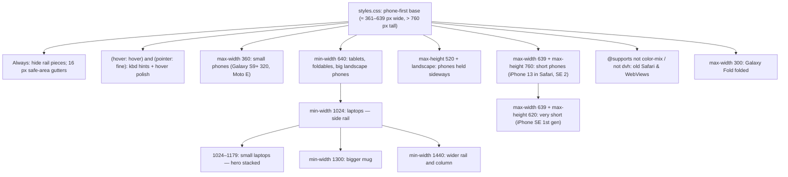

# L2.10c · Styling III: the responsive layer (+ Level 2 checkpoint)

> **Level 2 · Build it** · Lesson 18 of 18

| Recipe card | |
|---|---|
| **Time** | 75 min |
| **You need** | L2.10a (tokens, shell, tab bar), L2.10b (components, the deck formula), L1.02 (media queries) |
| **You'll produce** | All 674 lines of `src/responsive.css`, a measured derivation of the deck height, and the Level 2 checkpoint |

**In two sentences:** `styles.css` describes the app on a typical phone; `responsive.css` loads after it and *only overrides* what must change on other screens: tighter spacing on 320 px Androids, a shorter card on short phones, a slim bar in landscape, a wider column on tablets, and a full side rail on laptops. Every number in it was measured on one of 11 device profiles, and two of its rules exist because the tests or a screenshot sweep caught content hiding under the tab bar or a heading running into the mug.

> **Session 2 update (2026-10-16).** The `.otp` override at ≤ 360 px was deleted with email sign-in ([L2.07c](l2-07c-google-sign-in.md) §5.4).

### Objectives
1. Draw the breakpoint map (which media query fires on which device) and explain why the order of the blocks in the file matters.
2. Derive the deck-height constants (440, 424, 334) from measured layout boxes, and recompute them for a new layout.
3. Explain how the bottom tab bar becomes a side rail on laptops, property by property.
4. Write the two `@supports` fallbacks and say which browsers they serve.
5. Diagnose "buttons hidden under the tab bar" and "heading under the mug" from their symptoms.

---

## 1 · Warm-up: pull it from memory

1. *(L2.10a)* What is the shell's bottom padding, and why does it include `--tab-h`?
2. *(L2.10b)* What is the deck's base height formula, and why must the deck have an explicit height at all?
3. *(L1.02)* Two rules with identical selectors set `height` on `.deck`, one inside `@media (max-height: 760px)` and one inside `@media (max-height: 620px)`. Both match. Which wins?

<details><summary>Answers</summary>

1. `calc(var(--tab-h) + 28px + env(safe-area-inset-bottom))`. The tab bar floats over the page, so the shell reserves its height plus gaps; otherwise the last content hides behind it.
2. `clamp(340px, calc(100dvh - 440px - env(safe-area-inset-bottom)), 540px)`. All cards inside are absolutely positioned, so they contribute no height to the deck.
3. The one that comes **later in the file**. Media queries add no specificity; with equal specificity, source order decides.
</details>

## 2 · The problem this solves

The user asked for "every screen size, even iPhones and all kinds of Androids". A phone-first stylesheet looks right on a 390 × 844 iPhone and wrong almost everywhere else:
- on a 320 px Android, the four card buttons and five tab labels don't fit;
- on an iPhone SE, the card pushes its own buttons under the tab bar;
- in landscape there's no vertical room at all;
- on a laptop, a 560 px column floats in a sea of empty space with a phone tab bar at the bottom.

**The idea:** one override file, organised by *device situation* rather than by component, each block small and named for who it serves.


*Each arrow is "this block refines the one above it". The two arrows that matter for source order: the Fold block must come after the 360 block, and the very-short block after the short block, because they override the same properties.*

---

## 3 · Concepts

### 3.1 Media queries add no specificity, so order is the tie-breaker

`@media (max-width: 360px) { .deck-controls { … } }` has the same specificity as `.deck-controls { … }`: one class. When several matching rules set the same property, the **last one in the file** wins. So:
- `responsive.css` is imported *after* `styles.css` in `main.tsx`; every override wins over the base.
- Inside `responsive.css`, a more specific *situation* must come later: the ≤ 620 px-tall block (lines 633–674) sits after the ≤ 760 px-tall block (219–251), so on an iPhone SE 1st gen, which matches both, the smaller deck formula wins.

### 3.2 Query by situation, not by device name

There is no "iPhone" media query. The file targets the *situations* that change layout:
- **Width** (`max-width`, `min-width`): how many things fit side by side.
- **Height** (`max-height`): whether the card and its buttons fit above the tab bar.
- **Orientation**: landscape phones have a height problem, not a width problem.
- **Input** (`hover: hover` and `pointer: fine`): whether there's a mouse. Hover effects on touch screens "stick" after a tap, so they are only added where hovering exists.
- **Feature support** (`@supports`): whether the browser understands `color-mix()` or `dvh`.

### 3.3 Feature queries: `@supports not (…)`

`@supports not (height: 100dvh) { … }` applies its rules only in browsers that *don't* understand `100dvh` (Safari before 15.4, old Android WebViews). This is the opposite of the "write it twice" fallback from L2.10a. That trick works for one property in one rule; `@supports` is needed when the fallback must change *several* rules at once, or replace a whole `clamp()` expression.

### 3.4 Where the deck-height constant comes from

The deck's height is "the viewport minus everything that isn't the deck". Write the visible viewport height as $H$, the height of everything above the deck as $A$, everything below it down to the screen edge (including the tab bar and a clearance gap) as $B$:

$$\text{deck} = H - (A + B)$$

- *Why:* the page must fit in exactly one screen on the Study tab, so the deck gets whatever the fixed chrome leaves.

Measured with Playwright's Pixel 7 profile (412 × 839) on `/study`:

| Box | top → bottom (px) |
|---|---|
| Top bar | 0 → 63 |
| Page head ("Flashcards · Week …") | 71 → 98 |
| Week chips | 110 → 156 |
| Mode switch (`.seg`) | 168 → 218 |
| **Deck** | **232 → 631** |
| Deck foot ("12 / 130 · Hide mastered") | 639 → 659 |
| Controls (Undo · Again · Got it · Flip) | 688 → 744 |
| Tab bar | 759 → 827 |

So $A = 232$ (the deck's top) and $B = 839 - 631 = 208$:

$$A + B = 232 + 208 = 440$$

That 440 *is* the constant in `calc(100dvh - 440px)`. The bottom part breaks down as: 8 (deck margin) + 20 (foot) + 29 (foot margin and stack gap) + 56 (controls) + **15 (clearance above the tab bar)** + 68 (tab bar) + 12 (gap under it) = 208. The 15 px clearance is the only free choice; the rest is measured.

**The same derivation on the other two formulas** (measured, emulated insets are 0):

| Rule | Device profile | $H$ | $A$ (deck top) | $B$ ($H$ − deck bottom) | $A + B$ | Constant in CSS |
|---|---|---|---|---|---|---|
| Short phones (≤ 760 tall) | iPhone 13 in Safari, 390 × 664 | 664 | 214 | 664 − 454 = 210 | **424** | `100dvh - 424px` |
| Very short (≤ 620 tall) | iPhone SE 1st gen, 320 × 568 | 568 | 161 | 568 − 395 = 173 | **334** | `100dvh - 334px` |

The very-short constant is 90 px smaller because that block *removes* chrome: it hides the page head (the selected chip already names the deck), tightens the top bar by 8 px, and shrinks the seg and the controls. **Lesson:** a "magic number" in a `calc()` should be a measured sum. When you add a row of UI above the deck, the constant must grow by that row's height, or the buttons slide under the tab bar again.

---

## 4 · Reading the real code

As in L2.10b, the notes come first and the full source of each block follows in a reveal. Together the reveals cover all 674 lines.

### 4.1 Defaults (lines 1–16)

```css
/* laptop-only pieces are hidden by default */
.rail-brand,
.rail-foot,
.tab-label.long,
.kbd-hint {
  display: none;
}
.shell {
  padding-left: max(16px, env(safe-area-inset-left));
  padding-right: max(16px, env(safe-area-inset-right));
}
```
- **The tab bar's markup contains the laptop rail too** (the brand block, the theme toggle with a label, the footer, and a long label per tab, [L2.05](l2-05-app-shell.md)). One `<nav>` serves every screen; on phones these pieces are hidden.
- **`.kbd-hint`** ("← → to swipe, Space to flip") is hidden unless there's a keyboard-and-mouse setup (§4.2).
- **Gutters of `max(16px, inset)`**: 16 px on a normal phone, but in landscape an iPhone's notch is on the side (inset ≈ 47 px), and content must clear it.

<details><summary>Full source: lines 1–16</summary>

```css
/* =====================================================================
   Responsive layer: every screen from 320px Androids to wide laptops.
   Loaded after styles.css.
   ===================================================================== */

/* laptop-only pieces are hidden by default */
.rail-brand,
.rail-foot,
.tab-label.long,
.kbd-hint {
  display: none;
}
.shell {
  padding-left: max(16px, env(safe-area-inset-left));
  padding-right: max(16px, env(safe-area-inset-right));
}
```
</details>

### 4.2 Hover devices only (lines 18–71)

- **`@media (hover: hover) and (pointer: fine)`**: the primary input can hover *and* is precise (a mouse or trackpad). A touchscreen laptop with a mouse attached qualifies; a phone doesn't.
- **`kbd`** styles keyboard keys: a 2 px bottom border gives the "physical key" look.
- **Lift on hover**: week tiles and quick tiles rise 3 px and get the stronger shadow.
- **Hover borders**: options (not disabled, not selected), chips (not on), plain buttons (not primary/red/again/got/disabled), round and icon buttons, grid buttons, inactive tabs. The long `:not()` chains exclude every state that already has its own colours, so hover never fights a state.
- **`filter: brightness(1.08)`** on primary and red buttons lightens any colour by 8% without a new token.

<details><summary>Full source: lines 18–71</summary>

```css
/* keyboard hints + hover polish only where there is a mouse */
@media (hover: hover) and (pointer: fine) {
  .kbd-hint {
    display: block;
    text-align: center;
    font-size: 0.78rem;
    color: var(--faint);
    margin: 14px 0 0;
  }
  kbd {
    display: inline-block;
    min-width: 22px;
    padding: 1px 6px;
    border-radius: 6px;
    border: 1px solid var(--border-strong);
    border-bottom-width: 2px;
    background: var(--surface);
    color: var(--muted);
    font: 600 0.72rem/1.5 var(--font);
    text-align: center;
  }
  .week-tile,
  .quick a {
    transition: transform 0.25s var(--ease-out), box-shadow 0.25s, border-color 0.25s;
  }
  .week-tile:hover,
  .quick a:hover {
    transform: translateY(-3px);
    box-shadow: var(--shadow-2);
    border-color: var(--border-strong);
  }
  .opt:not(:disabled):not(.sel):hover {
    border-color: var(--border-strong);
  }
  .chip:not(.on):hover {
    color: var(--ink);
    border-color: var(--border-strong);
  }
  .btn:not(.primary):not(.red):not(.again):not(.got):not(:disabled):hover {
    border-color: var(--ink);
  }
  .btn.primary:not(:disabled):hover,
  .btn.red:not(:disabled):hover {
    filter: brightness(1.08);
  }
  .round:hover,
  .icon-btn:hover,
  .qgrid button:hover {
    border-color: var(--border-strong);
  }
  .tab:not(.active):hover {
    color: var(--ink);
  }
}
```
</details>

### 4.3 Small phones, ≤ 360 px wide (lines 73–217)

Who: 320 px Androids (Galaxy S9+ profile), Moto E, iPhone SE 1st gen, and the Galaxy Fold. Every rule here buys horizontal room:
- **Gutters 16 → 12 px**, with the matching full-bleed margins on `.topbar` and `.chips` (−12 px). If you change one, change the other, or the top bar's background stops short of the edge.
- **Smaller chrome**: logo 30 px, title 0.9 rem, icon buttons 38 px, tab bar 8 px from the edges (`100% − 16px`) with 5 px padding and 0.6 rem labels.
- **Home**: smaller hero padding and heading, mug at 64%, smaller stat numbers, 2 fixed week columns (`repeat(2, minmax(0, 1fr))`), because `auto-fill` with 150 px tiles would give one column on the Fold (L2.10b §5.3).
- **Card**: less padding; smaller option text. **Controls**: 46 px square buttons, 8 px gaps, and **the icons inside "Again" and "Got it" are hidden** (`.deck-controls .btn svg { display: none }`). At 320 px the labels alone just fit.
- **Test nav**: 48 px buttons; `minmax(0, 1fr)` for the Next button.
- **Podium and leaderboard**: smaller avatars, 28 / 36 px rank and avatar columns.
- **Results ring at 88%** (`transform: scale(0.88)`; a transform shrinks the drawing without changing its layout box, so the space around it stays the same).
- **OTP**: smaller and tighter (0.22 em) so 8–10 digits fit. Note that the base rule's `padding-left: calc(16px + 0.32em)` is *not* updated here, so the centring compensation is 0.1 em too large on small phones: about 2 px, invisible in practice, but a nice catch if you noticed it.

<details><summary>Full source: lines 73–217</summary>

```css
/* ---------- small phones (≤ 360px: Galaxy A/J series, iPhone SE 1st gen, Moto E…) ---------- */
@media (max-width: 360px) {
  .shell {
    padding-left: max(12px, env(safe-area-inset-left));
    padding-right: max(12px, env(safe-area-inset-right));
  }
  .topbar,
  .chips {
    margin-left: -12px;
    margin-right: -12px;
    padding-left: 12px;
    padding-right: 12px;
  }
  .topbar .brand img {
    width: 30px;
    height: 30px;
  }
  .topbar .brand-title {
    font-size: 0.9rem;
  }
  .topbar .brand-sub {
    font-size: 0.56rem;
  }
  .icon-btn {
    width: 38px;
    height: 38px;
  }
  .tabbar,
  .test-nav {
    width: calc(100% - 16px);
    bottom: calc(8px + env(safe-area-inset-bottom));
  }
  .tabbar {
    padding: 5px;
  }
  .tab {
    font-size: 0.6rem;
  }
  .hero {
    padding: 18px 16px;
  }
  .hero h1 {
    font-size: 1.5rem;
  }
  .hero .mug-slot {
    transform: scale(0.64);
  }
  .stats {
    gap: 8px;
  }
  .stat {
    padding: 12px 10px;
  }
  .stat .v {
    font-size: 1.12rem;
  }
  .stat .k {
    font-size: 0.68rem;
  }
  .quick a {
    min-height: 118px;
    padding: 14px;
  }
  .weeks {
    grid-template-columns: repeat(2, minmax(0, 1fr));
  }
  .seg button {
    font-size: 0.82rem;
    gap: 4px;
  }
  .fc-face {
    padding: 18px 14px 12px;
  }
  .fc-opts li {
    font-size: 0.88rem;
    padding: 9px 10px;
  }
  .deck-controls {
    grid-template-columns: 46px minmax(0, 1fr) minmax(0, 1fr) 46px;
    gap: 8px;
  }
  .deck-controls .round {
    width: 46px;
    height: 46px;
    border-radius: 14px;
  }
  .deck-controls .btn {
    min-height: 46px;
    font-size: 0.9rem;
    gap: 4px;
    padding: 0 6px;
  }
  .deck-controls .btn svg {
    display: none;
  }
  .q-card {
    padding: 16px 14px;
  }
  .opt {
    padding: 10px 12px;
    font-size: 0.92rem;
    min-height: 52px;
  }
  .test-nav {
    grid-template-columns: 48px 48px minmax(0, 1fr) 48px;
    gap: 6px;
    padding: 6px;
  }
  .test-nav .round {
    width: 48px;
    height: 48px;
  }
  .test-nav .btn {
    min-height: 48px;
    padding: 0 10px;
  }
  .pod .avatar {
    width: 48px;
    height: 48px;
    font-size: 1.05rem;
  }
  .pod.first .avatar {
    width: 60px;
    height: 60px;
  }
  .result .ring-wrap {
    transform: scale(0.88);
  }
  .result-stats b {
    font-size: 1.02rem;
  }
  .lb-row {
    grid-template-columns: 28px 36px minmax(0, 1fr) auto;
    gap: 8px;
    padding: 9px 10px;
  }
  .lb-row .av {
    width: 36px;
    height: 36px;
  }
  .otp {
    font-size: 1.3rem;
    letter-spacing: 0.22em;
  }
}
```
</details>

### 4.4 Short phones, ≤ 639 wide and ≤ 760 tall (lines 219–251)

```css
@media (max-width: 639px) and (max-height: 760px) {
  .deck {
    height: max(236px, calc(100vh - 424px));
    height: max(236px, calc(100dvh - 424px - env(safe-area-inset-bottom)));
  }
  …
}
```
- **Who**: most iPhones *in Safari* (the browser's bars eat 100–180 px, so an iPhone 13's visible height is about 664 px), iPhone SE 2nd/3rd gen, smaller Androids. Width ≤ 639 keeps it to phones.
- **A different shape of formula**: `max(236px, H − 424)` instead of `clamp(340, H − 440, 540)`. The minimum drops from 340 to 236 because on these screens the old 340 px floor *was* the bug (§7). There's no maximum: on a short screen the preferred value is always small.
- **The `vh` line before the `dvh` line**: the L2.10a fallback pattern. A browser that doesn't know `dvh` drops the second line.
- **The constant shrinks 440 → 424** because the rest of this block trims 16 px of chrome: compact head margins and a 1.4 rem title, 34 px chips, 36 px seg buttons, less margin under the deck foot. On the back of the card, smaller question text and tighter options make room inside the shorter card.

<details><summary>Full source: lines 219–251</summary>

```css
/* ---------- short phones (iPhone SE/8, small Androids): keep card buttons above the tab bar ---------- */
@media (max-width: 639px) and (max-height: 760px) {
  .deck {
    height: max(236px, calc(100vh - 424px));
    height: max(236px, calc(100dvh - 424px - env(safe-area-inset-bottom)));
  }
  .page-head.compact {
    margin: 4px 2px 8px;
  }
  .page-head.compact h1 {
    font-size: 1.4rem;
  }
  .chip {
    height: 34px;
  }
  .seg button {
    height: 36px;
  }
  .deck-foot {
    margin-bottom: 6px;
  }
  .fc-q {
    font-size: 1.05rem;
  }
  .fc-opts {
    margin-top: 10px;
    gap: 6px;
  }
  .fc-opts li {
    padding: 8px 10px;
    font-size: 0.88rem;
  }
}
```
</details>

### 4.5 Phones held sideways (lines 253–279)

```css
@media (max-height: 520px) and (orientation: landscape) {
  :root { --tab-h: 54px; }
  .tab { font-size: 0; gap: 0; }
  .topbar { position: relative; }
  .deck { height: 330px; min-height: 0; }
  .test-top { top: 0; }
  .splash { grid-auto-flow: column; gap: 28px; }
}
```
- **A token change ripples**: setting `--tab-h: 54px` shrinks the tab bar *and* recalculates the shell padding, the pinned leaderboard row and the toast position (L2.10a). One line, four effects.
- **`font-size: 0` hides the labels** but keeps them in the accessibility tree (the link's text still names it for screen readers). `display: none` on the label would remove it from screen readers too.
- **The top bar stops being sticky** (`position: relative`): with ~360 px of height, a permanent 63 px header is too expensive. The test header then sticks at the very top (`top: 0`).
- **A fixed 330 px deck**: the page scrolls in landscape; that's accepted.
- **The splash lays out side by side** (mug next to wordmark) instead of stacked.

<details><summary>Full source: lines 253–279</summary>

```css
/* ---------- phones held sideways / very short screens ---------- */
@media (max-height: 520px) and (orientation: landscape) {
  :root {
    --tab-h: 54px;
  }
  .tab {
    font-size: 0;
    gap: 0;
  }
  .tab .tab-dot {
    top: 6px;
  }
  .topbar {
    position: relative;
  }
  .deck {
    height: 330px;
    min-height: 0;
  }
  .test-top {
    top: 0;
  }
  .splash {
    grid-auto-flow: column;
    gap: 28px;
  }
}
```
</details>

### 4.6 Tablets and big landscape phones, ≥ 640 px (lines 281–342)

- **Shell up to 840 px** with 24 px gutters (and matching −24 px full-bleed margins).
- **`.page-narrow` (720 px) and `.page-xs` (520 px)**: `AnimatedRoutes` gives every page a width class (Home `page-wide`, Account `page-xs`, the rest `page-narrow`, [L2.05](l2-05-app-shell.md)). A form stretched to 840 px is hard to read, so narrower pages stay narrow.
- **Hero**: more padding, 2.5 rem heading (max 14ch), mug enlarged to 112% from its bottom-right corner.
- **Weeks**: `minmax(170px, 1fr)`. **Quick tiles** taller.
- **Deck**: `clamp(420px, H − 440, 520px)`, written twice (`vh` then `dvh`). There is no inset here: tablets have none in portrait that matters.
- **The sheet floats**: 16 px off the bottom, fully rounded, `min(560px, 100% − 32px)` wide, normal bottom padding. On big screens a sheet glued to the bottom edge looks like a phone app stretched.
- **The results mascot** grows to 96 px (the "mascot covered the ring" fix only applied to small cards).

<details><summary>Full source: lines 281–342</summary>

```css
/* ---------- tablets, foldables & big phones in landscape (≥ 640px) ---------- */
@media (min-width: 640px) {
  .shell {
    max-width: 840px;
    padding-left: max(24px, env(safe-area-inset-left));
    padding-right: max(24px, env(safe-area-inset-right));
  }
  .topbar,
  .chips {
    margin-left: -24px;
    margin-right: -24px;
    padding-left: 24px;
    padding-right: 24px;
  }
  .page-narrow {
    max-width: 720px;
    margin: 0 auto;
  }
  .page-xs {
    max-width: 520px;
    margin: 0 auto;
  }
  .hero {
    padding: 30px 28px 28px;
  }
  .hero h1 {
    font-size: 2.5rem;
    max-width: 14ch;
  }
  .hero p {
    max-width: 30ch;
    font-size: 1rem;
  }
  .hero .mug-slot {
    transform: scale(1.12);
    transform-origin: bottom right;
    right: 22px;
    bottom: -4px;
  }
  .quick a {
    min-height: 150px;
    padding: 20px;
  }
  .weeks {
    grid-template-columns: repeat(auto-fill, minmax(170px, 1fr));
  }
  .deck {
    height: clamp(420px, calc(100vh - 440px), 520px);
    height: clamp(420px, calc(100dvh - 440px), 520px);
  }
  .sheet {
    bottom: 16px;
    border-radius: 28px;
    width: min(560px, calc(100% - 32px));
    padding-bottom: 22px;
  }
  .result .mascot {
    width: 96px;
    right: 18px;
    top: 14px;
  }
}
```
</details>

### 4.7 Laptops, ≥ 1024 px: the side rail (lines 344–562)

The biggest block, because the *navigation model* changes: the floating bottom bar becomes a full-height left rail.

```css
:root { --rail-w: 252px; }
.topbar { display: none; }
.shell { max-width: none; margin-left: var(--rail-w); padding: 32px 48px 72px; }
.shell.no-rail { margin-left: 0; }
.shell > main { max-width: 1100px; margin: 0 auto; }
```
- **A new token `--rail-w`**, used by both the rail's width and the shell's left margin, so they can't disagree.
- **No top bar**: the rail carries the brand and the theme toggle.
- **The shell moves right by the rail's width** and drops its phone-centred `max-width`; the page content (`main`) is then centred in the remaining area, capped at 1100 px (760 for narrow pages, 520 for xs). **`.no-rail`** is used while a test is running, when `TabBar` renders nothing.

```css
.tabbar {
  left: 0; top: 0; bottom: 0;
  transform: none;
  width: var(--rail-w);
  height: auto;
  display: flex; flex-direction: column; gap: 4px;
  padding: 22px 14px 18px;
  border-radius: 0; border: 0; border-right: 1px solid var(--border);
  box-shadow: none;
  background: var(--surface);
  backdrop-filter: none; -webkit-backdrop-filter: none;
}
```
Read it as "undo the phone bar, property by property":

| Phone value (styles.css) | Laptop value | Why |
|---|---|---|
| `left: 50%; transform: translateX(-50%)` | `left: 0; transform: none` | Pinned to the left edge; the centring transform must be cancelled explicitly, or the rail is shifted half its width off-screen |
| `bottom: 12px + inset`, `height: var(--tab-h)` | `top: 0; bottom: 0; height: auto` | Full height |
| `width: min(528px, …)` | `width: var(--rail-w)` | — |
| `display: grid; repeat(5, 1fr)` | `display: flex; column` | A vertical list, and the rail brand/foot become visible children |
| rounded 24 px, border all round, `--shadow-2`, translucent + blur | square, right border only, no shadow, solid surface, no blur | A rail is part of the layout, not floating over it |

- **Tabs become rows**: icon then label, left-aligned, 48 px tall, 0.95 rem. The pill's radius follows (14 px). The red "sign in" dot moves to the row's right end, vertically centred.
- **Labels swap**: `.tab-label.short` ("Ranks") hidden, `.tab-label.long` ("Leaderboard") shown.
- **`.rail-brand`**: the hexagon badge, title and the red "aur", separated from the tabs by a hairline.
- **`.rail-foot { margin-top: auto }`**: in a column flexbox, an `auto` top margin absorbs all the free space, pushing the theme toggle and the course credit to the bottom of the rail.
- **Page heads grow** (2.6 rem). **Chips wrap** instead of scrolling (`flex-wrap: wrap`, no bleed margins): on a laptop all 14 fit in two rows, and horizontal scrolling with a mouse is awkward.
- **Home becomes a dashboard**: `.home-top` is a two-column grid (`1.75fr` hero, `1fr` stats). The hero is a 340 px-tall flex column with the heading at `clamp(2.3rem, 3.3vw, 3.1rem)` and **`max-width: 9.5ch`**, and the paragraph at 26ch: the overlap fix (§7). Stats stack vertically in equal rows (`grid-auto-rows: 1fr`).
- **Bigger quick tiles and week tiles** (`minmax(200px, 1fr)`).
- **Deck 500 px**, and every sticky/fixed offset that assumed a top bar or a bottom bar is reset: `.test-top` and `.week-head` stick at `top: 0`; the pinned row sits 20 px from the bottom; the toast 32 px.
- **`!important` on `.home-top .hero { margin-top: 0 }`**: the hero has an inline `style={{ marginTop: … }}` in `Home.tsx` for the phone layout; only `!important` beats an inline style. It's the one place the stylesheet needs it outside the reduced-motion block.

<details><summary>Full source: lines 344–562</summary>

```css
/* ---------- laptops & desktops (≥ 1024px): side rail instead of bottom bar ---------- */
@media (min-width: 1024px) {
  :root {
    --rail-w: 252px;
  }
  .topbar {
    display: none;
  }
  .shell {
    max-width: none;
    margin-left: var(--rail-w);
    padding: 32px 48px 72px;
  }
  .shell.no-rail {
    margin-left: 0;
  }
  .shell > main {
    max-width: 1100px;
    margin: 0 auto;
  }
  .shell > main.page-narrow {
    max-width: 760px;
  }
  .shell > main.page-xs {
    max-width: 520px;
  }

  .tabbar {
    left: 0;
    top: 0;
    bottom: 0;
    transform: none;
    width: var(--rail-w);
    height: auto;
    display: flex;
    flex-direction: column;
    gap: 4px;
    padding: 22px 14px 18px;
    border-radius: 0;
    border: 0;
    border-right: 1px solid var(--border);
    box-shadow: none;
    background: var(--surface);
    backdrop-filter: none;
    -webkit-backdrop-filter: none;
  }
  .tab {
    flex: none;
    flex-direction: row;
    justify-content: flex-start;
    gap: 12px;
    height: 48px;
    padding: 0 14px;
    font-size: 0.95rem;
    border-radius: 14px;
  }
  .tab .tab-pill {
    border-radius: 14px;
  }
  .tab .tab-dot {
    top: 50%;
    right: 14px;
    transform: translateY(-50%);
  }
  .tab-label.short {
    display: none;
  }
  .tab-label.long {
    display: inline;
  }
  .rail-brand {
    display: flex;
    align-items: center;
    gap: 12px;
    text-decoration: none;
    padding: 2px 6px 20px;
    margin-bottom: 10px;
    border-bottom: 1px solid var(--border);
  }
  .rail-brand img {
    width: 48px;
    flex: none;
  }
  .rail-brand .brand-title {
    font-weight: 800;
    font-stretch: 110%;
    font-size: 1rem;
    line-height: 1.15;
  }
  .rail-brand .brand-sub {
    margin-top: 4px;
    font-size: 0.6rem;
    letter-spacing: 0.2em;
    font-weight: 700;
    color: var(--muted);
    text-transform: uppercase;
  }
  .rail-brand .brand-sub b {
    color: var(--red);
  }
  .rail-foot {
    display: block;
    margin-top: auto;
    padding: 14px 4px 0;
    border-top: 1px solid var(--border);
  }
  .rail-theme {
    display: flex;
    align-items: center;
    gap: 12px;
    width: 100%;
    height: 44px;
    padding: 0 12px;
    border-radius: 12px;
    color: var(--muted);
    font-weight: 600;
    font-size: 0.9rem;
  }
  .rail-theme:hover {
    background: var(--surface-2);
    color: var(--ink);
  }
  .rail-foot p {
    margin: 10px 12px 0;
    font-size: 0.72rem;
    color: var(--faint);
  }

  .page-head {
    margin: 4px 2px 22px;
  }
  .page-head h1 {
    font-size: 2.6rem;
  }
  .page-head.compact h1 {
    font-size: 2rem;
  }
  .chips {
    margin: 0;
    padding: 2px 0 6px;
    flex-wrap: wrap;
  }

  .home-top {
    display: grid;
    grid-template-columns: minmax(0, 1.75fr) minmax(0, 1fr);
    gap: 16px;
  }
  .home-top .hero {
    margin-top: 0 !important;
    min-height: 340px;
    display: flex;
    flex-direction: column;
    justify-content: center;
    align-items: flex-start;
    padding: 40px 40px 36px;
  }
  .home-top .hero h1 {
    font-size: clamp(2.3rem, 3.3vw, 3.1rem);
    max-width: 9.5ch;
  }
  .home-top .hero p {
    max-width: 26ch;
  }
  .home-top .hero .mug-slot {
    transform: scale(1.15);
    right: 28px;
    bottom: 6px;
  }
  .home-top .stats {
    grid-template-columns: 1fr;
    grid-auto-rows: 1fr;
    margin-top: 0;
  }
  .home-top .stat {
    padding: 18px 20px;
    display: flex;
    flex-direction: column;
    justify-content: center;
  }
  .home-top .stat .v {
    font-size: 1.7rem;
  }
  .quick a {
    min-height: 168px;
    padding: 24px;
  }
  .quick a b {
    font-size: 1.2rem;
  }
  .weeks {
    grid-template-columns: repeat(auto-fill, minmax(200px, 1fr));
    gap: 12px;
  }
  .week-tile {
    padding: 16px 18px;
  }

  .deck {
    height: 500px;
  }
  .test-top {
    top: 0;
    padding-top: 16px;
  }
  .week-head {
    top: 0;
  }
  .me-pin {
    bottom: 20px;
  }
  .toast {
    bottom: 32px;
  }
  .splash .wordmark .w1,
  .splash .wordmark .w3 {
    font-size: 2rem;
  }
}
```
</details>

### 4.8 Laptop refinements (lines 564–593)

- **1024–1179 px (small laptops)**: `.home-top` back to `display: block`. The hero takes the full width and the three stats sit in a row underneath. Side by side, the hero was too narrow for its heading and the mug (§7).
- **≥ 1300 px**: the mug grows to 145% and moves 48 px in from the right.
- **≥ 1440 px**: a 272 px rail and an 1180 px content cap.

<details><summary>Full source: lines 564–593</summary>

```css
/* small laptops: hero full width, stats in a row underneath */
@media (min-width: 1024px) and (max-width: 1179px) {
  .home-top {
    display: block;
  }
  .home-top .stats {
    grid-template-columns: repeat(3, minmax(0, 1fr));
    grid-auto-rows: auto;
    margin-top: 14px;
  }
  .home-top .hero {
    min-height: 300px;
  }
}

@media (min-width: 1300px) {
  .home-top .hero .mug-slot {
    transform: scale(1.45);
    right: 48px;
  }
}

@media (min-width: 1440px) {
  :root {
    --rail-w: 272px;
  }
  .shell > main {
    max-width: 1180px;
  }
}
```
</details>

### 4.9 Old browsers (lines 595–621)

```css
@supports not (background: color-mix(in srgb, red 50%, transparent)) {
  .topbar, .test-top, .week-head { background: var(--bg); }
  .tabbar, .test-nav { background: var(--surface); }
  .week-tile.done { border-color: var(--good); }
}
@supports not (height: 100dvh) {
  body, .shell { min-height: 100vh; }
  .deck { height: clamp(340px, calc(100vh - 440px), 540px); }
  .sheet { max-height: 86vh; }
}
```
- **Without `color-mix()`** (Safari < 16.2, Chrome < 111): the translucent backgrounds would be *invalid*, so the declaration is dropped and the bars become fully transparent, which is unreadable. The fallback makes them solid. The "done" border becomes plain green.
- **Without `dvh`** (Safari < 15.4): `100dvh` inside `calc()` invalidates the *whole* declaration, so the deck would have no height at all and every card would collapse. The fallback restates the formulas with `vh`. (The shorter-phone blocks already have their own `vh` lines.)
- **Why `@supports` here instead of the two-line trick?** Several rules must change together, and the selectors span components. One feature query keeps the "old browser" story in one place.

<details><summary>Full source: lines 595–621</summary>

```css
/* ---------- older browsers (Safari < 16.2, old Android WebView) ---------- */
@supports not (background: color-mix(in srgb, red 50%, transparent)) {
  .topbar,
  .test-top,
  .week-head {
    background: var(--bg);
  }
  .tabbar,
  .test-nav {
    background: var(--surface);
  }
  .week-tile.done {
    border-color: var(--good);
  }
}
@supports not (height: 100dvh) {
  body,
  .shell {
    min-height: 100vh;
  }
  .deck {
    height: clamp(340px, calc(100vh - 440px), 540px);
  }
  .sheet {
    max-height: 86vh;
  }
}
```
</details>

### 4.10 Galaxy Fold folded, ≤ 300 px (lines 623–631)

- At 280 px the hero's heading met the mug even at 64% (measured: heading text ends at 192 px, mug starts at 185 px). The mug drops to 55% and the heading to 1.4 rem.

<details><summary>Full source: lines 623–631</summary>

```css
/* Galaxy Fold (folded) and other ultra-narrow screens */
@media (max-width: 300px) {
  .hero .mug-slot {
    transform: scale(0.55);
  }
  .hero h1 {
    font-size: 1.4rem;
  }
}
```
</details>

### 4.11 Very short phones, ≤ 620 px tall (lines 633–674)

```css
@media (max-width: 639px) and (max-height: 620px) {
  .topbar { padding-top: calc(6px + env(safe-area-inset-top)); padding-bottom: 6px; }
  .topbar .brand img { width: 28px; height: 28px; }
  .icon-btn { width: 36px; height: 36px; }
  .page-head.compact { display: none; /* the selected week chip already says which deck this is */ }
  .chips { padding-top: 6px; }
  .seg button { height: 34px; }
  .deck { margin: 10px 0 6px;
    height: max(220px, calc(100vh - 334px));
    height: max(220px, calc(100dvh - 334px - env(safe-area-inset-bottom))); }
  .deck-foot { margin: 2px 2px 6px; }
  .deck-controls .round { width: 44px; height: 44px; }
  .deck-controls .btn { min-height: 44px; }
  .deck-controls { grid-template-columns: 44px minmax(0, 1fr) minmax(0, 1fr) 44px; }
}
```
- **Who**: the iPhone SE 1st gen (320 × 568) and small Androids with a browser bar. It comes **last in the file** so it beats both the ≤ 360 block (46 px controls) and the ≤ 760 block (the 424 formula).
- **Every pixel of chrome is negotiated**: 8 px off the top bar, the page head hidden (the comment says why it's safe), smaller seg and controls.
- **44 px buttons** are the floor: Apple's minimum touch target is 44 pt.
- **The columns are restated** (`44px … 44px`) because the ≤ 360 block set `46px` columns; buttons and columns must agree or the grid leaves 2 px gaps.
- **334** is the measured chrome (§3.4); measured clearance above the tab bar is only 3 px (controls end at 489, tab bar starts at 492). That's tight but passes the test, which allows the buttons to end at most 1 px below the bar's top.

<details><summary>Full source: lines 633–674</summary>

```css
/* ---------- very short phones (iPhone SE 1st gen, small Androids: ≤ 620px tall) ---------- */
@media (max-width: 639px) and (max-height: 620px) {
  .topbar {
    padding-top: calc(6px + env(safe-area-inset-top));
    padding-bottom: 6px;
  }
  .topbar .brand img {
    width: 28px;
    height: 28px;
  }
  .icon-btn {
    width: 36px;
    height: 36px;
  }
  .page-head.compact {
    display: none; /* the selected week chip already says which deck this is */
  }
  .chips {
    padding-top: 6px;
  }
  .seg button {
    height: 34px;
  }
  .deck {
    margin: 10px 0 6px;
    height: max(220px, calc(100vh - 334px));
    height: max(220px, calc(100dvh - 334px - env(safe-area-inset-bottom)));
  }
  .deck-foot {
    margin: 2px 2px 6px;
  }
  .deck-controls .round {
    width: 44px;
    height: 44px;
  }
  .deck-controls .btn {
    min-height: 44px;
  }
  .deck-controls {
    grid-template-columns: 44px minmax(0, 1fr) minmax(0, 1fr) 44px;
  }
}
```
</details>

---

## 5 · Worked traces

### 5.1 Which blocks fire? Six screens

Predict which of these blocks match each screen: **H** = hover, **S** = ≤ 360 wide, **Sh** = short (≤ 639 × ≤ 760), **VS** = very short (≤ 639 × ≤ 620), **L** = landscape ≤ 520 tall, **T** = ≥ 640, **R** = ≥ 1024 rail, **F** = ≤ 300.

| Screen (viewport) | Predict |
|---|---|
| Galaxy S9+ in Chrome, 320 × 658, touch | ? |
| iPhone 13 in Safari, 390 × 664, touch | ? |
| iPhone SE 1st gen, 320 × 568, touch | ? |
| iPhone 13 landscape, 750 × 342, touch | ? |
| iPad Mini, 768 × 1024, touch | ? |
| Laptop, 1366 × 768, trackpad | ? |

<details><summary>Reveal</summary>

| Screen | Blocks | Deck height |
|---|---|---|
| Galaxy S9+ | S, Sh | max(236, 658 − 424) = **236** (measured 236 ✓) |
| iPhone 13 | Sh | max(236, 664 − 424) = **240** (measured 240 ✓) |
| iPhone SE 1st gen | S, Sh, VS | VS wins (last): max(220, 568 − 334) = **234** (measured 234 ✓) |
| iPhone 13 landscape | L, T (750 ≥ 640) | L sets 330, but T comes **later** in the file and also sets the deck: `clamp(420, 342 − 440, 520)` = **420 px** in a 342 px-tall viewport (measured in WebKit: 420 ✓). The page scrolls; see Q3 |
| iPad Mini | T | clamp(420, 1024 − 440, 520) = **520** |
| Laptop 1366 × 768 | H, T, R | R sets **500** (later than T) |
</details>

The landscape row is a genuine edge, confirmed by measurement: the "phones held sideways" block still shrinks the tab bar to 54 px and hides its labels (the ≥ 640 block doesn't touch those), but its 330 px deck height loses to the ≥ 640 block's 420 px minimum, which comes later in the file. Check yourself, Q3, asks what to do about it.

### 5.2 Laptop centring at 1366 px (measured)

On `/test` at 1366 × 768 the measured boxes were `.shell x=252 w=1114`, `.shell > main x=429 w=760 margin-left=129px`.
- Shell content area: 1114 − 2 × 48 (padding) = **1018 px**, starting at 252 + 48 = 300.
- `main.page-narrow` is capped at 760 px and centred: (1018 − 760) / 2 = **129 px** margin. ✓
- So the column runs from 429 to 1189: centred in the space *right of the rail*, not in the window. (In the build session, a screenshot at small scale made pages look off-centre; this measurement showed they weren't, and nothing was changed.)

---

## 6 · Running and testing

```bash
npm run build && npx vite preview --port 4174    # what Playwright tests against
npx playwright test tests/e2e/ui.spec.ts -g "nothing hides" --project=iphone-se --project=galaxy-s9-320
npx playwright test --project=laptop-chrome-1366 --project=desktop-edge-1920 tests/e2e/ui.spec.ts
```
- **The 11 projects** in `playwright.config.ts` were chosen to hit every block: two 320 px phones (S, Sh, VS), Pixel 7 (base), iPhone 13 (Sh), iPhone 14 Pro Max, two tablets (T), and four desktops (H, T, R, small-laptop) ([L4.03](l4-03-playwright-foundations.md)).
- **"no page scrolls sideways and nothing hides under the tab bar"** checks, on every project: no sideways scrolling on any route, and on `/study?week=0` that the bottom of the "Got it" button is at or above the tab bar's top (+1 px).
- **"navigation reaches every section and marks the active tab"** uses `isRail(page)` to click the rail on laptops and the bar on phones, so it tests both navigation models.

## 7 · Bug journal

### Incident · Card buttons hidden under the tab bar on short phones

1. **Symptom.** In the device screenshot sweep (11 sizes × 5 routes), the iPhone SE's Study screen showed the card, but "Again" and "Got it" were covered by the tab bar. Later, the automated check reported the same thing on the 320 × 568 profile:
   ```text
   ✘ [iphone-se] › ui.spec.ts › no page scrolls sideways and nothing hides under the tab bar
       Error: Got it button hidden under the tab bar
       Expected: <= 493
       Received:    572
   ```
   The button's bottom edge was 79 px below the tab bar's top.
2. **Diagnosis.**
   - The deck formula's floor: `clamp(340px, 100dvh − 440px, 540px)`. On a 568 px viewport the preferred value is 128 px, so the deck is **340 px**: far more than the space available. The floor meant for "don't make the card tiny" was making the page too tall.
   - First fix (from the sweep): a short-phone block, `max(250px, 100dvh − 400px)`. It fixed the 667 px-tall SE 2nd gen in the sweep.
   - During testing the constant was re-measured and changed to `max(236px, 100dvh − 424px)` along with smaller chips and seg buttons, but the 568 px profile still failed: 568 − 424 = 144 → floor 236 px, still too tall.
   - A second, smaller tier was needed for ≤ 620 px-tall screens, removing chrome rather than only shrinking the card. With `100dvh − 318px` the gap shrank from 79 px to 12 px (`Received: 504.98`); re-measuring the real chrome gave **334**, and the test passed on every project.
3. **Root cause.** A fixed-pixel subtraction (`100dvh − 440px`) encodes the height of the surrounding UI *on one screen*. Its `clamp` minimum then guarantees overflow on any screen shorter than minimum + constant + clearance (340 + 440 = 780 px). Most phones in a browser are shorter than that.
4. **Fix.**
   ```diff
   +/* ---------- short phones (iPhone SE/8, small Androids): keep card buttons above the tab bar ---------- */
   +@media (max-width: 639px) and (max-height: 760px) {
   +  .deck {
   +    height: max(236px, calc(100vh - 424px));                                      /* old-browser line */
   +    height: max(236px, calc(100dvh - 424px - env(safe-area-inset-bottom)));       /* 424 = measured chrome */
   +  }
   +  …tighter page head, chips, seg, foot, card text…
   +}
   ```
   ```diff
   +/* ---------- very short phones (iPhone SE 1st gen, small Androids: ≤ 620px tall) ---------- */
   +@media (max-width: 639px) and (max-height: 620px) {
   +  .page-head.compact { display: none; }                                           /* remove chrome, not just shrink */
   +  .deck { height: max(220px, calc(100dvh - 334px - env(safe-area-inset-bottom))); }
   +  .deck-controls .round, .deck-controls .btn { … 44px … }                         /* Apple's minimum target */
   +}
   ```
5. **Lesson.** Constants in layout `calc()`s are measurements: derive them from real boxes (§3.4) and write down what they contain. Test the property you care about ("the button is fully above the bar") on the **shortest** supported screen, not just the narrowest.

### Incident · The hero heading ran under the mug on small laptops

1. **Symptom.** In the laptop screenshots the Home hero's heading, "Brew your *exam prep*." at 3.1 rem, ran into the steaming mug on the right.
2. **Diagnosis.**
   - Added `max-width: 9.5ch` to the heading and 26ch to the paragraph, and made the size fluid: `clamp(2.3rem, 3.3vw, 3.1rem)`, with a smaller mug below 1300 px.
   - Measured the heading's right edge against the mug's left edge at five widths. First run, comparing **element boxes**:
     ```text
     1024 { h1Right: 616, mugLeft: 517 } OVERLAP
     1180 { h1Right: 632, mugLeft: 616 } OVERLAP
     1280 { h1Right: 656, mugLeft: 680 } OK
     1366 { h1Right: 678, mugLeft: 669 } OVERLAP
     ```
   - *Red herring:* that check was too strict. A heading's box is as wide as its `max-width`, not its text, and the mug's SVG box includes empty space around the drawing. The measurement was changed to the **text's own rectangles** (a DOM `Range` over the heading, taking the largest `right`) and the **visible mug** (17% in from the SVG's left edge):
     ```text
     1024 { h1Right: 590, mugLeft: 547 } OVERLAP
     1180 { h1Right: 605, mugLeft: 646 } OK
     1280 { h1Right: 627, mugLeft: 710 } OK
     1366 { h1Right: 646, mugLeft: 707 } OK
     ```
   - Only the 1024–1179 range really overlapped: there the hero is one of two columns and only ~600 px wide.
3. **Root cause.** Absolutely positioned decoration (the mug) doesn't take part in layout, so text flows under it. Whether they collide depends on the hero's *width*, which in a two-column grid is much less than the screen's width.
4. **Fix.**
   ```diff
   +/* small laptops: hero full width, stats in a row underneath */
   +@media (min-width: 1024px) and (max-width: 1179px) {
   +  .home-top { display: block; }                                      /* no side-by-side grid */
   +  .home-top .stats { grid-template-columns: repeat(3, minmax(0, 1fr)); grid-auto-rows: auto; margin-top: 14px; }
   +  .home-top .hero { min-height: 300px; }
   +}
   ```
   Re-measured at 1024: `h1Right: 590, mugLeft: 803` → OK at every width. The same check on phone widths found one more overlap, at 280 px (heading 192, mug 185), fixed by the ≤ 300 px block.
5. **Lesson.** When text shares space with absolutely positioned art, measure **text extents** against the **visible art**, across a sweep of widths, including the awkward middle widths where a grid column is narrow. Element boxes give false alarms.

## 8 · Why this design

| Decision | Alternatives | Why this one | Trade-off | Choose differently when |
|---|---|---|---|---|
| Separate override file, loaded last | Media queries next to each component | All screen-size logic in one place; easy to audit per device | A component's full styling lives in two files | Component libraries → co-locate queries with each component |
| Phone-first base + overrides | Desktop-first (`max-width` everywhere) | Most users are on phones; the base is the common case | Laptop block is large | Desktop-dominant audience |
| One `<nav>` restyled into a rail | Two separate navs rendered per breakpoint | One source of truth for tabs; no JS breakpoint detection | Rail-only pieces hidden on phones | Navigation differs a lot between devices |
| Height queries for the deck | JS `ResizeObserver` measuring free space | No JS, no layout flash | Constants must be re-measured when the UI changes | The chrome above the deck varies at runtime → measure with JS |
| Tiered short-screen blocks (760, 620) | One formula with a tiny minimum | Each tier removes chrome appropriately instead of crushing the card | More blocks to keep in order | — |
| `@supports` fallbacks | Ignore old browsers; polyfills | Cheap; keeps the app usable on 2021-era phones | Two code paths to keep in sync | Analytics show no old browsers → delete them |

## 9 · Check yourself

**Q1.** You add a 40 px "streak" banner above the deck on the Study page. What else must change, on which screens?
<details><summary>Answer</summary>All three deck constants grow by 40 (and its margin): 440 → 480, 424 → 464, 334 → 374, plus the <code>vh</code> fallbacks and the ≥ 640 px and <code>@supports</code> formulas. Otherwise the "Got it" button slides under the tab bar on exactly the phones where it was fixed. Better: hide the banner in the very-short block.</details>

**Q2.** Why is the very-short block (≤ 620 px tall) placed at the very end of the file rather than next to the short block?
<details><summary>Answer</summary>Media queries add no specificity. The iPhone SE 1st gen matches the ≤ 360, ≤ 760 and ≤ 620 blocks, which all set deck or control sizes. The last one in source order wins, so the most specific <i>situation</i> must come last. (Next to the short block would also beat it, but would lose to the ≤ 360 block's 46 px controls if placed before it.)</details>

**Q3.** Predict: an iPhone 13 in landscape (750 × 342). What deck height applies, and is that a problem?
<details><summary>Answer</summary>Both the landscape block (330 px) and the ≥ 640 block (<code>clamp(420, …)</code> = 420 px) match; the ≥ 640 block comes later, so the deck is <b>420 px</b> in a 342 px viewport, taller than the screen. It's usable because the page scrolls, but the landscape block's <code>.deck</code> rule never takes effect on wide landscape phones (its tab-bar changes do; measured: 54 px bar, 0 px labels, 420 px deck). Fix: move the landscape block after the ≥ 640 block, or limit the tablet block's deck rule with <code>(min-height: 521px)</code>.</details>

**Q4.** A browser without `dvh` support loads the Study page. Without lines 610–621, what happens to the deck?
<details><summary>Answer</summary>The base <code>height: clamp(340px, calc(100dvh − 440px − env(…)), 540px)</code> is invalid there, so the whole declaration is dropped and the deck has no height. Its children are all absolutely positioned, so the deck collapses to 0 px and the cards overlap the controls. The <code>@supports</code> block restores a <code>vh</code> version.</details>

**Q5.** On a laptop, why must `.tabbar` set `transform: none`?
<details><summary>Answer</summary>The phone rule centres the bar with <code>left: 50%; transform: translateX(−50%)</code>. The rail sets <code>left: 0</code>, but the transform would still shift it left by half its own width (126 px), half off-screen.</details>

**Q6.** Why are hover effects inside `(hover: hover) and (pointer: fine)` instead of applied everywhere?
<details><summary>Answer</summary>On touch screens, <code>:hover</code> sticks after a tap until you tap elsewhere, so a tile you tapped stays lifted and an option keeps a hover border that looks like a selection.</details>

## 10 · Practice

**Easy (10 min).** Fix the dead landscape rule (Q3) by moving the "phones held sideways" block below the ≥ 640 px block.
**Done when** a 750 × 342 viewport in DevTools shows a 330 px deck and a 54 px tab bar with no labels.

**Medium (20 min).** Replace the three deck constants with a custom property: `--chrome: 440px` in the base, overridden to `424px` and `334px` in the short blocks, and a single formula `clamp(var(--deck-min), calc(100dvh - var(--chrome) - env(safe-area-inset-bottom)), var(--deck-max))`.
**Done when** every device in §5.1 measures the same deck height as before.
<details><summary>Hint</summary>The minimum and maximum differ per tier too (340/540, 236/none, 220/none), so you need <code>--deck-min</code> and <code>--deck-max</code>; use a large value like <code>9999px</code> for "no maximum".</details>

**Hard (40 min).** Remove the constants entirely: make the Study page a full-height flex column (`height: calc(100dvh - <tab zone>)`) where the deck is `flex: 1; min-height: 220px` and everything else is its natural size.
**Done when** the "nothing hides under the tab bar" test passes on all 11 projects with no height media queries left for the deck.
<details><summary>Key insight</summary>Flexbox does the subtraction at runtime: the deck gets whatever the chrome leaves, whatever the chrome is. You still need one number, the tab bar zone (<code>--tab-h</code> + 12 px + inset + clearance). The page must not scroll, so the shell's bottom padding must not double-count it.</details>

## 11 · From memory

**Rung 1 · Cloze.**

```css
.rail-brand, .rail-foot, .tab-label.long, .kbd-hint { display: ___①___; }
@media (hover: hover) and (pointer: ___②___) { .week-tile:hover { transform: translateY(-3px); } }
@media (max-width: 639px) and (max-height: ___③___) {
  .deck { height: max(236px, calc(100dvh - ___④___ - env(safe-area-inset-bottom))); } }
@media (max-height: 520px) and (orientation: landscape) { :root { --tab-h: ___⑤___; } .tab { font-size: 0; } }
@media (min-width: 1024px) {
  :root { --rail-w: 252px; }
  .shell { margin-left: var(___⑥___); }
  .tabbar { left: 0; top: 0; bottom: 0; transform: ___⑦___; width: var(--rail-w); flex-direction: column; }
  .rail-foot { display: block; margin-top: ___⑧___; }
}
@supports ___⑨___ (height: 100dvh) { .deck { height: clamp(340px, calc(100vh - 440px), 540px); } }
@media (max-width: 639px) and (max-height: 620px) {
  .page-head.compact { display: none; }
  .deck { height: max(220px, calc(100dvh - ___⑩___ - env(safe-area-inset-bottom))); } }
```
<details><summary>Answers</summary>① <code>none</code> ② <code>fine</code> ③ <code>760px</code> ④ <code>424px</code> ⑤ <code>54px</code> ⑥ <code>--rail-w</code> ⑦ <code>none</code> ⑧ <code>auto</code> ⑨ <code>not</code> ⑩ <code>334px</code></details>

**Rung 2 · Blank page (20 min). No scrolling up.** Write a `responsive.css` for the app containing: the defaults, the hover block (two effects), the ≤ 360 block (gutters + full-bleed margins + controls), both short-phone tiers for the deck, the laptop rail (shell, tab bar, tab rows, label swap, rail foot) and both `@supports` fallbacks.
<details><summary>Self-check</summary>

- [ ] Rail pieces and kbd hints hidden by default; `max(16px, env(safe-area-inset-*))` gutters
- [ ] Hover effects only inside `(hover: hover) and (pointer: fine)`
- [ ] ≤ 360: gutters and full-bleed margins changed **together**; `minmax(0, 1fr)` controls
- [ ] Short tier `max(236px, 100dvh − 424px − inset)` with a `vh` line first; very-short tier `max(220px, 100dvh − 334px − inset)` placed **last**
- [ ] Laptop: `--rail-w` used by both shell margin and rail width; top bar hidden
- [ ] Rail: `left: 0; top: 0; bottom: 0; transform: none; height: auto`, flex column, no radius/shadow/blur, right border only
- [ ] Tabs as rows; short/long label swap; `margin-top: auto` on the foot
- [ ] Sticky/fixed offsets reset (`.test-top`, `.week-head` top 0; pin and toast near the bottom)
- [ ] `@supports not (color-mix…)` → solid bars; `@supports not (height: 100dvh)` → `vh` formulas
</details>

---

## 12 · Level 2 checkpoint

You've now built every part. This checkpoint mixes questions from all 17 Level 2 lessons (interleaving), then asks you to write the two most central pieces from a blank page.

### 12.1 Mixed quiz

**C1.** *(L2.01)* Question 7 of week 12 gets which `id`, and what does `answer: 2` mean?
<details><summary>Answer</summary><code>1207</code> (<code>week × 100 + n</code>). The answer is the <b>third</b> option, C: answer indexes are 0-based.</details>

**C2.** *(L2.02, L2.03)* A student calls `insert into test_attempts …` directly with `score = 100`. What stops them?
<details><summary>Answer</summary>RLS: there is no insert policy on <code>test_attempts</code> for <code>authenticated</code>, so the insert is denied. Attempts are only created by <code>start_test</code> and only scored by <code>submit_test</code>, both <code>security definer</code> functions that compute the score and the duration on the server.</details>

**C3.** *(L2.05)* An effect is written `useEffect(() => window.scrollTo({ top: 0 }), [path])`. What happened when this shape was used in the build, and why?
<details><summary>Answer</summary>A blank page with <code>destroy is not a function</code>. An arrow function without braces <i>returns</i> its expression, and in that Chrome version <code>scrollTo</code> returned a Promise. React stored it as the effect's cleanup and later tried to call it. Wrap the body in braces so the effect returns <code>undefined</code>.</details>

**C4.** *(L2.07a)* Your Supabase project sends 8-digit codes. What did the app originally do with them, and what's the fix?
<details><summary>Answer</summary>It cut input to 6 digits, so every real code was rejected and nobody could sign in. The fix accepts 6–10 digits (<code>OTP_MIN = 6</code>, <code>OTP_MAX = 10</code>, <code>maxLength={OTP_MAX}</code>).</details>

**C5.** *(L2.07b)* Local progress was updated at 10:05, the cloud row at 10:02. What does sign-in do?
<details><summary>Answer</summary>"Newest wins": local is newer, so the app keeps local and upserts it to the cloud. If the cloud had been newer, it would replace local.</details>

**C6.** *(L2.08a)* On an iPhone, the answer shows mirrored through the front of the card. What is the cause, and what is the robust fix?
<details><summary>Answer</summary>WebKit didn't honour <code>backface-visibility: hidden</code> in this nesting of transforms. Drive each face's opacity (and pointer events) from the rotation angle with <code>useTransform</code>, and keep <code>backface-visibility</code> as a bonus.</details>

**C7.** *(L2.09b)* You reload the page in the middle of a ranked test. Why do you return to the same question with the clock still correct?
<details><summary>Answer</summary>The attempt (id, question order, answers, current index, server start time) is saved in <code>localStorage</code> on every change; the clock is computed from the server's <code>started_at</code>, not from a client counter, so reloading can't reset it.</details>

**C8.** *(L2.10a–c)* The page wobbles sideways on iPhones during a slide animation. Which two lines fix it, and where?
<details><summary>Answer</summary><code>overflow-x: hidden; overflow-x: clip;</code> on <b>both</b> <code>html</code> and <code>body</code>. <code>clip</code> (unlike <code>hidden</code>) doesn't create a scroll container, so the sticky top bar keeps working.</details>

### 12.2 Blank-page drill: the core of the app (40 min)

**No notes, no scrolling.** In two empty files, write:
1. **`submit_test(p_attempt uuid, p_answers int[])`** in PL/pgSQL, with its `security definer`, `search_path`, ownership check, double-submit guard, grading loop, server-side duration and the return value (score, total, duration, rank, players, correct answers).
2. **The flashcard `SwipeCard`**: the drag with `useMotionValue`, the swipe decision (distance or velocity threshold), the stamps' opacity, the flip with angle-driven face visibility, and the exit animation direction.

<details><summary>Self-check: submit_test</summary>

- [ ] `returns json language plpgsql security definer set search_path = public`
- [ ] Loads the attempt with `where id = p_attempt and user_id = auth.uid() for update`; `if not found then raise`
- [ ] Refuses a second submission (`submitted_at is not null`) and an expired one (`now() − started_at > interval '3 hours'`)
- [ ] Rejects an answer array whose length differs from `question_ids` (`coalesce(array_length(p_answers, 1), 0)`)
- [ ] Grades in one query: `generate_subscripts(a.question_ids, 1) as i` joined to `questions`, `sum(case when p_answers[i] = q.answer …)` and `array_agg(q.answer order by i)`; a skipped `-1` never matches
- [ ] `duration_ms` from `clock_timestamp() − started_at` on the server
- [ ] Updates the row; reads the caller's rank from `get_leaderboard(100000)` and counts distinct players
- [ ] Returns `json_build_object(score, total, duration_ms, correct, rank, players)`
- [ ] `revoke all … from public, anon` then `grant execute … to authenticated`
</details>

<details><summary>Self-check: SwipeCard</summary>

- [ ] `x = useMotionValue(0)`; `rotate` and stamp opacities derived with `useTransform`
- [ ] `drag="x"` with `dragSnapToOrigin` (or constraints) and `onDragEnd` reading `offset.x` and `velocity.x`
- [ ] Decision: past the distance threshold **or** fast enough → right = got it, left = again; otherwise spring back
- [ ] Exit variant flies off in the swipe direction (`custom={dir}`)
- [ ] Flip: `rotateY = useSpring(flipped ? 180 : 0, …)`, set again when `flipped` changes; front opacity = angle < 90, back = angle ≥ 90; `pointerEvents` follow
- [ ] Card tilt `rotate = useTransform(x, [-220, 220], [-14, 14])`; stamps fade in between 30 and 120 px; thresholds 110 px or 650 px/s
- [ ] `touch-action: pan-y` on the card and its scroll areas (CSS)
</details>

Score yourself: **every box ticked on both** → start Level 3. **Two or more missing** → redo the Rung 2 drills of L2.03 and L2.08a tomorrow, then retry this drill in three days.

---

## 13 · Flashcards

<details><summary><b>Q:</b> Do media queries add specificity?</summary><b>A:</b> No. With equal selectors, the later rule in the file wins, so more specific situations go later.</details>
<details><summary><b>Q:</b> Where does the 440 in <code>100dvh − 440px</code> come from?</summary><b>A:</b> The measured height of everything above the deck (232) plus everything below it to the screen edge (208) on the base layout.</details>
<details><summary><b>Q:</b> Why did the 340 px <code>clamp</code> minimum cause the tab-bar bug?</summary><b>A:</b> Any viewport shorter than 340 + 440 = 780 px gets a deck taller than the space left, pushing the buttons under the bar.</details>
<details><summary><b>Q:</b> Which media feature limits hover effects to mice?</summary><b>A:</b> <code>(hover: hover) and (pointer: fine)</code>.</details>
<details><summary><b>Q:</b> How does the tab bar become a rail?</summary><b>A:</b> Fixed left/top/bottom 0, <code>transform: none</code>, rail width, flex column, no radius, shadow or blur, right border; tabs become rows; labels swap; foot pushed down with <code>margin-top: auto</code>.</details>
<details><summary><b>Q:</b> Why <code>font-size: 0</code> for landscape tab labels instead of <code>display: none</code>?</summary><b>A:</b> The text stays in the accessibility tree, so links keep their names.</details>
<details><summary><b>Q:</b> What does <code>@supports not (height: 100dvh)</code> protect?</summary><b>A:</b> Old Safari drops any declaration containing <code>dvh</code>; without the fallback the deck has no height.</details>
<details><summary><b>Q:</b> Why stack the hero on 1024–1179 px laptops?</summary><b>A:</b> As one of two grid columns it's only ~600 px wide and the heading runs under the absolutely positioned mug.</details>
<details><summary><b>Q:</b> How should text-vs-art overlap be measured?</summary><b>A:</b> Text extents (DOM Range rects) against the visible art, not element boxes.</details>
<details><summary><b>Q:</b> Why does <code>.home-top .hero</code> need <code>!important</code>?</summary><b>A:</b> To beat an inline <code>style</code> margin set in <code>Home.tsx</code>.</details>
<details><summary><b>Q:</b> What is <code>.shell.no-rail</code> for?</summary><b>A:</b> During a running test the rail isn't rendered, so the shell drops its left margin.</details>

## 14 · The menu board

| | |
|---|---|
| Order | `styles.css` then `responsive.css`; inside, later blocks win (no specificity from `@media`) |
| Tiers | hover · ≤360 · short ≤639×≤760 · landscape ≤520 · ≥640 · ≥1024 rail · 1024–1179 · ≥1300 · ≥1440 · @supports · ≤300 · very short ≤639×≤620 (last) |
| Deck | base `clamp(340, H−440−inset, 540)` · short `max(236, H−424−inset)` · very short `max(220, H−334−inset)` · tablet `clamp(420, H−440, 520)` · laptop 500 |
| Constant | = measured chrome above + below the deck, including tab zone and clearance |
| Rail | `--rail-w` 252 (272 ≥1440); shell `margin-left: var(--rail-w)`; bar → full-height column, `transform: none` |
| Phones ≤360 | 12 px gutters + matching bleed; 46 px controls without icons; 2 week columns |
| Old browsers | no color-mix → solid bars; no dvh → `vh` formulas |
| Tests | 11 projects; "nothing hides under the tab bar" on `/study?week=0` |

## 15 · Glossary

**Breakpoint**: a width or height where the layout changes. **Chrome (UI)**: the interface around the main content (bars, headers, controls), not the browser. **Feature query**: `@supports`, rules conditional on browser support. **Interaction media features**: `hover` and `pointer`, describing the primary input. **Phone-first**: base styles for phones, overrides for bigger screens. **Rail**: a vertical navigation bar along one edge. **Source order**: the position of a rule in the stylesheet, the final tie-breaker in the cascade. **Viewport**: the visible area of the page; on phones, the screen minus the browser's bars.

## 16 · Go further

| Resource | Type | Why | Which part | Time |
|---|---|---|---|---|
| [MDN: Using media queries](https://developer.mozilla.org/en-US/docs/Web/CSS/CSS_media_queries/Using_media_queries) | Docs | Syntax for width, height, orientation and combining conditions | "Targeting media features", "Creating complex media queries" | 20 min |
| [MDN: @supports](https://developer.mozilla.org/en-US/docs/Web/CSS/@supports) | Docs | Feature queries and `not` | "Syntax", "Examples" | 10 min |
| [web.dev: The large, small, and dynamic viewport units](https://web.dev/blog/viewport-units) | Article | Why `vh` is wrong on phones and how `dvh` fixes it | Whole article | 10 min |
| [MDN: hover media feature](https://developer.mozilla.org/en-US/docs/Web/CSS/@media/hover) | Docs | Detecting hover-capable inputs | Whole page | 5 min |
| [Ahmad Shadeed: The guide to responsive design](https://ishadeed.com/article/responsive-design/) | Guide | Practical patterns beyond breakpoints | Sections on navigation and layout | 30 min |

---
← [L2.10b Styling II: every component](l2-10b-component-styles.md) · [Hub](README.md) · [L3.01 Under the hood: the security model →](l3-01-security-model.md)
