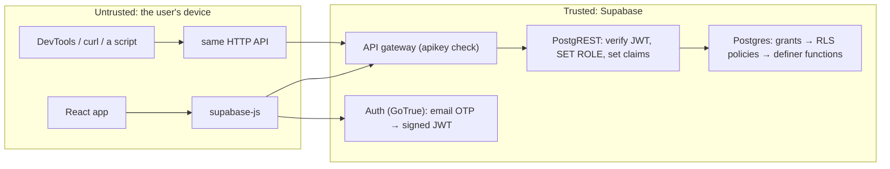

# L3.01 · Under the hood: the security model

> **Level 3 · Under the hood** · Lesson 1 of 5

| Recipe card | |
|---|---|
| **Time** | 70 min |
| **You need** | L1.04 (RLS, roles, keys, JWT), L2.02 (tables and policies), L2.03 (the four functions) |
| **You'll produce** | A threat model for the app, a request-by-request explanation of how Postgres decides what each caller may do, three verified foot-guns, and one real weakness with a proposed fix |

**In two sentences:** The browser is hostile territory: anyone can open DevTools, copy the public key and call the database API directly, so every rule that matters lives in Postgres, as row-level security policies and `security definer` functions. This lesson follows a request from the browser to the row, attacks the app the way a curious student would, proves which attacks fail and why, and is honest about the one that still works.

### Objectives
1. Draw the path of an API request from supabase-js to a Postgres row, naming where the role, the user id and each policy are applied.
2. Predict the result (rows, empty, or which error code) of ten attacks, and explain each from the policies and grants.
3. Explain three Postgres foot-guns: tables with RLS off, the default `EXECUTE` grant to `PUBLIC`, and `pg_temp` in a definer's search path, and how to detect each.
4. State what the server can and cannot guarantee about a leaderboard score, and design a fix for the instant-submit weakness.

---

## 1 · Warm-up: pull it from memory

1. *(L2.02)* `test_attempts` has one policy. Which, and why are there no insert or update policies?
2. *(L2.03)* Why does `submit_test` filter `where id = p_attempt and user_id = auth.uid()` instead of only `id = p_attempt`?
3. *(L1.04)* What is the difference between the publishable (anon) key and the secret key?

<details><summary>Answers</summary>

1. `"attempts: read own"` (`for select using (auth.uid() = user_id)`). With no insert/update policies, clients can't write the table at all; only the definer functions `start_test` and `submit_test` can.
2. A definer function bypasses RLS, so it must apply the ownership check itself. Without the `user_id` filter, anyone who learned an attempt id could submit someone else's test.
3. The publishable key identifies the project and is meant to be public; requests with it run as role `anon` (or `authenticated` with a user's session) and are fully subject to RLS. The secret key runs as `service_role`, which **bypasses RLS**, and must never reach a browser.
</details>

## 2 · The problem this solves

The naive app checks permissions in JavaScript: "only show the submit button if the user is signed in", "compute the score in the browser and save it". Both are decorations. The JavaScript runs on the attacker's machine. They can edit it, skip it, or never load it and call the API with `curl`.

**The idea:** treat the API as public and put the rules where the attacker can't reach: inside the database, evaluated for every query, using an identity the attacker can't forge (a signed JWT).


*The two clients on the left are equal in the server's eyes. Everything the app enforces is enforced in the right-hand box.*

---

## 3 · Concepts: what happens between your code's lines

### 3.1 One request, from browser to row

Take `supabase.from("card_progress").select("*")` sent by a signed-in student. Step by step:

```mermaid
sequenceDiagram
  participant B as Browser (supabase-js)
  participant G as API gateway
  participant P as PostgREST
  participant D as Postgres
  B->>G: GET /rest/v1/card_progress?select=* · apikey: publishable · Authorization: Bearer <user JWT>
  G->>P: forward (apikey is valid for this project)
  P->>P: verify JWT signature and exp; read claim role = "authenticated"
  P->>D: BEGIN; SET LOCAL ROLE authenticated; set request.jwt.claims = '{"sub":"a1…","role":"authenticated",…}'
  P->>D: SELECT * FROM card_progress
  D->>D: grant check: may "authenticated" SELECT this table? yes
  D->>D: RLS: append policy USING (auth.uid() = user_id); auth.uid() reads sub from the claims
  D-->>P: only rows where user_id = a1…
  P-->>B: 200 JSON array
```

Three facts make this safe:
- **The role comes from the JWT**, and the JWT is signed by Supabase Auth. Editing the payload (`"role": "service_role"`) breaks the signature; PostgREST rejects it with 401.
- **`auth.uid()` reads the `sub` claim** from the request settings PostgREST set. The client never sends a user id the server trusts; it sends a token from which the server derives it.
- **RLS is added inside Postgres**, after the grant check and before any row leaves. The query the client wrote is `SELECT *`; the query that runs is effectively `SELECT * … WHERE auth.uid() = user_id`.

### 3.2 How RLS combines policies

1. **Definition.** A policy is a boolean expression attached to a table, a command (`select`, `insert`, `update`, `delete`, `all`) and optionally a role.
2. **The rules Postgres applies:**
   - RLS **enabled with no policy for a command** → that command sees or changes **nothing** (default deny).
   - **`USING (expr)`** filters which *existing* rows are visible to `select`, `update` and `delete`.
   - **`WITH CHECK (expr)`** tests *new* row values on `insert` and `update`. Failing it raises error **42501** "new row violates row-level security policy".
   - Several permissive policies for the same command are **OR**ed.
   - An `update` needs a row to pass `USING` (to be targeted) **and** the new version to pass `WITH CHECK`.
3. **Consequences you can observe:**
   - A blocked `select` returns `[]`, not an error. That's why the live tests assert `data` equals `[]`.
   - A blocked `update` or `delete` matches zero rows: it **succeeds** and changes nothing (`data: []`, `error: null`).
   - A blocked `insert` errors with 42501.

| Table | select | insert | update | delete |
|---|---|---|---|---|
| `questions` | ✗ (no policy) | ✗ | ✗ | ✗ |
| `profiles` | own row | own id only | own row, stays own | ✗ (no policy; cascades when the auth user is deleted) |
| `test_attempts` | own rows | ✗ | ✗ | ✗ |
| `card_progress` | own rows | own `user_id` | own, stays own | own |

### 3.3 `security definer`: the waiter who can enter the kitchen

A normal (`security invoker`) function runs with the caller's role, so RLS still applies inside it. A **`security definer`** function runs with the role of its **owner**. In Supabase that's `postgres`, which owns the tables, and **table owners are not subject to RLS** (unless a table uses `force row level security`). So inside `submit_test` the code can read the `questions` answer key that the caller can't.

That power is exactly why each definer function must:
- **re-check identity itself**: `auth.uid()` still returns the *caller's* id inside a definer function, because it reads the request's claims, not the current role;
- **return only safe data**: `get_leaderboard` reads every attempt, but returns names, scores and times, never emails or answer arrays;
- **pin its search path** (§3.5);
- **be callable only by the right roles** (§3.4).

### 3.4 Grants come before policies

Before RLS runs, Postgres checks **privileges**: may this role touch this table or call this function at all?
- Supabase grants table privileges on `public` to `anon` and `authenticated` by default, and relies on RLS for row-level gating. (The DB tests reproduce this with `grant all on all tables in schema public to anon, authenticated`.)
- **Postgres grants `EXECUTE` on every new function to `PUBLIC`** (every role) by default. A definer function you forget to lock down is callable by `anon`.

So the schema ends with:
```sql
revoke all on function public.start_test()                from public, anon;
revoke all on function public.submit_test(uuid, int[])    from public, anon;
revoke all on function public.get_my_stats()              from public, anon;
revoke all on function public.get_leaderboard(int)        from public;
grant execute on function public.start_test()             to authenticated;
grant execute on function public.submit_test(uuid, int[]) to authenticated;
grant execute on function public.get_my_stats()           to authenticated;
grant execute on function public.get_leaderboard(int)     to anon, authenticated;
```
An `anon` call to `start_test` then fails before the function body runs, with **42501** "permission denied for function start_test". The function's own `if uid is null` check is a second line of defence.

### 3.5 The search path inside a definer function

Unqualified names (`questions`, `profiles`) are looked up along `search_path`. If a caller could put a look-alike `questions` table earlier on the path, the definer function would grade against *their* table. `set search_path = public` on the function fixes the path to `public` for the duration of the call.

There is a subtlety, verified in PGlite for this lesson: **the session's temporary schema `pg_temp` is still searched first for tables**, even when it isn't listed. A session that can run raw SQL could `create temp table questions (…)` and shadow the real one:

```text
create temp table questions (…);  -- empty
select start_test();
→ ERROR: No questions in the database yet (run seed.sql)
```
The definer function read the empty temp table. Through Supabase's HTTP API nobody can run `create temp table` (PostgREST only exposes table endpoints and functions), so this isn't exploitable here. The fully hardened forms are `set search_path = public, pg_temp` (temp searched **last**) or `set search_path = ''` with every name schema-qualified (`public.questions`). The Postgres docs recommend the first; Supabase's linter recommends the second.

---

## 4 · The math

### 4.1 Why a JWT can't be edited

A JWT is `base64url(header) . base64url(payload) . signature`, where

$$\text{signature} = \operatorname{Sign}_{k}\big(\text{base64url(header)} \,\|\, \text{.} \,\|\, \text{base64url(payload)}\big)$$

- $k$ is a key only Supabase holds (an HMAC secret or a private signing key).
- Changing one character of the payload changes the signed message, so the old signature no longer verifies.
- Producing a valid new signature without $k$ means breaking HMAC-SHA256 or ECDSA, which is computationally infeasible (for HMAC-SHA256, on the order of $2^{256}$ guesses for the key).

So the client can *read* its token (the payload is only encoded, not encrypted: paste it into a JWT decoder and you'll see `sub`, `role`, `exp`), but can't *change* it.

### 4.2 How safe is an 8-digit email code?

Let $d$ be the number of digits, so there are $10^d$ codes, and an attacker gets $k$ guesses before the code expires or rate limits stop them. With distinct guesses,

$$P(\text{success}) = \frac{k}{10^d}$$

- *Why:* each distinct guess eliminates one code; the real code is equally likely to be any of the $10^d$.

| $d$ | $k = 100$ | $k = 10{,}000$ |
|---|---|---|
| 6 | $10^{-4}$ (0.01%) | $10^{-2}$ (1%) |
| 8 (this project) | $10^{-6}$ | $10^{-4}$ (0.01%) |

Supabase rate-limits OTP verification and codes expire, so realistic $k$ is small. Two extra digits make guessing 100× harder for the same budget. (The cost was the 8-digit sign-in bug of [L2.07a](l2-07a-auth-sign-in.md): the app has to accept whatever length the project sends.)

---

## 5 · Attack the app: predict, then reveal

Every row is something a student with DevTools can type. **Predict the outcome before opening each answer.** All of these are executed for real by `tests/e2e/api-security.spec.ts` (live project) or `tests/db/schema.test.mjs` (PGlite) ([L4.02](l4-02-database-tests.md), [L4.06](l4-06-live-security-auth.md)).

| # | Attacker | Call |
|---|---|---|
| A1 | anon | `from("questions").select("*")`: read the answer key |
| A2 | anon | `rpc("start_test")` |
| A3 | anon | `from("test_attempts").insert({ …, score: 100 })` |
| A4 | student A | `from("profiles").insert({ id: <B's id>, display_name: "Hijack Attempt" })` |
| A5 | student A | `from("profiles").insert({ id: <own>, display_name: "" })` |
| A6 | student A | `from("test_attempts").update({ score: 100, duration_ms: 1 }).eq("user_id", <own>)` |
| A7 | student A | `rpc("submit_test", { p_attempt: <B's attempt>, … })` |
| A8 | student B | the same `submit_test` twice |
| A9 | student B | `from("card_progress").delete().eq("user_id", <A's id>)` |
| A10 | anon | `rpc("get_leaderboard", { p_limit: 5 })`: look for emails |

<details><summary>Reveal A1–A5</summary>

- **A1:** `data: []`, `error: null`. RLS is on and `questions` has no select policy. *(But see §7.2: the key is public anyway.)*
- **A2:** error **42501** permission denied: `EXECUTE` was revoked from `anon`. The body never runs.
- **A3:** error: `anon` has no insert policy on `test_attempts`.
- **A4:** error 42501: `with check (auth.uid() = id)` fails for B's id.
- **A5:** error **23514** check violation: `display_name ~ '^[A-Za-z0-9_. -]+$'` rejects `<` and `>`. Even if it were stored, React escapes text when rendering, so it would show as literal text: two layers.
</details>

<details><summary>Reveal A6–A10</summary>

- **A6:** `data: []`, `error: null`. No update policy, so no row is targetable; the update "succeeds" on zero rows. The test then re-reads and confirms the score is still 73.
- **A7:** error "Test attempt not found": the definer function's own `user_id = auth.uid()` filter.
- **A8:** first call succeeds; second: "This test was already submitted". If both arrive at the same instant, `select … for update` makes the second wait for the first's row lock, then it sees `submitted_at` set ([L3.02](l3-02-ranking-sql.md)).
- **A9:** `data: []`. A's rows are invisible to B under `USING (auth.uid() = user_id)`, so zero rows are deleted.
- **A10:** rows with `rank, user_id, display_name, score, total, duration_ms, attempts, submitted_at`, and no email. The definer function reads `profiles` for everyone but returns only the public name. (`user_id` is a random UUID; it identifies a row but reveals nothing.)
</details>

---

## 6 · Running and testing

```bash
npm run test:db                                   # PGlite: RLS, grants, grading, ranking (no network)
npx playwright test --project=api                 # live project: anonymous + two throwaway users
```
- **No secrets needed** for the anonymous half of the live tests or the DB tests. The signed-in half needs `SUPABASE_SECRET_KEY` (or the git-ignored `Supabase.txt`) to create and delete throwaway users through the admin API, and is skipped otherwise ([L4.06](l4-06-live-security-auth.md)).
- **What these tests prove**: each row of §5, against both an emulation (fast, offline) and the real project (catches dashboard drift, such as someone disabling RLS in the UI).

## 7 · Bug journal: four failure modes, all verified

### 7.1 Known foot-gun · A new table with RLS off is public

1. **Symptom.** You add `public.announcements` for a "news" banner and forget `enable row level security`. Anyone can now run `curl "$URL/rest/v1/announcements?select=*" -H "apikey: <publishable key>"` and read every row, including drafts, and write to it. Reproduced in PGlite as role `anon`:
   ```text
   anon reads: [{"id":1,"body":"secret draft"}]
   anon reads questions: 0
   ```
2. **Diagnosis.** Nothing errors; that's the danger. The only signals are a catalog query, Supabase's Security Advisor ("RLS disabled in public"), or a test that reads every table as `anon`.
3. **Root cause.** Supabase grants table privileges to `anon` and `authenticated` by default. With RLS off, privileges are the only gate, and they say yes.
4. **Fix and detection.**
   ```diff
    create table public.announcements (id int primary key, body text);
   +alter table public.announcements enable row level security;
   +create policy "announcements: read" on public.announcements for select using (true);  -- public read, no writes
   ```
   The query that finds every unprotected table (empty for this project's schema; it listed `announcements` once the table was added):
   ```sql
   select c.relname
   from pg_class c join pg_namespace n on n.oid = c.relnamespace
   where n.nspname = 'public' and c.relkind = 'r' and not c.relrowsecurity;
   ```
5. **Lesson.** Make "every public table has RLS" a **test**, not a habit: run this query in the DB test suite and assert it returns no rows. The live test "cannot read the answer key or any private table" only covers the tables it names; the catalog query covers tables nobody has written a test for yet.

### 7.2 Known foot-gun · Functions are executable by everyone by default

1. **Symptom.** A helper function you added to `public` for internal use is callable by any visitor: `rpc("helper")` works with only the publishable key. Verified in PGlite: as `anon`, `select public.helper()` returned `42`.
2. **Diagnosis.** You never granted anything. Postgres did: new functions get `EXECUTE` for `PUBLIC`. PostgREST exposes every function in the exposed schema as `/rest/v1/rpc/<name>`.
3. **Root cause.** Default privileges. For a `security definer` function this is a full RLS bypass for whatever the function does.
4. **Fix.**
   ```diff
    create function public.helper() … security definer …;
   +revoke all on function public.helper() from public, anon, authenticated;   -- nobody via the API
   ```
   Or put internal helpers in a schema the API doesn't expose (for example `private`).
5. **Lesson.** Every `create function` in an exposed schema is followed by its `revoke`/`grant` lines. The live test "cannot start, submit or read stats" asserts error code 42501 for each function `anon` must not call.

### 7.3 Hardening note · `pg_temp` is searched first

Verified in §3.5: inside a definer function with `set search_path = public`, a temp table named `questions` shadowed the real one. **Not exploitable through the API** (no raw SQL), so the schema is safe as deployed. If the database is ever reachable by untrusted SQL clients (a reporting tool, a shared Postgres), change each function to `set search_path = public, pg_temp` or `set search_path = ''` with schema-qualified names.

### 7.4 Found while writing this lesson · A script can top the leaderboard

1. **Symptom.** A perfect, instant attempt is accepted and ranked first. Reproduced in PGlite with the real `setup.sql`:
   ```text
   instant submit: {"score":100,"total":100,"duration_ms":12,"rank":1}
   ```
   The DB test suite's own `play()` helper does the same thing for every test, in milliseconds, and nothing objects.
2. **Diagnosis.** Each check in §5 holds: the score *is* computed by the server from the submitted answers, and the time *is* measured by the server. What the server cannot know is **who or what chose the answers**. And the answers aren't secret: the flashcards ship all 130 questions with their answers in the JavaScript bundle (`src/data/questions.json`), by design, because studying them is the point of the app. So a 20-line script with a real session can call `start_test`, look up all 100 answers locally, and call `submit_test` within a fraction of a second.
3. **Root cause.** The leaderboard ranks by **score, then time**, and the system protects the integrity of the *measurement* (no forged rows, no edited scores, no client clock) but has no notion of a *plausible* attempt. RLS answers "may this user write this?", not "is this a human taking a test?".
4. **Fix** (proposed, **not applied** to the app):
   ```diff
      dur := (extract(epoch from (clock_timestamp() - a.started_at)) * 1000)::int;
   +  -- 100 questions can't be read and answered by a person in under ~2 minutes
   +  if dur < a.total * 1200 then
   +    raise exception 'Too fast to be a real attempt' using errcode = 'P0001';
   +  end if;
   ```
   A softer variant stores the attempt but excludes it from `get_leaderboard` (`where t.duration_ms >= t.total * 1200`). Either way, the DB test helper must then fake time (for example by back-dating `started_at` as the test owner). Stronger options, in increasing cost: a per-user cooldown between attempts, CAPTCHA on `start_test`, or hiding the answer key from the bundle (which would break offline flashcards).
5. **Lesson.** Write down **what the server guarantees and what it doesn't**. Here: "scores are computed server-side and can't be forged or edited; durations are server-measured; we do not detect automated or assisted answering." Then decide whether the gap matters for this audience (a class leaderboard for a MOOC) before paying for a fix.

## 8 · Why this design

| Decision | Alternatives | Why this one | Trade-off | Choose differently when |
|---|---|---|---|---|
| Rules in Postgres (RLS + definer functions) | A custom API server (Express/Edge Functions) that checks everything | No server to run; rules apply to *every* path into the data | SQL policies are harder to read and test than app code | Complex business rules or third-party calls → an Edge Function in front |
| Grading in a definer function | Grade in the browser and insert the score | Score can't be forged | Answer key must live in the DB too (and stays in sync via tests) | Never grade on the client for a ranked score |
| No insert/update policies on attempts | Policies with `with check (score is null)` etc. | Zero client write surface | Every write path is a function you must write | Many client-editable fields → policies with tight checks |
| Revoke-then-grant per function | Rely on defaults | Explicit, testable | Easy to forget for new functions (7.2) | Use a non-exposed schema for helpers |
| `set search_path = public` | `= ''` with qualified names; `public, pg_temp` | Short and readable; safe via the API | `pg_temp` still first (7.3) | Untrusted SQL access → `''` or `public, pg_temp` |
| Answers shipped to the client for flashcards | Fetch answers only after flipping | Works offline, instant | Answers are public (7.4) | A real exam with secret questions → never ship the key |

## 9 · Check yourself

**Q1.** A student runs `supabase.from("test_attempts").update({ score: 100 }).eq("id", myAttemptId)` and gets `{ data: [], error: null }`. They conclude the update "worked". What really happened?
<details><summary>Answer</summary>Nothing changed. With RLS on and no update policy, no row passes the (absent) <code>USING</code> clause, so the update targets zero rows and returns no error. Only a failing <code>WITH CHECK</code> or insert raises 42501.</details>

**Q2.** Predict: inside `get_leaderboard` (security definer), what does `auth.uid()` return when anon calls it?
<details><summary>Answer</summary><code>null</code>. <code>auth.uid()</code> reads the request's JWT claims, not the current role. Definer changes the role to the owner but not the request claims. (That's why <code>get_my_stats</code> can use <code>auth.uid()</code> to find the caller's row.)</details>

**Q3.** You add `create policy "attempts: update own" on test_attempts for update using (auth.uid() = user_id);` to let users rename attempts. What did you just break?
<details><summary>Answer</summary>Score integrity. Without a <code>WITH CHECK</code> restricting columns, and since policies are row-level not column-level, a user can now update <code>score</code> and <code>duration_ms</code> on their own rows. Column-level protection needs column privileges (<code>revoke update (score, duration_ms) …</code>) or a definer function instead.</details>

**Q4.** Someone edits their JWT payload from `"role":"authenticated"` to `"role":"service_role"` in DevTools. What happens?
<details><summary>Answer</summary>PostgREST verifies the signature over the header and payload; the edited payload no longer matches, so the request is rejected (401). Without the signing key the student can't produce a valid signature.</details>

**Q5.** Why can't the instant-submit weakness (7.4) be fixed with another RLS policy?
<details><summary>Answer</summary>RLS decides <i>who</i> may read or write <i>which rows</i>. The scripted submission comes from the legitimate owner, through the legitimate function, with correct data. Detecting "not a human" needs a rule about the attempt itself (a minimum duration, a cooldown, a CAPTCHA), inside <code>submit_test</code> or in front of it.</details>

**Q6.** Which of these exposes data to anonymous visitors? (a) a table with RLS on and no policies; (b) a table with RLS off; (c) a `security definer` function granted to `anon` that returns `select * from profiles`.
<details><summary>Answer</summary><b>(b) and (c).</b> (a) is default deny. (b) is open via default grants. (c) bypasses RLS and returns whatever it selects: definer functions must return only what's safe for their callers.</details>

## 10 · Practice

**Easy (10 min).** Add the catalog check from 7.1 to `tests/db/schema.test.mjs` as a test named "every public table has RLS enabled".
**Done when** it passes on the current schema and fails if you comment out one `enable row level security` line.

**Medium (20 min).** Implement the minimum-duration rule from 7.4 as a *soft* rule: keep storing fast attempts, but exclude them from `get_leaderboard`. Update the DB test helper so tests still produce ranked attempts.
**Done when** an instant 100/100 is stored, `get_leaderboard` doesn't list it, and every existing DB test passes.
<details><summary>Hint</summary>In the test, after <code>start_test</code>, run (as the owner, outside <code>as()</code>) <code>update test_attempts set started_at = now() - interval '10 minutes' where id = $1</code> before submitting.</details>

**Hard (40 min).** Harden every function to `set search_path = ''` with fully qualified names (`public.questions`, `public.test_attempts`, `auth.uid()`), then re-run the temp-table shadow experiment from §3.5 in PGlite to prove it no longer affects the function.
**Done when** both test suites pass and `create temp table questions …` followed by `select start_test()` still returns 100 real question ids.
<details><summary>Key insight</summary>With an empty search path, unqualified names don't resolve at all, so every missed qualification is a loud error ("relation does not exist") rather than a silent shadow. The built-in functions (<code>array_length</code>, <code>now</code>) live in <code>pg_catalog</code>, which is always searched.</details>

## 11 · From memory

**Rung 1 · Cloze.**

```sql
alter table public.test_attempts enable ___①___ level security;
create policy "attempts: read own" on public.test_attempts for ___②___ using (auth.uid() = ___③___);
create policy "progress: update own" on public.card_progress for update
  using (auth.uid() = user_id) ___④___ (auth.uid() = user_id);

create or replace function public.submit_test(p_attempt uuid, p_answers int[])
returns json language plpgsql security ___⑤___ set ___⑥___ = public as $$ … $$;

revoke all on function public.submit_test(uuid, int[]) from ___⑦___, anon;
grant ___⑧___ on function public.submit_test(uuid, int[]) to authenticated;
```
<details><summary>Answers</summary>① <code>row</code> ② <code>select</code> ③ <code>user_id</code> ④ <code>with check</code> ⑤ <code>definer</code> ⑥ <code>search_path</code> ⑦ <code>public</code> ⑧ <code>execute</code></details>

**Rung 2 · Blank page (20 min). No scrolling up.** On one page: draw the request path (browser → gateway → PostgREST → grants → RLS → definer), write the policy table of §3.2 for all four tables, and list the three foot-guns and the instant-submit weakness, each with its detection and fix.
<details><summary>Self-check</summary>

- [ ] The role and `auth.uid()` come from a **signed** JWT, verified by PostgREST; claims are set per request
- [ ] Order: privilege check, then RLS; definer functions run as the owner and skip RLS
- [ ] No policy = deny; `USING` filters rows; `WITH CHECK` tests new rows; blocked select/update/delete → zero rows, blocked insert → 42501
- [ ] Policy table: questions none; profiles own select/insert/update; attempts own select only; progress own all four
- [ ] RLS-off table → catalog query on `pg_class.relrowsecurity` + a test
- [ ] Default `EXECUTE` to `PUBLIC` → revoke/grant per function, 42501 test
- [ ] `pg_temp` first → `public, pg_temp` or `''` (not exploitable via the API)
- [ ] Instant submit → guarantees vs non-guarantees; minimum-duration rule
</details>

## 12 · Flashcards

<details><summary><b>Q:</b> Where do the role and user id of an API request come from?</summary><b>A:</b> The signed JWT. PostgREST verifies it, sets the role, and stores the claims; <code>auth.uid()</code> reads <code>sub</code>.</details>
<details><summary><b>Q:</b> RLS on, no policy for <code>select</code>: what does a select return?</summary><b>A:</b> An empty result, no error (default deny).</details>
<details><summary><b>Q:</b> What does a blocked <code>update</code> return?</summary><b>A:</b> Success on zero rows (<code>data: []</code>, no error).</details>
<details><summary><b>Q:</b> <code>USING</code> vs <code>WITH CHECK</code>?</summary><b>A:</b> <code>USING</code> picks which existing rows are visible/targetable; <code>WITH CHECK</code> validates the new row on insert/update.</details>
<details><summary><b>Q:</b> Why can a definer function read the answer key?</summary><b>A:</b> It runs as the owner of the tables, and owners aren't subject to RLS.</details>
<details><summary><b>Q:</b> What must every definer function do itself?</summary><b>A:</b> Check identity (<code>auth.uid()</code>), return only safe columns, pin <code>search_path</code>, and be granted only to the right roles.</details>
<details><summary><b>Q:</b> Why <code>revoke … from public</code>?</summary><b>A:</b> Postgres grants <code>EXECUTE</code> on new functions to <code>PUBLIC</code> by default.</details>
<details><summary><b>Q:</b> Error code for "permission denied" / RLS insert violation?</summary><b>A:</b> 42501. Check constraint 23514, unique 23505.</details>
<details><summary><b>Q:</b> How do you find tables with RLS off?</summary><b>A:</b> <code>pg_class</code> where <code>relkind = 'r'</code>, schema <code>public</code>, <code>not relrowsecurity</code>; or Supabase's Security Advisor.</details>
<details><summary><b>Q:</b> What does <code>set search_path = public</code> not prevent?</summary><b>A:</b> Temp-table shadowing: <code>pg_temp</code> is still searched first unless listed last.</details>
<details><summary><b>Q:</b> P(guess an 8-digit code in k tries)?</summary><b>A:</b> k / 10⁸.</details>
<details><summary><b>Q:</b> What doesn't the server guarantee about a score?</summary><b>A:</b> That a human chose the answers unaided. The key is public study material, so a script can submit a perfect paper instantly.</details>

## 13 · The menu board

| | |
|---|---|
| Trust boundary | Browser = hostile; rules live in Postgres |
| Request path | apikey → JWT verified → `SET ROLE` + claims → grants → RLS → rows |
| RLS rules | no policy = deny · USING filters · WITH CHECK validates · permissive policies OR'd |
| Observable | blocked select/update/delete → `[]`; blocked insert → 42501 |
| Definer | runs as owner (skips RLS); `auth.uid()` still the caller; check identity, return safe columns |
| Grants | `EXECUTE` to `PUBLIC` by default → revoke, then grant per role |
| Search path | `= public` fixed; `pg_temp` first unless listed last; hardest: `''` + qualified names |
| Detect | catalog query for RLS-off · Security Advisor · live anon tests |
| Guarantees | no forged/edited scores, server time · not: human, unaided answering |

## 14 · Glossary

**Claims**: the fields in a JWT payload (`sub`, `role`, `exp`). **Default deny**: with RLS on, nothing is allowed without a policy. **Definer / invoker**: whose privileges a function runs with: its owner's, or its caller's. **Grant / privilege**: permission for a role to use an object, checked before RLS. **JWT**: a signed token carrying claims. **OTP**: one-time password. **`pg_temp`**: the per-session temporary schema. **Permissive policy**: a policy combined with others by OR. **PostgREST**: the server that turns HTTP requests into SQL under the caller's role. **`PUBLIC`**: the pseudo-role meaning every role. **Rate limit**: a cap on requests per time window. **Search path**: the list of schemas searched for unqualified names. **Threat model**: assets, attackers, entry points and the defences for each. **Trust boundary**: the line beyond which input can't be trusted.

## 15 · Go further

| Resource | Type | Why | Which part | Time |
|---|---|---|---|---|
| [PostgreSQL: Row security policies](https://www.postgresql.org/docs/current/ddl-rowsecurity.html) | Docs | The exact rules for USING, WITH CHECK, permissive/restrictive and owners | Whole page | 25 min |
| [PostgreSQL: CREATE FUNCTION](https://www.postgresql.org/docs/current/sql-createfunction.html) | Docs | The official guidance on safe definer functions and `pg_temp` | "Writing SECURITY DEFINER Functions Safely" | 10 min |
| [Supabase: Row Level Security](https://supabase.com/docs/guides/database/postgres/row-level-security) | Docs | How Supabase roles, `auth.uid()` and policies fit together | "Policies", "Helper functions", "Bypassing RLS" | 20 min |
| [PostgREST: Authentication](https://docs.postgrest.org/en/stable/references/auth.html) | Docs | How a JWT becomes a database role and claims | "JWT-Based User Impersonation" | 15 min |
| [Supabase: Database linter](https://supabase.com/docs/guides/database/database-linter) | Docs | Automated checks for RLS-off tables and mutable search paths | The security lints list | 10 min |
| [OWASP Top 10: Broken Access Control](https://owasp.org/Top10/A01_2021-Broken_Access_Control/) | Reference | The most common real-world web vulnerability, which this lesson defends against | "Description", "How to Prevent" | 15 min |

---
← [L2.10c Styling III: responsive](l2-10c-responsive.md) · [Hub](README.md) · [L3.02 Ranking maths and SQL internals →](l3-02-ranking-sql.md)
