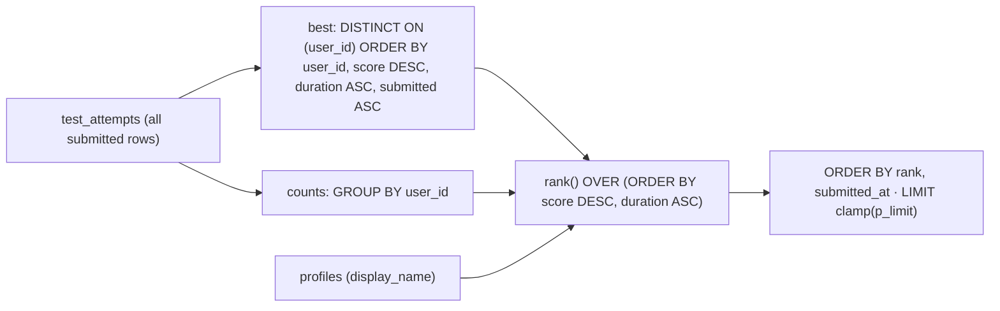
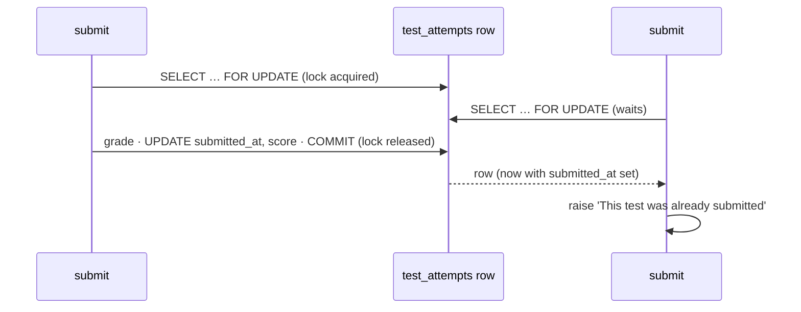

# L3.02 · Under the hood: ranking maths and SQL internals

> **Level 3 · Under the hood** · Lesson 2 of 5

| Recipe card | |
|---|---|
| **Time** | 65 min |
| **You need** | L2.03 (`start_test`, `submit_test`, `get_leaderboard`, `get_my_stats`), L3.01 (definer functions) |
| **You'll produce** | Frame-by-frame traces of `distinct on` and `rank()` on real rows, the probability maths of 100-from-130 sampling and of guessing, the cost of every function measured on 10,000 attempts, and the concurrency story of `for update` |

**In two sentences:** The leaderboard is two SQL ideas stacked: `distinct on` keeps each player's best attempt, and the window function `rank()` numbers those bests so that equal results share a place. This lesson runs both on real rows, derives what random 100-of-130 tests mean for a student, measures what each function costs as the class grows, and walks through the edges: ties, concurrent submits, missing questions and integer limits.

### Objectives
1. Trace `distinct on` + `rank()` on any set of attempts and predict the board, including ties.
2. Explain the difference between `rank`, `dense_rank` and `row_number`, and why the board uses `rank`.
3. Compute, for random 100-question tests drawn from 130: the chance a question appears, the expected overlap of two tests, and how many tests it takes to see every question.
4. Read the query plan of `get_leaderboard`, state its complexity, and fix `get_my_stats`'s four-fold cost.
5. Explain what `select … for update` does when two submissions of the same attempt race.

---

## 1 · Warm-up: pull it from memory

1. *(L2.03)* What is the `order by` inside `get_leaderboard`'s `best` CTE, and why does it start with `t.user_id`?
2. *(L2.03)* How does `submit_test` pair each answer with its question?
3. *(L3.01)* Why can `get_leaderboard` read every player's attempts when called by `anon`?

<details><summary>Answers</summary>

1. `order by t.user_id, t.score desc, t.duration_ms asc, t.submitted_at asc`. `distinct on (t.user_id)` keeps the **first** row of each `user_id` group in that order, and Postgres requires the `order by` to begin with the `distinct on` expressions.
2. `generate_subscripts(a.question_ids, 1) as i` yields 1…100; `p_answers[i]` is compared with `q.answer` from a join on `q.id = a.question_ids[i]`.
3. It's `security definer`: it runs as the tables' owner, which RLS doesn't restrict, and it returns only public columns.
</details>

## 2 · The problem this solves

A leaderboard looks like `order by score desc limit 10`. The naive query has three problems:
- **A student with 12 attempts takes 12 rows.** The board should show each person once, at their best.
- **"Best" needs a tie-break.** Two attempts with score 95: the faster one is better. Same score and same time: the earlier one.
- **Places must be honest.** Two people with identical results are both "1st"; the next person is "3rd", not "2nd".



---

## 3 · Concepts

### 3.1 `distinct on`: first row per group, in your order

1. **Definition.** `select distinct on (k) …  order by k, x, y` sorts the rows by `k, x, y`, then keeps only the **first** row of each run of equal `k`.
2. **Why here.** "Each player's best attempt" is "the first row per `user_id` when sorted best-first".
3. **How it works.** Postgres sorts (or reads an index in order), then a *Unique* step compares each row's `k` with the previous row's and skips repeats. The rule that the `order by` must start with `k` is what makes "equal `k` values are adjacent" true.
4. **Standalone example.**
   ```sql
   select distinct on (team) team, player, goals
   from (values ('A','Asha',3), ('A','Bo',5), ('B','Cy',2)) t(team, player, goals)
   order by team, goals desc;
   -- A | Bo | 5
   -- B | Cy | 2
   ```
5. **What breaks without the tie-breakers.** With only `order by user_id, score desc`, two attempts with the same score are in *unspecified* order, so the board could show the slower attempt's time, and could even change between calls.
6. **Portable alternative.** `row_number() over (partition by user_id order by score desc, duration_ms, submitted_at) = 1` does the same thing in any SQL database. `distinct on` is a Postgres extension; it's shorter and usually as fast.

### 3.2 The rank family

All three are **window functions**: they compute a value per row from an ordered window of rows, without collapsing them like `group by` does.

| Function | Equal rows get | The next distinct row gets | Sequence for results 95·20m, 95·20m, 95·21m, 95·21m, 88·17m |
|---|---|---|---|
| `rank()` | the same number | 1 + the number of rows strictly ahead | 1, 1, 3, 3, 5 |
| `dense_rank()` | the same number | previous + 1 | 1, 1, 2, 2, 3 |
| `row_number()` | different numbers (arbitrary among ties) | previous + 1 | 1, 2, 3, 4, 5 |

(These are the measured outputs from PGlite for exactly those five rows.) The formula behind `rank()`:

$$\operatorname{rank}(r) = 1 + \big|\{\, s : s \text{ is strictly better than } r \,\}\big|$$

- *Why it's honest:* your place is "how many people beat you, plus one". Ties don't push anyone up or down.

The board uses `rank()` because it matches how competitions report ties ("joint first, then third"), and the podium colours by rank (L2.09c), so two co-winners both get gold.

### 3.3 `generate_subscripts` and array indexes

Postgres arrays are **1-based**: `question_ids[1]` is the first question. `generate_subscripts(arr, 1)` returns the valid indexes of dimension 1 (`1 … 100`). Joining on `q.id = a.question_ids[i]` gives one row per position, so `p_answers[i]` and `q.answer` line up position by position. `array_agg(q.answer order by i)` rebuilds the correct-answer array **in the test's order**. Without `order by i`, the aggregate's order is unspecified, and the results screen would mark the wrong options as correct.

JavaScript arrays are 0-based. The data crosses the boundary as JSON arrays, which have no index base, so `r.correct[0]` in the browser is `correct[1]` in SQL. No conversion is needed as long as nobody indexes manually across the boundary.

### 3.4 `select … for update`: a row lock

1. **Definition.** `for update` locks the selected rows until the end of the transaction. Another transaction that tries to lock or update the same row **waits**.
2. **Why here.** A double-tap or a retry can send two `submit_test` calls for the same attempt at the same moment.
3. **How it works.** Each PostgREST request is one transaction. The first call locks the attempt row, grades and updates it, and commits. The second call was waiting on the lock; when it gets the row, it re-reads the **committed** version, sees `submitted_at` set, and raises "already submitted".


4. **Without it.** Both calls read `submitted_at is null`, both grade, both update. The second overwrites the first's `duration_ms` with a slightly larger value, and the client may get two different results. Not a security hole, but a correctness one.

---

## 4 · The math

### 4.1 What a random 100-of-130 test means

`start_test` draws 100 distinct questions uniformly at random from $N = 130$ (`order by random() limit 100`). Let $T = 100$.

**Chance a given question is in a test.** Each question is equally likely to be any of the $N$ positions in a random ordering, and the test takes the first $T$:

$$P(q \in \text{test}) = \frac{T}{N} = \frac{100}{130} \approx 0.769$$

**Expected overlap of two independent tests.** By linearity of expectation, summing that chance over the 100 questions of the first test:

$$E[\text{overlap}] = T \cdot \frac{T}{N} = \frac{100^2}{130} \approx 76.9 \text{ questions}$$

- *Meaning:* retaking the test repeats about 77 questions and swaps in about 23 new ones.

**How many tests until you've seen every question?** A question is missed by one test with probability $\frac{N-T}{N} = \frac{30}{130}$, so it's missed by all $k$ independent tests with probability $\left(\frac{3}{13}\right)^k$. The expected number never seen:

$$E[\text{unseen after } k] = 130 \cdot \left(\frac{3}{13}\right)^k$$

The exact probability of having seen all 130 needs inclusion–exclusion over the questions missed (computed for this lesson):

| Tests $k$ | 1 | 2 | 3 | 4 | 5 | 6 | 7 |
|---|---|---|---|---|---|---|---|
| Expected unseen | 30.0 | 6.92 | 1.60 | 0.37 | 0.085 | 0.020 | 0.005 |
| $P(\text{all 130 seen})$ | 0 | 0.0001 | 0.180 | 0.687 | **0.918** | **0.981** | 0.996 |

- *Meaning for a student:* the flashcards cover all 130; the ranked test alone would need about **5–6 attempts** to show you everything with > 90% confidence. That's one reason the app has both.

### 4.2 What does guessing score?

The data has 120 four-option questions and 10 two-option (true/false-style) questions. A test contains on average $100 \cdot \frac{10}{130} \approx 7.69$ two-option questions. Guessing uniformly:

$$E[\text{score}] = 7.69 \cdot \tfrac{1}{2} + 92.31 \cdot \tfrac{1}{4} \approx 26.9$$

Treating the questions as independent Bernoulli trials, the variance is $\sum p(1-p) = 7.69 \cdot 0.25 + 92.31 \cdot 0.1875 \approx 19.2$, so the standard deviation is about $4.4$. A pure guesser lands between roughly 18 and 36 about 95% of the time ($\pm 2\sigma$). Anything well above 40 means real knowledge, and that is what the mood ladder of L2.09c ("Time for another cup and a review" below 50%) is calibrated against.

### 4.3 Cost of the functions

Let $N_a$ be the number of submitted attempts and $U$ the number of players.

| Step of `get_leaderboard` | Work | Why |
|---|---|---|
| Find submitted rows | bitmap scan of `test_attempts_rank_idx` | the partial index contains exactly the submitted rows |
| `distinct on` | sort $N_a$ rows: $O(N_a \log N_a)$, then one pass | sort key `user_id, score desc, …` doesn't match either index's order |
| `counts` | hash aggregate: $O(N_a)$ | |
| `rank()` | sort $U$ bests: $O(U \log U)$ | |
| joins to `profiles`, `counts` | hash joins: $O(U)$ | |

**Measured in PGlite** with 2,000 players and 10,000 attempts (two runs each):

```text
get_leaderboard(200) ms 27.0 / 24.8
get_my_stats ms         84.9 / 84.3
```
The plan confirms the shape: `Bitmap Index Scan on test_attempts_rank_idx → Sort (user_id, score DESC, …) → Unique → Sort (score DESC, duration_ms) → WindowAgg → Limit`.

**`get_my_stats` costs about 3.4× the leaderboard** because it calls `get_leaderboard(100000)` four times, once for each of best score, total, duration and rank (L2.03's "honest critique"). The fix computes it once:

```sql
create or replace function public.get_my_stats()
returns json language sql stable security definer set search_path = public as $$
  with me as (select * from get_leaderboard(100000) l where l.user_id = auth.uid())
  select json_build_object(
    'best_score',    (select score from me),
    'best_total',    (select total from me),
    'best_duration', (select duration_ms from me),
    'rank',          (select rank from me),
    'attempts',      (select count(*) from test_attempts t where t.user_id = auth.uid() and t.submitted_at is not null),
    'players',       (select count(distinct t.user_id) from test_attempts t where t.submitted_at is not null)
  );
$$;
```
A CTE referenced several times is computed once in Postgres 12+ (it's materialised when referenced more than once). **Measured** on the same 10,000 attempts: identical JSON result, **22 ms instead of 75 ms**.

**When would it matter?** At ~25 ms for 10,000 attempts, a class of a few hundred is negligible. Beyond ~100,000 attempts, you'd keep a `best_attempts` table (one row per user, updated by `submit_test`) with an index on `(score desc, duration_ms)`, turning the board into an index scan of 200 rows.

**`order by random() limit 100`** reads every question, assigns a random number, and keeps the top 100 with a bounded heap: $O(N \log T)$. For 130 rows it took 1.6 ms. For a million-row bank you'd use `tablesample system_rows(…)` or random ids instead.

### 4.4 Two limits worth knowing

- **`duration_ms int`**: the largest `int` is $2^{31}-1 = 2{,}147{,}483{,}647$ ms ≈ **24.9 days**. The 3-hour expiry check in `submit_test` guarantees durations stay far below that (3 h = 10,800,000 ms).
- **`limit least(greatest(coalesce(p_limit, 100), 1), 100000)`** clamps the caller's limit into $[1, 100000]$. Measured: `null → 100`, `0 → 1`, `-5 → 1`, `50 → 50`, `10,000,000 → 100,000`. Without it, `p_limit: -1` would be an error and `p_limit: null` would return everything.

---

## 5 · Worked traces (real rows, run in PGlite)

### 5.1 `distinct on`, frame by frame

Six submitted attempts by four players:

| Player | score | duration | submitted |
|---|---|---|---|
| Ana | 88 | 25:00 | 10:00 |
| Ana | 95 | 21:40 | 11:00 |
| Ben | 95 | 20:00 | 10:30 |
| Cyd | 95 | 20:00 | 10:40 |
| Cyd | 70 | 15:00 | 09:00 |
| Dev | 95 | 21:40 | 12:00 |

| Frame | What Postgres does | State |
|---|---|---|
| 1 | Filter `submitted_at is not null` | all 6 rows |
| 2 | Sort by `user_id, score desc, duration asc, submitted asc` | Ana 95, Ana 88 · Ben 95 · Cyd 95, Cyd 70 · Dev 95 |
| 3 | **Predict:** which row survives for Cyd, and why not the 15:00 one? | |
| 4 | Unique on `user_id`: keep the first of each run | Ana 95·21:40 · Ben 95·20:00 · Cyd 95·20:00 · Dev 95·21:40 |

<details><summary>Frame 3 answer</summary>Cyd's 95 · 20:00. Score is compared first (95 beats 70); the faster time of the 70 attempt doesn't matter because time only breaks ties in score. Measured output: <code>[Ana 95 1300000 11:00, Ben 95 1200000 10:30, Cyd 95 1200000 10:40, Dev 95 1300000 12:00]</code>.</details>

### 5.2 `rank()` and the final order

| Frame | Step | Result |
|---|---|---|
| 1 | Sort bests by `score desc, duration asc` | Ben 95·20:00, Cyd 95·20:00, Ana 95·21:40, Dev 95·21:40 |
| 2 | **Predict** the four ranks | |
| 3 | `order by rank, submitted_at` | ties shown oldest first |

<details><summary>Reveal (measured)</summary>

| rank | name | score | duration | attempts | submitted |
|---|---|---|---|---|---|
| 1 | Ben | 95 | 20:00 | 1 | 10:30 |
| 1 | Cyd | 95 | 20:00 | 2 | 10:40 |
| 3 | Ana | 95 | 21:40 | 2 | 11:00 |
| 3 | Dev | 95 | 21:40 | 1 | 12:00 |

Ben and Cyd share 1st (nobody is strictly better). Ana and Dev each have two players strictly ahead, so 1 + 2 = 3. Within a tie, `submitted_at` puts whoever got there first on top: a display order, not a rank difference. `attempts` comes from the separate `counts` CTE, so Ana's 88 and Cyd's 70 still count as attempts.
</details>

---

## 6 · Running and testing

```bash
npm run test:db
```
- **"leaderboard: best attempt per player, score first, then time"**, **"leaderboard limit is clamped"** and **"get_my_stats reflects the caller's best attempt"** in `tests/db/schema.test.mjs` play attempts with known scores and check the order, each player's best, the clamp and the stats ([L4.02](l4-02-database-tests.md)).
- **"leaderboard ranks by score then time and get_my_stats agrees"** (live, `api-security.spec.ts`) fetches up to 1,000 rows, sorts a copy in JavaScript by `score desc, duration asc`, and asserts it equals the server's order. It also checks the user's `get_my_stats().rank` equals their leaderboard row's rank.
- **Try it:** in the Supabase SQL editor, `explain analyze select * from get_leaderboard(200);` and compare with the plan in §4.3.

## 7 · Bug journal: edge cases as stories

### 7.1 Known edge · A question deleted mid-test shifts the answer key

1. **Symptom** (hypothetical, not seen in production). A student finishes a test right after an admin deleted question 507 to fix a typo. Their results screen marks options as correct that don't match the questions above them.
2. **Diagnosis.** `submit_test` joins positions to `questions`: `join questions q on q.id = a.question_ids[i]`. An inner join **drops** position $i$ if its question no longer exists. Reproduced in PGlite with ids `[101, 99999, 102]`: the inner join returned `[3, 1]` (2 answers for 3 questions); a left join returned `[3, null, 1]`. The score silently counts 99 positions, and `array_agg(q.answer order by i)` returns **99** answers for 100 questions. The browser zips `correct[i]` with `question_ids[i]` by index, so every position after the missing one is shifted by one.
3. **Root cause.** The function assumed every attempt's question still exists. Nothing in the schema enforces it (no foreign key from an array element to `questions`).
4. **Fix.**
   ```diff
   -  from generate_subscripts(a.question_ids, 1) as i
   -  join questions q on q.id = a.question_ids[i];
   +  from generate_subscripts(a.question_ids, 1) as i
   +  left join questions q on q.id = a.question_ids[i];   -- keep every position; a missing key scores 0, answer null
   ```
   and never `delete` from `questions`; correct a question with `update`, which `seed.sql`'s `insert … on conflict do update` already does.
5. **Lesson.** When you aggregate by position, use a join that **can't drop positions**, and assert lengths: `array_length(correct, 1) = a.total`.

### 7.2 Clean run · Concurrency

Double submissions are handled by `for update` (§3.4), and the live test "cannot submit another user's attempt, twice, or with a wrong answer count" proves the sequential case. The truly simultaneous case isn't tested (PGlite is a single connection), so it rests on Postgres's documented locking behaviour.

## 8 · Why this design

| Decision | Alternatives | Why this one | Trade-off | Choose differently when |
|---|---|---|---|---|
| `distinct on` for "best per user" | `row_number() … = 1`; `group by` + `max()` | Shortest correct form; whole best row in one pass | Postgres-only | Portability matters → `row_number()` |
| `rank()` | `dense_rank()`, `row_number()` | Competition-style ties ("joint 1st, then 3rd") | Ranks can skip numbers, surprising some users | "Top 3 distinct scores" displays → `dense_rank()` |
| Compute the board on every call | A `best_attempts` table maintained by `submit_test` | No extra state to keep consistent | $O(N_a \log N_a)$ per call | > ~100k attempts or very frequent polling |
| Random sample per test | Fixed test; stratified by week | Every attempt differs; all questions reachable | A test may under-represent a week | A real exam blueprint → sample *n* per week |
| `for update` lock | Unique constraint on a "submitted" flag; optimistic `update … where submitted_at is null returning` | Simple, explicit | Holds a lock during grading (milliseconds) | High contention → the optimistic single `update … returning` |

## 9 · Check yourself

**Q1.** Ana's attempts: 90 in 30:00, 90 in 25:00, 85 in 10:00. Which one is her leaderboard entry?
<details><summary>Answer</summary>90 in 25:00. Score first (90 &gt; 85), then shorter duration among the 90s.</details>

**Q2.** Results: 98, 95, 95, 95, 90. What rank does the 90 get under `rank()` and under `dense_rank()`?
<details><summary>Answer</summary><code>rank()</code>: 5 (four results strictly better). <code>dense_rank()</code>: 3 (two distinct better values: 98 and 95).</details>

**Q3.** You remove `t.submitted_at asc` from the `distinct on` order. What can go wrong?
<details><summary>Answer</summary>For a player with two attempts of the same score <i>and</i> duration, which one is kept becomes unspecified, so <code>submitted_at</code> (used for the tie display order) can change between calls. The score and time shown are the same either way, so it's a stability bug, not a wrong-score bug.</details>

**Q4.** A student takes 3 ranked tests. Roughly how many of the 130 questions have they still never seen there?
<details><summary>Answer</summary>About 130 · (3/13)³ ≈ <b>1.6</b>. The chance they've seen all 130 is only about 18%.</details>

**Q5.** Predict: two `submit_test` calls for the same attempt arrive 1 ms apart. What does each caller receive?
<details><summary>Answer</summary>The first gets its result. The second waits on the row lock, then reads the committed row, sees <code>submitted_at</code> set, and gets "This test was already submitted".</details>

**Q6.** Why is `array_agg(q.answer order by i)` needed when the join already iterates `i` in order?
<details><summary>Answer</summary>SQL doesn't guarantee that a join produces rows in any order; a hash join can emit them shuffled. Only an explicit <code>order by</code> inside the aggregate guarantees the array follows the test's question order.</details>

## 10 · Practice

**Easy (10 min).** Rewrite `best` with `row_number() over (partition by user_id order by score desc, duration_ms, submitted_at)` and check in PGlite that the six-row example gives the same four bests.

**Medium (20 min).** Replace `get_my_stats` with the single-CTE version in §4.3, run `npm run test:db`, and measure both versions on 10,000 attempts.
**Done when** tests pass and the new version takes roughly one leaderboard's time.

**Hard (40 min).** Make the test stratified: exactly $\lfloor 100 \cdot n_w / 130 \r
floor$ questions from each week $w$ (where $n_w$ is that week's question count), topped up at random to 100.
**Done when** 1,000 calls to `start_test` in PGlite each return 100 distinct ids and every week's count is within 1 of its quota.
<details><summary>Key insight</summary><code>row_number() over (partition by week order by random())</code> numbers questions randomly within each week; keep rows where that number ≤ the week's quota, then add <code>100 − sum(quotas)</code> more from the rest, ordered by <code>random()</code>.</details>

## 11 · From memory

**Rung 1 · Cloze.**

```sql
with best as (
  select ___①___ (t.user_id) t.user_id, t.score, t.total, t.duration_ms, t.submitted_at
  from test_attempts t
  where t.submitted_at is not null
  order by t.user_id, t.score ___②___, t.duration_ms ___③___, t.submitted_at asc
)
select ___④___() over (order by b.score desc, b.duration_ms asc) as rank, …
order by rank, b.submitted_at
limit least(greatest(coalesce(p_limit, 100), ___⑤___), 100000);

select coalesce(sum(case when p_answers[i] = q.answer then 1 else 0 end), 0)::int,
       array_agg(q.answer order by ___⑥___)
from ___⑦___(a.question_ids, 1) as i
join questions q on q.id = a.question_ids[i];

select * into a from test_attempts where id = p_attempt and user_id = auth.uid() for ___⑧___;
```
<details><summary>Answers</summary>① <code>distinct on</code> ② <code>desc</code> ③ <code>asc</code> ④ <code>rank</code> ⑤ <code>1</code> ⑥ <code>i</code> ⑦ <code>generate_subscripts</code> ⑧ <code>update</code></details>

**Rung 2 · Blank page (15 min). No scrolling up.** Write `get_leaderboard` from memory, then derive on paper: $P(q \in \text{test})$, the expected overlap of two tests, and the expected number of unseen questions after $k$ tests, with numbers for $k = 3$.
<details><summary>Self-check</summary>

- [ ] `returns table (rank bigint, user_id, display_name, score, total, duration_ms, attempts bigint, submitted_at)`, `language sql stable security definer set search_path = public`
- [ ] `best` CTE with `distinct on (user_id)` and the four-key order; `counts` CTE
- [ ] `rank() over (order by score desc, duration_ms asc)`; joins to `profiles` and `counts`; `order by rank, submitted_at`; clamped `limit`
- [ ] $T/N = 100/130 ≈ 0.769$; overlap $T^2/N ≈ 76.9$; unseen $130 (3/13)^k$, $k = 3$ → ≈ 1.6
</details>

## 12 · Flashcards

<details><summary><b>Q:</b> What does <code>distinct on (k)</code> keep?</summary><b>A:</b> The first row of each group of equal <code>k</code>, in the query's <code>order by</code>, which must start with <code>k</code>.</details>
<details><summary><b>Q:</b> rank vs dense_rank vs row_number on 1st, 1st, next?</summary><b>A:</b> 1, 1, 3 · 1, 1, 2 · 1, 2, 3.</details>
<details><summary><b>Q:</b> Formula for <code>rank()</code>?</summary><b>A:</b> 1 + the number of rows strictly better.</details>
<details><summary><b>Q:</b> Why <code>order by i</code> inside <code>array_agg</code>?</summary><b>A:</b> Joins don't guarantee order; the correct-answer array must follow the test's question order.</details>
<details><summary><b>Q:</b> What does <code>for update</code> do in <code>submit_test</code>?</summary><b>A:</b> Locks the attempt row so a concurrent second submit waits, then sees it already submitted.</details>
<details><summary><b>Q:</b> P(a question is in a 100-of-130 test)?</summary><b>A:</b> 100/130 ≈ 0.77.</details>
<details><summary><b>Q:</b> Expected overlap of two tests?</summary><b>A:</b> 100²/130 ≈ 77 questions.</details>
<details><summary><b>Q:</b> Tests needed to see all 130 with > 90% chance?</summary><b>A:</b> 5 (P ≈ 0.918).</details>
<details><summary><b>Q:</b> Expected score from pure guessing?</summary><b>A:</b> ≈ 27 ± 4.4 (120 four-option and 10 two-option questions).</details>
<details><summary><b>Q:</b> Why is <code>get_my_stats</code> ~3–4× the leaderboard's cost?</summary><b>A:</b> It calls <code>get_leaderboard</code> four times; a single CTE fixes it.</details>
<details><summary><b>Q:</b> Complexity of the leaderboard?</summary><b>A:</b> O(Nₐ log Nₐ) for the per-user sort, plus O(U log U) for ranking.</details>
<details><summary><b>Q:</b> Danger of an inner join from positions to <code>questions</code>?</summary><b>A:</b> A missing question drops a position, shifting the correct-answer array.</details>

## 13 · The menu board

| | |
|---|---|
| Best per user | `distinct on (user_id) … order by user_id, score desc, duration asc, submitted asc` |
| Ranking | `rank()` = 1 + strictly better; ties share; next skips |
| Display order | `order by rank, submitted_at` |
| Clamp | `least(greatest(coalesce(p, 100), 1), 100000)` |
| Grading | `generate_subscripts` (1-based) + join + `array_agg(… order by i)` |
| Races | `for update` serialises submits of one attempt |
| Sampling | P = 100/130 · overlap ≈ 77 · unseen after k = 130(3/13)ᵏ · 5 tests → 92% see all |
| Guessing | ≈ 27 ± 4.4 |
| Cost (10k attempts) | leaderboard ≈ 25 ms · `get_my_stats` ≈ 85 ms (4× call) |
| Limits | `int` ms ≈ 24.9 days; 3 h expiry keeps it safe |

## 14 · Glossary

**Bitmap index scan**: collects matching row locations from an index, then fetches them. **CTE**: a `with` subquery. **Inclusion–exclusion**: counting the probability of a union by alternately adding and subtracting intersections. **Linearity of expectation**: the expected value of a sum is the sum of expected values, even for dependent variables. **Partial index**: an index over only the rows matching a `where`. **Query plan**: the steps Postgres chooses to execute a query (`explain`). **Row lock**: a lock on one row held until the transaction ends. **Uniform random sample**: every subset of the given size is equally likely. **Window function**: computes a value per row over an ordered set of rows, without grouping them.

## 15 · Go further

| Resource | Type | Why | Which part | Time |
|---|---|---|---|---|
| [PostgreSQL: Window functions tutorial](https://www.postgresql.org/docs/current/tutorial-window.html) | Docs | The clearest introduction to `over (…)` | Whole page | 15 min |
| [PostgreSQL: SELECT, DISTINCT clause](https://www.postgresql.org/docs/current/sql-select.html#SQL-DISTINCT) | Docs | The exact rule for `distinct on` and its `order by` | "DISTINCT Clause" | 5 min |
| [PostgreSQL: Explicit locking](https://www.postgresql.org/docs/current/explicit-locking.html) | Docs | Row-level locks and what waits for what | "Row-Level Locks" | 15 min |
| [Use The Index, Luke](https://use-the-index-luke.com/) | Book (free online) | Why the sort can't use the existing indexes, and how to design one that could | "Sorting and Grouping" chapter | 30 min |
| [PostgreSQL: Using EXPLAIN](https://www.postgresql.org/docs/current/using-explain.html) | Docs | Reading the plan in §4.3 | "EXPLAIN Basics" | 20 min |

---
← [L3.01 The security model](l3-01-security-model.md) · [Hub](README.md) · [L3.03 Gestures, springs, 3D and scrolling →](l3-03-gestures-3d.md)
