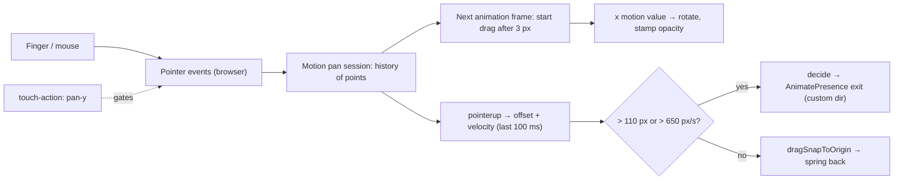
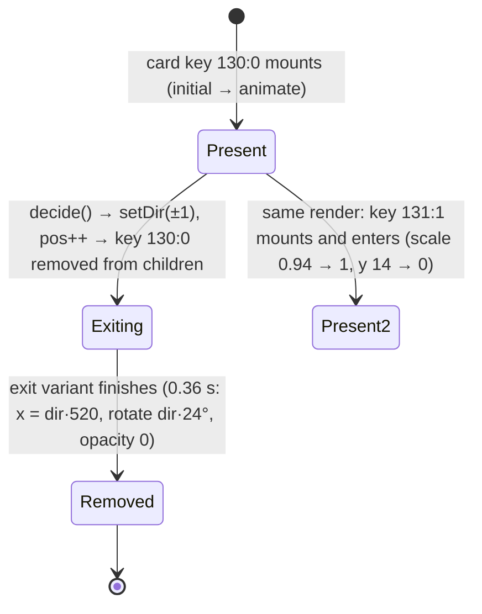

# L3.03 · Under the hood: gestures, springs, 3D and scrolling

> **Level 3 · Under the hood** · Lesson 3 of 6

| Recipe card | |
|---|---|
| **Time** | 75 min |
| **You need** | L2.08a (the `SwipeCard`), L2.05 (page transitions), L2.06a (sheets, pills), L2.10a–b (`touch-action`, `overflow: clip`, `perspective`) |
| **You'll produce** | A frame-level account of how a finger becomes a swipe decision, the physics of every spring in the app with numbers, the projection maths of the 3D flip, the lifecycle of exiting elements, and the rules of scroll containers |

**In two sentences:** The swipe deck feels physical because three systems cooperate: the browser's pointer events (gated by `touch-action`), Motion's pan session (which estimates velocity from the last 100 ms of movement and starts a drag only on the next animation frame), and damped springs whose overshoot and settling time follow from two numbers, stiffness and damping. This lesson opens each system, computes what they do with the app's real parameters, and turns their edge cases (a drag that never starts, a flip that could flicker, an exiting card with stale props, a scroll container that eats gestures) into predictions you can check.

### Objectives
1. Trace a swipe from `pointerdown` to `onDragEnd`, compute its offset and Motion's velocity estimate, and predict the decision.
2. Compute the damping ratio, overshoot and settling time of any spring from its stiffness and damping, and find the damping below which the flip would flicker.
3. Compute how much a 3D-rotated card is magnified at its near edge for a given `perspective`, and explain the angle-driven face swap.
4. Describe `AnimatePresence`'s lifecycle for the deck and for pages, including why `custom` exists.
5. Explain scroll containers, scroll chaining, `overscroll-behavior`, `touch-action` and passive listeners, and diagnose a gesture conflict from its symptom.

---

## 1 · Warm-up: pull it from memory

1. *(L2.08a)* What are the two swipe thresholds in `onDragEnd`?
2. *(L2.10b)* Why do both `.fc` and `.fc-scroll` have `touch-action: pan-y`?
3. *(L2.05)* What does `mode="wait"` on the page `AnimatePresence` do?

<details><summary>Answers</summary>

1. Offset beyond ±110 px **or** velocity beyond ±650 px/s.
2. It tells the browser to handle only vertical panning itself, so horizontal finger movement is delivered to JavaScript as pointer events (the swipe). Without it on the scroll area, the scroll container would claim every touch gesture.
3. The old page finishes its exit animation before the new page mounts and enters.
</details>

## 2 · The problem this solves

Level 2 used Motion as a black box: `drag="x"`, `useSpring`, `AnimatePresence`. Black boxes are fine until they misbehave: a test swipe that works in Chrome and does nothing in WebKit, a flip that might flicker if someone "tunes" a number, an exiting card flying the wrong way, a scroll area that swallows swipes. Each has a mechanism, and the mechanism predicts the fix.



---

## 3 · Concepts

### 3.1 From finger to pointer events

Browsers unify mouse, touch and pen as **pointer events**: `pointerdown`, `pointermove`, `pointerup`, `pointercancel`. Before delivering a touch's moves to the page, the browser decides whether *it* will use the gesture (to scroll, zoom, or navigate back). `touch-action` is the page's answer:

| `touch-action` | Browser handles | Page receives as pointer moves |
|---|---|---|
| `auto` (default) | all panning and zooming | only what the browser doesn't use; a horizontal swipe may become a scroll or a back gesture, and the page gets `pointercancel` |
| `pan-y` | vertical panning only | horizontal movement |
| `none` | nothing | everything (the page can't be scrolled by touching this element) |

The card uses `pan-y`: you can still scroll the page by dragging vertically on the card, and horizontal drags are the swipe. The page-level backstop is `overscroll-behavior-x: none` on `html`, which stops Chrome's "swipe to go back" history gesture (L2.08a, incident 1).

### 3.2 Inside Motion's pan session

From Motion 12.43's source (`PanSession` in `framer-motion`):
1. **`pointerdown`** creates a session with a `history` of `{x, y, timestamp}` points, starting with the down point.
2. **Each `pointermove`** appends a point and schedules `updatePoint` on the **next animation frame** (`frame.update(this.updatePoint, true)`).
3. **`updatePoint`** computes the offset from the first point. Only when the distance reaches **3 px** (`distanceThreshold = 3`) does it set `startEvent` and call `onStart`: the drag has begun. From then on, every frame moves the `x` motion value.
4. **`pointerup`** computes `info = { point, offset, delta, velocity }`. **`onEnd` (our `onDragEnd`) is called only if `startEvent` is set.**

**Velocity** is not the speed of the last movement. It's displacement over a ~100 ms window:

$$v = \frac{x_{\text{last}} - x_{\text{ref}}}{t_{\text{last}} - t_{\text{ref}}}$$

where the reference point is the most recent point **more than 100 ms older** than the last one (or the first point, if the gesture is shorter). One refinement: if the reference would be the pointer-down point, the gesture has more than two points, and that point is more than 200 ms old (you held, then flicked), Motion uses the second point instead, so a long hold doesn't dilute a fast flick.

**Consequence 1: a drag needs a frame.** If all moves *and* the `pointerup` arrive before the next animation frame, `updatePoint` never runs, `startEvent` stays `null`, and **`onDragEnd` never fires**. A human can't do that; a test that fires 12 mouse moves and a mouse-up in the same millisecond can. That was the WebKit test failure of [L4.04](l4-04-ui-tests-nav-cards.md).

**Consequence 2: velocity forgives short, fast gestures.** A 62 px flick fails the distance test but passes the velocity test (§5.1).

### 3.3 `dragElastic` and `dragSnapToOrigin`

- **`dragSnapToOrigin`**: when the drag ends without a decision, the card springs back to `x = 0` using the component's `transition` (stiffness 380, damping 32).
- **`dragElastic={0.9}`** applies resistance beyond drag constraints: past a limit, the card moves `elastic × overshoot` (Motion's `mixNumber(min, point, elastic)`). The card has no explicit constraints; with `dragSnapToOrigin`, Motion treats the origin as the constraint, so 0.9 means the card follows the finger at 90%: a slight "heaviness" without feeling stuck.

### 3.4 Springs: two numbers, one personality

A Motion spring is a damped harmonic oscillator. With displacement $x$ from the target, stiffness $k$, damping $c$ and mass $m$ (Motion's default $m = 1$):

$$m\,\ddot{x} + c\,\dot{x} + k\,x = 0$$

- *Why this equation:* the spring pulls back proportionally to displacement ($-kx$), friction resists proportionally to speed ($-c\dot{x}$), and Newton's second law sets their sum equal to $m\ddot{x}$.

Two derived numbers describe its behaviour:

$$\omega_0 = \sqrt{\frac{k}{m}} \quad \text{(natural frequency, rad/s)}, \qquad \zeta = \frac{c}{2\sqrt{k\,m}} \quad \text{(damping ratio)}$$

- $\zeta < 1$: **underdamped**, it overshoots and oscillates while settling.
- $\zeta = 1$: **critically damped**, the fastest approach with no overshoot.
- $\zeta > 1$: **overdamped**, slow, no overshoot.

For an underdamped spring released from rest, the first overshoot as a fraction of the distance travelled is

$$\text{overshoot} = \exp\!\left(\frac{-\zeta\pi}{\sqrt{1-\zeta^2}}\right)$$

- *Why:* the solution is $x(t) = x_0\, e^{-\zeta\omega_0 t}\,(\cos\omega_d t + \tfrac{\zeta}{\sqrt{1-\zeta^2}}\sin\omega_d t)$ with $\omega_d = \omega_0\sqrt{1-\zeta^2}$; the first extremum is at $t_p = \pi/\omega_d$, and plugging it in leaves only the exponential.

and the time to settle within about 2% is

$$t_s \approx \frac{4}{\zeta\,\omega_0}$$

- *Why:* the oscillation's envelope is $e^{-\zeta\omega_0 t}$, and $e^{-4} \approx 0.018$.

This is exactly the solver Motion runs: its source computes `dampingRatio = damping / (2 * Math.sqrt(stiffness * mass))` and `angularFreq = undampedFreq * Math.sqrt(1 - dampingRatio²)`, then evaluates the closed-form solution each frame.

---

## 4 · The math, with the app's real numbers

### 4.1 Every spring in the app

Computed from the `stiffness` and `damping` values in the source ($m = 1$):

| Spring (file) | $k$ | $c$ | $\zeta$ | $\omega_0$ | Overshoot | Peak at | Settles ≈ |
|---|---|---|---|---|---|---|---|
| Tab pill (`App.tsx`) | 520 | 40 | 0.877 | 22.8 | 0.32% | 0.29 s | 0.20 s |
| Segmented pill (`Ui.tsx`) | 500 | 38 | 0.850 | 22.4 | 0.63% | 0.27 s | 0.21 s |
| Bottom sheet (`Ui.tsx`) | 360 | 32 | 0.843 | 19.0 | 0.72% | 0.31 s | 0.25 s |
| Card enter / snap back (`Study.tsx`) | 380 | 32 | 0.821 | 19.5 | 1.10% | 0.28 s | 0.25 s |
| **Card flip `rotateY`** (`Study.tsx`) | 260 | 26 | **0.806** | 16.1 | **1.38%** | 0.33 s | 0.31 s |
| Ghost cards (`Study.tsx`) | 300 | 30 | 0.866 | 17.3 | 0.43% | 0.36 s | 0.27 s |
| Deck finished (`Study.tsx`) | 260 | 22 | 0.682 | 16.1 | 5.33% | 0.27 s | 0.36 s |
| Result card (`Test.tsx`) | 220 | 22 | 0.742 | 14.8 | 3.10% | 0.32 s | 0.36 s |
| Podium columns (`Leaderboard.tsx`) | 200 | 20 | 0.707 | 14.1 | 4.32% | 0.31 s | 0.40 s |
| Results mascot pop (`Test.tsx`) | 260 | 14 | **0.434** | 16.1 | **22.0%** | 0.22 s | 0.57 s |
| Account mascot (`Account.tsx`) | 240 | 14 | 0.452 | 15.5 | 20.4% | 0.23 s | 0.57 s |
| Account badge (`Account.tsx`) | 200 | 16 | 0.566 | 14.1 | 11.6% | 0.27 s | 0.50 s |

**Reading the table as design:** navigation springs (pills, sheet, card snap) sit at $\zeta \approx 0.82$–$0.88$: under 1.1% overshoot, crisp and calm. "Moment" springs (results card, podium, deck-finished) drop to $\zeta \approx 0.7$ for a visible 3–5% bounce. The mascots go to $\zeta \approx 0.44$: a 20% overshoot that reads as *playful*. The personality of each element is two numbers.

### 4.2 Will the flip ever flicker?

The front face shows while the angle is below 90°, the back while it's 90° or more (L2.08a). Flipping from 0° to 180°, the spring overshoots by $1.38\% \times 180° \approx$ **2.5°** (to about 182.5°), then settles. To flip back from 180° to 0°, it undershoots to about −2.5°. Either way the angle never re-crosses 90°, so the visible face changes exactly once.

**How low could damping go before it breaks?** After the swap, the rule shows the back face, which is correct while the angle stays between 90° and 270° (the back faces you). Past 270°, the *front* faces you again geometrically, but the rule still shows the back, now pointing away, so you'd see it mirrored (or nothing). The first peak is at $180°(1 + \text{overshoot})$, so trouble starts when the overshoot exceeds 50%. Solve $\exp(-\zeta\pi/\sqrt{1-\zeta^2}) = 0.5$:

$$\frac{\zeta\pi}{\sqrt{1-\zeta^2}} = \ln 2 \;\Rightarrow\; \zeta \approx 0.2155 \;\Rightarrow\; c = 2\zeta\sqrt{k} \approx 2 \cdot 0.2155 \cdot \sqrt{260} \approx 6.95$$

So with `stiffness: 260`, any `damping` below about **7** would swing the card past 270° and show a mirrored answer for a moment. (Below about 3.5, an overshoot above 70.7%, the rebound would even dip under 90° and flash the question.) The chosen 26 is nearly four times the margin. Critical damping for this stiffness is $2\sqrt{260} \approx 32.2$.

| `damping` | ζ | Overshoot | First peak | First rebound | Display |
|---|---|---|---|---|---|
| 26 (shipped) | 0.806 | 1.4% | 182.5° | 180.0° | correct throughout |
| 6.95 | 0.216 | 50.0% | 270.0° | 135.0° | the limit |
| 5 | 0.155 | 61.1% | 289.9° | 112.9° | mirrored answer between 270° and 290° |

### 4.3 Perspective: how big does the near edge get?

With `perspective: p` on the deck, a point at depth $z$ (towards the viewer is positive) is drawn scaled by

$$s(z) = \frac{p}{p - z}$$

- *Why:* similar triangles. The eye is at distance $p$ from the screen plane; a point $z$ closer to the eye is at distance $p - z$, and the projection onto the screen scales by $p/(p-z)$.

A card of width $w$ rotated by $\theta$ about its vertical centre line has its edges at $z = \pm \tfrac{w}{2}\sin\theta$. For a 350 px card:

| $p$ | $\theta = 30°$ near / far | $\theta = 45°$ near / far | $\theta = 60°$ near / far |
|---|---|---|---|
| 400 px | 1.28 / 0.82 | 1.45 / 0.76 | 1.61 / 0.73 |
| 800 px | 1.12 / 0.90 | 1.18 / 0.87 | 1.23 / 0.84 |
| **1600 px (the app)** | 1.06 / 0.95 | **1.08 / 0.93** | 1.11 / 0.91 |

At 45°, the app's near edge is drawn 8% bigger and the far edge 7% smaller: enough to read as 3D, not enough to distort text or poke past the deck. At `perspective: 400px` the near edge would be 45% bigger and spill over the neighbouring UI.

### 4.4 The swipe's visual mappings

`useTransform` maps the drag offset $x$ linearly and clamps to the output range:
- **Tilt**: $x \in [-220, 220] \mapsto \text{rotate} \in [-14°, 14°]$, so the tilt is $x \cdot \tfrac{14}{220} \approx 0.064°$ per px.
- **"GOT IT" stamp**: $x \in [30, 120] \mapsto$ opacity $[0, 1]$: invisible for small wobbles, fully shown just past the 110 px decision line.
- **"AGAIN" stamp**: $x \in [-120, -30] \mapsto [1, 0]$, the mirror image.

---

## 5 · Worked traces

### 5.1 Five gestures through Motion's velocity estimate

Each gesture is a list of `(time ms, x px)` pointer samples. The decision is computed with Motion's algorithm (§3.2) and the app's thresholds. **Predict each decision first.**

| Gesture | Samples (ms → px) | Offset | Velocity | Decision |
|---|---|---|---|---|
| A · steady swipe | 0→0, 16→40, 33→70, 50→95, 66→108, 83→116, 100→121, 116→124 | 124 | ? | ? |
| B · quick flick | 0→0, 16→18, 33→40, 50→62 | 62 | ? | ? |
| C · slow drag, then stop | 0→0, 200→40, 400→80, 600→100, 700→101, 800→101 | 101 | ? | ? |
| D · hold, then flick | 0→0, 400→2, 416→30, 433→62, 450→95 | 95 | ? | ? |

<details><summary>Reveal</summary>

| Gesture | Reference point | Velocity | Decision | Stamp opacity · tilt at release |
|---|---|---|---|---|
| A | first point (no sample is > 100 ms older than 116 except t = 0) | 124 / 0.116 = **1069 px/s** | **got it** (both tests pass) | 1.00 · 7.9° |
| B | first point | 62 / 0.050 = **1240 px/s** | **got it**: distance fails, velocity passes | 0.36 · 3.9° |
| C | t = 600 (the latest sample > 100 ms before 800) | (101 − 100) / 0.2 = **5 px/s** | **snap back**: 101 < 110, and stopped | 0.79 · 6.4° |
| D | would be t = 0, but it's > 200 ms old, so t = 400 | (95 − 2) / 0.05 = **1860 px/s** | **got it** | 0.72 · 6.0° |

C is the interesting one: the stamp is 79% visible, yet the card springs back. Stopping before letting go is how you change your mind.
</details>

### 5.2 Frames of a flip

`rotateY` springs 0° → 180° ($\zeta = 0.806$). Face visibility is a step function of the angle.

| Frame | Approx. time | Angle | Front opacity | Back opacity | What you see |
|---|---|---|---|---|---|
| 1 | 0 s | 0° | 1 | 0 | Question, facing you |
| 2 | ~0.08 s | ~60° | 1 | 0 | Question, turned away, near edge enlarged ~1.1× |
| 3 | crossing | 89.9° → 90° | 1 → 0 | 0 → 1 | Card edge-on: almost nothing to see, so the swap is invisible |
| 4 | ~0.2 s | ~150° | 0 | 1 | Answer side, still turning |
| 5 | 0.33 s | ≈ 182.5° (peak) | 0 | 1 | Tiny overshoot |
| 6 | ~0.4 s | 180° | 0 | 1 | Settled |

The back face is pre-rotated `rotateY(180deg)`, so at 180° it faces you the right way round. The mirrored-answer bug was the back face being *visible* at frames 1–2, seen through the front; angle-driven opacity makes that impossible regardless of the engine.

### 5.3 What `AnimatePresence` does when you swipe


- **For 0.36 s two cards exist** in the DOM: the exiting one and the entering one. Code (and tests) that query "the card" must pick the right one; the tests use `.fc` `.last()` (the newest), and the quiz test bug of [L4.05](l4-05-ui-tests-quiz-runner.md) came from reading the card sliding out.
- **Why `custom={dir}`**: the exiting card was rendered with the props of its last render, when `dir` described the *previous* swipe. `AnimatePresence custom={dir}` passes the **current** value to the exit variant function, `exit: (d) => ({ x: d * 520, … })`, so the card flies in the direction you just swiped. Without it, every other card would fly the wrong way.
- **`d === 0`** (restart, undo) uses a quick fade (0.15 s) instead of a fly-out.
- **Pages** use `mode="wait"`: the old page exits (0.26 s, fades and rises 8 px), *then* the new one enters (0.26 s). A route change therefore takes about 0.52 s before the new page is stable, which is why UI tests wait for the transition before asserting ([L4.04](l4-04-ui-tests-nav-cards.md)).

---

## 6 · Scrolling, under the hood

### 6.1 Scroll containers and what they break

An element becomes a **scroll container** when its `overflow` is `auto`, `scroll` or `hidden` (yes, `hidden` too: it can still be scrolled by code, focus, or anchor jumps). `clip` and `visible` don't. A scroll container:
- **captures `position: sticky`**: a sticky child sticks within the nearest scroll container, not the viewport. If `body` became one, the top bar would stop sticking (L2.10a).
- **claims touch gestures** inside it (the "swipes swallowed by `.fc-scroll`" bug), unless `touch-action` says otherwise.

### 6.2 Scroll chaining and `overscroll-behavior`

When a scroll container reaches its end, further scrolling **chains** to the next scrollable ancestor (the page), and at the page's end the browser may bounce, pull-to-refresh or navigate.

| Value | Effect at the boundary | Used on |
|---|---|---|
| `auto` | Chain to the parent; browser effects allowed | (default) |
| `contain` | Don't chain; keep this element's own bounce | `.fc-scroll` (long options don't scroll the page) |
| `none` | Don't chain; no bounce, no pull-to-refresh, no navigation gesture | `body`; `overscroll-behavior-x` on `html` |

### 6.3 Passive listeners

`window.addEventListener("scroll", on, { passive: true })` in the top bar promises the browser that the listener won't call `preventDefault()`. The browser can then scroll on its compositor thread immediately, without waiting for JavaScript. A non-passive `touchmove` or `wheel` listener forces the browser to wait for your handler on every frame of scrolling. Chrome treats document-level `touchstart`/`touchmove` listeners as passive by default, and ignores `preventDefault()` in them with a console warning. That's one reason the app blocks gestures with CSS (`touch-action`, `overscroll-behavior`) rather than with JavaScript.

---

## 7 · Running and testing

```bash
npx playwright test tests/e2e/ui.spec.ts -g "swipe|real touch|flip"
```
- **"flashcards: swipe right = got it, swipe left = again"** drags with 12 mouse moves spaced 16 ms apart (~200 ms, like a finger), so every move lands in its own frame (§3.2).
- **"flashcards: real touch swipe on phones (Chromium)"** sends real touch events through the Chrome DevTools Protocol and asserts the URL is still `/study` afterwards (no back navigation).
- **"flashcards: flip, got it, again, undo, hide mastered, progress saved"** taps the card, polls until it reports flipped, checks the answer text on the back, then flips back with the "Flip card" button ([L4.04](l4-04-ui-tests-nav-cards.md)).
- The touch test also swipes **in the middle of the scrollable options area**, the exact spot where swipes used to be swallowed (§6.1).
- **Try it:** in DevTools, run `document.querySelector('.fc-inner')` while flipping and watch its `transform` in the Styles pane, or slow animations to 10% in the Animations panel and watch frame 3 of §5.2.

## 8 · Bug journal: failure modes of the stack

### 8.1 A drag that never starts (mechanism of the WebKit test failure)

1. **Symptom.** In Playwright's WebKit projects, `page.mouse.move(x + 220, y, { steps: 12 })` followed by `mouse.up()` left the deck unchanged:
   ```text
   Error: expect(locator).toContainText(expected) failed
   Expected string: "✓ 1"
   Received string: "1 / 10✓ 0 · ↻ 0"
   ```
2. **Diagnosis.** An event logger showed WebKit *did* deliver 13 `pointermove` events and a `pointerup`. Adding a 100 ms pause before `mouse.up()` made the swipe work on every engine, and the card's mid-drag transform showed it had moved. So the events arrived, but too fast: `steps: 12` dispatches all 12 moves without waiting, so in WebKit the moves and the up all landed before one animation frame.
3. **Root cause.** Motion starts a drag in `updatePoint`, which runs on the next animation frame (§3.2). `pointerup` before that frame → `startEvent` is `null` → `onEnd` (our `onDragEnd`) is skipped.
4. **Fix** (in the test, not the app: humans can't move 220 px and lift within one frame):
   ```diff
   -    await page.mouse.move(x + dx, y + 2, { steps: 12 });
   +    for (let i = 1; i <= 12; i++) {
   +      await page.mouse.move(x + (dx * i) / 12, y + 2); // ~200ms, like a real swipe
   +      await page.waitForTimeout(16);
   +    }
        await page.mouse.up();
   ```
5. **Lesson.** Synthetic input must respect the frame clock of the code under test. When a gesture works by hand and fails in automation, log the raw events first, then compare the *timing*, not only the event list.

### 8.2 A flip that would flicker (predicted, never shipped)

1. **Symptom** (if someone "makes the flip bouncier" with `damping: 5`). At the end of every flip the answer appears, then for a split second shows mirrored, then settles.
2. **Diagnosis.** With $\zeta = 5/(2\sqrt{260}) = 0.155$, the overshoot is $\exp(-0.155\pi/\sqrt{1 - 0.155^2}) \approx 61\%$, so the angle peaks at $180° \times 1.61 \approx 290°$ before rebounding to about 113°. Between 270° and 290° the front of the card geometrically faces you, but the rule "angle ≥ 90° → back" still shows the back face, which is now pointing away: drawn mirrored (or invisible, where `backface-visibility` works).
3. **Root cause.** The face rule assumes the angle stays between −90° and 270° (each face is correct within 90° of facing you). A spring overshoot above 50% breaks that assumption; above 70.7% (damping below about 3.5) the rebound would also dip under 90° and flash the question.
4. **Fix.** Keep $\zeta$ well above 0.2155 (damping > 7 at stiffness 260). The shipped value (26) has a 3.7× margin. If you want more bounce, bounce the *scale*, not the angle.
5. **Lesson.** When you derive a display state from an animated value, compute the value's extreme (overshoot) and check the derivation still holds there.

### 8.3 An exiting element with stale props (known Motion foot-gun)

1. **Symptom** (without `custom`). Swipe right: the card flies right. Swipe left: the card flies **right** again. Swipe right: it flies left.
2. **Diagnosis.** The exit animation reads `dir` from the exiting card's own props, which were frozen at its last render, before `setDir` ran for this swipe.
3. **Root cause.** A removed child is no longer rendered by its parent, so it never receives new props. `AnimatePresence` keeps the old element around to animate it out.
4. **Fix** (what the app does): pass the live value through presence.
   ```diff
   - <AnimatePresence initial={false}>
   + <AnimatePresence custom={dir} initial={false}>
   ```
   with `exit: (d: number) => …` as a variant function.
5. **Lesson.** Anything an exit animation depends on must come through `AnimatePresence`'s `custom`, not through the exiting component's props.

## 9 · Why this design

| Decision | Alternatives | Why this one | Trade-off | Choose differently when |
|---|---|---|---|---|
| Motion's `drag` + thresholds | Raw pointer events; Hammer.js; `@use-gesture` | Velocity, snapping and springs in one API; works with `AnimatePresence` | Frame-based start (§8.1); ~30 kB of library | Gesture-heavy apps with pinch/rotate → `@use-gesture` |
| Distance **or** velocity | Distance only | Short fast flicks feel natural | A shaky slow drag past 110 px still commits | Accidental swipes are costly → distance **and** velocity |
| Springs for UI motion | Duration + easing curves | Interruptible: a spring retargets mid-flight with its current velocity | Duration is emergent, not specified | Precisely timed sequences → tweens (the card's exit is a 0.36 s tween) |
| Angle-driven face visibility | `backface-visibility` only | Engine-independent | Must keep overshoot < 50% (§4.2) | — |
| `perspective: 1600px` | 600–1000 px | Calm 3D, text stays readable | Less dramatic | Showy hero animations → smaller perspective |
| CSS gesture control (`touch-action`, `overscroll-behavior`) | `preventDefault` in JS listeners | Works on the compositor, no passive-listener conflicts | Coarser control | You need per-gesture logic → pointer capture + non-passive listeners on the element |

## 10 · Check yourself

**Q1.** A user drags the card 130 px right, very slowly, and holds still for half a second before letting go. Decision?
<details><summary>Answer</summary><b>Got it.</b> Velocity is about 0, but the offset (130 px) is past 110 px, and the rule is distance <i>or</i> velocity.</details>

**Q2.** Predict: a 40 px flick in 30 ms (samples 0→0, 15→20, 30→40). Decision?
<details><summary>Answer</summary>Velocity = 40 / 0.03 ≈ 1333 px/s > 650 → <b>got it</b>, even though 40 px is far below 110 px. (The 3 px start threshold is passed on the first frame, so the drag starts, as long as the moves span at least one frame.)</details>

**Q3.** You change the tab pill to `stiffness: 520, damping: 20`. Compute ζ and the overshoot. Is it still a "navigation" feel?
<details><summary>Answer</summary>ζ = 20 / (2√520) ≈ 0.44; overshoot ≈ exp(−0.44π/√(1 − 0.19)) ≈ 22%. The pill would bounce noticeably past the new tab, the same playfulness as the mascot: wrong personality for navigation.</details>

**Q4.** Why doesn't the face swap at exactly 90° produce a visible jump?
<details><summary>Answer</summary>At 90° the card is edge-on: its projected width is ~0, so neither face is visible. Swapping opacity there changes nothing you can see.</details>

**Q5.** A `.fc-scroll` with `touch-action: auto` contains long options. What happens when you swipe horizontally on the options with a finger?
<details><summary>Answer</summary>The scroll container claims the gesture: the browser may start a pan, and Motion receives <code>pointercancel</code> instead of moves, so no swipe. With <code>pan-y</code>, horizontal movement is delivered to JavaScript.</details>

**Q6.** Two cards are in the DOM for 0.36 s after a swipe. Which one does `document.querySelectorAll(".fc")[0]` return?
<details><summary>Answer</summary>The exiting card (it was rendered first and is still in the tree). The entering card is later in document order, which is why tests use <code>.last()</code>.</details>

## 11 · Practice

**Easy (10 min).** Change the card's thresholds to "distance **and** velocity" in a branch, then try gestures A–D of §5.1 by hand (and with the simulator below). Which ones change?
<details><summary>Answer</summary>B (62 px) and D (95 px) now snap back; A still commits; C still snaps back.</details>

**Medium (20 min).** Write a 20-line Node script that implements Motion's velocity estimate (§3.2) and the app's decision, and reproduce the table in §5.1 exactly.
**Done when** your four velocities are 1069, 1240, 5 and 1860 px/s.

**Hard (40 min).** Add a "peek" gesture: dragging *up* on the card more than 80 px shows the answer while the finger is down and flips back on release, without breaking horizontal swipes or vertical page scrolling.
**Done when** horizontal swipes still decide, a vertical drag on the page outside the card still scrolls, and a vertical drag on the card peeks.
<details><summary>Key insight</summary>Vertical page scrolling on the card is currently allowed by <code>touch-action: pan-y</code>. A vertical peek needs the card to receive vertical moves too (<code>touch-action: none</code> on the card, which stops page scrolling from the card), or a long-press to enter peek mode. Decide which gesture owns which axis before writing code.</details>

## 12 · From memory

**Rung 1 · Cloze.**

$$\zeta = \frac{\_\_①\_\_}{2\sqrt{k\,m}}, \qquad \text{overshoot} = \exp\!\left(\frac{-\zeta\,\_\_②\_\_}{\sqrt{1-\zeta^2}}\right), \qquad t_s \approx \frac{\_\_③\_\_}{\zeta\,\omega_0}, \qquad s(z) = \frac{p}{p - \_\_④\_\_}$$

```tsx
const rotate = useTransform(x, [-220, 220], [___⑤___, 14]);
const goodOpacity = useTransform(x, [30, ___⑥___], [0, 1]);
const frontOpacity = useTransform(rotateY, (v) => (v < ___⑦___ ? 1 : 0));
const onDragEnd = (_: unknown, info: PanInfo) => {
  if (info.offset.x > 110 || info.___⑧___.x > 650) onDecide("known"); … };
<AnimatePresence ___⑨___={dir} initial={false}>
```
<details><summary>Answers</summary>① c (damping) ② π ③ 4 ④ z ⑤ <code>-14</code> ⑥ <code>120</code> ⑦ <code>90</code> ⑧ <code>velocity</code> ⑨ <code>custom</code></details>

**Rung 2 · Blank page (20 min). No scrolling up.** Derive, with numbers: ζ, overshoot and settling time of the flip spring; the damping below which the flip flickers; the near-edge scale at 45° for `perspective: 1600px` and a 350 px card. Then write the four steps of Motion's pan session and its velocity rule.
<details><summary>Self-check</summary>

- [ ] ζ = 26 / (2√260) ≈ 0.806; overshoot ≈ 1.4% (≈ 2.5°); settle ≈ 4 / (0.806 · 16.1) ≈ 0.31 s
- [ ] Flicker when overshoot > 50% → ζ < 0.2155 → damping < ≈ 7
- [ ] z = 175 · sin 45° ≈ 123.7 → s = 1600 / (1600 − 123.7) ≈ 1.08
- [ ] down → history; move → append + schedule on next frame; frame → start after 3 px; up → onEnd only if started
- [ ] Velocity over ~100 ms window; hold-then-flick uses the second point if the first is > 200 ms old
</details>

## 13 · Flashcards

<details><summary><b>Q:</b> When does Motion actually start a drag?</summary><b>A:</b> On the next animation frame after the pointer has moved ≥ 3 px.</details>
<details><summary><b>Q:</b> Why can a synthetic swipe do nothing?</summary><b>A:</b> If all moves and the pointerup land before a frame, the drag never starts and <code>onDragEnd</code> isn't called.</details>
<details><summary><b>Q:</b> How does Motion estimate release velocity?</summary><b>A:</b> Displacement over roughly the last 100 ms of pointer samples.</details>
<details><summary><b>Q:</b> Damping ratio formula?</summary><b>A:</b> ζ = c / (2√(k m)); Motion's mass defaults to 1.</details>
<details><summary><b>Q:</b> Overshoot formula?</summary><b>A:</b> exp(−ζπ / √(1 − ζ²)).</details>
<details><summary><b>Q:</b> The flip spring's ζ and overshoot?</summary><b>A:</b> 0.806 and 1.4% (≈ 2.5°).</details>
<details><summary><b>Q:</b> Below what damping would the flip flicker (k = 260)?</summary><b>A:</b> About 7 (ζ ≈ 0.2155, 50% overshoot).</details>
<details><summary><b>Q:</b> Perspective scale formula?</summary><b>A:</b> s = p / (p − z).</details>
<details><summary><b>Q:</b> Why <code>custom</code> on <code>AnimatePresence</code>?</summary><b>A:</b> Exiting children keep stale props; <code>custom</code> passes the current value to their exit variants.</details>
<details><summary><b>Q:</b> Which overflow values create a scroll container?</summary><b>A:</b> <code>auto</code>, <code>scroll</code> and <code>hidden</code> (not <code>clip</code> or <code>visible</code>).</details>
<details><summary><b>Q:</b> <code>overscroll-behavior: contain</code> vs <code>none</code>?</summary><b>A:</b> Both stop chaining; <code>contain</code> keeps the element's own bounce, <code>none</code> removes all boundary effects.</details>
<details><summary><b>Q:</b> What does a passive listener promise?</summary><b>A:</b> It won't call <code>preventDefault()</code>, so the browser can scroll without waiting for JavaScript.</details>

## 14 · The menu board

| | |
|---|---|
| Gesture gate | `touch-action: pan-y` on card and scroll area; `overscroll-behavior-x: none` on html |
| Pan session | down → history · move → next frame · start ≥ 3 px · up → `onEnd` only if started |
| Velocity | Δx / Δt over ~100 ms; hold-then-flick skips a stale first point |
| Decision | > 110 px or > 650 px/s; else snap back (380/32) |
| Mappings | tilt ±14° over ±220 px · stamps 30→120 px |
| Springs | ζ = c/(2√k); overshoot e^(−ζπ/√(1−ζ²)); t_s ≈ 4/(ζω₀) · nav 0.82–0.88 · moments ~0.7 · mascots ~0.44 |
| Flip | ζ 0.806 · +2.5° · flicker if damping < 7 |
| 3D | s = p/(p − z); 1600 px → 1.08× at 45° |
| Presence | two cards for 0.36 s; `custom={dir}`; pages `mode="wait"` ≈ 0.52 s |
| Scroll | hidden/auto/scroll = container (traps sticky, claims touch); chaining; contain vs none; passive listeners |

## 15 · Glossary

**Animation frame**: one screen refresh (~16.7 ms at 60 Hz); `requestAnimationFrame` callbacks run just before it. **Compositor thread**: the browser thread that scrolls and composites layers without running JavaScript. **Critical damping**: ζ = 1, fastest settle without overshoot. **Damping ratio (ζ)**: how quickly oscillation dies out. **Natural frequency (ω₀)**: how fast the undamped spring would oscillate. **Pan session**: Motion's record of one pointer gesture. **Passive listener**: an event listener that promises not to cancel the default action. **Pointer events**: the unified mouse/touch/pen input events. **Pointercancel**: sent when the browser takes over a gesture. **Projection**: mapping 3D points onto the 2D screen. **Scroll chaining**: passing leftover scroll to the parent container. **Settling time**: how long until the motion stays within a small band of the target. **Stale props**: values an unmounting component captured at its last render.

## 16 · Go further

| Resource | Type | Why | Which part | Time |
|---|---|---|---|---|
| [MDN: Pointer events](https://developer.mozilla.org/en-US/docs/Web/API/Pointer_events) | Docs | The event model under every gesture | "Pointer capture", "touch-action CSS property" | 20 min |
| [Motion: Drag gestures](https://motion.dev/docs/react-drag) | Docs | `drag`, `dragElastic`, `dragSnapToOrigin`, `onDragEnd` info | Whole page | 15 min |
| [Motion: AnimatePresence](https://motion.dev/docs/react-animate-presence) | Docs | Exit animations, `mode`, `custom` | "Changing key", "custom", "mode" | 15 min |
| [MDN: overscroll-behavior](https://developer.mozilla.org/en-US/docs/Web/CSS/overscroll-behavior) | Docs | Chaining and boundary effects | "Values", "Examples" | 10 min |
| [Josh W. Comeau: A friendly introduction to spring physics](https://www.joshwcomeau.com/animation/a-friendly-introduction-to-spring-physics/) | Article (interactive) | Builds intuition for stiffness and damping with sliders | Whole article | 25 min |
| [web.dev: Improving scroll performance with passive listeners](https://developer.chrome.com/docs/lighthouse/best-practices/uses-passive-event-listeners) | Docs | Why passive listeners matter | Whole page | 5 min |

---
← [L3.02 Ranking maths and SQL internals](l3-02-ranking-sql.md) · [Hub](README.md) · [L3.04 Viewports, contrast and accessibility →](l3-04-viewports-contrast.md)
