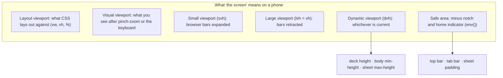

# L3.04 · Under the hood: viewports, contrast maths and accessibility

> **Level 3 · Under the hood** · Lesson 4 of 5

| Recipe card | |
|---|---|
| **Time** | 70 min |
| **You need** | L2.10a (tokens, safe areas, `dvh`), L2.10c (the short-phone formulas), L2.05 (accessible names in the shell) |
| **You'll produce** | A model of the four "viewports" a phone page lives in, the WCAG contrast formula derived and applied to the app's real colours, the compositing maths for translucent surfaces, and the full story of the 11 contrast failures and one keyboard failure that axe found |

**In two sentences:** "The screen" is really several viewports that change as the browser's bars slide and the keyboard opens, and the app's layout units (`dvh`, `env(safe-area-inset-*)`) are choices among them. "Readable" is a number: the WCAG contrast ratio, computed from linearised sRGB, which the automated scans enforced and which caught eleven colour pairs the eye had accepted, including one whose background only existed when a dark card scrolled under a translucent bar.

### Objectives
1. Name the layout viewport, the visual viewport and the small, large and dynamic viewport heights, and pick the right unit for a given layout.
2. Compute a contrast ratio by hand from two hex colours, including through translucency and opacity.
3. Explain each of the 11 contrast fixes and the scrollable-region fix, and why some only appeared on certain devices.
4. List what axe checks and what it can't, and design a test that avoids false results during animations.

---

## 1 · Warm-up: pull it from memory

1. *(L2.10a)* Why does `--red-ink` exist when there is already `--red`?
2. *(L2.10c)* On an iPhone 13 in Safari, roughly how tall is the visible viewport, and which deck formula applies?
3. *(L2.05)* Lighthouse flagged *label-content-name-mismatch* on the home link. What was wrong?

<details><summary>Answers</summary>

1. Brand red `#d7262f` reaches only 4.40:1 on the cream page, below the 4.5:1 needed for small text. `--red-ink` (`#b51e27`) is the darker red used whenever red is text.
2. About 664 px (Playwright's profile). The short-phone rule `max(236px, 100dvh − 424px)` applies.
3. The link's accessible name (`aria-label="Home"`) didn't contain its visible text ("Psychology of Learning"). Voice-control users say what they see, so the names must match. The fix removed the `aria-label` and made the badge image decorative (`alt=""`).
</details>

## 2 · The problem this solves

Two things look fine on the developer's laptop and fail for real people:
- **Size.** `height: 100vh` is taller than the visible screen on most phones; content hides behind the browser's toolbar or the home indicator.
- **Readability.** A soft grey that looks elegant on a bright monitor disappears on a phone in sunlight, or for someone with low vision. Nobody notices until someone can't read it.

Both have exact answers: viewport units with defined meanings, and a contrast formula with a pass mark.



---

## 3 · Concepts

### 3.1 The viewports, precisely

| Name | What it is | CSS that reads it | Changes when |
|---|---|---|---|
| **Layout viewport** | The rectangle the page is laid out in. Width = `device-width` because of `<meta name="viewport" content="width=device-width">` | `vw`, `%` of the root, media queries | Rotation; window resize |
| **Visual viewport** | The part of the layout viewport currently visible | `window.visualViewport` (JS only) | Pinch-zoom; on iOS, the on-screen keyboard |
| **Large viewport** (`lvh`, and `vh`) | Height with the browser's bars **retracted** | `100lvh`, `100vh` | Rotation |
| **Small viewport** (`svh`) | Height with the bars **expanded** | `100svh` | Rotation |
| **Dynamic viewport** (`dvh`) | Whichever of the two is current, updated as the bars slide | `100dvh` | Scrolling (bars slide), rotation |

- **Why `vh` is the large one.** When mobile Safari introduced collapsing bars, making `vh` change while scrolling caused layout jumps on every page, so browsers froze `vh` at the largest value. Correct for "a background that always covers", wrong for "fit in what I can see now".
- **The app's choices:** `min-height: 100dvh` on `body` and `.shell` (fill the screen, follow the bars); `dvh` in the deck formulas (the card and its buttons must fit *now*); `max-height: 86dvh` on the sheet. Each has a `vh` fallback for browsers older than Safari 15.4 (L2.10c).
- **Why not `svh`** for the deck? It would always assume the bars are showing, wasting ~100 px when they've retracted. `dvh` resizes as they move, which on a page that rarely scrolls (the Study page fits one screen) is barely noticeable.
- **The keyboard.** On iOS, opening the keyboard shrinks the *visual* viewport but not the layout viewport, so `dvh` doesn't change and fixed elements can end up behind the keyboard. The app avoids fixed elements on input screens: the account form is in normal flow, and the tab bar sits below it. (Chrome on Android has behaved the same way by default since version 108; the viewport meta key `interactive-widget=resizes-content` opts back into resizing the layout.)

### 3.2 CSS pixels and device pixels

A CSS pixel is not a screen pixel. An iPhone 13 is 1170 × 2532 device pixels with a **device pixel ratio** of 3, so CSS sees 390 × 844. All layout numbers in this series are CSS pixels. The ratio matters for images: a 74 CSS-px mascot needs about 222 device pixels of width to look sharp, which is why `/brand/mascot.webp` is served larger than it's drawn ([L3.05](l3-05-performance.md)).

### 3.3 Safe areas, revisited

With `viewport-fit=cover`, `env(safe-area-inset-top|right|bottom|left)` give the notch, rounded-corner and home-indicator insets in CSS px (on an iPhone 13 in portrait: top ≈ 47, bottom 34; in landscape: left/right ≈ 47, bottom 21). They're `0px` everywhere else, including desktop browsers and Playwright's emulation, which is why the measurements in L2.10c have no insets.

---

## 4 · The math: contrast

### 4.1 From hex to relative luminance

WCAG 2 defines contrast from **relative luminance** $L$, the perceived brightness of a colour on a 0 (black) to 1 (white) scale.

**Step 1, normalise.** Split `#rrggbb` into three bytes and divide by 255: $c_{s} = \text{byte} / 255$.

**Step 2, linearise.** sRGB values are gamma-encoded (stored so that equal steps *look* equal), but light adds up linearly. Undo the encoding:

$$c = \begin{cases} \dfrac{c_s}{12.92} & c_s \le 0.04045 \\[2mm] \left(\dfrac{c_s + 0.055}{1.055}\right)^{2.4} & c_s > 0.04045 \end{cases}$$

- *Why two pieces:* the sRGB curve is a short straight line near black (to avoid infinite slope) joined to a power curve.

**Step 3, weight.** The eye is most sensitive to green and least to blue:

$$L = 0.2126\,R + 0.7152\,G + 0.0722\,B$$

**Step 4, the ratio.** With $L_1$ the lighter and $L_2$ the darker luminance:

$$\text{contrast} = \frac{L_1 + 0.05}{L_2 + 0.05}$$

- *Why $+0.05$:* it models the ambient light reflecting off the screen (flare), so even pure black isn't "infinitely" dark. The ratio runs from 1:1 (identical) to 21:1 (black on white).

**The pass marks (WCAG 2.1 AA):** **4.5:1** for normal text; **3:1** for large text (at least 24 px, or 18.66 px bold) and for UI component boundaries and icons.

### 4.2 One pair, by hand: the "Again" button

Before the fix, light theme: text `--bad` `#d7262f` on `--bad-soft` `#fbe3e1`, bold 16 px (not "large", which needs 18.66 px bold).

| Step | Text `#d7262f` | Background `#fbe3e1` |
|---|---|---|
| Bytes | 215, 38, 47 | 251, 227, 225 |
| Normalised | 0.843, 0.149, 0.184 | 0.984, 0.890, 0.882 |
| Linearised | 0.680, 0.019, 0.028 | 0.965, 0.768, 0.753 |
| $L$ | 0.2126·0.680 + 0.7152·0.019 + 0.0722·0.028 ≈ **0.160** | 0.2126·0.965 + 0.7152·0.768 + 0.0722·0.753 ≈ **0.809** |

$$\text{contrast} = \frac{0.809 + 0.05}{0.160 + 0.05} \approx \frac{0.859}{0.210} \approx 4.08$$

Exactly what axe reported (4.08), and **below 4.5**. The fix darkened the text to `#b81f28` ($L \approx 0.113$): $(0.809 + 0.05)/(0.113 + 0.05) \approx$ **5.26**. ✓

### 4.3 Translucency and opacity change the colours you must check

The ratio is computed on **what is painted**, not on the CSS values.

- **A translucent background** (`color-mix(… 86%, transparent)`) is alpha-composited over whatever is behind it:
  $$C_{\text{painted}} = \alpha\, C_{\text{top}} + (1-\alpha)\, C_{\text{behind}}$$
  (applied per channel, in sRGB as browsers composite).
- **An `opacity` on text** composites the text over its own background the same way: `.count` at `opacity: 0.7` turned `--muted` into a paler effective colour.

**The tab-bar case.** axe reported tab labels `#6f6359` on a background of `#dfdcd8`, a colour that appears nowhere in the stylesheet. Solving the compositing equation for what was behind the 86% bar:

$$C_{\text{behind}} = \frac{C_{\text{painted}} - \alpha\, C_{\text{top}}}{1 - \alpha} = \frac{(223, 220, 216) - 0.86\,(255, 253, 249)}{0.14} \approx (26, 17, 13) = \texttt{\#1a110d}$$

That's the espresso hero card (`#120f0e`, within rounding). On short and narrow screens the hero scrolled **under** the floating tab bar, darkening it from cream to grey-beige, and the labels dropped to 4.26:1. At 95% opacity over the same hero, the bar paints `#f3f1ed`, and with the new `--tab-ink` `#574c43` the ratio is **7.39**.

**Lesson in one line:** a translucent surface has no single contrast ratio; it has one per thing that can scroll under it. Check the worst case (here, the darkest content).

---

## 5 · Worked trace: the eleven contrast failures

Recomputed for this lesson with the formula above; every "before" value matches axe's report.

| # | Where | Before (fg on bg) | Ratio | After | Ratio | What changed |
|---|---|---|---|---|---|---|
| 1 | Home quick tile, red, subtitle (light) | `#f5c9cb` on `#d7262f` | 3.35 | `rgba(255,255,255,.92)` on `#c01f29` | 5.31 | New token `--red-fill`; subtitle colour instead of `opacity: 0.75` |
| 2 | Same, dark | `#fbced0` on `#ef3a42` | 2.77 | same on `#c4222b` | 5.10 | Dark `--red-fill` |
| 3 | Quick tile title, dark | `#ffffff` on `#ef3a42` | 3.92 | `#ffffff` on `#c4222b` | 5.82 | Same |
| 4 | Card back hint ("Tap to flip back") | `#7a6e63` on `#120f0e` | 3.85 | `#a8998a` on `#120f0e` | 6.90 | Hard-coded hint colour |
| 5 | Rail footer credit (`--faint`), dark | `#786c61` on `#171413` | 3.59 | `#9b8e80` | 5.74 | `--faint` dark |
| 6 | Same, light | `#9c8f82` on `#fffdf9` | 3.10 | `#75685c` | 5.31 | `--faint` light |
| 7 | Week chip count, dark | `#7f7469` on `#171413` | 4.01 | `#ab9d8e` | 6.93 | Removed `opacity: 0.7`, bold instead |
| 8 | Same, light | `#9a9189` on `#fffdf9` | 3.04 | `#6f6359` | 5.73 | Same |
| 9 | "Again" button, light | `#d7262f` on `#fbe3e1` | 4.08 | `#b81f28` | 5.26 | `--bad` light darkened |
| 10 | "Got it" button, light | `#1f8048` on `#dcf0e2` | 4.15 | `#186b3b` | 5.49 | `--good` light darkened |
| 11 | Tab labels over the hero, light | `#6f6359` on `#dfdcd8` | 4.26 | `#574c43` on `#f3f1ed` | 7.39 | New `--tab-ink`; bar 86% → 95% |

**Predict before reading on:** fixes 9 and 10 appeared only *after* 1–8 were fixed, and fix 11 only in the final full run on all devices. Why?

<details><summary>Answer</summary>

- **9 and 10:** they were in the first report all along, hidden by its format. axe groups failures **by rule**, and the test's summary prints one line per rule: the node count and only the *first* failing node (`${v.nodes.length}× e.g. ${v.nodes[0]…}`). "color-contrast (serious): 3× e.g. .fc-back > .fc-hint" meant three failing elements, of which only the hint was shown. Once the shown examples were fixed, the next nodes in the list (the Again and Got it labels) became the examples. A test also stops at its first failed `expect`, so later screens in the same test weren't scanned until earlier ones passed.
- **11:** it depends on *layout*. Only on devices where the hero was tall enough relative to the viewport to sit under the tab bar at scan time (the 320 px Galaxy and the iPhone 14 Pro Max profiles, scanned for the first time in the full run) did the bar composite over espresso.
</details>

---

## 6 · Accessibility beyond colour

### 6.1 What the app does, and why

| Need | How the app meets it | Where |
|---|---|---|
| Every control has a name | Icon-only buttons have `aria-label` ("Previous card", "Flip card", "Refresh", "All questions") | Study, Test, Leaderboard |
| The card itself is operable | `role="button"`, a state-aware label ("Question side. Tap to reveal the answer.") and keyboard shortcuts | `SwipeCard` |
| Toggles say they're toggles | `role="switch"` + `aria-checked` on "Shuffle" and "Hide mastered" | `Ui.tsx` `Switch` |
| You know where you are | `aria-current="page"` on the active tab | `App.tsx` |
| Keyboard focus is visible | `:focus-visible` red ring (2.5 px, offset 2 px) | `styles.css` |
| Scrollable areas are reachable | The visible face's `.fc-scroll` has `tabIndex={0}` and a label; the hidden face's has `-1` | `Study.tsx` (fix 12 below) |
| Colour isn't the only signal | "· you" text on your leaderboard row; ✓/✗ icons on answers; stamps say "GOT IT" / "AGAIN" | Leaderboard, results, deck |
| Language is declared | `<html lang="en">` (screen readers pick the right voice) | `index.html` |
| Motion can be reduced | `prefers-reduced-motion` collapses CSS animations | `styles.css` (L2.10b) |
| Targets are big enough | 42–56 px buttons; 44 px minimum on the smallest phones | `styles.css`, `responsive.css` |
| Text can grow | Sizes in `rem`, so the browser's font-size setting scales them | everywhere |

### 6.2 What axe can and can't check

axe-core evaluates the **current DOM and computed styles** against rules tagged with WCAG criteria. The app's scan uses tags `wcag2a`, `wcag2aa`, `wcag21a`, `wcag21aa`, excludes the splash, and fails on **serious** or **critical** violations.

| axe checks well | axe can't judge |
|---|---|
| Contrast of text over solid backgrounds | Contrast over images or gradients (reported as "needs review", not a violation) |
| Missing names, roles, labels | Whether a name is *meaningful* ("button" vs "Flip card") |
| `aria-*` validity | Whether the reading or focus order makes sense |
| Scrollable regions without focusable content | Whether the focus ring is actually visible (it doesn't render focus) |
| Document language, landmarks, duplicate ids | Whether animations cause problems, or captions are accurate |

That's why the series also relies on manual checks: a keyboard-only pass, screenshots in both themes, and Lighthouse's accessibility audit.

---

## 7 · Running and testing

```bash
npx playwright test tests/e2e/a11y.spec.ts                       # all a11y projects, both themes
npx playwright test tests/e2e/a11y.spec.ts --project=galaxy-s9-320 # the device that exposed fix 11
```
- **Three tests × two themes**: main screens (`/`, `/study`, `/test`, `/ranks`, `/me`); the flashcard back, quiz feedback and list search; the test runner, question grid and results (with a fake attempt and result injected into `localStorage`).
- **The theme is forced before load** with `addInitScript(() => localStorage.setItem("pol.theme", …))`, so the first paint is already in the right theme.
- **Waits before each scan** (`waitForTimeout(700)` after navigation, 900 ms after the flip, 2 s on results): see §8.3 ([L4.07](l4-07-a11y-lighthouse-flaky.md) walks the file line by line).

## 8 · Bug journal

### 8.1 Incident · Eleven contrast failures that looked fine

1. **Symptom.** The first accessibility run failed on both themes:
   ```text
   Error: light /: serious/critical accessibility issues
   + "color-contrast (serious): 1× e.g. .red > span — Element has insufficient color contrast of 3.35
      (foreground color: #f5c9cb, background color: #d7262f, font size: 9.6pt (12.8px), font weight: normal).
      Expected contrast ratio of 4.5:1"
   Error: light flashcard back: serious/critical accessibility issues
   + "color-contrast (serious): 3× e.g. .fc-back > .fc-hint — … contrast of 3.85 (foreground color: #7a6e63, background color: #120f0e …"
   ```
2. **Diagnosis.** The report was turned into a de-duplicated list (`grep` + `sort | uniq -c`), giving eight distinct colour pairs (§5, rows 1–8). Three causes stood out: **small text on brand red** (the red is a mid-tone, so neither white nor pink text reaches 4.5:1 on it); **`opacity` used to "soften" text** (rows 1 and 7–8: opacity lowers contrast in a way the token values hide); and **`--faint` tuned by eye** on a bright monitor. After fixing those, two more pairs surfaced (rows 9–10), and the full-device run found the tab bar (row 11).
3. **Root cause.** Colours were chosen visually, in one theme at a time, at one screen size, and translucency and opacity made the *painted* colours differ from the token values.
4. **Fix.**
   ```diff
   +  --red-fill: #c01f29;            /* light: red surfaces that carry white text */
   +  --red-fill: #c4222b;            /* dark */
   -  --faint: #9c8f82;  → +  --faint: #75685c;     /* light */
   -  --faint: #786c61;  → +  --faint: #9b8e80;     /* dark */
   -  --bad: #d7262f;    → +  --bad: #b81f28;       /* light */
   -  --good: #1f8048;   → +  --good: #186b3b;      /* light */
   +  --tab-ink: #574c43;   /* light */   +  --tab-ink: #b8ab9c;   /* dark */
    .btn.red, .quick a.red { background: var(--red-fill); … }
   -.quick a span { opacity: 0.75; }   → +.quick a span { color: var(--muted); }  +.quick a.red span { color: rgba(255,255,255,.92); }
   -.chip .count { opacity: 0.7; }     → +.chip .count { font-weight: 800; }
   -.fc-back .fc-hint { color: #7a6e63; } → +{ color: #a8998a; }
   -.tabbar { background: color-mix(in srgb, var(--surface) 86%, transparent); } → +95%
   ```
5. **Lesson.** Pick colours by **ratio**, not by eye: compute them, in both themes, against the darkest thing that can be behind a translucent surface. Never use `opacity` to make text secondary; use a token that passes. And run the scans on every device size, because layout decides what's behind what.

### 8.2 Incident · The card's text couldn't be scrolled from the keyboard

1. **Symptom.** `scrollable-region-focusable (serious): 1× e.g. .fc-back > .fc-scroll — Element should have focusable content`.
2. **Diagnosis.** Long questions overflow the card, so `.fc-scroll` scrolls. A mouse or finger can scroll it; a keyboard user can only scroll what has focus, and the region contained no focusable elements.
3. **Root cause.** Scrollable containers aren't reliably focusable by default (some recent browsers make them keyboard-scrollable automatically; others don't, and axe checks for the portable fix).
4. **Fix** (in `Study.tsx`): make the *visible* face's region focusable, and the hidden one not.
   ```diff
   -<div className="fc-scroll">
   +<div className="fc-scroll" tabIndex={flipped ? -1 : 0} aria-label="Question and options">
   …
   -<div className="fc-scroll">
   +<div className="fc-scroll" tabIndex={flipped ? 0 : -1} aria-label="Answer">
   ```
   With `tabIndex={0}` on both, Tab would land on an invisible face; the toggle keeps focus on what you can see.
5. **Lesson.** Anything that scrolls must be reachable by Tab; anything hidden must not be.

### 8.3 Known failure mode · Scanning mid-animation

Pages fade and slide in (opacity 0 → 1 over 0.26 s). If axe runs during the fade, it measures text at partial opacity, which is a *lighter* painted colour, and can report contrast failures that no user sees once the page settles (or miss real ones on elements still off-screen). The scans therefore wait (700 ms after navigation, longer after the flip and on results) and exclude the splash. The general fix, used across the UI tests, is to wait for a *state* rather than a time when one exists (`expect(...).toHaveCount(0)` for the splash; L4.04).

## 9 · Why this design

| Decision | Alternatives | Why this one | Trade-off | Choose differently when |
|---|---|---|---|---|
| `dvh` for fit-the-screen layouts | `svh`; `vh`; JS `innerHeight` | Follows the real visible height with no JS | Resizes slightly while bars slide | Pages that scroll a lot and must not resize → `svh` |
| WCAG 2 ratio as the gate | APCA (the proposed WCAG 3 method); eyeballing | It's the legal and industry standard axe enforces | It over-penalises some dark-mode pairs and under-penalises thin fonts | Designing for WCAG 3 → also check APCA Lc values |
| Separate tokens per job (`--red`, `--red-ink`, `--red-fill`, `--tab-ink`) | One token per hue | Each passes for its use | More tokens | Brand colour already passes everywhere |
| Opaque-enough translucency (95%) | Fully opaque bars; a solid fallback | Keeps the frosted look and passes over the darkest content | Less "glass" | Content behind is never dark → lower alpha is fine |
| Automated axe + manual keyboard pass | axe only | Covers what axe can't see | Manual time | — |

## 10 · Check yourself

**Q1.** Compute the contrast of white `#ffffff` on `#ef3a42` given $L(\#ef3a42) \approx 0.218$.
<details><summary>Answer</summary>(1 + 0.05) / (0.218 + 0.05) ≈ 1.05 / 0.268 ≈ <b>3.92</b>: fails for normal text, passes 3:1 for large text and icons. (This was row 3.)</details>

**Q2.** A heading is 20 px and bold. Which threshold applies?
<details><summary>Answer</summary>3:1. Bold text counts as large from 18.66 px (14 pt). Regular weight needs 24 px (18 pt).</details>

**Q3.** Predict: you set `.tabbar` back to 86% and scroll the Home page so the *cream* stat tiles are behind it. Does axe fail?
<details><summary>Answer</summary>Probably not: cream behind cream composites to nearly <code>--surface</code>, and the labels pass. It fails only when dark content is behind the bar. That's exactly why this bug hid until the device and scroll position lined up.</details>

**Q4.** Why is `opacity: 0.7` on text worse than choosing a lighter colour with the same look?
<details><summary>Answer</summary>Visually it's the same painted colour; the problem is maintenance. The token value no longer tells you the painted colour, so a contrast check on tokens passes while the screen fails. A real colour token keeps the ratio computable and testable.</details>

**Q5.** On iOS the keyboard opens over the account form. Does `100dvh` shrink?
<details><summary>Answer</summary>No. iOS shrinks the visual viewport, not the layout viewport, so viewport units stay the same. Use <code>window.visualViewport</code> in JS if a layout must react to the keyboard.</details>

**Q6.** An axe scan of the results page passes in 0.2 s after navigation and fails after 2 s. Which is more trustworthy, and why might they differ?
<details><summary>Answer</summary>The 2 s scan. At 0.2 s elements are mid-fade (partial opacity, so measured colours are wrong) and the count-up and mascot haven't appeared yet. The settled page is what users read.</details>

## 11 · Practice

**Easy (10 min).** Write `contrast(hexA, hexB)` in JavaScript from §4.1 and reproduce rows 1–11 of §5.
**Done when** your numbers match the table to two decimals (use the composited colours for rows 1, 2 and 11).

**Medium (20 min).** Add a unit test that loads `styles.css`, extracts the light and dark token values with a regex, and asserts minimum ratios for the text pairs that matter: `--ink`/`--bg`, `--muted`/`--surface`, `--faint`/`--surface`, `--tab-ink`/`--surface`, `--red-ink`/`--bg`, `--bad`/`--bad-soft`, `--good`/`--good-soft`, white/`--red-fill`.
**Done when** the test passes, and fails if you change `--faint` back to `#9c8f82`.

**Hard (40 min).** Compute the worst-case contrast of the tab labels for **any** content behind the bar: take every background colour used in the app (tokens and hard-coded espresso surfaces), composite the bar over each at 95%, and report the minimum ratio for `--tab-ink` in both themes. Then find the lowest bar opacity that still passes 4.5:1.
<details><summary>Key insight</summary>Contrast falls as the painted background approaches the text's luminance, so the worst case is the background that pulls the composite towards the label colour: the darkest content in light mode, the lightest in dark mode. Binary-search α between 0.8 and 1.</details>

## 12 · From memory

**Rung 1 · Cloze.**

$$c = \left(\frac{c_s + \_\_①\_\_}{1.055}\right)^{\_\_②\_\_} \;(c_s > 0.04045), \qquad L = 0.2126R + \_\_③\_\_\,G + 0.0722B, \qquad \text{contrast} = \frac{L_1 + \_\_④\_\_}{L_2 + 0.05}$$

$$C_{\text{painted}} = \alpha\,C_{\text{top}} + (\_\_⑤\_\_)\,C_{\text{behind}}$$

Pass marks: normal text ___⑥___ : 1; large text ___⑦___ : 1. Height with the bars retracted: `100___⑧___` (= `100vh`); the current height: `100___⑨___`.
<details><summary>Answers</summary>① 0.055 ② 2.4 ③ 0.7152 ④ 0.05 ⑤ 1 − α ⑥ 4.5 ⑦ 3 ⑧ <code>lvh</code> ⑨ <code>dvh</code></details>

**Rung 2 · Blank page (15 min). No scrolling up.** Compute by hand the contrast of `--good` `#186b3b` on `--good-soft` `#dcf0e2` (show the linearised channels and both luminances), then list five accessibility features of the app and what each one serves.
<details><summary>Self-check</summary>

- [ ] Linearised `#186b3b` ≈ (0.0091, 0.1470, 0.0437) → $L \approx 0.110$; `#dcf0e2` ≈ (0.7157, 0.8714, 0.7605) → $L \approx 0.830$
- [ ] Ratio = (0.830 + 0.05) / (0.110 + 0.05) ≈ **5.49** (row 10 of §5)
- [ ] Five of: names on icon buttons, card role and label, `role="switch"`, `aria-current`, focus ring, focusable scroll areas, not-colour-alone, `lang`, reduced motion, target sizes, `rem` text
</details>

## 13 · Flashcards

<details><summary><b>Q:</b> <code>vh</code>, <code>svh</code>, <code>lvh</code>, <code>dvh</code>?</summary><b>A:</b> vh = lvh (bars retracted); svh = bars expanded; dvh = current, updating as bars slide.</details>
<details><summary><b>Q:</b> Does the iOS keyboard change <code>dvh</code>?</summary><b>A:</b> No; it shrinks the visual viewport only.</details>
<details><summary><b>Q:</b> Relative luminance weights?</summary><b>A:</b> 0.2126 R + 0.7152 G + 0.0722 B, on linearised channels.</details>
<details><summary><b>Q:</b> Contrast ratio formula?</summary><b>A:</b> (L_light + 0.05) / (L_dark + 0.05).</details>
<details><summary><b>Q:</b> AA thresholds?</summary><b>A:</b> 4.5:1 normal text; 3:1 large text (≥ 24 px, or ≥ 18.66 px bold) and UI components.</details>
<details><summary><b>Q:</b> Painted colour of a translucent layer?</summary><b>A:</b> α·top + (1 − α)·behind, per channel.</details>
<details><summary><b>Q:</b> Why did the tab labels fail only on some devices?</summary><b>A:</b> The 86% bar was over the dark hero there; the composite background dropped the ratio to 4.26.</details>
<details><summary><b>Q:</b> Why not soften text with <code>opacity</code>?</summary><b>A:</b> The painted colour differs from the token, so token checks lie; use a passing colour token.</details>
<details><summary><b>Q:</b> What does <code>scrollable-region-focusable</code> require?</summary><b>A:</b> A scrolling region must be keyboard-reachable (focusable itself or containing focusable content).</details>
<details><summary><b>Q:</b> Why toggle <code>tabIndex</code> between the two faces?</summary><b>A:</b> So Tab reaches the visible face's scroll area and never the hidden one.</details>
<details><summary><b>Q:</b> Two things axe can't judge?</summary><b>A:</b> Whether names are meaningful; whether focus is visible; logical order; contrast over images.</details>
<details><summary><b>Q:</b> Why wait before an axe scan?</summary><b>A:</b> Mid-fade elements are partly transparent, so measured colours are wrong.</details>

## 14 · The menu board

| | |
|---|---|
| Viewports | layout (CSS) · visual (zoom, iOS keyboard) · svh / lvh (= vh) / dvh |
| App units | body/shell `min-height: 100dvh`; deck `dvh` formulas; sheet `86dvh`; `vh` fallbacks |
| Pixels | CSS px × DPR = device px (iPhone 13: × 3) |
| Luminance | /255 → linearise (12.92 or ((c+0.055)/1.055)^2.4) → 0.2126 / 0.7152 / 0.0722 |
| Ratio | (L₁ + 0.05)/(L₂ + 0.05) · AA 4.5 / 3 |
| Composite | α·top + (1−α)·behind; opacity on text does the same |
| The 11 | red surfaces → `--red-fill` · `--faint` both themes · chip count no opacity · card hint · `--bad`/`--good` light · `--tab-ink` + 95% bar |
| Plus | focusable `.fc-scroll` on the visible face |
| axe | WCAG 2.0/2.1 A+AA tags · serious/critical fail · wait for settle · exclude splash |

## 15 · Glossary

**Accessible name**: what assistive technology announces for an element. **Alpha compositing**: blending a translucent layer over what's behind it. **APCA**: a newer contrast model proposed for WCAG 3. **axe-core**: an automated accessibility rules engine. **Device pixel ratio**: device pixels per CSS pixel. **Gamma encoding**: storing colour non-linearly so equal steps look equal. **Large text (WCAG)**: ≥ 24 px, or ≥ 18.66 px bold. **Layout viewport**: the area CSS lays the page out in. **Relative luminance**: perceived brightness from 0 to 1. **Safe area**: screen area not covered by hardware cut-outs or system bars. **sRGB**: the standard colour space of the web. **Visual viewport**: the currently visible part of the page. **WCAG**: Web Content Accessibility Guidelines.

## 16 · Go further

| Resource | Type | Why | Which part | Time |
|---|---|---|---|---|
| [W3C: Understanding SC 1.4.3 Contrast (Minimum)](https://www.w3.org/WAI/WCAG21/Understanding/contrast-minimum.html) | Standard | The rule, the thresholds and the definition of large text | "Intent", "Benefits", the relative-luminance note | 20 min |
| [W3C: relative luminance definition](https://www.w3.org/TR/WCAG21/#dfn-relative-luminance) | Standard | The exact formula used in §4.1 | The definition and its note | 5 min |
| [web.dev: The large, small, and dynamic viewport units](https://web.dev/blog/viewport-units) | Article | Diagrams of svh / lvh / dvh on real phones | Whole article | 10 min |
| [MDN: Visual Viewport API](https://developer.mozilla.org/en-US/docs/Web/API/Visual_Viewport_API) | Docs | Reacting to pinch-zoom and the keyboard | "Concepts and usage" | 10 min |
| [Deque: axe-core rule descriptions](https://dequeuniversity.com/rules/axe/) | Reference | What each rule (`color-contrast`, `scrollable-region-focusable`) checks | The two rules above | 15 min |
| [WebAIM: Contrast checker](https://webaim.org/resources/contrastchecker/) | Tool | Check pairs while choosing colours | — | 5 min |

---
← [L3.03 Gestures, springs, 3D and scrolling](l3-03-gestures-3d.md) · [Hub](README.md) · [L3.05 Performance and Lighthouse →](l3-05-performance.md)
