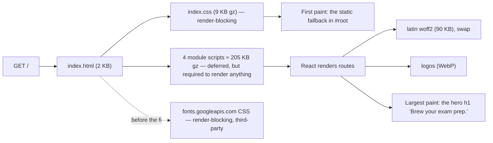

# L3.05 · Under the hood: performance and Lighthouse (+ Level 3 checkpoint)

> **Level 3 · Under the hood** · Lesson 5 of 6

| Recipe card | |
|---|---|
| **Time** | 70 min |
| **You need** | L2.04 (Vite config, `manualChunks`, fonts in `main.tsx`), L2.05 (the splash), L1.04 (static hosting and CDNs) |
| **You'll produce** | A model of what happens between "Enter" and "I can read the heading", the meaning and maths of each Lighthouse metric, the measured before/after of the session's performance fixes, a production audit, and the Level 3 checkpoint |

**In two sentences:** The app is a client-rendered SPA, so the heading a student sees first can't paint until the browser has downloaded and run about 200 KB of compressed JavaScript; everything that competes with that (a third-party font stylesheet, oversized images, layout shifts) shows up directly in Lighthouse's metrics. Measuring first, the session took mobile performance from **81 to 91** locally with three changes, and the deployed site now scores **98** on mobile, for reasons this lesson separates into what the code controls and what the host does.

### Objectives
1. Draw the critical rendering path for this SPA and say which resources block first paint and which block the largest paint.
2. Define FCP, LCP, CLS, TBT and Speed Index, state Lighthouse's throttling model, and estimate transfer times from bytes and bandwidth.
3. Explain each of the three fixes (self-hosted font, right-sized WebP images, explicit image sizes) and its measured effect.
4. Read cache headers and explain content-hashed, immutable assets versus revalidated public files.
5. Name the remaining opportunities (render delay, unused JS, an off-screen image) and the code change for each.

---

## 1 · Warm-up: pull it from memory

1. *(L2.04)* What does `manualChunks` do in `vite.config.ts`, and why?
2. *(L2.05)* How long does the splash stay at minimum, and is the app rendered behind it?
3. *(L1.04)* What does a CDN do for a static site?

<details><summary>Answers</summary>

1. It puts `@supabase`, `motion` and `react` into separate vendor chunks. Vendor code changes rarely, so those files keep their content hash (and cache) across app releases.
2. 650 ms on the first load of a session (capped at 4 s). Yes: `Shell` renders the routes underneath the fixed splash, which only covers them.
3. Serves the same files from servers near each user, so the round trip is short, and caches them at the edge.
</details>

## 2 · The problem this solves

"It's fast on my laptop" measures the developer's machine: a fast CPU, a fibre connection, a warm cache. The students use mid-range phones on mobile data. Performance work without measurement optimises the wrong thing. So the order is: **measure under realistic conditions, read what the measurement blames, fix that, measure again.**


*The dashed arrow is gone: removing the third-party font stylesheet was the biggest single win.*

---

## 3 · Concepts

### 3.1 The critical rendering path for a client-rendered SPA

1. **HTML arrives.** `index.html` holds the `<head>` tags and, inside `<div id="root">`, a plain **static fallback** (a heading, a description and the list of weeks, in the system font) that is readable before any JavaScript runs and is replaced by React (L2.04). It's there for search engines and slow networks; it's usually the first contentful paint, but not the largest paint Lighthouse finally reports.
2. **CSS blocks rendering.** The browser won't paint until every stylesheet in `<head>` is loaded and parsed (otherwise it would paint unstyled content, then repaint). Vite emits one CSS file, 9 KB compressed.
3. **Module scripts are deferred.** `<script type="module">` downloads in parallel and runs after parsing; it doesn't block the first paint, but **nothing the app shows exists until it runs**: React must download (72 KB), the app chunk (30 KB) must run, and only then are the splash, shell and hero created.
4. **Fonts load when used.** A `@font-face` file is fetched only when text using it is laid out. With `font-display: swap`, text paints immediately in the fallback font and swaps when the web font arrives.
5. **Images load as `` elements are created**, including those inside `display: none` parents (they are in the DOM, so they're fetched unless `loading="lazy"`).

### 3.2 The metrics

| Metric | What it measures | "Good" (Lighthouse/Core Web Vitals) |
|---|---|---|
| **FCP** (First Contentful Paint) | When any text or image first paints | ≤ 1.8 s |
| **LCP** (Largest Contentful Paint) | When the largest text block or image in the viewport paints | ≤ 2.5 s |
| **CLS** (Cumulative Layout Shift) | How much visible content jumps unexpectedly | ≤ 0.1 |
| **TBT** (Total Blocking Time) | Sum, over main-thread tasks longer than 50 ms, of the part beyond 50 ms, between FCP and interactive | ≤ 200 ms |
| **Speed Index** | How quickly the viewport visually fills in | ≤ 3.4 s |

Lighthouse 12 weights them into the performance score: **TBT 30%, LCP 25%, CLS 25%, FCP 10%, Speed Index 10%**. Each metric is first mapped to 0–100 on a log-normal curve calibrated from real-world sites, so improving an already-good metric moves the score less.

**Lab vs field.** Lighthouse is a *lab* test: one simulated load. Real users' experience (the *field*, collected by Chrome's UX Report or Vercel Speed Insights) also includes INP (Interaction to Next Paint), repeat visits with warm caches, and slower devices than the simulation.

### 3.3 Lighthouse's throttling model

The runs in this lesson use the default **simulated** throttling: Lighthouse loads the page at full speed, records the dependency graph, then *computes* how long it would take under these conditions (read from each report's `configSettings`):

| Form factor | Round-trip time | Throughput | CPU slowdown |
|---|---|---|---|
| Mobile | 150 ms | 1,638.4 kbps (≈ 1.6 Mbps) | 4× |
| Desktop | 40 ms | 10,240 kbps | 1× |

### 3.4 Caching: hashed, immutable assets

Vite names build outputs by content hash: `react-efav6phX.js`. If the content changes, the name changes. So these files can be cached **forever**: `vercel.json` sends `Cache-Control: public, max-age=31536000, immutable` for `/assets/*` (one year, and "don't even revalidate"). Files in `public/` keep their names (`/brand/mascot.webp`), so they get Vercel's default `public, max-age=0, must-revalidate`: the browser keeps a copy but asks the server each time ("has it changed?"), and gets a tiny `304 Not Modified` if not. Measured on production:

```text
/assets/index-DSGj10eu.js   Cache-Control: public, max-age=31536000, immutable
/assets/react-efav6phX.js   Content-Encoding: br   Cache-Control: public, max-age=31536000, immutable
/brand/mascot.webp          Cache-Control: public, max-age=0, must-revalidate
```
`index.html` itself must never be cached long: it's the file that points at the new hashes after a deploy.

### 3.5 Fonts: subsets, `unicode-range` and `swap`

`@fontsource-variable/archivo/wdth.css` declares the same family three times, for three character ranges: latin (90 KB), latin-ext (86 KB) and vietnamese (34 KB), each with a `unicode-range`. The browser downloads only the files whose range covers characters on the page. Measured: the Home page requested **only the latin file**. `font-display: swap` (in all three declarations) means no invisible text while the font loads.

---

## 4 · The math

### 4.1 How long do bytes take?

A first-order model of downloading $B$ bytes over a connection with round-trip time $\text{RTT}$ and throughput $W$ (bits per second), after $n$ round trips of setup:

$$t \approx n \cdot \text{RTT} + \frac{8B}{W}$$

- *Why:* each setup step (DNS, TCP, TLS, the request itself) costs a round trip before data flows; then the bytes stream at the link's rate.

For the app's JavaScript on Lighthouse's mobile profile ($W = 1{,}638{,}400$ bit/s): about 205 KB compressed, so

$$\frac{8 \times 205 \times 1024}{1{,}638{,}400} \approx 1.03 \text{ s}$$

of pure transfer before React can render, plus round trips and 4× slowed parsing and execution. That's why LCP's breakdown on the local run was **TTFB 457 ms, render delay 2,656 ms (85%)**: the hero heading needed no download of its own; it was waiting for the JavaScript that creates it.

### 4.2 The image savings, in bytes and seconds

The session replaced three PNG logos with WebP files sized for their display:

| Image | Drawn at (CSS px) | Before: PNG | After: WebP (px, bytes) | Saved |
|---|---|---|---|---|
| Round badge (top bar, crown) | 34 × 34 | 80,270 B | 96 × 96, 4,916 B | −93.9% |
| Hex badge (rail, account) | 48 × 68 / 128 × 180 | 301,334 B | 256 × 360, 21,276 B | −92.9% |
| Mascot (results, account, deck done) | 74–120 wide | 106,825 B | 240 × 262, 16,644 B | −84.4% |
| **Total** | | **488,429 B** | **42,836 B** | **445,593 B** |

At the mobile throughput, $8 \times 445{,}593 / 1{,}638{,}400 \approx 2.2$ s of transfer saved on a page that loads all three. (Lighthouse had flagged the 80 KB round badge specifically: 75,574 of its 80,270 bytes were wasted for a 34 px image.)

**Why 96 px for a 34 px image?** Device pixel ratio: 34 CSS px × 3 (iPhone) ≈ 102 device px. 96 is close enough to look sharp and keeps the file tiny.

### 4.3 Layout shift, by formula

Each unexpected shift scores

$$\text{shift} = \text{impact fraction} \times \text{distance fraction}$$

- **Impact fraction**: the area of the viewport touched by the moving elements (their old and new positions combined), divided by the viewport area.
- **Distance fraction**: the largest distance any of them moved, divided by the viewport's larger dimension.

CLS is the largest burst ("session window") of such shifts. **Worked example** (hypothetical, to show why `width`/`height` matter): on a 390 × 664 viewport, the account page's 128 × 180 hex badge has no size attributes and loads 300 ms late; the form below it, from y = 200 to the bottom, jumps down 180 px. Impact region: from 200 to 664 → 464 / 664 ≈ 0.70 of the viewport. Distance: 180 / 664 ≈ 0.27. Shift ≈ 0.70 × 0.27 ≈ **0.19**, which on its own fails the 0.1 threshold. With `width={128} height={180}` the browser reserves the box before the image arrives, and the shift is 0. Measured CLS after the fix: 0.002–0.013.

---

## 5 · Worked trace: the measurements

### 5.1 Before and after the session's fixes (local production build)

Lighthouse 12.8.2, simulated throttling, `vite preview` of the production build:

| Run | Perf | A11y | Best pr. | SEO | FCP | LCP | CLS | TBT |
|---|---|---|---|---|---|---|---|---|
| Mobile, Home, **before** | **81** | 100 | 96 | 100 | 3.2 s | 3.9 s | 0 | 0 ms |
| Mobile, Home, **after** | **91** | 100 | 96 | 100 | 2.1 s | 3.2 s | 0.006 | 60 ms |
| Desktop, Home, before | 99 | 100 | 96 | 100 | 0.6 s | 0.9 s | 0.003 | 0 ms |
| Desktop, Home, after | 100 | 100 | 96 | 100 | 0.4 s | 0.6 s | 0.003 | 0 ms |
| Mobile, Home, **re-run for this lesson** | 91 | 100 | 96 | 100 | 2.1 s | 3.1 s | 0.006 | 90 ms |

What Lighthouse blamed before, and the fix for each:

| Audit (before) | Detail from the report | Fix |
|---|---|---|
| `render-blocking-resources` | `fonts.googleapis.com/css2?family=Archivo…`, est. **978 ms** wasted | Self-host the font with `@fontsource-variable/archivo/wdth.css` imported in `main.tsx`; remove the `<link>`s from `index.html` |
| `uses-responsive-images` | `badge-round.png`: 80,270 B, **75,574 B wasted** | WebP files sized for display (§4.2) |
| `unsized-images` | Logos without `width`/`height` | Explicit `width`/`height` on every `` |
| `label-content-name-mismatch` | The brand link's `aria-label="Home"` | Removed (L2.05) |

**Why the font was the biggest win.** A third-party stylesheet needs a DNS lookup, a TCP and TLS handshake to a *second* origin, then the CSS, then (for the font file) a third origin. Each is a round trip at 150 ms, and the stylesheet blocks first paint. Self-hosting moves the font onto the same origin and out of the render-blocking path, and Vite gives it a content hash so it's cached for a year.

### 5.2 What production adds

The same Lighthouse version against the deployed site:

| Run | Perf | A11y | Best pr. | SEO | FCP | LCP | CLS | TBT |
|---|---|---|---|---|---|---|---|---|
| Mobile, **production** | **98** | 100 | **100** | 100 | 1.2 s | 1.2 s | 0.006 | 140 ms |

- **Best practices 96 → 100**: locally, the console shows `404 /_vercel/insights/script.js` because Vercel Web Analytics only exists on Vercel; in production it loads (§7.2).
- **Faster paints**: production serves over **HTTP/2** with **Brotli** compression and short CDN round trips (TTFB 228 ms in the LCP breakdown), while `vite preview` is a single local HTTP/1.1 server. These host features are the likely reasons for the gap; we didn't isolate each one, so treat local runs as a *relative* measure (before vs after the same change) and production as the real number.

### 5.3 What's left (current report)

| Opportunity | Measured | Code change |
|---|---|---|
| Render delay of the LCP heading | 85% of LCP locally | Make the static fallback in `index.html` match the Home hero (same markup and classes, styled by the same CSS), so the largest paint happens before the JS runs instead of when React replaces the fallback |
| `unused-javascript` | ~79–81 KiB, mostly `supabase` (≈ 37–49 KB unused at load) and part of `react` | Split routes with `React.lazy` + `Suspense`; load the Supabase client only when sign-in or sync is needed |
| `offscreen-images` | `badge-hex.webp` (21 KB) downloaded on phones | It's inside the laptop rail, which is `display: none` on phones; add `loading="lazy"` (lazy images that aren't rendered aren't fetched) |
| Main-thread work | 2.6 s under 4× CPU, 1.05 s of it style and layout | Fewer simultaneous entry animations on Home; `content-visibility: auto` for long lists |

## 6 · Running and testing

```bash
npm run build && npx vite preview --port 4174 --host 127.0.0.1
npx -y lighthouse@12.8.2 http://127.0.0.1:4174/ --quiet --output=json --output-path=./lh-mobile.json --chrome-flags="--headless=new"
npx -y lighthouse@12.8.2 http://127.0.0.1:4174/ --preset=desktop --quiet --output=html --output-path=./lh-desktop.html
```
- **`--preset=desktop`** switches to the desktop throttling and screen. The default is mobile.
- **`--output=json`** is for scripts (read `categories.*.score` and `audits[...]`); `html` is the readable report.
- **Run each audit 3 times** and take the median: simulated throttling is stable, but CPU contention on your machine still moves TBT by tens of ms.
- **What the test suite checks instead**: `tests/e2e/http.spec.ts` › "hashed assets are cached forever, HTML is not" asserts, against production (`BASE_URL=https://…`), that the hashed `index-*.js` has `immutable` and `/` doesn't; "search & sharing files are served correctly" checks that every logo and icon is served with an image content type ([L4.03](l4-03-playwright-foundations.md)). Lighthouse itself isn't in CI here ([L4.07](l4-07-a11y-lighthouse-flaky.md) explains how it was run and read).

## 7 · Bug journal

### 7.1 Incident · Mobile performance 81

1. **Symptom.** The first audit of the production build:
   ```text
   mobile-home     perf=81 acce=100 best=96 seo=100 | FCP 3.2 s LCP 3.9 s CLS 0 TBT 0 ms
      needs work: first-contentful-paint, largest-contentful-paint, speed-index, …,
                  render-blocking-resources, unused-javascript, modern-image-formats, uses-responsive-images
   ```
2. **Diagnosis.** TBT was 0, so the main thread wasn't the problem; the paints were late. The report's details named the culprits: the Google Fonts stylesheet blocking render (978 ms estimated), and the 80 KB round badge drawn at 34 px. LCP's element was the hero heading, text, so no image was the LCP itself; the delays came from what loaded before it.
3. **Root cause.** Two defaults of "getting it working": fonts linked from a third-party CDN (one more origin in the critical path) and logos used straight from the designer's export (large PNGs with transparency, no size attributes).
4. **Fix.**
   ```diff
    // src/main.tsx
   +import "@fontsource-variable/archivo/wdth.css";   // self-hosted, same origin, hashed, swap
    import "./styles.css";
   ```
   ```diff
    <!-- index.html -->
   -<link rel="preconnect" href="https://fonts.googleapis.com" />
   -<link rel="preconnect" href="https://fonts.gstatic.com" crossorigin />
   -<link href="https://fonts.googleapis.com/css2?family=Archivo:wdth,wght@62..125,400..900&display=swap" rel="stylesheet" />
   ```
   ```diff
   -<motion.img src="/brand/badge-round.png" alt="" … />
   +<motion.img src="/brand/badge-round.webp" width={34} height={34} alt="" … />
   ```
   and the token `--font: "Archivo Variable", "Archivo", system-ui, …`. Result: **81 → 91** mobile, **99 → 100** desktop.
5. **Lesson.** Measure on the *mobile* profile, read the report's details (not only the score), and fix in order of estimated savings. Keep the first-paint path on your own origin.

### 7.2 Known failure mode · A 404 you shouldn't fix

1. **Symptom.** Best practices stays at 96 locally: `errors-in-console: Failed to load resource: the server responded with a status of 404 (Not Found)`.
2. **Diagnosis.** The network list shows the request: `404 /_vercel/insights/script.js`. That path is served by Vercel's edge when Web Analytics is enabled for the project; `vite preview` doesn't have it.
3. **Root cause.** An environment difference, not a bug. In production the same request returns 200 (and `/_vercel/insights/view` records the page view), and best practices is 100.
4. **Fix.** None in code. Optionally, render `<Analytics />` only when `import.meta.env.PROD` *and* on a Vercel host, to keep local consoles clean.
5. **Lesson.** Before fixing an audit, check whether it describes your code or your test environment. Compare with production.

## 8 · Why this design

| Decision | Alternatives | Why this one | Trade-off | Choose differently when |
|---|---|---|---|---|
| Client-side rendered SPA (Vite + React) | Static pre-rendering (SSG); server rendering (Next.js) | Simplest hosting; the app is interactive throughout | LCP waits for JS (§4.1) | Content-heavy or SEO-critical first paint → SSG for the landing page |
| Vendor `manualChunks` | One bundle; automatic splitting | Long cache life for rarely changing libraries | All four chunks load on every page | Many routes with heavy, separate dependencies → route-level `lazy` |
| Self-hosted variable font | Google Fonts; system fonts only | Same origin, cached, one file for all weights and widths | 90 KB for latin | Every kilobyte matters → system font stack |
| WebP at ~3× display size | PNG; SVG; AVIF; `srcset` | Tiny, sharp on 3× screens, wide support | One size for all screens | Large photos → `srcset` + AVIF |
| Immutable hashed assets, revalidated public files | Short cache for everything; hash public files too | Safe and fast; deploys take effect immediately | Public images revalidate each visit (a 304) | Many public images → move them into `src` so Vite hashes them |

## 9 · Check yourself

**Q1.** TBT is 0 ms but LCP is 3.9 s. Where do you look first, the JavaScript execution profile or the network waterfall?
<details><summary>Answer</summary>The network waterfall and render-blocking resources. TBT 0 means no long main-thread tasks; the time is going into waiting for resources (here, a third-party font stylesheet and JS downloads).</details>

**Q2.** Why may a file named `react-efav6phX.js` be cached for a year, but `index.html` must not?
<details><summary>Answer</summary>The hashed name changes whenever its content changes, so a cached copy is never stale. <code>index.html</code> keeps its name and holds the references to the current hashes; caching it would keep users on an old release.</details>

**Q3.** Predict: you add `loading="lazy"` to the rail's hex badge. On a phone, is it downloaded?
<details><summary>Answer</summary>No. Lazy images load when they are near the viewport, and an image inside a <code>display: none</code> parent never is. On laptops, where the rail is visible, it loads as normal.</details>

**Q4.** An element 300 px tall moves down 100 px in an 800 px viewport; it was at y = 100. Compute the layout shift score (assume full width).
<details><summary>Answer</summary>Its old and new positions span y = 100 to 500: impact fraction = 400 / 800 = 0.5. Distance fraction = 100 / 800 = 0.125. Score = 0.5 × 0.125 = <b>0.0625</b>.</details>

**Q5.** At 1.6 Mbps, how long does the 90 KB latin font file take to transfer (ignoring round trips)?
<details><summary>Answer</summary>8 × 90 × 1024 / 1,638,400 ≈ <b>0.45 s</b>. With <code>font-display: swap</code> the text is readable before it arrives.</details>

**Q6.** The local mobile run says 91, production says 98, with the same code. Which number do you report, and what are local runs good for?
<details><summary>Answer</summary>Report production (it's what users get, with HTTP/2, Brotli and CDN). Local runs are for <i>comparing</i> a change against the previous build under identical conditions.</details>

## 10 · Practice

**Easy (10 min).** Add `loading="lazy"` to the rail's hex badge in `App.tsx`, rebuild, and confirm with Lighthouse (mobile) that `offscreen-images` no longer lists it.

**Medium (20 min).** Lazy-load the five pages with `React.lazy(() => import("./pages/Study"))` and a `Suspense` fallback of `<Loader />`. Rebuild and compare the `index-*.js` chunk size and Lighthouse's `unused-javascript`.
**Done when** each page is its own chunk and all UI tests still pass (they wait for content, so they should).
<details><summary>Watch out</summary>The page transition's <code>AnimatePresence</code> wraps the routes; a lazy page suspends on first visit, so the fallback appears inside the animated <code>main</code>. Test that the slide still looks right on a slow connection (DevTools → Network → Slow 4G).</details>

**Hard (40 min).** Pre-render the Home hero: today `<div id="root">` in `index.html` holds a plain system-font fallback (heading, description, week list). Replace it with the hero's static HTML (`section.hero` with its heading, paragraph and button) using the same classes, so it's styled by the real CSS and paints before JavaScript; React's `createRoot` replaces it when it renders. Keep the week list for search engines (for example below the hero).
**Done when** Lighthouse mobile shows LCP render delay well under 50% of LCP and CLS stays ≤ 0.01.
<details><summary>Key insight</summary>The pre-rendered hero must occupy exactly the same box as React's, or the swap is a layout shift. Match the markup, and don't pre-render anything personalised (the greeting with the user's name).</details>

## 11 · From memory

**Rung 1 · Cloze.**

$$t \approx n\cdot\text{RTT} + \frac{\_\_①\_\_\,B}{W}, \qquad \text{shift} = \text{impact fraction} \times \_\_②\_\_\ \text{fraction}$$

Lighthouse weights: TBT ___③___ %, LCP 25 %, CLS ___④___ %, FCP 10 %, SI 10 %. Mobile throttling: RTT ___⑤___ ms, ≈ 1.6 Mbps, CPU ___⑥___×. Good LCP ≤ ___⑦___ s; good CLS ≤ ___⑧___.

```json
{ "source": "/assets/(.*)", "headers": [{ "key": "Cache-Control", "value": "public, max-age=___⑨___, ___⑩___" }] }
```
<details><summary>Answers</summary>① 8 ② distance ③ 30 ④ 25 ⑤ 150 ⑥ 4 ⑦ 2.5 ⑧ 0.1 ⑨ <code>31536000</code> ⑩ <code>immutable</code></details>

**Rung 2 · Blank page (15 min). No scrolling up.** Draw the critical rendering path of this app, mark what blocks FCP and what delays LCP, then list the three fixes with their measured effect and the three remaining opportunities with their code changes.
<details><summary>Self-check</summary>

- [ ] CSS blocks first paint; module scripts are deferred but create all content; fonts load on use with swap; images load when `` exists (even under `display: none`)
- [ ] LCP = the hero heading; its delay is mostly JS (render delay 85%)
- [ ] Fixes: self-hosted font (978 ms render-blocking removed), WebP at display size (445,593 B saved), `width`/`height` on images; 81 → 91 mobile
- [ ] Remaining: pre-render the hero; lazy routes / lazy Supabase; `loading="lazy"` on the rail badge
- [ ] Production 98: HTTP/2, Brotli, CDN, analytics script present
</details>

---

## 12 · Level 3 checkpoint

### 12.1 Mixed quiz (interleaved across L3.01–L3.05)

**C1.** *(L3.01)* A student calls `rpc("submit_test")` with their own attempt and all correct answers 50 ms after `start_test`. Which checks pass, and what does the server *not* know?
<details><summary>Answer</summary>All checks pass: own attempt, not submitted, not expired, right length; the score is computed by the server and the time is server-measured (≈ 50 ms). The server doesn't know whether a human answered; the answer key is public study material. The proposed fix is a minimum-duration rule.</details>

**C2.** *(L3.02)* Three players finish with 95 in 20:00, 95 in 20:00 and 94 in 15:00. What are their ranks?
<details><summary>Answer</summary>1, 1, 3. Score comes first, so the 94 is behind both 95s regardless of time; the two identical results share first place.</details>

**C3.** *(L3.03)* A Playwright swipe with `steps: 12` passes in Chromium and does nothing in WebKit. What's the mechanism?
<details><summary>Answer</summary>All moves and the pointerup landed before an animation frame. Motion starts a drag only in its frame callback, so <code>startEvent</code> was null and <code>onDragEnd</code> was skipped. Space the moves out (16 ms apart).</details>

**C4.** *(L3.04)* Tab labels pass contrast on the cream page but fail on some phones. Why, and how was the background colour axe reported explained?
<details><summary>Answer</summary>The tab bar was 86% opaque, and on those layouts the dark hero card scrolled under it. Solving the compositing equation for <code>#dfdcd8</code> gives a behind colour of ≈ <code>#1a110d</code>, the hero. Fix: 95% opacity and a darker <code>--tab-ink</code>.</details>

**C5.** *(L3.05)* Lighthouse shows TBT 0 ms and LCP 3.9 s on mobile. Name the two biggest causes found in the session.
<details><summary>Answer</summary>The render-blocking third-party Google Fonts stylesheet (≈ 978 ms) and oversized PNG logos (an 80 KB image drawn at 34 px), together with the general cost of client-side rendering.</details>

**C6.** *(L3.02 + L3.05)* `get_my_stats` takes 75 ms on 10,000 attempts. What's the fix, and what did it measure?
<details><summary>Answer</summary>Compute <code>get_leaderboard</code> once in a CTE instead of four times: same JSON, 22 ms.</details>

### 12.2 Explain a trade-off and an edge case (25 min, written)

Pick **one** trade-off and **one** edge case below and write a half-page explanation for a peer, with numbers.

**Trade-offs:** (a) shipping the answer key to the browser for offline flashcards vs keeping the ranked test fair; (b) `distinct on` + `rank()` computed per call vs a maintained `best_attempts` table; (c) `dvh` vs `svh` for the deck; (d) a client-rendered SPA vs pre-rendering the landing page.

**Edge cases:** (e) a question deleted between `start_test` and `submit_test`; (f) a flip spring with damping 5; (g) a translucent bar over dark content; (h) a synthetic swipe faster than one frame.

<details><summary>Rubric (self-grade)</summary>

- [ ] States the two options and what each optimises
- [ ] Gives at least one concrete number from the series (ms, KB, ratio, probability, ζ)
- [ ] Names who is affected and when the choice would flip
- [ ] For the edge case: the exact mechanism, the visible symptom, the fix, and the test that would catch it
- [ ] Uses no term without defining it for the reader
</details>

---

## 13 · Flashcards

<details><summary><b>Q:</b> What blocks first paint in this app?</summary><b>A:</b> The CSS (and, before the fix, the third-party font stylesheet). Module scripts are deferred.</details>
<details><summary><b>Q:</b> Why does LCP wait for JavaScript here?</summary><b>A:</b> It's client-rendered: the hero heading doesn't exist until React runs.</details>
<details><summary><b>Q:</b> Lighthouse 12 weights?</summary><b>A:</b> TBT 30, LCP 25, CLS 25, FCP 10, Speed Index 10.</details>
<details><summary><b>Q:</b> Mobile throttling settings?</summary><b>A:</b> 150 ms RTT, ≈ 1.6 Mbps, 4× CPU slowdown (simulated).</details>
<details><summary><b>Q:</b> Transfer-time model?</summary><b>A:</b> t ≈ n·RTT + 8B / W.</details>
<details><summary><b>Q:</b> Layout shift formula?</summary><b>A:</b> impact fraction × distance fraction; CLS is the worst burst.</details>
<details><summary><b>Q:</b> Why can hashed assets be <code>immutable</code>?</summary><b>A:</b> New content means a new file name, so a cached copy is never stale.</details>
<details><summary><b>Q:</b> What does <code>unicode-range</code> do for fonts?</summary><b>A:</b> The browser downloads only the subsets whose characters appear on the page (here, only latin).</details>
<details><summary><b>Q:</b> Why did self-hosting the font help so much?</summary><b>A:</b> It removed a render-blocking request to a third-party origin (DNS + TLS + CSS + font on extra origins).</details>
<details><summary><b>Q:</b> Why give images <code>width</code> and <code>height</code>?</summary><b>A:</b> The browser reserves their box, so nothing shifts when they load.</details>
<details><summary><b>Q:</b> Is an image in a <code>display: none</code> parent downloaded?</summary><b>A:</b> Yes, unless it has <code>loading="lazy"</code>.</details>
<details><summary><b>Q:</b> Why does best practices show 96 locally but 100 in production?</summary><b>A:</b> Locally <code>/_vercel/insights/script.js</code> is a 404; Vercel serves it in production.</details>

## 14 · The menu board

| | |
|---|---|
| Path | HTML → CSS (blocks paint) → module JS (deferred, creates everything) → font on use (swap) → images |
| Metrics | FCP ≤ 1.8 · LCP ≤ 2.5 · CLS ≤ 0.1 · TBT ≤ 200 ms · SI ≤ 3.4 · weights 30/25/25/10/10 |
| Throttling | mobile 150 ms · 1.6 Mbps · 4× CPU; desktop 40 ms · 10 Mbps · 1× |
| Bytes | t ≈ n·RTT + 8B/W; 205 KB JS ≈ 1 s at 1.6 Mbps |
| Fixes | self-host font · WebP at ~3× display · width/height → 81 → 91 (local mobile), 98 production |
| Images | 488,429 → 42,836 B; round badge 80 KB → 4.9 KB |
| Cache | `/assets/*` 1 year immutable; public files revalidate (304); `index.html` never long-cached |
| Left | pre-render hero · lazy routes / Supabase · lazy rail badge · fewer simultaneous animations |

## 15 · Glossary

**Brotli**: a compression format, usually smaller than gzip for text. **CDN**: servers near users that cache and deliver files. **Client-side rendering**: the browser builds the page with JavaScript. **Content hash**: a short fingerprint of a file's bytes, used in its name. **Critical rendering path**: the steps and resources needed before content can paint. **Field data**: measurements from real users. **HTTP/2**: a protocol version that multiplexes many requests over one connection. **Lab data**: measurements from a controlled test run. **Log-normal scoring**: Lighthouse's curve from a metric value to a 0–100 score. **Pre-rendering**: generating a page's HTML ahead of time. **Render-blocking**: a resource the browser must load before painting. **Revalidation**: asking the server whether a cached file changed (answered with 304). **TTFB**: time to first byte of the response. **`unicode-range`**: a `@font-face` descriptor naming which characters a font file covers.

## 16 · Go further

| Resource | Type | Why | Which part | Time |
|---|---|---|---|---|
| [web.dev: Largest Contentful Paint](https://web.dev/articles/lcp) | Article | What counts as LCP and its sub-parts | "What elements are considered", "How to improve" | 20 min |
| [web.dev: Cumulative Layout Shift](https://web.dev/articles/cls) | Article | The shift formula and session windows | "Layout shift score" | 15 min |
| [Chrome developers: Lighthouse performance scoring](https://developer.chrome.com/docs/lighthouse/performance/performance-scoring) | Docs | Metric weights and the scoring curves | "Weightings", "How metric scores are determined" | 10 min |
| [web.dev: Optimize web fonts](https://web.dev/learn/performance/optimize-web-fonts) | Course | Self-hosting, subsetting, `font-display` | Whole module | 25 min |
| [MDN: HTTP caching](https://developer.mozilla.org/en-US/docs/Web/HTTP/Guides/Caching) | Docs | `max-age`, `immutable`, revalidation | "Fresh and stale", "Cache busting" | 20 min |
| [Vite: Building for production](https://vite.dev/guide/build) | Docs | Hashing, chunking and `manualChunks` | "Chunking strategy" | 10 min |

---
← [L3.04 Viewports, contrast and accessibility](l3-04-viewports-contrast.md) · [Hub](README.md) · [L3.06 OAuth, PKCE, and why sign-up timed out →](l3-06-oauth-pkce-504.md)
