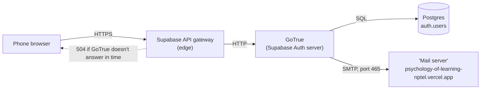
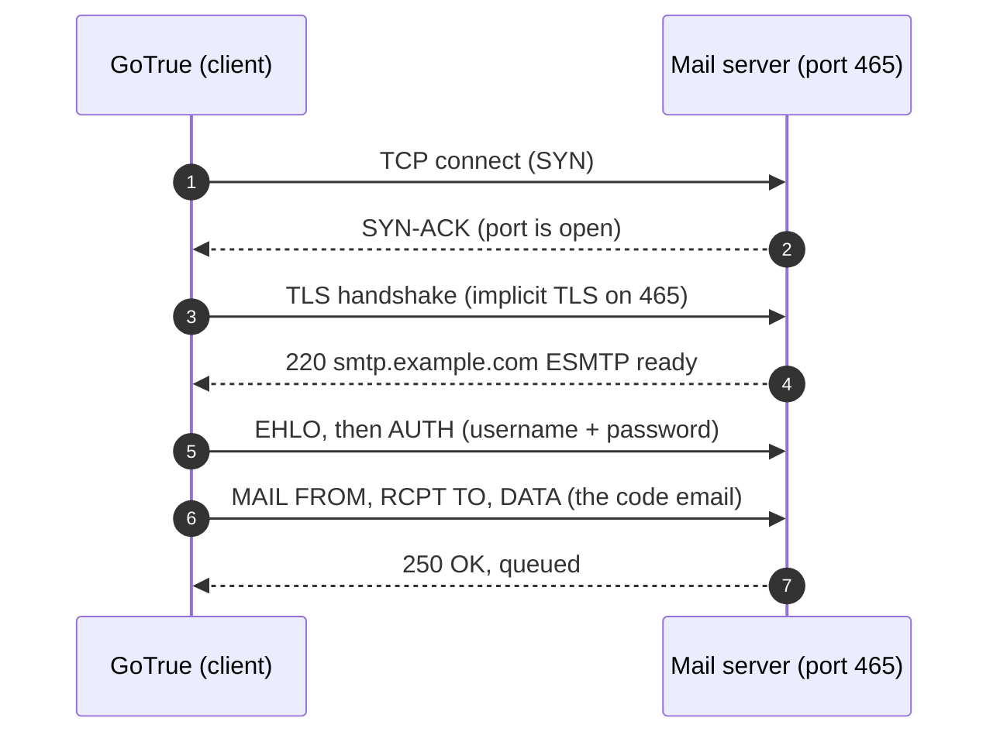
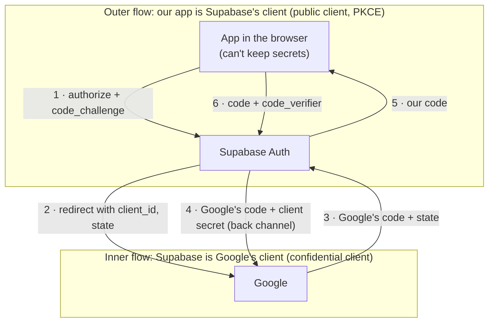

# L3.06 · Under the hood: OAuth, PKCE, and why sign-up timed out

> **Level 3 · Under the hood** · Lesson 6 of 6 · *Session 2*

| Recipe card | |
|---|---|
| **Time** | 70 min |
| **You need** | L2.07c (the six hops, the dashboards), L3.01 (the security model: JWTs, `auth.uid()`, threat thinking), L1.02 (HTTP status codes, redirects) |
| **You'll produce** | A diagnosis method for any 5xx; a PKCE challenge computed by hand and checked with Node; a threat list for the sign-in flow; the session's 504 as a full incident report |

**In two sentences:** "What is HTTP 504?" has a one-line answer, but finding *which* server timed out, and *why*, took a probe of every hop between a phone and a mail server. This lesson goes under the sign-in from both directions: the network plumbing that produced the 504 (gateways, SMTP ports, TCP timeouts, rate limits) and the cryptography that makes Google sign-in safe in a browser (the code flow, `state`, PKCE's hash, redirect allow-lists, the Public Suffix List).

### Objectives
1. From a status code alone, say which hop produced it (500, 502, 503, 504, 429) and what that means for the fix.
2. Explain why connecting to a website's port 465 **times out** instead of being **refused**, and which ports and TLS modes email submission uses.
3. Derive the S256 code challenge for a given verifier, explain why it is 43 characters long, compute the verifier's entropy (448 bits), and name the attack PKCE stops.
4. Name the other guards of the authorisation code flow (`state`, exact redirect URI, client secret on the server, redirect allow-list) and what each one stops.
5. Predict the outcome of five edge cases: cancelled consent, an in-app browser, a different browser finishing the flow, two tabs, and an abandoned flow.

---

## 1 · Warm-up: pull it from memory

1. *(L2.07c)* Name the six hops of a Google sign-in in order.
2. *(L3.01)* RLS policies call `auth.uid()`. Where does that value come from on each request?
3. *(L1.02)* What does a browser do with `302 Found` and a `Location` header?
4. *(L2.07c)* Which two client options did Google sign-in need, and what does each do?

<details><summary>Answers</summary>

1. App → Supabase `/authorize` → Google → Supabase `/callback` → app with `?code` → token exchange (`/token?grant_type=pkce`).
2. From the `sub` claim of the JWT in `Authorization: Bearer …`, verified by Postgres/PostgREST with the project's signing key.
3. Makes a new GET request to the `Location` URL (that's how every OAuth hop moves the browser).
4. `detectSessionInUrl: true` (exchange `?code` on start-up) and `flowType: "pkce"` (code + verifier instead of a token in the URL fragment).
</details>

---

## 2 · The problem this solves

The user's first message was **"what http 504"**, and the second was **"somebody got it when they tried to signup..so can you check"**. Sign-up was an email-code request, so one click crossed four machines:


*Takeaway: a 504 is always written by a middle box about the box behind it. The question is never "what is 504?" but "which middle box, waiting on whom?"*

To answer that you need three things this lesson teaches: what each 5xx code means about *where* it came from (§3.1), how mail servers are reached and what a dead port looks like (§3.2), and, once Google sign-in replaced email, how the new flow stays safe (§3.3–§4).

---

## 3 · Concepts

### 3.1 Status codes that point at a hop

1. **Definition.** A **gateway** (or reverse proxy) is a server that receives your request and forwards it to another server, the *upstream*. Supabase puts one in front of every project.
2. **Why here.** The 504 named the gateway's problem, not GoTrue's or the browser's.
3. **How it works.**

| Code | Name | Written by | Means | What you do |
|---|---|---|---|---|
| **500** | Internal Server Error | the app server itself | Its own code crashed | Read *its* logs |
| **502** | Bad Gateway | a gateway | The upstream answered with garbage, or the connection broke | Is the upstream crashing or restarting? |
| **503** | Service Unavailable | a gateway or the server | Nobody available to serve (overloaded, paused, deploying) | Wait; check status pages; is the project paused? |
| **504** | Gateway Timeout | a gateway | The upstream accepted the request but didn't answer in time | Find what the upstream was **waiting on** |
| **429** | Too Many Requests | the server | You hit a rate limit (not an error in the server) | Wait, or raise the limit |

4. **Minimal example.** `curl -s -o /dev/null -w "%{http_code} %{time_total}s\n" https://example.com/` prints the status and how long the whole request took. A 504 typically arrives after a suspiciously round, long time; a 503 often comes back fast.
5. **In this incident.** The first probes ruled out "paused" and "down" in under a second each:
   ```text
   == auth/v1/health        HTTP 200 in 0.389026s   {"version":"v2.197.0","name":"GoTrue",…}
   == auth/v1/settings      HTTP 200 in 0.447659s
   == rest/v1/profiles…     HTTP 200 in 0.764510s   []
   ```
   GoTrue was alive and fast. So the slow thing was something GoTrue *itself* waited on during sign-up. The only outside dependency of a sign-up is the email.
6. **Without this model:** you'd restart things, or blame the user's network.
7. **Try it (2 min).** Run the three `curl`s from §7 against the project. Then add `-w "%{time_connect} %{time_starttransfer}\n"`: connect time is the network, start-transfer minus connect is the server thinking.

### 3.2 Email, SMTP ports, and what a dead port looks like

**SMTP** (Simple Mail Transfer Protocol) is how one program hands an email to a mail server. A sign-up email from GoTrue goes like this:


*Takeaway: everything starts with step 1. If nothing at that address listens on that port, the conversation never begins.*

| Port | Use | TLS |
|---|---|---|
| 25 | Server-to-server relay | optional STARTTLS; often blocked for clients |
| **465** | Message submission (apps → their provider) | **implicit TLS** from the first byte (RFC 8314) |
| **587** | Message submission | starts plain, upgrades with `STARTTLS` |
| 2525 | Unofficial alternative some providers offer | like 587 |

**Refused vs timed out.** A TCP connection starts with a SYN packet.
- If the machine is reachable but nothing listens on that port, it answers with a reset (RST): **refused**, almost instantly.
- If a firewall silently **drops** the SYN, nothing comes back at all. The client retries until its own timeout: **timed out**.

The session measured both:

```text
# our website on the SMTP ports (curl --connect-timeout 10)
== port 465   * Connection timed out after 10011 milliseconds
== port 587   * Connection timed out after 10006 milliseconds

# a machine with nothing on 465 (localhost) for contrast
* connect to 127.0.0.1 port 465 from 0.0.0.0 port 59216 failed: Connection refused
* Failed to connect to 127.0.0.1 port 465 after 2027 ms: Could not connect to server

# the same website on HTTPS
443: HTTP 200, connect 0.105924s
```
- Vercel's edge (`216.198.79.131`, `64.29.17.131`) answers web ports in about 0.1 s and **drops** everything else. Dropping is a normal firewall choice: it gives scanners nothing to learn.
- (The 2 s on localhost is Windows retrying a refused connection a few times before reporting it; Linux or macOS report it in milliseconds.)
- So GoTrue's connection to "the mail server" didn't fail fast. It **hung**, and while it hung, the gateway's clock ran out: **504**.

**Why the sender address couldn't work either.** The settings used `noreply@psychology-of-learning-nptel.vercel.app`. Receiving mail servers check that the sending domain authorises the sender, using DNS records (SPF, DKIM, DMARC). Only whoever controls a domain's DNS can publish those, and `vercel.app` belongs to Vercel. Real options send from an address you control: your Gmail through Gmail's SMTP, or a single verified address on Brevo, or a domain you own.

### 3.3 The authorisation code flow, layer by layer

Google sign-in through Supabase is **two OAuth flows nested inside each other**:


*Takeaway: the inner flow is protected by a secret only Supabase knows; the outer flow can't use a secret (anything in a browser is public), so it uses PKCE instead.*

Vocabulary from the standard (RFC 6749), mapped to us:

| OAuth term | Inner flow | Outer flow |
|---|---|---|
| Resource owner | the student | the student |
| Client | Supabase Auth | our React app |
| Authorisation server | Google | Supabase Auth |
| Client type | **confidential** (has a secret) | **public** (can't keep one) |
| Proof at the exchange | client secret | PKCE verifier |

**The guards, and what each stops:**

| Guard | Where | Stops |
|---|---|---|
| Exact `redirect_uri` match | Google checks it against the client's registered list | Google sending codes to an attacker's server |
| `state` (one-time random value) | Supabase creates it at hop 2, checks it at hop 3 | Forged callbacks: an attacker making your browser complete *their* sign-in ("login CSRF") |
| Client secret on the back channel | Hop 4, server to server | Anyone who saw Google's code in a URL redeeming it |
| Redirect allow-list (`redirect_to`) | Supabase, before hop 5 | Supabase handing our code to an arbitrary site (§3.4) |
| PKCE verifier | Hop 6 | Anyone who saw *our* code redeeming it (§4) |
| Short lifetimes and single use | Both servers | Replaying an old code |

The **front channel** is everything carried in browser redirects (visible in the address bar, history, extensions, logs). The **back channel** is server-to-server (hop 4, and our hop 6 `POST`). The design rule: **codes may travel the front channel; secrets and tokens only the back channel.** The implicit flow broke that rule by putting the access token in the URL fragment, which is why it's discouraged (RFC 9700).

### 3.4 Redirect allow-lists and "open redirects"

An **open redirect** is a link on a trusted site that bounces visitors to any URL in a parameter. Attackers love them, because `https://trusted.site/…?to=https://evil.site` *looks* trusted.

- **Supabase's `redirect_to`** is checked against the Redirect URLs allow-list. Without that check, a crafted link starting at our real Supabase URL could finish on an attacker's page, carrying a fresh sign-in code (PKCE would still stop the exchange, but the allow-list means it never gets that far: defence in depth).
- **Our own `?next`** is used as `nav(next, { replace: true })`, an in-app React Router navigation, after the student is signed in. It's only ever set by our own links (`/me?next=/test`). Defence in depth says: validate it anyway. A safe rule is "must start with one `/` and not `//`" (`//evil.site` is a *protocol-relative* URL: same scheme, different host). That's the hard practice exercise in §11.

### 3.5 The Public Suffix List and "top private domain"

1. **Definition.** The **Public Suffix List** (PSL, publicsuffix.org) is a shared list of domain endings under which *unrelated* people can register names: `com`, `co.uk`, and also hosting domains like `vercel.app`, `github.io`, `netlify.app`, `supabase.co`.
2. **Why it exists.** Browsers use it so `a.vercel.app` can't set a cookie for all of `vercel.app` (which would reach `b.vercel.app`, someone else's site). Google uses it to decide which domains one developer may claim.
3. **How it works.** The list has two sections: ICANN domains (`com`, `in`, `co.uk`) and **private domains**, added by companies that hand out subdomains. A host's **public suffix** is the longest list entry it ends with; its **top private domain** is that suffix plus one more label:

$$\operatorname{TPD}(h) = \text{(the label immediately before } \operatorname{PS}(h)\text{)} \,.\, \operatorname{PS}(h)$$

| Host | Public suffix | Top private domain |
|---|---|---|
| `psychology-of-learning-nptel.vercel.app` | `vercel.app` | `psychology-of-learning-nptel.vercel.app` |
| `kehcsupmruaskpgdvzaj.supabase.co` | `supabase.co` | `kehcsupmruaskpgdvzaj.supabase.co` |
| `www.example.co.uk` | `co.uk` | `example.co.uk` |
| `docs.my-site.github.io` | `github.io` | `my-site.github.io` |

4. **Check it yourself** (fetched 2026-10-17; the list changes, so line numbers will differ):
   ```bash
   curl -s https://publicsuffix.org/list/public_suffix_list.dat -o psl.dat
   grep -n -x -E 'vercel\.app|supabase\.co|github\.io|netlify\.app' psl.dat
   grep -n '===BEGIN PRIVATE DOMAINS===' psl.dat
   ```
   ```text
   13836:github.io
   14990:netlify.app
   16081:supabase.co
   16339:vercel.app
   11247:// ===BEGIN PRIVATE DOMAINS===
   ```
   All four sit after line 11,247: private domains.
5. **In this project:** Google's "Authorised domains" field rejected `supabase.co` and `vercel.app` with *"Invalid domain: must be a top private domain"* and accepted the two full hostnames ([L2.07c](l2-07c-google-sign-in.md), Incident 3).
6. **Without knowing this:** you'd assume Google's console is broken, or try to verify ownership of `vercel.app`.
7. **Try it:** what's the top private domain of `a.b.c.netlify.app`? (Answer: `c.netlify.app`.)

### 3.6 Edge cases: predict, then reveal

Predict each outcome before opening it.

**E1 · The student taps Cancel on Google's screen.**
<details><summary>Outcome</summary>Google redirects to Supabase's callback with an error; Supabase redirects to our <code>redirect_to</code> with <code>error=access_denied</code> and an <code>error_description</code>. <code>SignIn</code> shows "Google sign-in didn't finish", removes the three error keys, keeps <code>next</code>. Covered by a UI test.</details>

**E2 · The link is opened inside WhatsApp or Instagram, and the student signs in from that in-app browser.**
<details><summary>Outcome</summary>Google's OAuth policy blocks sign-in from embedded webviews ("disallowed_useragent", Error 403), because the host app could read what's typed. The fix is human: open the link in Chrome or Safari. It's why the advice to the friend in L2.07c said "in Chrome, not from inside WhatsApp or Instagram".</details>

**E3 · The flow starts in one browser and finishes in another** (for example, the phone hands Supabase's final redirect to a different browser app).
<details><summary>Outcome</summary>The second browser has no verifier in its <code>localStorage</code>, so the <code>/token?grant_type=pkce</code> exchange fails and the student stays signed out. Meanwhile Supabase already created the user at hop 6. On the day, 2 of the first 8 Google users had a user row but no <code>last_sign_in_at</code>: consistent with this or with a closed tab, but not proven to be either.</details>

**E4 · The student taps the button in two tabs, then finishes in the first tab.**
<details><summary>Outcome</summary>Each start stores a verifier. In supabase-js 2.117.3, unless an experimental option adds a flow id to the redirect, the exchange reads the fixed key <code>…-code-verifier</code>, which "mirrors the most recently started flow" (a comment in <code>storePKCEVerifier</code>). The first tab's code is presented with the second tab's verifier: the hashes don't match, the exchange fails, and that tab stays signed out. Trying again works. The <code>busy</code> flag stops double taps in <em>one</em> tab, not across tabs.</details>

**E5 · Email sign-in is off. Do the tests' admin-minted codes still sign users in?**
<details><summary>Outcome</summary>Yes. On the day, after the user turned Email off, <code>api-security.spec.ts</code> (which signs in two throwaway users with <code>generateLink</code> + <code>verifyOtp</code>) still passed 13/13, while a public <code>POST /auth/v1/otp</code> returned <code>422 email_provider_disabled</code>. Minting a code needs the secret key, so this is a test-only path, not a back door.</details>

---

## 4 · The math: PKCE, derived with real numbers

**Symbols.**
- $v$: the **code verifier**, a random string (RFC 7636 allows 43–128 characters from `A–Z a–z 0–9 - . _ ~`).
- $\operatorname{SHA256}$: a hash function mapping any input to 256 bits (32 bytes). Easy to compute forwards; infeasible to invert or to find a second input with the same output.
- $\operatorname{BASE64URL}$: base64 with `+`→`-`, `/`→`_`, and no `=` padding, so the result is safe in a URL.
- $c$: the **code challenge**.

**The definition (method `S256`).**

$$c = \operatorname{BASE64URL}\big(\operatorname{SHA256}(\operatorname{ASCII}(v))\big)$$

*Why this shape:* the hash means the challenge reveals nothing usable about $v$ (step 1 travels the front channel, so assume attackers see $c$); base64url makes 32 raw bytes printable in a query string.

**The check at the exchange.** The server stored $c$ at hop 1. At hop 6 the client sends $v'$. The server accepts only if

$$\operatorname{BASE64URL}\big(\operatorname{SHA256}(v')\big) = c$$

*Why it works:* the honest client has $v$ (it never left the tab), so equality holds. An attacker who intercepted the code has seen at most $c$, and producing a $v'$ that hashes to $c$ means inverting SHA-256.

**Worked example.** A made-up verifier, so you can reproduce the numbers ($v$ = `a3f1` repeated 28 times, 112 characters, the same length supabase-js uses):

```js
// pkce.mjs: run with `node pkce.mjs`
import { createHash } from "node:crypto";
const verifier = "a3f1".repeat(28);
console.log(createHash("sha256").update(verifier).digest("hex"));
console.log(createHash("sha256").update(verifier).digest("base64"));
console.log(createHash("sha256").update(verifier).digest("base64url"));
```
```text
6d4b01bcf6ad888a01048cddeb1464a5afc22b49845bdc6943a19431c19ae42c
bUsBvPatiIoBBIzd6xRkpa/CK0mEW9xpQ6GUMcGa5Cw=
bUsBvPatiIoBBIzd6xRkpa_CK0mEW9xpQ6GUMcGa5Cw
```
Line by line:
1. The hash is 64 hex digits = 32 bytes = 256 bits.
2. Plain base64 contains a `/` (unsafe in a URL path) and ends with `=` padding.
3. Base64url swapped `/`→`_` and dropped the `=`. That 43-character string is $c$, sent as `code_challenge=bUsBvPatiIoBBIzd6xRkpa_CK0mEW9xpQ6GUMcGa5Cw&code_challenge_method=s256`.

**Why exactly 43 characters.** Base64 writes 6 bits per character:

$$\left\lceil \frac{256 \text{ bits}}{6 \text{ bits/char}} \right\rceil = \lceil 42.67 \rceil = 43$$

*Check with padding:* base64 encodes 3 bytes as 4 characters. $32 = 10 \times 3 + 2$, so 10 full groups give 40 characters, and the last 2 bytes give 3 characters plus one `=`: 44 with padding, **43** without.

**How strong is supabase-js's verifier?** From its source (`generatePKCEVerifier`): it fills a `Uint32Array(56)` from `crypto.getRandomValues`, then maps each number through `dec2hex`, which keeps the **last two hex digits** (`('0' + dec.toString(16)).substr(-2)`), i.e. the low byte. So:

$$56 \text{ values} \times 8 \text{ random bits} = 448 \text{ bits of entropy}, \qquad 56 \times 2 = 112 \text{ characters}$$

*Compare:* RFC 7636 recommends 32 random bytes (256 bits). A guesser trying $10^{12}$ verifiers per second would need about $2^{448}/10^{12} \approx 7 \times 10^{122}$ seconds. The universe is about $4 \times 10^{17}$ seconds old.

**What about `plain`?** If a browser lacks WebCrypto, supabase-js falls back to $c = v$ (method `plain`) and logs a warning. Then anyone who sees the hop-1 URL learns the verifier, and PKCE protects nothing. Every modern browser has WebCrypto on HTTPS pages; the fallback exists for unusual environments.

**The attack PKCE stops (authorisation code interception).** RFC 7636 was written for phones, where a malicious app could register the same custom URL scheme as a real app and receive its codes. In browsers the leak paths are a malicious extension reading URLs, a proxy or server log recording query strings, or browser history on a shared computer. In all of them the attacker holds the code but not the verifier, and the exchange fails.

---

## 5 · Reading the real code: inside supabase-js 2.117.3

Level 3 reads the library that does the work between our lines. These excerpts are from `node_modules/@supabase/auth-js/dist/module/` (comments ours).

**Making the verifier and challenge** (`lib/helpers.js`):
```js
export function generatePKCEVerifier() {
    const verifierLength = 56;
    const array = new Uint32Array(verifierLength);
    // (fallback using Math.random when there is no crypto: omitted)
    crypto.getRandomValues(array);                      // cryptographically secure randomness
    return Array.from(array, dec2hex).join('');         // each → its low byte as 2 hex chars → 112 chars
}
export async function generatePKCEChallenge(verifier) {
    const hasCryptoSupport = typeof crypto !== 'undefined' && typeof crypto.subtle !== 'undefined' && typeof TextEncoder !== 'undefined';
    if (!hasCryptoSupport) {
        console.warn('WebCrypto API is not supported. Code challenge method will default to use plain instead of sha256.');
        return verifier;                                // "plain": challenge = verifier
    }
    const hashed = await sha256(verifier);              // binary string of the 32-byte digest
    return btoa(hashed).replace(/\+/g, '-').replace(/\//g, '_').replace(/=+$/, '');   // base64 → base64url
}
```
- `crypto.getRandomValues` draws from the operating system's secure random source; `Math.random` would be predictable.
- The three `replace` calls are the whole definition of base64url: the same three changes you saw in §4's output.

**Choosing the method and storing the verifier** (`lib/helpers.js`):
```js
export async function getCodeChallengeAndMethod(storage, storageKey, isPasswordRecovery = false, onEvictFlow) {
    const codeVerifier = generatePKCEVerifier();
    let storedCodeVerifier = codeVerifier;
    if (isPasswordRecovery) {
        storedCodeVerifier += '/recovery';             // marks password-recovery flows (not used by us)
    }
    const flowId = generatePKCEFlowId();
    await storePKCEVerifier(storage, storageKey, flowId, storedCodeVerifier, onEvictFlow);
    const codeChallenge = await generatePKCEChallenge(codeVerifier);
    const codeChallengeMethod = codeVerifier === codeChallenge ? 'plain' : 's256';   // equal only in the fallback
    return [codeChallenge, codeChallengeMethod, flowId];
}
```
- **Store first, then navigate.** If the browser left before the verifier was saved, the flow could never finish.
- `storePKCEVerifier` writes a per-flow slot (`<storageKey>-flow-<id>-code-verifier`), an index of open flows (`<storageKey>-flows-code-verifier`, at most 5; older slots are evicted) **and** the fixed key `<storageKey>-code-verifier`, which mirrors the most recent flow. A test after one click found exactly those three keys, e.g. `sb-kehcsupmruaskpgdvzaj-auth-token-code-verifier` ([L4.09](l4-09-auth-tests-incident-ops.md) Practice, easy).

**Building the authorize URL** (`GoTrueClient.js`, `_getUrlForProvider`, abridged):
```js
if (this.flowType === 'pkce') {
    [codeChallenge, codeChallengeMethod, flowId] = await this._getCodeChallengeAndMethod();
    redirectTo = this._maybeAppendFlowIdToRedirect(redirectTo, flowId);   // only with an experimental opt-in
}
const urlParams = [`provider=${encodeURIComponent(provider)}`];
if (redirectTo) urlParams.push(`redirect_to=${encodeURIComponent(redirectTo)}`);
// … scopes, then:
urlParams.push(new URLSearchParams({ code_challenge: …, code_challenge_method: … }).toString());
return { url: `${url}?${urlParams.join('&')}`, flowId };
```
and then, in `_handleProviderSignIn`: `if (isBrowser() && !options.skipBrowserRedirect) window.location.assign(url);`
- `redirect_to` is encoded **again** here, around our already-encoded `next`. That's why the authorize URL contains `%252Ftest` (`%` itself encoded as `%25`) while `redirect_to`, once decoded, reads `…/me?next=%2Ftest`.

**Finishing on page load** (`GoTrueClient.js`, inside `_initialize` when `detectSessionInUrl` is on and the URL looks like a PKCE callback):
```js
if (!params.code) throw new AuthPKCEGrantCodeExchangeError('No code detected.');
const { data, error } = await this._exchangeCodeForSession(params.code, { flowId: params[PKCE_FLOW_ID_PARAM] });
if (error) throw error;
const url = new URL(window.location.href);
url.searchParams.delete('code');
url.searchParams.delete(PKCE_FLOW_ID_PARAM);
window.history.replaceState(window.history.state, '', url.toString());   // the address bar loses ?code
```
and the exchange itself:
```js
await _request(this.fetch, 'POST', `${this.url}/token?grant_type=pkce`, {
    headers: this.headers,
    body: { auth_code: authCode, code_verifier: codeVerifier },
    xform: _sessionResponse,
});
```
- **`replaceState`, not `pushState`:** the URL with the code never becomes a Back-button entry.
- This runs inside `createClient`'s start-up. `AuthProvider`'s `getSession()` waits for it, which is why our React code never sees a `code`.

---

## 6 · Worked trace: the 504, hop by hop (step-through frames)

Each frame is a probe that was really run, in order. Predict before reading the result.

| Frame | Probe | Result | Predict first → what it rules out |
|---|---|---|---|
| 1 | `GET /auth/v1/health` | 200 in 0.389 s, GoTrue v2.197.0 | Is the project paused or down? **No** |
| 2 | `GET /auth/v1/settings` | 200 in 0.448 s; `"email":true`, `"google":false`, `"mailer_autoconfirm":false` | Is sign-up disabled? **No; confirmation emails are required** |
| 3 | `GET /rest/v1/profiles?limit=1` | 200 in 0.765 s, `[]` | Is the database slow? **No** |
| 4 | `POST /auth/v1/otp` for a throwaway `@example.com` address | **429** `over_email_send_rate_limit` in 0.29 s | Can anyone sign up *right now*? **No: the hourly email limit is used up** |
| 5 | List users with the admin API | `total users: 0` | Did earlier sign-ups half-succeed? **No user rows exist at all** (consistent with the sign-up being undone when its email can't be sent) |
| 6 | The user's screenshot of Authentication → Emails → SMTP | Custom SMTP **on**; host `psychology-of-learning-nptel.vercel.app`, port 465, user `psychology-of-learning`, sender `noreply@psychology-of-learning-nptel.vercel.app` | Is the mail server real? **That host is the website** |
| 7 | `curl smtps://psychology-of-learning-nptel.vercel.app:465` and `:587` | Both: *Connection timed out after ~10 000 ms* | Does anything accept SMTP there? **No: SYNs are dropped, so GoTrue hangs** |
| 8 | Same host on 443 | 200, connect 0.106 s | Is the host reachable at all? **Yes, but only as a website** |

**Conclusion.** Sign-up → GoTrue tries to connect to a "mail server" that silently drops the connection → GoTrue waits → the gateway in front of it gives up first → the browser sees **504**. Some attempts also counted against the hourly email limit, hence the later **429**.

---

## 7 · Running and testing

Reproduce the probes (Git Bash or any POSIX shell; the publishable key is public, but keep it out of shared logs anyway):
```bash
U=https://kehcsupmruaskpgdvzaj.supabase.co
K=$(grep VITE_SUPABASE_ANON_KEY .env.local | cut -d= -f2)
for p in auth/v1/health auth/v1/settings "rest/v1/profiles?select=id&limit=1"; do
  curl -s -o /dev/null -w "$p  HTTP %{http_code} in %{time_total}s\n" -H "apikey: $K" "$U/$p"
done
```
Check a mail server the way GoTrue would, with a 10-second limit:
```bash
curl -sv --connect-timeout 10 smtps://smtp.gmail.com:465 2>&1 | grep -E -i "connected|timed out|refused|220"
```
A real provider answers, after the TLS handshake, with its greeting, for example `< 220 smtp.gmail.com ESMTP … - gsmtp`. Your website prints `Connection timed out after 100xx milliseconds`.

Compute a PKCE challenge for any verifier:
```bash
node -e 'console.log(require("crypto").createHash("sha256").update(process.argv[1]).digest("base64url"))' "a3f1a3f1…"
```

There is no automated test for the network plumbing; the protection is the runbook in [L4.09](l4-09-auth-tests-incident-ops.md) and the UI tests that assert the PKCE `code_challenge` is present ([L2.07c](l2-07c-google-sign-in.md) §7).

---

## 8 · Bug journal

### Incident · "what http 504" on sign-up

1. **Symptom.** A friend tapped sign-up (email code) and got:
   ```text
   HTTP 504 Gateway Timeout
   ```
   Later the same path, with the app's new error mapping, showed *"Sign-in is having trouble right now. Please try again in a minute."*
2. **Diagnosis.** The real path, including the wrong turn:
   - Health, settings and REST all fast (§6 frames 1–3): not paused, not down.
   - A sign-up probe returned 429 at once (frame 4), and there were 0 users (frame 5).
   - **Wrong turn:** with no SMTP details in the repo or the notes file, the first conclusion was "you're almost certainly on Supabase's built-in email sender", which is slow and limited. That was a guess from missing evidence. The user's next message, a screenshot of their SMTP settings, disproved it: custom SMTP was on.
   - The screenshot showed the host was the website (frame 6). Two `curl`s to ports 465 and 587 timed out (frame 7), while 443 answered in 0.1 s (frame 8).
3. **Root cause.** The SMTP **host** field held the app's own domain, and the username and sender were invented to match. There was no mail account behind any of it. A website host drops connections on mail ports, so GoTrue's connection hung instead of failing, and the gateway's timeout fired first. Underneath: the dashboard accepts any hostname without testing it.
4. **Fix.** Two options were written up (fix SMTP with Brevo or Gmail; or remove email). The user chose Google sign-in, then Google-only, and switched off the Email provider:
   ```diff
     Authentication → Sign In / Providers
   - Email:  on    (custom SMTP: psychology-of-learning-nptel.vercel.app:465)
   + Email:  off   (POST /auth/v1/otp → 422 email_provider_disabled)
   + Google: on    (client from Google Cloud; redirect URI = Supabase callback)
   ```
   If email ever comes back, the SMTP block must look like this (Brevo shown):
   ```diff
   - Host: psychology-of-learning-nptel.vercel.app   Port: 465   User: psychology-of-learning
   - Sender: noreply@psychology-of-learning-nptel.vercel.app
   + Host: smtp-relay.brevo.com   Port: 587   User: <login>@smtp-brevo.com   Password: <SMTP key, not API key>
   + Sender: an address verified in Brevo (Senders → Add a sender)
   ```
5. **Lesson.** For any 5xx, walk the hops: is each one up (fast probes), and what does the slow one wait on? Test an external dependency's **port** directly before trusting a dashboard field. And separate evidence from absence of evidence: "I found no SMTP notes" is not "there is no custom SMTP".

### Known failure mode · Google blocks embedded browsers

1. **Symptom.** Students who open the link from a chat app see Google's *"Error 403: disallowed_useragent"* when signing in.
2. **Diagnosis.** It happens only inside in-app browsers; the same student in Chrome is fine.
3. **Root cause.** Google's OAuth policies forbid sign-in from embedded webviews, where the host app could read the password field.
4. **Fix.** Nothing in code can override it. Tell students to open the site in Chrome or Safari ("⋮ → Open in browser").
5. **Lesson.** OAuth moves trust to the provider, and with it some of your UX. Put "open in your browser" in the message you send with the link.

---

## 9 · Why this design

| Decision | Alternatives | Why this one | Trade-off | Choose differently when |
|---|---|---|---|---|
| No email in the sign-in path | Supabase's built-in mailer (testing only, low limits); Brevo/Gmail SMTP; a domain with SPF/DKIM | Removes a whole failure class (ports, quotas, spam folders, sender verification) | Depends on Google being reachable and the student having an account | You need non-Google users, or emails for other reasons (receipts) |
| PKCE for the outer flow | Implicit flow; a backend that holds a client secret | Browsers can't keep secrets; PKCE gives code interception protection without a server | The verifier must survive in the same browser | You already run a backend (then use a confidential client there) |
| Supabase as the confidential client | Our own server talking to Google | No server to run; secret stays in Supabase | Supabase sees Google's tokens | You need Google API access (Drive, Calendar) under your control |
| Fixed hostname allow-list (`…/**`) | Allow any URL; exact paths only | Any path on our site, nothing else | `/**` lets *any* path receive a code (fine on a site we fully control) | Several apps share one project: list exact paths |
| Fail fast in the UI (`busy`, 5xx message) | Retry automatically | A timeout of 30 s+ is better as a clear message than a spinner | The student must tap again | Idempotent background requests (retry with backoff) |

---

## 10 · Check yourself

**Q1.** Sign-up returns 503 within 0.2 s. What do you check first?
<details><summary>Answer</summary>Whether the project is paused or being restarted (a fast 503 means "nobody to serve you"), and the provider's status page. A 504 would instead make you look at what the server waits on.</details>

**Q2.** `curl smtps://mail.example.com:465` prints *Connection refused* immediately. Compared with *timed out*, what do you learn?
<details><summary>Answer</summary>The machine is reachable and actively rejects the port: nothing listens there. A timeout means packets are dropped (firewall) or the host is unreachable. Either way it's not a mail server on that port, but "refused" fails fast, so it would have produced an immediate error instead of a 504.</details>

**Q3.** Predict: you change one character of the verifier in `localStorage` before the app comes back from Google. What happens?
<details><summary>Answer</summary>The exchange sends the changed verifier; its SHA-256 differs completely from the stored challenge (the avalanche property), so Supabase rejects it and the student stays signed out.</details>

**Q4.** Why does supabase-js send `code_challenge_method=s256`, and when would it send `plain`?
<details><summary>Answer</summary>s256 when WebCrypto is available (challenge ≠ verifier). <code>plain</code> only in the no-WebCrypto fallback, where challenge = verifier, which gives no protection if the first URL is seen.</details>

**Q5.** A teammate proposes adding `vercel.app` to the authorised domains "to cover preview deployments too". What do you say?
<details><summary>Answer</summary>Google will refuse it: <code>vercel.app</code> is a public suffix. Authorise each hostname you own. For previews, the Supabase redirect allow-list (not Google's) is what needs their URLs, because Google only ever redirects to Supabase.</details>

**Q6.** Which guard stops an attacker who reads *Google's* code from a proxy log, and which stops one who reads *Supabase's* code?
<details><summary>Answer</summary>Google's code needs the client secret at hop 4 (only Supabase has it). Supabase's code needs the PKCE verifier at hop 6 (only the student's tab has it).</details>

---

## 11 · Practice

**Easy (10 min).** Write `checkSmtp.sh host port` that prints `OPEN`, `REFUSED` or `TIMEOUT` within 10 seconds.
<details><summary>Solution</summary>

```bash
#!/usr/bin/env bash
out=$(curl -sv --connect-timeout 10 "telnet://$1:$2" 2>&1 </dev/null)   # telnet:// opens a bare TCP connection
case "$out" in
  *"Established connection"*|*"Connected to"*) echo OPEN ;;   # curl 8.x / older curl wording
  *"refused"*)      echo REFUSED ;;
  *"timed out"*)    echo TIMEOUT ;;
  *)                echo "UNKNOWN: $out" | head -3 ;;
esac
```
Run on 2026-10-17, the three checks printed `OPEN`, `REFUSED` and `TIMEOUT`. (The first version matched only `Connected to` and printed `UNKNOWN` for Gmail, because curl 8 says `Established connection to …`: match the tool's real output, not your memory of it.)

Done when: `checkSmtp.sh smtp.gmail.com 465` → OPEN; `checkSmtp.sh 127.0.0.1 465` → REFUSED; `checkSmtp.sh psychology-of-learning-nptel.vercel.app 465` → TIMEOUT.
</details>

**Medium (20 min).** Write a browser-side function that reproduces supabase-js's verifier and challenge with WebCrypto, and check it against Node's output for the same verifier.
<details><summary>Solution</summary>

```js
const verifier = Array.from(crypto.getRandomValues(new Uint32Array(56)), (d) => ("0" + d.toString(16)).slice(-2)).join("");
const digest = new Uint8Array(await crypto.subtle.digest("SHA-256", new TextEncoder().encode(verifier)));
const challenge = btoa(String.fromCharCode(...digest)).replace(/\+/g, "-").replace(/\//g, "_").replace(/=+$/, "");
console.log(verifier.length, challenge.length); // 112 43
```
Done when: pasting the printed verifier into the Node one-liner from §7 prints the same challenge.
</details>

**Hard (40 min).** Harden `?next` in `Account.tsx`: accept only same-site paths, and prove it with a test.
<details><summary>Hint</summary>Same-site path = starts with exactly one <code>/</code>. Reject <code>//host</code>, <code>/\host</code> (some browsers treat <code>\</code> like <code>/</code>), and anything with a scheme.</details>
<details><summary>Solution outline</summary>

```ts
const safeNext = (n: string | null) => (n && /^\/(?![/\\])/.test(n) ? n : null);
const next = safeNext(params.get("next"));
```
Use `safeNext` in both `Account` (the navigate effect) and `SignIn` (building `redirectTo`). Test: sign in a throwaway user with `?next=//example.com` and assert the URL stays on `/me`.
</details>

---

## 12 · From memory

**Rung 1 · Cloze.**

- challenge = **___①___**( **___②___**( verifier ) ), and its length is ⌈ **___③___** ÷ 6 ⌉ = **___④___** characters.
- A gateway that waited too long for its upstream returns **___⑤___**; a rate limit returns **___⑥___**.
- Implicit-TLS email submission uses port **___⑦___**; STARTTLS submission uses **___⑧___**.
- A silently dropped SYN gives *___⑨___*; a reset gives *___⑩___*.
- Google's code is redeemed with the ___⑪___; Supabase's code with the ___⑫___.

<details><summary>Answers</summary>① BASE64URL ② SHA256 ③ 256 ④ 43 ⑤ 504 ⑥ 429 ⑦ 465 ⑧ 587 ⑨ timed out ⑩ connection refused ⑪ client secret ⑫ PKCE code verifier</details>

**Rung 2 · Blank page (15 min).** No scrolling up. Draw the nested-flows diagram (§3.3) with all six arrows labelled, then write the PKCE definition, the length derivation, and the 448-bit entropy calculation.
<details><summary>Self-check</summary>

- [ ] Outer flow: app (public client) ↔ Supabase, protected by PKCE; inner flow: Supabase (confidential) ↔ Google, protected by the client secret
- [ ] `state` checked by Supabase; exact `redirect_uri` checked by Google; `redirect_to` allow-list checked by Supabase
- [ ] $c = \operatorname{BASE64URL}(\operatorname{SHA256}(v))$; 32 bytes → 43 characters (padding argument too)
- [ ] 56 × 8 = 448 bits; 112 hex characters
- [ ] Why codes may use the front channel but tokens may not
</details>

---

## 13 · Level 3 checkpoint (addendum for session 2)

The Level 3 checkpoint in [L3.05](l3-05-performance.md) still stands. Add this part after it.

**Mixed quiz (interleaved with L3.01–L3.05).**
1. *(L3.01 + L3.06)* After Google sign-in, which value do RLS policies use to identify the student, and which component created it?
2. *(L3.05 + L3.06)* Both a slow LCP and a 504 are "slow". Name the instrument you'd use for each.
3. *(L3.04 + L3.06)* The sign-in button's text is dark on a cream button with a four-colour logo. Which part needs a contrast check, and which doesn't?

<details><summary>Answers</summary>1. <code>auth.uid()</code>, the <code>sub</code> claim of the JWT that Supabase issued at the PKCE exchange (Google never issues our JWT). 2. Lighthouse/DevTools performance trace for LCP; per-hop <code>curl</code> timings and the provider's logs for the 504. 3. The text against the button (WCAG 4.5:1). The logo is decorative and <code>aria-hidden</code>; non-text contrast rules apply to meaningful graphics, not brand marks.</details>

**Blank-page drill (15 min).** Explain to a peer, on one page: (a) the trade-off of Google-only sign-in versus fixed SMTP, with one number from this session; (b) one edge case (E3 or E4) and what the student sees.

---

## 14 · Flashcards

<details><summary><b>Q:</b> Who writes a 504, and about whom?</summary><b>A:</b> A gateway or proxy, about its upstream, which accepted the request but didn't answer in time.</details>
<details><summary><b>Q:</b> 502 vs 504?</summary><b>A:</b> 502: the upstream answered badly or the connection broke. 504: the upstream didn't answer in time.</details>
<details><summary><b>Q:</b> Why did SMTP to the website time out rather than fail fast?</summary><b>A:</b> Vercel's edge drops packets to non-web ports; no reset comes back, so the client waits until its timeout.</details>
<details><summary><b>Q:</b> Ports for email submission and their TLS modes?</summary><b>A:</b> 465 implicit TLS; 587 STARTTLS. (25 is server-to-server relay.)</details>
<details><summary><b>Q:</b> Why can't you send as <code>noreply@…vercel.app</code>?</summary><b>A:</b> You don't control <code>vercel.app</code>'s DNS, so you can't publish SPF/DKIM/DMARC for it; receivers reject or junk it.</details>
<details><summary><b>Q:</b> The PKCE S256 formula?</summary><b>A:</b> challenge = BASE64URL(SHA256(ASCII(verifier))).</details>
<details><summary><b>Q:</b> Why is an S256 challenge 43 characters?</summary><b>A:</b> 256 bits ÷ 6 bits per base64 character = 42.67 → 43 (44 with one <code>=</code>, which base64url drops).</details>
<details><summary><b>Q:</b> Entropy of supabase-js's verifier?</summary><b>A:</b> 56 random bytes (low byte of each Uint32) = 448 bits, written as 112 hex characters.</details>
<details><summary><b>Q:</b> What attack does PKCE stop?</summary><b>A:</b> Authorisation code interception: a stolen code can't be exchanged without the verifier.</details>
<details><summary><b>Q:</b> What does <code>state</code> stop?</summary><b>A:</b> Forged callbacks (login CSRF): completing a sign-in your browser never started.</details>
<details><summary><b>Q:</b> Public vs confidential client?</summary><b>A:</b> A public client (browser app) can't keep a secret; a confidential client (a server like Supabase Auth) can.</details>
<details><summary><b>Q:</b> What is a top private domain?</summary><b>A:</b> A public suffix plus one label, e.g. <code>psychology-of-learning-nptel.vercel.app</code>.</details>
<details><summary><b>Q:</b> Flow started in Chrome, finished in another browser: result?</summary><b>A:</b> No verifier there → exchange fails → signed out, though Supabase may already have created the user.</details>
<details><summary><b>Q:</b> Why does Google refuse sign-in inside WhatsApp's browser?</summary><b>A:</b> Embedded webviews are blocked by Google's OAuth policy (<code>disallowed_useragent</code>), because the host app could read input.</details>

---

## 15 · The menu board

| | |
|---|---|
| Status → hop | 500 server's own crash · 502 bad upstream answer · 503 nobody to serve · 504 upstream too slow · 429 rate limit |
| Probe order | health → settings → REST → the failing endpoint → the dependency's port |
| Ports | 465 implicit TLS · 587 STARTTLS · 25 relay · refused = RST, timeout = dropped |
| Two flows | outer: app ↔ Supabase (public, PKCE) · inner: Supabase ↔ Google (confidential, secret, `state`) |
| PKCE | $c = \operatorname{B64URL}(\operatorname{SHA256}(v))$ · 43 chars · verifier 112 hex = 448 bits · `plain` only without WebCrypto |
| Storage | `sb-<ref>-auth-token` (session) · `…-code-verifier` (latest flow) · `…-flow-<id>-code-verifier` (slots, max 5) · `…-flows-code-verifier` (index of open flows) |
| PSL | public suffix + 1 label = top private domain; `vercel.app`, `supabase.co`, `github.io` are suffixes |
| Edge cases | cancel → `?error` · in-app browser → 403 disallowed_useragent · other browser / other tab → exchange fails |

## 16 · Glossary

**Avalanche property**: a tiny input change flips about half of a hash's output bits. **Back channel**: server-to-server requests, invisible to the browser. **Base64url**: base64 with `-` and `_` instead of `+` and `/`, without padding. **Confidential client**: an OAuth client that can keep a secret (a server). **Entropy**: unpredictability measured in bits; $n$ bits means $2^n$ equally likely values. **Front channel**: data carried in browser redirects and URLs. **Gateway / reverse proxy**: a server that forwards requests to an upstream. **Implicit TLS**: encryption from the first byte of the connection (port 465). **Login CSRF**: tricking a browser into finishing an attacker's sign-in. **Open redirect**: a trusted URL that forwards to any URL given in a parameter. **Protocol-relative URL**: `//host/path`, which keeps the current scheme. **Public client**: an OAuth client that cannot keep a secret (a browser or mobile app). **Public Suffix List**: the shared list of domains under which unrelated parties register names. **RST / SYN**: TCP's reset and connection-request packets. **STARTTLS**: upgrading a plain connection to TLS (port 587). **Upstream**: the server a gateway forwards to.

## 17 · Go further

| Resource | Type | Why | Which part | Time |
|---|---|---|---|---|
| [RFC 7636: PKCE](https://datatracker.ietf.org/doc/html/rfc7636) | Standard | The original, short and readable | §1 (the attack), §4.1–4.6 (the algorithm) | 25 min |
| [OAuth.com: PKCE](https://www.oauth.com/oauth2-servers/pkce/) | Explainer | The same with friendlier prose | All sub-pages of the PKCE chapter | 15 min |
| [RFC 9700: OAuth 2.0 Security Best Current Practice](https://datatracker.ietf.org/doc/html/rfc9700) | Standard | Why PKCE everywhere and no implicit flow | §2.1 and §2.1.2 | 15 min |
| [Supabase: PKCE flow](https://supabase.com/docs/guides/auth/sessions/pkce-flow) | Guide | How Supabase stores and exchanges the verifier | Whole page | 10 min |
| [MDN: 504 Gateway Timeout](https://developer.mozilla.org/en-US/docs/Web/HTTP/Reference/Status/504) | Reference | The status family in one place | 504 page, then the 5xx sidebar | 10 min |
| [RFC 8314: Cleartext considered obsolete](https://www.rfc-editor.org/rfc/rfc8314) | Standard | Why port 465 is implicit TLS | §3 | 10 min |
| [Supabase: Send emails with custom SMTP](https://supabase.com/docs/guides/auth/auth-smtp) | Guide | If email sign-in ever returns | Whole page | 10 min |

---
← [L3.05 Performance and Lighthouse](l3-05-performance.md) · [Hub](README.md) · [L4.01 Test it I: strategy and data tests →](l4-01-testing-strategy-data.md)
