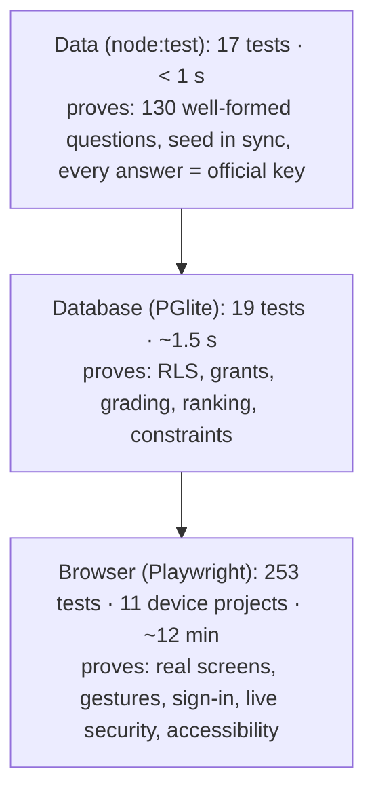

# L4.01 · Test it I: testing strategy and the data-integrity tests

> **Level 4 · Test it and ship it** · Lesson 1 of 9

| Recipe card | |
|---|---|
| **Time** | 70 min |
| **You need** | L2.01 (the data pipeline: PDFs → `questions.json` → `seed.sql`), L1.05 (Node, npm scripts) |
| **You'll produce** | The test strategy for the whole app (what each layer proves and costs), and `tests/unit/data.test.mjs` (107 lines) from a blank file, including a mutation check that proves the tests can fail |

**In two sentences:** The app is only as good as its 130 answers, so the cheapest, fastest tests check the data itself: shape, ids, the SQL seed, and every answer against the official PDFs and the SWAYAM page. This lesson places those tests in the app's three-layer strategy (data, database, browser), walks the file line by line with real `pdftotext` output, and tells the story of a test file that passed while silently checking nothing.

### Objectives
1. Draw the app's test pyramid, with each layer's count, run time and what it can and can't prove.
2. Write `data.test.mjs` from memory: structure checks, the seed-sync regex, the PDF answer parser and the SWAYAM check.
3. Explain why the PDF comparison uses `startsWith` in both directions, using real lines from the PDFs.
4. Run a mutation check and explain what it proves that a green run doesn't.
5. Diagnose a suite where tests "pass" because they were skipped.

---

## 1 · Warm-up: pull it from memory

1. *(L2.01)* What is the id of week 5, question 7, and what does `answer: 3` mean?
2. *(L2.01)* How is a single quote written inside a SQL string literal in `seed.sql`?
3. *(L1.05)* What does `"test:unit": "node --test tests/unit/data.test.mjs"` in `package.json` let you type?

<details><summary>Answers</summary>

1. `507` (`week × 100 + n`); the fourth option (0-based), D.
2. Doubled: `'It''s'`. The seed generator escapes every `'` as `''`.
3. `npm run test:unit`, which runs Node's built-in test runner on that file.
</details>

## 2 · The problem this solves

A wrong answer in `questions.json` is worse than a crash: the flashcard teaches the wrong fact, the quiz marks the right answer wrong, and the ranked test scores everyone against it. Nobody would notice by clicking around.

**The idea:** treat the data as code and test it, at three layers that each prove something the others can't.


*Bottom to top: more tests are cheaper and faster lower down; each layer up proves more of the real system and costs more. Run the bottom layers on every change and the top before every deploy.*

| Layer | Count | Time | Needs | Proves | Can't prove |
|---|---|---|---|---|---|
| Data | 17 | < 1 s (0.4 s measured) | Node; `pdftotext` and the PDFs for 12 of them | The content is right and consistent everywhere it's stored | Anything about code behaviour |
| Database | 19 | ~1.5 s (1.4 s measured) | Node only (Postgres runs in WebAssembly) | The SQL's security and grading logic | Supabase's real auth, network, dashboard settings |
| Browser | 253 | ~12 min | A production build; the live project for 3 files | What users see and can do, on 11 devices | Real devices' quirks beyond emulation; real users' data |

This is a **test pyramid**: wide at the bottom (many cheap, fast, isolated tests), narrow at the top (fewer slow, broad ones). The shape matters because a failure in a fast lower test points straight at its cause, while a failing browser test could be the data, the SQL, the CSS or the network.

---

## 3 · Concepts

### 3.1 `node:test` and `node:assert/strict`

1. **Definition.** `node:test` is the test runner built into Node (v18+); `node:assert/strict` is its assertion library, where equality is strict (`===`, deep equality without type coercion).
2. **Why here.** Zero dependencies for the data and DB layers: no Jest or Vitest to install or configure.
3. **How it works.** Each `test(name, fn)` registers a test; `node --test file` runs them and prints `✔`/`✖`/`﹣` (skipped) lines and a summary. A test fails if `fn` throws (or its promise rejects). `test(name, { skip: "reason" }, fn)` skips with a reason that's printed.
4. **Minimal example.**
   ```js
   import { test } from "node:test";
   import assert from "node:assert/strict";
   test("adds", () => assert.equal(1 + 1, 2));
   test("needs a tool", { skip: "tool missing" }, () => {});
   ```
   `node --test example.test.mjs` prints `✔ adds`, `﹣ needs a tool # tool missing`, then `ℹ pass 1`, `ℹ skipped 1`.
5. **In the project.** Both `tests/unit/data.test.mjs` and `tests/db/schema.test.mjs`.
6. **Without strictness.** `assert.equal("1", 1)` passes in legacy mode (`==`); in strict mode it fails. A seed with `"5"` as a week would sneak through the legacy assertion.
7. **Try it.** Run `npm run test:unit` and count the lines starting with `﹣`.

### 3.2 A test that can't fail proves nothing: the mutation check

A green run says "no assertion failed". It doesn't say the assertions *could* fail. A **mutation check** deliberately breaks the thing under test and confirms the suite goes red, then restores it. Done for this file (and reproduced for this lesson): change question 507's answer from 3 to 0 and run the suite.

```text
✖ supabase/seed.sql is in sync with questions.json
  AssertionError [ERR_ASSERTION]: answer for 507
✖ week 5 answers match 05.Assignement_Psy.pdf
```
Two independent tests caught it: the seed no longer matches the JSON, and the JSON no longer matches the PDF. After restoring the file, `git status` shows no change and the suite is green again.

### 3.3 Skips are results too

A skipped test is neither a pass nor a failure; it's a statement that a precondition wasn't met. Skips are useful (the PDFs and the SWAYAM page aren't in every checkout), but **a skip that should have run hides missing coverage behind a green summary**. That's the bug in §7. Rule: every skip must print *why*, and the summary's `skipped` count must be read, not only `fail`.

---

## 4 · Reading the real code

### 4.1 Setup (lines 1–12)

```js
// Data integrity: the 130 questions are well-formed, the SQL seed matches them,
// and every answer matches the official answer keys (PDFs + SWAYAM page for week 12).
// Run: npm run test:unit
import { test } from "node:test";
import assert from "node:assert/strict";
import { readFileSync, existsSync } from "node:fs";
import { execFileSync } from "node:child_process";
import { fileURLToPath } from "node:url";

const root = new URL("../../", import.meta.url);
const Q = JSON.parse(readFileSync(new URL("src/data/questions.json", root), "utf8"));
const norm = (s) => s.toLowerCase().replace(/[^a-z0-9]/g, "");
```
- **`import.meta.url`** is this file's own URL (`file:///C:/…/tests/unit/data.test.mjs`). `new URL("../../", …)` resolves to the repo root regardless of the directory you run `node` from. Relative paths like `"src/data/…"` would depend on the current directory.
- **`readFileSync` accepts URLs**, so `new URL("src/data/questions.json", root)` works on Windows and macOS alike.
- **`execFileSync`** runs a program with an argument array (no shell), so file names with spaces (`"Assignement 3. Solution.pdf"`) need no quoting.
- **`norm`** lowercases and deletes everything except letters and digits: `"Love and belonging"` → `"loveandbelonging"`, `"Students' cognitive …"` → `"studentscognitive…"`. Comparing normalised text ignores spacing, punctuation and case differences between the PDFs and the JSON.

### 4.2 Shape tests (lines 14–36)

```js
test("there are 130 questions, 10 per week, weeks 0–12", () => {
  assert.equal(Q.length, 130);
  for (let w = 0; w <= 12; w++) assert.equal(Q.filter((q) => q.week === w).length, 10, `week ${w}`);
});

test("ids are unique and follow week*100 + n", () => {
  assert.equal(new Set(Q.map((q) => q.id)).size, Q.length);
  for (let w = 0; w <= 12; w++) {
    const ids = Q.filter((q) => q.week === w).map((q) => q.id);
    assert.deepEqual(ids, Array.from({ length: 10 }, (_, i) => w * 100 + i + 1));
  }
});
```
- **Count per week**, with the week in the failure message (`week 7`), so a failure says where to look.
- **Uniqueness by `Set` size**: if two questions share an id, the set is smaller than the array.
- **Exact id sequence per week**: `Array.from({ length: 10 }, (_, i) => w * 100 + i + 1)` is `[501, …, 510]` for week 5. `deepEqual` also checks **order**, which the app relies on (`numberInWeek` and the PDF comparison both use position).

```js
test("every question has text, 2 or 4 distinct options and a valid answer", () => {
  for (const q of Q) {
    assert.ok(q.q.trim().length > 5, `q${q.id} text`);
    assert.ok([2, 4].includes(q.options.length), `q${q.id} option count`);
    assert.ok(q.options.every((o) => o.trim().length > 0), `q${q.id} empty option`);
    assert.equal(new Set(q.options.map(norm)).size, q.options.length, `q${q.id} duplicate options`);
    assert.ok(Number.isInteger(q.answer) && q.answer >= 0 && q.answer < q.options.length, `q${q.id} answer index`);
    if (q.options.length === 2) assert.deepEqual(q.options, ["True", "False"], `q${q.id} true/false`);
  }
});
```
- **Text longer than 5 characters** catches an empty or truncated extraction.
- **2 or 4 options** is a property of this course's assignments (four-option MCQs and true/false), so anything else is an extraction error.
- **Distinct options after `norm`**: two options that differ only in punctuation would confuse a student and probably means a copy-paste slip.
- **`Number.isInteger(q.answer)` and the range check**: catches `"3"` (a string), `1.5`, `-1`, and an index past the end. That last one would make `options[answer]` `undefined` in the UI.
- **True/false questions are exactly `["True", "False"]`** in that order, so the app (and the quiz's A/B letters) is consistent.

### 4.3 Seed sync (lines 38–52)

```js
test("supabase/seed.sql is in sync with questions.json", () => {
  const seed = readFileSync(new URL("supabase/seed.sql", root), "utf8");
  const rows = [...seed.matchAll(/^\s+\((\d+), (\d+), '((?:[^']|'')*)', '((?:[^']|'')*)'::jsonb, (\d)\)/gm)];
  assert.equal(rows.length, 130, "row count");
  for (const [, id, week, prompt, opts, ans] of rows) {
    const q = Q.find((x) => x.id === +id);
    assert.ok(q, `seed id ${id} missing from json`);
    assert.equal(+week, q.week);
    assert.equal(prompt.replace(/''/g, "'"), q.q);
    assert.deepEqual(JSON.parse(opts.replace(/''/g, "'")), q.options);
    assert.equal(+ans, q.answer, `answer for ${id}`);
  }
  const setup = readFileSync(new URL("supabase/setup.sql", root), "utf8");
  assert.ok(setup.includes(seed.split("\n")[2]), "setup.sql contains the seed");
});
```
- **Why this test exists:** the answer key exists twice, in the JSON (for flashcards) and in the database (for grading). If they drift, the flashcards and the ranked test disagree.
- **The regex, piece by piece** (matching a seed row like `  (507, 5, 'An example of ___ is …', '["purposeful",…]'::jsonb, 3),`):
  - `^\s+\(` a line that starts with indentation and `(` (the `m` flag makes `^` match at each line start);
  - `(\d+), (\d+), ` the id and week;
  - `'((?:[^']|'')*)'` a SQL string: any run of "a non-quote character, **or** a doubled quote", which is exactly SQL's escaping rule; capture group 3 is the prompt;
  - the same pattern again followed by `'::jsonb` for the options;
  - `, (\d)\)` the answer index and the closing parenthesis.
- **`[...seed.matchAll(…)]`** turns the iterator into an array; destructuring `[, id, week, prompt, opts, ans]` skips the whole-match element.
- **Unescape, then compare**: `.replace(/''/g, "'")` reverses the generator's escaping; options are parsed as JSON and compared deeply.
- **`setup.sql` contains the seed**: `setup.sql` is `schema.sql` + `seed.sql` concatenated (L2.01). Checking that line 3 of the seed appears in it catches "regenerated the seed but forgot `npm run gen:sql`".
- **What breaks without it:** edit an answer in the JSON, deploy, and the server grades against the old key.

### 4.4 The PDF cross-check (lines 54–98)

```js
const PDFS = {
  0: "00.Assignement_Psy.pdf",
  1: "01.Assignement_Psy.pdf",
  2: "02.Assignement_Psy.pdf",
  3: "Assignement 3. Solution.pdf",
  4: "04.Assignement_Psy.pdf",
  5: "05.Assignement_Psy.pdf",
  6: "06.Assignement.pdf",
  7: "7 assignment-Psy.of L.pdf",
  8: "08.Assignement.pdf",
  9: "09.Assignement_Psy.pdf",
  10: "10.Assignement_Psy.pdf",
  11: "11.Assignement_Psy.pdf",
};
let hasPdftotext = true;
try {
  execFileSync("pdftotext", ["-v"], { stdio: "ignore" });
} catch (e) {
  hasPdftotext = e.code !== "ENOENT"; // pdftotext -v exits non-zero but exists
}
```
- **The real file names**, inconsistent spelling and all ("Assignement", spaces, a different pattern for weeks 3 and 7). The map is the single place that knows them.
- **Detecting the tool**: run `pdftotext -v` and ignore its output. `execFileSync` throws in two different situations, and they must be told apart:
  - the program **doesn't exist** → `e.code === "ENOENT"` ("error, no entry": the OS couldn't find the file to run);
  - the program **ran and exited non-zero** → `e.status` is the exit code and `e.code` is undefined. `pdftotext -v` exits with **99** after printing its version (measured), so this case means "installed".
- The comment records the surprising fact. That one line is the fix for §7.

```js
for (const [week, file] of Object.entries(PDFS)) {
  const path = new URL(file, root);
  test(`week ${week} answers match ${file}`, { skip: !hasPdftotext || !existsSync(path) ? "pdftotext or PDF not available" : false }, () => {
    const text = execFileSync("pdftotext", ["-layout", fileURLToPath(path), "-"], { encoding: "utf8" });
    // "Ans. D= text" lines, possibly wrapped onto the next line
    const lines = text.split(/\r?\n/);
    const keys = [];
    for (let i = 0; i < lines.length; i++) {
      const m = lines[i].match(/Ans\.?\s*([a-dA-D])?\s*=\s*(.+)$/);
      if (!m) continue;
      let t = m[2].trim();
      const next = (lines[i + 1] || "").trim();
      if (next && !/^(Solution|\d+\)|QUESTION|\*+END)/.test(next)) t += " " + next;
      keys.push(norm(t));
    }
    const ours = Q.filter((q) => q.week === +week);
    assert.equal(keys.length, 10, "found 10 answer lines");
    ours.forEach((q, i) => {
      const a = norm(q.options[q.answer]);
      assert.ok(keys[i].startsWith(a) || a.startsWith(keys[i]), `W${week} Q${i + 1}: key "${keys[i]}" vs ours "${a}"`);
    });
  });
}
```
- **One test per week**, generated in a loop, so a failure names the week and the file.
- **`skip`** is a reason string when the tool or the file is missing, `false` otherwise.
- **`pdftotext -layout file -`**: `-layout` keeps the page's visual columns (so "Ans. D= …" stays on one line), and `-` writes to standard output instead of a `.txt` file. `fileURLToPath` converts the URL to a native path (`C:\Users\…\05.Assignement_Psy.pdf`); the earlier hand-made conversion from `url.pathname` broke on Windows drive letters and `%20`-encoded spaces.
- **Split on `\r?\n`**: handles both Windows and Unix line endings.
- **The answer-line regex** `Ans\.?\s*([a-dA-D])?\s*=\s*(.+)$`: "Ans", an optional dot, an optional letter (some PDFs write `Ans. c=` in lowercase, some omit the letter), `=`, then the answer text to the end of the line (group 2). The letter is captured but not used: the **text** is compared, because the option order in the JSON could differ from the PDF.
- **Wrapped answers**: if the next line isn't empty and doesn't start a new section (`Solution`, `3)`, `QUESTION`, `*****END`), it's appended. §5 shows both real cases this handles, and the one it gets "wrong" harmlessly.
- **`keys.length === 10`**: if the parser finds 9 or 11 answers, the regex or the PDF is off, and the positional comparison below would be meaningless.
- **Bidirectional `startsWith`**: the PDF line may be longer than the option (a page header glued on, §5.2) or shorter (an answer cut at a line break that wasn't joined). Requiring one to be a prefix of the other accepts both while still catching a different answer.

### 4.5 Week 12 from the SWAYAM page (lines 100–107)

```js
// ---------- week 12: accepted answers from the saved SWAYAM page ----------
const swayam = new URL("../Course_ Psychology of Learning _ SWAYAM.html", root);
test("week 12 answers match the SWAYAM accepted answers", { skip: existsSync(swayam) ? false : "SWAYAM page not available" }, () => {
  const html = readFileSync(swayam, "utf8").replace(/<[^>]+>/g, "\n");
  const letters = [...html.matchAll(/Accepted answer is\s*\n\s*([A-D])\./g)].map((m) => "ABCD".indexOf(m[1]));
  const wk12 = Q.filter((q) => q.week === 12).map((q) => q.answer);
  assert.deepEqual(letters.slice(-10), wk12);
});
```
- **Week 12 had no PDF**: its questions came from a saved course page, where each question shows "Accepted answer is" followed by a letter (L2.01).
- **The path is outside the repo** (`../`), in the Downloads folder where the page was saved. On this machine today the page is no longer there, so the test prints `﹣ week 12 answers match the SWAYAM accepted answers # SWAYAM page not available`: a correct, visible skip.
- **Strip tags to newlines**, then match "Accepted answer is", whitespace, a letter and a dot. `"ABCD".indexOf(letter)` converts it to a 0-based index.
- **`.slice(-10)`**: the page contains the week's questions last; taking the final ten ignores anything earlier on the page.

---

## 5 · Worked traces with real PDF lines

### 5.1 Week 5: a clean parse

`pdftotext -layout 05.Assignement_Psy.pdf -` (excerpt, line numbers from the output):

```text
 95:         Ans. D= expectancy
 96:
118:         Ans. A= Love and belonging
119:             Solution: Please go through lecture notes of week-5 (slide no.31-32) for better
```

| Line | Regex match? | `t` | Next line | Appended? | Key |
|---|---|---|---|---|---|
| 95 | yes, letter D | `expectancy` | empty | no | `expectancy` |
| 118 | yes, letter A | `Love and belonging` | `Solution: Please…` | no (starts with `Solution`) | `loveandbelonging` |

Question 507 (the 7th of week 5) has options `["purposeful", "valence", "instrumentality", "expectancy"]` and `answer: 3` → `norm("expectancy")` = `expectancy`, equal to key 7. ✓

### 5.2 Two lines that need the bidirectional prefix check

```text
00.Assignement_Psy.pdf:   Ans. D= Psychology
                          (next line)  NPTEL Online Certification Courses
10.Assignement_Psy.pdf:   Ans. c= Students' cognitive development and learning is limited by the general stages of
                          (next line)  development.
```
**Predict** the key for each, and whether the check passes.

<details><summary>Reveal</summary>

- **Week 0:** the next line is a page header, not a section start, so it's appended. Key = `psychologynptelonlinecertificationcourses`. Our option is `psychology`. `key.startsWith("psychology")` → **passes**. The join was wrong, but harmlessly: the real answer is a prefix of the key.
- **Week 10:** a genuinely wrapped answer. Key = `studentscognitivedevelopmentandlearningislimitedbythegeneralstagesofdevelopment`, which equals our normalised option. **Passes**.
- If the check were only `key === ours`, week 0 would fail on a header. If it were only `ours.startsWith(key)`, week 0 would also fail. Both directions are needed.
</details>

---

## 6 · Running and testing

```bash
npm run test:unit
```
Expected on a machine with `pdftotext` and the PDFs (and, for week 12, the saved page):
```text
✔ there are 130 questions, 10 per week, weeks 0–12
✔ ids are unique and follow week*100 + n
✔ every question has text, 2 or 4 distinct options and a valid answer
✔ supabase/seed.sql is in sync with questions.json
✔ week 0 answers match 00.Assignement_Psy.pdf
…
✔ week 11 answers match 11.Assignement_Psy.pdf
✔ week 12 answers match the SWAYAM accepted answers
ℹ tests 17
ℹ pass 17
ℹ skipped 0
```
- **Install `pdftotext`**: it's part of Poppler (`choco install poppler` on Windows, `brew install poppler` on macOS, `apt install poppler-utils` on Linux), or Xpdf, which this machine has (`pdftotext version 4.00`).
- **Mutation check** (run it yourself, then restore):
  ```bash
  cp src/data/questions.json /tmp/q.bak
  node -e 'const f=require("fs"),p="src/data/questions.json",d=JSON.parse(f.readFileSync(p));d.find(q=>q.id===507).answer=0;f.writeFileSync(p,JSON.stringify(d,null,1))'
  npm run test:unit            # expect ✖ seed sync ("answer for 507") and ✖ week 5
  cp /tmp/q.bak src/data/questions.json && git status --short src/data   # nothing listed
  ```

## 7 · Bug journal

### Incident · Twelve answer checks "passed" by never running

1. **Symptom.** The first run of the data tests was green:
   ```text
   ✔ supabase/seed.sql is in sync with questions.json
   ﹣ week 0 answers match 00.Assignement_Psy.pdf # pdftotext or PDF not available
   ﹣ week 1 answers match 01.Assignement_Psy.pdf # pdftotext or PDF not available
   …
   ﹣ week 11 answers match 11.Assignement_Psy.pdf # pdftotext or PDF not available
   ✔ week 12 answers match the SWAYAM accepted answers
   ℹ tests 17
   ℹ pass 5
   ℹ fail 0
   ℹ skipped 12
   ```
   `fail 0`, but 12 of the 17 tests, the ones that matter most, were skipped.
2. **Diagnosis.** The PDFs were in the repo root. `pdftotext` was installed: `pdftotext -layout` had been used to extract the questions in the first place (L2.01). So the "not available" branch was wrong. The detection was:
   ```js
   try { execFileSync("pdftotext", ["-v"], { stdio: "ignore" }); }
   catch { hasPdftotext = false; }
   ```
   Running `pdftotext -v` by hand showed the cause: it prints its version and **exits with status 99**. Node's `execFileSync` throws for any non-zero exit, so the `catch` treated "installed, odd exit code" the same as "not installed".
3. **Root cause.** "The command failed" was used as a proxy for "the command doesn't exist". They're different errors with different signals: `ENOENT` versus a non-zero `status`.
4. **Fix.**
   ```diff
    try {
      execFileSync("pdftotext", ["-v"], { stdio: "ignore" });
   -} catch {
   -  hasPdftotext = false;
   +} catch (e) {
   +  hasPdftotext = e.code !== "ENOENT"; // pdftotext -v exits non-zero but exists
    }
   ```
   plus `fileURLToPath(path)` for the PDF path (the hand-made `decodeURIComponent(path.pathname…)` conversion was fragile on Windows). Result: `pass 17, skipped 0`, then the mutation check (§3.2) proved the comparisons can fail.
5. **Lesson.** Read the **skipped** count, not only `fail`. Detect tools by the specific error for "missing" (`ENOENT`), never by "any error". And after a suite goes green for the first time, break something on purpose.

## 8 · Why this design

| Decision | Alternatives | Why this one | Trade-off | Choose differently when |
|---|---|---|---|---|
| Test the data against the original sources | Trust the extraction; spot-check by hand | Every one of 130 answers checked on every run | Needs `pdftotext` and the PDFs locally | Data from a trusted API → validate the schema only |
| `node:test` + `assert/strict` | Jest, Vitest | No dependencies, fast, built in | Fewer conveniences (watch mode, snapshots) | Large unit suites with mocks → Vitest |
| Compare answer **text**, not letters | Compare A/B/C/D letters | Survives option reordering; catches the wrong *meaning* | Needs normalisation and prefix tolerance | Options never reordered and letters reliable |
| Skip with a reason when sources are missing | Fail; or silently skip | Clean checkouts and CI still run the structural tests | A skip can hide a broken detection (§7) | In CI that *must* verify answers → fail if sources are missing |
| Seed-sync test | Generate the seed in the build | Catches forgetting to regenerate | One more test | Seed generated automatically in CI → still keep the test |

## 9 · Check yourself

**Q1.** The summary says `pass 5, fail 0, skipped 12`. Is the data verified?
<details><summary>Answer</summary>No. Only the structural checks and week 12 ran. The 12 PDF comparisons, which check the answers themselves, didn't. Find out why each skip happened before trusting the run.</details>

**Q2.** `execFileSync("pdftotext", ["-v"])` throws with `e.status === 99`. Is `pdftotext` installed?
<details><summary>Answer</summary>Yes. A non-zero <code>status</code> means the program ran and exited with that code. Only <code>e.code === "ENOENT"</code> means it wasn't found.</details>

**Q3.** Someone edits question 304's answer in `questions.json` and forgets to run `npm run gen:sql`. Which tests fail?
<details><summary>Answer</summary>"supabase/seed.sql is in sync with questions.json" (answer for 304), and, if the edit is wrong, "week 3 answers match …" too. If the edit was a genuine correction, only the seed-sync test fails, telling you to regenerate.</details>

**Q4.** Why does the PDF parser compare normalised text rather than the captured letter?
<details><summary>Answer</summary>The letter only means something relative to the option order in the PDF. If options were reordered during extraction, letters would mismatch while the meaning is right (or match while it's wrong). The text is what the student learns.</details>

**Q5.** A PDF answer line is `Ans. B= Social` and the next line is `pressure`. Our option is `social pressure`. Pass or fail?
<details><summary>Answer</summary>Pass. "pressure" doesn't start a new section, so it's appended: key <code>socialpressure</code> equals ours. (Even without the join, <code>socialpressure.startsWith("social")</code> would pass.)</details>

**Q6.** What does the mutation check prove that a green run doesn't?
<details><summary>Answer</summary>That the assertions are actually connected to the data: when the data is wrong, the suite fails, and in the expected tests.</details>

## 10 · Practice

**Easy (10 min).** Add a test that every question's text ends with `?`, `.`, `:` or `___` (or find the ones that don't, and decide whether the rule or the data is wrong).

**Medium (20 min).** Make the PDF tests **fail** instead of skip when an environment variable `REQUIRE_SOURCES=1` is set and a PDF or `pdftotext` is missing.
**Done when** `REQUIRE_SOURCES=1 npm run test:unit` fails on a machine without `pdftotext`, and plain `npm run test:unit` still skips.

**Hard (40 min).** Write a tiny mutation-testing script: for each of the 130 questions, change its answer, run only the matching week's test in-process, and record whether it fails. Report any question whose mutation **survives**.
**Done when** it reports 0 survivors for weeks 0–11 (week 12 depends on the SWAYAM page).
<details><summary>Key insight</summary>Don't spawn 130 Node processes: import the parsing logic into a function, run it against an in-memory mutated copy of <code>Q</code>, and restore after each mutation. Survivors usually mean a key line that is a prefix of more than one option.</details>

## 11 · From memory

**Rung 1 · Cloze.**

```js
const root = new URL("../../", import.meta.___①___);
const norm = (s) => s.toLowerCase().replace(/[^a-z0-9]/___②___, "");
assert.deepEqual(ids, Array.from({ length: 10 }, (_, i) => w * ___③___ + i + 1));
const rows = [...seed.matchAll(/^\s+\((\d+), (\d+), '((?:[^']|___④___)*)', '((?:[^']|'')*)'::jsonb, (\d)\)/gm)];
try { execFileSync("pdftotext", ["-v"], { stdio: "ignore" }); }
catch (e) { hasPdftotext = e.code !== "___⑤___"; }
const text = execFileSync("pdftotext", ["___⑥___", fileURLToPath(path), "-"], { encoding: "utf8" });
const m = lines[i].match(/Ans\.?\s*([a-dA-D])?\s*=\s*(.+)$/);
assert.ok(keys[i].startsWith(a) ___⑦___ a.startsWith(keys[i]));
const letters = [...html.matchAll(/Accepted answer is\s*\n\s*([A-D])\./g)].map((m) => "ABCD".___⑧___(m[1]));
```
<details><summary>Answers</summary>① <code>url</code> ② <code>g</code> ③ <code>100</code> ④ <code>''</code> ⑤ <code>ENOENT</code> ⑥ <code>-layout</code> ⑦ <code>||</code> ⑧ <code>indexOf</code></details>

**Rung 2 · Blank page (20 min). No scrolling up.** Write `tests/unit/data.test.mjs` from scratch.
<details><summary>Self-check</summary>

- [ ] Repo root from `import.meta.url`; JSON read through a URL; `norm` helper
- [ ] Count per week; unique ids; exact `w*100 + 1 … w*100 + 10` order
- [ ] Text length; 2 or 4 options; non-empty and distinct options; integer answer in range; true/false exactly `["True","False"]`
- [ ] Seed regex with `(?:[^']|'')*`; 130 rows; unescape `''`; compare id, week, prompt, options, answer; `setup.sql` contains the seed
- [ ] `pdftotext -v` detection with `ENOENT`; per-week tests with a skip reason
- [ ] `-layout` extraction; answer-line regex; join wrapped lines except section starts; exactly 10 keys; bidirectional `startsWith`
- [ ] SWAYAM: strip tags, match "Accepted answer is X.", last 10
</details>

## 12 · Flashcards

<details><summary><b>Q:</b> What does each test layer prove?</summary><b>A:</b> Data: content correct and consistent. DB: RLS, grants, grading, ranking. Browser: what users see and do, on 11 devices, plus live security and accessibility.</details>
<details><summary><b>Q:</b> Why a pyramid shape?</summary><b>A:</b> Many fast, precise tests at the bottom; few slow, broad ones at the top. Lower failures point straight at the cause.</details>
<details><summary><b>Q:</b> What is a mutation check?</summary><b>A:</b> Deliberately break the code or data, confirm the tests fail, then restore.</details>
<details><summary><b>Q:</b> How do you tell "not installed" from "exited non-zero" in <code>execFileSync</code>?</summary><b>A:</b> <code>e.code === "ENOENT"</code> vs a numeric <code>e.status</code>.</details>
<details><summary><b>Q:</b> What does <code>pdftotext -v</code> exit with?</summary><b>A:</b> 99, even though it's installed.</details>
<details><summary><b>Q:</b> Why <code>new URL("../../", import.meta.url)</code>?</summary><b>A:</b> Paths relative to the test file, independent of the current directory.</details>
<details><summary><b>Q:</b> What does <code>(?:[^']|'')*</code> match?</summary><b>A:</b> A SQL string body: non-quotes or doubled quotes.</details>
<details><summary><b>Q:</b> Why compare answers with <code>startsWith</code> both ways?</summary><b>A:</b> PDF lines can carry extra text (a page header) or be cut short; one must be a prefix of the other.</details>
<details><summary><b>Q:</b> Why test seed sync?</summary><b>A:</b> The key exists in JSON (flashcards) and SQL (grading); drift would make them disagree.</details>
<details><summary><b>Q:</b> What should you read besides <code>fail</code> in a test summary?</summary><b>A:</b> <code>skipped</code>, and each skip's reason.</details>

## 13 · The menu board

| | |
|---|---|
| Layers | data 17 · < 1 s → DB 19 · ~1.5 s → browser 253 · 11 projects · ~12 min |
| Runner | `node --test`; `assert/strict`; `test(name, { skip: "why" }, fn)` |
| Shape | 130; 10/week; ids `w*100+n` in order; text; 2 or 4 distinct options; integer answer in range; T/F exact |
| Seed | regex with `(?:[^']|'')*`; unescape; compare all fields; setup.sql contains seed |
| PDFs | `pdftotext -layout file -`; `Ans.? X= text`; join wraps except section starts; 10 keys; prefix both ways |
| Tool check | `ENOENT` = missing; `status 99` = present |
| Week 12 | SWAYAM page: "Accepted answer is X." → last 10 |
| Trust | read `skipped`; run a mutation check |

## 14 · Glossary

**Assertion**: a check that throws when false. **`ENOENT`**: the OS error for "no such file or directory". **Exit status**: the number a program returns when it ends (0 = success). **Layout mode**: `pdftotext -layout`, preserving the page's columns. **Mutation check**: breaking code or data on purpose to prove tests catch it. **Normalisation**: transforming text to a canonical form before comparing. **Regex flags `g` / `m`**: all matches / `^` and `$` per line. **Skip**: a test not run because a precondition is missing. **Test pyramid**: many fast low-level tests, fewer slow high-level ones. **Test runner**: the program that finds, runs and reports tests.

## 15 · Go further

| Resource | Type | Why | Which part | Time |
|---|---|---|---|---|
| [Node.js: Test runner](https://nodejs.org/api/test.html) | Docs | `test`, `skip`, `--test`, reporters | "Skipping tests", "Running tests from the command line" | 20 min |
| [Node.js: assert strict mode](https://nodejs.org/api/assert.html#strict-assertion-mode) | Docs | Why `assert/strict` | "Strict assertion mode" | 5 min |
| [Martin Fowler: The practical test pyramid](https://martinfowler.com/articles/practical-test-pyramid.html) | Article | The reasoning behind layers | "The Test Pyramid", "Unit Tests" | 30 min |
| [Node.js: child_process.execFileSync](https://nodejs.org/api/child_process.html#child_processexecfilesyncfile-args-options) | Docs | What it throws and the error fields | The function's description | 5 min |
| [Poppler utilities](https://poppler.freedesktop.org/) | Tool | Where `pdftotext` comes from | Downloads / packages | 5 min |

---
← [L3.06 OAuth, PKCE, and why sign-up timed out](l3-06-oauth-pkce-504.md) · [Hub](README.md) · [L4.02 Test it II: database tests →](l4-02-database-tests.md)
