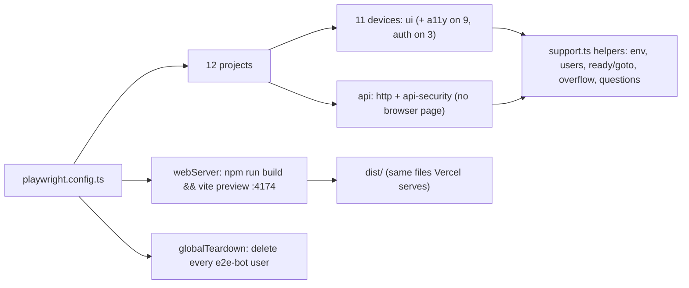

# L4.03 · Test it III: Playwright foundations: config, helpers, teardown, HTTP checks

> **Level 4 · Test it and ship it** · Lesson 3 of 9

| Recipe card | |
|---|---|
| **Time** | 75 min |
| **You need** | L4.01 (test layers), L2.04 (`.env.local`, `import.meta.env`), L2.10c (which devices hit which breakpoints), L1.04 (keys, hosting) |
| **You'll produce** | `playwright.config.ts` (46 lines), `tests/e2e/support.ts` (146 lines), `tests/e2e/teardown.ts` (8 lines) and `tests/e2e/http.spec.ts` (87 lines) from blank files |

**In two sentences:** Playwright drives real browser engines (Chromium, WebKit, Firefox) against a production build of the app, and one config file decides which build, which 12 projects (an API-only one plus 11 device profiles), which spec files each runs, how failures are recorded, and what is cleaned up afterwards. The shared helpers read credentials safely, create and delete throwaway users without sending emails, and wait for the app the way a person would; the HTTP spec checks routing, caching, SEO files and that no secret is ever served, and its three bugs teach three ways a test can quietly test the wrong thing.

> **Session 2 update (2026-10-16).** The helpers here are unchanged and still used, with a new one, `signInPage`, that puts a real session in the browser for the UI journey ([L4.09](l4-09-auth-tests-incident-ops.md) §4.1). `otpFor` still mints codes through the admin API, which keeps working with the Email provider off. The Playwright count is now 264 (one more UI test × 11 projects).

### Objectives
1. Write `playwright.config.ts` from memory and explain every option: `webServer`, `baseURL`, `projects`, `testMatch`, `workers`, `retries`, `trace`, `globalTeardown`.
2. Explain the project matrix (which spec runs on which device, and why 253 tests) and choose devices to cover breakpoints.
3. Write the support helpers: credential loading, throwaway users, OTP lookup, `ready`/`goto`, `noHorizontalOverflow`, `currentQuestion`.
4. Write the HTTP spec, including a secret scanner that finds real leaks without false alarms.
5. Diagnose three test-infrastructure bugs: a shell rewriting arguments, a scanner flagging library code, and tests silently pointed at production.

---

## 1 · Warm-up: pull it from memory

1. *(L4.01)* Which layer of the pyramid is the slowest, and why run it at all?
2. *(L2.10c)* Name the device situations `responsive.css` targets (at least four).
3. *(L3.05)* What `Cache-Control` should a hashed asset get, and what should `index.html` get?

<details><summary>Answers</summary>

1. The browser layer (~12 min). It's the only one that proves what users see and can do, on real engines and screen sizes.
2. Small phones (≤ 360 wide), short phones (≤ 760 tall), very short (≤ 620 tall), landscape phones, tablets (≥ 640), laptops with the rail (≥ 1024), small laptops (1024–1179), hover devices, old browsers.
3. `public, max-age=31536000, immutable`; `index.html` must not be long-cached (it points at the current hashes).
</details>

## 2 · The problem this solves

You could test in the browser by hand: open the site on your phone, tap around. You'd test one device, one engine, once. After the next change you'd have to do it again, and you wouldn't, so regressions ship.

**The idea:** describe every check once in code, and let a runner execute it on every engine and screen size that matters, against the same production build users get, on demand.



---

## 3 · Concepts

### 3.1 Playwright Test in one page

1. **Definition.** Playwright is a browser automation library; Playwright Test is its test runner. It launches Chromium, WebKit (Safari's engine) and Firefox builds it downloads itself (`npx playwright install`).
2. **Why here.** One API for three engines, built-in device profiles (viewport, user agent, touch, pixel ratio), automatic waiting, traces of failures, and parallel workers.
3. **How it works.** Each test gets **fixtures**: `page` (a fresh tab in a fresh browser context: no cookies, no storage), `request` (an HTTP client), and info like `browserName` and `isMobile`. A **project** is a named configuration (a device, a set of spec files); every test runs once per project that matches it.
4. **Minimal example.**
   ```ts
   import { test, expect } from "@playwright/test";
   test("title", async ({ page }) => {
     await page.goto("https://example.com");
     await expect(page).toHaveTitle(/Example/);
   });
   ```
5. **In the project.** Five spec files, 12 projects, 253 test runs.
6. **Without it.** Manual checks on whichever device is in your pocket.
7. **Try it.** `npx playwright test --list | tail -1` prints `Total: 253 tests in 5 files`.

### 3.2 Locators and auto-waiting (preview; L4.04 goes deep)

`page.locator(".fc").last()` doesn't find anything immediately: it's a **recipe** for finding elements, re-evaluated each time it's used. Actions (`click`) and web-first assertions (`expect(locator).toContainText(…)`) **retry** until the condition holds or the timeout expires (8 s here). That's what makes tests robust to animations and network delays, as long as you assert on a state, not on a fixed sleep.

### 3.3 The `request` fixture

For checks that don't need a rendered page (status codes, headers, file contents), `request.get(url)` sends a plain HTTP request from Node. It's fast and doesn't execute JavaScript. That's exactly right for "does `/robots.txt` exist" and exactly wrong for "does the page render".

---

## 4 · Reading the real code

### 4.1 `playwright.config.ts` (all 46 lines)

```ts
import { defineConfig, devices } from "@playwright/test";

// BASE_URL=https://psychology-of-learning-nptel.vercel.app npm run test:e2e  → test production
// otherwise a production build is served locally on :4174
const BASE_URL = process.env.BASE_URL ?? "http://127.0.0.1:4174";
const local = !process.env.BASE_URL;

const ui = { testMatch: /(ui|a11y)\.spec\.ts/ };

export default defineConfig({
  testDir: "tests/e2e",
  timeout: 90_000,
  expect: { timeout: 8_000 },
  fullyParallel: true,
  workers: 4,
  retries: 1,
  reporter: [["list"], ["html", { open: "never", outputFolder: "test-results/report" }]],
  globalTeardown: "./tests/e2e/teardown.ts",
  use: {
    baseURL: BASE_URL,
    trace: "retain-on-failure",
    screenshot: "only-on-failure",
  },
  webServer: local
    ? { command: "npm run build && npx vite preview --port 4174 --strictPort --host 127.0.0.1", url: BASE_URL, reuseExistingServer: true, timeout: 180_000 }
    : undefined,
  projects: [
    // live API / security checks, no browser UI needed
    { name: "api", testMatch: /(api-security|http)\.spec\.ts/ },

    // phones
    { name: "galaxy-s9-320", use: { ...devices["Galaxy S9+"] }, ...ui },
    { name: "pixel-7", use: { ...devices["Pixel 7"] }, testMatch: /(ui|a11y|auth)\.spec\.ts/ },
    { name: "iphone-se", use: { ...devices["iPhone SE"] }, ...ui },
    { name: "iphone-13", use: { ...devices["iPhone 13"] }, testMatch: /(ui|auth)\.spec\.ts/ },
    { name: "iphone-14-pro-max", use: { ...devices["iPhone 14 Pro Max"] }, ...ui },
    // tablets
    { name: "ipad-mini", use: { ...devices["iPad Mini"] }, ...ui },
    { name: "galaxy-tab-s4", use: { ...devices["Galaxy Tab S4"] }, ...ui },
    // laptops / desktops
    { name: "laptop-chrome-1366", use: { ...devices["Desktop Chrome"], viewport: { width: 1366, height: 768 } }, testMatch: /(ui|a11y)\.spec\.ts/ },
    { name: "desktop-firefox", use: { ...devices["Desktop Firefox"], viewport: { width: 1440, height: 900 } }, testMatch: /(ui|auth)\.spec\.ts/ },
    { name: "desktop-safari", use: { ...devices["Desktop Safari"], viewport: { width: 1280, height: 800 } }, ...ui },
    { name: "desktop-edge-1920", use: { ...devices["Desktop Edge"], viewport: { width: 1920, height: 1080 } }, ...ui },
  ],
});
```

**Lines 1–7, the target.**
- **`BASE_URL`** defaults to the local preview on port 4174. Setting `BASE_URL=https://psychology-of-learning-nptel.vercel.app` (the `test:prod` script does) runs the same suite against production.
- **`local`** is true when no `BASE_URL` is set; it decides whether to start a server.
- **`ui`** is a shared fragment: device projects run `ui.spec.ts` and `a11y.spec.ts` unless they say otherwise.

**Lines 9–24, the runner.**
- **`testDir`**: where spec files live.
- **`timeout: 90_000`** per test (the signed-in journey sets its own, longer one). **`expect.timeout: 8_000`**: how long web-first assertions retry.
- **`fullyParallel: true`** + **`workers: 4`**: tests (not only files) are spread over four worker processes. Four is a measured compromise on this laptop: more workers made WebKit slow enough to time out the 100-question journey.
- **`retries: 1`**: a failed test is re-run once; if it then passes it's reported as **flaky**, not passed. Use `--retries=0` when debugging so failures aren't hidden (every diagnosis in this series was run that way).
- **Reporters**: `list` in the terminal and an `html` report in `test-results/report` (git-ignored), not auto-opened.
- **`globalTeardown`** runs once after everything, even if tests crashed (§4.3).
- **`use`**: defaults for every project. `trace: "retain-on-failure"` records a full timeline (DOM snapshots, network, console) and keeps it only for failures; `screenshot: "only-on-failure"`.

**Lines 25–27, the server.**
- **`webServer`** builds the app (`tsc -p . && vite build`) and serves `dist/` with `vite preview` on a fixed port. `--strictPort` fails instead of silently picking another port; `--host 127.0.0.1` avoids IPv6/localhost ambiguity on Windows.
- **`url`**: Playwright polls it until it answers before starting tests. **`reuseExistingServer: true`**: if something already serves 4174, use it (fast reruns, but see §7.3's lesson about stale servers). **`timeout: 180_000`**: the build can take a while on a cold machine.
- **Testing the production build, not `vite dev`**, matters: the dev server has no hashed files, no minification, no `dist/` file list, and it reloads modules (which caused L4.07's flake).

**Lines 28–45, the projects.**

| Project | Engine | Viewport (CSS px) | Specs | Why this device |
|---|---|---|---|---|
| `api` | none | — | `api-security`, `http` | Pure HTTP and supabase-js; run once |
| `galaxy-s9-320` | Chromium | 320 × 658 | ui, a11y | Narrow Android: the ≤ 360 block, short-phone block |
| `pixel-7` | Chromium | 412 × 839 | ui, a11y, **auth** | Typical Android; base phone layout; real touch events |
| `iphone-se` | WebKit | 320 × 568 | ui, a11y | Smallest iPhone: the very-short block |
| `iphone-13` | WebKit | 390 × 664 | ui, **auth** | Typical iPhone in Safari |
| `iphone-14-pro-max` | WebKit | 430 × 740 | ui, a11y | Largest iPhone |
| `ipad-mini` | WebKit | 768 × 1024 | ui, a11y | Tablet block (≥ 640) |
| `galaxy-tab-s4` | Chromium | 712 × 1138 | ui, a11y | Android tablet |
| `laptop-chrome-1366` | Chromium | 1366 × 768 | ui, a11y | The rail; small-laptop height |
| `desktop-firefox` | Firefox | 1440 × 900 | ui, **auth** | Gecko engine |
| `desktop-safari` | WebKit | 1280 × 800 | ui, a11y | Desktop Safari; small laptop band (1024–1179 no, 1280 yes) |
| `desktop-edge-1920` | Chromium | 1920 × 1080 | ui, a11y | Widest layout |

**The count:** 20 API tests + 16 UI tests × 11 devices + 6 a11y tests × 9 devices + 1 auth journey × 3 devices = 20 + 176 + 54 + 3 = **253**. The signed-in journey runs on only three projects (one per engine) because each run creates a real user and takes minutes.

### 4.2 `tests/e2e/support.ts`

**Credentials (lines 1–31).**

```ts
// Shared helpers for the Playwright suites.
// Reads the public Supabase URL/key from .env.local and, for tests that need real
// users, the secret key from SUPABASE_SECRET_KEY or the local (git-ignored) Supabase.txt.
import { createClient, type SupabaseClient } from "@supabase/supabase-js";
import { existsSync, readFileSync } from "node:fs";
import { expect, type Page } from "@playwright/test";
import questions from "../../src/data/questions.json" with { type: "json" };

function readKv(path: string, sep: RegExp) {
  const out: Record<string, string> = {};
  if (!existsSync(path)) return out;
  for (const line of readFileSync(path, "utf8").split(/\r?\n/)) {
    const m = line.match(sep);
    if (m) out[m[1].trim()] = m[2].trim().replace(/^"|"$/g, "");
  }
  return out;
}

const dotenv = readKv(".env.local", /^([A-Z0-9_]+)=(.*)$/);
const creds = readKv("Supabase.txt", /^([^:]+):(.*)$/);

export const env = {
  url: process.env.VITE_SUPABASE_URL ?? dotenv.VITE_SUPABASE_URL ?? "",
  anon: process.env.VITE_SUPABASE_ANON_KEY ?? dotenv.VITE_SUPABASE_ANON_KEY ?? "",
  secret: process.env.SUPABASE_SECRET_KEY ?? creds["Secret keys"] ?? "",
};
export const hasAdmin = Boolean(env.url && env.secret);

const noPersist = { auth: { persistSession: false, autoRefreshToken: false } };
export const anonClient = () => createClient(env.url, env.anon, noPersist);
const admin = () => createClient(env.url, env.secret, noPersist);
```

- **`import questions from "…json" with { type: "json" }`**: an *import attribute* telling Node this module is JSON. Without it, Node refuses to import JSON as ESM.
- **`readKv(path, sep)`**: a tiny parser for `KEY=value` files (`.env.local`) and `Label: value` files (`Supabase.txt`, the git-ignored notes file holding the project's keys). Missing file → empty object, so the suite runs (with skips) on a clean checkout. Surrounding quotes are stripped.
- **Precedence**: real environment variables first (CI sets them), then the local files.
- **`hasAdmin`**: the secret key is present. Tests that need real users skip without it.
- **`noPersist`**: test clients must not save sessions to disk or refresh tokens in the background; each test gets a clean, short-lived client.
- **`admin()`** uses the **secret key**, which bypasses RLS. It lives only in Node test code, never in the browser bundle (the HTTP spec checks that).

**Throwaway users (lines 33–94).**

```ts
export const TEST_EMAIL_PREFIX = "e2e-bot-";
const rand = () => Math.random().toString(36).slice(2, 8);

const created = new Set<string>();

/** Create a confirmed throwaway user (no email is ever sent). */
export async function createTestUser(tag: string) {
  const email = `${TEST_EMAIL_PREFIX}${tag}-${rand()}@example.com`;
  const { data, error } = await admin().auth.admin.createUser({ email, email_confirm: true });
  if (error) throw error;
  created.add(data.user!.id);
  return { email, id: data.user!.id };
}

/** Delete only the users this test file created (other workers may still be using theirs). */
export async function deleteMyTestUsers() {
  if (!hasAdmin) return;
  const a = admin();
  for (const id of created) {
    await a.auth.admin.deleteUser(id);
    created.delete(id);
  }
}

/** The 6-digit code the user would have received by email. */
export async function otpFor(email: string) {
  const { data, error } = await admin().auth.admin.generateLink({ type: "magiclink", email });
  if (error) throw error;
  return data.properties.email_otp;
}

/** A supabase-js client signed in through the real OTP verification endpoint. */
export async function signedInClient(email: string): Promise<SupabaseClient> {
  const c = anonClient();
  const { error } = await c.auth.verifyOtp({ email, token: await otpFor(email), type: "email" });
  if (error) throw error;
  return c;
}

/** Delete every throwaway user (cascades to profiles, attempts and progress). Global teardown only. */
export async function deleteTestUsers() {
  if (!hasAdmin) return 0;
  const a = admin();
  let n = 0;
  for (let page = 1; page < 20; page++) {
    const { data, error } = await a.auth.admin.listUsers({ page, perPage: 200 });
    if (error) throw error;
    for (const u of data.users) {
      if (u.email?.startsWith(TEST_EMAIL_PREFIX)) {
        await a.auth.admin.deleteUser(u.id);
        n++;
      }
    }
    if (data.users.length < 200) break;
  }
  return n;
}

export async function cardProgressOf(userId: string) {
  const { data } = await admin().from("card_progress").select("question_id, status").eq("user_id", userId);
  return data ?? [];
}
```

- **`e2e-bot-<tag>-<random>@example.com`**: a recognisable prefix (so teardown can find every test user) and `example.com`, a domain reserved for documentation that can never receive mail.
- **`createUser({ email, email_confirm: true })`** via the admin API creates a confirmed user **without sending an email**.
- **`created`**: a per-worker set of the ids *this* file created. `deleteMyTestUsers` deletes only those, because four workers run at once and another worker may still be using its users. (This is the fix for the cleanup race of [L4.06](l4-06-live-security-auth.md).)
- **`otpFor(email)`**: `generateLink({ type: "magiclink" })` returns, among other things, `properties.email_otp`, the same one-time code the email would contain. The test types it like a user would, but nothing is sent. *(The doc comment says "6-digit"; the project sends 8. The code is length-agnostic, the comment is stale: a small reminder that comments rot when facts change, which is why the series prefers tests over comments for facts.)*
- **`signedInClient`**: verifies that code through the **real** endpoint (`verifyOtp`), so the client holds a genuine session.
- **`deleteTestUsers`** (teardown only): pages through all users 200 at a time (at most 20 pages = 4,000 users), deletes those with the prefix. `on delete cascade` in the schema removes their profiles, attempts and progress.
- **`cardProgressOf`**: reads a user's synced progress with the admin client, to assert that flashcard marks reached the database.

**Question lookups and page helpers (lines 96–146).**

```ts
// ---------- question lookups ----------
type Q = { id: number; week: number; q: string; options: string[]; answer: number };
export const QUESTIONS = questions as Q[];
export const ANSWER = new Map(QUESTIONS.map((q) => [q.id, q.answer]));
/** Find the question shown on screen from its text + options (some prompts repeat). */
export function questionFromScreen(text: string, options: string[]) {
  const clean = (s: string) => s.replace(/\s+/g, " ").trim();
  const t = clean(text);
  const hits = QUESTIONS.filter((q) => clean(q.q) === t);
  if (hits.length === 1) return hits[0];
  const o = options.map(clean).join("|");
  const exact = hits.find((q) => q.options.map(clean).join("|") === o);
  if (!exact) throw new Error(`Question not found: ${t}`);
  return exact;
}

// ---------- page helpers ----------
export const isRail = (page: Page) => (page.viewportSize()?.width ?? 0) >= 1024;

/** Wait for the first-load splash to go away. */
export async function ready(page: Page) {
  await expect(page.locator(".splash")).toHaveCount(0, { timeout: 8000 });
}

export async function goto(page: Page, path: string) {
  await page.goto(path);
  await ready(page);
}

/** The page must not be pannable sideways, during or after entry animations. */
export async function noHorizontalOverflow(page: Page) {
  for (const wait of [0, 600]) {
    await page.waitForTimeout(wait);
    const scrolled = await page.evaluate(() => {
      window.scrollTo(400, window.scrollY);
      const x = window.scrollX;
      window.scrollTo(0, window.scrollY);
      return x;
    });
    expect(scrolled, `page scrolled sideways by ${scrolled}px (after ${wait}ms)`).toBe(0);
  }
}

/** Text of the question currently shown in the quiz/test card. */
export async function currentQuestion(page: Page) {
  await expect(page.locator(".q-card")).toHaveCount(1); // wait out the slide transition
  const card = page.locator(".q-card");
  const text = await card.locator(".q-text").innerText();
  const options = await card.locator(".opt").evaluateAll((els) => els.map((e) => (e.textContent ?? "").replace(/^[A-D]/, "").trim()));
  return questionFromScreen(text, options);
}
```

- **`questionFromScreen`**: the runner shows questions in random order, so a test that wants to answer correctly must identify the question from the screen. Whitespace is normalised; if several questions share a prompt (some do), the options break the tie.
- **`isRail`**: the same 1024 px breakpoint as the CSS. Tests that click navigation choose the rail or the bottom bar with it.
- **`ready`**: wait until the splash is gone (`toHaveCount(0)` retries for up to 8 s). Every navigation goes through `goto`, which calls it.
- **`noHorizontalOverflow`**: *tries* to scroll sideways (to x = 400) and reads back `scrollX`, immediately and again after 600 ms (during and after entry animations). This replaced a single `scrollWidth` comparison: a proxy, measured once, which could miss a wobble that lasts only as long as an entry animation ([L4.04](l4-04-ui-tests-nav-cards.md)).
- **`currentQuestion`** first waits until exactly **one** `.q-card` exists: during a slide transition there are two, and reading the first one read the card sliding *out* (the bug of [L4.05](l4-05-ui-tests-quiz-runner.md)). Option texts drop their leading letter badge (`A`, `B`, …).

### 4.3 `tests/e2e/teardown.ts`

```ts
import { deleteTestUsers, hasAdmin } from "./support";

// Remove every throwaway e2e user (and, by cascade, their scores) even if a test crashed.
export default async function teardown() {
  if (!hasAdmin) return;
  const n = await deleteTestUsers();
  if (n) console.log(`\n[teardown] removed ${n} e2e test user(s) and their data`);
}
```

- **Global teardown** is a default-exported function Playwright runs once after all workers finish, **even if tests failed or crashed**. It's the safety net behind the per-file cleanup: anything a crashed test left behind is removed here.
- **It prints only when it removed something**, so a clean run stays quiet. The live run in the session ended with no leftover users, profiles or scores (verified by listing them afterwards).

### 4.4 `tests/e2e/http.spec.ts`

**Setup and the secret scanner (lines 1–15).**

```ts
// HTTP-level checks of the deployed site (routing, redirects, caching, SEO files,
// and that no secret/source files are served). Runs in the "api" project.
import { test, expect } from "@playwright/test";
import { existsSync, readFileSync } from "node:fs";

// real secret values from the local, git-ignored credentials file (if present)
const SECRETS = existsSync("Supabase.txt")
  ? [...readFileSync("Supabase.txt", "utf8").matchAll(/^(?:Secret keys|Service role)\s*:\s*(\S+)/gim)].map((m) => m[1])
  : [];
const leaks = (body: string) => SECRETS.some((s) => body.includes(s)) || /sb_secret_[A-Za-z0-9_-]{16,}|VERCEL_OIDC_TOKEN|create table public\./.test(body);

const PROD = "https://psychology-of-learning-nptel.vercel.app";
// same target as the rest of the suite: local production build unless BASE_URL is set
const base = process.env.BASE_URL ?? "http://127.0.0.1:4174";
const isProd = base.startsWith("https://");
```

- **`SECRETS`**: the *actual values* of the secret and service-role keys, read from the local `Supabase.txt` if it exists (`gim` flags: global, case-insensitive, multi-line so `^` matches each line).
- **`leaks(body)`** is true if the body contains one of those values, **or** matches a pattern for a secret-shaped string: `sb_secret_` followed by at least 16 key characters, the literal `VERCEL_OIDC_TOKEN`, or `create table public.` (which would mean SQL source is being served). §7.2 explains why the pattern requires the 16 characters.
- **`base` defaults to the local build** (the fix of §7.3); **`isProd`** gates the checks that only make sense on the real host.

**Routing, SEO files and metadata (lines 17–50).**

```ts
test("every app route serves the app shell", async ({ request }) => {
  for (const path of ["/", "/study", "/study?week=3", "/test", "/test/run", "/test/result", "/ranks", "/me", "/some/unknown/page"]) {
    const r = await request.get(base + path);
    expect(r.status(), path).toBe(200);
    expect(await r.text(), path).toContain('<div id="root">');
  }
});

test("search & sharing files are served correctly", async ({ request }) => {
  const robots = await request.get(base + "/robots.txt");
  expect(robots.status()).toBe(200);
  expect(await robots.text()).toContain("Sitemap: https://psychology-of-learning-nptel.vercel.app/sitemap.xml");
  const sitemap = await request.get(base + "/sitemap.xml");
  expect(sitemap.headers()["content-type"]).toMatch(/xml/);
  expect((await sitemap.text()).match(/<loc>/g)?.length).toBe(4);
  for (const f of ["/og-image.png", "/favicon.png", "/icons/icon-192.png", "/icons/icon-512.png", "/icons/maskable-512.png", "/icons/apple-touch-icon.png", "/brand/mascot.webp", "/brand/badge-hex.webp", "/brand/badge-round.webp"]) {
    const r = await request.get(base + f);
    expect(r.status(), f).toBe(200);
    expect(r.headers()["content-type"], f).toMatch(/image\/(png|webp)/);
  }
  const manifest = await request.get(base + "/manifest.webmanifest");
  expect(manifest.status()).toBe(200);
  expect(JSON.parse(await manifest.text()).icons.length).toBe(3);
});

test("index.html has title, description, canonical, Open Graph and structured data", async ({ request }) => {
  const html = await (await request.get(base + "/")).text();
  expect(html).toMatch(/<title>Psychology of Learning NPTEL/);
  expect(html).toMatch(/<meta\s+name="description"\s+content="[^"]{80,}/);
  expect(html).toContain('<link rel="canonical" href="https://psychology-of-learning-nptel.vercel.app/"');
  expect(html).toContain('property="og:image" content="https://psychology-of-learning-nptel.vercel.app/og-image.png"');
  expect(html).toContain('"@type": "LearningResource"');
  expect(html).toContain('name="viewport" content="width=device-width, initial-scale=1, viewport-fit=cover"');
});
```

- **Every route returns the app shell** (`<div id="root">`) with status 200, including deep links and an unknown path. That's the SPA rewrite (`/(.*) → /index.html`) at work; without it, reloading `/study` would be a 404.
- **`robots.txt`** must point to the sitemap; **`sitemap.xml`** must be served as XML with exactly 4 `<loc>` entries (the four public pages).
- **Every image file** must return 200 **and an image content type**. The status alone isn't enough: the SPA rewrite answers *any* missing file with `index.html` and status 200, so only the content type reveals a missing image (§7.3 is that exact failure).
- **The manifest** has 3 icons (192, 512, maskable 512).
- **`index.html`** has the title, a description of at least 80 characters, the canonical URL, the Open Graph image, JSON-LD structured data, and the viewport meta with `viewport-fit=cover` (L4.08 explains each).

**Caching, secrets, redirect, HSTS (lines 52–87).**

```ts
test("hashed assets are cached forever, HTML is not", async ({ request }) => {
  const html = await (await request.get(base + "/")).text();
  const js = html.match(/\/assets\/index-[\w-]+\.js/)?.[0];
  expect(js).toBeTruthy();
  const r = await request.get(base + js!);
  expect(r.status()).toBe(200);
  if (isProd) {
    expect(r.headers()["cache-control"]).toContain("immutable");
    expect((await request.get(base + "/")).headers()["cache-control"] ?? "").not.toContain("immutable");
  }
});

test("secrets and source files are never served", async ({ request }) => {
  for (const f of ["/Supabase.txt", "/.env.local", "/.env", "/src/lib/supabase.ts", "/supabase/setup.sql", "/package.json", "/.vercel/project.json"]) {
    const r = await request.get(base + f);
    expect(leaks(await r.text()), `${f} leaks a secret or source`).toBe(false);
  }
  // the bundled JS may contain the publishable key, never the secret / service-role key
  const html = await (await request.get(base + "/")).text();
  for (const src of html.match(/\/assets\/[\w-]+\.js/g) ?? []) {
    expect(leaks(await (await request.get(base + src)).text()), `${src} contains a secret key`).toBe(false);
  }
});

test("short link redirects permanently to the main address", async ({ request }) => {
  test.skip(!isProd, "production only");
  const r = await request.get("https://psychologyoflearning.vercel.app/study?week=2", { maxRedirects: 0 });
  expect([301, 308]).toContain(r.status());
  expect(r.headers()["location"]).toBe(`${PROD}/study?week=2`);
});

test("served over HTTPS with HSTS", async ({ request }) => {
  test.skip(!isProd, "production only");
  const r = await request.get(PROD + "/");
  expect(r.headers()["strict-transport-security"]).toBeTruthy();
});
```

- **Caching**: find the hashed `index-*.js` in the HTML, fetch it, and on production require `immutable` on it and *not* on `/`. Locally, `vite preview` doesn't send these headers, so only the fetch is checked.
- **Secrets and sources are never served**: request files that must not exist on the site (`/Supabase.txt`, `.env` files, source files, the SQL, `package.json`, `.vercel/project.json`). Because of the SPA rewrite they usually return `index.html` with 200; the test checks the **body** for leaks rather than the status. Then it fetches **every** JavaScript chunk referenced by the HTML and scans it too: the bundle may contain the publishable key (that's normal) but never a secret.
- **The short link** `psychologyoflearning.vercel.app` must answer with a permanent redirect (301 or 308) to the same path on the main domain, preserving the query string (`maxRedirects: 0` so the test sees the redirect itself).
- **HSTS**: production must send `Strict-Transport-Security`, telling browsers to use HTTPS only.

---

## 5 · Worked trace: one run, start to finish

| Step | What happens | Where |
|---|---|---|
| 1 | `npx playwright test` reads the config; no `BASE_URL`, so `local = true` | config lines 5–6 |
| 2 | Nothing on 4174 → runs `npm run build && npx vite preview --port 4174 …`, polls the URL until it answers | `webServer` |
| 3 | Spawns 4 workers; distributes 253 (test × project) pairs | `fullyParallel`, `workers` |
| 4 | A `ui` test on `iphone-se`: new WebKit context with the iPhone SE profile; `goto("/study")` → `page.goto` + `ready` waits for the splash to disappear | support `goto` |
| 5 | An `api-security` test: creates `e2e-bot-sec-a-k3x9qe@example.com` with the admin API; signs in with the OTP from `generateLink` | support |
| 6 | A test fails: it's retried once; the trace and screenshot of the failed attempt are kept in `test-results/` | `retries`, `trace` |
| 7 | Each file's `afterAll` deletes its own users | `deleteMyTestUsers` |
| 8 | After all workers: teardown deletes any remaining `e2e-bot-` users | `teardown.ts` |
| 9 | The list reporter prints the summary; the HTML report is written | reporters |

---

## 6 · Running and testing

```bash
npx playwright install                       # once: download Chromium, WebKit, Firefox
npx playwright test                          # everything (≈ 12 min on this laptop)
npx playwright test --project=api            # 20 HTTP + security tests, seconds
npx playwright test tests/e2e/ui.spec.ts --project=iphone-se --retries=0
npx playwright show-report test-results/report
npx playwright show-trace test-results/<test-folder>/trace.zip
npm run test:prod                            # same suite against production
```
- **Without the secret key**, the signed-in tests skip (`needs SUPABASE_SECRET_KEY…`); everything else runs. That's the "15 skipped" in a full run's summary.
- **In CI** set `VITE_SUPABASE_URL`, `VITE_SUPABASE_ANON_KEY` and (for the user tests) `SUPABASE_SECRET_KEY` as secrets; never commit them.

## 7 · Bug journal: three ways a test tests the wrong thing

### 7.1 Incident · Git Bash rewrote `/study` into `C:/Program Files/Git/study`

1. **Symptom.** A screenshot script run from Git Bash on Windows, called with the routes to capture, crashed on the first navigation:
   ```text
   ProtocolError: Protocol error (Page.navigate): Cannot navigate to invalid URL
   ```
2. **Diagnosis.** Printing the argument the script received showed the problem. Reproduced for this lesson:
   ```bash
   $ node -e 'console.log(JSON.stringify(process.argv.slice(1)))' /study
   ["C:/Program Files/Git/study"]
   $ node -e 'console.log(JSON.stringify(process.argv.slice(1)))' "/,/study,/test"
   ["C:/Program Files/Git/,/study,/test"]
   ```
   The script built `http://127.0.0.1:4173` + `C:/Program Files/Git/study`, an invalid URL.
3. **Root cause.** Git Bash (MSYS2) converts arguments that look like POSIX paths into Windows paths before starting a native Windows program, so that `/usr/bin/x` works for Windows tools. A URL path like `/study` looks like a POSIX path.
4. **Fix.** Turn conversion off for that command:
   ```diff
   -node devices.mjs ../shots "/,/study,/test,/ranks,/me"
   +MSYS_NO_PATHCONV=1 node devices.mjs ../shots "/,/study,/test,/ranks,/me"
   ```
   (Playwright's own tests weren't affected: their paths are in code, not command-line arguments.)
5. **Lesson.** When a script misbehaves only from one shell, print the arguments it actually received. Keep routes and URLs inside code or config files rather than passing them through a shell.

### 7.2 Incident · The secret scanner flagged the Supabase library's own source

1. **Symptom.** "secrets and source files are never served" failed on the bundle:
   ```text
   Error: /assets/supabase-C3nyvjhK.js
   expect(received).not.toMatch(expected)
   Expected pattern: not /sb_secret_|service_role/
   Received string:  "const Nr=Symbol.for(\"@supabase/supabase-js.traceContextExtractor\");…
   ```
2. **Diagnosis.** A real leak? The secret key wasn't in any environment variable that starts with `VITE_`, so Vite couldn't have inlined it. Searching the chunk showed the match: supabase-js itself contains the *prefix* `sb_secret_` in code that warns developers who put a secret key in a browser (something like `startsWith("sb_secret_")`). The pattern matched the library's warning, not a key.
3. **Root cause.** A pattern that matches a **prefix** matches any code that talks *about* the prefix. Good scanners match the **shape of the value** or the **value itself**.
4. **Fix.**
   ```diff
   -expect(js, src).not.toMatch(/sb_secret_|service_role/);
   +// real secret values from the local, git-ignored credentials file (if present)
   +const SECRETS = existsSync("Supabase.txt") ? [...readFileSync("Supabase.txt", "utf8")
   +  .matchAll(/^(?:Secret keys|Service role)\s*:\s*(\S+)/gim)].map((m) => m[1]) : [];
   +const leaks = (body: string) => SECRETS.some((s) => body.includes(s))
   +  || /sb_secret_[A-Za-z0-9_-]{16,}|VERCEL_OIDC_TOKEN|create table public\./.test(body);
   +expect(leaks(await (await request.get(base + src)).text()), `${src} contains a secret key`).toBe(false);
   ```
   Then the scanner itself was tested: it found 2 secret values in `Supabase.txt`, detected a planted one (`"x" + secret + "y"` → true), and ignored the library text (`startsWith("sb_secret_")` → false).
5. **Lesson.** Scan for the secret's **value** when you have it, and for its full **shape** (prefix plus length) when you don't. Test the scanner with a planted positive and a known false positive.

### 7.3 Incident · The HTTP tests silently checked production

1. **Symptom.** In the final full run, one test failed after the switch to WebP images:
   ```text
   ✘ [api] › tests\e2e\http.spec.ts:22:1 › search & sharing files are served correctly
     Error: /brand/mascot.webp
     Expected pattern: /image\/(png|webp)/
     Received string:  "text/html; charset=utf-8"
   ```
2. **Diagnosis.**
   - The file existed in `dist/brand/`.
   - *Hypothesis: a stale preview server* that started before the WebP files were built and didn't know about them. Checked: nothing was listening on 4174 (`4174 not running`). Ruled out.
   - Rerunning only the HTTP spec failed the same way, against a fresh state. The status was 200 but the body was HTML: the SPA rewrite answering a **missing** file with `index.html`. Missing *where*? Reading the spec: `const base = process.env.BASE_URL ?? PROD;`. Unlike every other spec, it defaulted to **production**, where the WebP files hadn't been deployed yet.
3. **Root cause.** One file had its own default target. Every earlier run had "passed" against production, so the HTTP spec had been testing the last deploy, not the code under test, without anyone noticing.
4. **Fix.**
   ```diff
   -const base = process.env.BASE_URL ?? PROD;
   +// same target as the rest of the suite: local production build unless BASE_URL is set
   +const base = process.env.BASE_URL ?? "http://127.0.0.1:4174";
    const isProd = base.startsWith("https://");
   ```
   The production-only checks (redirect, HSTS, cache headers) became `test.skip(!isProd, "production only")`. Result: 5 passed, 2 skipped locally; all 7 pass with `npm run test:prod`.
5. **Lesson.** A suite needs **one** notion of "the system under test", set in one place. And because SPA rewrites turn every missing file into a 200, assert **content types or content**, never status alone.

## 8 · Why this design

| Decision | Alternatives | Why this one | Trade-off | Choose differently when |
|---|---|---|---|---|
| Playwright | Cypress; Selenium/WebDriver; Puppeteer | Three engines incl. WebKit, device profiles, parallel workers, traces | Engines are Playwright's builds, not the exact shipped browsers | You must test on real devices → a device cloud (BrowserStack) |
| Test the production build | `vite dev` | Same files as users get; no HMR noise | Rebuild before runs (~4 s) | Rapid TDD on one component → component tests in dev |
| 11 device projects chosen by breakpoint | Every device Playwright knows | Each project exercises a different CSS block or engine | 12 min runs | Faster feedback → a "smoke" project subset on every commit |
| `retries: 1` | 0; 2+ | Reports flakes instead of failing on them; reveals them as "flaky" | Can hide a real intermittent bug if nobody reads "flaky" | Debugging → `--retries=0` |
| Admin API for users, OTP from `generateLink` | Real emails to a test inbox (Mailosaur); a fake auth server | No emails, real sessions, real verify endpoint | Needs the secret key in the test environment | No secret allowed in CI → a separate test project |
| Per-file cleanup + global teardown | Teardown only; never clean up | No leftovers even after crashes; parallel-safe | Two code paths | — |

## 9 · Check yourself

**Q1.** A test passes on retry. What does the report say, and what should you do?
<details><summary>Answer</summary>It's marked <b>flaky</b>. Treat it as a bug: open the trace of the failed attempt and find the race (usually an assertion that read state too early).</details>

**Q2.** Why does `/brand/mascot.webp` return status 200 even when the file doesn't exist?
<details><summary>Answer</summary>The SPA rewrite <code>/(.*) → /index.html</code> serves the app shell for any unknown path, with 200. Only the content type (<code>text/html</code>) or the body reveals the file is missing.</details>

**Q3.** Why does `deleteMyTestUsers` delete only the users in `created`, and not every `e2e-bot-` user?
<details><summary>Answer</summary>Four workers run concurrently; another file may be mid-test with its users. Deleting by prefix would sign them out (and cascade-delete their data) under them. Only global teardown, after all workers, deletes by prefix.</details>

**Q4.** The `pixel-7` project runs `auth.spec.ts`, but `galaxy-s9-320` doesn't. Why?
<details><summary>Answer</summary>The signed-in journey creates a real user and takes minutes; one project per engine (Chromium on pixel-7, WebKit on iphone-13, Gecko on desktop-firefox) covers engine differences without multiplying the cost.</details>

**Q5.** Predict: you run `npx playwright test` while `npm run preview` (port 4173) is open in another terminal. Which server do the tests use?
<details><summary>Answer</summary>Neither of yours: the config's <code>webServer</code> builds and starts its own on <b>4174</b> (unless something already listens on 4174, which it then reuses).</details>

**Q6.** Why does the leak pattern require `sb_secret_[A-Za-z0-9_-]{16,}` rather than `sb_secret_`?
<details><summary>Answer</summary>The library's own code mentions the bare prefix; a real key has many characters after it. The shape avoids the false positive while still catching any real secret-format key.</details>

## 10 · Practice

**Easy (10 min).** Add a `smoke` project: Chromium at 390 × 844 running only the first three tests of `ui.spec.ts` (use `grep` in the project config), for a 30-second check before commits.

**Medium (20 min).** Make the HTTP spec check that `index.html` is **not cached** on production (`cache-control` must contain `max-age=0` or `no-cache`, or be absent), and that the hashed font file is `immutable`.
**Done when** `npm run test:prod -- --project=api` passes and fails if you remove the `headers` block from `vercel.json` (try it on a preview deployment, not production).

**Hard (40 min).** Add a GitHub Actions workflow that runs data, DB and the `api` + two device projects on every push, with the Supabase keys as repository secrets, uploading the HTML report and traces as an artifact when anything fails.
<details><summary>Key insight</summary>Install browsers with <code>npx playwright install --with-deps chromium webkit</code> to keep the job fast; set <code>CI=true</code> and consider <code>workers: process.env.CI ? 2 : 4</code>; never echo secrets (GitHub masks them, but a <code>console.log(env)</code> in a helper wouldn't be masked if transformed).</details>

## 11 · From memory

**Rung 1 · Cloze.**

```ts
export default defineConfig({
  fullyParallel: true, workers: 4, retries: ___①___,
  globalTeardown: "./tests/e2e/teardown.ts",
  use: { baseURL: BASE_URL, trace: "___②___", screenshot: "only-on-failure" },
  webServer: local ? { command: "npm run build && npx vite ___③___ --port 4174 --strictPort --host 127.0.0.1",
                       url: BASE_URL, ___④___: true, timeout: 180_000 } : undefined,
  projects: [{ name: "api", testMatch: /(api-security|http)\.spec\.ts/ },
             { name: "iphone-se", use: { ...devices["___⑤___"] }, ...ui }, /* … */],
});
const { data } = await admin().auth.admin.createUser({ email, ___⑥___: true });
const { data } = await admin().auth.admin.generateLink({ type: "magiclink", email }); // data.properties.___⑦___
await expect(page.locator(".splash")).toHaveCount(___⑧___, { timeout: 8000 });
const base = process.env.BASE_URL ?? "http://127.0.0.1:___⑨___";
```
<details><summary>Answers</summary>① <code>1</code> ② <code>retain-on-failure</code> ③ <code>preview</code> ④ <code>reuseExistingServer</code> ⑤ <code>iPhone SE</code> ⑥ <code>email_confirm</code> ⑦ <code>email_otp</code> ⑧ <code>0</code> ⑨ <code>4174</code></details>

**Rung 2 · Blank page (25 min). No scrolling up.** Write `playwright.config.ts`, the credential and user parts of `support.ts`, `teardown.ts`, and the "secrets and source files are never served" test.
<details><summary>Self-check</summary>

- [ ] `BASE_URL` override; `local` flag; shared `ui` testMatch fragment
- [ ] Timeouts (test 90 s, expect 8 s), `fullyParallel`, 4 workers, 1 retry, list + html reporters, `globalTeardown`
- [ ] `use`: baseURL, trace and screenshot on failure
- [ ] `webServer`: build + preview on 4174 strict, 127.0.0.1, url, reuse, 180 s
- [ ] 12 projects with the right `testMatch` per project (auth on pixel-7, iphone-13, desktop-firefox)
- [ ] Env from process, then `.env.local`, then `Supabase.txt`; `hasAdmin`; clients without session persistence
- [ ] `e2e-bot-` prefix, `@example.com`; `createUser` with `email_confirm`; per-file `created` set; OTP via `generateLink`; teardown deletes by prefix, paged
- [ ] Leak check by value and by shape; scan forbidden paths' bodies and every JS chunk
</details>

## 12 · Flashcards

<details><summary><b>Q:</b> What is a Playwright project?</summary><b>A:</b> A named configuration (device, spec files); every matching test runs once per project.</details>
<details><summary><b>Q:</b> Why 253 tests?</summary><b>A:</b> 20 api + 16 ui × 11 + 6 a11y × 9 + 1 auth × 3.</details>
<details><summary><b>Q:</b> What does <code>webServer</code> do?</summary><b>A:</b> Builds and serves the production build on 4174, waits for it, reuses one already running.</details>
<details><summary><b>Q:</b> What does <code>retries: 1</code> report when a retry passes?</summary><b>A:</b> "Flaky".</details>
<details><summary><b>Q:</b> How are test users created without emails?</summary><b>A:</b> Admin <code>createUser({ email_confirm: true })</code>; the code comes from <code>generateLink(...).properties.email_otp</code>.</details>
<details><summary><b>Q:</b> Why <code>@example.com</code>?</summary><b>A:</b> A reserved domain that can never receive mail.</details>
<details><summary><b>Q:</b> Why per-file cleanup plus global teardown?</summary><b>A:</b> Parallel-safe cleanup of your own users, plus a safety net for crashes.</details>
<details><summary><b>Q:</b> Why check content type, not just status, for files?</summary><b>A:</b> The SPA rewrite returns <code>index.html</code> with 200 for any missing file.</details>
<details><summary><b>Q:</b> How should a secret scanner match?</summary><b>A:</b> By the secret's value, or its full shape (prefix + length), never the bare prefix.</details>
<details><summary><b>Q:</b> What does Git Bash do to <code>/study</code> as an argument?</summary><b>A:</b> Converts it to <code>C:/Program Files/Git/study</code>; disable with <code>MSYS_NO_PATHCONV=1</code>.</details>
<details><summary><b>Q:</b> Why must every spec share one base URL?</summary><b>A:</b> Otherwise a file can silently test production (or another build) instead of the code under test.</details>

## 13 · The menu board

| | |
|---|---|
| Target | `BASE_URL` or local preview :4174 (build first); `test:prod` for production |
| Runner | 90 s test · 8 s expect · fullyParallel · 4 workers · 1 retry · trace/screenshot on failure |
| Projects | api + 11 devices; ui on all, a11y on 9, auth on 3 (one per engine) → 253 |
| Users | `e2e-bot-…@example.com` · admin `createUser` · OTP via `generateLink` · per-file delete · teardown by prefix |
| Waiting | `goto` → `ready` (splash gone); `currentQuestion` waits for one `.q-card` |
| Overflow | try `scrollTo(400)` and read `scrollX`, at 0 and 600 ms |
| HTTP | routes → shell; robots/sitemap/images (content type!)/manifest; meta tags; immutable assets; secrets by value+shape; 301/308 short link; HSTS |
| Pitfalls | Git Bash path conversion · prefix-only scanners · a spec with its own default target |

## 14 · Glossary

**Browser context**: an isolated browser profile (cookies, storage) inside one browser instance. **Device profile**: viewport, user agent, touch and pixel ratio of a device. **Fixture**: an object Playwright provides to a test (`page`, `request`). **Flaky test**: one that sometimes passes and sometimes fails without code changes. **Global teardown**: a function run once after all tests. **HSTS**: the `Strict-Transport-Security` header forcing HTTPS. **Import attribute**: `with { type: "json" }`, telling the runtime a module's type. **MSYS path conversion**: Git Bash's rewriting of POSIX-looking arguments for Windows programs. **Project (Playwright)**: a named run configuration. **SPA rewrite**: serving `index.html` for every path so the client router handles it. **Trace**: Playwright's recording of a test (DOM snapshots, network, console). **Worker**: a process running tests in parallel.

## 15 · Go further

| Resource | Type | Why | Which part | Time |
|---|---|---|---|---|
| [Playwright: Test configuration](https://playwright.dev/docs/test-configuration) | Docs | Every option in the config | "Basic configuration", "Projects" | 20 min |
| [Playwright: Web server](https://playwright.dev/docs/test-webserver) | Docs | `webServer`, `reuseExistingServer` | Whole page | 5 min |
| [Playwright: Emulation (devices)](https://playwright.dev/docs/emulation) | Docs | What a device profile sets | "Devices", "Viewport" | 10 min |
| [Playwright: Trace viewer](https://playwright.dev/docs/trace-viewer) | Docs | Reading a failure's timeline | Whole page | 15 min |
| [Supabase: auth admin API](https://supabase.com/docs/reference/javascript/auth-admin-createuser) | Reference | `createUser`, `generateLink`, `deleteUser`, `listUsers` | Those four methods | 15 min |
| [Git for Windows: path conversion](https://www.msys2.org/docs/filesystem-paths/) | Docs | Why MSYS rewrites arguments and how to stop it | "Automatic Unix ⟶ Windows path conversion" | 10 min |

---
← [L4.02 Test it II: database tests](l4-02-database-tests.md) · [Hub](README.md) · [L4.04 Test it IV: navigation, layout and flashcards →](l4-04-ui-tests-nav-cards.md)
