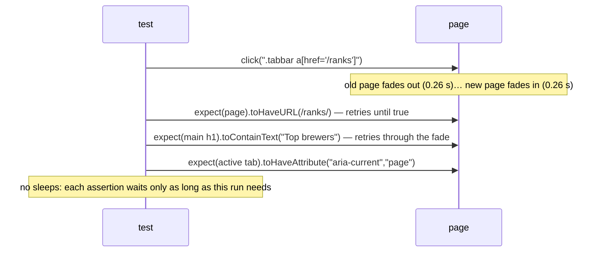

# L4.04 · Test it IV: UI tests for navigation, layout and flashcards

> **Level 4 · Test it and ship it** · Lesson 4 of 9

| Recipe card | |
|---|---|
| **Time** | 75 min |
| **You need** | L4.03 (config, projects, `goto`, `noHorizontalOverflow`), L2.05 (tabs, routes), L2.08a (the deck), L3.03 (how Motion starts a drag) |
| **You'll produce** | Lines 1–163 of `tests/e2e/ui.spec.ts`: 9 of its 16 tests (home, navigation, layout, deep links, and five flashcard tests), run on all 11 device projects |

**In two sentences:** A browser test is a script of what a person does and sees, and its hard part is *timing*: pages slide in, cards fly out, the splash fades, and a test that looks too early reads the wrong thing. This lesson builds the first half of the UI suite with locators that retry, assertions that wait for a state rather than for a number of milliseconds, gestures paced like a real finger, and checks measured at the moments a user would notice a problem.

### Objectives
1. Choose locators (CSS, role + name, text) and web-first assertions that wait correctly through animations.
2. Write the navigation and layout tests that adapt to the rail and the bottom bar with one code path.
3. Detect the card's flip state from its computed transform, and explain the `DOMMatrix` check.
4. Write mouse, touch (CDP) and keyboard swipe tests that pass on Chromium, WebKit and Firefox.
5. Diagnose a gesture test that fails only in WebKit, and a layout check that measured a proxy at the wrong moment.

---

## 1 · Warm-up: pull it from memory

1. *(L4.03)* What does `goto(page, path)` do besides `page.goto`?
2. *(L3.03)* When does Motion call `onDragEnd`, and when does it skip it?
3. *(L2.05)* How long does a route change take before the new page is stable?

<details><summary>Answers</summary>

1. It waits until the first-load splash is gone (`.splash` count 0, up to 8 s).
2. On `pointerup`, but only if the drag started, which happens on an animation frame after ≥ 3 px of movement. If moves and `pointerup` land before that frame, it's skipped.
3. About 0.52 s: the old page exits (0.26 s) before the new one enters (0.26 s), because of `mode="wait"`.
</details>

## 2 · The problem this solves

The naive browser test is `click; sleep(1000); check`. It's slow (every sleep is paid on every run, on every device), and it's still flaky: on a slow WebKit run one second isn't enough, and on a fast one the check may run during a *different* animation. Multiply by 11 projects and two retries and a suite becomes unusable.

**The idea:** never wait for time; wait for **the state you're about to check**. Playwright's locators and `expect` retry until the state holds. When there's no DOM state to wait for (a CSS transform), poll a function until it returns what you expect.



---

## 3 · Concepts

### 3.1 Locators: what to select by

| Strategy | Example in this file | Use when | Breaks when |
|---|---|---|---|
| CSS class | `.deck-foot`, `button.btn.got` | Stable structural classes the CSS also depends on | Classes are renamed |
| CSS attribute | `.tabbar a[href="/ranks"]` | The thing has a meaningful attribute | Hrefs change |
| Role + name | `getByRole("button", { name: "Flip card" })`, `getByRole("switch", { name: "Hide mastered" })` | Controls with accessible names (also tests accessibility) | The label changes |
| Text | `getByText("Deck done!")`, `.chip` with `hasText: /^Week 12$/` | Content users read | Copy changes |

`getByRole` is preferred for controls: it finds the element the way assistive technology does, so the test fails if the control loses its name. The anchored regex `/^Week 12$/` avoids matching "Week 1" inside "Week 12" (or the reverse).

### 3.2 Web-first assertions and `expect.poll`

- **`await expect(locator).toContainText("✓ 1")`** re-queries the locator and re-reads the text until it matches or 8 s pass. Same for `toHaveCount`, `toBeVisible`, `toHaveAttribute`, and `expect(page).toHaveURL`.
- **`await expect.poll(() => fn()).toBe(true)`** calls `fn` repeatedly until its result passes. Used for things that aren't DOM text or attributes, like "is the card rotated?".
- **A plain `expect(value)`** (no `await`, no locator) checks once, now. Use it only on values that can't change, like a bounding box you just measured.

### 3.3 Detecting the flip from a matrix

The card's inner element animates `rotateY` from 0° to 180°. Its computed `transform` is a matrix, for example `matrix3d(-1, 0, 1.22e-16, 0, …)` at 180°. For a rotation about the Y axis by θ, the matrix's first entry is

$$m_{11} = \cos\theta$$

so $m_{11} < 0$ exactly when $90° < \theta < 270°$, the range in which the back face is towards you (L3.03 §4.2). `new DOMMatrix(t).m11 < 0` turns "is the answer showing?" into a number check that's independent of the spring's overshoot (at 182.5°, $\cos = -0.999$).

### 3.4 Three ways to perform a swipe

| Method | What it sends | Used for | Engines |
|---|---|---|---|
| `page.mouse` with paced moves | Mouse/pointer events, 16 ms apart | The main swipe test | All three |
| CDP `Input.dispatchTouchEvent` | Real touch events through Chrome's DevTools protocol | Touch on the options area; back-navigation check | Chromium on touch devices only |
| `page.keyboard.press("ArrowRight")` | Key events | Laptop shortcuts | Desktop projects |

**Pacing matters** (L3.03 §3.2, §8.1): Motion starts a drag on an animation frame, so moves must span frames, as a finger's do.

---

## 4 · Reading the real code

### 4.1 Setup and helpers (lines 1–22)

```ts
// UI behaviour on every device/browser project (phones, tablets, laptops; Chromium, WebKit, Firefox).
import { test, expect, type Page } from "@playwright/test";
import { ANSWER, QUESTIONS, currentQuestion, goto, isRail, noHorizontalOverflow } from "./support";

const ROUTES: [string, RegExp][] = [
  ["/", /Brew your/],
  ["/study", /All weeks/],
  ["/test", /100 questions/],
  ["/ranks", /Top brewers/],
  ["/me", /Pull up a chair/],
];

const deckFoot = (page: Page) => page.locator(".deck-foot");
const flipped = (page: Page) =>
  page.locator(".fc").last().locator(".fc-inner").evaluate((el) => {
    const t = getComputedStyle(el).transform;
    return t !== "none" && new DOMMatrix(t).m11 < 0; // rotateY(180deg) → m11 = -1
  });

test.beforeEach(async ({ page }) => {
  page.on("dialog", (d) => d.accept()); // "leave test?" beforeunload prompts
});
```

- **`ROUTES`** pairs each path with a regex that its page heading must match. One table drives three tests.
- **`deckFoot`** is the small status line under the deck ("3 / 10 ✓ 1 · ↻ 1"): the most stable place to read deck progress.
- **`flipped`** reads the computed transform of the newest card's inner element and checks $m_{11} < 0$ (§3.3). `"none"` means not rotated.
- **`page.on("dialog", d => d.accept())`** in `beforeEach`: the running test registers a `beforeunload` prompt ("leave the test?"); without a handler, a dialog would block navigation and the test would hang until timeout.

### 4.2 Home and navigation (lines 24–44)

```ts
test("home shows hero, stats and all 13 weeks", async ({ page }) => {
  await goto(page, "/");
  await expect(page).toHaveTitle(/Psychology of Learning NPTEL/);
  await expect(page.locator(".hero h1")).toContainText("Brew your");
  await expect(page.locator(".stat")).toHaveCount(3);
  await expect(page.locator(".week-tile")).toHaveCount(13);
  await expect(page.locator(".stat").first()).toContainText("0/130");
});

test("navigation reaches every section and marks the active tab", async ({ page }) => {
  await goto(page, "/");
  // the right navigation for the screen: bottom tab bar on phones/tablets, side rail on laptops
  await expect(page.locator(".rail-brand")).toBeVisible({ visible: isRail(page) });
  await expect(page.locator(".topbar")).toBeVisible({ visible: !isRail(page) });
  for (const [path, heading] of ROUTES.slice(1).concat([ROUTES[0]])) {
    await page.locator(`.tabbar a[href="${path}"]`).last().click();
    await expect(page).toHaveURL(new RegExp(`${path === "/" ? "/$" : path}`));
    await expect(page.locator("main h1").first()).toContainText(heading);
    await expect(page.locator(`.tabbar a[href="${path}"].active`).last()).toHaveAttribute("aria-current", "page");
  }
});
```

- **Home**: the document title (SEO), the hero heading, exactly 3 stats and 13 week tiles, and a fresh visitor's progress `0/130`. Each project starts with empty storage, so `0/130` is deterministic.
- **The right navigation for the screen**: `toBeVisible({ visible: isRail(page) })` asserts visible on laptops and *hidden* on phones, in one line. The rail brand only shows from 1024 px; the top bar only below.
- **The loop** visits Study, Test, Ranks, Me, then back to Home, by clicking the tab link. `.last()` matters on laptops: the rail brand is also a link to `/`, so `a[href="/"]` matches two elements.
- **Three checks per tab**: the URL (with `/$` for home so it doesn't match every path), the page's heading (`main h1`, which waits through the 0.52 s transition), and `aria-current="page"` on the active tab, the accessibility signal from L2.05.

### 4.3 Layout and deep links (lines 46–72)

```ts
test("no page scrolls sideways and nothing hides under the tab bar", async ({ page }) => {
  for (const [path] of ROUTES) {
    await goto(page, path);
    await noHorizontalOverflow(page);
  }
  await goto(page, "/study?week=0");
  await noHorizontalOverflow(page);
  // the card buttons must sit above the bottom tab bar without scrolling
  if (!isRail(page)) {
    const g = (await page.locator("button.btn.got").boundingBox())!;
    const bar = (await page.locator(".tabbar").boundingBox())!;
    expect(g.y + g.height, "Got it button hidden under the tab bar").toBeLessThanOrEqual(bar.y + 1);
  }
});

test("deep links, week filter and unknown routes", async ({ page }) => {
  await goto(page, "/study?week=3");
  await expect(page.locator("main h1")).toHaveText("Week 3");
  await expect(deckFoot(page)).toContainText("1 / 10");
  await page.locator(".chip", { hasText: /^Week 12$/ }).click();
  await expect(page).toHaveURL(/week=12/);
  await expect(page.locator(".fc").last()).toContainText("Sustainability in economic sustainability");
  await page.locator(".chip", { hasText: /^All/ }).click();
  await expect(deckFoot(page)).toContainText("1 / 130");
  await goto(page, "/this/does/not/exist");
  await expect(page.locator(".hero h1")).toContainText("Brew your");
});
```

- **No sideways scrolling on any route**, and on the Study page specifically (the deck is the widest component). `noHorizontalOverflow` tries to scroll at 0 ms and at 600 ms (§7.2).
- **"Got it" above the tab bar**, phones and tablets only: compare the button's bottom edge with the bar's top edge, with 1 px of tolerance for sub-pixel rounding. `boundingBox()` is a one-time measurement, which is fine here because `goto` waited for the page and the deck doesn't move after that. This assertion found the iPhone SE bug of [L2.10c](l2-10c-responsive.md) (`Expected: <= 493, Received: 572`).
- **Deep links**: `/study?week=3` must open with the heading "Week 3" and a 10-card deck. Clicking the "Week 12" chip must update the URL (the chips write `?week=` with `useSearchParams`) and show a known week-12 question. "All" gives 130 cards.
- **Unknown routes** fall back to Home (`<Route path="*" element={<Home />} />`).

### 4.4 Flip, mark, undo, hide mastered, persistence (lines 74–107)

```ts
test("flashcards: flip, got it, again, undo, hide mastered, progress saved", async ({ page }) => {
  await goto(page, "/study?week=0");
  await expect(page.locator(".fc").last()).toContainText("What is Psychology?");
  expect(await flipped(page)).toBe(false);
  await page.locator(".fc").last().click();
  await expect.poll(() => flipped(page)).toBe(true);
  await expect(page.locator(".fc").last().locator(".fc-answer")).toContainText("A study of cognitive processes & behavior");
  await page.getByRole("button", { name: "Flip card" }).click();
  await expect.poll(() => flipped(page)).toBe(false);

  await page.locator("button.btn.got").click();
  await expect(deckFoot(page)).toContainText("2 / 10");
  await expect(deckFoot(page)).toContainText("✓ 1");
  await page.locator("button.btn.again").click();
  await expect(deckFoot(page)).toContainText("3 / 10");
  await expect(deckFoot(page)).toContainText("↻ 1");
  await page.getByRole("button", { name: "Previous card" }).click();
  await expect(deckFoot(page)).toContainText("2 / 10");

  // progress survives a reload and shows on Home
  await page.reload();
  const marks = await page.evaluate(() => JSON.parse(localStorage.getItem("pol.marks") || "{}"));
  expect(marks["1"].s).toBe("known");
  expect(marks["2"].s).toBe("again");
  await goto(page, "/");
  await expect(page.locator(".stat").first()).toContainText("1/130");
  await expect(page.locator(".week-tile").first()).toContainText("1/10");

  // hide mastered removes the known card from the deck
  await goto(page, "/study?week=0");
  await page.getByRole("switch", { name: "Hide mastered" }).click();
  await expect(deckFoot(page)).toContainText("1 / 9");
  await expect(page.locator(".fc").last()).not.toContainText("What is Psychology?");
});
```

- **Week 0's first card** is "What is Psychology?", a fixed fact of the data.
- **Flip by tapping the card** (`.click()` on the `role="button"` card), then poll until the matrix says it's rotated, then read the answer on the back. **Flip back** with the round "Flip card" button (by role and name).
- **Mark and count**: "Got it" → card 2 of 10 and ✓ 1; "Again" → 3 of 10 and ↻ 1; "Previous card" (undo) → back to 2 of 10.
- **Persistence**: after a reload, `localStorage["pol.marks"]` has card 101 as `known` and 102 as `again` (the shape of L2.07b's marks), and Home shows `1/130` overall and `1/10` on week 0's tile.
- **Hide mastered** (a `role="switch"`): the deck drops to 9 cards and the known card is gone from the top.

### 4.5 Finishing a deck (lines 109–115)

```ts
test("flashcards: finishing a deck offers review of the 'again' cards", async ({ page }) => {
  await goto(page, "/study?week=12");
  for (let i = 0; i < 10; i++) await page.locator(i % 3 === 0 ? "button.btn.again" : "button.btn.got").click();
  await expect(page.getByText("Deck done!")).toBeVisible();
  await page.getByRole("button", { name: /Review the 4/ }).click();
  await expect(deckFoot(page)).toContainText("1 / 4");
});
```

- **Ten buttons, pattern "again, got, got"**: `i % 3 === 0` is true for i = 0, 3, 6, 9, so 4 "again" and 6 "got it". The deck-done screen must offer "Review the 4", and reviewing shows a 4-card deck. The count in the button proves the "again" pile was computed correctly.
- **Clicks without waits**: each click waits for the button to be enabled and stable (actionability), and the deck replaces the card on each click, so no explicit wait is needed between them.

### 4.6 The swipe tests (lines 117–149)

```ts
test("flashcards: swipe right = got it, swipe left = again", async ({ page }) => {
  await goto(page, "/study?week=1");
  const swipe = async (dx: number) => {
    const b = (await page.locator(".fc").last().boundingBox())!;
    const x = b.x + b.width / 2, y = b.y + 40;
    await page.mouse.move(x, y);
    await page.mouse.down();
    for (let i = 1; i <= 12; i++) {
      await page.mouse.move(x + (dx * i) / 12, y + 2); // ~200ms, like a real swipe
      await page.waitForTimeout(16);
    }
    await page.mouse.up();
  };
  await swipe(220);
  await expect(deckFoot(page)).toContainText("✓ 1");
  await swipe(-220);
  await expect(deckFoot(page)).toContainText("↻ 1");
  await expect(deckFoot(page)).toContainText("3 / 10");
});

test("flashcards: real touch swipe on phones (Chromium)", async ({ page, browserName, isMobile }) => {
  test.skip(browserName !== "chromium" || !isMobile, "raw touch events need Chromium + a touch device");
  await goto(page, "/study?week=2");
  const cdp = await page.context().newCDPSession(page);
  const b = (await page.locator(".fc").last().boundingBox())!;
  const x = b.x + b.width / 2, y = b.y + b.height / 2; // middle of the scrollable options area
  const touch = (type: string, xx: number) => cdp.send("Input.dispatchTouchEvent", { type, touchPoints: type === "touchEnd" ? [] : [{ x: xx, y }] });
  await touch("touchStart", x);
  for (let i = 1; i <= 12; i++) await touch("touchMove", x + (230 * i) / 12);
  await touch("touchEnd", x + 230);
  await expect(deckFoot(page)).toContainText("✓ 1");
  await expect(page).toHaveURL(/\/study/); // the swipe must not trigger browser back-navigation
});
```

- **Mouse swipe**: press 40 px below the card's top edge (on the question, away from buttons), move 220 px in 12 steps **16 ms apart** (about 200 ms, a real swipe), release. 220 px is double the 110 px threshold, so the decision doesn't depend on velocity. Then swipe left. The foot must show ✓ 1, ↻ 1 and card 3 of 10.
- **The `y + 2`**: a tiny vertical drift, like a real hand; perfectly horizontal synthetic moves are an unrealistic special case.
- **Real touch swipe**: skipped unless Chromium on a touch device (`pixel-7`, `galaxy-s9-320`, `galaxy-tab-s4`), because CDP touch events are a Chromium protocol. It touches **the middle of the card**, which is inside the scrollable options area, the exact place where swipes used to be swallowed (L2.08a incident 2), moves 230 px in 12 events, and lifts. Two assertions: the swipe counted (✓ 1), and **the URL is still `/study`**, which guards against the browser treating the swipe as "go back" (L2.08a incident 1).

### 4.7 Keyboard shortcuts (lines 151–163)

```ts
test("flashcards: keyboard shortcuts on laptops", async ({ page, isMobile }) => {
  test.skip(isMobile, "keyboard shortcuts are for laptops");
  await goto(page, "/study?week=4");
  await expect(page.locator(".kbd-hint").first()).toBeVisible();
  await page.keyboard.press("Space");
  await expect.poll(() => flipped(page)).toBe(true);
  await page.keyboard.press("ArrowRight");
  await expect(deckFoot(page)).toContainText("✓ 1");
  await page.keyboard.press("ArrowLeft");
  await expect(deckFoot(page)).toContainText("↻ 1");
  await page.keyboard.press("Backspace");
  await expect(deckFoot(page)).toContainText("2 / 10");
});
```

- **Laptops only** (`isMobile` is false on desktop projects), where the hint is shown (`(hover: hover) and (pointer: fine)`, L2.10c).
- **Space** flips (polled through the matrix), **→** marks known, **←** marks again, **Backspace** undoes. The Backspace step is the regression test for Safari navigating away on Backspace (L2.08a incident 4): if it navigated, the deck foot would vanish and the assertion would fail.

---

## 5 · Worked trace: one swipe on WebKit, frame by frame

The mouse swipe on `iphone-13`, with timestamps as the test produces them (each step waits 16 ms):

| t (ms) | Test action | Pointer x offset | Motion |
|---|---|---|---|
| 0 | `mouse.down()` | 0 | session created; history = [0] |
| 0 + ε | move 1 | 18 | point appended; `updatePoint` scheduled for next frame |
| ~16 | frame | 18 | offset ≥ 3 px → **drag starts** (`startEvent` set) |
| 16 … 176 | moves 2–12, one per frame | 37 … 220 | card follows; tilt and "GOT IT" stamp rise |
| ~192 | `mouse.up()` | 220 | `onDragEnd({ offset: 220, velocity ≈ 1,100 px/s })` → `"known"` |
| ~192–550 | — | — | card flies right (0.36 s exit); next card enters |
| — | `expect(deckFoot).toContainText("✓ 1")` | — | retries until the foot updates |

Now the **original** version, `mouse.move(x + 220, y + 2, { steps: 12 })`: all 12 moves are dispatched back to back, then `mouse.up()` immediately. **Predict** what Motion does on WebKit.

<details><summary>Reveal</summary>All moves and the up arrive before the first animation frame. <code>updatePoint</code> never runs while the pointer is down, so <code>startEvent</code> stays null and <code>onDragEnd</code> is skipped: no decision, the card snaps back, the foot stays at <code>✓ 0</code>. Chromium happened to process a frame in between often enough to pass, which is why the bug looked WebKit-specific.</details>

---

## 6 · Running and testing

```bash
npx playwright test tests/e2e/ui.spec.ts -g "flashcards" --project=iphone-13 --retries=0
npx playwright test tests/e2e/ui.spec.ts -g "navigation|sideways" --project=laptop-chrome-1366 --project=galaxy-s9-320
npx playwright test tests/e2e/ui.spec.ts --ui        # interactive mode: step through, see each locator
```
- **`-g`** filters by test title (a regex).
- **`--ui`** opens Playwright's UI mode, with a timeline, DOM snapshots per action, and a locator picker. The best way to write a new UI test.
- **Expected skips**: "real touch swipe" skips on non-Chromium or non-touch projects; "keyboard shortcuts" skips on phones and tablets.

## 7 · Bug journal

### 7.1 Incident · A swipe fired in one millisecond failed in WebKit

1. **Symptom.** In the full run, the swipe test failed on every WebKit project and passed elsewhere:
   ```text
   ✘ [iphone-13] › ui.spec.ts › flashcards: swipe right = got it, swipe left = again
     Error: expect(locator).toContainText(expected) failed
     Expected string: "✓ 1"
     Received string: "1 / 10✓ 0 · ↻ 0"
   ✘ [iphone-14-pro-max] …   ✘ [ipad-mini] …   ✘ [desktop-safari] …
   ```
2. **Diagnosis.**
   - *Are the events arriving?* A throwaway debug test logged every pointer and mouse event during the swipe. WebKit delivered `pointerdown:mouse` 1, `pointermove:mouse` 13–14, `pointerup:mouse` 1, the same as Chromium.
   - *Does the card move?* The debug test paused 100 ms before `mouse.up()` and read the card's transform mid-drag: `matrix(0.970296, 0.241922, -0.241922, 0.970296, 272, 0)`, i.e. moved and tilted. And with that pause, **the swipe worked on all four engines** (`foot: 2 / 10`).
   - So the events were right and the gesture worked; only the **timing** differed. `steps: 12` sends the moves without waiting between them.
3. **Root cause.** Motion starts a drag only in an animation-frame callback (L3.03 §3.2). A gesture that begins and ends between two frames is never started, so `onDragEnd` never fires. A real finger can't do that; the test could.
4. **Fix.**
   ```diff
       await page.mouse.down();
   -   await page.mouse.move(x + dx, y + 2, { steps: 12 });
   +   for (let i = 1; i <= 12; i++) {
   +     await page.mouse.move(x + (dx * i) / 12, y + 2); // ~200ms, like a real swipe
   +     await page.waitForTimeout(16);
   +   }
       await page.mouse.up();
   ```
   The 16 ms waits are **not** "waiting for state" sleeps; they reproduce a physical property of the input (a finger moving over ~200 ms).
5. **Lesson.** Synthetic input should have the timing of real input. When an interaction test fails in one engine, log the raw events and test with and without realistic pacing before suspecting the app.

### 7.2 Test design story · The sideways check measured a proxy, once

1. **Symptom.** The first version of the layout check was:
   ```ts
   const over = await page.evaluate(() => document.documentElement.scrollWidth - window.innerWidth);
   expect(over, "page must not scroll sideways").toBeLessThanOrEqual(1);
   ```
   It reported 4–18 px on iPhones, and its numbers changed from run to run.
2. **Diagnosis.** Two weaknesses, both about *what* and *when*:
   - **What:** `scrollWidth − innerWidth` says content reaches past the edge. The user's problem is "the page pans sideways". The new check measures that directly: `scrollTo(400, y)`, read `scrollX`, scroll back.
   - **When:** the wobble came from the sign-in form sliding in from the right (`x: 30` → `0`), which lasts a fraction of a second. A single measurement right after navigation catches it on some runs and not others; that's why the numbers varied, and why Chromium projects passed (their animation had finished first). The new check measures at **0 ms and 600 ms**, during and after the entry animation.
   - *Re-checked for this series* in Chromium and WebKit with a minimal page: for root-level overflow, `scrollWidth − innerWidth` and the real `scrollX` agreed in every case (40 and 40 without the fix; 0 and 0 with `overflow-x: clip` on `html`). So the proxy wasn't *wrong* here; measuring the real property, at the moments that matter, is what made the check trustworthy and its failures explainable.
3. **Root cause.** A transient problem was checked with a one-shot measurement of an indirect quantity.
4. **Fix.**
   ```diff
   -export async function noHorizontalOverflow(page: Page) {
   -  const over = await page.evaluate(() => document.documentElement.scrollWidth - window.innerWidth);
   -  expect(over, "page must not scroll sideways").toBeLessThanOrEqual(1);
   -}
   +/** The page must not be pannable sideways, during or after entry animations. */
   +export async function noHorizontalOverflow(page: Page) {
   +  for (const wait of [0, 600]) {
   +    await page.waitForTimeout(wait);
   +    const scrolled = await page.evaluate(() => {
   +      window.scrollTo(400, window.scrollY);
   +      const x = window.scrollX;
   +      window.scrollTo(0, window.scrollY);
   +      return x;
   +    });
   +    expect(scrolled, `page scrolled sideways by ${scrolled}px (after ${wait}ms)`).toBe(0);
   +  }
   +}
   ```
   It then failed consistently (8–14 px), which led to the real fix in CSS ([L2.10a](l2-10a-tokens-base-shell.md)), after which it passed on all 11 devices.
5. **Lesson.** Assert the property the user experiences, and sample it across the window in which it can go wrong. A check that fails *consistently* is worth more than one that's usually right.

## 8 · Why this design

| Decision | Alternatives | Why this one | Trade-off | Choose differently when |
|---|---|---|---|---|
| Wait for states (web-first assertions, `expect.poll`) | Fixed sleeps | Fast on fast runs, patient on slow ones | Need a state to wait for | No observable state → `expect.poll` on a computed value |
| CSS classes + roles for locators | `data-testid` attributes everywhere | No test-only markup; roles also test accessibility | Renaming a class breaks tests | Large teams changing markup often → `data-testid` |
| One test path for rail and bar (`isRail`) | Separate desktop and mobile specs | Same assertions everywhere; less duplication | Branches inside tests | Very different UIs per device |
| Paced mouse swipes + CDP touch | Only `dispatchEvent` of synthetic events | Real input pipeline, real gesture recognition | Slower (~200 ms per swipe), touch only on Chromium | WebKit touch needed → real devices |
| Shared deck-foot text as the progress oracle | Reading `localStorage` after each action | What the user sees | Text format becomes a contract | — |

## 9 · Check yourself

**Q1.** Why does the navigation loop use `.last()` on `.tabbar a[href="/"]`?
<details><summary>Answer</summary>On laptops the rail brand is also a link to <code>/</code> inside <code>.tabbar</code>; <code>.last()</code> picks the Home tab, which comes after it in the DOM.</details>

**Q2.** `expect(await page.locator(".deck-foot").innerText()).toContain("✓ 1")` versus `await expect(page.locator(".deck-foot")).toContainText("✓ 1")`. Which is flaky, and why?
<details><summary>Answer</summary>The first: it reads the text once, possibly before the swipe's state update renders. The second retries until the text matches or 8 s pass.</details>

**Q3.** The card is at 182.5° after the flip's overshoot. What does `flipped` return?
<details><summary>Answer</summary><code>true</code>: m₁₁ = cos 182.5° ≈ −0.999 &lt; 0.</details>

**Q4.** The touch test asserts `toHaveURL(/\/study/)` after swiping. Which bug does that guard against?
<details><summary>Answer</summary>Chrome's overscroll history navigation treating a horizontal swipe as "go back" (fixed with <code>overscroll-behavior-x: none</code>).</details>

**Q5.** In "finishing a deck", how many "again" cards does `i % 3 === 0` produce over 10 clicks, and what button text proves it?
<details><summary>Answer</summary>4 (i = 0, 3, 6, 9): "Review the 4".</details>

**Q6.** Predict: you remove the `page.on("dialog", …)` handler. Which tests in this file are at risk, and of what?
<details><summary>Answer</summary>None of the nine in this lesson register a <code>beforeunload</code> prompt, but the test-runner tests later in the file do: navigating away from a running test would open a dialog, and without a handler the navigation waits until the test times out.</details>

## 10 · Practice

**Easy (10 min).** Add a test that the theme toggle in the top bar has an accessible name on phones (use `getByRole("button", { name: /theme/i })`).

**Medium (20 min).** Write a test that a **slow** drag of 100 px that stops before release (no velocity) springs back without marking the card (L3.03 §5.1, gesture C).
**Done when** it passes on Chromium and WebKit, and fails if you lower the distance threshold to 90 px.
<details><summary>Hint</summary>Move 100 px in 12 steps with 16 ms waits, then wait 150 ms without moving (so the last 100 ms of history has no displacement), then release. Assert the foot still shows <code>✓ 0 · ↻ 0</code> and card 1.</details>

**Hard (40 min).** Make the swipe test engine-independent of frame timing: replace the 16 ms waits with `await page.evaluate(() => new Promise(requestAnimationFrame))` between moves.
**Done when** it passes on all projects with `--repeat-each=5`.
<details><summary>Key insight</summary>Waiting for a frame inside the page guarantees Motion's <code>updatePoint</code> runs between moves, regardless of machine speed, which is the actual condition the gesture needs.</details>

## 11 · From memory

**Rung 1 · Cloze.**

```ts
const flipped = (page: Page) => page.locator(".fc").last().locator(".fc-inner").evaluate((el) => {
  const t = getComputedStyle(el).transform;
  return t !== "none" && new DOMMatrix(t).___①___ < 0;
});
test.beforeEach(async ({ page }) => { page.on("___②___", (d) => d.accept()); });
await expect(page.locator(".rail-brand")).toBeVisible({ visible: ___③___(page) });
await expect(page.locator(`.tabbar a[href="${path}"].active`).last()).toHaveAttribute("___④___", "page");
expect(g.y + g.height, "Got it button hidden under the tab bar").toBeLessThanOrEqual(bar.y + ___⑤___);
await expect.___⑥___(() => flipped(page)).toBe(true);
for (let i = 1; i <= 12; i++) { await page.mouse.move(x + (dx * i) / 12, y + 2); await page.waitForTimeout(___⑦___); }
const touch = (type: string, xx: number) => cdp.send("Input.___⑧___", { type, touchPoints: type === "touchEnd" ? [] : [{ x: xx, y }] });
```
<details><summary>Answers</summary>① <code>m11</code> ② <code>dialog</code> ③ <code>isRail</code> ④ <code>aria-current</code> ⑤ <code>1</code> ⑥ <code>poll</code> ⑦ <code>16</code> ⑧ <code>dispatchTouchEvent</code></details>

**Rung 2 · Blank page (25 min). No scrolling up.** Write the navigation test, the layout test and the three swipe tests (mouse, touch, keyboard).
<details><summary>Self-check</summary>

- [ ] Routes table with heading regexes; rail vs top bar with `toBeVisible({ visible })`
- [ ] Click tab (`.last()`), assert URL (`/$` for home), `main h1`, `aria-current="page"`
- [ ] Overflow on every route and `/study?week=0`; "Got it" bottom ≤ bar top + 1, phones only
- [ ] Mouse swipe: down 40 px into the card, 12 moves × 16 ms, small y drift, up; ✓ 1, ↻ 1, 3 / 10
- [ ] Touch: skip unless Chromium + mobile; CDP session; start, 12 moves, end in the options area; ✓ 1; URL still `/study`
- [ ] Keyboard: skip on mobile; hint visible; Space (poll flip), →, ←, Backspace → 2 / 10
</details>

## 12 · Flashcards

<details><summary><b>Q:</b> What's a web-first assertion?</summary><b>A:</b> An <code>await expect(locator)…</code> that retries until the condition holds or the timeout expires.</details>
<details><summary><b>Q:</b> When use <code>expect.poll</code>?</summary><b>A:</b> When the state isn't DOM text or attributes, e.g. a computed transform.</details>
<details><summary><b>Q:</b> How does the test know the card is flipped?</summary><b>A:</b> <code>DOMMatrix(transform).m11 = cos θ &lt; 0</code>.</details>
<details><summary><b>Q:</b> Why pace the mouse moves 16 ms apart?</summary><b>A:</b> Motion starts drags on animation frames; moves must span frames like a finger's.</details>
<details><summary><b>Q:</b> Why does the touch test run only on Chromium touch projects?</summary><b>A:</b> CDP <code>Input.dispatchTouchEvent</code> is Chromium-only and needs a touch device profile.</details>
<details><summary><b>Q:</b> What two bugs does the touch test guard?</summary><b>A:</b> Swipes swallowed by the scroll area, and the swipe triggering browser back.</details>
<details><summary><b>Q:</b> Why a dialog handler in <code>beforeEach</code>?</summary><b>A:</b> The running test's <code>beforeunload</code> prompt would block navigation.</details>
<details><summary><b>Q:</b> Why check sideways scroll at 0 and 600 ms?</summary><b>A:</b> The wobble exists only during entry animations; sample during and after.</details>
<details><summary><b>Q:</b> Why prefer <code>getByRole</code> for controls?</summary><b>A:</b> It finds them as assistive tech does, so losing the accessible name fails the test.</details>
<details><summary><b>Q:</b> What does the "Got it above the tab bar" check compare?</summary><b>A:</b> The button's bottom edge with the bar's top edge (+1 px), on phones and tablets.</details>

## 13 · The menu board

| | |
|---|---|
| Locators | classes (`.deck-foot`, `button.btn.got`), attributes (`a[href]`), roles + names, anchored text |
| Waiting | web-first assertions (8 s) · `expect.poll` for computed values · never sleep for state |
| Flip | `DOMMatrix(t).m11 < 0` |
| Nav | `isRail` decides rail vs bar; `.last()`; URL + heading + `aria-current` |
| Layout | try-to-scroll at 0 & 600 ms; Got it bottom ≤ bar top + 1 |
| Deck | flip, got, again, undo, reload → storage + Home stats; hide mastered → 9; deck done → "Review the 4" |
| Swipes | mouse 12 × 16 ms · CDP touch (Chromium, mobile) + URL check · keyboard on laptops |
| Lessons | realistic input timing; measure the user-visible property at the right moments |

## 14 · Glossary

**Actionability**: Playwright's checks before acting (visible, stable, enabled, not covered). **CDP**: Chrome DevTools Protocol, used to send low-level input. **`DOMMatrix`**: a JS object for 2D/3D transform matrices. **Locator**: a lazily evaluated, retrying element query. **Oracle**: the observable a test compares against the expected result. **UI mode**: Playwright's interactive test runner. **Web-first assertion**: an assertion that waits for the page to reach a state.

## 15 · Go further

| Resource | Type | Why | Which part | Time |
|---|---|---|---|---|
| [Playwright: Locators](https://playwright.dev/docs/locators) | Docs | Strategies and their priority | "Quick Guide", "Locate by role" | 20 min |
| [Playwright: Assertions](https://playwright.dev/docs/test-assertions) | Docs | Web-first assertions, `expect.poll` | "Auto-retrying assertions", "expect.poll" | 15 min |
| [Playwright: Auto-waiting (actionability)](https://playwright.dev/docs/actionability) | Docs | What a click waits for | Whole page | 10 min |
| [Playwright: Mouse and keyboard input](https://playwright.dev/docs/input) | Docs | `mouse`, `keyboard`, `steps` | "Mouse click", "Keys and shortcuts", "Drag and drop" | 15 min |
| [MDN: DOMMatrix](https://developer.mozilla.org/en-US/docs/Web/API/DOMMatrix) | Docs | Reading `m11` and friends | Properties table | 5 min |

---
← [L4.03 Test it III: Playwright foundations](l4-03-playwright-foundations.md) · [Hub](README.md) · [L4.05 Test it V: quiz, list, theme, runner and results →](l4-05-ui-tests-quiz-runner.md)
