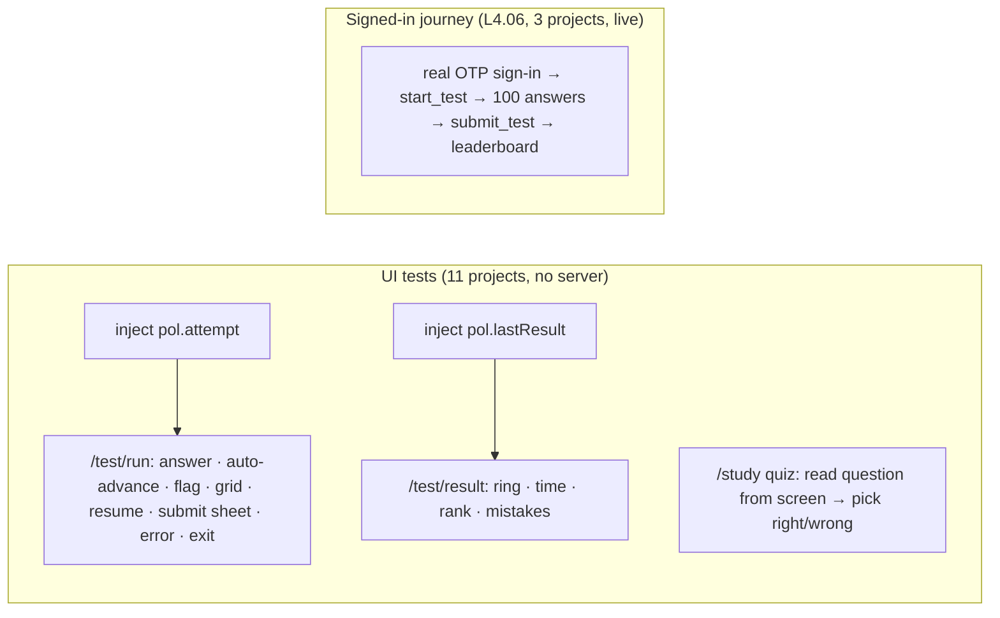

# L4.05 · Test it V: UI tests for quiz, list, theme, test runner and results

> **Level 4 · Test it and ship it** · Lesson 5 of 8

| Recipe card | |
|---|---|
| **Time** | 70 min |
| **You need** | L4.04 (locators, waiting, `deckFoot`), L4.03 (`currentQuestion`, `questionFromScreen`), L2.08b (quiz and list), L2.09a–c (runner, results) |
| **You'll produce** | Lines 165–304 of `tests/e2e/ui.spec.ts`: the remaining 7 UI tests, including a 100-question runner test that needs no server, and a results test driven entirely by injected state |

**In two sentences:** The second half of the UI suite tests screens whose content is random (the quiz order), remote (the leaderboard), or long and stateful (a 100-question test with a clock, flags, a grid and resume), so it leans on two techniques: identifying what's on screen from the data instead of assuming an order, and **injecting state into `localStorage`** so a screen can be tested without the steps or the server that normally produce it. Its bug story is a two-layer one: a real app bug (the quiz shuffling twice) hid behind a test bug (reading the card that was sliding out), and both had to be found.

### Objectives
1. Test a randomised quiz by reading the question from the screen and choosing right or wrong answers deliberately.
2. Test list search, the theme toggle (including persistence across reloads) and the signed-out gate.
3. Write the runner test from an injected attempt: answer, auto-advance, previous, flag, grid, jump, resume, submit sheet, error path, exit.
4. Write the results test from an injected result, and compute every expected value from the injected data.
5. Diagnose a test that reads stale content during a transition, and separate it from an app bug with the same symptom.

---

## 1 · Warm-up: pull it from memory

1. *(L4.03)* What does `currentQuestion(page)` wait for before reading, and why?
2. *(L2.09a)* Which `localStorage` key holds an in-progress attempt, and what fields does it have?
3. *(L2.09c)* How is the mistakes list built from a stored result?

<details><summary>Answers</summary>

1. Until exactly one `.q-card` exists. During a slide transition there are two, and the first is the one leaving.
2. `pol.attempt`: `attempt_id`, `question_ids`, `started_at`, `client_started`, `answers`, `flags`, `pos`.
3. Zip `question_ids`, `answers` and `correct` by position; keep positions where your answer ≠ the correct one (skipped included).
</details>

## 2 · The problem this solves

Three obstacles make these screens hard to test end to end:
- **Randomness.** The quiz shuffles; a test can't hard-code "question 1 is X".
- **Remote state.** The real runner needs a signed-in user and `start_test` on the server, and the results screen needs a real submission. Doing that 11 times per run is slow and needs secrets.
- **Length.** A full test is 100 questions; a UI test that clicks through all of them on 11 devices would take most of an hour.

**The idea:** test the *rendering and behaviour* of each screen from state you control (injected into `localStorage`), and leave the real server round trip to one signed-in journey (L4.06), run on three projects.



---

## 3 · Concepts

### 3.1 Identify, don't assume

`currentQuestion` reads the question text and options from the card and finds the matching item in `questions.json` (`questionFromScreen`, L4.03). Knowing the real question, the test can **choose** a right answer (`q.answer`) or a guaranteed wrong one (`(q.answer + 1) % q.options.length`, the next option round-robin). The expected score is then computed by the test, not read from the app.

### 3.2 State injection

A test can write the same `localStorage` keys the app writes, then load the page. The app can't tell the difference, so the screen renders exactly as it would after the real steps. Two rules make it honest:
- **Use the app's real schema** (field names and types), or the test proves nothing about real data.
- **Cover the real producer elsewhere**: the signed-in journey (L4.06) creates both keys for real, so injection isn't the only evidence.

### 3.3 Waiting through a content swap

When content is *replaced* (a new question slides in), "wait until visible" isn't enough: the old content is visible too. Wait until the **old** content is gone, or the **new** content is present:
```ts
await expect(page.locator(".q-card .q-text")).not.toHaveText(oldText);
```
`not.toHaveText` retries like any web-first assertion: it passes as soon as the element's text is different (or the old element is gone and the new one has different text).

---

## 4 · Reading the real code

### 4.1 Quiz mode (lines 165–185)

```ts
test("quiz mode scores right and wrong answers and finishes the round", async ({ page }) => {
  await goto(page, "/study?week=5");
  await page.locator(".seg button", { hasText: "Quiz" }).click();
  let expected = 0;
  for (let i = 0; i < 10; i++) {
    const q = await currentQuestion(page);
    const right = i % 2 === 0;
    const pick = right ? q.answer : (q.answer + 1) % q.options.length;
    await page.locator(".q-card .opt").nth(pick).click();
    await expect(page.locator(".q-card .opt.correct")).toHaveCount(1);
    await expect(page.locator(".q-card .opt.wrong")).toHaveCount(right ? 0 : 1);
    if (right) expected++;
    await expect(page.locator(".deck-foot")).toContainText(`Score ${expected}`);
    await page.getByRole("button", { name: /Next question|See score/ }).click();
    // wait until the next question has slid in (the old card animates out first)
    if (i < 9) await expect(page.locator(".q-card .q-text")).not.toHaveText(q.q);
  }
  await expect(page.getByRole("heading", { name: `${expected}/10` })).toBeVisible();
  await page.getByRole("button", { name: /Retry the 5 you missed/ }).click();
  await expect(page.locator(".deck-foot")).toContainText("1 / 5");
});
```

- **Week 5, Quiz tab**: ten questions in random order.
- **Alternate right and wrong**: even `i` right, odd `i` wrong, so the expected final score is 5/10 whatever the order.
- **Click the chosen option by index** (`.nth(pick)`): the options are rendered in the data's order, so index = answer index.
- **Feedback assertions**: always exactly one `.opt.correct` (the right answer is revealed either way), and one `.opt.wrong` only when the pick was wrong.
- **The running score** in the deck foot ("Score 3") after every answer.
- **Next**: the button says "Next question" until the last, then "See score"; one role locator with a regex covers both.
- **The wait that fixed the test** (§7): before reading the next question, wait until the card's text is no longer the old question.
- **The end**: a heading `5/10` (by role, so it's announced as a heading), and "Retry the 5 you missed" starts a 5-card round.

### 4.2 List search (lines 187–197)

```ts
test("list mode searches and highlights", async ({ page }) => {
  await goto(page, "/study");
  await page.locator(".seg button", { hasText: "List" }).click();
  await expect(page.locator(".qa")).toHaveCount(130);
  await page.locator(".search input").fill("maslow");
  await expect(page.locator(".qa")).toHaveCount(1);
  await expect(page.locator(".qa mark")).toHaveText(/maslow/i);
  await expect(page.locator(".qa")).toContainText("Love and belonging");
  await page.locator(".search input").fill("zzzz-no-match");
  await expect(page.getByText(/Nothing matches/)).toBeVisible();
});
```

- **All 130** questions listed (`.qa` items) before searching.
- **"maslow"** (lowercase) matches exactly one question, "Friendship is a ___ need in Maslow's hierarchy.", whose answer is "Love and belonging". The `<mark>` must contain the matched word, case-insensitively: the highlight preserves the original "Maslow" capitalisation (L2.08b).
- **No match** shows the empty-state text ("Nothing matches…").

### 4.3 Theme (lines 199–215)

```ts
test("theme toggle switches light/dark and is remembered", async ({ page }) => {
  await goto(page, "/");
  const bg = () => page.evaluate(() => getComputedStyle(document.body).backgroundColor);
  const before = await bg();
  const toggle = isRail(page) ? page.locator(".rail-theme") : page.locator(".topbar .icon-btn");
  await toggle.click();
  await expect.poll(bg).not.toBe(before);
  const theme = await page.evaluate(() => document.documentElement.dataset.theme);
  expect(["light", "dark"]).toContain(theme);
  await page.reload();
  expect(await page.evaluate(() => document.documentElement.dataset.theme)).toBe(theme);
  expect(await bg()).not.toBe(before);
  // explicit choice from the account page
  await goto(page, "/me");
  await page.locator(".seg button", { hasText: "Dark" }).click();
  await expect.poll(() => page.evaluate(() => document.documentElement.dataset.theme)).toBe("dark");
});
```

- **Observable, not internal**: the oracle is `body`'s computed background colour. Whatever the starting theme (it depends on the device's emulated colour scheme), one click must change it.
- **The toggle is in a different place** on laptops (`.rail-theme` in the rail) and phones (`.topbar .icon-btn`).
- **`data-theme` is set** to `light` or `dark` after a click (never "system": the toggle calls `setPref(resolved === "dark" ? "light" : "dark")`, switching between the resolved themes), and **survives a reload** (stored in `pol.theme`).
- **The account page's segmented control** sets Dark explicitly.

### 4.4 Signed-out gate and live leaderboard (lines 217–231)

```ts
test("signed-out visitors are sent to sign in before a ranked test", async ({ page }) => {
  await goto(page, "/test");
  await page.getByRole("link", { name: /Sign in with email to start/ }).click();
  await expect(page).toHaveURL(/\/me\?next=\/test/);
  await expect(page.getByRole("button", { name: /Email me a code/ })).toBeVisible();
  await page.getByLabel("Email").fill("not-an-email");
  await page.getByRole("button", { name: /Email me a code/ }).click();
  await expect(page.getByText("Enter a valid email address.")).toBeVisible();
});

test("leaderboard loads from the live database", async ({ page }) => {
  await goto(page, "/ranks");
  await expect(page.locator(".banner")).toHaveCount(0);
  await expect(page.getByText("No scores yet").or(page.locator(".pod").first())).toBeVisible();
});
```

- **The intro screen** for a signed-out visitor offers "Sign in with email to start", which links to `/me?next=/test` so sign-in returns you to the test (L2.07a).
- **Client-side email validation**: "not-an-email" shows the app's own message, "Enter a valid email address." This is the regression test for the bug where the browser's native validation bubble hid the app's message in some browsers (the form has `noValidate`, L2.07a).
- **The leaderboard loads from the live database** with the publishable key: no error banner, and either the empty state or a podium. `.or()` combines two locators: the assertion passes if either is visible. This is the one UI test that touches the real project; it's read-only.

### 4.5 The test runner from an injected attempt (lines 233–285)

```ts
test("test runner: answer, auto-advance, flag, grid, resume, submit sheet, exit", async ({ page }) => {
  // a locally stored in-progress attempt (no server call needed to render the runner)
  await goto(page, "/");
  const ids = QUESTIONS.slice(0, 100).map((q) => q.id);
  await page.evaluate((qids) => {
    localStorage.setItem(
      "pol.attempt",
      JSON.stringify({ attempt_id: "00000000-0000-0000-0000-000000000000", question_ids: qids, started_at: new Date().toISOString(), client_started: Date.now(), answers: qids.map(() => null), flags: [], pos: 0 })
    );
  }, ids);
  await goto(page, "/test/run");
  await expect(page.getByText("Question 1 of 100")).toBeVisible();
  await expect(page.locator(".tabbar")).toHaveCount(0); // focus mode: no navigation bar
  await expect(page.locator(".timer")).toContainText(/0:0\d/);

  const q1 = await currentQuestion(page);
  await page.locator(".q-card .opt").nth(ANSWER.get(q1.id)!).click();
  await expect(page.getByText("Question 2 of 100")).toBeVisible(); // auto-advance
  await expect(page.locator(".test-top")).toContainText("1/100");

  await page.getByRole("button", { name: "Previous question" }).click();
  await expect(page.locator(".q-card .opt.sel")).toHaveCount(1);
  await page.getByRole("button", { name: "Flag question" }).click();
  await expect(page.locator(".q-card")).toContainText("Flagged");

  await page.getByRole("button", { name: "All questions" }).click();
  await expect(page.locator(".qgrid button")).toHaveCount(100);
  await expect(page.locator(".qgrid button.ans")).toHaveCount(1);
  await expect(page.locator(".qgrid button.flag")).toHaveCount(1);
  await page.locator(".qgrid button", { hasText: /^50$/ }).click();
  await expect(page.getByText("Question 50 of 100")).toBeVisible();

  await page.reload(); // resume where you left off
  await expect(page.getByText("Question 50 of 100")).toBeVisible();
  await expect(page.locator(".test-top")).toContainText("1/100");

  await page.locator(".test-top button", { hasText: "Submit" }).click();
  await expect(page.locator(".sheet")).toContainText("You answered 1 of 100");
  await expect(page.locator(".sheet")).toContainText("99 unanswered");
  await page.getByRole("button", { name: "Go to first unanswered" }).click();
  await expect(page.getByText("Question 2 of 100")).toBeVisible();

  // submitting without a valid session shows an error instead of crashing
  await page.locator(".test-top button", { hasText: "Submit" }).click();
  await page.locator(".sheet").getByRole("button", { name: /^Submit at/ }).click();
  await expect(page.locator(".sheet .banner")).toBeVisible();
  await expect(page).toHaveURL(/\/test\/run/);
  await page.keyboard.press("Escape");

  await page.getByRole("button", { name: /Exit/ }).click();
  await page.getByRole("button", { name: "Leave for now" }).click();
  await expect(page).toHaveURL(/\/test$/);
});
```

**Setup (lines 234–246).**
- **The attempt**: the first 100 question ids, a zero UUID, `started_at` now, every answer `null`, no flags, position 0. Written with `page.evaluate` (in the page, so `localStorage` belongs to the app's origin) after a first `goto("/")`, then the runner is opened.
- **Focus mode**: "Question 1 of 100", and **no tab bar** (`toHaveCount(0)`: `TabBar` returns `null` on `/test/run`, L2.05).
- **The timer** shows `0:0x`: a few seconds since `started_at`.

**Answering and moving (lines 248–256).**
- **Answer question 1 correctly** (via `currentQuestion` and the key) → **auto-advance** to question 2 and the progress counter `1/100`.
- **Previous question** shows question 1 again with its choice still selected (`.opt.sel` count 1).
- **Flag question** → the card shows "Flagged".

**The grid and resume (lines 258–267).**
- **"All questions"** opens the sheet: 100 grid buttons, one `.ans` (answered), one `.flag`. Clicking "50" (anchored regex, so it doesn't match "150" or "5") jumps to question 50.
- **Reload** → still question 50, still `1/100`: resume from `localStorage` (L2.09a).

**The submit sheet and the error path (lines 269–280).**
- **Submit** (in the top bar) opens the sheet: "You answered 1 of 100", "99 unanswered", and "Go to first unanswered" jumps to question 2 (question 1 is answered).
- **Submitting for real** ("Submit at 0:12"-style: the button shows the elapsed time): the attempt id is the zero UUID and there's no session, so `submit_test` fails. The runner must show the error in the sheet's banner and **stay on `/test/run`**, not crash or lose the attempt. `Escape` closes the sheet.

**Exit (lines 282–284).**
- **Exit → "Leave for now"** returns to `/test`. The sheet tells the user the truth: "Your answers are saved on this device and you can resume, but the clock keeps running." (the server-side `started_at` doesn't pause). The `beforeunload` handler isn't involved here because this is in-app navigation; the dialog handler in `beforeEach` covers real unloads.

### 4.6 The results page from an injected result (lines 287–304)

```ts
test("result page renders score, stats and mistakes", async ({ page }) => {
  await goto(page, "/");
  const ids = QUESTIONS.slice(0, 100).map((q) => q.id);
  await page.evaluate((qids) => {
    const key = qids.map(() => 0);
    localStorage.setItem("pol.lastResult", JSON.stringify({ score: 88, total: 100, duration_ms: 754000, correct: key, rank: 3, players: 20, question_ids: qids, answers: qids.map((_, i) => (i < 88 ? 0 : 1)) }));
  }, ids);
  await goto(page, "/test/result");
  await expect(page.locator(".ring-num b")).toHaveText("88", { timeout: 5000 });
  await expect(page.locator(".result-stats")).toContainText("12:34");
  await expect(page.locator(".result-stats")).toContainText("3rd");
  await expect(page.locator(".result-stats")).toContainText("of 20 players");
  await expect(page.getByText("12 to review")).toBeVisible();
  await expect(page.locator(".review-item")).toHaveCount(8);
  await page.getByRole("button", { name: "Show all 12" }).click();
  await expect(page.locator(".review-item")).toHaveCount(12);
  await noHorizontalOverflow(page);
});
```

- **The result**: score 88 of 100, 754,000 ms, rank 3 of 20 players. The "correct" key is all zeros, and the answers are 0 for the first 88 positions and 1 for the last 12, so exactly **12 mistakes**, consistent with the score.
- **The ring number** must reach `88`, which also proves the count-up finishes (its animation is ~1.1 s, hence `timeout: 5000`).
- **Expected values, computed**: 754,000 ms = 754 s = 12 min 34 s → `12:34`; rank 3 → `3rd`; "of 20 players"; "12 to review"; 8 items shown, then "Show all 12" → 12 items.
- **No sideways scrolling** on the results screen, where the mascot and burst are absolutely positioned near the edges.

---

## 5 · Worked trace: the quiz loop with real data

Week 5 in quiz mode, as the debug log in the session recorded the first three iterations (questions are shuffled, so your run differs):

| i | Question read from screen | `q.answer` | Right? | Picked | `.opt.wrong` | Score after |
|---|---|---|---|---|---|---|
| 0 | "___ proposed that there are three primary drives that drive human behavior." | 0 (Hull) | yes | 0 | 0 | 1 |
| 1 | "___ theory differentiates between autonomous motivation and controlled motivation." | 3 (Self-determination) | no | (3+1) % 4 = 0 | 1 | 1 |
| 2 | "Friendship is a ___ need in Maslow's hierarchy." | 0 (Love and belonging) | yes | 0 | 0 | 2 |
| … | | | | | | |
| 9 | (last) | | no | | 1 | **5** |

**Predict**: what would iteration 1 have read **without** the `not.toHaveText(q.q)` wait?

<details><summary>Reveal</summary>The debug log in the session showed it: iteration 1 read <i>"___ proposed that there are three primary drives…"</i> again, the question from iteration 0, still on screen as it slid out. The test then "knew" the answer to the wrong question and clicked option 0 thinking it was wrong… or right, depending on the real question. That's why the assertion on <code>.opt.wrong</code> got <code>1</code> when it expected <code>0</code>.</details>

---

## 6 · Running and testing

```bash
npx playwright test tests/e2e/ui.spec.ts -g "quiz|list mode|theme" --retries=0
npx playwright test tests/e2e/ui.spec.ts -g "test runner|result page" --project=iphone-se --project=desktop-firefox
```
- The runner test takes ~10–15 s per project (many sheet animations); it's the slowest UI test.
- To debug a single step, add `await page.pause()` and run with `--headed`: the Playwright Inspector opens at that line.

## 7 · Bug journal

### Incident · The quiz test read the card that was sliding out (with a real bug underneath)

1. **Symptom.**
   ```text
   ✘ [pixel-7] › ui.spec.ts › quiz mode scores right and wrong answers and finishes the round
     Error: expect(locator).toHaveCount(expected) failed
     Expected: 0
     Received: 1
   ```
   The test chose what it believed was the right answer, and the app marked it wrong.
2. **Diagnosis.**
   - **Layer 1, a real app bug.** Reading the quiz code showed it shuffled **twice** when opened: once in `useState(() => shuffleArr(pool))`, and again in an effect that called `restart()` on mount. The first question could change right after it appeared, so a fast tap (by a test or a quick human) could land on a question that had just been replaced. Fixed in the app ([L2.08b](l2-08b-quiz-and-list.md)): reshuffle only when the week (`pool`) actually changes, tracked with a ref.
   - **Still failing**, so the first theory was incomplete. A throwaway debug spec logged, per iteration, the `.q-text` elements before and after reading, and 600 ms later. Iteration 1 read the **previous** question: the old card was still in the DOM, animating out, and `currentQuestion` read it. *(Side lesson: the first debug file, `zz-debug.spec.ts`, ran zero tests ("No tests found") because no project's `testMatch` matched its name; renamed to `debug-ui.spec.ts`, it ran.)*
3. **Root cause.** Two different problems with one symptom: an app race (double shuffle on mount), and a test race (reading during the slide transition, when two cards exist).
4. **Fix.**
   ```diff
   // src/pages/Study.tsx (app)
   -  // eslint-disable-next-line react-hooks/exhaustive-deps
   -  useEffect(() => {
   -    restart();
   -  }, [pool]);
   +  // reshuffle only when the week changes (not on mount, which would swap the first question)
   +  const lastPool = useRef(pool);
   +  useEffect(() => {
   +    if (lastPool.current === pool) return;
   +    lastPool.current = pool;
   +    restart();
   +    // eslint-disable-next-line react-hooks/exhaustive-deps
   +  }, [pool]);
   ```
   ```diff
   // tests/e2e/ui.spec.ts (test)
        await page.getByRole("button", { name: /Next question|See score/ }).click();
   +    // wait until the next question has slid in (the old card animates out first)
   +    if (i < 9) await expect(page.locator(".q-card .q-text")).not.toHaveText(q.q);
   ```
   and later, in `support.ts`, `currentQuestion` itself waits for a single card (`toHaveCount(1)`), so every caller is protected.
5. **Lesson.** When a fix doesn't make a test pass, don't stack more fixes on the same theory; **log what the test actually reads**. And when content is replaced in place, wait for the *old* content to disappear, not merely for content to be visible.

## 8 · Why this design

| Decision | Alternatives | Why this one | Trade-off | Choose differently when |
|---|---|---|---|---|
| Inject `pol.attempt` / `pol.lastResult` | Drive the real flow every time; mock the API with `page.route` | Fast, no secrets, tests every screen state on 11 devices | Injected data could drift from the real schema | The schema changes often → generate fixtures from the app's types |
| Real flow in one journey (L4.06) | Real flow in every UI test | Proves the producer once, on three engines | Slow test, needs secrets | — |
| Identify questions from the screen | Seed `Math.random` to fix the order | Tests the real shuffled behaviour | Needs `questionFromScreen` and unique prompts (+ options tie-break) | Deterministic order needed for screenshots → seed |
| Alternate right/wrong | Random choices | Deterministic expected score (5/10) | — | — |
| Assert the error path (submit fails) | Only the happy path | The runner must survive server errors without losing the attempt | — | — |

## 9 · Check yourself

**Q1.** Why does the quiz test pick `(q.answer + 1) % q.options.length` for a wrong answer instead of a random other option?
<details><summary>Answer</summary>It's deterministic and always different from the right answer, for both 4-option and 2-option (true/false) questions.</details>

**Q2.** The injected attempt uses the zero UUID as `attempt_id`. Which assertion depends on that, and why is it safe?
<details><summary>Answer</summary>The error path: submitting must fail and show the banner. No real attempt has that id, and there's no session anyway, so the server rejects it without touching real data.</details>

**Q3.** Compute what the results screen should show for `duration_ms: 3_725_000`.
<details><summary>Answer</summary>3,725 s = 1 h 2 min 5 s → <code>1:02:05</code> (<code>fmtDuration</code> adds hours when ≥ 1 h, L2.04).</details>

**Q4.** Why is the ring assertion given `timeout: 5000` instead of the default 8 s, and what does it prove besides the score?
<details><summary>Answer</summary>A tighter bound that still covers the ~1.1 s count-up (and the card's entrance); it proves the count-up actually finishes at the stored score. (The default would also pass; the explicit value documents the expectation.)</details>

**Q5.** The leaderboard test uses `.or()`. What would go wrong with `expect(page.getByText("No scores yet")).toBeVisible()` alone?
<details><summary>Answer</summary>It would fail as soon as anyone has a score on the live board: the test would depend on production data.</details>

**Q6.** A debug spec named `zz-debug.spec.ts` reports "No tests found". Why?
<details><summary>Answer</summary>Every project's <code>testMatch</code> only matches <code>ui|a11y|auth|api-security|http</code> spec names; the file isn't matched by any project. Name it so a project matches (e.g. <code>debug-ui.spec.ts</code>).</details>

## 10 · Practice

**Easy (10 min).** Extend the list test: search "MASLOW" (uppercase) and assert the same single result.

**Medium (20 min).** Add a runner test for the clock: inject an attempt whose `started_at` is 2 h 59 min ago and assert the timer shows `2:59:` and an "almost out of time" state, if the app has one; if it doesn't, write the test first and decide what it should show.

**Hard (40 min).** Replace the leaderboard test's dependency on the live project with `page.route("**/rest/v1/rpc/get_leaderboard**", …)` returning a fixed board including a tie, and assert the podium order 2 · 1 · 3, equal medals for the tie, and the pinned "you" row (L2.09c).
<details><summary>Key insight</summary>The pinned row needs a session for "you": mock <code>auth/v1/user</code> too, or inject a Supabase session into <code>localStorage</code>. Keep one unmocked smoke test against the real project so the mock can't drift unnoticed.</details>

## 11 · From memory

**Rung 1 · Cloze.**

```ts
const pick = right ? q.answer : (q.answer + 1) ___①___ q.options.length;
await page.locator(".q-card .opt").___②___(pick).click();
if (i < 9) await expect(page.locator(".q-card .q-text")).___③___.toHaveText(q.q);
await expect(page.getByText("No scores yet").___④___(page.locator(".pod").first())).toBeVisible();
localStorage.setItem("pol.___⑤___", JSON.stringify({ attempt_id: "00000000-…", question_ids: qids,
  started_at: new Date().toISOString(), client_started: Date.now(), answers: qids.map(() => ___⑥___), flags: [], pos: 0 }));
await expect(page.locator(".tabbar")).toHaveCount(___⑦___);
await page.locator(".qgrid button", { hasText: /___⑧___/ }).click();
await expect(page.locator(".result-stats")).toContainText("___⑨___"); // 754000 ms
```
<details><summary>Answers</summary>① <code>%</code> ② <code>nth</code> ③ <code>not</code> ④ <code>or</code> ⑤ <code>attempt</code> ⑥ <code>null</code> ⑦ <code>0</code> ⑧ <code>^50$</code> ⑨ <code>12:34</code></details>

**Rung 2 · Blank page (25 min). No scrolling up.** Write the quiz test and the runner test.
<details><summary>Self-check</summary>

- [ ] Quiz: open week 5 quiz; loop 10; read with `currentQuestion`; alternate right/wrong; one `.correct`, `.wrong` only when wrong; running score; Next/See score; wait for the old text to go; final `5/10` heading; "Retry the 5" → 1 / 5
- [ ] Runner: inject `pol.attempt` with the real schema; open `/test/run`; "Question 1 of 100"; no tab bar; timer `0:0\d`
- [ ] Answer correctly → auto-advance, `1/100`; previous → `.sel`; flag → "Flagged"
- [ ] Grid: 100 buttons, 1 `.ans`, 1 `.flag`; jump to 50; reload → still 50 and `1/100`
- [ ] Submit sheet counts; "Go to first unanswered" → 2; real submit → banner, still on `/test/run`; Escape
- [ ] Exit → "Leave for now" → `/test`
</details>

## 12 · Flashcards

<details><summary><b>Q:</b> How does the quiz test know the right answer when the order is random?</summary><b>A:</b> It reads the question from the screen and looks it up in <code>questions.json</code>.</details>
<details><summary><b>Q:</b> What is state injection?</summary><b>A:</b> Writing the app's own storage keys (with its real schema) before loading a screen.</details>
<details><summary><b>Q:</b> How do you wait for replaced content?</summary><b>A:</b> Wait for the old content to be gone: <code>not.toHaveText(old)</code>.</details>
<details><summary><b>Q:</b> What two bugs hid behind the quiz failure?</summary><b>A:</b> The app shuffled twice on mount; the test read the card sliding out.</details>
<details><summary><b>Q:</b> Why does the runner test expect a banner on submit?</summary><b>A:</b> The injected attempt can't be submitted; the runner must show the error and keep the attempt.</details>
<details><summary><b>Q:</b> What does <code>.or()</code> do on locators?</summary><b>A:</b> Matches either locator, so the assertion passes if either is visible.</details>
<details><summary><b>Q:</b> 754,000 ms on screen?</summary><b>A:</b> <code>12:34</code>.</details>
<details><summary><b>Q:</b> Why is the theme oracle the body background colour?</summary><b>A:</b> It's what users see, independent of how the theme is implemented.</details>
<details><summary><b>Q:</b> Why can a debug spec find "No tests"?</summary><b>A:</b> Its file name doesn't match any project's <code>testMatch</code>.</details>

## 13 · The menu board

| | |
|---|---|
| Quiz | read from screen · alternate right/wrong · `.correct` 1, `.wrong` 0/1 · wait old text gone · 5/10 · retry 5 |
| List | 130 · "maslow" → 1 with `<mark>` · "Nothing matches" |
| Theme | body colour changes · `data-theme` light/dark persists · account "Dark" |
| Gate | sign-in link → `/me?next=/test`; "Enter a valid email address." |
| Board | live, read-only: no banner; empty state **or** podium |
| Runner | inject attempt · no tab bar · auto-advance · prev · flag · grid (100/1/1) · jump 50 · reload resume · sheet counts · error banner · exit |
| Results | inject result · ring 88 · 12:34 · 3rd of 20 · 12 to review · 8 → 12 · no overflow |

## 14 · Glossary

**Fixture data**: prepared data a test loads. **Oracle**: what a test compares against. **Playwright Inspector**: the step debugger opened by `page.pause()`. **Race condition**: a result that depends on the timing of two things. **Round-robin**: choosing the next item, wrapping around at the end. **State injection**: putting an app into a state by writing its storage directly.

## 15 · Go further

| Resource | Type | Why | Which part | Time |
|---|---|---|---|---|
| [Playwright: Evaluating JavaScript](https://playwright.dev/docs/evaluating) | Docs | `page.evaluate` and passing arguments in | Whole page | 10 min |
| [Playwright: Mock APIs](https://playwright.dev/docs/mock) | Docs | `page.route` for the Hard exercise | "Mock API requests" | 15 min |
| [Playwright: Debugging tests](https://playwright.dev/docs/debug) | Docs | `page.pause()`, `--debug`, the Inspector | "Playwright Inspector" | 15 min |
| [Kent C. Dodds: Write tests. Not too many. Mostly integration.](https://kentcdodds.com/blog/write-tests) | Article | Where state injection sits between unit and end-to-end | Whole article | 10 min |

---
← [L4.04 Test it IV: navigation, layout and flashcards](l4-04-ui-tests-nav-cards.md) · [Hub](README.md) · [L4.06 Test it VI: live security and the signed-in journey →](l4-06-live-security-auth.md)
