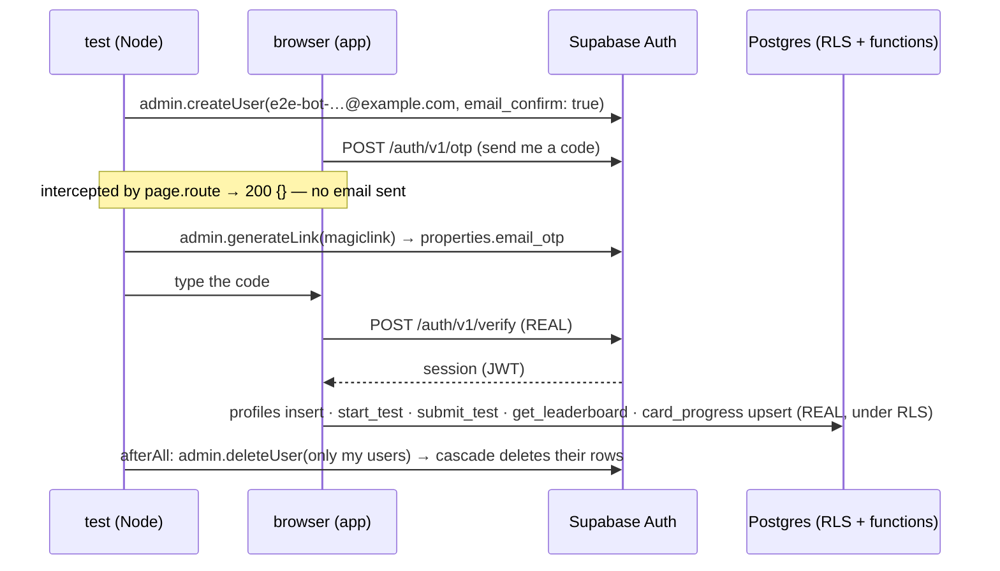

# L4.06 · Test it VI: live security tests and the signed-in journey

> **Level 4 · Test it and ship it** · Lesson 6 of 8

| Recipe card | |
|---|---|
| **Time** | 75 min |
| **You need** | L3.01 (the security model and the attack list), L4.02 (the same checks in PGlite), L4.03 (throwaway users, `otpFor`, `signedInClient`), L2.07a–b (sign-in, names, sync, sign-out) |
| **You'll produce** | `tests/e2e/api-security.spec.ts` (140 lines, 13 tests) and `tests/e2e/auth.spec.ts` (120 lines, one long journey) from blank files |

**In two sentences:** The PGlite tests prove the SQL is right; these tests prove the **deployed project** is right, by attacking the real Supabase API with the publishable key and two throwaway users, and by walking a real user through the real UI from email-code sign-in to a 100-question test, the leaderboard, a rename, flashcard sync and sign-out. They create users without sending a single email, clean up only what they created, and caught three app bugs (including "nobody can sign in") and two test bugs (a cleanup race between workers and an extra click that skipped a question).

### Objectives
1. Write the live security spec: anonymous reads, calls and writes; signed-in profile rules, grading, forgery, ownership and cross-user isolation; the ranking check; the key check.
2. Write the signed-in journey with a mocked "send code" request and the real verify endpoint, and explain exactly which parts are real.
3. Collect uncaught page errors during a journey and fail on them.
4. Make cleanup safe with parallel workers.
5. Diagnose a test that waits forever for a button, and a test whose user vanished mid-run.

---

## 1 · Warm-up: pull it from memory

1. *(L4.03)* How does `otpFor(email)` get a code without sending an email?
2. *(L4.02)* Which layer can't detect "RLS was disabled in the dashboard", and which layer can?
3. *(L2.07a)* How many digits does this project's email code have, and what did the app originally accept?

<details><summary>Answers</summary>

1. The admin API's `generateLink({ type: "magiclink", email })` returns `properties.email_otp`, the code the email would contain.
2. The PGlite tests can't (they test `setup.sql`, not the live project); the live tests in this lesson can.
3. 8 digits; the app cut input to 6, so every real code was rejected.
</details>

## 2 · The problem this solves

`setup.sql` passing in PGlite doesn't mean the live project matches it: someone could have edited a policy in the dashboard, skipped running the latest `setup.sql`, or changed an auth setting (code length, email templates) that no SQL describes. And the UI tests of L4.04–05 used injected state; nothing yet proves a real person can sign in, take a test and see themselves ranked.

**The idea:** one spec attacks the live API directly, and one journey uses the live system through the UI, both with throwaway users that are created confirmed and deleted afterwards.



---

## 3 · Concepts

### 3.1 What's real and what's faked

| Part | Real or faked | Why |
|---|---|---|
| The browser, the built app, the network to Supabase | Real | It's the system under test |
| "Send me a code" (`POST /auth/v1/otp`) | **Faked** with `page.route` → `200 {}` | Sending real email would spam `example.com`, hit rate limits, and need an inbox |
| The code itself | Real, from `generateLink` | It's the code Supabase would have emailed |
| Verifying the code (`/auth/v1/verify`) | Real | Proves the 6–10 digit handling, sessions, and the redirect back to `/test` |
| Everything in the database | Real | RLS, functions and the leaderboard as deployed |

### 3.2 Route interception

`page.route(pattern, handler)` intercepts the page's requests whose URL matches the glob. The handler can `route.fulfill(...)` (answer it), `route.continue()` (let it through, possibly modified) or `route.abort()`. Here only the OTP-send endpoint is fulfilled; every other request goes to Supabase untouched. A counter proves the app actually made the request exactly once.

### 3.3 `pageerror`: fail on crashes nobody asserted

`page.on("pageerror", e => …)` fires for **uncaught** exceptions in the page. Many crashes don't break the next assertion immediately (the error boundary shows a "Reload" screen, or a background promise rejects). Collecting them and asserting the list is empty at the end catches them anyway. This is how the "signing out crashed the app" bug would be caught even if the next screen happened to render.

### 3.4 Serial mode and long timeouts

`test.describe.configure({ mode: "serial", timeout: 480_000 })`:
- **serial**: the tests in the file run in order in one worker, and if one fails the rest are skipped (for the security spec, the signed-in tests share users created in `beforeAll`).
- **480 s**: a 100-question test through the UI is long on slow WebKit (each question is a slide transition plus an auto-advance). 240 s was measured as not enough on `iphone-13`.

---

## 4 · Reading the real code

### 4.1 `api-security.spec.ts`: anonymous visitor (lines 1–42)

```ts
// Live security checks against the real Supabase project.
// Uses two throwaway users (created + deleted via the admin API, no emails sent).
import { test, expect } from "@playwright/test";
import type { SupabaseClient } from "@supabase/supabase-js";
import { ANSWER, anonClient, createTestUser, deleteMyTestUsers, env, hasAdmin, signedInClient } from "./support";

test.describe.configure({ mode: "serial" });

const anon = anonClient();

test.describe("anonymous visitor", () => {
  test("cannot read the answer key or any private table", async () => {
    for (const table of ["questions", "profiles", "test_attempts", "card_progress"]) {
      const { data, error } = await anon.from(table).select("*").limit(5);
      expect(error, table).toBeNull();
      expect(data, `${table} must be empty for anon`).toEqual([]);
    }
  });

  test("cannot start, submit or read stats", async () => {
    for (const [fn, args] of [
      ["start_test", {}],
      ["submit_test", { p_attempt: "00000000-0000-0000-0000-000000000000", p_answers: [] }],
      ["get_my_stats", {}],
    ] as const) {
      const { error } = await anon.rpc(fn, args);
      expect(error?.code, fn).toBe("42501");
    }
  });

  test("cannot write to any table", async () => {
    expect((await anon.from("profiles").insert({ id: "00000000-0000-0000-0000-000000000000", display_name: "Anon" })).error).not.toBeNull();
    expect((await anon.from("test_attempts").insert({ user_id: "00000000-0000-0000-0000-000000000000", question_ids: [1], total: 1 })).error).not.toBeNull();
    expect((await anon.from("questions").insert({ id: 9999, week: 0, prompt: "x", options: [], answer: 0 })).error).not.toBeNull();
  });

  test("can read the public leaderboard (names only, no emails)", async () => {
    const { data, error } = await anon.rpc("get_leaderboard", { p_limit: 5 });
    expect(error).toBeNull();
    expect(Array.isArray(data)).toBe(true);
    for (const row of data as Record<string, unknown>[]) expect(Object.keys(row)).not.toContain("email");
  });
});
```

- **Serial** so the signed-in group's shared users exist for each test.
- **Reads**: for each of the four tables, `select("*")` returns **no error and no rows**. Expecting `error` to be `null` matters: a 401 or "relation does not exist" would also return no data, and would hide a misconfigured project.
- **Calls**: `start_test`, `submit_test`, `get_my_stats` must fail with Postgres error code **42501** (insufficient privilege): the revoke/grant lines are live.
- **Writes**: inserts into `profiles`, `test_attempts` and `questions` are all refused.
- **The public board**: callable by `anon`, an array, and no row has an `email` key.

### 4.2 `api-security.spec.ts`: signed-in users (lines 44–140)

```ts

test.describe("signed-in users", () => {
  test.skip(!hasAdmin, "needs SUPABASE_SECRET_KEY (or local Supabase.txt) to create throwaway users");

  let A: SupabaseClient, B: SupabaseClient;
  let a: { email: string; id: string }, b: { email: string; id: string };
  const nameA = `E2E Alpha ${Date.now() % 100000}`;

  test.beforeAll(async () => {
    a = await createTestUser("sec-a");
    b = await createTestUser("sec-b");
    A = await signedInClient(a.email);
    B = await signedInClient(b.email);
  });
  test.afterAll(async () => {
    await deleteMyTestUsers();
  });

  test("OTP sign-in produces a real session", async () => {
    const { data } = await A.auth.getUser();
    expect(data.user?.email).toBe(a.email);
  });

  test("cannot start a test before choosing a name", async () => {
    const { error } = await A.rpc("start_test");
    expect(error?.message).toMatch(/display name/i);
  });

  test("profile rules: own row only, valid names, unique ignoring case", async () => {
    expect((await A.from("profiles").insert({ id: b.id, display_name: "Hijack Attempt" })).error, "write someone else's profile").not.toBeNull();
    expect((await A.from("profiles").insert({ id: a.id, display_name: "ab" })).error?.code, "too short").toBe("23514");
    expect((await A.from("profiles").insert({ id: a.id, display_name: "" })).error?.code, "bad chars").toBe("23514");
    expect((await A.from("profiles").insert({ id: a.id, display_name: nameA })).error).toBeNull();
    expect((await B.from("profiles").insert({ id: b.id, display_name: nameA.toUpperCase() })).error?.code, "duplicate").toBe("23505");
    expect((await B.from("profiles").insert({ id: b.id, display_name: `E2E Beta ${Date.now() % 100000}` })).error).toBeNull();
    const { data } = await A.from("profiles").select("id");
    expect(data, "sees only own profile").toEqual([{ id: a.id }]);
  });

  test("server grades the test and records the time", async () => {
    const { data: s, error } = await A.rpc("start_test");
    expect(error).toBeNull();
    expect(s.question_ids).toHaveLength(100);
    expect(new Set(s.question_ids).size).toBe(100);
    const answers = s.question_ids.map((id: number, i: number) => (i < 73 ? ANSWER.get(id) : -1));
    const { data: r, error: e2 } = await A.rpc("submit_test", { p_attempt: s.attempt_id, p_answers: answers });
    expect(e2).toBeNull();
    expect(r.score).toBe(73);
    expect(r.total).toBe(100);
    expect(r.duration_ms).toBeGreaterThan(0);
    expect(r.correct).toEqual(s.question_ids.map((id: number) => ANSWER.get(id)));
  });

  test("scores cannot be forged or tampered with", async () => {
    const ins = await A.from("test_attempts").insert({ user_id: a.id, question_ids: [101], total: 1, score: 1, duration_ms: 1, submitted_at: new Date().toISOString() });
    expect(ins.error, "direct insert").not.toBeNull();
    const upd = await A.from("test_attempts").update({ score: 100, duration_ms: 1 }).eq("user_id", a.id).select();
    expect(upd.data ?? [], "direct update changes nothing").toEqual([]);
    const { data } = await A.from("test_attempts").select("score").eq("user_id", a.id);
    expect(data?.map((d) => d.score)).toEqual([73]);
  });

  test("cannot submit another user's attempt, twice, or with a wrong answer count", async () => {
    const { data: s } = await B.rpc("start_test");
    const ans = s.question_ids.map(() => 0);
    expect((await A.rpc("submit_test", { p_attempt: s.attempt_id, p_answers: ans })).error?.message).toMatch(/not found/i);
    expect((await B.rpc("submit_test", { p_attempt: s.attempt_id, p_answers: [0, 1] })).error?.message).toMatch(/count/i);
    expect((await B.rpc("submit_test", { p_attempt: s.attempt_id, p_answers: ans })).error).toBeNull();
    expect((await B.rpc("submit_test", { p_attempt: s.attempt_id, p_answers: ans })).error?.message).toMatch(/already submitted/i);
  });

  test("users cannot see each other's attempts or flashcard progress", async () => {
    expect((await B.from("test_attempts").select("user_id")).data?.every((r) => r.user_id === b.id)).toBe(true);
    expect((await A.from("card_progress").upsert({ user_id: a.id, question_id: 101, status: "known" })).error).toBeNull();
    expect((await B.from("card_progress").upsert({ user_id: a.id, question_id: 102, status: "known" })).error, "write A's progress").not.toBeNull();
    expect((await B.from("card_progress").select("*")).data).toEqual([]);
    const del = await B.from("card_progress").delete().eq("user_id", a.id).select();
    expect(del.data ?? []).toEqual([]);
    expect((await A.from("card_progress").select("question_id, status")).data).toEqual([{ question_id: 101, status: "known" }]);
  });

  test("leaderboard ranks by score then time and get_my_stats agrees", async () => {
    const { data: lb } = await anon.rpc("get_leaderboard", { p_limit: 1000 });
    const rowA = (lb as { display_name: string; score: number; rank: number }[]).find((r) => r.display_name === nameA);
    expect(rowA?.score).toBe(73);
    const { data: st } = await A.rpc("get_my_stats");
    expect(st.best_score).toBe(73);
    expect(st.rank).toBe(rowA?.rank);
    const sorted = [...(lb as { score: number; duration_ms: number }[])].sort((x, y) => y.score - x.score || x.duration_ms - y.duration_ms);
    expect(lb).toEqual(sorted);
  });

  test("the public key is the publishable/anon key, never the secret", async () => {
    expect(env.anon).not.toEqual(env.secret);
    expect(env.anon).not.toMatch(/^sb_secret_/);
  });
});
```

- **Skipped without the admin key**, with the reason printed.
- **`beforeAll`** creates two users and signs both in through the real verify endpoint. **`afterAll`** deletes only these two (§7.1).
- **"OTP sign-in produces a real session"**: `getUser()` with A's session returns A's email.
- **Name before test**: `start_test` refuses with the "display name" message.
- **Profile rules** (the same set as L4.02, live): hijacking B's id fails; "ab" → `23514` (check); `` → `23514`; a valid name works; B taking A's name in UPPERCASE → `23505` (unique, case-insensitive); A's `select` returns only A's own id.
- **Grading**: 100 distinct ids; answer 73 correctly and skip 27 (`-1`); the server says 73/100, a positive duration, and `correct` equals the key in order.
- **Forgery**: insert refused; update returns no rows; re-reading A's scores gives `[73]`, so nothing changed.
- **Ownership, length, double submit**: A submitting B's attempt → "not found"; B sending 2 answers → "count"; B's valid submit works; repeating it → "already submitted".
- **Isolation**: B's attempts are all B's; A upserts progress; B can't write A's progress, sees none of it, and deleting A's rows affects nothing; A's progress is intact.
- **Ranking**: fetch up to 1,000 rows anonymously, find A's row by name, check it shows 73; `get_my_stats` agrees on score and rank; and the board equals a copy sorted in JavaScript by score descending, then duration ascending.
- **The key check**: the publishable key isn't the secret key and doesn't have the `sb_secret_` prefix: a guard against pasting the wrong key into `VITE_SUPABASE_ANON_KEY` (which would ship a secret to every browser).

### 4.3 `auth.spec.ts`: setup and sign-in (lines 1–48)

```ts
// Full signed-in journey through the real UI against the live Supabase project:
// email code sign-in → leaderboard name → 100-question test → results → leaderboard
// → profile edits → flashcard sync → sign out. Throwaway users; no real emails are sent.
import { test, expect } from "@playwright/test";
import { ANSWER, cardProgressOf, createTestUser, currentQuestion, deleteMyTestUsers, goto, hasAdmin, otpFor, signedInClient } from "./support";

test.skip(!hasAdmin, "needs SUPABASE_SECRET_KEY (or local Supabase.txt) to create throwaway users");
test.describe.configure({ mode: "serial", timeout: 480_000 });
test.afterAll(async () => {
  await deleteMyTestUsers();
});

test("sign in, take a ranked test, appear on the leaderboard, manage account", async ({ page }, info) => {
  page.on("dialog", (d) => d.accept());
  const crashes: string[] = [];
  page.on("pageerror", (e) => crashes.push(e.message));
  const tag = info.project.name.replace(/\W/g, "").slice(0, 10);
  const user = await createTestUser(tag);
  const name = `E2E ${tag} ${Math.floor(Math.random() * 9000 + 1000)}`;

  // Don't actually email anyone: the "send code" request is answered locally.
  // Verification of the code below is the real Supabase endpoint.
  let otpRequests = 0;
  await page.route("**/auth/v1/otp*", async (route) => {
    otpRequests++;
    await route.fulfill({ status: 200, contentType: "application/json", body: "{}" });
  });

  // ---- sign in with the 6-digit code ----
  await goto(page, "/test");
  await page.getByRole("link", { name: /Sign in with email to start/ }).click();
  await page.getByLabel("Email").fill(user.email);
  await page.getByRole("button", { name: /Email me a code/ }).click();
  await expect(page.getByText("Check your inbox")).toBeVisible();
  expect(otpRequests).toBe(1);

  await page.locator("#code").fill("00000000"); // wrong code first (8 digits auto-submits)
  await expect(page.locator(".err")).toContainText(/wrong or has expired/i);
  await page.locator("#code").fill(await otpFor(user.email));
  await expect(page.getByText("You're in!")).toBeVisible();

  // ---- choose a leaderboard name (validation first) ----
  await page.getByLabel("Leaderboard name").fill("ab");
  await page.getByRole("button", { name: "Let's go" }).click();
  await expect(page.locator(".err")).toContainText("3–20 characters");
  await page.getByLabel("Leaderboard name").fill(name);
  await page.getByRole("button", { name: "Let's go" }).click();
  await expect(page).toHaveURL(/\/test$/); // ?next=/test brings them back
```

- **Projects**: only `pixel-7`, `iphone-13` and `desktop-firefox` run this file (one per engine, L4.03).
- **`afterAll(deleteMyTestUsers)`** removes the journey's two users.
- **The tag** is the project name without punctuation (`iphone13`), so users and leaderboard names are traceable to the project that created them.
- **The OTP route**: matches `**/auth/v1/otp*` and answers 200 with an empty JSON object. (*The section comment still says "6-digit code"; the code is 8 digits in this project, as the next lines show. Comments rot.*)
- **Sign-in**: from `/test`, follow "Sign in with email to start" (so `?next=/test` is set), type the email, request a code; "Check your inbox" appears and exactly **one** OTP request was made.
- **A wrong code first**: `00000000` (8 digits, which auto-submits) must show "wrong or has expired". Then the real code from `otpFor` → "You're in!". This step is the regression test for the 8-digit bug: with the old 6-digit cut, the real code could never be typed.
- **Choose a name**: "ab" → "3–20 characters" (client validation mirrors the DB constraint); a valid name → back to `/test` via `next`.

### 4.4 `auth.spec.ts`: the ranked test (lines 50–72)

```ts
  // ---- take the test: 90 right, 4 wrong, 6 skipped ----
  await page.getByRole("button", { name: /Start test/ }).click();
  await expect(page).toHaveURL(/\/test\/run/);
  await expect(page.getByText("Question 1 of 100")).toBeVisible();
  for (let i = 0; i < 100; i++) {
    await expect(page.getByText(`Question ${i + 1} of 100`)).toBeVisible();
    const q = await currentQuestion(page);
    if (i === 50) {
      await page.reload(); // resume mid-test
      await expect(page.getByText("Question 51 of 100")).toBeVisible();
      await expect(page.locator(".test-top")).toContainText("50/100");
    }
    if (i >= 94) {
      if (i < 99) await page.getByRole("button", { name: /^Next/ }).click();
      continue;
    }
    const pick = i < 90 ? ANSWER.get(q.id)! : (ANSWER.get(q.id)! + 1) % q.options.length;
    await page.locator(".q-card .opt").nth(pick).click(); // the app auto-advances after an answer
  }
  await page.getByRole("button", { name: "Submit test" }).click();
  await expect(page.locator(".sheet")).toContainText("You answered 94 of 100");
  await expect(page.locator(".sheet")).toContainText("6 unanswered");
  await page.locator(".sheet").getByRole("button", { name: /^Submit at/ }).click();
```

- **Plan**: questions 1–90 right, 91–94 wrong, 95–100 skipped → 94 answered, 6 unanswered, score 90.
- **Each iteration** first asserts "Question i+1 of 100" is visible (so the test can't drift out of step with the app), then reads the question from the screen.
- **At i = 50, reload**: the runner must resume at question 51 with 50 answered: resume against a real server attempt.
- **Skipping** (i ≥ 94): click "Next" without answering, except on the last question, where there is no "Next" (§7.2).
- **Answering** clicks the option; **the app auto-advances**, so the test does not click "Next" after an answer.
- **Submit**: "You answered 94 of 100", "6 unanswered", then "Submit at …".

### 4.5 `auth.spec.ts`: results, leaderboard, account, sync, sign-out (lines 74–120)

```ts
  // ---- results ----
  await expect(page).toHaveURL(/\/test\/result/);
  await expect(page.locator(".ring-num b")).toHaveText("90", { timeout: 10_000 });
  await expect(page.getByText("10 to review")).toBeVisible();
  await expect(page.locator(".result-stats")).toContainText(/\d+(st|nd|rd|th)/);

  // ---- leaderboard shows me ----
  await page.getByRole("link", { name: /See the leaderboard/ }).click();
  const me = page.locator(".lb-row.me, .pod", { hasText: name }).first();
  await expect(me).toBeVisible();
  await expect(me).toContainText("90");

  // ---- home stats ----
  await goto(page, "/");
  await expect(page.locator(".stat").nth(1)).toContainText("90/100");

  // ---- account: rename, duplicate-name guard ----
  const other = await createTestUser(`${tag}-b`);
  const otherName = `E2E Taken ${Math.floor(Math.random() * 9000 + 1000)}`;
  const oc = await signedInClient(other.email);
  await oc.from("profiles").insert({ id: other.id, display_name: otherName });

  await goto(page, "/me");
  await expect(page.getByText(user.email)).toBeVisible();
  await page.getByRole("button", { name: "Edit name" }).click();
  await page.getByLabel("Leaderboard name").fill(otherName.toLowerCase());
  await page.getByRole("button", { name: "Save name" }).click();
  await expect(page.locator(".sheet .err")).toContainText("That name is taken");
  const renamed = `${name} X`.slice(0, 20);
  await page.getByLabel("Leaderboard name").fill(renamed);
  await page.getByRole("button", { name: "Save name" }).click();
  await expect(page.getByText("Name updated")).toBeVisible();
  await expect(page.locator(".card").first()).toContainText(renamed);

  // ---- flashcard progress syncs to the cloud ----
  await goto(page, "/study?week=0");
  await page.locator("button.btn.got").click();
  await expect.poll(async () => (await cardProgressOf(user.id)).find((r) => r.question_id === 1)?.status, { timeout: 10_000 }).toBe("known");

  // ---- sign out ----
  await goto(page, "/me");
  await page.getByRole("button", { name: "Sign out" }).click();
  await expect(page.getByText("Pull up a chair")).toBeVisible();
  await goto(page, "/test");
  await expect(page.getByRole("link", { name: /Sign in with email to start/ })).toBeVisible();
  expect(crashes, "uncaught errors in the page").toEqual([]);
});
```

- **Results**: the ring counts to **90** (server-graded), "10 to review" (4 wrong + 6 skipped), and an ordinal rank ("1st", "17th").
- **Leaderboard**: a row (`.lb-row.me`) or a podium column (`.pod`) containing the user's name and 90. The selector covers both, because whether the user lands on the podium depends on who else is on the live board.
- **Home stats**: best score `90/100`.
- **The duplicate-name guard**: a second user (created and signed in through supabase-js, not the UI) takes a name; renaming to that name in **lowercase** must show "That name is taken" (the unique index is case-insensitive); a fresh name → "Name updated" and the account card shows it.
- **Sync**: mark week 0's first card known in the UI, then poll the database with the admin client until `card_progress` has question 1 as `known` (up to 10 s, since the upsert is fire-and-forget, L2.07b).
- **Sign out**: the account page shows the signed-out "Pull up a chair" screen, and the test intro offers sign-in again. This is the regression test for "signing out crashed the whole app" ([L2.07b](l2-07b-account-progress.md)).
- **No uncaught errors** during the whole journey.

---

## 5 · Worked trace: the expected numbers of the journey

| Quantity | Computation | Expected | Asserted where |
|---|---|---|---|
| Answered | 90 right + 4 wrong | 94 | sheet "You answered 94 of 100" |
| Unanswered | 100 − 94 | 6 | sheet "6 unanswered" |
| Score | correct answers only | 90 | ring `90`; leaderboard row; Home `90/100` |
| Mistakes | 4 wrong + 6 skipped | 10 | "10 to review" |
| Answered at the reload | questions 1–50 | 50 | `.test-top` "50/100" |
| OTP requests | one click on "Email me a code" | 1 | `expect(otpRequests).toBe(1)` |
| Users created | journey user + "taken name" user | 2 | deleted in `afterAll` |

---

## 6 · Running and testing

```bash
npx playwright test --project=api                                   # live security, ~30 s
npx playwright test tests/e2e/auth.spec.ts --project=pixel-7        # one journey, ~3–5 min
npx playwright test tests/e2e/auth.spec.ts --retries=0              # all three engines
```
- **Needs** `.env.local` (URL + publishable key) and `SUPABASE_SECRET_KEY` or the local `Supabase.txt`. Without the secret key: the anonymous half runs, the rest skips.
- **Leaves nothing behind**: each file's `afterAll`, then global teardown. After the final run in the session, a check listed zero `e2e-bot-` users, profiles or scores in the live project.
- **Safe for real users**: the tests only read the public board and write rows owned by their own throwaway users.

## 7 · Bug journal

### 7.1 Incident · One worker's cleanup deleted another worker's user mid-test

1. **Symptom.** In a full run, the Firefox journey failed at the very end of its test:
   ```text
   ✘ [desktop-firefox] › auth.spec.ts › sign in, take a ranked test, appear on the leaderboard, manage account
     Error: expect(page).toHaveURL(expected) failed
     Expected pattern: /\/test\/result/
     Received string:  "http://127.0.0.1:4174/test/run"
   ```
   The page snapshot showed "Question 100 of 100", 94/100 answered, the clock at 8:02, and "Submit test" focused: the click had happened, but submission didn't go through.
2. **Diagnosis.** The same journey passed alone. In the full run it overlapped with `api-security.spec.ts` in another worker, whose `afterAll` called `deleteTestUsers()`, which deleted **every** user whose email starts with `e2e-bot-`. That included the Firefox journey's user, deleted while it was on question 100. Its session then pointed at a user that no longer existed, and `submit_test` failed.
3. **Root cause.** A cleanup scoped by a **shared prefix**, run while other workers were using resources with that prefix. Cleanup was correct for a single worker and wrong for four.
4. **Fix** (in `support.ts`):
   ```diff
   +const created = new Set<string>();
    export async function createTestUser(tag: string) {
      …
   +  created.add(data.user!.id);
      return { email, id: data.user!.id };
    }
   +/** Delete only the users this test file created (other workers may still be using theirs). */
   +export async function deleteMyTestUsers() { … for (const id of created) … }
   ```
   and both specs' `afterAll` switched from `deleteTestUsers` to `deleteMyTestUsers`. The prefix sweep moved to global teardown, which runs after all workers.
5. **Lesson.** In parallel test runs, a test may only destroy what it created. Sweeps by pattern belong in global setup or teardown, when nothing else is running.

### 7.2 Incident · An extra "Next" click skipped a question

1. **Symptom.** The iPhone 13 journey hit the 8-minute limit, stuck on one line:
   ```text
   Error: locator.click: Test timeout of 480000ms exceeded.
     - waiting for getByRole('button', { name: /^Next/ })
   > 63 |       if (i < 99) await page.getByRole("button", { name: /^Next/ }).click();
   ```
2. **Diagnosis.** Eight minutes of waiting for a button isn't slowness; the button wasn't there. The failure screenshot and page snapshot showed the **last** question, where the runner's bottom bar shows "Submit test" instead of "Next". So the test thought it was on an earlier question than the app. Reading the loop found an extra step: after answering question 94, the loop clicked "Next" (`if (i === 93) … Next`), but the app **auto-advances** after an answer. When that click landed after the auto-advance, it moved one question further, the skip loop's "Next" clicks reached question 100 one step early, and the final "Next" waited forever. (Why the other engines passed wasn't fully established; the timing of the click relative to the auto-advance is the likely difference, and slower WebKit runs made the late landing more likely.)
3. **Root cause.** The test duplicated an action the app performs itself (advancing), making the outcome depend on timing.
4. **Fix.**
   ```diff
        await page.locator(".q-card .opt").nth(pick).click(); // the app auto-advances after an answer
   -    if (i === 93) await page.getByRole("button", { name: /^Next/ }).click();
      }
   ```
   plus the per-iteration guard already in the loop, `await expect(page.getByText(\`Question ${i + 1} of 100\`)).toBeVisible()`, so any future drift fails within 8 s at the right line instead of after 8 minutes. The file's timeout was also raised from 240 s to 480 s, after a separate run showed WebKit needing more than 4 minutes for 100 questions.
5. **Lesson.** Don't perform actions the app already performs. Assert you're where you think you are at the start of each loop step, so a drift fails fast and close to its cause.

### 7.3 App bugs this journey caught

| Bug | How the journey exposed it | Told in |
|---|---|---|
| Nobody could sign in (8-digit codes cut to 6) | The real code couldn't be typed; "You're in!" never appeared | [L2.07a](l2-07a-auth-sign-in.md) |
| The browser's own email check hid the app's message | The invalid-email step (UI test) and sign-in step behaved differently per engine | [L2.07a](l2-07a-auth-sign-in.md) |
| Signing out crashed the app to a blank page | After "Sign out", "Pull up a chair" never appeared and `pageerror` recorded the crash | [L2.07b](l2-07b-account-progress.md) |

## 8 · Why this design

| Decision | Alternatives | Why this one | Trade-off | Choose differently when |
|---|---|---|---|---|
| Live tests against the real project | Only PGlite; a staging project | Catches dashboard drift and auth settings | Tests write to production (own throwaway rows only) | Many developers or real user data at stake → a separate staging project |
| Fake only "send code" | Real emails to a test inbox; fake all of auth | No email, real verification and sessions | Doesn't test the email template | Template correctness matters → one manual or inbox-based test |
| One long journey | Many short signed-in tests | Real state carries through (session, attempt, score, name) | One failure hides later steps; slow | Steps independent → split with `storageState` sessions |
| Per-file cleanup + teardown | Teardown only | Parallel-safe, nothing left after crashes | Two code paths | — |
| Assert on `pageerror` | Only visible assertions | Catches crashes that don't break the next assertion | A noisy third-party script would fail tests | Third-party scripts → filter by source |

## 9 · Check yourself

**Q1.** Why does the anonymous read test assert `error` is `null` and not only that `data` is empty?
<details><summary>Answer</summary>An empty result can also come from a broken key (401), a missing table, or a network failure. Only "no error and no rows" proves RLS is denying access.</details>

**Q2.** Which single assertion in the journey is the regression test for the 8-digit bug?
<details><summary>Answer</summary><code>await expect(page.getByText("You're in!")).toBeVisible()</code> after typing the real code: with a 6-digit cut, the code is rejected and the message never appears. (The wrong-code step with 8 zeros also exercises the 8-digit auto-submit.)</details>

**Q3.** The journey's leaderboard check uses `.lb-row.me, .pod` with `hasText: name`. Why both?
<details><summary>Answer</summary>Depending on who else is on the live board, a score of 90 may land on the podium (rendered as <code>.pod</code>) or in the list (<code>.lb-row.me</code>).</details>

**Q4.** Predict: someone changes the security spec's `afterAll` back to `deleteTestUsers()`. When does it fail, and how?
<details><summary>Answer</summary>Only when it overlaps with a running journey in another worker: that journey's user is deleted mid-test and a later step (often the submit) fails. It's intermittent, which is exactly what makes it dangerous.</details>

**Q5.** Why is the second user in the journey created through supabase-js instead of the UI?
<details><summary>Answer</summary>It only needs to own a name. Creating it through the UI would add a second sign-in flow and minutes of runtime for no extra coverage.</details>

**Q6.** What does "the board equals a copy sorted by score desc, then duration asc" not prove?
<details><summary>Answer</summary>That ties are ranked correctly (equal ranks), and that each player appears once at their best. The PGlite test covers those with controlled data.</details>

## 10 · Practice

**Easy (10 min).** Add an anonymous check that `rpc("get_leaderboard", { p_limit: -1 })` returns at most one row (the clamp, live).

**Medium (20 min).** Add a live check that every function except `get_leaderboard` is refused for `anon` **by name**, by listing them from a fixed array and asserting code 42501 for each, and that an unknown function name returns PostgREST's "function not found" error, not 42501.
<details><summary>Hint</summary>PostgREST reports a missing function with its own code (PGRST202), different from a permission error. Checking both keeps the test honest if a function is renamed.</details>

**Hard (40 min).** Split the journey into three tests that share a signed-in session with `storageState`: sign-in (saves the state), the ranked test, and the account steps.
**Done when** each part can run on its own after the first, and the full file still passes on all three engines.
<details><summary>Key insight</summary>Supabase stores the session in <code>localStorage</code>, which <code>context.storageState()</code> captures. Save it to a file in the sign-in test and load it with <code>test.use({ storageState })</code> in the others; keep <code>mode: "serial"</code> so the order holds.</details>

## 11 · From memory

**Rung 1 · Cloze.**

```ts
test.describe.configure({ mode: "___①___" });
const { error } = await anon.rpc(fn, args);
expect(error?.code, fn).toBe("___②___");
expect((await A.from("profiles").insert({ id: a.id, display_name: "ab" })).error?.code, "too short").toBe("___③___");
expect((await B.from("profiles").insert({ id: b.id, display_name: nameA.toUpperCase() })).error?.code, "duplicate").toBe("___④___");
await page.route("**/auth/v1/___⑤___*", async (route) => { otpRequests++; await route.___⑥___({ status: 200, contentType: "application/json", body: "{}" }); });
page.on("___⑦___", (e) => crashes.push(e.message));
await page.locator("#code").fill(await ___⑧___(user.email));
test.afterAll(async () => { await ___⑨___(); });
```
<details><summary>Answers</summary>① <code>serial</code> ② <code>42501</code> ③ <code>23514</code> ④ <code>23505</code> ⑤ <code>otp</code> ⑥ <code>fulfill</code> ⑦ <code>pageerror</code> ⑧ <code>otpFor</code> ⑨ <code>deleteMyTestUsers</code></details>

**Rung 2 · Blank page (30 min). No scrolling up.** Write the anonymous half of the security spec, the forgery and ownership tests, and the journey's sign-in and ranked-test sections.
<details><summary>Self-check</summary>

- [ ] Four tables: `error` null and `data` `[]` for anon; three functions → 42501; three inserts refused; board readable without emails
- [ ] Two users in `beforeAll`, signed in through `verifyOtp`; `afterAll` deletes only them
- [ ] Forgery: insert refused; update returns `[]`; score unchanged
- [ ] Ownership/length/double submit in the right order
- [ ] Journey: skip without admin; serial + 480 s; `pageerror` collector; throwaway user and name
- [ ] Route `**/auth/v1/otp*` → 200 `{}`; one request counted; wrong code → error; real code → "You're in!"
- [ ] Name validation then valid name → back to `/test`
- [ ] Loop: assert position; read question; reload at 50; skip 95–100 with Next except the last; answer by click only (auto-advance)
- [ ] Sheet counts 94 / 6; submit; ring 90; "10 to review"
</details>

## 12 · Flashcards

<details><summary><b>Q:</b> What does the journey fake, and what is real?</summary><b>A:</b> Only "send code" is faked (no email); the code, verification, session and every database call are real.</details>
<details><summary><b>Q:</b> How is an email code obtained without email?</summary><b>A:</b> Admin <code>generateLink</code> → <code>properties.email_otp</code>.</details>
<details><summary><b>Q:</b> Why assert <code>error</code> null on anonymous reads?</summary><b>A:</b> To distinguish RLS denial (no error, no rows) from a broken key or missing table.</details>
<details><summary><b>Q:</b> Error codes: privilege, check, unique?</summary><b>A:</b> 42501, 23514, 23505.</details>
<details><summary><b>Q:</b> Why does the key check matter?</summary><b>A:</b> Pasting the secret key into <code>VITE_SUPABASE_ANON_KEY</code> would ship it to every browser.</details>
<details><summary><b>Q:</b> What caused the Firefox journey to fail at submit?</summary><b>A:</b> Another worker's cleanup deleted all <code>e2e-bot-</code> users, including the one in use.</details>
<details><summary><b>Q:</b> Rule for cleanup in parallel runs?</summary><b>A:</b> Destroy only what you created; sweep by pattern only in global teardown.</details>
<details><summary><b>Q:</b> What caused the 8-minute wait for "Next"?</summary><b>A:</b> An extra Next click after an auto-advancing answer skipped a question, so the loop reached the last question early.</details>
<details><summary><b>Q:</b> What does <code>page.on("pageerror")</code> add?</summary><b>A:</b> Fails the journey on uncaught exceptions even if the next assertion happens to pass.</details>
<details><summary><b>Q:</b> Journey expected numbers?</summary><b>A:</b> 94 answered, 6 unanswered, score 90, 10 to review, 50/100 at the reload.</details>

## 13 · The menu board

| | |
|---|---|
| Anon | 4 tables → no error, `[]` · 3 fns → 42501 · 3 inserts refused · board readable, no email |
| Signed in | real session · name gate · profile rules 23514/23505 · grading 73 · forgery refused · ownership/count/twice · isolation · ranking order · key ≠ secret |
| Journey | fake `/auth/v1/otp` only · wrong code then real · name → `/test` · 90 right/4 wrong/6 skipped · reload at 50 · results 90 · board · rename guard · sync poll · sign out · no `pageerror` |
| Cleanup | per-file `created` set; prefix sweep in teardown |
| Time | api ~30 s; journey 3–5 min per engine, 480 s limit |
| Bugs caught | 8-digit codes · email message · sign-out crash · cleanup race · extra Next |

## 14 · Glossary

**Admin API**: Supabase Auth endpoints callable only with the secret key. **Drift**: the deployed system diverging from its source files. **Global teardown**: code run once after every worker has finished. **Route interception**: answering or modifying a page's network request inside the test. **Serial mode**: running a file's tests in order in one worker. **`storageState`**: a saved browser state (cookies, storage) reused across tests. **Throwaway user**: a user created for one test run and deleted after.

## 15 · Go further

| Resource | Type | Why | Which part | Time |
|---|---|---|---|---|
| [Playwright: Network (route)](https://playwright.dev/docs/network) | Docs | `page.route`, `fulfill`, `continue` | "Handle requests", "Modify responses" | 15 min |
| [Playwright: Authentication](https://playwright.dev/docs/auth) | Docs | `storageState` for the Hard exercise | "Basic: shared account in all tests" | 15 min |
| [Playwright: Parallelism](https://playwright.dev/docs/test-parallel) | Docs | Workers, serial mode, isolation | "Serial mode", "Isolate test data" | 10 min |
| [Supabase: verifyOtp](https://supabase.com/docs/reference/javascript/auth-verifyotp) | Reference | The real endpoint the journey exercises | Parameters and types | 5 min |
| [PostgreSQL error codes](https://www.postgresql.org/docs/current/errcodes-appendix.html) | Reference | 42501, 23514, 23505 and the rest | Classes 23 and 42 | 5 min |

---
← [L4.05 Test it V: quiz, list, theme, runner and results](l4-05-ui-tests-quiz-runner.md) · [Hub](README.md) · [L4.07 Test it VII: accessibility, Lighthouse and flaky tests →](l4-07-a11y-lighthouse-flaky.md)
