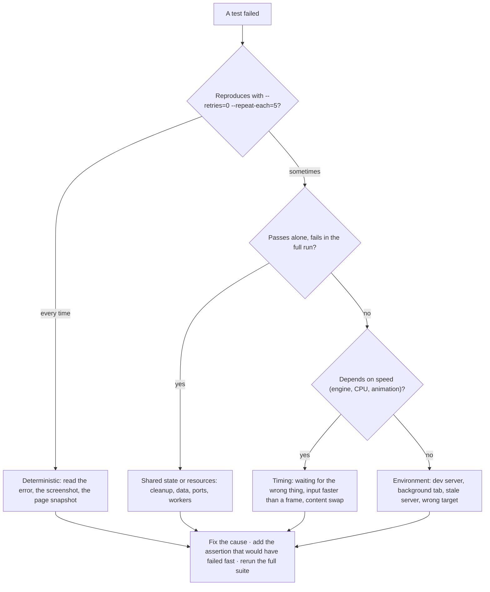

# L4.07 · Test it VII: accessibility audits, Lighthouse and flaky-test forensics

> **Level 4 · Test it and ship it** · Lesson 7 of 8

| Recipe card | |
|---|---|
| **Time** | 65 min |
| **You need** | L3.04 (contrast maths, what axe can and can't check), L3.05 (Lighthouse metrics), L4.03–L4.06 (the suite and its bugs) |
| **You'll produce** | `tests/e2e/a11y.spec.ts` (63 lines) from a blank file, a repeatable Lighthouse procedure with a script that reads its JSON, and a forensic method for any failing or flaky test, applied to every flake in this series |

**In two sentences:** The accessibility spec turns axe-core into a gate: three tests per theme scan every screen and state, and fail on any serious or critical violation with a one-line summary per rule. The rest of the lesson is about trust: how to run Lighthouse so its numbers mean something, and how to work out *why* a test fails or flakes, a method distilled from eleven real incidents in this build, including one where the "frozen app" was actually a development server and a throttled background tab.

### Objectives
1. Write the accessibility spec from memory: theme forcing, the scan helper, the three scan tests, and the waits.
2. Run Lighthouse on mobile and desktop and extract scores, metrics and failing audits from its JSON with a script.
3. Apply a forensic checklist to a failing test: reproduce, classify (deterministic, timing, environment, shared state), gather evidence, fix the cause.
4. Recognise environment artefacts (dev server reloads, background-tab throttling, cold builds) and remove them from the test setup.

---

## 1 · Warm-up: pull it from memory

1. *(L3.04)* Why must a scan wait for animations to settle?
2. *(L4.03)* What does a test marked "flaky" mean in Playwright's report?
3. *(L3.05)* Why are local Lighthouse runs useful even though production scores higher?

<details><summary>Answers</summary>

1. Mid-fade elements are partly transparent, so axe measures blended colours that users never see once the page settles.
2. It failed, then passed on retry (`retries: 1`). Something about it depends on timing or state.
3. They compare a change against the previous build under identical conditions: relative, not absolute.
</details>

## 2 · The problem this solves

Two kinds of test results are hard to act on:
- **Audits with hundreds of findings** (axe, Lighthouse) are ignored unless they're turned into a short, specific pass/fail.
- **Failures that come and go** erode trust in the whole suite. After the third "just rerun it", real failures get rerun too.

**The idea:** make audits *gates* with readable summaries, and treat every flaky or confusing failure as a bug with a cause, found by a method rather than by retrying.



---

## 3 · Concepts

### 3.1 axe in Playwright

`@axe-core/playwright` injects axe-core into the page and runs its rules against the current DOM. `new AxeBuilder({ page }).withTags([...]).exclude(selector).analyze()` returns `{ violations, passes, incomplete, … }`. Each violation has an `id` (the rule, e.g. `color-contrast`), an `impact` (`minor`, `moderate`, `serious`, `critical`) and `nodes` (each failing element, with `target` selectors and a `failureSummary`).

### 3.2 Lighthouse from the command line

`npx lighthouse <url> --output=json --output-path=report.json` runs a full audit in a headless Chrome and writes a JSON report: `categories.<name>.score` (0–1), `audits.<id>` with `score`, `displayValue` and `details.items` (the evidence: URLs, bytes, milliseconds). `--preset=desktop` switches the throttling and screen.

### 3.3 Four kinds of failure

| Kind | Signature | Examples in this series |
|---|---|---|
| **Deterministic** | Fails every time, same line | `pdftotext -v` skips (L4.01); the 8-digit sign-in bug; the tab-bar overlap on iPhone SE |
| **Timing** | Fails on slower engines or under load; passes with an added pause | The 1 ms swipe (L4.04); the quiz reading the sliding card (L4.05); the extra "Next" (L4.06); scans mid-fade |
| **Shared state** | Passes alone, fails in the full run | The cleanup race between workers (L4.06) |
| **Environment** | Depends on how and where it runs, not on the code | Git Bash path conversion (L4.03); HTTP tests pointed at production (L4.03); the dev server and background tab (§7) |

---

## 4 · Reading the real code: `tests/e2e/a11y.spec.ts`

### 4.1 The scan helper (lines 1–14)

```ts
// Automated accessibility checks (axe-core, WCAG 2.1 A/AA) on every screen, both themes.
import { test, expect, type Page } from "@playwright/test";
import AxeBuilder from "@axe-core/playwright";
import { QUESTIONS, goto } from "./support";

async function scan(page: Page, label: string) {
  const r = await new AxeBuilder({ page })
    .withTags(["wcag2a", "wcag2aa", "wcag21a", "wcag21aa"])
    .exclude(".splash")
    .analyze();
  const bad = r.violations.filter((v) => v.impact === "serious" || v.impact === "critical");
  const summary = bad.map((v) => `${v.id} (${v.impact}): ${v.nodes.length}× e.g. ${v.nodes[0]?.target.join(" ")} — ${v.nodes[0]?.failureSummary?.split("\n")[1]?.trim()}`);
  expect(summary, `${label}: serious/critical accessibility issues`).toEqual([]);
}
```

- **Tags**: WCAG 2.0 and 2.1, levels A and AA. axe has other rule sets (best practices, WCAG 2.2, experimental); these four match the legal and common target.
- **`.exclude(".splash")`**: the first-load splash is decorative and fading; it's also `aria-hidden` once it starts fading.
- **Only serious and critical fail the test.** Minor and moderate findings exist (for example "region" landmarks) but don't block; the summary format makes adding them a one-word change.
- **The summary line** per rule: `id (impact): N× e.g. <first node's selector> — <first line of its failure summary>`. Compact enough to read in a terminal, specific enough to act on. Its limitation, showing only the first node, is exactly what hid two of the contrast failures until the first ones were fixed (L3.04 §5).
- **`toEqual([])`** with a label: on failure, Playwright prints the received array, so the summary lines *are* the error message.

### 4.2 Forcing the theme (lines 16–21)

```ts
for (const theme of ["light", "dark"] as const) {
  test.describe(`${theme} theme`, () => {
    test.beforeEach(async ({ page }) => {
      await page.addInitScript((t) => localStorage.setItem("pol.theme", JSON.stringify(t)), theme);
      page.on("dialog", (d) => d.accept());
    });
```

- **Two `describe` blocks generated by a loop**, so every test runs once per theme.
- **`addInitScript`** runs before any page script on every navigation: it writes `pol.theme` (JSON-encoded, as the app's `save()` does) so the **first paint** is already in the forced theme. Setting it after load would scan a theme transition.
- **The dialog handler**: the runner test below opens `/test/run`, which installs a `beforeunload` prompt.

### 4.3 The three scans (lines 23–63)

```ts
    test("main screens", async ({ page }) => {
      for (const path of ["/", "/study", "/test", "/ranks", "/me"]) {
        await goto(page, path);
        await page.waitForTimeout(700); // let entry animations settle
        await scan(page, `${theme} ${path}`);
      }
    });

    test("flashcard back, quiz feedback and list", async ({ page }) => {
      await goto(page, "/study?week=6");
      await page.locator(".fc").last().click();
      await page.waitForTimeout(900);
      await scan(page, `${theme} flashcard back`);
      await page.locator(".seg button", { hasText: "Quiz" }).click();
      await page.locator(".q-card .opt").first().click();
      await page.waitForTimeout(500);
      await scan(page, `${theme} quiz feedback`);
      await page.locator(".seg button", { hasText: "List" }).click();
      await page.locator(".search input").fill("memory");
      await scan(page, `${theme} list search`);
    });

    test("test runner, question grid and results", async ({ page }) => {
      await goto(page, "/");
      const ids = QUESTIONS.slice(20, 120).map((q) => q.id);
      await page.evaluate((qids) => {
        localStorage.setItem("pol.attempt", JSON.stringify({ attempt_id: "x", question_ids: qids, started_at: new Date().toISOString(), client_started: Date.now(), answers: qids.map((_, i) => (i < 3 ? 0 : null)), flags: [1], pos: 2 }));
        localStorage.setItem("pol.lastResult", JSON.stringify({ score: 81, total: 100, duration_ms: 900000, correct: qids.map(() => 1), rank: 4, players: 30, question_ids: qids, answers: qids.map((_, i) => (i % 5 ? 1 : 0)) }));
      }, ids);
      await goto(page, "/test/run");
      await page.waitForTimeout(600);
      await scan(page, `${theme} test runner`);
      await page.getByRole("button", { name: "All questions" }).click();
      await page.waitForTimeout(600);
      await scan(page, `${theme} question grid`);
      await goto(page, "/test/result");
      await page.waitForTimeout(2000);
      await scan(page, `${theme} results`);
    });
  });
}
```

- **Main screens**: the five routes, 700 ms after each navigation (the page transition is ~0.52 s; the rest is margin for entry animations).
- **States, not just pages**: the flashcard **back** (a dark surface with its own colours), quiz **feedback** (green and red options), and list **search** with highlights. Each state has colours the default page doesn't.
- **The runner from injected state** (the L4.05 technique): an attempt with 3 answers and 1 flag at question 3, and a result with mixed answers. Then the runner, the question grid (sheet), and the results page after 2 s (count-up, mascot and mood line all finished).
- **Coverage**: 3 tests × 2 themes × 9 projects = 54 scan runs, and 11 distinct screen states per theme.

---

## 5 · Lighthouse, repeatably

### 5.1 The procedure

```bash
npm run build
npx vite preview --port 4174 --strictPort --host 127.0.0.1 &      # the production build
npx -y lighthouse@12.8.2 http://127.0.0.1:4174/ --quiet --chrome-flags="--headless=new" \
    --output=json --output-path=lh/mobile-home.json
npx -y lighthouse@12.8.2 http://127.0.0.1:4174/ --preset=desktop --quiet --chrome-flags="--headless=new" \
    --output=json --output-path=lh/desktop-home.json
npx -y lighthouse@12.8.2 https://psychology-of-learning-nptel.vercel.app/ --quiet --chrome-flags="--headless=new" \
    --output=json --output-path=lh/mobile-prod.json
```
- **Pin the version** (`lighthouse@12.8.2`): scoring curves change between major versions, so comparisons across versions are meaningless.
- **Headless Chrome**: a visible window that goes to the background gets throttled (§7).
- **Same build, same machine, nothing else running** for before/after comparisons; run three times and take the median.

### 5.2 Reading the JSON with a script

The session's summary script, as a standalone file:

```python
# lhsum.py — usage: python lhsum.py lh/*.json
import json, sys, os
for f in sys.argv[1:]:
    d = json.load(open(f, encoding="utf-8"))           # UTF-8: reports contain non-ASCII
    c, a = d["categories"], d["audits"]
    dv = lambda k: a[k]["displayValue"].replace("\xa0", " ")
    print(os.path.basename(f).ljust(16),
          " ".join(f"{k}={round(v['score'] * 100)}" for k, v in c.items()),
          "| FCP", dv("first-contentful-paint"), "LCP", dv("largest-contentful-paint"),
          "CLS", dv("cumulative-layout-shift"), "TBT", dv("total-blocking-time"))
    weak = [k for k, v in a.items() if v.get("score") is not None and v["score"] < 0.9
            and v.get("scoreDisplayMode") in ("binary", "numeric", "metricSavings")]
    print("   below 0.9:", ", ".join(weak))
```
- **`encoding="utf-8"`**: the first version of this script crashed on Windows with `UnicodeDecodeError: 'charmap' codec can't decode byte 0x9d`, because Python's default encoding there is cp1252 and the report contains non-ASCII characters. Always open JSON reports as UTF-8.
- **`\xa0`**: Lighthouse's display values use a non-breaking space ("2.1\xa0s").
- **"below 0.9"** lists the audits worth reading. Then read `audits[id].details.items` for the evidence (which URL, how many bytes or ms).

**Output for this project** (re-run for L3.05):
```text
desktop-home    performance=100 accessibility=100 best-practices=96 seo=100 | FCP 0.5 s LCP 0.6 s CLS 0.003 TBT 0 ms
mobile-home     performance=91 accessibility=100 best-practices=96 seo=100 | FCP 2.1 s LCP 3.1 s CLS 0.006 TBT 90 ms
mobile-prod     performance=98 accessibility=100 best-practices=100 seo=100 | FCP 1.2 s LCP 1.2 s CLS 0.006 TBT 140 ms
```

### 5.3 Why Lighthouse isn't in the test suite

Lab scores vary by machine load, so a hard threshold ("performance ≥ 90") would flake on a busy laptop or CI runner. The suite instead tests the *causes* Lighthouse flagged, deterministically: images are WebP with sizes (HTTP spec checks content types), hashed assets are immutable (on production), accessibility is gated by axe. Lighthouse is run by hand around performance work, with the procedure above. (A CI budget with tolerances, using Lighthouse CI, is the step up; see Go further.)

---

## 6 · Running and testing

```bash
npx playwright test tests/e2e/a11y.spec.ts                                   # 54 runs
npx playwright test tests/e2e/a11y.spec.ts --project=galaxy-s9-320 -g "dark"
npx playwright test -g "quiz" --retries=0 --repeat-each=10 --project=iphone-13   # hunt a flake
npx playwright show-trace test-results/<folder>/trace.zip
```
- **`--repeat-each=10`** runs each selected test 10 times: the fastest way to turn "sometimes" into a rate (3/10 fails is a timing bug; 10/10 is deterministic).
- **`--workers=1`** isolates shared-state problems: if a flake disappears with one worker, look for cross-test interference.
- **The trace** shows each action with a DOM snapshot before and after, the network log and the console. Most timing bugs are visible as "the assertion read the DOM one snapshot too early".

## 7 · Bug journal

### Incident · Vite's reload loop plus background-tab throttling looked like a frozen app

1. **Symptom.** During the first hands-on check in a real Chrome window (driven through a browser extension), the app seemed to freeze after a swipe: the "AGAIN" stamp stayed half-visible and the card didn't move on; the page still reported the splash as present (`"splash": true`). A later command to the tab failed outright:
   ```text
   Failed to execute JavaScript: CDP sendCommand "Runtime.evaluate" timed out after 45000ms on tab 1133474601.
   The renderer may be frozen or unresponsive.
   ```
2. **Diagnosis.**
   - *Hypothesis: an infinite render loop in the app.* The console did show a real bug, `destroy is not a function` (the `useEffect` returning a Promise of [L2.05](l2-05-app-shell.md)), which was fixed. The "freeze" continued after the fix.
   - *What else was in the console?* Repeated `[vite] connecting...` / `[vite] connected.` lines: the dev server's live-reload socket dropping and reconnecting, reloading modules under the running page.
   - *Why did animations stop?* The Chrome window was in the **background** while the tests ran. Chrome stops `requestAnimationFrame` in hidden tabs and throttles their timers, so Motion's springs, the stamp fade and the splash's timers all paused. The app wasn't frozen; its clock was.
   - Taking screenshots with **headless** Chrome of a **production build** instead: both swipe directions worked, and the stamp only "froze" when the tab was hidden.
3. **Root cause.** Two environment artefacts at once: a development server that reloads code mid-test, and a browser that deliberately starves background tabs of frames and timers. Neither exists for a user looking at the app.
4. **Fix** (to the test setup, not the app):
   ```diff
   -# check by hand in the visible browser against the dev server
   -npm run dev            # http://127.0.0.1:5173, live reload
   +# test the production build in a headless browser
   +npm run build && npx vite preview --port 4174 --strictPort --host 127.0.0.1
   +npx playwright test     # headless Chromium / WebKit / Firefox, never backgrounded
   ```
   This became the `webServer` block of `playwright.config.ts` (L4.03). The related real app bug, the splash never disappearing in headless and background tabs (its unmount waited for an exit animation those environments never completed), was fixed separately with a timer-driven fade and a 4 s cap ([L2.05](l2-05-app-shell.md), incident 2).
5. **Lesson.** Before debugging the app, rule out the harness: is this the production build? Is the tab visible? Is anything reloading? A test environment should differ from a user's only in ways you chose.

### Index of this series' failures by kind

| Kind | Incident | Decisive evidence | Lesson |
|---|---|---|---|
| Deterministic | Twelve PDF checks skipped | `pass 5, skipped 12`; `pdftotext -v` exits 99 | L4.01 |
| Deterministic | Buttons under the tab bar | `Expected: <= 493, Received: 572` | L2.10c |
| Timing | 1 ms swipe in WebKit | Events logged; works with a 100 ms pause | L4.04 |
| Timing | Sideways check at the wrong moment | Values varied per run; measured during the slide | L4.04 |
| Timing | Quiz read the sliding card | Debug log: iteration 1 read iteration 0's question | L4.05 |
| Timing | Extra "Next" click | Snapshot: last question, "Submit test" where "Next" was | L4.06 |
| Shared state | Cleanup race | Passes alone; another worker's `afterAll` deleted by prefix | L4.06 |
| Environment | Git Bash path conversion | `["C:/Program Files/Git/study"]` | L4.03 |
| Environment | HTTP tests checked production | `const base = … ?? PROD` | L4.03 |
| Environment | Scanner flagged library source | The match was supabase-js's own warning code | L4.03 |
| Environment | Dev server + background tab | `[vite] connecting…`; hidden tab; works headless on a build | L4.07 |

## 8 · Why this design

| Decision | Alternatives | Why this one | Trade-off | Choose differently when |
|---|---|---|---|---|
| axe as a gate (serious + critical) | Report only; fail on everything | Blocks real barriers without drowning in minor findings | Minor issues accumulate unseen | Mature product → also gate moderate, add WCAG 2.2 tags |
| Scan states, not only pages | One scan per URL | Colours of feedback, back faces and sheets get checked | More, longer tests | — |
| Lighthouse by hand with a pinned version | Lighthouse CI with budgets | No flaky thresholds in the suite | Regressions caught only when someone runs it | A team shipping often → Lighthouse CI with tolerances and medians |
| Forensics before retries | Retry until green | Each flake becomes a fixed bug and a better assertion | Time spent per failure | Never; retries are for reporting flakes, not hiding them |
| Headless, production build | Visible browser, dev server | No throttling, no HMR, same files as users | Can't watch it live (use `--headed` or UI mode when needed) | Writing a new test → UI mode against the build |

## 9 · Check yourself

**Q1.** A test fails 3 times in `--repeat-each=10` on WebKit and never on Chromium. Which kind is it most likely, and what do you look for first?
<details><summary>Answer</summary>Timing. Look for an assertion that reads state before a transition finishes, or input faster than an animation frame; open the trace of a failing repeat.</details>

**Q2.** A test passes alone and fails in the full run. What do you try first?
<details><summary>Answer</summary><code>--workers=1</code> on the full run. If it passes, look for shared state: cleanup by pattern, shared users or data, a fixed port, a global setting.</details>

**Q3.** Why does `addInitScript` set the theme instead of `page.evaluate` after `goto`?
<details><summary>Answer</summary><code>addInitScript</code> runs before the page's own scripts, so the first paint uses the forced theme. Setting it after load would scan during a theme transition, or in the wrong theme.</details>

**Q4.** The Lighthouse summary script crashes with `UnicodeDecodeError: 'charmap' codec…` on Windows. Fix?
<details><summary>Answer</summary>Open the report with <code>encoding="utf-8"</code>; Windows' default (cp1252) can't decode some characters in the report.</details>

**Q5.** Predict: you run the UI suite against `npm run dev` instead of the build. Name two ways results could mislead you.
<details><summary>Answer</summary>Module reloads can reset state mid-test; dev-only warnings and React's StrictMode double effects change timing; files aren't hashed, so cache and HTTP checks don't reflect production; performance numbers are meaningless.</details>

**Q6.** Why isn't "performance ≥ 90" an assertion in the suite?
<details><summary>Answer</summary>Lab scores vary with machine load, so it would flake. The suite tests the deterministic causes instead (image formats and sizes, cache headers), and Lighthouse is run by hand with a pinned version.</details>

## 10 · Practice

**Easy (10 min).** Make the a11y summary list **every** failing node's selector (not just the first), and check how the first contrast failures would have looked.

**Medium (20 min).** Add WCAG 2.2 AA (`wcag22aa`) to the tags and run the suite. Record each new finding and decide: fix, or document why not.
<details><summary>Hint</summary>WCAG 2.2 adds target size (2.5.8, 24 × 24 px minimum) and focus-not-obscured (2.4.11). The tab bar and sticky headers are the places to look.</details>

**Hard (40 min).** Set up Lighthouse CI (`@lhci/cli`) with three runs per URL, assertions on the median (`performance ≥ 0.85`, `accessibility = 1`, `cumulative-layout-shift ≤ 0.1`), against the local preview.
**Done when** `npx lhci autorun` passes locally and fails if you re-add the Google Fonts `<link>`.

## 11 · From memory

**Rung 1 · Cloze.**

```ts
const r = await new AxeBuilder({ page })
  .withTags(["wcag2a", "wcag2aa", "___①___", "wcag21aa"])
  .___②___(".splash")
  .analyze();
const bad = r.violations.filter((v) => v.impact === "serious" || v.impact === "___③___");
await page.___④___((t) => localStorage.setItem("pol.theme", JSON.stringify(t)), theme);
await page.waitForTimeout(___⑤___); // let entry animations settle
```
```bash
npx -y lighthouse@12.8.2 http://127.0.0.1:4174/ --preset=___⑥___ --output=___⑦___ --output-path=lh/desktop.json
npx playwright test -g "quiz" --retries=___⑧___ --repeat-each=10
```
<details><summary>Answers</summary>① <code>wcag21a</code> ② <code>exclude</code> ③ <code>critical</code> ④ <code>addInitScript</code> ⑤ <code>700</code> ⑥ <code>desktop</code> ⑦ <code>json</code> ⑧ <code>0</code></details>

**Rung 2 · Blank page (20 min). No scrolling up.** Write `a11y.spec.ts`, then draw the failure-forensics flowchart and place five incidents from this series on it.
<details><summary>Self-check</summary>

- [ ] Scan helper with the four tags, splash excluded, serious/critical filter, one-line summary, labelled `toEqual([])`
- [ ] Loop over themes; `addInitScript` sets `pol.theme`; dialog handler
- [ ] Main screens with a 700 ms settle; card back; quiz feedback; list search; runner, grid and results from injected state
- [ ] Flowchart: reproduce with retries 0 and repeat-each → deterministic / timing / shared state / environment
- [ ] Five incidents placed correctly (see the index in §7)
</details>

## 12 · Flashcards

<details><summary><b>Q:</b> Which axe impacts fail the suite?</summary><b>A:</b> Serious and critical.</details>
<details><summary><b>Q:</b> Which WCAG tags are scanned?</summary><b>A:</b> wcag2a, wcag2aa, wcag21a, wcag21aa.</details>
<details><summary><b>Q:</b> Why <code>addInitScript</code> for the theme?</summary><b>A:</b> It runs before the app's scripts, so the first paint is in the forced theme.</details>
<details><summary><b>Q:</b> How many a11y scan runs?</summary><b>A:</b> 3 tests × 2 themes × 9 projects = 54.</details>
<details><summary><b>Q:</b> Four kinds of test failure?</summary><b>A:</b> Deterministic, timing, shared state, environment.</details>
<details><summary><b>Q:</b> First two commands for a suspected flake?</summary><b>A:</b> <code>--retries=0 --repeat-each=N</code>, then <code>--workers=1</code>.</details>
<details><summary><b>Q:</b> Why test the production build headlessly?</summary><b>A:</b> No dev reloads, no background-tab throttling, same files as users.</details>
<details><summary><b>Q:</b> What do hidden Chrome tabs do to animations?</summary><b>A:</b> Stop <code>requestAnimationFrame</code> and throttle timers, so animations appear frozen.</details>
<details><summary><b>Q:</b> Why pin the Lighthouse version?</summary><b>A:</b> Scoring curves change between versions; comparisons need the same one.</details>
<details><summary><b>Q:</b> Why open Lighthouse JSON as UTF-8 in Python on Windows?</summary><b>A:</b> The default cp1252 codec can't decode some characters in the report.</details>

## 13 · The menu board

| | |
|---|---|
| axe | 4 WCAG tags · exclude splash · fail on serious/critical · one line per rule (first node only) |
| Theme | `addInitScript` writes `pol.theme` before load |
| States | 5 routes · card back · quiz feedback · list search · runner · grid · results (injected) |
| Waits | 700 ms after nav · 900 ms after flip · 2 s on results |
| Lighthouse | pinned 12.8.2 · headless · build on 4174 · mobile + desktop + prod · median of 3 · read `details.items` |
| Forensics | retries 0 + repeat-each → deterministic / timing / shared state / environment → fix cause + fail-fast assertion |
| Environment traps | dev server · background tab · stale server · wrong target · shell rewriting args |

## 14 · Glossary

**axe-core**: an accessibility rule engine. **Background-tab throttling**: browsers pausing animation frames and slowing timers for hidden tabs. **Flaky test**: one with nondeterministic results. **Forensics (testing)**: methodically establishing why a test failed. **HMR / live reload**: a dev server pushing code changes into a running page. **Impact (axe)**: a violation's severity. **Lighthouse CI**: Lighthouse runs in CI with assertions on scores. **Repeat-each**: running a test multiple times to measure its failure rate.

## 15 · Go further

| Resource | Type | Why | Which part | Time |
|---|---|---|---|---|
| [Playwright: Accessibility testing](https://playwright.dev/docs/accessibility-testing) | Docs | The official axe integration | Whole page | 15 min |
| [axe-core: Rule descriptions](https://github.com/dequelabs/axe-core/blob/develop/doc/rule-descriptions.md) | Reference | Every rule with its tags and impact | The WCAG 2.1 tables | 15 min |
| [Lighthouse CI: Getting started](https://github.com/GoogleChrome/lighthouse-ci/blob/main/docs/getting-started.md) | Docs | Budgets and medians for the Hard exercise | "Configure LHCI", "Assertions" | 25 min |
| [Chrome: Timer throttling in background tabs](https://developer.chrome.com/blog/timer-throttling-in-chrome-88) | Article | Why hidden tabs "freeze" | Whole post | 10 min |
| [Playwright: Retries](https://playwright.dev/docs/test-retries) | Docs | How flaky is reported | "Retries", "Serial mode" | 10 min |
| [Google Testing Blog: Flaky tests at Google](https://testing.googleblog.com/2016/05/flaky-tests-at-google-and-how-we.html) | Article | Why flakes matter at scale | Whole post | 10 min |

---
← [L4.06 Test it VI: live security and the signed-in journey](l4-06-live-security-auth.md) · [Hub](README.md) · [L4.08 Ship it: deploy from Git and operate →](l4-08-deploy-operate.md)
