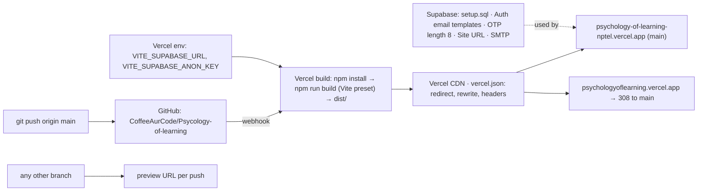

# L4.08 · Ship it: deploy from Git and operate (+ Level 4 checkpoint)

> **Level 4 · Test it and ship it** · Lesson 8 of 9

| Recipe card | |
|---|---|
| **Time** | 75 min |
| **You need** | L1.04 (Git, keys, static hosting), L2.04 (`index.html`, env variables), L3.05 (caching), L4.03 (the HTTP spec that checks all of this) |
| **You'll produce** | `vercel.json`, `.gitignore`, `.vercelignore`, `.env.example`, the SEO head of `index.html`, `robots.txt`, `sitemap.xml`, `manifest.webmanifest`, the Supabase dashboard settings, and the Level 4 checkpoint |

**In two sentences:** Shipping this app means three systems agreeing: GitHub holds the code (and never the secrets), Vercel builds every push to `main` with the Vite preset and serves `dist/` from its CDN with the right redirects, rewrites and cache headers, and Supabase holds the database and auth settings that no file in the repo can set by itself. This lesson walks every deployment file, the dashboard checklist, how to operate the site afterwards, and the two deploy bugs, both of which were silent misconfigurations rather than errors.

> **Session 2 update (2026-10-16).** In §4.7, the email rows (code templates, OTP length, SMTP) are history: email sign-in is off. The current Supabase and Google Cloud settings are in [L2.07c](l2-07c-google-sign-in.md) §4, and the operating runbook for auth is in [L4.09](l4-09-auth-tests-incident-ops.md) §6.

### Objectives
1. Write `vercel.json` from memory and explain the redirect, the SPA rewrite and the cache header.
2. Keep secrets out of Git and out of uploads: `.gitignore`, `.vercelignore`, `.env.example`, Vercel environment variables, and the build-time meaning of `VITE_`.
3. Explain each SEO and sharing tag in `index.html`, plus robots, sitemap and manifest, and what the static fallback is for.
4. Set up the Supabase side: run `setup.sql`, email templates with the code, OTP length, Site URL, SMTP.
5. Operate it: deploy by pushing, preview branches, roll back, run `test:prod`, read analytics, and diagnose a deployment that "works" with the wrong settings.

---

## 1 · Warm-up: pull it from memory

1. *(L4.03)* Why does the SPA rewrite make "file missing" checks harder, and what does the HTTP spec check instead?
2. *(L2.04)* What happens to `import.meta.env.VITE_SUPABASE_URL` at build time?
3. *(L3.01)* Which key may appear in the browser bundle, and which must never?

<details><summary>Answers</summary>

1. Every unknown path returns `index.html` with status 200, so a missing file looks like success. The spec checks content types and bodies.
2. Vite replaces it with the literal value from the environment, inside the built JavaScript. It's not read at runtime.
3. The publishable (anon) key may; the secret (service-role) key must never.
</details>

## 2 · The problem this solves

Deploying by hand ("run the CLI from my laptop") works once. It ties every release to one machine, one person and one folder, and that folder contains `Supabase.txt` with the secret key. It also leaves no record of which code is live.

**The idea:** deploy from Git. The repository is the single source of truth, a push to `main` is a release, any other branch gets a preview URL, and secrets live only in the hosts' settings.



---

## 3 · Concepts

### 3.1 What a Vercel deployment is

Each deployment is an **immutable** snapshot: one build of one commit, at its own URL (`psychology-of-learning-nptel-4iujqfk7j-….vercel.app`). **Domains are aliases** pointing at a deployment. "Promoting" or a new production deployment only moves the alias; the old deployment still exists, which is why rollback is instant (point the alias back).

### 3.2 Framework presets

A preset tells Vercel how to build: for Vite, the build command is `npm run build` (here `tsc -p . && vite build`) and the output directory is `dist`. Without a preset ("Other"), Vercel may treat the repository as static files and serve the **source** `index.html`, which references `/src/main.tsx`, a file no browser can run: a blank page that returns 200 everywhere. That's the risk of §7.1.

### 3.3 Build-time environment variables

`VITE_*` variables are baked into the JavaScript at build time. So:
- changing one in Vercel's settings does nothing until the **next build** (redeploy);
- anything with the `VITE_` prefix is **public**, by design. Only the URL and the publishable key may have it;
- the secret key isn't needed by the site at all. It lives only in the test environment (`SUPABASE_SECRET_KEY` or the git-ignored `Supabase.txt`).

### 3.4 Redirects vs rewrites

| | Redirect | Rewrite |
|---|---|---|
| What the browser sees | A 301/308 response and a new URL in the address bar | The original URL; the content comes from elsewhere |
| Used here for | The short domain → the main domain | Every path → `index.html` (the SPA) |
| Search engines | Transfer ranking to the destination; treat it as one site | See the URL as normal |

308 is the "permanent, keep the method" redirect (`permanent: true` in `vercel.json`); 301 is the older permanent one. The HTTP spec accepts either.

---

## 4 · Reading the real files

### 4.1 `vercel.json` (all of it)

```json
{
  "redirects": [
    {
      "source": "/:path*",
      "has": [{ "type": "host", "value": "psychologyoflearning.vercel.app" }],
      "destination": "https://psychology-of-learning-nptel.vercel.app/:path*",
      "permanent": true
    }
  ],
  "rewrites": [{ "source": "/(.*)", "destination": "/index.html" }],
  "headers": [
    {
      "source": "/assets/(.*)",
      "headers": [{ "key": "Cache-Control", "value": "public, max-age=31536000, immutable" }]
    }
  ]
}

```

- **The redirect**: when the request's `host` is the short domain, send a permanent redirect to the same path on the main domain. `:path*` captures the whole path; Vercel keeps the query string, which the HTTP spec checks (`/study?week=2` → `…/study?week=2`). One canonical domain means one set of search results and one origin for `localStorage` (progress saved on one domain isn't visible on another).
- **The rewrite**: every path serves `/index.html`, so deep links and reloads (`/study`, `/test/run`) reach React Router. Real files in `dist/` (assets, icons, `robots.txt`) are served first; the rewrite only applies when no file matches.
- **The header**: everything under `/assets/` (Vite's hashed files) is cacheable for a year and `immutable` (L3.05). Nothing else gets a long cache: `index.html` must always be fresh.

### 4.2 `.gitignore` and `.vercelignore`

```gitignore
# secrets — never commit
Supabase.txt
.env
.env.*
!.env.example

# build / deps
node_modules/
dist/
.vercel/

# misc
.DS_Store
Thumbs.db
*.log
*.tsbuildinfo

.vercel

# test output
test-results/
playwright-report/
```

- **Secrets first**: `Supabase.txt` (the notes file with the keys) and every `.env*` file, **except** `.env.example` (the `!` re-includes it). Order matters: a later pattern overrides an earlier one, which is the root of §7.2.
- **Build output and dependencies**: `node_modules/`, `dist/`, and `.vercel/` (the CLI's link file with project ids).
- **Test output**: `test-results/` and `playwright-report/` (traces can contain page content and screenshots).

```gitignore
# never upload secrets or course files to Vercel
Supabase.txt
.env
.env.*
!.env.example
*.pdf
Psychology_of_Learning_Flashcards.html
node_modules
dist
```

- **Why a second ignore file when deploys come from Git?** A Git deployment only contains committed files, so the secrets can't be uploaded that way. But a **CLI** deployment (`vercel deploy`, used before the Git connection, and still possible) uploads the **working folder**, including untracked files like `Supabase.txt`. `.vercelignore` protects that path. It also keeps the course PDFs and the old single-file flashcard page out of every upload.
- **Verified live**: requesting `/Supabase.txt` returns the app shell (the rewrite), and the HTTP spec checks that no response body contains a secret.

### 4.3 `.env.example`

```bash
# Copy to .env.local and fill in (Supabase > Project Settings > API keys)
VITE_SUPABASE_URL=https://YOUR-PROJECT.supabase.co
VITE_SUPABASE_ANON_KEY=sb_publishable_xxx

# Supabase → Auth → Providers → Email → "Email OTP length" (default here: 8)
# VITE_OTP_LENGTH=8
```

- **The template for `.env.local`**: names the two variables and where to find them, with placeholder values. Committed so a new developer knows what to set.
- **`VITE_OTP_LENGTH`** (commented out): the app auto-submits once this many digits are typed; it accepts 6–10 regardless (L2.07a).

### 4.4 `index.html`: the head

```html
<!doctype html>
<html lang="en">
  <head>
    <meta charset="UTF-8" />
    <meta name="viewport" content="width=device-width, initial-scale=1, viewport-fit=cover" />
    <title>Psychology of Learning NPTEL · Flashcards, Quiz &amp; Practice Test</title>
    <meta
      name="description"
      content="Free flashcards, quizzes and a timed 100-question practice test for the NPTEL Psychology of Learning course (IIT Kharagpur). All 130 assignment questions with answers, weeks 0–12, plus a live leaderboard."
    />
    <meta name="keywords" content="Psychology of Learning, NPTEL, NPTEL Psychology of Learning, assignment answers, IIT Kharagpur, SWAYAM, flashcards, practice test, quiz, exam preparation" />
    <link rel="canonical" href="https://psychology-of-learning-nptel.vercel.app/" />
    <meta name="robots" content="index, follow" />
    <meta name="theme-color" content="#0e0c0b" />
    <meta name="color-scheme" content="dark light" />
    <meta name="format-detection" content="telephone=no" />
    <link rel="icon" type="image/png" href="/favicon.png" />
    <link rel="apple-touch-icon" href="/icons/apple-touch-icon.png" />
    <link rel="manifest" href="/manifest.webmanifest" />
    <meta name="mobile-web-app-capable" content="yes" />
    <meta name="apple-mobile-web-app-capable" content="yes" />
    <meta name="apple-mobile-web-app-title" content="PsyLearn" />
    <meta name="apple-mobile-web-app-status-bar-style" content="black-translucent" />

    <meta property="og:type" content="website" />
    <meta property="og:site_name" content="Coffee aur Code" />
    <meta property="og:url" content="https://psychology-of-learning-nptel.vercel.app/" />
    <meta property="og:title" content="Psychology of Learning NPTEL · Flashcards, Quiz & Practice Test" />
    <meta property="og:description" content="All 130 NPTEL assignment questions with answers. Swipe flashcards, take a timed 100-question test, climb the leaderboard." />
    <meta property="og:image" content="https://psychology-of-learning-nptel.vercel.app/og-image.png" />
    <meta property="og:image:width" content="1200" />
    <meta property="og:image:height" content="630" />
    <meta name="twitter:card" content="summary_large_image" />
    <meta name="twitter:title" content="Psychology of Learning NPTEL · Flashcards, Quiz & Practice Test" />
    <meta name="twitter:description" content="All 130 NPTEL assignment questions with answers, a timed practice test and a live leaderboard." />
    <meta name="twitter:image" content="https://psychology-of-learning-nptel.vercel.app/og-image.png" />

    <script type="application/ld+json">
      {
        "@context": "https://schema.org",
        "@type": "LearningResource",
        "name": "Psychology of Learning NPTEL · Flashcards, Quiz & Practice Test",
        "url": "https://psychology-of-learning-nptel.vercel.app/",
        "description": "Flashcards, quizzes and a timed practice test covering all 130 assignment questions of the NPTEL Psychology of Learning course (IIT Kharagpur), weeks 0 to 12.",
        "learningResourceType": ["Flashcards", "Quiz", "Practice test"],
        "educationalLevel": "Undergraduate",
        "inLanguage": "en",
        "isAccessibleForFree": true,
        "about": { "@type": "Course", "name": "Psychology of Learning", "provider": { "@type": "Organization", "name": "NPTEL · IIT Kharagpur" } },
        "publisher": { "@type": "Organization", "name": "Coffee aur Code" }
      }
    </script>
    <script>
      // apply saved theme before paint (no flash)
      try {
        var t = JSON.parse(localStorage.getItem("pol.theme") || "null");
        if (t === "light" || t === "dark") document.documentElement.dataset.theme = t;
      } catch (e) {}
    </script>
  </head>
```

| Lines | Tag | Purpose |
|---|---|---|
| 2 | `lang="en"` | Screen readers and search engines know the language |
| 5 | viewport with `viewport-fit=cover` | Phone-width layout; content under the notch with safe-area padding (L2.10a) |
| 6 | `<title>` | The search result title and tab name: the course name plus what's offered, as students search it |
| 7–10 | description | The search snippet (the HTTP spec requires ≥ 80 characters) |
| 11 | keywords | Ignored by Google; harmless for other engines |
| 12 | canonical | Tells search engines the one true URL (the short domain redirects anyway) |
| 13 | robots `index, follow` | Explicitly indexable |
| 14–16 | theme-color, color-scheme, format-detection | Browser UI colour; dark/light controls before CSS; iOS shouldn't turn numbers into phone links |
| 17–23 | icons, manifest, app-capable | Favicon, home-screen icon, installable as a standalone app |
| 25–36 | Open Graph and Twitter | The preview card when the link is shared (WhatsApp, Telegram, X): title, description and a 1200 × 630 image |
| 38–52 | JSON-LD `LearningResource` | Structured data describing the site as free learning material about the NPTEL course |
| 53–59 | inline theme script | Applies a saved Light/Dark choice before the first paint (no flash), wrapped in `try` because storage can be unavailable |

### 4.5 `index.html`: the body and the static fallback

```html
  <body>
    <div id="root">
      <!-- Readable before JavaScript loads (search engines, slow networks). React replaces this. -->
      <main style="max-width: 640px; margin: 0 auto; padding: 32px 20px; font-family: system-ui, sans-serif">
        <h1>Psychology of Learning (NPTEL) · Flashcards, Quiz &amp; Practice Test</h1>
        <p>
          Study all 130 assignment questions with answers from the NPTEL <strong>Psychology of Learning</strong> course by IIT Kharagpur, weeks 0 to 12. Swipe
          flashcards, take quick quizzes, and attempt a timed 100-question practice test with a live leaderboard.
        </p>
        <h2>Weeks covered</h2>
        <ul>
          <li>Week 0 · Introduction to psychology</li>
          <li>Week 1 · What is learning</li>
          <li>Week 2 · Behaviourism, conditioning &amp; intelligence</li>
          <li>Week 3 · Memory and information processing</li>
          <li>Week 4 · Thinking, concepts &amp; Bloom's taxonomy</li>
          <li>Week 5 · Motivation</li>
          <li>Week 6 · Emotional intelligence</li>
          <li>Week 7 · Learning &amp; instruction</li>
          <li>Week 8 · Pedagogy &amp; experiential learning</li>
          <li>Week 9 · E-learning</li>
          <li>Week 10 · Teaching, feedback &amp; assessment</li>
          <li>Week 11 · Social cognition</li>
          <li>Week 12 · Learning for sustainability</li>
        </ul>
        <noscript><p>Please enable JavaScript to use the flashcards and practice test.</p></noscript>
      </main>
    </div>
    <script type="module" src="/src/main.tsx"></script>
  </body>
</html>
```

- **Readable without JavaScript**: a heading, a description and the week list, in the system font. Search engines that don't run JavaScript, link previews and very slow connections see real content; React replaces it on render (`createRoot(#root)`).
- **`<noscript>`** explains what's needed for the interactive parts.
- **`<script type="module" src="/src/main.tsx">`**: in the **source** file it points at TypeScript; `vite build` rewrites it to the hashed bundle (`/assets/index-DSGj10eu.js`). That difference is how §7.1 was verified.

### 4.6 `robots.txt`, `sitemap.xml`, `manifest.webmanifest`

```text
User-agent: *
Allow: /

Sitemap: https://psychology-of-learning-nptel.vercel.app/sitemap.xml
```

```xml
<?xml version="1.0" encoding="UTF-8"?>
<urlset xmlns="http://www.sitemaps.org/schemas/sitemap/0.9">
  <url><loc>https://psychology-of-learning-nptel.vercel.app/</loc><priority>1.0</priority></url>
  <url><loc>https://psychology-of-learning-nptel.vercel.app/study</loc><priority>0.9</priority></url>
  <url><loc>https://psychology-of-learning-nptel.vercel.app/test</loc><priority>0.8</priority></url>
  <url><loc>https://psychology-of-learning-nptel.vercel.app/ranks</loc><priority>0.6</priority></url>
</urlset>
```

```json
{
  "name": "Psychology of Learning · Coffee aur Code",
  "short_name": "PsyLearn",
  "description": "Flashcards, timed practice tests and a leaderboard for the NPTEL Psychology of Learning exam.",
  "start_url": "/",
  "display": "standalone",
  "background_color": "#0e0c0b",
  "theme_color": "#0e0c0b",
  "icons": [
    { "src": "/icons/icon-192.png", "sizes": "192x192", "type": "image/png" },
    { "src": "/icons/icon-512.png", "sizes": "512x512", "type": "image/png" },
    { "src": "/icons/maskable-512.png", "sizes": "512x512", "type": "image/png", "purpose": "maskable" }
  ]
}
```

- **robots** allows everything and points to the sitemap.
- **sitemap** lists the four public pages with relative priorities. `/me` (the account page) is deliberately left out: it has no content worth indexing.
- **manifest** makes the site installable ("Add to Home Screen"): name, short name for the icon label, standalone display (no browser bars), dark colours matching the splash, and three icons including a **maskable** one (with safe padding, so Android can crop it to circles or squircles).

### 4.7 The Supabase side (no file can do this)

| Step | Where | Why | What breaks without it |
|---|---|---|---|
| Run `supabase/setup.sql` | SQL Editor | Tables, RLS, functions, grants and the 130 questions; safe to re-run | Leaderboard error banner ("The database isn't set up yet"); no tests |
| Paste `supabase/email-otp-template.html` into **Magic link** and **Confirm sign up** | Authentication → Emails → Templates | The app signs in with the **code** (`{{ .Token }}`); the default templates send a **link** | Users get a link and no code to type |
| Email OTP length = 8 (or anything 6–10) | Authentication → Providers → Email | Longer codes are harder to guess (L3.01 §4.2) | Nothing now; before the fix, any length but 6 broke sign-in |
| Site URL = `https://psychology-of-learning-nptel.vercel.app` | Authentication → URL Configuration | Links in emails and redirects point to the real site | Email links point to `localhost:3000` |
| Custom SMTP (e.g. Resend) | Authentication → Emails → SMTP | Supabase's built-in email is for testing and sends only a few emails per hour | Students stop receiving codes once the class signs up |
| Vercel Web Analytics on | Vercel → Project → Analytics | The `<Analytics />` component reports page views only when enabled | `/_vercel/insights/script.js` 404s (as locally) |

**The email template** (excerpt) shows the code large and spaced, in the brand's colours, with inline styles because email clients ignore `<style>` blocks and external CSS:
```html
<div style="display:inline-block;padding:14px 22px;border-radius:14px;background:#120f0e;color:#f4eadb;font-size:32px;font-weight:900;letter-spacing:10px;…">{{ .Token }}</div>
<p style="…">The code expires in 1 hour. If you didn't ask for it, you can ignore this email.</p>
```

---

## 5 · Worked trace: from `git push` to a student's phone

| Step | What happens | Evidence you can check |
|---|---|---|
| 1 | `git push origin main` (commit `94c4a3b`) | `git log --oneline` |
| 2 | GitHub notifies Vercel; a production build starts | Vercel → Deployments: "Building" with the commit message |
| 3 | `npm install`, then `npm run build` → `tsc` type-checks, Vite writes `dist/` with hashed files; `VITE_*` values from Production env are inlined | Build log: `✓ built in …`, the chunk list |
| 4 | `dist/` is uploaded to the CDN; the deployment becomes READY | Deployment URL serves the app |
| 5 | The production aliases move to it: main domain, short domain, `…-git-main-…` | `alias: ['psychologyoflearning.vercel.app', 'psychology-of-learning-nptel.vercel.app', …]` |
| 6 | A student opens the short link | 308 → main domain, path and query kept |
| 7 | `index.html` (not long-cached) loads the new hashed bundle; old hashes are never requested again | `http.spec` › hashed assets immutable, HTML not |
| 8 | The app calls Supabase with the inlined URL and publishable key | `api-security` anon tests pass against production |
| 9 | Analytics records a page view | Vercel → Analytics |

**Verify after every deploy** with one command: `npm run test:prod` (the whole suite against production, including the production-only checks: redirect, HSTS, cache headers).

---

## 6 · Running and operating

```bash
git push origin main                         # deploy to production
git push origin my-branch                    # preview URL for the branch (shown on the PR / in Vercel)
npm run test:prod                            # verify production
npx -y vercel@64.2.0 ls                      # list deployments (needs `vercel login`)
npx -y vercel@64.2.0 rollback <deployment-url>   # point production back at an earlier deployment
npx -y vercel@64.2.0 env ls                  # which env vars exist for Production / Preview
```
- **Changing an env var** requires a redeploy: push a commit, or "Redeploy" in the dashboard.
- **Changing SQL**: edit `schema.sql` / regenerate with `npm run gen:sql`, run `npm run test:db`, then paste `setup.sql` into the SQL editor. It's idempotent, so existing data survives (L4.02).
- **Changing a question**: edit `questions.json`, `npm run gen:sql`, `npm run test:unit` (checks the PDFs and the seed), commit, push, and re-run `setup.sql` so grading uses the new key.
- **Search**: add the site to Google Search Console and submit `/sitemap.xml`.
- **Signing out the CLI** on a machine that shouldn't keep access: `npx vercel logout`.

## 7 · Bug journal

### 7.1 Incident · Vercel built from Git with no framework set

1. **Symptom.** Nothing visibly failed. After connecting the GitHub repository and starting a production deployment through the Vercel API, a check of the project's settings printed:
   ```text
   repo: CoffeeAurCode / Psycology-of-learning repoId: 1420670914 prodBranch: main framework: None
   ```
2. **Diagnosis.** The project had been created by the CLI, from a folder, and had never been given a framework preset. With "Other", Vercel could serve the repository as static files: the **source** `index.html`, whose module script points at `/src/main.tsx`. That page returns 200 for every URL and renders only the static fallback, so a status-code check would call it healthy.
3. **Root cause.** A deployment setting that defaults to "do something plausible" instead of failing. The CLI deploys had worked because they uploaded an already-built folder; Git deploys build on Vercel and need the preset.
4. **Fix.**
   ```bash
   # set the preset to Vite (build: npm run build, output: dist)
   npx -y vercel@64.2.0 api /v9/projects/psychology-of-learning-nptel -X PATCH \
     --input fw.json    # {"framework":"vite","buildCommand":null,"outputDirectory":null,"installCommand":null}
   # → framework now: vite | nodeVersion: 24.x
   ```
   Then **verify the artefact, not the status**: the live HTML must reference a hashed bundle, not the source entry:
   ```text
   $ curl -s https://psychology-of-learning-nptel.vercel.app/ | grep -oE '/assets/index-[A-Za-z0-9_-]+\.js'
   /assets/index-BfpkPwIX.js
   ```
   (The HTTP spec's "hashed assets are cached forever" test makes this check permanent: it fails if no `/assets/index-*.js` is found in the HTML.)
5. **Lesson.** After any change to how a site is built, check **what is served** (the hashed bundle), not only that it's served (200).

### 7.2 Incident · `vercel link` silently git-ignored `.env.example`

1. **Symptom.** After `vercel link`, `git status` stopped listing `.env.example` as a file to commit, although `.gitignore` explicitly re-included it (`!.env.example`).
2. **Diagnosis.** The CLI had edited two files. It appended a token to `.env.local` (`VERCEL_OIDC_TOKEN=…`, checked with the values redacted: the Supabase settings had survived), and it appended to `.gitignore`:
   ```text
   .vercel
   .env*
   ```
   `git check-ignore .env.example` confirmed the file was now ignored.
3. **Root cause.** In `.gitignore`, **the last matching pattern wins**. The appended `.env*` came after `!.env.example`, so it re-ignored the template.
4. **Fix.**
   ```diff
    .vercel
   -.env*
   ```
   then `git check-ignore .env.example || echo ".env.example tracked OK"` and `git check-ignore -q .env.local && echo ".env.local ignored OK"`. Both printed OK. The existing `.env` and `.env.*` rules above already protect real env files.
5. **Lesson.** After any tool edits config files, read the diff (`git diff .gitignore`) and test the rule with `git check-ignore`, both for what must be ignored and for what must not.

## 8 · Why this design

| Decision | Alternatives | Why this one | Trade-off | Choose differently when |
|---|---|---|---|---|
| Vercel, deployed from Git | Netlify; Cloudflare Pages; GitHub Pages; CLI deploys | Push to deploy, preview URLs, CDN, header/redirect config, analytics | Vendor-specific `vercel.json` | Static-only and free forever → GitHub Pages (but no headers config) |
| One canonical domain + 308 from the short one | Two independent domains | One search identity, one `localStorage` origin | — | — |
| `VITE_` env vars set in Vercel | Committing a config file | Keys not in Git; per-environment values | Redeploy to change | Runtime config needed → fetch `/config.json` at start |
| Static fallback + JSON-LD | Full SSR or pre-rendering | Indexable and readable without JS, at no infrastructure cost | Fallback isn't the real UI (and doesn't help LCP) | SEO-critical pages → pre-render (L3.05) |
| Supabase built-in email for testing, SMTP for real use | Built-in only | Free to start | Few emails per hour | Any real class → custom SMTP from day one |

## 9 · Check yourself

**Q1.** You change `VITE_SUPABASE_ANON_KEY` in Vercel's dashboard. When does the live site use the new key?
<details><summary>Answer</summary>After the next build. The value is inlined into the bundle at build time, so trigger a redeploy (push or "Redeploy").</details>

**Q2.** Why does the redirect use the request's `host`, rather than a separate project for the short domain?
<details><summary>Answer</summary>Both domains are aliases of the same deployment. The <code>has: host</code> condition lets one config redirect only requests that arrive on the short domain.</details>

**Q3.** Predict: a student bookmarks `psychologyoflearning.vercel.app/study?week=2`. What happens when they open it?
<details><summary>Answer</summary>A 308 to <code>https://psychology-of-learning-nptel.vercel.app/study?week=2</code>; the rewrite serves <code>index.html</code>; the router opens week 2. Their progress is in the main domain's <code>localStorage</code>.</details>

**Q4.** A deployment returns 200 for `/` and every route, but the page is blank except for the plain week list. What do you check first?
<details><summary>Answer</summary>Whether the HTML references <code>/src/main.tsx</code> (source served: no framework preset or wrong output directory) or a hashed <code>/assets/index-*.js</code>. Then the browser console.</details>

**Q5.** Why is `.vercelignore` needed if deploys come from Git?
<details><summary>Answer</summary>CLI deploys upload the working folder, including untracked secrets like <code>Supabase.txt</code>. <code>.vercelignore</code> protects that path; Git deploys only see committed files.</details>

**Q6.** Students say "I never got the code". Name three causes in order of likelihood for this project.
<details><summary>Answer</summary>The built-in email rate limit (no custom SMTP yet); the email template still sends a link instead of <code>{{ .Token }}</code>; the email went to spam. (Check Supabase → Logs → Auth for each send.)</details>

## 10 · Practice

**Easy (10 min).** Add `security headers` to `vercel.json` for every path: `X-Content-Type-Options: nosniff`, `Referrer-Policy: strict-origin-when-cross-origin`, and a `Permissions-Policy` that disables camera, microphone and geolocation. Extend the HTTP spec to check them on production.

**Medium (20 min).** Add a `Content-Security-Policy` that allows only the site itself, the Supabase project URL (for `connect-src`) and Vercel's insights, and verify with the full UI suite that nothing breaks.
<details><summary>Hint</summary>The inline theme script in <code>index.html</code> needs either a hash in <code>script-src</code> or moving to a file. Start with <code>Content-Security-Policy-Report-Only</code> and read the console for violations.</details>

**Hard (40 min).** Make previews safe: point Preview deployments at a **separate** Supabase project (its own URL and publishable key in Vercel's Preview environment), with `setup.sql` applied, and run `test:prod` against a preview URL with `BASE_URL`.
**Done when** a branch's preview never touches production data, and the live security tests pass against both.

## 11 · From memory

**Rung 1 · Cloze.**

```json
{
  "redirects": [{ "source": "/:path*", "___①___": [{ "type": "host", "value": "psychologyoflearning.vercel.app" }],
                  "destination": "https://psychology-of-learning-nptel.vercel.app/:path*", "___②___": true }],
  "___③___": [{ "source": "/(.*)", "destination": "/index.html" }],
  "headers": [{ "source": "/assets/(.*)", "headers": [{ "key": "Cache-Control", "value": "public, max-age=31536000, ___④___" }] }]
}
```
```gitignore
Supabase.txt
.env
.env.*
___⑤___.env.example
```
Supabase: the email templates must contain `{{ .___⑥___ }}`; Authentication → URL Configuration → ___⑦___ URL = the production URL; env vars with the ___⑧___ prefix are public and inlined at build time.
<details><summary>Answers</summary>① <code>has</code> ② <code>permanent</code> ③ <code>rewrites</code> ④ <code>immutable</code> ⑤ <code>!</code> ⑥ <code>Token</code> ⑦ Site ⑧ <code>VITE_</code></details>

**Rung 2 · Blank page (20 min). No scrolling up.** Write `vercel.json`, the secret lines of `.gitignore`, `.vercelignore`, the six-step Supabase checklist, and the post-deploy verification steps.
<details><summary>Self-check</summary>

- [ ] Host-conditioned permanent redirect with `:path*`; SPA rewrite to `/index.html`; immutable cache on `/assets/(.*)` only
- [ ] `.gitignore`: `Supabase.txt`, `.env`, `.env.*`, `!.env.example` **last among env rules**; `node_modules/`, `dist/`, `.vercel/`, test output
- [ ] `.vercelignore`: the same secrets plus PDFs and build folders
- [ ] Vercel: framework preset Vite; env vars for Production and Preview; redeploy after changes
- [ ] Supabase: run `setup.sql`; code templates for Magic link and Confirm sign up; OTP length; Site URL; SMTP; analytics enabled
- [ ] Verify: live HTML has a hashed bundle; `npm run test:prod`
</details>

---

## 12 · Level 4 checkpoint

### 12.1 Mixed quiz (interleaved across L4.01–L4.08)

**C1.** *(L4.01)* A data-test run says `pass 5, skipped 12, fail 0`. What do you conclude, and what do you check?
<details><summary>Answer</summary>The answer checks didn't run. Read the skip reasons; check the tool detection (<code>ENOENT</code> vs a non-zero exit status).</details>

**C2.** *(L4.02)* Without `grant all on all tables … to anon, authenticated`, 16 of 19 DB tests fail. Why is "making them pass by accepting permission errors" wrong?
<details><summary>Answer</summary>The denials would come from privileges, not RLS, which isn't how production is protected; the tests would pass while proving nothing about the policies.</details>

**C3.** *(L4.03)* An image check passes on status 200 but the image is missing. How, and what's the better assertion?
<details><summary>Answer</summary>The SPA rewrite serves <code>index.html</code> with 200 for any unknown path. Assert the content type (<code>image/png|webp</code>) or the body.</details>

**C4.** *(L4.04)* A Playwright swipe works with a 100 ms pause before `mouse.up()` and fails without it, on WebKit. Mechanism and fix?
<details><summary>Answer</summary>Motion starts drags on an animation frame; all events arrived before one. Space the moves (16 ms apart) like a real finger.</details>

**C5.** *(L4.05)* A quiz test chooses the "right" answer and the app marks it wrong, only sometimes. Name the two causes found.
<details><summary>Answer</summary>The app shuffled twice on mount (fixed in the app), and the test read the card that was sliding out (wait for the old text to be gone).</details>

**C6.** *(L4.06)* A journey fails at submit only in full runs. What did the cleanup do, and what's the rule?
<details><summary>Answer</summary>Another file's <code>afterAll</code> deleted every <code>e2e-bot-</code> user, including one in use. Delete only what you created; sweep by pattern in global teardown.</details>

**C7.** *(L4.07)* The app "freezes" after a swipe when checked by hand. Name two environment causes to rule out before debugging the app.
<details><summary>Answer</summary>A dev server reloading modules, and a background tab whose animation frames and timers are throttled. Test the production build headlessly.</details>

**C8.** *(L4.08)* The live site returns 200 everywhere but shows only a plain list. Most likely cause?
<details><summary>Answer</summary>Source files served instead of the build (no framework preset): the HTML points at <code>/src/main.tsx</code>.</details>

### 12.2 Blank-page drill: the test and release system (40 min)

Without notes, write: (1) `playwright.config.ts`; (2) the support helpers for throttling-safe navigation, throwaway users and cleanup; (3) one live security test, one UI test that waits through a transition, and one a11y scan; (4) `vercel.json`; (5) the release checklist from commit to verified production.

<details><summary>Self-check</summary>

- [ ] Config: target from `BASE_URL` or local build on 4174 via `webServer`; projects with per-project `testMatch`; retries 1, traces on failure; global teardown
- [ ] Helpers: `goto` waits for the splash; `currentQuestion` waits for one card; users via admin `createUser` + `generateLink`; per-file delete set; teardown by prefix
- [ ] Security test asserts a specific error code or `[]` with `error: null`
- [ ] UI test waits for a state (`not.toHaveText(old)`, `expect.poll`), never a fixed sleep for state
- [ ] a11y scan: WCAG 2.0/2.1 A+AA tags, splash excluded, serious/critical fail, theme via `addInitScript`
- [ ] `vercel.json`: host redirect (permanent), SPA rewrite, immutable `/assets`
- [ ] Release: data + DB tests → push → Vercel build (Vite preset, env) → hashed bundle served → `npm run test:prod` → Supabase SQL if schema changed
</details>

Score yourself: **all boxes ticked** → do the mastery checkpoint ([mastery.md](mastery.md)). **Two or more missing** → redo the Rung 2 drills of L4.03 and L4.06 tomorrow, then retry in three days.

---

## 13 · Flashcards

<details><summary><b>Q:</b> What does the `vercel.json` redirect do?</summary><b>A:</b> Requests on the short domain get a permanent (308) redirect to the same path on the main domain.</details>
<details><summary><b>Q:</b> Why the SPA rewrite?</summary><b>A:</b> So deep links and reloads serve <code>index.html</code> and React Router handles the path.</details>
<details><summary><b>Q:</b> What gets <code>immutable</code> caching?</summary><b>A:</b> Only <code>/assets/*</code>, Vite's hashed files.</details>
<details><summary><b>Q:</b> When do <code>VITE_</code> env changes take effect?</summary><b>A:</b> At the next build; they're inlined into the bundle.</details>
<details><summary><b>Q:</b> Why <code>.vercelignore</code> in a Git-deployed project?</summary><b>A:</b> CLI deploys upload the working folder, including untracked secrets.</details>
<details><summary><b>Q:</b> Which <code>.gitignore</code> pattern wins?</summary><b>A:</b> The last one that matches.</details>
<details><summary><b>Q:</b> What did <code>vercel link</code> add to <code>.gitignore</code>, and the effect?</summary><b>A:</b> <code>.env*</code> after <code>!.env.example</code>, re-ignoring the template.</details>
<details><summary><b>Q:</b> Risk of no framework preset?</summary><b>A:</b> Source files served (HTML pointing at <code>/src/main.tsx</code>), 200 everywhere, app never runs.</details>
<details><summary><b>Q:</b> How to verify a deploy beyond status codes?</summary><b>A:</b> The HTML references a hashed <code>/assets/index-*.js</code>; then <code>npm run test:prod</code>.</details>
<details><summary><b>Q:</b> Supabase settings the repo can't set?</summary><b>A:</b> Running <code>setup.sql</code>, email templates with <code>{{ .Token }}</code>, OTP length, Site URL, SMTP.</details>
<details><summary><b>Q:</b> Why is <code>/me</code> not in the sitemap?</summary><b>A:</b> It's the account page; nothing worth indexing.</details>
<details><summary><b>Q:</b> What is a maskable icon?</summary><b>A:</b> An icon with safe padding so the OS can crop it to its own shape.</details>

## 14 · The menu board

| | |
|---|---|
| Flow | push `main` → GitHub → Vercel build (Vite preset, env) → CDN → aliases; branches → previews |
| `vercel.json` | host redirect 308 · rewrite all → `/index.html` · `/assets/*` immutable 1 y |
| Secrets | `.gitignore` (`!.env.example` last) · `.vercelignore` for CLI uploads · only `VITE_` URL + publishable key in Vercel |
| SEO | title · description ≥ 80 · canonical · OG/Twitter 1200×630 · JSON-LD LearningResource · static fallback · robots + sitemap (4) · manifest (3 icons) |
| Supabase | `setup.sql` · code templates · OTP 6–10 · Site URL · SMTP · analytics on |
| Operate | `test:prod` after deploys · rollback by alias · redeploy after env changes · re-run `setup.sql` after SQL/question changes |
| Pitfalls | no framework preset · a tool appending to `.gitignore` |

## 15 · Glossary

**Alias (Vercel)**: a domain pointing at a deployment. **Canonical URL**: the preferred address of a page for search engines. **CDN**: servers near users that cache and deliver files. **Framework preset**: Vercel's build settings for a framework. **JSON-LD**: structured data in a `<script type="application/ld+json">`. **Maskable icon**: an icon designed to be cropped by the OS. **Open Graph**: meta tags that control link previews. **Preview deployment**: a deployment of a non-production branch at its own URL. **Rewrite**: serving content from another path without changing the URL. **Rollback**: pointing production back at an earlier deployment. **SMTP**: the protocol for sending email. **Web app manifest**: JSON describing an installable web app.

## 16 · Go further

| Resource | Type | Why | Which part | Time |
|---|---|---|---|---|
| [Vercel: Project configuration (vercel.json)](https://vercel.com/docs/project-configuration) | Docs | `redirects`, `rewrites`, `headers`, `has` | Those four sections | 20 min |
| [Vercel: Git integration](https://vercel.com/docs/git) | Docs | Production branch, previews | "Deploying a Git repository" | 10 min |
| [Vercel: Environment variables](https://vercel.com/docs/environment-variables) | Docs | Per-environment values, redeploys | Whole page | 10 min |
| [Supabase: Email templates](https://supabase.com/docs/guides/auth/auth-email-templates) | Docs | `{{ .Token }}` and template variables | "Terminology", "Email OTP" | 10 min |
| [Supabase: Custom SMTP](https://supabase.com/docs/guides/auth/auth-smtp) | Docs | Why and how to set SMTP | Whole page | 10 min |
| [Google Search Central: SEO starter guide](https://developers.google.com/search/docs/fundamentals/seo-starter-guide) | Guide | Titles, descriptions, sitemaps | "Help Google find your content", "Influence how your site looks in Google Search" | 30 min |
| [git: gitignore documentation](https://git-scm.com/docs/gitignore) | Docs | Pattern order and negation | "PATTERN FORMAT" | 10 min |

---
← [L4.07 Test it VII: accessibility, Lighthouse and flaky tests](l4-07-a11y-lighthouse-flaky.md) · [Hub](README.md) · [L4.09 A sign-in you can't automate →](l4-09-auth-tests-incident-ops.md)
