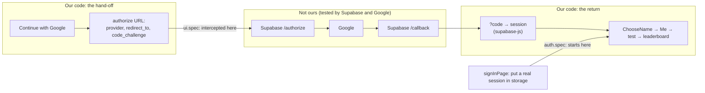

# L4.09 · Test it and run it: a sign-in you can't automate, and a live incident

> **Level 4 · Test it and ship it** · Lesson 9 of 9 · *Session 2*

| Recipe card | |
|---|---|
| **Time** | 75 min |
| **You need** | L4.03 (Playwright config, `support.ts`, the local build server), L4.06 (route interception, throwaway users, `signedInClient`), L2.07c (the Google flow), L3.06 (the hops, PKCE, the 504) |
| **You'll produce** | `signInPage` in `tests/e2e/support.ts`; the new sign-in section of `auth.spec.ts`; two tests in `ui.spec.ts`; an incident probe kit (five commands and one script); a deploy fingerprint check; a runbook for auth changes |

**In two sentences:** You can't (and mustn't) drive Google's real login page from a test, so the tests check everything on **our** side of the boundary: that the button hands off correctly, and that a real session produces the right screens. The second half is operations: the exact commands that found the 504, how to prove a deploy is live, and three small debugging mistakes from this session that are worth never repeating.

### Objectives
1. Test a third-party sign-in up to your boundary: intercept `/auth/v1/authorize`, assert `provider`, `redirect_to` and `code_challenge`, and test the cancelled-consent return.
2. Write `signInPage` (inject a real session under `sb-<ref>-auth-token`, reload) and say exactly what it does and doesn't prove.
3. Run the incident probe kit (timed status checks, auth settings, the sign-up endpoint, a masked user listing, a port check) and interpret each result.
4. Verify that production serves a given change by fingerprinting its JavaScript bundle.
5. Debug safely: redact by allow-list, mask personal data, keep commands from hanging on input, and write the message a user needs.

---

## 1 · Warm-up: pull it from memory

1. *(L4.06)* In the old signed-in journey, which request was faked and which was real?
2. *(L4.03)* Against which server do the Playwright tests run by default, and why not the dev server?
3. *(L2.07c)* What three things does the authorize URL carry from our app?
4. *(L3.06)* Where is the PKCE verifier between hop 1 and hop 6?

<details><summary>Answers</summary>

1. Sending the code (`/auth/v1/otp`) was answered locally with `page.route`, so no email went out; verifying the code (`/auth/v1/verify`) hit the real Supabase, with a code minted by the admin API.
2. A local **production build** (`npm run build && vite preview` on `127.0.0.1:4174`), because that's what users get: minified, chunked, no dev-only behaviour.
3. `provider=google`, `redirect_to` (our `/me?next=…`), and the PKCE `code_challenge` (+ method).
4. In the browser's `localStorage` (`sb-<ref>-auth-token-code-verifier`, plus a per-flow slot), never sent anywhere until the exchange.
</details>

---

## 2 · The problem this solves

The old journey test typed a code. With Google, the middle of sign-in happens on `accounts.google.com`, and automating it is a dead end: Google detects automated browsers, a real account would need a password and 2-step verification stored in CI, and scripting Google's login breaks its terms. Mocking the whole thing would test nothing.

The way out is to draw the boundary and test both edges of it:


*Takeaway: one test proves we leave correctly, another proves we behave correctly once a real session exists. The exchange in the middle is supabase-js's job (its own tests), and a manual check after each auth deploy covers the live wiring.*

---

## 3 · Concepts

### 3.1 Testing at your boundary

1. **Definition.** A *boundary test* checks the exact message your code sends to a system you don't own, and your behaviour on every reply it can send back, without running that system.
2. **Why here.** Google can't be run in a test, but the URL we send and the replies we handle (a code, or an error) are fully ours.
3. **How.** Intercept the outgoing request and assert its contents; then simulate each reply by loading the URL the provider would redirect to.
4. **Minimal example.**
   ```ts
   await page.route("**/pay.example.com/**", (r) => { seen = r.request().url(); return r.fulfill({ body: "ok" }); });
   ```
5. **In the project:** the hand-off test in §4.3.
6. **Without it:** a typo in `redirectTo`, a lost `next`, or PKCE switched off would all ship silently, because a real Google login still "works".
7. **Try it:** in the hand-off test, change the expected `redirect_to` to `/me?next=/test` (unencoded) and watch it fail with the actual value printed.

### 3.2 Intercepting a navigation

- `page.route(glob, handler)` intercepts **every** request the page makes that matches, including full-page navigations like `window.location.assign(...)`.
- `"**/auth/v1/authorize*"`: `**` matches any scheme, host and path prefix; the trailing `*` allows the query string.
- `route.fulfill({ status, contentType, body })` answers locally. The browser "arrives" at a tiny page instead of Supabase, so nothing goes on to Google.
- `route.request().url()` is the full URL with its query: the thing we want to inspect.
- `page.unroute(glob)` removes the interception, so later navigations in the same test go to the network again.

### 3.3 Injecting a session

supabase-js keeps the whole session as JSON in `localStorage` under a key derived from the project URL. From its source (`supabase-js`, `index.mjs`):

```js
`sb-${baseUrl.hostname.split(".")[0]}-auth-token`
```
For `https://kehcsupmruaskpgdvzaj.supabase.co`, `hostname.split(".")[0]` is `kehcsupmruaskpgdvzaj`, so the key is `sb-kehcsupmruaskpgdvzaj-auth-token`. Put a valid session there, reload, and the client starts up signed in, exactly as it would after a real Google sign-in finished.

- **Why reload?** The client reads storage once, at start-up (`getSession` in `AuthProvider`). Writing storage on a running page changes nothing until the next start.
- **What it proves:** every screen and request after sign-in (name step, `?next` redirect, ranked test, leaderboard, rename, sync, sign-out) with a **real** JWT against the **real** database and RLS.
- **What it doesn't prove:** the Google redirect chain and the PKCE exchange. Those are covered by the hand-off test (our half), supabase-js's own tests (the exchange), and a manual sign-in after each auth deploy (the live wiring).
- **Alternative:** Playwright's `storageState` saves a whole browser state to a file and loads it into new contexts. Our version builds a fresh session per test user instead, because each test file creates and deletes its own users ([L4.06](l4-06-live-security-auth.md)).

### 3.4 Probing production safely

Live debugging means running commands against real systems with real keys and real people's data. Three habits:
- **Allow-list what you print.** Print only values you know are public (the project URL), or only key *names*. A deny-list ("hide anything called KEY or SECRET") misses the name you didn't think of (§7, Incident 3).
- **Mask personal data.** Show `pr***@gmail.com`, not the address. Count rows instead of listing them when counts answer the question.
- **Never let a command wait for input.** In scripts and automation, give every command a time limit (`timeout 60 …`) and closed input (`< /dev/null`) (§7, Incident 2).

---

## 4 · Reading the real code

### 4.1 `tests/e2e/support.ts`: `signInPage` (new) and its helpers (unchanged)

```ts
/** A one-time sign-in code minted by the admin API (tests only; never emailed). */
export async function otpFor(email: string) {
  const { data, error } = await admin().auth.admin.generateLink({ type: "magiclink", email });
  if (error) throw error;
  return data.properties.email_otp;
}

/** A supabase-js client signed in through the real OTP verification endpoint. */
export async function signedInClient(email: string): Promise<SupabaseClient> {
  const c = anonClient();
  const { error } = await c.auth.verifyOtp({ email, token: await otpFor(email), type: "email" });
  if (error) throw error;
  return c;
}

/** Drop a real session into the page's storage, exactly what supabase-js saves after Google sign-in. */
export async function signInPage(page: Page, email: string) {
  const { data } = await (await signedInClient(email)).auth.getSession();
  const key = `sb-${new URL(env.url).hostname.split(".")[0]}-auth-token`;
  await page.evaluate(([k, v]) => localStorage.setItem(k, v), [key, JSON.stringify(data.session)]);
  await page.reload();
  await ready(page);
}
```
- **`otpFor`'s comment changed** ("The 6-digit code the user would have received by email" was wrong twice: it's 8 digits, and no user receives email any more). The code is minted by the **admin API** with the secret key. That's why it keeps working with the Email provider off: the public sign-up path is closed, the admin path isn't.
- **`signedInClient`** signs a throwaway user in through the real `verify` endpoint and returns a client holding a real session. Unchanged; the API security tests use it directly.
- **`signInPage` line 1:** reuse `signedInClient`, then read its session (access token, refresh token, expiry, user).
- **Line 2:** compute the storage key the same way supabase-js does. Hard-coding `sb-kehcsupmruaskpgdvzaj-auth-token` would break the day the tests point at another project.
- **Line 3:** `page.evaluate(fn, arg)` runs `fn` **inside the browser**. Values must be passed as the second argument (here a `[key, value]` pair), because the function is serialised and can't see Node variables. The page must already be on our origin, since `localStorage` is per-origin; the journey calls this after navigating to `/me`.
- **Lines 4–5:** reload so the client starts up with the session; `ready(page)` waits for the splash to go ([L4.03](l4-03-playwright-foundations.md)).

### 4.2 `tests/e2e/auth.spec.ts`: the new sign-in section

```diff
 // Full signed-in journey through the real UI against the live Supabase project:
-// email code sign-in → leaderboard name → 100-question test → results → leaderboard
+// sign-in → leaderboard name → 100-question test → results → leaderboard
 // → profile edits → flashcard sync → sign out. Throwaway users; no real emails are sent.
…
-  let otpRequests = 0;
-  await page.route("**/auth/v1/otp*", async (route) => { otpRequests++; await route.fulfill({ … }); });
-  await page.getByLabel("Email").fill(user.email);
-  await page.getByRole("button", { name: /Email me a code/ }).click();
-  await expect(page.getByText("Check your inbox")).toBeVisible();
-  await page.locator("#code").fill("00000000"); // wrong code first
-  await expect(page.locator(".err")).toContainText(/wrong or has expired/i);
-  await page.locator("#code").fill(await otpFor(user.email));
+  // ---- sign in ----
+  // Google's own login screen can't be automated, so the throwaway user's real Supabase
+  // session is put in place of it; the Google hand-off itself is covered in ui.spec.ts.
   await goto(page, "/test");
-  await page.getByRole("link", { name: /Sign in with email to start/ }).click();
+  await page.getByRole("link", { name: /Sign in to start/ }).click();
+  await expect(page.getByRole("button", { name: /Continue with Google/ })).toBeVisible();
+  await signInPage(page, user.email);
   await expect(page.getByText("You're in!")).toBeVisible();
```
- **Still starts from the Test page link**, so the `?next=/test` round trip is real: after the name step the test expects `/test` (unchanged lines that follow).
- **`expect(… Continue with Google …).toBeVisible()` before injecting** proves the signed-out screen is the Google one, and that we're on our origin, which `signInPage` needs.
- **The comment says what's replaced and where the gap is covered.** A future reader shouldn't have to guess why the test doesn't click the button.
- The rest of the journey (100 questions, results, leaderboard, rename, sync, sign-out) is unchanged from [L4.06](l4-06-live-security-auth.md), except the last check: after sign-out, the link reads **"Sign in to start"**.

### 4.3 `tests/e2e/ui.spec.ts`: two tests

```ts
test("signed-out visitors are sent to sign in before a ranked test", async ({ page }) => {
  await goto(page, "/test");
  await page.getByRole("link", { name: /Sign in to start/ }).click();
  await expect(page).toHaveURL(/\/me\?next=\/test/);
  await expect(page.getByRole("button", { name: /Continue with Google/ })).toBeVisible();
  await expect(page.getByLabel("Email")).toHaveCount(0); // Google is the only way in
});
```
- **`toHaveCount(0)`** is how you assert absence. `not.toBeVisible()` would also pass for a field that exists but is hidden; count 0 means it isn't in the page at all. This line is the guard for the user's requirement "only google sign in".

```ts
test("Continue with Google hands off to Supabase and returns to where they were going", async ({ page }) => {
  // Stop at Supabase's authorize endpoint; we never drive Google's own login screen.
  let authorize: URL | undefined;
  await page.route("**/auth/v1/authorize*", async (route) => {
    authorize = new URL(route.request().url());
    await route.fulfill({ status: 200, contentType: "text/html", body: "<p>google</p>" });
  });
  await goto(page, "/me?next=/test");
  await page.getByRole("button", { name: /Continue with Google/ }).click();
  await expect.poll(() => authorize?.searchParams.get("provider")).toBe("google");
  const back = new URL(authorize!.searchParams.get("redirect_to")!);
  expect(back.pathname + back.search).toBe("/me?next=%2Ftest");
  expect(authorize!.searchParams.get("code_challenge")).toBeTruthy(); // PKCE

  // cancelling on Google's screen brings them back with ?error=… → friendly message, clean URL
  await page.unroute("**/auth/v1/authorize*");
  await goto(page, "/me?next=/test&error=access_denied&error_description=cancelled");
  await expect(page.locator(".err")).toContainText("Google sign-in didn't finish");
  await expect(page).toHaveURL(/\/me\?next=%2Ftest$|\/me\?next=\/test$/);
});
```
- **`let authorize: URL | undefined`** is filled by the route handler, which runs asynchronously when the browser navigates.
- **`expect.poll(() => …)`** re-runs the function until it returns `"google"` (or times out). A plain `expect` right after `click()` would race the navigation ([L4.04](l4-04-ui-tests-nav-cards.md)).
- **`new URL(…searchParams.get("redirect_to"))`** decodes one level: `searchParams.get` undoes the outer encoding, and `back.search` keeps the inner one, hence `%2Ftest`.
- **`pathname + search`, not the full URL:** the origin is `http://127.0.0.1:4174` locally and the production domain under `npm run test:prod`. The assertion holds on both.
- **`code_challenge` truthy** catches someone switching `flowType` back to implicit. (Practice 1 tightens it.)
- **The error half** loads the URL Supabase would redirect to after a cancel. The URL check accepts both spellings of `next` because `URLSearchParams.toString()` re-encodes `/` as `%2F` when the effect rewrites the query.

### 4.4 `tests/e2e/api-security.spec.ts`: one honest rename

```diff
-  test("OTP sign-in produces a real session", async () => {
+  test("a signed-in client gets a real session", async () => {
```
The test still signs in with an admin-minted code, but "OTP sign-in" now reads like a product feature that no longer exists. Test names are documentation.

---

## 5 · Worked trace (step-through frames): the hand-off test

Local run against the production build on `127.0.0.1:4174`. Predict, then reveal.

| Frame | Step | State after | Predict first → |
|---|---|---|---|
| 1 | `page.route("**/auth/v1/authorize*", …)` | Handler registered; nothing intercepted yet | Does registering a route make a request? **No** |
| 2 | `goto(page, "/me?next=/test")` | Signed-out account page; `ready` waited for the splash | Which screen? **SignIn, "Pull up a chair"** |
| 3 | Click **Continue with Google** | `busy`; verifier stored; `location.assign("https://kehcsupmruaskpgdvzaj.supabase.co/auth/v1/authorize?provider=google&redirect_to=http%3A%2F%2F127.0.0.1%3A4174%2Fme%3Fnext%3D%252Ftest&code_challenge=…&code_challenge_method=s256")` | Why `%252F`? **`%2F` encoded again by supabase-js** |
| 4 | The navigation matches the route | Handler stores the URL; fulfils with `<p>google</p>` | Does the browser reach Supabase? **No** |
| 5 | `expect.poll(… provider …)` | `"google"` | Why poll? **The handler runs after the click resolves** |
| 6 | Decode `redirect_to` | `back.pathname + back.search = "/me?next=%2Ftest"` | Which code produced `%2F`? **`encodeURIComponent(next)` in `SignIn`** |
| 7 | `code_challenge` | 43 characters of base64url | What would be missing with `flowType: "implicit"`? **The challenge** |
| 8 | `unroute`, then load `/me?next=/test&error=access_denied&error_description=cancelled` | `.err` shows "Google sign-in didn't finish…"; effect rewrites URL to `/me?next=%2Ftest` | Does `next` survive? **Yes; only the 3 error keys are removed** |

---

## 6 · Running and operating

### 6.1 Run the tests

```bash
npx playwright test tests/e2e/ui.spec.ts -g "Google|sign in" --project=pixel-7   # the two sign-in UI tests
npx playwright test tests/e2e/auth.spec.ts --project=pixel-7                      # the journey (needs the secret key)
npx playwright test tests/e2e/api-security.spec.ts --project=api                  # live API attacks
npx playwright test                                                               # everything (~14 min)
```
Results on the day:

| Run | Result |
|---|---|
| Full suite, Google + email fallback | 247 passed, 17 skipped (13.6 min) |
| Sign-in related, after removing email (`-g "sign\|Google\|Pull up\|a11y\|axe\|routes\|/me\|account"`) | 90 passed (7.3 min) |
| Full suite, Google only | 246 passed, **1 flaky**, 17 skipped (14.1 min) |
| `api-security.spec.ts` after the Email provider was turned off | 13 passed |

The same 17 skips appear in every run. They come from the suite's conditional `test.skip`s: real-touch swipes only on Chromium phones, keyboard shortcuts only on laptops, and two HTTP checks that run only against production. None is a new gap.

### 6.2 The incident probe kit

These five probes found the 504. Keep them; they work for any Supabase project. `U` and `K` as in [L2.07c](l2-07c-google-sign-in.md) §4.

**Probe 1 · Is each layer up, and how fast?**
```bash
for p in auth/v1/health auth/v1/settings "rest/v1/profiles?select=id&limit=1"; do
  curl -s -o /dev/null -w "$p  HTTP %{http_code} in %{time_total}s\n" -H "apikey: $K" "$U/$p"
done
```
All 200 in under a second means the project isn't paused or down; look further along the request.

**Probe 2 · What is auth configured to do?**
```bash
curl -s -H "apikey: $K" "$U/auth/v1/settings" | grep -o '"google":[a-z]*\|"email":[a-z]*\|"disable_signup":[a-z]*\|"mailer_autoconfirm":[a-z]*'
```
`settings` is public by design (the client uses it to know which providers exist).

**Probe 3 · Call the failing endpoint yourself, with a throwaway address.**
```bash
curl -s -m 70 -w "  [HTTP %{http_code} in %{time_total}s]\n" -X POST -H "apikey: $K" -H "Content-Type: application/json" \
  -d '{"email":"e2e-bot-probe@example.com","create_user":true}' "$U/auth/v1/otp"
```
`-m 70` caps it at 70 seconds so a hang can't freeze your terminal. On the day: `429 over_email_send_rate_limit` in 0.29 s; after the fix: `422 email_provider_disabled`. Use an `@example.com` address: that domain is reserved and never receives mail, so a working mailer can't spam a real person.

**Probe 4 · Who exists? (admin, masked)**
```js
// users.mjs: node users.mjs  (reads the secret key from the git-ignored Supabase.txt; prints no full emails)
import { readFileSync } from "node:fs";
import { createRequire } from "node:module";
const require = createRequire(process.cwd() + "/package.json");   // use the project's supabase-js
const { createClient } = require("@supabase/supabase-js");
const env = Object.fromEntries(readFileSync(".env.local", "utf8").split(/\r?\n/).map((l) => l.match(/^([A-Z_]+)=(.*)$/)).filter(Boolean).map((m) => [m[1], m[2]]));
const secret = readFileSync("Supabase.txt", "utf8").match(/^Secret keys:\s*(\S+)/m)[1];
const a = createClient(env.VITE_SUPABASE_URL, secret, { auth: { persistSession: false, autoRefreshToken: false } });
const { data, error } = await a.auth.admin.listUsers({ perPage: 1000 });
if (error) throw error;
const mask = (e) => (e ?? "").replace(/^(.{2}).*(@.*)$/, "$1***$2");
const us = data.users.sort((x, y) => y.created_at.localeCompare(x.created_at));
console.log("total users:", us.length, " confirmed:", us.filter((u) => u.email_confirmed_at).length);
for (const u of us.slice(0, 25))
  console.log(u.created_at.slice(0, 19), "last_in:", (u.last_sign_in_at || "-").slice(0, 19),
    "via:", u.app_metadata?.provider, "banned:", u.banned_until || "no", mask(u.email));
```
- **`createRequire(process.cwd() + "/package.json")`** loads supabase-js from the project's `node_modules` even though the script lives elsewhere (keep probe scripts outside the repo).
- **`split(/\r?\n/)`** handles both line-ending styles (see L2.07c, Incident 4).
- **`persistSession: false`**: a script has no `localStorage`; don't try to store anything.
- **`mask`** keeps two characters and the domain: enough to recognise a teammate, not enough to identify a stranger.

Readings on the day (emails replaced by placeholders here):
```text
# during the incident
total users: 0  confirmed: 0
# after Google sign-in went live
total users: 8  confirmed: 8
2026-10-16T13:58:01 last_in: 2026-10-16T13:58:02 via: google banned: no ab***@gmail.com
2026-10-16T13:28:46 last_in: -                   via: google banned: no cd***@<college domain>
…
```
Two of the eight had `last_in: -`: Google finished, but the app never got a session ([L3.06](l3-06-oauth-pkce-504.md) E3). Seven of the eight rows were distinct people, which is how "Access blocked" for one friend was recognised as account-specific.

**Probe 5 · Does the dependency's port answer?**
```bash
curl -sv --connect-timeout 10 smtps://HOST:465 2>&1 | grep -E -i "established|connected|timed out|refused|220"
```
Timed out → nothing there (or a firewall); refused → nothing listening; a `220` line → a real mail server.

### 6.3 Is the deploy live? Fingerprint the bundle

A green deploy in a dashboard says a build finished. It doesn't say the site you're looking at serves it (caches, the wrong branch, a different alias). Ask the site:
```bash
JS=$(curl -s https://psychology-of-learning-nptel.vercel.app/me | grep -o '/assets/index-[^"]*\.js' | head -1); echo $JS
curl -s "https://psychology-of-learning-nptel.vercel.app$JS" | grep -o "Continue with Google\|Email me a code\|Use email instead" | sort | uniq -c
```
```text
/assets/index-COOw-ijr.js
      1 Continue with Google
```
- The first command finds the hashed entry chunk in the HTML (`/me` is served `index.html` by the SPA rewrite, [L4.08](l4-08-deploy-operate.md)).
- The second counts strings that only exist in one version. Earlier the same day it printed `Continue with Google`, `Email me a code`, `pkce` and `signInWithOAuth` (the version with the email fallback); after the last deploy only the Google string remains.
- **Pick fingerprints from user-visible strings**: identifiers get minified, text doesn't.

### 6.4 Runbook: after any change to sign-in

- [ ] `curl …/auth/v1/settings` shows exactly the providers you intend (`"google":true`, `"email":false`)
- [ ] `curl -w "%{redirect_url}" …/authorize?provider=google` → `accounts.google.com`, and `curl -L` of that URL shows Google's sign-in page, not an error page
- [ ] UI hand-off test and full suite green
- [ ] Bundle fingerprint shows the new version
- [ ] One real sign-in in a private window; the new user appears in Authentication → Users with provider `google`
- [ ] Tell users what changed and how to recover (below)

### 6.5 The message a user needs

When the friend saw "Access blocked", the useful answer wasn't a diagnosis; it was steps:

> Hi! Please try signing in again:
> 1. Open **https://psychology-of-learning-nptel.vercel.app** in **Chrome** (not from inside WhatsApp or Instagram).
> 2. Tap **Me → Continue with Google** and pick your account.
> 3. If you still see "Access blocked", tap the blue **"error details"** link on that page and send me a screenshot of it.
> 4. If you have another Google account, try that one too.

It worked on the retry. Each step either fixes a known cause (in-app browser), collects the missing evidence (error details), or gives a way around (another account).

---

## 7 · Bug journal

### Incident 1 · One flaky journey on iPhone 13

1. **Symptom.** The full run after removing email: `246 passed, 1 flaky`, the flaky one being `[iphone-13] › auth.spec.ts › sign in, take a ranked test, appear on the leaderboard, manage account`. It failed once and passed on Playwright's retry.
2. **Diagnosis.** The obvious suspect was the new sign-in code. The failure's `error-context.md` (the page snapshot Playwright saves) said otherwise:
   ```text
   - generic "Elapsed time": 3:19
   - button "Submit"
   - generic: 94/100
   - generic: Question 100 of 100
   ```
   The test had signed in, chosen a name, and answered 94 of 100 questions. It failed at the end of the test run, more than three minutes after sign-in.
3. **Root cause.** Not determined; something timing-related at the submit step on WebKit late in a long serial test. It's unrelated to sign-in, which had already succeeded, and the same test passed in the earlier full run and in the 90-test sign-in run.
4. **Fix.** None in this session. Recorded, not hidden.
5. **Lesson.** Before blaming your change for a red test, read *where* it failed (`error-context.md`, the screenshot, the trace). Retries keep the suite usable, but a test that needs them is a signal: note it, and investigate if it recurs ([L4.07](l4-07-a11y-lighthouse-flaky.md) has the method).

### Incident 2 · A probe command that hung for two minutes

1. **Symptom.** A one-liner meant to write and run the user-listing script hit the 120-second tool limit and was moved to the background. Running the script next gave:
   ```text
   Error: Cannot find module 'C:\Users\BIT\AppData\Local\Temp\claude\…\scratchpad\users.mjs'
   code: 'MODULE_NOT_FOUND'
   ```
2. **Diagnosis.** The command began with a leftover fragment: `cat > "$TEMP/claude/users.mjs" 2>/dev/null || true; …`. A `cat >` with no input file and no heredoc reads **standard input**, and in that shell stdin was open but silent. So `cat` waited forever, and the real heredoc that wrote the script never ran: hence "file not found" afterwards.
3. **Root cause.** A command that reads stdin, in a context where nobody would ever type.
4. **Fix.** Stop the hung job; write the file with an editor tool; run the script with closed input and a deadline:
   ```diff
   - cat > "$TEMP/claude/users.mjs" 2>/dev/null || true; S=…; cat > "$S/users.mjs" <<'EOF' … EOF; node "$S/users.mjs"
   + timeout 60 node "$S/users.mjs" < /dev/null
   ```
5. **Lesson.** In scripts and automation, every command gets `< /dev/null` (or a heredoc) and a `timeout`. A hang tells you nothing; a timeout tells you where.

### Incident 3 · The redaction filter that leaked a token

1. **Symptom.** To look at `.env.local` without exposing keys, the output was piped through:
   ```bash
   sed 's/\(KEY=\|key=\|password.*=\|secret.*[:=]\).*/\1<redacted>/I' .env.local
   ```
   The anon key came out as `<redacted>`, but the next line printed in full: `VERCEL_OIDC_TOKEN="eyJhbGciOi…"` (a token the Vercel CLI writes when you link a project).
2. **Diagnosis.** The pattern listed names to hide. `VERCEL_OIDC_TOKEN=` contains none of `KEY=`, `key=`, `password`, `secret`.
3. **Root cause.** **Deny-list redaction**: it hides only what you predicted. The impact was small (the token is a development credential that expires 12 hours after issue, and it appeared only in the local session log), but the method was wrong.
4. **Fix.** Allow-list: print key **names** only, or only values you know are public.
   ```diff
   - sed 's/\(KEY=\|key=\|…\).*/\1<redacted>/I' .env.local
   + cut -d= -f1 .env.local                                   # names only
   + grep '^VITE_SUPABASE_URL=' .env.local                   # one known-public value
   ```
5. **Lesson.** When looking at secret-bearing files, decide what may be shown, not what must be hidden. And you rarely need to *see* a key: `K=$(grep … | cut -d= -f2)` uses it without printing it.

### Incident 4 · The breakage that was predicted but didn't happen

1. **Symptom (expected).** Before the user turned the Email provider off, the plan said: "the signed-in tests create their throwaway users through Supabase's email login… turning Email off will probably break those tests."
2. **Diagnosis.** After the switch, instead of rewriting the helpers, the cheapest check ran first: `npx playwright test tests/e2e/api-security.spec.ts --project=api` → **13 passed**. A public `POST /auth/v1/otp` returned `422 email_provider_disabled` at the same time.
3. **Root cause.** The prediction conflated two paths. The provider switch closes the *public* email sign-in. The tests use the *admin* path (`generateLink` with the secret key) to mint the code, and verifying that code still issues a session.
4. **Fix.** None needed; `otpFor`'s comment was corrected so the next reader doesn't make the same assumption.
5. **Lesson.** Test a predicted breakage before "fixing" it. It took 13 seconds and saved a rewrite of three helpers.

---

## 8 · Why this design

| Decision | Alternatives | Why this one | Trade-off | Choose differently when |
|---|---|---|---|---|
| Inject a session for the journey | Drive Google with a real test account; Playwright `storageState` files; mock supabase-js | Real JWT, real RLS, no third-party UI; each test owns its user | Skips the PKCE exchange (covered elsewhere) | You own the identity provider (then drive it) |
| Intercept at Supabase's `/authorize` | Intercept at `accounts.google.com`; no hand-off test | It's the first URL *we* build; Google's URL is Supabase's output, not ours | Supabase→Google mapping is untested by us | Supabase misbuilds Google URLs (then add a `curl` check) |
| Assert absence with `toHaveCount(0)` | `not.toBeVisible()` | Fails if a hidden email field sneaks back | — | — |
| Probe production with the publishable key | Dashboards only | Fast, scriptable, timed, repeatable | Can't see server logs | You need server-side traces (use the provider's logs) |
| Masked listing via the admin API | The dashboard's users table | Scriptable, counts, filters; no full emails on screen | Needs the secret key locally | Teammates without key access (use the dashboard) |
| Bundle fingerprint | Trust the deploy status; check the HTML only | Proves what users download | Needs a unique string per change | Sites with build IDs exposed in a header or `/version.json` |

---

## 9 · Check yourself

**Q1.** Why does `signInPage` need the page to be on our origin before `page.evaluate`?
<details><summary>Answer</summary><code>localStorage</code> is per origin. Writing it on <code>about:blank</code> (or any other origin) stores the session where our app will never look.</details>

**Q2.** A teammate replaces the `expect.poll` in the hand-off test with `expect(authorize?.searchParams.get("provider")).toBe("google")` right after the click. What happens?
<details><summary>Answer</summary>It fails intermittently (or always): the click resolves before the navigation is intercepted, so <code>authorize</code> is often still <code>undefined</code>. Polling waits for the handler.</details>

**Q3.** Which of these would the hand-off test catch? (a) `detectSessionInUrl` set back to `false`; (b) `flowType` set to `"implicit"`; (c) `encodeURIComponent` removed; (d) the Google client secret rotated in Google but not in Supabase.
<details><summary>Answer</summary><b>(b)</b> no <code>code_challenge</code>; <b>(c)</b> <code>redirect_to</code> becomes <code>/me?next=/test</code>. Not (a): that's on the return path, after our boundary. Not (d): that's the live wiring; only the manual sign-in in the runbook catches it.</details>

**Q4.** Probe 3 returns `429 over_email_send_rate_limit`. Is the mail server working?
<details><summary>Answer</summary>Unknown. The rate limit is checked before any email is attempted, so a 429 says nothing about SMTP. You need probe 5 (the port) and the SMTP settings.</details>

**Q5.** The bundle fingerprint still shows "Email me a code" ten minutes after a successful deploy. Two causes?
<details><summary>Answer</summary>(1) You fetched a different deployment or alias than the one that was updated (check the domain you're querying). (2) A cache served the old <code>index.html</code>, which points at the old hashed chunk. (The hashed chunk itself can't be stale: a new build gets a new filename.)</details>

---

## 10 · Practice

**Easy (10 min).** Strengthen the hand-off test: assert `code_challenge_method` is `s256`, the challenge is 43 characters of base64url, and a verifier exists in `localStorage`.
<details><summary>Solution</summary>

```ts
expect(authorize!.searchParams.get("code_challenge_method")).toBe("s256");
expect(authorize!.searchParams.get("code_challenge")).toMatch(/^[A-Za-z0-9_-]{43}$/);
await goto(page, "/"); // back on our origin: its localStorage holds the verifier
const keys = await page.evaluate(() => Object.keys(localStorage).filter((k) => k.endsWith("-code-verifier")));
expect(keys.length).toBeGreaterThan(0);
```
- **Why `goto(page, "/")` first:** after the click, the page sits on the fulfilled response, whose origin is `kehcsupmruaskpgdvzaj.supabase.co`. Its `localStorage` is a different, empty store. Our origin's store still has the verifier.
- Run on 2026-10-17 (pixel-7), it passed and found three keys: `sb-kehcsupmruaskpgdvzaj-auth-token-flow-b964cbc8…-code-verifier` (this flow's slot), `sb-kehcsupmruaskpgdvzaj-auth-token-code-verifier` (the fixed key, mirroring the latest flow) and `sb-kehcsupmruaskpgdvzaj-auth-token-flows-code-verifier` (the index of open flows).
</details>

**Medium (25 min).** Write a test that cancels (error return) and *then* signs in successfully via `signInPage`, and checks the student still lands on `/test` after choosing a name.
<details><summary>Hint</summary>Start at <code>/me?next=/test&amp;error=access_denied&amp;error_description=x</code>, wait for the message, then <code>signInPage</code>. Remember <code>next</code> is now <code>%2Ftest</code> in the URL.</details>

**Hard (40 min).** Turn the probe kit into `scripts/auth-doctor.mjs`: run probes 1–3 and 5 (SMTP host and port as arguments), print PASS/WARN/FAIL lines, exit non-zero on FAIL, and never print a key.
<details><summary>Solution outline</summary>

- Read `VITE_SUPABASE_URL` and the key from `.env.local` with an allow-list parser (only those two names).
- `fetch` with `AbortSignal.timeout(10_000)` for each HTTP probe; record status and `performance.now()` deltas.
- For SMTP, `net.connect({ host, port, timeout: 10_000 })`: `connect` → OPEN, `error` with `ECONNREFUSED` → REFUSED, `timeout` → TIMEOUT.
- Rules: any 5xx → FAIL; 429 → WARN; `"email":true` with SMTP TIMEOUT → FAIL ("sign-up will 504").
Done when: against today's project it prints PASS for health/settings/REST, PASS for `email_provider_disabled`, and against the old SMTP host it prints FAIL with the reason.
</details>

---

## 11 · From memory

**Rung 1 · Cloze.**

```ts
const key = `sb-${new URL(env.url).___①___.split(".")[0]}-auth-token`;
await page.___②___(([k, v]) => localStorage.setItem(k, v), [key, JSON.___③___(data.session)]);
await page.___④___();

await page.route("**/auth/v1/___⑤___*", async (route) => { authorize = new URL(route.request().url()); await route.___⑥___({ status: 200, contentType: "text/html", body: "<p>google</p>" }); });
await expect.___⑦___(() => authorize?.searchParams.get("provider")).toBe("google");
expect(back.pathname + back.search).toBe("/me?next=___⑧___");
await expect(page.getByLabel("Email")).___⑨___(0);
```
```bash
curl -s -o /dev/null -w "HTTP %{___⑩___} in %{time_total}s\n" -H "apikey: $K" "$U/auth/v1/health"
timeout 60 node users.mjs < ___⑪___
```
<details><summary>Answers</summary>① <code>hostname</code> ② <code>evaluate</code> ③ <code>stringify</code> ④ <code>reload</code> ⑤ <code>authorize</code> ⑥ <code>fulfill</code> ⑦ <code>poll</code> ⑧ <code>%2Ftest</code> ⑨ <code>toHaveCount</code> ⑩ <code>http_code</code> ⑪ <code>/dev/null</code></details>

**Rung 2 · Blank page (20 min).** No scrolling up. Write `signInPage`, the hand-off test (both halves), and from memory the five probes with what each result means.
<details><summary>Self-check</summary>

- [ ] Storage key derived from the URL's hostname, not hard-coded; session JSON; reload; wait for ready
- [ ] Journey: link → Google button visible → inject → "You're in!"; comment explains the gap
- [ ] Route registered **before** the click; `fulfill` so nothing reaches Supabase; `expect.poll`
- [ ] `redirect_to` decoded with `new URL`; `pathname + search` = `/me?next=%2Ftest`; challenge present
- [ ] Error half: `unroute`, load the error URL, message shown, `next` kept
- [ ] Probes: timed status loop; settings flags; the failing endpoint with `@example.com` and `-m`; masked admin listing; port check (timeout vs refused vs 220)
- [ ] Bundle fingerprint by user-visible strings
</details>

---

## 12 · Level 4 checkpoint (addendum for session 2)

The checkpoint in [L4.08](l4-08-deploy-operate.md) still stands; add this part.

**Mixed quiz (interleaved with L4.01–L4.08).**
1. *(L4.06 + L4.09)* The journey used to mock one request and hit one real endpoint. What does it mock now, and what does it replace?
2. *(L4.03 + L4.09)* `support.ts` reads the Supabase URL from env or `.env.local`. Why does that make a derived storage key in `signInPage` better than a hard-coded one?
3. *(L4.07 + L4.09)* A test is flaky on one WebKit project only, at the end of a long serial test. Name the first artefact you open and what you look for.
4. *(L4.08 + L4.09)* Deploy status is green. How do you prove users get the new sign-in screen?

<details><summary>Answers</summary>1. It mocks nothing on the sign-in path any more; it replaces the whole Google redirect chain by injecting a real session (minted via the admin API and the real verify endpoint). 2. The URL can change (a teammate's project, a CI secret); a derived key follows it, a hard-coded one silently writes the session where the app never looks, and every signed-in test fails at "You're in!". 3. <code>error-context.md</code> / the trace: the page state at failure (which step, which question), to see whether your change is even involved. 4. Fetch the live HTML, find the hashed entry chunk, and grep it for a string only the new version has.</details>

**Blank-page drill (15 min).** Write the runbook (§6.4) from memory and justify each line in one sentence.

---

## 13 · Flashcards

<details><summary><b>Q:</b> Why can't the tests drive Google's login page?</summary><b>A:</b> Bot detection, real credentials and 2-step verification in CI, and Google's terms. Test your side of the boundary instead.</details>
<details><summary><b>Q:</b> What does the hand-off test assert?</summary><b>A:</b> The authorize request has <code>provider=google</code>, <code>redirect_to</code> = <code>/me?next=%2Ftest</code>, and a PKCE <code>code_challenge</code>; and the error return shows the message and keeps <code>next</code>.</details>
<details><summary><b>Q:</b> supabase-js's session storage key?</summary><b>A:</b> <code>sb-${hostname.split(".")[0]}-auth-token</code>, e.g. <code>sb-kehcsupmruaskpgdvzaj-auth-token</code>.</details>
<details><summary><b>Q:</b> Why reload after writing the session to storage?</summary><b>A:</b> The client reads storage only at start-up.</details>
<details><summary><b>Q:</b> What does session injection not prove?</summary><b>A:</b> The Google redirect chain and the PKCE exchange.</details>
<details><summary><b>Q:</b> How do you assert an element is absent from the page?</summary><b>A:</b> <code>expect(locator).toHaveCount(0)</code>.</details>
<details><summary><b>Q:</b> Why do admin-minted codes still work with the Email provider off?</summary><b>A:</b> The switch closes public email sign-in; minting via the admin API (secret key) and verifying still issue a session.</details>
<details><summary><b>Q:</b> The five probes, in order?</summary><b>A:</b> Timed health/settings/REST; settings flags; the failing endpoint with a throwaway address; masked user listing; the dependency's port.</details>
<details><summary><b>Q:</b> Deny-list vs allow-list redaction?</summary><b>A:</b> Deny-list hides names you predicted (and leaks the rest); allow-list shows only what you know is safe.</details>
<details><summary><b>Q:</b> Two habits that stop automation from hanging?</summary><b>A:</b> <code>&lt; /dev/null</code> (no stdin) and <code>timeout N</code> (a deadline).</details>
<details><summary><b>Q:</b> How do you prove a deploy is what users get?</summary><b>A:</b> Fetch the live HTML, find the hashed entry chunk, grep it for a user-visible string unique to the new version.</details>
<details><summary><b>Q:</b> First move on a flaky test after your change?</summary><b>A:</b> Read where it failed (<code>error-context.md</code>, screenshot, trace) before assuming your change caused it.</details>

---

## 14 · The menu board

| | |
|---|---|
| Boundary | test the URL we send + every reply we handle; never the provider's UI |
| Hand-off test | `route("**/auth/v1/authorize*")` before click → `fulfill` → `expect.poll(provider)` → `redirect_to` = `/me?next=%2Ftest` → `code_challenge` |
| Error return | `unroute` → load `?error=access_denied…` → message → `next` kept |
| `signInPage` | `signedInClient` → session → `localStorage["sb-<ref>-auth-token"]` → reload → ready |
| Absence | `toHaveCount(0)` |
| Probes | timed status loop · settings flags · failing endpoint (`@example.com`, `-m 70`) · masked admin listing · port check |
| Deploy proof | live HTML → `/assets/index-*.js` → grep a user-visible string |
| Hygiene | allow-list output · mask emails · `< /dev/null` + `timeout` · test predictions before rewriting |

## 15 · Glossary

**Allow-list / deny-list**: showing only approved items / hiding only forbidden ones. **Boundary test**: a test of what your code sends to, and how it handles replies from, a system you don't own. **Bundle fingerprint**: a string that identifies one build's JavaScript. **`error-context.md`**: the page snapshot Playwright writes for a failed test. **Flaky test**: a test that fails and passes on the same code. **Heredoc**: shell syntax (`<<'EOF' … EOF`) that feeds literal text to a command's stdin. **OIDC token**: a short-lived signed identity token (here, Vercel's for local development). **Route interception**: answering a page's network request from the test instead of the network. **Session injection**: placing a valid session in storage so the app starts signed in. **`storageState`**: Playwright's saved cookies and storage for reuse across tests. **stdin**: a program's standard input stream.

## 16 · Go further

| Resource | Type | Why | Which part | Time |
|---|---|---|---|---|
| [Playwright: Network](https://playwright.dev/docs/network) | Docs | `route`, `fulfill`, `unroute`, globs | "Handle requests", "Modify requests", "Glob URL patterns" | 15 min |
| [Playwright: Authentication](https://playwright.dev/docs/auth) | Docs | `storageState`, the alternative to our injection | "Core concepts" and "Basic: shared account" | 15 min |
| [Supabase: Rate limits](https://supabase.com/docs/guides/auth/rate-limits) | Docs | Which auth endpoints are limited, and where to change them | Whole page | 10 min |
| [Google: OAuth 2.0 policies](https://developers.google.com/identity/protocols/oauth2/policies) | Policy | Embedded webviews, verification, what triggers review | "Use secure browsers" and verification sections | 15 min |

---
← [L4.08 Ship it: deploy from Git and operate](l4-08-deploy-operate.md) · [Hub](README.md) · [Mastery checkpoint →](mastery.md)
